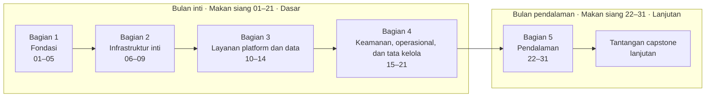

# Dasar-Dasar Azure: Satu Makan Siang, Satu Pelajaran

🇬🇧 [Read in English](README.md)

**Pelajari setiap layanan dasar Azure dalam 31 kali istirahat makan siang.** Baca dan tonton dalam satu jam; kerjakan
lab praktiknya kapan pun Anda sempat.

Anda adalah cloud engineer baru di **Nusantara Retail**, peritel dengan empat puluh toko yang toko online-nya masih
berjalan di satu server, di sebuah ruang kecil di sebelah pantry. Trafik pengunjung sudah naik tiga kali lipat. Servernya
tidak. Di rapat bulanan terakhir, direktur bertanya: *"Kalau server itu mati, berapa lama kita tidak bisa jualan?"*
Tidak ada yang menjawab. Dalam 31 makan siang ke depan, Andalah yang akan menjawabnya.

> [!TIP]
> **Ikuti kursus ini di situs webnya:** <https://stefpin.github.io/azure-fundamentals-lunches/> — setiap episode
> lengkap dengan demo animasi, kuis yang menilai jawaban Anda secara otomatis, timer makan siang, lencana, peta
> perjalanan, dan catatan kemajuan belajar. Semua materinya juga bisa dibaca langsung di GitHub ini.

## Yang Anda dapatkan di setiap makan siang

| | Apa | Kapan |
|---|---|---|
| 📖 | **Bacaan** — sekitar 25 menit, lengkap dengan diagram, tabel, tips, dan uji pemahaman | saat makan siang |
| 🎬 | **Demo interaktif** — cerita animasi langkah demi langkah yang bisa Anda putar, jeda, dan mundurkan (plus video pendek opsional) | saat makan siang |
| 🔬 | **Lab praktik** — latihan mandiri di subscription Azure milik Anda sendiri, lengkap dengan skrip verifikasi dan pembersihan | kapan saja, sesuai kecepatan Anda |

Satu makan siang tepat 60 menit:

| ⏱ | Segmen |
|---:|---|
| 5 menit | Skenario dan tujuan |
| 25 menit | Bacaan |
| 15 menit | Demo |
| 5 menit | Uji pemahaman |
| 5 menit | Poin penting dan pratinjau lab |
| 5 menit | Waktu cadangan — habiskan makan siang Anda 🍜 |

## Dua bulan makan siang



- **Bulan inti (Makan Siang 01–21, Dasar):** setiap layanan fundamental — hierarki resource, identitas, virtual machine,
  penyimpanan, jaringan, penyeimbangan beban (load balancing), App Service, Azure SQL, Cosmos DB, kontainer, serverless,
  keamanan, pemantauan, cadangan (backup), tata kelola, biaya, dan Bicep — lalu ditutup dengan capstone, yaitu proyek
  penutup yang menyatukan semuanya. Bulan ini mencakup seluruh kerangka keterampilan AZ-900, ujian sertifikasi Microsoft
  Azure Fundamentals.
- **Bulan pendalaman (Makan Siang 22–31, Lanjutan):** separuh lanjutan dari setiap topik yang terlalu besar untuk satu
  jam — identitas, VM, penyimpanan, jaringan, konektivitas hibrid, penyeimbangan beban, database, Kubernetes, pemantauan,
  dan tata kelola skala besar.

Anda bisa berhenti setelah bulan inti dan tetap mendapat gambaran yang utuh: tidak ada materi di Makan Siang 01–21 yang
bergantung pada sesi pendalaman.

## Daftar makan siang

<!-- COURSE-TABLE:START -->
### Bulan inti — Bagian 1 · Fondasi

| # | Makan siang (bacaan) | Level | Online | Lab | Waktu lab | Biaya |
|---:|---|---|---|---|---|---|
| 01 | [Sebelum Memulai: Lab Azure, Perkakas, dan Pagar Pengaman Biaya Anda](lunches/01-before-you-begin/README.id.md) | Dasar | [🌐 Episode](https://stefpin.github.io/azure-fundamentals-lunches/id/lunches/01-before-you-begin.html) · [▶ Demo](https://stefpin.github.io/azure-fundamentals-lunches/demos/01-before-you-begin.html?lang=id) | [Menyiapkan lingkungan lab](labs/01-before-you-begin/README.id.md) | sekitar 30 menit | 💲 |
| 02 | [Konsep Cloud](lunches/02-cloud-concepts/README.id.md) | Dasar | [🌐 Episode](https://stefpin.github.io/azure-fundamentals-lunches/id/lunches/02-cloud-concepts.html) · [▶ Demo](https://stefpin.github.io/azure-fundamentals-lunches/demos/02-cloud-concepts.html?lang=id) | [Menyusun justifikasi bisnis](labs/02-cloud-concepts/README.id.md) | sekitar 40 menit | 💲 |
| 03 | [Infrastruktur Global Azure: Region, Availability Zone, dan Region Pair](lunches/03-global-infrastructure/README.id.md) | Dasar | [🌐 Episode](https://stefpin.github.io/azure-fundamentals-lunches/id/lunches/03-global-infrastructure.html) · [▶ Demo](https://stefpin.github.io/azure-fundamentals-lunches/demos/03-global-infrastructure.html?lang=id) | [Menjelajahi region dan zona](labs/03-global-infrastructure/README.id.md) | sekitar 35 menit | 💲 |
| 04 | [Hierarki Resource dan Azure Resource Manager](lunches/04-resource-hierarchy-basic/README.id.md) | Dasar | [🌐 Episode](https://stefpin.github.io/azure-fundamentals-lunches/id/lunches/04-resource-hierarchy-basic.html) · [▶ Demo](https://stefpin.github.io/azure-fundamentals-lunches/demos/04-resource-hierarchy-basic.html?lang=id) | [Menata Nusantara Retail](labs/04-resource-hierarchy-basic/README.id.md) | sekitar 40 menit | 💲 |
| 05 | [Identitas dan Akses](lunches/05-identity-access-basic/README.id.md) | Dasar | [🌐 Episode](https://stefpin.github.io/azure-fundamentals-lunches/id/lunches/05-identity-access-basic.html) · [▶ Demo](https://stefpin.github.io/azure-fundamentals-lunches/demos/05-identity-access-basic.html?lang=id) | [Beri kontraktor akses secukupnya](labs/05-identity-access-basic/README.id.md) | sekitar 40 menit | 💲 |

### Bulan inti — Bagian 2 · Infrastruktur inti

| # | Makan siang (bacaan) | Level | Online | Lab | Waktu lab | Biaya |
|---:|---|---|---|---|---|---|
| 06 | [Virtual Machines](lunches/06-virtual-machines-basic/README.id.md) | Dasar | [🌐 Episode](https://stefpin.github.io/azure-fundamentals-lunches/id/lunches/06-virtual-machines-basic.html) · [▶ Demo](https://stefpin.github.io/azure-fundamentals-lunches/demos/06-virtual-machines-basic.html?lang=id) | [VM web server pertama Anda](labs/06-virtual-machines-basic/README.id.md) | sekitar 45 menit | 💲💲 |
| 07 | [Penyimpanan](lunches/07-storage-basic/README.id.md) | Dasar | [🌐 Episode](https://stefpin.github.io/azure-fundamentals-lunches/id/lunches/07-storage-basic.html) · [▶ Demo](https://stefpin.github.io/azure-fundamentals-lunches/demos/07-storage-basic.html?lang=id) | [Menyimpan gambar produk dan faktur](labs/07-storage-basic/README.id.md) | sekitar 45 menit | 💲 |
| 08 | [Virtual Networking](lunches/08-networking-basic/README.id.md) | Dasar | [🌐 Episode](https://stefpin.github.io/azure-fundamentals-lunches/id/lunches/08-networking-basic.html) · [▶ Demo](https://stefpin.github.io/azure-fundamentals-lunches/demos/08-networking-basic.html?lang=id) | [Membangun jaringan Nusantara Retail](labs/08-networking-basic/README.id.md) | sekitar 50 menit | 💲💲 |
| 09 | [Load Balancing: Azure Load Balancer](lunches/09-load-balancing-basic/README.id.md) | Dasar | [🌐 Episode](https://stefpin.github.io/azure-fundamentals-lunches/id/lunches/09-load-balancing-basic.html) · [▶ Demo](https://stefpin.github.io/azure-fundamentals-lunches/demos/09-load-balancing-basic.html?lang=id) | [Menjaga toko tetap buka saat server gagal](labs/09-load-balancing-basic/README.id.md) | sekitar 50 menit | 💲💲 |

### Bulan inti — Bagian 3 · Layanan platform dan data

| # | Makan siang (bacaan) | Level | Online | Lab | Waktu lab | Biaya |
|---:|---|---|---|---|---|---|
| 10 | [Aplikasi Web dengan Azure App Service](lunches/10-app-service/README.id.md) | Dasar | [🌐 Episode](https://stefpin.github.io/azure-fundamentals-lunches/id/lunches/10-app-service.html) · [▶ Demo](https://stefpin.github.io/azure-fundamentals-lunches/demos/10-app-service.html?lang=id) | [Memindahkan toko online ke PaaS](labs/10-app-service/README.id.md) | sekitar 45 menit | 💲 |
| 11 | [Database Relasional: Azure SQL](lunches/11-relational-databases-basic/README.id.md) | Dasar | [🌐 Episode](https://stefpin.github.io/azure-fundamentals-lunches/id/lunches/11-relational-databases-basic.html) · [▶ Demo](https://stefpin.github.io/azure-fundamentals-lunches/demos/11-relational-databases-basic.html?lang=id) | [Database pesanan Nusantara Retail](labs/11-relational-databases-basic/README.id.md) | sekitar 45 menit | 💲 |
| 12 | [NoSQL dengan Azure Cosmos DB](lunches/12-cosmos-db/README.id.md) | Dasar | [🌐 Episode](https://stefpin.github.io/azure-fundamentals-lunches/id/lunches/12-cosmos-db.html) · [▶ Demo](https://stefpin.github.io/azure-fundamentals-lunches/demos/12-cosmos-db.html?lang=id) | [Katalog produk yang siap tumbuh](labs/12-cosmos-db/README.id.md) | sekitar 45 menit | 💲 |
| 13 | [Containers: Container Registry, Container Instances, dan Container Apps](lunches/13-containers-basic/README.id.md) | Dasar | [🌐 Episode](https://stefpin.github.io/azure-fundamentals-lunches/id/lunches/13-containers-basic.html) · [▶ Demo](https://stefpin.github.io/azure-fundamentals-lunches/demos/13-containers-basic.html?lang=id) | [Mengemas toko online](labs/13-containers-basic/README.id.md) | sekitar 45 menit | 💲 |
| 14 | [Serverless: Azure Functions, Logic Apps, dan Event Grid](lunches/14-serverless/README.id.md) | Dasar | [🌐 Episode](https://stefpin.github.io/azure-fundamentals-lunches/id/lunches/14-serverless.html) · [▶ Demo](https://stefpin.github.io/azure-fundamentals-lunches/demos/14-serverless.html?lang=id) | [Menanggapi pesanan baru secara otomatis](labs/14-serverless/README.id.md) | sekitar 50 menit | 💲 |

### Bulan inti — Bagian 4 · Keamanan, operasional, dan tata kelola

| # | Makan siang (bacaan) | Level | Online | Lab | Waktu lab | Biaya |
|---:|---|---|---|---|---|---|
| 15 | [Esensi Keamanan: Defense in Depth, Key Vault, dan Defender for Cloud](lunches/15-security-essentials/README.id.md) | Dasar | [🌐 Episode](https://stefpin.github.io/azure-fundamentals-lunches/id/lunches/15-security-essentials.html) · [▶ Demo](https://stefpin.github.io/azure-fundamentals-lunches/demos/15-security-essentials.html?lang=id) | [Keluarkan kata sandi dari file konfigurasi](labs/15-security-essentials/README.id.md) | sekitar 45 menit | 💲💲 |
| 16 | [Pemantauan: Azure Monitor, Alert, Service Health, dan Advisor](lunches/16-monitoring-basic/README.id.md) | Dasar | [🌐 Episode](https://stefpin.github.io/azure-fundamentals-lunches/id/lunches/16-monitoring-basic.html) · [▶ Demo](https://stefpin.github.io/azure-fundamentals-lunches/demos/16-monitoring-basic.html?lang=id) | [Tahu lebih dulu daripada pelanggan](labs/16-monitoring-basic/README.id.md) | sekitar 45 menit | 💲💲 |
| 17 | [Pencadangan Data dan Pemulihan Bencana](lunches/17-backup-disaster-recovery/README.id.md) | Dasar | [🌐 Episode](https://stefpin.github.io/azure-fundamentals-lunches/id/lunches/17-backup-disaster-recovery.html) · [▶ Demo](https://stefpin.github.io/azure-fundamentals-lunches/demos/17-backup-disaster-recovery.html?lang=id) | [Latihan pemulihan data](labs/17-backup-disaster-recovery/README.id.md) | 60–90 menit | 💲💲 |
| 18 | [Tata Kelola dan Kepatuhan: Azure Policy, Lock, Tag, dan Microsoft Purview](lunches/18-governance-compliance-basic/README.id.md) | Dasar | [🌐 Episode](https://stefpin.github.io/azure-fundamentals-lunches/id/lunches/18-governance-compliance-basic.html) · [▶ Demo](https://stefpin.github.io/azure-fundamentals-lunches/demos/18-governance-compliance-basic.html?lang=id) | [Menjaga data tetap di tempat yang benar](labs/18-governance-compliance-basic/README.id.md) | sekitar 45 menit | 💲 |
| 19 | [Manajemen Biaya](lunches/19-cost-management/README.id.md) | Dasar | [🌐 Episode](https://stefpin.github.io/azure-fundamentals-lunches/id/lunches/19-cost-management.html) · [▶ Demo](https://stefpin.github.io/azure-fundamentals-lunches/demos/19-cost-management.html?lang=id) | [Temukan pemborosan buatan Anda sendiri](labs/19-cost-management/README.id.md) | sekitar 40 menit | 💲 |
| 20 | [Infrastructure as Code dengan Bicep](lunches/20-infrastructure-as-code-bicep/README.id.md) | Dasar | [🌐 Episode](https://stefpin.github.io/azure-fundamentals-lunches/id/lunches/20-infrastructure-as-code-bicep.html) · [▶ Demo](https://stefpin.github.io/azure-fundamentals-lunches/demos/20-infrastructure-as-code-bicep.html?lang=id) | [Sembilan belas makan siang penuh klik dalam satu file](labs/20-infrastructure-as-code-bicep/README.id.md) | sekitar 50 menit | 💲 |
| 21 | [Capstone Inti: Menyatukan Semuanya](lunches/21-core-capstone/README.id.md) | Dasar | [🌐 Episode](https://stefpin.github.io/azure-fundamentals-lunches/id/lunches/21-core-capstone.html) · [▶ Demo](https://stefpin.github.io/azure-fundamentals-lunches/demos/21-core-capstone.html?lang=id) | [Proyek capstone](labs/21-core-capstone/README.id.md) | sekitar 2–3 jam | 💲💲 |

### Bulan pendalaman — Bagian 5 · Pendalaman

| # | Makan siang (bacaan) | Level | Online | Lab | Waktu lab | Biaya |
|---:|---|---|---|---|---|---|
| 22 | [Identitas dan Akses](lunches/22-identity-access-advanced/README.id.md) | Lanjutan | [🌐 Episode](https://stefpin.github.io/azure-fundamentals-lunches/id/lunches/22-identity-access-advanced.html) · [▶ Demo](https://stefpin.github.io/azure-fundamentals-lunches/demos/22-identity-access-advanced.html?lang=id) | [Pipeline tanpa kata sandi dan hak akses minimum](labs/22-identity-access-advanced/README.id.md) | sekitar 50 menit | 💲 |
| 23 | [Virtual Machines](lunches/23-virtual-machines-advanced/README.id.md) | Lanjutan | [🌐 Episode](https://stefpin.github.io/azure-fundamentals-lunches/id/lunches/23-virtual-machines-advanced.html) · [▶ Demo](https://stefpin.github.io/azure-fundamentals-lunches/demos/23-virtual-machines-advanced.html?lang=id) | [Siap menghadapi promo 12.12](labs/23-virtual-machines-advanced/README.id.md) | sekitar 60 menit | 💲💲 |
| 24 | [Penyimpanan](lunches/24-storage-advanced/README.id.md) | Lanjutan | [🌐 Episode](https://stefpin.github.io/azure-fundamentals-lunches/id/lunches/24-storage-advanced.html) · [▶ Demo](https://stefpin.github.io/azure-fundamentals-lunches/demos/24-storage-advanced.html?lang=id) | [Faktur tahan ransomware](labs/24-storage-advanced/README.id.md) | sekitar 60 menit | 💲💲 |
| 25 | [Virtual Networking](lunches/25-networking-advanced/README.id.md) | Lanjutan | [🌐 Episode](https://stefpin.github.io/azure-fundamentals-lunches/id/lunches/25-networking-advanced.html) · [▶ Demo](https://stefpin.github.io/azure-fundamentals-lunches/demos/25-networking-advanced.html?lang=id) | [Hub-and-spoke untuk Nusantara Retail](labs/25-networking-advanced/README.id.md) | sekitar 60 menit | 💲💲 |
| 26 | [Hybrid Connectivity: VPN Gateway, ExpressRoute, dan Virtual WAN](lunches/26-hybrid-connectivity/README.id.md) | Lanjutan | [🌐 Episode](https://stefpin.github.io/azure-fundamentals-lunches/id/lunches/26-hybrid-connectivity.html) · [▶ Demo](https://stefpin.github.io/azure-fundamentals-lunches/demos/26-hybrid-connectivity.html?lang=id) | [Menghubungkan kantor pusat](labs/26-hybrid-connectivity/README.id.md) | sekitar 90 menit | 💲💲💲 |
| 27 | [Load Balancing: Application Gateway, Front Door, dan Traffic Manager](lunches/27-load-balancing-advanced/README.id.md) | Lanjutan | [🌐 Episode](https://stefpin.github.io/azure-fundamentals-lunches/id/lunches/27-load-balancing-advanced.html) · [▶ Demo](https://stefpin.github.io/azure-fundamentals-lunches/demos/27-load-balancing-advanced.html?lang=id) | [Melindungi dan merutekan toko online](labs/27-load-balancing-advanced/README.id.md) | sekitar 75 menit | 💲💲💲 |
| 28 | [Database Relasional](lunches/28-relational-databases-advanced/README.id.md) | Lanjutan | [🌐 Episode](https://stefpin.github.io/azure-fundamentals-lunches/id/lunches/28-relational-databases-advanced.html) · [▶ Demo](https://stefpin.github.io/azure-fundamentals-lunches/demos/28-relational-databases-advanced.html?lang=id) | [Pesanan yang selamat dari gangguan region](labs/28-relational-databases-advanced/README.id.md) | sekitar 60 menit | 💲💲 |
| 29 | [Containers: Azure Kubernetes Service](lunches/29-containers-advanced-aks/README.id.md) | Lanjutan | [🌐 Episode](https://stefpin.github.io/azure-fundamentals-lunches/id/lunches/29-containers-advanced-aks.html) · [▶ Demo](https://stefpin.github.io/azure-fundamentals-lunches/demos/29-containers-advanced-aks.html?lang=id) | [Kubernetes untuk tim microservices](labs/29-containers-advanced-aks/README.id.md) | sekitar 60 menit | 💲💲💲 |
| 30 | [Pemantauan: Log Analytics, KQL, dan Application Insights](lunches/30-monitoring-advanced/README.id.md) | Lanjutan | [🌐 Episode](https://stefpin.github.io/azure-fundamentals-lunches/id/lunches/30-monitoring-advanced.html) · [▶ Demo](https://stefpin.github.io/azure-fundamentals-lunches/demos/30-monitoring-advanced.html?lang=id) | [Mengapa checkout lambat pada hari Jumat?](labs/30-monitoring-advanced/README.id.md) | sekitar 60 menit | 💲💲 |
| 31 | [Hierarki Resource dan Tata Kelola: Tata Kelola Skala Besar](lunches/31-governance-at-scale/README.id.md) | Lanjutan | [🌐 Episode](https://stefpin.github.io/azure-fundamentals-lunches/id/lunches/31-governance-at-scale.html) · [▶ Demo](https://stefpin.github.io/azure-fundamentals-lunches/demos/31-governance-at-scale.html?lang=id) | [Tata kelola untuk seluruh perusahaan](labs/31-governance-at-scale/README.id.md) | sekitar 60 menit | 💲 |

**Lalu:** [Tantangan capstone lanjutan](labs/32-advanced-capstone-challenge/README.id.md) — proyek beberapa sesi, 💲💲💲. Hanya berisi persyaratan: rancang, bangun, buktikan.
<!-- COURSE-TABLE:END -->

## Mulai di sini

1. Baca [Makan Siang 01 · Sebelum Memulai: Lab Azure, Perkakas, dan Pagar Pengaman Biaya Anda (Dasar)](lunches/01-before-you-begin/README.id.md). Bacaan ini menjelaskan cara
   mendapatkan subscription Azure untuk lab, perangkat yang dipakai, dan pagar pengaman biaya yang perlu dipasang
   lebih dulu.
2. Buka **Azure Cloud Shell** di [shell.azure.com](https://shell.azure.com) (pilih **Bash**), lalu ambil file lab:

   ```bash
   git clone https://github.com/stefpin/azure-fundamentals-lunches.git
   cd azure-fundamentals-lunches
   bash labs/common/check-environment.sh
   ```

3. Ikuti satu makan siang per hari, berurutan. Kerjakan lab kapan pun Anda sempat — lab-lab ini tidak saling bergantung.

Lebih suka VS Code? Repositori ini menyertakan [dev container](.devcontainer/devcontainer.json) berisi Azure CLI, Bicep,
Python, dan kubectl, sehingga juga bisa dipakai di GitHub Codespaces.

## Lab, biaya, dan keamanan

> [!IMPORTANT]
> Gunakan **subscription pribadi atau subscription khusus lab** — jangan pernah subscription kantor atau produksi.
> Resource lab menimbulkan biaya selama masih ada, jadi akhiri setiap lab dengan `bash cleanup.sh`.

- Setiap lab mencantumkan waktu dan **kelompok biayanya**: 💲 gratis atau hampir gratis · 💲💲 biaya kecil selama
  resource berjalan · 💲💲💲 biaya yang terasa selama berjalan — hapus segera setelah lab selesai. Lihat
  [semua lab](labs/README.id.md).
- Setiap lab **berdiri sendiri**: jika butuh titik awal, `setup.sh` yang akan menyiapkannya.
- `verify.sh` memeriksa hasil kerja Anda; `cleanup.sh` menghapus semua yang dibuat oleh lab.
- Makan Siang 01 membantu Anda memasang **anggaran (budget) dengan alert** sebelum Anda membuat apa pun.

## Tentang penulis

**Stefanus Pinarta** · Senior Solutions Engineer, Cloud and AI Infrastructure di Microsoft · Jakarta, Indonesia

**20+ tahun di TI enterprise · pernah bekerja di dalam 3 penyedia cloud terbesar · 18 sertifikasi cloud · mantan dosen**

Stefanus telah lebih dari dua puluh tahun merancang dan menjalankan sistem enterprise, dan ia pernah bekerja langsung
di dalam ketiga penyedia cloud terbesar: kini di Microsoft, sebelumnya sebagai Customer Solutions Consultant di Google
Cloud dan Senior Solutions Architect di AWS. Sebelum era cloud, ia menjabat Vice President IT Architecture di HSBC
Indonesia dan bertanggung jawab atas arsitektur enterprise bank tersebut; sebelumnya ia menjadi enterprise architect
sekaligus kepala divisi TI di Maybank Indonesia, konsultan teknologi perbankan di Accenture, serta analis di grup
operasional dan teknologi Citibank.

Ia memegang 18 sertifikasi cloud dari AWS, Google Cloud, Alibaba Cloud, dan Microsoft, ditambah TOGAF 9, CCNA, dan
PRINCE2. Gelar Master of Engineering Science di bidang Computer Science and Engineering ia raih dari UNSW Sydney melalui
beasiswa Australian Development Scholarship dengan rata-rata High Distinction, dan gelar Sarjana Teknik Informatika dari
ITB dengan predikat cum laude. Sebagai dosen di BINUS International, ia merancang dan mengajar mata kuliah universitas,
dan kursus ini mengikuti prinsip yang sama yang ia pakai di kelas: satu ide yang jelas dalam satu waktu, lalu langsung
praktik.

📧 Untuk pertanyaan lebih lanjut, silakan kirim email ke **[stefanus.pinarta@gmail.com](mailto:stefanus.pinarta@gmail.com)** ·
💼 [Terhubung di LinkedIn](https://id.linkedin.com/in/stefanus-pinarta-8193512)

<sub>Ini adalah proyek pribadi. Pandangan dan isi kursus ini sepenuhnya milik penulis dan tidak mewakili pemberi kerjanya.</sub>

## Untuk pengelola dan kontributor

| Dokumen | Isinya |
|---|---|
| [COURSE-DESIGN.md](COURSE-DESIGN.md) (dalam bahasa Inggris) | alasan kursus ini dibangun seperti sekarang, termasuk pilihan demo interaktif alih-alih video panjang |
| [SYLLABUS.id.md](SYLLABUS.id.md) | rincian setiap makan siang, demo, dan lab |
| [AUTHORING-GUIDE.md](AUTHORING-GUIDE.md) (dalam bahasa Inggris) | aturan penulisan, panduan demo player, konvensi skrip lab, fakta platform yang perlu dicek ulang |
| [PUBLISHING.md](PUBLISHING.md) (dalam bahasa Inggris) | cara menerbitkan di GitHub dan GitHub Pages, merekam video opsional, dan menjaga kursus tetap mutakhir |
| [TRANSLATION-GUIDE.md](TRANSLATION-GUIDE.md) (dalam bahasa Inggris) | cara edisi Bahasa Indonesia ditulis dan diperiksa: gaya bahasa, istilah, judul baku, dan pemeriksaan kesetaraan dengan versi bahasa Inggris |
| [TEST-PASS-NOTES.md](TEST-PASS-NOTES.md) (dalam bahasa Inggris) | hal-hal yang perlu dipastikan saat pertama kali menjalankan semua lab di Azure dari awal sampai akhir |
| [CONTRIBUTING.md](CONTRIBUTING.md) (dalam bahasa Inggris) | cara melaporkan masalah atau mengusulkan perubahan |

Situs web kursus dibangun dari file-file Markdown ini oleh `tools/build_site.py` dan diterbitkan ke **GitHub Pages**
oleh workflow *Publish the course site* setiap kali ada push:
`https://stefpin.github.io/azure-fundamentals-lunches/`. Halaman yang dihasilkan tersimpan di [`docs/`](docs/) dan
demonya di [`docs/demos/`](docs/demos/).

## Penafian

Ini adalah proyek belajar pribadi yang independen. Kursus ini **bukan** materi pelatihan, dokumentasi, maupun
sertifikasi resmi Microsoft, dan tidak didukung (endorsed) oleh Microsoft. Azure sering berubah: selalu periksa
[dokumentasi Azure](https://learn.microsoft.com/azure/) dan harga terbaru sebelum mengandalkan suatu detail. Microsoft,
Azure, dan nama-nama terkait adalah merek dagang milik grup perusahaan Microsoft. Nusantara Retail adalah perusahaan
fiktif.

## Lisensi

- Konten tertulis dan narasi demo: [CC BY-NC-SA 4.0](LICENSE-CONTENT.md) (dalam bahasa Inggris)
- Kode (skrip lab, Bicep, tools, dan mesin demo player): [MIT](LICENSE) (dalam bahasa Inggris)
