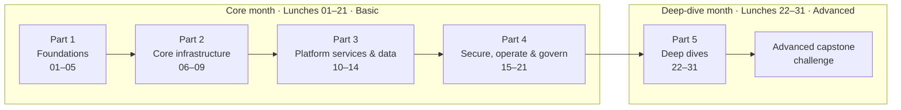

# Azure Fundamentals: One Lunch at a Time

**Learn every fundamental Azure service in 31 lunch breaks.** Read and watch in one hour; do the hands-on lab whenever it
suits you.

You are the new cloud engineer at **Nusantara Retail**, a retailer with forty stores whose online shop still runs on one
server in a small room next to the pantry. Traffic has tripled. The server has not. At the last monthly meeting the
director asked: *"If that server dies, how long can't we sell?"* Nobody answered. Over the next 31 lunches, you will.

> [!TIP]
> **Take the course on its website:** <https://stefpin.github.io/azure-fundamentals-lunches/> — every
> episode with its animated demo, self-graded quiz, lunch timer, badges, a journey map and progress tracking. Everything
> is also readable right here on GitHub.

## What every lunch gives you

| | What | When |
|---|---|---|
| 📖 | **Reading** — about 25 minutes, with diagrams, tables, tips and a knowledge check | during lunch |
| 🎬 | **Interactive demo** — an animated, step-by-step story you can play, pause and rewind (plus an optional short video) | during lunch |
| 🔬 | **Hands-on lab** — a self-contained exercise in your own Azure subscription, with verify and clean-up scripts | any time, at your own pace |

A lunch is exactly 60 minutes:

| ⏱ | Segment |
|---:|---|
| 5 min | Scenario and objectives |
| 25 min | Reading |
| 15 min | Demo |
| 5 min | Knowledge check |
| 5 min | Key takeaways and lab preview |
| 5 min | Buffer — finish your lunch 🍜 |

## Two months of lunches



- **Core month (Lunches 01–21, Basic):** every fundamental service — the resource hierarchy, identity, virtual machines,
  storage, networking, load balancing, App Service, Azure SQL, Cosmos DB, containers, serverless, security, monitoring,
  backup, governance, cost and Bicep — ending with a capstone. It covers the AZ-900 skills outline.
- **Deep-dive month (Lunches 22–31, Advanced):** the advanced half of every topic too big for one hour — identity, VMs,
  storage, networking, hybrid connectivity, load balancing, databases, Kubernetes, monitoring and governance at scale.

You can stop after the core month with a complete picture: nothing in Lunches 01–21 depends on the deep dives.

## The lunches

<!-- COURSE-TABLE:START -->
### Core month — Part 1 · Foundations

| # | Lunch (reading) | Level | Online | Lab | Lab time | Cost |
|---:|---|---|---|---|---|---|
| 01 | [Before You Begin: Your Azure Lab, Tools and Cost Guardrails](lunches/01-before-you-begin/README.md) | Basic | [🌐 Episode](https://stefpin.github.io/azure-fundamentals-lunches/lunches/01-before-you-begin.html) · [▶ Demo](https://stefpin.github.io/azure-fundamentals-lunches/demos/01-before-you-begin.html) | [Set up your lab environment](labs/01-before-you-begin/README.md) | about 30 minutes | 💲 |
| 02 | [Cloud Concepts](lunches/02-cloud-concepts/README.md) | Basic | [🌐 Episode](https://stefpin.github.io/azure-fundamentals-lunches/lunches/02-cloud-concepts.html) · [▶ Demo](https://stefpin.github.io/azure-fundamentals-lunches/demos/02-cloud-concepts.html) | [Make the business case](labs/02-cloud-concepts/README.md) | about 40 minutes | 💲 |
| 03 | [Azure Global Infrastructure: Regions, Availability Zones and Region Pairs](lunches/03-global-infrastructure/README.md) | Basic | [🌐 Episode](https://stefpin.github.io/azure-fundamentals-lunches/lunches/03-global-infrastructure.html) · [▶ Demo](https://stefpin.github.io/azure-fundamentals-lunches/demos/03-global-infrastructure.html) | [Explore regions and zones](labs/03-global-infrastructure/README.md) | about 35 minutes | 💲 |
| 04 | [Resource Hierarchy and Azure Resource Manager](lunches/04-resource-hierarchy-basic/README.md) | Basic | [🌐 Episode](https://stefpin.github.io/azure-fundamentals-lunches/lunches/04-resource-hierarchy-basic.html) · [▶ Demo](https://stefpin.github.io/azure-fundamentals-lunches/demos/04-resource-hierarchy-basic.html) | [Organise Nusantara Retail](labs/04-resource-hierarchy-basic/README.md) | about 40 minutes | 💲 |
| 05 | [Identity and Access](lunches/05-identity-access-basic/README.md) | Basic | [🌐 Episode](https://stefpin.github.io/azure-fundamentals-lunches/lunches/05-identity-access-basic.html) · [▶ Demo](https://stefpin.github.io/azure-fundamentals-lunches/demos/05-identity-access-basic.html) | [Give a contractor just enough access](labs/05-identity-access-basic/README.md) | about 40 minutes | 💲 |

### Core month — Part 2 · Core infrastructure

| # | Lunch (reading) | Level | Online | Lab | Lab time | Cost |
|---:|---|---|---|---|---|---|
| 06 | [Virtual Machines](lunches/06-virtual-machines-basic/README.md) | Basic | [🌐 Episode](https://stefpin.github.io/azure-fundamentals-lunches/lunches/06-virtual-machines-basic.html) · [▶ Demo](https://stefpin.github.io/azure-fundamentals-lunches/demos/06-virtual-machines-basic.html) | [Your first web server VM](labs/06-virtual-machines-basic/README.md) | about 45 minutes | 💲💲 |
| 07 | [Storage](lunches/07-storage-basic/README.md) | Basic | [🌐 Episode](https://stefpin.github.io/azure-fundamentals-lunches/lunches/07-storage-basic.html) · [▶ Demo](https://stefpin.github.io/azure-fundamentals-lunches/demos/07-storage-basic.html) | [Store product images and invoices](labs/07-storage-basic/README.md) | about 45 minutes | 💲 |
| 08 | [Virtual Networking](lunches/08-networking-basic/README.md) | Basic | [🌐 Episode](https://stefpin.github.io/azure-fundamentals-lunches/lunches/08-networking-basic.html) · [▶ Demo](https://stefpin.github.io/azure-fundamentals-lunches/demos/08-networking-basic.html) | [Build Nusantara Retail's network](labs/08-networking-basic/README.md) | about 50 minutes | 💲💲 |
| 09 | [Load Balancing: Azure Load Balancer](lunches/09-load-balancing-basic/README.md) | Basic | [🌐 Episode](https://stefpin.github.io/azure-fundamentals-lunches/lunches/09-load-balancing-basic.html) · [▶ Demo](https://stefpin.github.io/azure-fundamentals-lunches/demos/09-load-balancing-basic.html) | [Keep the shop open when a server fails](labs/09-load-balancing-basic/README.md) | about 50 minutes | 💲💲 |

### Core month — Part 3 · Platform services and data

| # | Lunch (reading) | Level | Online | Lab | Lab time | Cost |
|---:|---|---|---|---|---|---|
| 10 | [Web Apps with Azure App Service](lunches/10-app-service/README.md) | Basic | [🌐 Episode](https://stefpin.github.io/azure-fundamentals-lunches/lunches/10-app-service.html) · [▶ Demo](https://stefpin.github.io/azure-fundamentals-lunches/demos/10-app-service.html) | [Move the storefront to PaaS](labs/10-app-service/README.md) | about 45 minutes | 💲 |
| 11 | [Relational Databases: Azure SQL](lunches/11-relational-databases-basic/README.md) | Basic | [🌐 Episode](https://stefpin.github.io/azure-fundamentals-lunches/lunches/11-relational-databases-basic.html) · [▶ Demo](https://stefpin.github.io/azure-fundamentals-lunches/demos/11-relational-databases-basic.html) | [Nusantara Retail's orders database](labs/11-relational-databases-basic/README.md) | about 45 minutes | 💲 |
| 12 | [NoSQL with Azure Cosmos DB](lunches/12-cosmos-db/README.md) | Basic | [🌐 Episode](https://stefpin.github.io/azure-fundamentals-lunches/lunches/12-cosmos-db.html) · [▶ Demo](https://stefpin.github.io/azure-fundamentals-lunches/demos/12-cosmos-db.html) | [A product catalogue that scales](labs/12-cosmos-db/README.md) | about 45 minutes | 💲 |
| 13 | [Containers: Container Registry, Container Instances and Container Apps](lunches/13-containers-basic/README.md) | Basic | [🌐 Episode](https://stefpin.github.io/azure-fundamentals-lunches/lunches/13-containers-basic.html) · [▶ Demo](https://stefpin.github.io/azure-fundamentals-lunches/demos/13-containers-basic.html) | [Package the storefront](labs/13-containers-basic/README.md) | about 45 minutes | 💲 |
| 14 | [Serverless: Azure Functions, Logic Apps and Event Grid](lunches/14-serverless/README.md) | Basic | [🌐 Episode](https://stefpin.github.io/azure-fundamentals-lunches/lunches/14-serverless.html) · [▶ Demo](https://stefpin.github.io/azure-fundamentals-lunches/demos/14-serverless.html) | [React to new orders automatically](labs/14-serverless/README.md) | about 50 minutes | 💲 |

### Core month — Part 4 · Secure, operate and govern

| # | Lunch (reading) | Level | Online | Lab | Lab time | Cost |
|---:|---|---|---|---|---|---|
| 15 | [Security Essentials: Defense in Depth, Key Vault and Defender for Cloud](lunches/15-security-essentials/README.md) | Basic | [🌐 Episode](https://stefpin.github.io/azure-fundamentals-lunches/lunches/15-security-essentials.html) · [▶ Demo](https://stefpin.github.io/azure-fundamentals-lunches/demos/15-security-essentials.html) | [Get the password out of the config file](labs/15-security-essentials/README.md) | about 45 minutes | 💲💲 |
| 16 | [Monitoring: Azure Monitor, Alerts, Service Health and Advisor](lunches/16-monitoring-basic/README.md) | Basic | [🌐 Episode](https://stefpin.github.io/azure-fundamentals-lunches/lunches/16-monitoring-basic.html) · [▶ Demo](https://stefpin.github.io/azure-fundamentals-lunches/demos/16-monitoring-basic.html) | [Know before customers do](labs/16-monitoring-basic/README.md) | about 45 minutes | 💲💲 |
| 17 | [Backup and Disaster Recovery](lunches/17-backup-disaster-recovery/README.md) | Basic | [🌐 Episode](https://stefpin.github.io/azure-fundamentals-lunches/lunches/17-backup-disaster-recovery.html) · [▶ Demo](https://stefpin.github.io/azure-fundamentals-lunches/demos/17-backup-disaster-recovery.html) | [The restore drill](labs/17-backup-disaster-recovery/README.md) | 60–90 minutes | 💲💲 |
| 18 | [Governance and Compliance: Azure Policy, Locks, Tags and Microsoft Purview](lunches/18-governance-compliance-basic/README.md) | Basic | [🌐 Episode](https://stefpin.github.io/azure-fundamentals-lunches/lunches/18-governance-compliance-basic.html) · [▶ Demo](https://stefpin.github.io/azure-fundamentals-lunches/demos/18-governance-compliance-basic.html) | [Keep data in the right place](labs/18-governance-compliance-basic/README.md) | about 45 minutes | 💲 |
| 19 | [Cost Management](lunches/19-cost-management/README.md) | Basic | [🌐 Episode](https://stefpin.github.io/azure-fundamentals-lunches/lunches/19-cost-management.html) · [▶ Demo](https://stefpin.github.io/azure-fundamentals-lunches/demos/19-cost-management.html) | [Find the waste you made yourself](labs/19-cost-management/README.md) | about 40 minutes | 💲 |
| 20 | [Infrastructure as Code with Bicep](lunches/20-infrastructure-as-code-bicep/README.md) | Basic | [🌐 Episode](https://stefpin.github.io/azure-fundamentals-lunches/lunches/20-infrastructure-as-code-bicep.html) · [▶ Demo](https://stefpin.github.io/azure-fundamentals-lunches/demos/20-infrastructure-as-code-bicep.html) | [Nineteen lunches of clicks in one file](labs/20-infrastructure-as-code-bicep/README.md) | about 50 minutes | 💲 |
| 21 | [Core Capstone: Putting It All Together](lunches/21-core-capstone/README.md) | Basic | [🌐 Episode](https://stefpin.github.io/azure-fundamentals-lunches/lunches/21-core-capstone.html) · [▶ Demo](https://stefpin.github.io/azure-fundamentals-lunches/demos/21-core-capstone.html) | [Capstone project](labs/21-core-capstone/README.md) | about 2–3 hours | 💲💲 |

### Deep-dive month — Part 5 · Deep dives

| # | Lunch (reading) | Level | Online | Lab | Lab time | Cost |
|---:|---|---|---|---|---|---|
| 22 | [Identity and Access](lunches/22-identity-access-advanced/README.md) | Advanced | [🌐 Episode](https://stefpin.github.io/azure-fundamentals-lunches/lunches/22-identity-access-advanced.html) · [▶ Demo](https://stefpin.github.io/azure-fundamentals-lunches/demos/22-identity-access-advanced.html) | [Passwordless pipelines and least privilege](labs/22-identity-access-advanced/README.md) | about 50 minutes | 💲 |
| 23 | [Virtual Machines](lunches/23-virtual-machines-advanced/README.md) | Advanced | [🌐 Episode](https://stefpin.github.io/azure-fundamentals-lunches/lunches/23-virtual-machines-advanced.html) · [▶ Demo](https://stefpin.github.io/azure-fundamentals-lunches/demos/23-virtual-machines-advanced.html) | [Ready for the 12.12 sale](labs/23-virtual-machines-advanced/README.md) | about 60 minutes | 💲💲 |
| 24 | [Storage](lunches/24-storage-advanced/README.md) | Advanced | [🌐 Episode](https://stefpin.github.io/azure-fundamentals-lunches/lunches/24-storage-advanced.html) · [▶ Demo](https://stefpin.github.io/azure-fundamentals-lunches/demos/24-storage-advanced.html) | [Ransomware-proof invoices](labs/24-storage-advanced/README.md) | about 60 minutes | 💲💲 |
| 25 | [Virtual Networking](lunches/25-networking-advanced/README.md) | Advanced | [🌐 Episode](https://stefpin.github.io/azure-fundamentals-lunches/lunches/25-networking-advanced.html) · [▶ Demo](https://stefpin.github.io/azure-fundamentals-lunches/demos/25-networking-advanced.html) | [Hub and spoke for Nusantara Retail](labs/25-networking-advanced/README.md) | about 60 minutes | 💲💲 |
| 26 | [Hybrid Connectivity: VPN Gateway, ExpressRoute and Virtual WAN](lunches/26-hybrid-connectivity/README.md) | Advanced | [🌐 Episode](https://stefpin.github.io/azure-fundamentals-lunches/lunches/26-hybrid-connectivity.html) · [▶ Demo](https://stefpin.github.io/azure-fundamentals-lunches/demos/26-hybrid-connectivity.html) | [Connect head office](labs/26-hybrid-connectivity/README.md) | about 90 minutes | 💲💲💲 |
| 27 | [Load Balancing: Application Gateway, Front Door and Traffic Manager](lunches/27-load-balancing-advanced/README.md) | Advanced | [🌐 Episode](https://stefpin.github.io/azure-fundamentals-lunches/lunches/27-load-balancing-advanced.html) · [▶ Demo](https://stefpin.github.io/azure-fundamentals-lunches/demos/27-load-balancing-advanced.html) | [Protect and route the storefront](labs/27-load-balancing-advanced/README.md) | about 75 minutes | 💲💲💲 |
| 28 | [Relational Databases](lunches/28-relational-databases-advanced/README.md) | Advanced | [🌐 Episode](https://stefpin.github.io/azure-fundamentals-lunches/lunches/28-relational-databases-advanced.html) · [▶ Demo](https://stefpin.github.io/azure-fundamentals-lunches/demos/28-relational-databases-advanced.html) | [Orders that survive a regional outage](labs/28-relational-databases-advanced/README.md) | about 60 minutes | 💲💲 |
| 29 | [Containers: Azure Kubernetes Service](lunches/29-containers-advanced-aks/README.md) | Advanced | [🌐 Episode](https://stefpin.github.io/azure-fundamentals-lunches/lunches/29-containers-advanced-aks.html) · [▶ Demo](https://stefpin.github.io/azure-fundamentals-lunches/demos/29-containers-advanced-aks.html) | [Kubernetes for the microservices team](labs/29-containers-advanced-aks/README.md) | about 60 minutes | 💲💲💲 |
| 30 | [Monitoring: Log Analytics, KQL and Application Insights](lunches/30-monitoring-advanced/README.md) | Advanced | [🌐 Episode](https://stefpin.github.io/azure-fundamentals-lunches/lunches/30-monitoring-advanced.html) · [▶ Demo](https://stefpin.github.io/azure-fundamentals-lunches/demos/30-monitoring-advanced.html) | [Why was checkout slow on Friday?](labs/30-monitoring-advanced/README.md) | about 60 minutes | 💲💲 |
| 31 | [Resource Hierarchy and Governance: Governance at Scale](lunches/31-governance-at-scale/README.md) | Advanced | [🌐 Episode](https://stefpin.github.io/azure-fundamentals-lunches/lunches/31-governance-at-scale.html) · [▶ Demo](https://stefpin.github.io/azure-fundamentals-lunches/demos/31-governance-at-scale.html) | [Governance for the whole company](labs/31-governance-at-scale/README.md) | about 60 minutes | 💲 |

**Then:** [Advanced capstone challenge](labs/32-advanced-capstone-challenge/README.md) — a multi-session project, 💲💲💲. Requirements only: design it, build it, prove it.
<!-- COURSE-TABLE:END -->

## Start here

1. Read [Lunch 01 · Before You Begin](lunches/01-before-you-begin/README.md). It explains how to get an Azure
   subscription for the labs, the tools, and the cost guardrails to set up first.
2. Open **Azure Cloud Shell** at [shell.azure.com](https://shell.azure.com) (choose **Bash**) and get the lab files:

   ```bash
   git clone https://github.com/stefpin/azure-fundamentals-lunches.git
   cd azure-fundamentals-lunches
   bash labs/common/check-environment.sh
   ```

3. Take one lunch a day, in order. Do each lab when you have time — the labs do not depend on each other.

Prefer VS Code? The repository includes a [dev container](.devcontainer/devcontainer.json) with the Azure CLI, Bicep,
Python and kubectl, so it also works in GitHub Codespaces.

## Labs, cost and safety

> [!IMPORTANT]
> Use a **personal or dedicated lab subscription** — never a company or production subscription. Lab resources cost
> money while they exist, so finish every lab with `bash cleanup.sh`.

- Every lab states its time and **cost band**: 💲 free or close to free · 💲💲 small charges while running · 💲💲💲
  noticeable charges while running — delete straight after the lab. See [all labs](labs/README.md).
- Every lab is **independent**: when it needs a starting point, `setup.sh` creates it.
- `verify.sh` checks your work; `cleanup.sh` removes everything the lab created.
- Lunch 01 helps you set a **budget with alerts** before you create anything.

## For maintainers and contributors

| Document | What's inside |
|---|---|
| [COURSE-DESIGN.md](COURSE-DESIGN.md) | why the course is built this way, including the choice of interactive demos over long videos |
| [SYLLABUS.md](SYLLABUS.md) | the detailed outline of every lunch, demo and lab |
| [AUTHORING-GUIDE.md](AUTHORING-GUIDE.md) | writing rules, demo player guide, lab script conventions, platform facts to re-check |
| [PUBLISHING.md](PUBLISHING.md) | how to publish on GitHub and GitHub Pages, record the optional videos, and keep the course current |
| [TEST-PASS-NOTES.md](TEST-PASS-NOTES.md) | what to confirm during the first end-to-end run of the labs in Azure |
| [CONTRIBUTING.md](CONTRIBUTING.md) | how to report a problem or propose a change |

The course website is built from these Markdown files by `tools/build_site.py` and published to **GitHub Pages** by
the *Publish the course site* workflow on every push:
`https://stefpin.github.io/azure-fundamentals-lunches/`. The generated pages live in [`docs/`](docs/) and
the demos in [`docs/demos/`](docs/demos/).

## Disclaimer

This is an independent, personal learning project. It is **not** official Microsoft training, documentation or
certification material, and it is not endorsed by Microsoft. Azure changes often: always check the current
[Azure documentation](https://learn.microsoft.com/azure/) and pricing before relying on a detail. Microsoft, Azure and
related names are trademarks of the Microsoft group of companies. Nusantara Retail is a fictional company.

## License

- Written content and demo narratives: [CC BY-NC-SA 4.0](LICENSE-CONTENT.md)
- Code (lab scripts, Bicep, tools and the demo player engine): [MIT](LICENSE)
