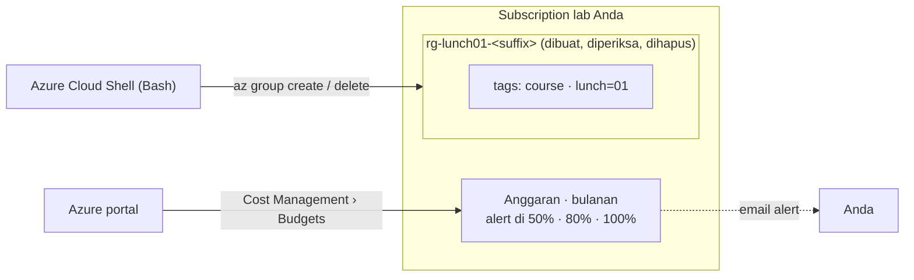

# Lab 01 · Menyiapkan lingkungan lab

🇬🇧 [Read in English](README.md)

> **Pasangan dari:** [Makan Siang 01 · Sebelum Memulai: Lab Azure, Perkakas, dan Pagar Pengaman Biaya Anda (Dasar)](../../lunches/01-before-you-begin/README.id.md)
> **Waktu:** sekitar 30 menit · **Biaya:** 💲 (lihat [kelompok biaya](../README.id.md#kelompok-biaya)) · **Tingkat kesulitan:** ★☆☆
> **Bisa dikerjakan terpisah:** ✅ Anda tidak memerlukan lab sebelumnya. Semua yang dibutuhkan lab ini dibuat oleh
> langkah-langkahnya sendiri.
> **Penulis:** Stefanus Pinarta · [Tentang penulis](../../README.id.md#tentang-penulis)

## 🎯 Yang akan Anda bangun

Di akhir lab ini, subscription Anda siap untuk seluruh kursus. Cloud Shell berfungsi, file kursus sudah ada di direktori
home Anda, pemeriksaan lingkungan lolos, dan sebuah **anggaran bulanan** (budget) dengan alert di 50%, 80%, dan 100%
mengawasi semua yang akan Anda bangun dalam tiga puluh makan siang berikutnya. Anda juga berlatih ritme yang akan diikuti
cloud engineer baru Nusantara Retail di setiap lab, yaitu membuat resource group bertag, memeriksanya, lalu
menghapusnya, dan Anda belajar membaca pesan error Azure.



## ✅ Sebelum mulai

- Sebuah subscription Azure tempat Anda bisa membuat resource, dan yang **bukan** subscription perusahaan atau produksi.
  Belum punya subscription? Bagian 3 dari
  [bacaan Makan Siang 01](../../lunches/01-before-you-begin/README.id.md#3-subscription-yang-aman-untuk-dirusak)
  membandingkan akun gratis, Azure for Students, dan pay-as-you-go.
- Peran **Owner** atau **Contributor** pada subscription itu. Jika Anda membuat subscription itu sendiri, Anda adalah
  Owner. Membuat anggaran membutuhkan setidaknya peran Contributor.
- Sebuah browser web. Tidak ada yang perlu dipasang: lab ini berjalan di **Azure Cloud Shell**.

> [!IMPORTANT]
> Lab ini hanya membuat sebuah resource group dan sebuah anggaran, dan keduanya gratis. Tetap selesaikan bagian
> **Bersihkan**: hari ini, kebiasaannya jauh lebih penting daripada uangnya.

## 🧭 Pilih mode Anda

| Mode | Cocok untuk Anda jika… | Caranya |
|---|---|---|
| **Terpandu** | Anda ingin setiap langkah dijelaskan | ikuti Tugas 1–5 di bawah (Tugas 6 opsional) |
| **Tantangan** | Anda sudah menguasai dasarnya | baca hanya [Ringkasan tantangan](#-ringkasan-tantangan), kerjakan dengan cara Anda sendiri, lalu jalankan `bash verify.sh` |

## Tugas 1 · Membuka Cloud Shell dan mengambil file kursus

Cloud Shell adalah meja kerja untuk setiap lab: sudah dalam keadaan login dan sudah terpasang Azure CLI, Git, serta
Bicep.

1. Masuk (sign in) ke [Azure portal](https://portal.azure.com) dengan akun lab Anda dan selesaikan permintaan MFA.
2. Pilih ikon **Cloud Shell** (`>_`) di toolbar atas, atau buka [shell.azure.com](https://shell.azure.com) di tab
   browser baru untuk terminal berukuran penuh.
3. Pada kali pertama, pilih **Bash**. Di panel *Getting started*, pilih opsi penyimpanan:
   - **Mount storage account** › *We will create a storage account for you* — disarankan untuk kursus ini. File dan
     suffix lab Anda tetap ada dari sesi ke sesi. Storage account ini memakan sedikit biaya, seperti penyimpanan pada
     umumnya.
   - **No storage account required** — sebuah *ephemeral session* (sesi sementara). Gratis dan cepat, tetapi setiap
     file dihapus saat sesi berakhir.

   Pilih subscription lab Anda di daftar drop-down, lalu konfirmasi.
4. Periksa subscription mana yang sedang dipakai CLI:

   ```bash
   az account show --query "{subscription:name, state:state, user:user.name}" --output table
   ```

   Jika Anda punya lebih dari satu subscription, tampilkan daftarnya lalu beralihlah ke subscription lab Anda:

   ```bash
   az account list --query "[].{name:name, id:id, state:state}" --output table
   az account set --subscription "<your lab subscription name or ID>"
   ```

5. Clone repositori kursus dan jalankan pemeriksaan lingkungan:

   ```bash
   cd ~
   git clone https://github.com/stefpin/azure-fundamentals-lunches.git   # first time only
   cd azure-fundamentals-lunches
   bash labs/common/check-environment.sh
   ```

   Pemeriksaan ini hanya membaca informasi; tidak ada yang dibuat. Skrip ini memastikan CLI sudah login dan subscription
   Anda aktif (enabled), region default-nya ada, dan ukuran VM kecil yang dipakai lab tersedia untuk Anda. Skrip ini
   juga menampilkan kuota vCPU regional Anda dan daftar resource group lab yang lupa Anda hapus. Pemeriksaan ukuran VM
   memakan waktu sekitar 30 detik.

> [!TIP]
> **Memakai ephemeral session?** Hasil clone dan suffix lab Anda hilang saat sesi berakhir. Catat suffix Anda sekarang
> dengan `cat ~/.azlunches-suffix`. Lain kali, setelah meng-clone ulang, pulihkan dengan
> `echo <your-suffix> > ~/.azlunches-suffix` supaya skrip-skrip berikutnya menemukan resource yang sudah Anda buat. Untuk
> beralih ke persistent storage, buka Cloud Shell **Settings › Reset user settings** lalu pilih **Mount storage
> account** saat Cloud Shell dimulai lagi.

> ✅ **Pemeriksaan:** `az account show` melaporkan `Enabled`, dan `check-environment.sh` diakhiri dengan
> **All N checks passed. Nice work!** Jika hanya pemeriksaan ukuran VM yang gagal, penyiapan Anda tetap aman untuk lab
> ini; lab-lab VM menjelaskan cara memilih ukuran lain.

## Tugas 2 · Membuat anggaran bulanan dengan alert (portal)

Anggaran adalah pagar pengaman untuk seluruh kursus. Anda membuatnya sekali lalu menyimpannya: pengeluaran setiap lab
dihitung terhadap anggaran ini. Anggaran paling mudah dibuat di portal.

1. Di kotak pencarian portal, ketik **Cost Management** lalu buka. Di menu kiri, pilih **Budgets**. (Jalur lain:
   **Subscriptions** › subscription lab Anda › **Budgets**.)
2. Periksa **Scope** yang ditampilkan di bagian atas. Scope harus berupa **subscription** lab Anda, bukan resource group
   atau management group (*grup manajemen*). Pilih scope tersebut untuk menggantinya jika perlu.
3. Pilih **+ Add** lalu isi *Create a budget*:
   - **Name:** `budget-azure-lunches`
   - **Reset period:** **Monthly**. (Jika subscription Anda juga menawarkan **Billing month**, opsi itu mengikuti tanggal
     invoice Anda; keduanya sama-sama boleh.)
   - **Creation date:** biarkan nilai default-nya, yaitu bulan ini.
   - **Expiration date:** setidaknya satu tahun dari sekarang. Saat sebuah anggaran kedaluwarsa, Azure menghapusnya.
   - **Amount:** jumlah yang rela Anda keluarkan untuk belajar dalam sebulan, dalam mata uang tagihan Anda, misalnya
     setara US$20. Grafik di halaman itu membantu Anda memilih; tidak ada jawaban yang salah.
4. Pilih **Next**. Di bawah **Alert conditions**, tambahkan tiga baris dengan **Type** diatur ke **Actual** dan **% of
   budget** diatur ke **50**, **80**, dan **100**. Jika mau, tambahkan baris keempat: **Type** **Forecasted**, **100**.
5. Di bawah **Alert recipients (email)**, masukkan alamat email Anda sendiri (Anda bisa menambahkan hingga lima). Pilih
   bahasa Anda, lalu pilih **Create**.

Anda juga bisa melihat anggaran dari Cloud Shell. Grup perintah `consumption` masih berstatus preview, jadi baris
peringatan tentang hal itu adalah hal yang normal:

```bash
az consumption budget list --query "[].{name:name, amount:amount, period:timeGrain}" --output table
```

**Jika anggaran tidak tersedia untuk Anda.** Beberapa jenis subscription, misalnya Azure for Students, Azure for
Students Starter, dan penawaran sponsorship, tercantum sebagai tidak didukung oleh Cost Management. Selain itu,
subscription yang benar-benar baru bisa butuh waktu hingga 48 jam sebelum semua fitur Cost Management muncul. Jika
halaman *Budgets* menampilkan error atau tidak ada tombol **Add**:

- jika subscription Anda baru berumur satu atau dua hari, coba lagi besok;
- jika tidak, pakai pagar pengaman cadangan: biarkan **spending limit** subscription Anda tetap aktif (penawaran
  berbasis kredit memilikinya secara default), periksa pemakaian Anda setiap minggu (Azure for Students: halaman
  **Education** di portal menampilkan pemakaian Anda), dan jalankan `check-environment.sh` setiap minggu untuk
  menemukan sisa resource. `verify.sh` mengenali penawaran-penawaran ini dan memeriksa spending limit sebagai pengganti
  anggaran.

> ✅ **Pemeriksaan:** *Cost Management › Budgets* menampilkan `budget-azure-lunches` dengan jumlah Anda dan periode reset
> bulanan. Perintah CLI di atas juga menampilkannya; anggaran baru bisa butuh beberapa menit untuk muncul di sana.

## Tugas 3 · Membuat resource group bertag dengan CLI

Setiap lab menyimpan resource-nya di satu resource group bertag. Berlatih dengan group kosong tidak memakan biaya
sepeser pun.

```bash
cd ~/azure-fundamentals-lunches/labs/01-before-you-begin
source ../common/config.sh
RG=$(rg_name 01)
echo "$RG"
```

`config.sh` menampilkan pengaturan lab (region, suffix, ukuran VM). `rg_name 01` menyusun nama group untuk lab ini,
misalnya `rg-lunch01-ab12c`. Buat group tersebut dengan helper bersama:

```bash
ensure_rg "$RG" 01
```

`ensure_rg` adalah fungsi kecil di `labs/common/helpers.sh`. Fungsi ini menjalankan persis perintah Azure CLI biasa
berikut, yang juga bisa Anda ketik sendiri (menjalankan keduanya tidak berbahaya; perintah kedua hanya memperbarui group
yang sama):

```bash
az group create \
  --name "$RG" \
  --location "$LOCATION" \
  --tags course="$COURSE_TAG" lunch=01 \
  --output none
```

Sekarang lihat apa yang Anda buat:

```bash
az group show --name "$RG" \
  --query "{name:name, location:location, tags:tags, state:properties.provisioningState}" --output json
az group list --tag course="$COURSE_TAG" --output table
az group show --name "$RG" --query id --output tsv
```

Perintah terakhir menampilkan **resource ID** group tersebut, yaitu alamat lengkapnya di Azure:
`/subscriptions/<subscription-id>/resourceGroups/<name>`. Makan Siang 04 membedah resource ID secara rinci.

> ✅ **Pemeriksaan:** `az group show` melaporkan `"state": "Succeeded"`, lokasi dari `config.sh`, dan kedua tag:
> `course: azure-fundamentals-lunches` dan `lunch: 01`.

## Tugas 4 · Menemukannya di portal

Portal dan CLI adalah dua jendela yang menghadap ke Azure Resource Manager yang sama. Apa pun yang dibuat lewat salah
satunya, terlihat dari yang lain.

1. Di kotak pencarian portal, ketik **Resource groups** lalu buka `rg-lunch01-<suffix>`. Refresh daftarnya jika group
   itu belum muncul.
2. **Overview:** lokasi dan kedua tag. Group ini kosong.
3. **Tags** (menu kiri): kedua tag tercantum. Biarkan apa adanya.
4. **Activity log** (menu kiri): sebuah entri untuk operasi tulis (write) pada resource group, dengan akun Anda sebagai
   pemanggil (caller). Entri Activity log bisa butuh beberapa menit untuk muncul.
5. **JSON View** (kanan atas halaman Overview): resource ID yang sama dengan yang Anda tampilkan di Tugas 3, ditambah
   tag-nya.

> ✅ **Pemeriksaan:** portal menampilkan nama, lokasi, dan tag yang sama dengan `az group show`, dan Activity log
> mencantumkan akun Anda sebagai pemanggil.

## Tugas 5 · Menghapusnya

Bersih-bersih adalah kebiasaan. Menghapus resource group berarti menghapus semua isinya; di sini isinya kosong, jadi
ini latihan yang aman.

```bash
az group delete --name "$RG" --yes
az group exists --name "$RG"
```

`az group delete` menunggu sampai group benar-benar hilang, yang hanya butuh beberapa detik untuk group kosong. Lab-lab
berikutnya sering menambahkan `--no-wait` agar penghapusan berlanjut di latar belakang; skrip `cleanup.sh` melakukan
persis hal itu.

> [!TIP]
> **Lebih suka portal?** *Resource groups* › `rg-lunch01-<suffix>` › **Delete resource group** › ketik namanya untuk
> konfirmasi › **Delete**. Portal meminta Anda mengetik namanya karena penghapusan tidak bisa dibatalkan.

> ✅ **Pemeriksaan:** `az group exists --name "$RG"` menampilkan `false`.

## Tugas 6 (opsional) · Memasang perkakas di komputer Anda sendiri

Cloud Shell sudah cukup untuk seluruh kursus ini. Jika Anda juga ingin penyiapan lokal:

| Perkakas | Cara memasang | Setelah itu |
|---|---|---|
| Azure CLI | Windows: `winget install --exact --id Microsoft.AzureCLI` · macOS: `brew update && brew install azure-cli` · Ubuntu atau Debian: `curl -sL https://aka.ms/InstallAzureCLIDeb \| sudo bash` | `az login` (atau `az login --use-device-code` di mesin jarak jauh), lalu `az account set --subscription "<lab subscription>"` |
| Bicep | `az bicep install` (CLI juga memasang Bicep secara otomatis saat pertama kali Anda men-deploy file Bicep) | `az bicep version` |
| Azure PowerShell | Pasang PowerShell 7, lalu `Install-Module -Name Az -Repository PSGallery -Scope CurrentUser -Force` | `Connect-AzAccount` |
| Visual Studio Code | Ekstensi **Bicep** (`ms-azuretools.vscode-bicep`), **Azure Resources** (`ms-azuretools.vscode-azureresourcegroups`), dan **Azure CLI Tools** (`ms-vscode.azurecli`) | Masuk dari tampilan Azure di side bar |
| Dev container | Repositori ini menyertakan `.devcontainer/devcontainer.json` berisi Azure CLI, Bicep, dan Python. Buka repositori di GitHub Codespaces atau dengan ekstensi VS Code **Dev Containers**. | `az login --use-device-code`, lalu `bash labs/common/check-environment.sh` |

Perbarui perkakas secara berkala dengan `az upgrade` dan `Update-Module -Name Az`. Untuk MFA wajib, Microsoft
menyarankan minimal Azure CLI 2.76 dan Azure PowerShell 14.3. Petunjuk lengkap:
[Memasang Azure CLI](https://learn.microsoft.com/cli/azure/install-azure-cli) ·
[Memasang Azure PowerShell](https://learn.microsoft.com/powershell/azure/install-azure-powershell) ·
[Memasang perkakas Bicep](https://learn.microsoft.com/azure/azure-resource-manager/bicep/install).

> ✅ **Pemeriksaan:** di komputer Anda, `az account show` menampilkan subscription lab Anda dan `az bicep version`
> menampilkan sebuah nomor versi.

## 🔧 Rusak lalu perbaiki

Salah ketik nama region adalah salah satu error pertama yang paling sering terjadi. Buat satu dengan sengaja, kembali
di Cloud Shell:

```bash
cd ~/azure-fundamentals-lunches/labs/01-before-you-begin
source ../common/config.sh
az group create --name "$(rg_name 01 typo)" --location southeastasai \
  --tags course="$COURSE_TAG" lunch=01
```

**Gejala:** perintah gagal dan tidak ada yang dibuat. Baca pesan error-nya dari atas. Teks di dalam tanda kurung adalah
**kode error**; pesannya menjelaskan apa yang salah dan, dalam kasus ini, bahkan menampilkan daftar nilai yang valid:

```text
(LocationNotAvailableForResourceGroup) The provided location 'southeastasai' is not available for resource group. List of available regions is 'eastasia,southeastasia,australiaeast,...'.
Code: LocationNotAvailableForResourceGroup
Message: The provided location 'southeastasai' is not available for resource group. List of available regions is '...'.
```

<details><summary>Petunjuk: cara memperbaikinya</summary>

Azure Resource Manager menolak permintaan itu sebelum resource provider mana pun terlibat, karena nama region tersebut
tidak ada. Tampilkan nama-nama persis yang diterima Azure, lalu saring:

```bash
az account list-locations --query "[?metadata.regionType=='Physical'].name" --output tsv | sort | grep -i -E 'asia|indonesia'
```

Jalankan lagi perintahnya dengan nama yang benar, `southeastasia` (atau cukup `"$LOCATION"`), lalu hapus group yang
baru saja Anda buat:

```bash
az group create --name "$(rg_name 01 typo)" --location "$LOCATION" \
  --tags course="$COURSE_TAG" lunch=01 --output none
az group delete --name "$(rg_name 01 typo)" --yes
```

Pelajarannya: error Azure itu spesifik. Kodenya (`LocationNotAvailableForResourceGroup`) mudah dicari di internet, dan
pesannya sering memberi tahu nilai-nilai yang valid.

</details>

## 🧪 Verifikasi hasil kerja Anda

```bash
bash verify.sh
```

`verify.sh` memeriksa bahwa Anda sudah login, subscription Anda aktif, ada anggaran di scope subscription dengan alert
bulanan di 50%, 80%, dan 100% (atau, untuk jenis subscription yang tidak mendukung anggaran, spending limit-nya aktif),
dan tidak ada resource group Lab 01 yang tertinggal. Setiap pemeriksaan seharusnya menampilkan **PASS**. Jika ada yang
gagal, pesannya memberi tahu tugas mana yang perlu Anda ulangi.

## 🧹 Bersihkan (jangan dilewati!)

```bash
bash cleanup.sh
```

Skrip ini menghapus resource group sisa dari lab ini: group yang bertag `lunch=01`, ditambah `rg-lunch01-<suffix>` dan
`rg-lunch01-typo-<suffix>` jika keduanya ada tanpa tag. Skrip ini **sengaja menyimpan anggaran Anda**: anggaran itu
gratis dan melindungi setiap lab di kursus ini. Hapus anggaran hanya setelah Anda menyelesaikan kursus (*Cost
Management › Budgets* › pilih anggarannya › **Delete**).

Jika Anda memilih persistent storage, Cloud Shell membuat sebuah storage account untuk direktori home Anda, biasanya di
resource group bernama `cloud-shell-storage-<region>`. Storage account itu bukan bagian dari lab ini. Simpan selama Anda
mengikuti kursus: menghapusnya berarti menghapus file Cloud Shell Anda.

## 🩺 Pemecahan masalah

| Gejala | Kemungkinan penyebab | Perbaikan |
|---|---|---|
| Cloud Shell tidak mau mulai dan menyebut resource provider `Microsoft.CloudShell` | Provider itu belum terdaftar di subscription ini | Portal › *Subscriptions* › subscription Anda › *Resource providers* › cari `cloudshell` › **Register**, lalu buka ulang Cloud Shell |
| `You are not signed in to Azure. Run: az login` (ditampilkan oleh skrip lab) | Anda menjalankannya secara lokal dan belum login, atau sesi login Anda sudah kedaluwarsa | Jalankan `az login`, atau gunakan Cloud Shell |
| `The Azure CLI was not found.` | Anda menjalankan skrip di komputer yang tidak punya Azure CLI | Gunakan Cloud Shell, atau pasang CLI (Tugas 6) |
| `check-environment.sh` menyatakan sebuah ukuran VM tidak tersedia | Ukuran itu tidak ditawarkan untuk subscription Anda di region Anda | Tidak masalah untuk lab ini. Lab-lab VM menjelaskan cara mengatur `VM_SIZE` dan `VM_SIZE_SMALL` |
| Halaman *Budgets* menampilkan error atau tidak punya tombol **Add** | Subscription yang benar-benar baru (hingga 48 jam), atau penawaran yang tidak didukung Cost Management (misalnya Azure for Students atau sponsorship) | Tunggu sehari; jika masih gagal, pakai cara cadangan di Tugas 2 |
| `az consumption budget list` tidak menampilkan apa-apa tepat setelah Anda membuat anggaran | Butuh beberapa menit sampai muncul, atau CLI sedang memakai subscription lain | Tunggu, lalu periksa `az account show` |
| `(AuthorizationFailed) The client ... does not have authorization to perform action 'Microsoft.Resources/subscriptions/resourcegroups/write'` | Akun Anda hanya punya akses Reader ke subscription itu | Gunakan subscription tempat Anda menjadi Owner atau Contributor |
| Error tentang MFA atau claims challenge saat Anda membuat atau menghapus sesuatu dari CLI | MFA wajib untuk operasi create, update, dan delete | Jalankan `az login` lagi dan selesaikan MFA; perbarui CLI versi lama dengan `az upgrade` |
| Folder hasil clone dan `~/.azlunches-suffix` Anda hilang | Anda memakai ephemeral session | Clone lagi dan pulihkan suffix Anda (lihat tip di Tugas 1), atau beralih ke persistent storage |
| `(LocationNotAvailableForResourceGroup) The provided location '…' is not available for resource group.` | Salah ketik nama region | Lihat *Rusak lalu perbaiki* |

## 🚀 Tantangan tambahan

- Jika tadi Anda melewatkannya, tambahkan alert **Forecasted** di 100% ke anggaran Anda. Lalu tambahkan sebuah **action
  group** yang mengirim notifikasi push ke aplikasi seluler Azure.
- Coba ritme yang sama di Azure PowerShell: alihkan Cloud Shell ke PowerShell lalu jalankan
  `New-AzResourceGroup -Name "rg-lunch01-ps-<suffix>" -Location southeastasia -Tag @{course="azure-fundamentals-lunches"; lunch="01"}`,
  kemudian `Remove-AzResourceGroup -Name "rg-lunch01-ps-<suffix>" -Force`. Permintaan yang sama, Resource Manager yang
  sama, sintaks yang berbeda.
- Jelajahi **Cost Management › Cost analysis** dan ubah tampilannya ke *Daily costs*. Kembalilah setelah sebuah lab VM
  untuk melihat baris biaya sungguhan muncul.
- Jalankan `az group list --query "[].{name:name, location:location}" --output table` dan cari apa pun yang tidak Anda
  buat dengan sengaja.

## 🏁 Ringkasan tantangan

Siapkan subscription Anda untuk kursus ini, dengan cara apa pun yang Anda suka (portal, CLI, atau PowerShell):

1. Azure CLI sudah login (di Cloud Shell atau secara lokal) ke subscription lab pribadi atau khusus yang statusnya
   **Enabled**.
2. Ada anggaran biaya **bulanan** di **scope subscription** dengan alert **biaya aktual** di **50%, 80%, dan 100%** yang
   dikirim ke alamat email Anda. (Jika jenis subscription Anda tidak mendukung anggaran, spending limit-nya harus
   **aktif**.)
3. Anda sudah membuat resource group bernama `rg-lunch01-<suffix>` di region lab Anda, dengan tag
   `course=azure-fundamentals-lunches` dan `lunch=01`, memastikan tag-nya di portal, lalu menghapusnya.
4. Tidak ada resource group bertag `lunch=01` yang tersisa.

Lalu jalankan `bash verify.sh`. Buntu? `solution.sh` menjalankan bagian CLI-nya sebagai skrip, atau beralihlah ke mode
Terpandu.

---

⬅️ [Bacaan Makan Siang 01](../../lunches/01-before-you-begin/README.id.md) · 🏠 [Semua lab](../README.id.md) · 🏠 [Beranda kursus](../../README.id.md)

<sub>Terakhir divalidasi: Oktober 2026 · Ada yang tidak berfungsi? [Laporkan masalah lab](../../CONTRIBUTING.md).</sub>
