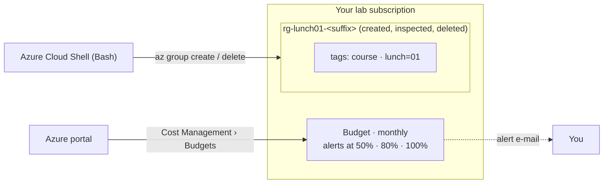

# Lab 01 · Set up your lab environment

> **Pairs with:** [Lunch 01 · Before You Begin: Your Azure Lab, Tools and Cost Guardrails](../../lunches/01-before-you-begin/README.md)
> **Time:** about 30 minutes · **Cost:** 💲 (see [cost bands](../README.md#cost-bands)) · **Difficulty:** ★☆☆
> **Works on its own:** ✅ You do not need any earlier lab. Everything this lab needs is created by its steps.

## 🎯 What you'll build

By the end of this lab your subscription is ready for the whole course. Cloud Shell works, the course files are in your
home directory, the environment check passes, and a **monthly budget** with alerts at 50%, 80% and 100% watches over
everything you will build in the next thirty lunches. You also rehearse the rhythm Nusantara Retail's new cloud engineer
will follow in every lab — create a tagged resource group, inspect it, delete it — and you learn to read an Azure error
message.



## ✅ Before you start

- An Azure subscription where you can create resources and that is **not** a company or production subscription. No
  subscription yet? Section 3 of the [Lunch 01 reading](../../lunches/01-before-you-begin/README.md#3-a-subscription-you-can-safely-break)
  compares the free account, Azure for Students and pay-as-you-go.
- The **Owner** or **Contributor** role on that subscription. If you created the subscription yourself, you are Owner.
  Creating a budget needs at least Contributor.
- A web browser. Nothing to install: this lab runs in **Azure Cloud Shell**.

> [!IMPORTANT]
> This lab creates only a resource group and a budget, and both are free. Finish with the **Clean up** section anyway:
> the habit matters more than the money today.

## 🧭 Choose your mode

| Mode | For you if… | How |
|---|---|---|
| **Guided** | you want every step explained | follow Tasks 1–5 below (Task 6 is optional) |
| **Challenge** | you already know the basics | read only the [Challenge brief](#-challenge-brief), do it your way, then run `bash verify.sh` |

## Task 1 · Open Cloud Shell and get the course files

Cloud Shell is the workbench for every lab: it is already signed in and has the Azure CLI, Git and Bicep installed.

1. Sign in to the [Azure portal](https://portal.azure.com) with your lab account and complete the MFA prompt.
2. Select the **Cloud Shell** icon (`>_`) in the top toolbar, or open [shell.azure.com](https://shell.azure.com) in a
   new browser tab for a full-size terminal.
3. The first time, choose **Bash**. In the *Getting started* pane, choose a storage option:
   - **Mount storage account** › *We will create a storage account for you* — recommended for this course. Your files
     and your lab suffix survive between sessions. The storage account costs a little, like any storage.
   - **No storage account required** — an *ephemeral session*. It is free and fast, but every file is deleted when the
     session ends.

   Select your lab subscription in the drop-down and confirm.
4. Check which subscription the CLI is using:

   ```bash
   az account show --query "{subscription:name, state:state, user:user.name}" --output table
   ```

   If you have more than one subscription, list them and switch to your lab subscription:

   ```bash
   az account list --query "[].{name:name, id:id, state:state}" --output table
   az account set --subscription "<your lab subscription name or ID>"
   ```

5. Clone the course repository and run the environment check:

   ```bash
   cd ~
   git clone https://github.com/stefpin/azure-fundamentals-lunches.git   # first time only
   cd azure-fundamentals-lunches
   bash labs/common/check-environment.sh
   ```

   The check only reads information; it creates nothing. It confirms that the CLI is signed in and your subscription is
   enabled, that the default region exists, and that the small VM sizes used by the labs are available to you. It also
   shows your regional vCPU quota and lists any lab resource groups you forgot to delete. The VM-size check takes about
   30 seconds.

> [!TIP]
> **Using ephemeral sessions?** Your clone and your lab suffix disappear when the session ends. Note the suffix now with
> `cat ~/.azlunches-suffix`. Next time, after cloning again, restore it with `echo <your-suffix> > ~/.azlunches-suffix`
> so later scripts find the resources you created. To switch to persistent storage, open Cloud Shell
> **Settings › Reset user settings** and choose **Mount storage account** at the next start.

> ✅ **Checkpoint:** `az account show` reports `Enabled`, and `check-environment.sh` ends with
> **All N checks passed. Nice work!** If only a VM-size check fails, your setup is still fine for this lab; the VM labs
> explain how to choose another size.

## Task 2 · Create a monthly budget with alerts (portal)

The budget is the guardrail for the whole course. You create it once and keep it: every lab's spending counts against it.
Budgets are easiest to create in the portal.

1. In the portal search bar, type **Cost Management** and open it. In the left menu, select **Budgets**. (Another route:
   **Subscriptions** › your lab subscription › **Budgets**.)
2. Check the **Scope** shown at the top. It must be your lab **subscription**, not a resource group or a management
   group. Select the scope to change it if needed.
3. Select **+ Add** and fill in *Create a budget*:
   - **Name:** `budget-azure-lunches`
   - **Reset period:** **Monthly**. (If your subscription also offers **Billing month**, that one follows your invoice
     dates; either is fine.)
   - **Creation date:** keep the default, the current month.
   - **Expiration date:** at least a year from now. When a budget expires, Azure deletes it.
   - **Amount:** what you are willing to spend on learning in one month, in your billing currency, for example the
     equivalent of US$20. The chart on the page helps you choose; there is no wrong answer.
4. Select **Next**. Under **Alert conditions**, add three rows with **Type** set to **Actual** and **% of budget** set to
   **50**, **80** and **100**. Optionally add a fourth row: **Type** **Forecasted**, **100**.
5. Under **Alert recipients (email)**, enter your own e-mail address (you can add up to five). Choose your language and
   select **Create**.

You can also look at budgets from Cloud Shell. The `consumption` command group is in preview, so a warning line about
that is normal:

```bash
az consumption budget list --query "[].{name:name, amount:amount, period:timeGrain}" --output table
```

**If budgets are not available to you.** Some subscription types, for example Azure for Students, Azure for Students
Starter and sponsorship offers, are listed as not supported by Cost Management. Separately, a brand-new subscription can
take up to 48 hours before every Cost Management feature appears. If the *Budgets* page shows an error or no **Add**
button:

- if your subscription is only a day or two old, try again tomorrow;
- otherwise, use the fallback guardrails: keep your subscription's **spending limit** switched on (credit-based offers
  have it by default), check your usage every week (Azure for Students: the **Education** page in the portal shows your
  usage), and run `check-environment.sh` weekly to catch leftovers. `verify.sh` recognises these offers and checks the
  spending limit instead of a budget.

> ✅ **Checkpoint:** *Cost Management › Budgets* lists `budget-azure-lunches` with your amount and a monthly reset
> period. The CLI command above shows it too; a new budget can take a few minutes to appear there.

## Task 3 · Create a tagged resource group with the CLI

Every lab keeps its resources in one tagged resource group. Practising on an empty group costs nothing.

```bash
cd ~/azure-fundamentals-lunches/labs/01-before-you-begin
source ../common/config.sh
RG=$(rg_name 01)
echo "$RG"
```

`config.sh` prints the lab settings (region, suffix, VM sizes). `rg_name 01` builds the name of this lab's group, for
example `rg-lunch01-ab12c`. Create the group with the shared helper:

```bash
ensure_rg "$RG" 01
```

`ensure_rg` is a small function in `labs/common/helpers.sh`. It runs exactly this plain Azure CLI command, which you
could type instead (running both is harmless; the second one simply updates the same group):

```bash
az group create \
  --name "$RG" \
  --location "$LOCATION" \
  --tags course="$COURSE_TAG" lunch=01 \
  --output none
```

Now look at what you created:

```bash
az group show --name "$RG" \
  --query "{name:name, location:location, tags:tags, state:properties.provisioningState}" --output json
az group list --tag course="$COURSE_TAG" --output table
az group show --name "$RG" --query id --output tsv
```

The last command prints the group's **resource ID**, its full address in Azure:
`/subscriptions/<subscription-id>/resourceGroups/<name>`. Lunch 04 takes resource IDs apart.

> ✅ **Checkpoint:** `az group show` reports `"state": "Succeeded"`, the location from `config.sh` and both tags:
> `course: azure-fundamentals-lunches` and `lunch: 01`.

## Task 4 · Find it in the portal

The portal and the CLI are two windows onto the same Azure Resource Manager. Whatever one creates, the other sees.

1. In the portal search bar, type **Resource groups** and open `rg-lunch01-<suffix>`. Refresh the list if it is not
   there yet.
2. **Overview:** the location and the two tags. The group is empty.
3. **Tags** (left menu): both tags are listed. Leave them as they are.
4. **Activity log** (left menu): an entry for the write operation on the resource group, with your account as the
   caller. Activity log entries can take a few minutes to appear.
5. **JSON View** (top right of the Overview page): the same resource ID you printed in Task 3, plus the tags.

> ✅ **Checkpoint:** the portal shows the same name, location and tags as `az group show`, and the Activity log names your
> account as the caller.

## Task 5 · Delete it

Cleanup is a habit. Deleting a resource group deletes everything inside it; here that is nothing, so it is a safe
rehearsal.

```bash
az group delete --name "$RG" --yes
az group exists --name "$RG"
```

`az group delete` waits until the group is gone, which takes a few seconds for an empty group. Later labs often add
`--no-wait` so deletion continues in the background; the `cleanup.sh` scripts do exactly that.

> [!TIP]
> **Prefer the portal?** *Resource groups* › `rg-lunch01-<suffix>` › **Delete resource group** › type the name to
> confirm › **Delete**. The portal makes you type the name because deletion cannot be undone.

> ✅ **Checkpoint:** `az group exists --name "$RG"` prints `false`.

## Task 6 (optional) · Install the tools on your own computer

Cloud Shell is all you need for this course. If you also want a local setup:

| Tool | Install | Then |
|---|---|---|
| Azure CLI | Windows: `winget install --exact --id Microsoft.AzureCLI` · macOS: `brew update && brew install azure-cli` · Ubuntu or Debian: `curl -sL https://aka.ms/InstallAzureCLIDeb \| sudo bash` | `az login` (or `az login --use-device-code` on a remote machine), then `az account set --subscription "<lab subscription>"` |
| Bicep | `az bicep install` (the CLI also installs Bicep automatically the first time you deploy a Bicep file) | `az bicep version` |
| Azure PowerShell | Install PowerShell 7, then `Install-Module -Name Az -Repository PSGallery -Scope CurrentUser -Force` | `Connect-AzAccount` |
| Visual Studio Code | Extensions **Bicep** (`ms-azuretools.vscode-bicep`), **Azure Resources** (`ms-azuretools.vscode-azureresourcegroups`) and **Azure CLI Tools** (`ms-vscode.azurecli`) | Sign in from the Azure view in the side bar |
| Dev container | The repository includes `.devcontainer/devcontainer.json` with the Azure CLI, Bicep and Python. Open the repository in GitHub Codespaces or with the VS Code **Dev Containers** extension. | `az login --use-device-code`, then `bash labs/common/check-environment.sh` |

Keep the tools current with `az upgrade` and `Update-Module -Name Az`. For mandatory MFA, Microsoft recommends at least
Azure CLI 2.76 and Azure PowerShell 14.3. Full instructions:
[Install the Azure CLI](https://learn.microsoft.com/cli/azure/install-azure-cli) ·
[Install Azure PowerShell](https://learn.microsoft.com/powershell/azure/install-azure-powershell) ·
[Install Bicep tools](https://learn.microsoft.com/azure/azure-resource-manager/bicep/install).

> ✅ **Checkpoint:** on your computer, `az account show` shows your lab subscription and `az bicep version` prints a
> version number.

## 🔧 Break it and fix it

A misspelled region name is one of the most common first errors. Make one on purpose, back in Cloud Shell:

```bash
cd ~/azure-fundamentals-lunches/labs/01-before-you-begin
source ../common/config.sh
az group create --name "$(rg_name 01 typo)" --location southeastasai \
  --tags course="$COURSE_TAG" lunch=01
```

**Symptom:** the command fails and nothing is created. Read the error from the top. The text in parentheses is the
**error code**; the message explains what was wrong and, here, even lists the valid values:

```text
(LocationNotAvailableForResourceGroup) The provided location 'southeastasai' is not available for resource group. List of available regions is 'eastasia,southeastasia,australiaeast,...'.
Code: LocationNotAvailableForResourceGroup
Message: The provided location 'southeastasai' is not available for resource group. List of available regions is '...'.
```

<details><summary>Hint: how to fix it</summary>

Azure Resource Manager rejected the request before any resource provider was involved, because the region name does
not exist. List the exact names Azure accepts and filter them:

```bash
az account list-locations --query "[?metadata.regionType=='Physical'].name" --output tsv | sort | grep -i -E 'asia|indonesia'
```

Run the command again with the correct name, `southeastasia` (or simply `"$LOCATION"`), then delete the group you just
created:

```bash
az group create --name "$(rg_name 01 typo)" --location "$LOCATION" \
  --tags course="$COURSE_TAG" lunch=01 --output none
az group delete --name "$(rg_name 01 typo)" --yes
```

The lesson: Azure errors are specific. The code (`LocationNotAvailableForResourceGroup`) is easy to search for, and the
message often tells you the valid values.

</details>

## 🧪 Verify your work

```bash
bash verify.sh
```

`verify.sh` checks that you are signed in, that your subscription is enabled, that a subscription-scope budget exists
with monthly alerts at 50%, 80% and 100% (or, for subscription types without budgets, that the spending limit is on),
and that no Lab 01 resource group is left behind. Every check should say **PASS**. If one fails, the message tells you
which task to revisit.

## 🧹 Clean up (do not skip!)

```bash
bash cleanup.sh
```

This deletes any resource group left over from this lab: groups tagged `lunch=01`, plus `rg-lunch01-<suffix>` and
`rg-lunch01-typo-<suffix>` if they exist without tags. It **keeps your budget on purpose**: the budget is free and
protects every lab in the course. Delete it only when you have finished the course (*Cost Management › Budgets* ›
select it › **Delete**).

If you chose persistent storage, Cloud Shell created a storage account for your home directory, usually in a resource
group named `cloud-shell-storage-<region>`. It is not part of this lab. Keep it while you take the course: deleting it
erases your Cloud Shell files.

## 🩺 Troubleshooting

| Symptom | Likely cause | Fix |
|---|---|---|
| Cloud Shell does not start and mentions the `Microsoft.CloudShell` resource provider | The provider is not registered in this subscription | Portal › *Subscriptions* › your subscription › *Resource providers* › search `cloudshell` › **Register**, then reopen Cloud Shell |
| `You are not signed in to Azure. Run: az login` (printed by a lab script) | You are running locally and are not signed in, or your sign-in expired | Run `az login`, or use Cloud Shell |
| `The Azure CLI was not found.` | You are running a script on a computer without the Azure CLI | Use Cloud Shell, or install the CLI (Task 6) |
| `check-environment.sh` says a VM size is not available | That size is not offered to your subscription in your region | Fine for this lab. The VM labs explain how to set `VM_SIZE` and `VM_SIZE_SMALL` |
| The *Budgets* page shows an error or has no **Add** button | Brand-new subscription (up to 48 hours), or an offer that Cost Management does not support (for example Azure for Students or sponsorships) | Wait a day; otherwise use the fallback in Task 2 |
| `az consumption budget list` returns nothing right after you created a budget | It can take a few minutes to appear, or the CLI is using another subscription | Wait, then check `az account show` |
| `(AuthorizationFailed) The client ... does not have authorization to perform action 'Microsoft.Resources/subscriptions/resourcegroups/write'` | Your account has only Reader access to the subscription | Use a subscription where you are Owner or Contributor |
| An error about MFA or a claims challenge when you create or delete something from the CLI | Mandatory MFA for create, update and delete operations | Run `az login` again and complete MFA; update an old CLI with `az upgrade` |
| Your cloned folder and `~/.azlunches-suffix` have disappeared | You are using ephemeral sessions | Clone again and restore your suffix (see the tip in Task 1), or switch to persistent storage |
| `(LocationNotAvailableForResourceGroup) The provided location '…' is not available for resource group.` | A misspelled region name | See *Break it and fix it* |

## 🚀 Stretch goals

- If you skipped it, add a **Forecasted** alert at 100% to your budget. Then add an **action group** that sends a push
  notification to the Azure mobile app.
- Try the same rhythm in Azure PowerShell: switch Cloud Shell to PowerShell and run
  `New-AzResourceGroup -Name "rg-lunch01-ps-<suffix>" -Location southeastasia -Tag @{course="azure-fundamentals-lunches"; lunch="01"}`,
  then `Remove-AzResourceGroup -Name "rg-lunch01-ps-<suffix>" -Force`. Same request, same Resource Manager, different
  syntax.
- Explore **Cost Management › Cost analysis** and change the view to *Daily costs*. Come back after a VM lab to see a
  real line appear.
- Run `az group list --query "[].{name:name, location:location}" --output table` and look for anything you did not
  create on purpose.

## 🏁 Challenge brief

Prepare your subscription for the course, any way you like (portal, CLI or PowerShell):

1. The Azure CLI is signed in (in Cloud Shell or locally) to a personal or dedicated lab subscription whose state is
   **Enabled**.
2. A **monthly** cost budget exists at **subscription scope** with **actual-cost** alerts at **50%, 80% and 100%** sent
   to your e-mail address. (If your subscription type does not support budgets, its spending limit must be **on**.)
3. You created a resource group named `rg-lunch01-<suffix>` in your lab region, tagged `course=azure-fundamentals-lunches`
   and `lunch=01`, confirmed the tags in the portal, and then deleted it.
4. No resource group tagged `lunch=01` remains.

Then run `bash verify.sh`. Stuck? `solution.sh` scripts the CLI parts, or switch to Guided mode.

---

⬅️ [Lunch 01 reading](../../lunches/01-before-you-begin/README.md) · 🏠 [All labs](../README.md) · 🏠 [Course home](../../README.md)

<sub>Last validated: October 2026 · Something broken? [Report a lab problem](../../CONTRIBUTING.md).</sub>
