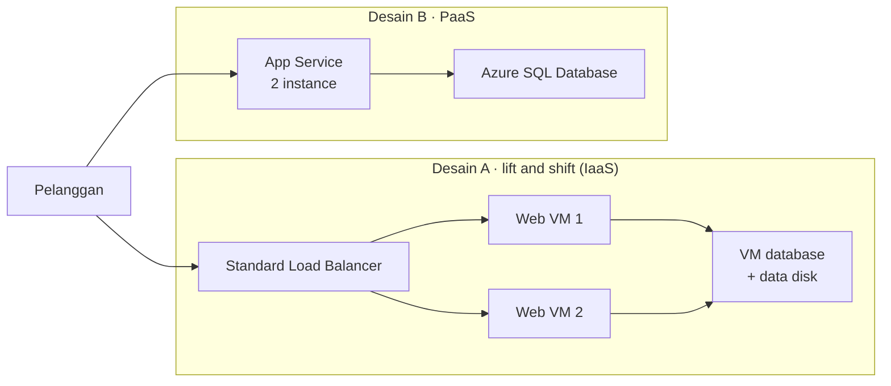

# Lab 02 · Menyusun justifikasi bisnis

🇬🇧 [Read in English](README.md)

> **Pasangan dari:** [Makan Siang 02 · Konsep Cloud (Dasar)](../../lunches/02-cloud-concepts/README.id.md)
> **Waktu:** sekitar 40 menit · **Biaya:** 💲 — tidak ada resource Azure yang dibuat (lihat [kelompok biaya](../README.id.md#kelompok-biaya)) · **Tingkat kesulitan:** ★☆☆
> **Bisa dikerjakan terpisah:** ✅ Anda tidak memerlukan lab sebelumnya. Tugas-tugas utamanya bahkan tidak membutuhkan
> subscription Azure.
> **Penulis:** Stefanus Pinarta · [Tentang penulis](../../README.id.md#tentang-penulis)

## 🎯 Yang akan Anda bangun

Ibu Sari ingin keputusan, bukan kuliah. Di lab ini Anda menyusun tiga hal yang dibutuhkan seorang direktur untuk
mengambil keputusan, yang bersama-sama membentuk sebuah justifikasi bisnis (business case):

1. **Dua estimasi biaya** di Azure pricing calculator untuk memindahkan toko online dari server pantry: **Desain A,
   lift and shift** ke virtual machine (IaaS), dan **Desain B, PaaS** di App Service dan Azure SQL Database.
2. **Lembar kerja yang sudah terisi** ([`worksheet.id.md`](worksheet.id.md)) yang membuktikan Anda bisa membedakan
   IaaS, PaaS, dan SaaS, CapEx dan OpEx, serta tanggung jawab Nusantara Retail dan tanggung jawab Microsoft.
3. **Rekomendasi satu halaman** yang bisa dibaca Ibu Sari dalam lima menit.



## ✅ Sebelum mulai

- Sebuah browser web. [Azure pricing calculator](https://azure.microsoft.com/en-us/pricing/calculator/) gratis dan bisa
  dipakai tanpa akun Azure.
- Opsional: masuk (sign in) ke kalkulator jika Anda ingin menyimpan estimasi secara online. Jika tidak, gunakan
  **Export** untuk mengunduh setiap estimasi sebagai spreadsheet.
- Lembar kerja, [`worksheet.id.md`](worksheet.id.md), di folder ini. Salin ke catatan Anda sendiri, atau cetak.
- Hanya untuk Tugas 7 yang opsional: Azure Cloud Shell dan file kursus (lihat [Lab 01](../01-before-you-begin/README.id.md)).

> [!IMPORTANT]
> Lab ini tidak membuat apa pun di Azure, jadi tidak ada `verify.sh` maupun `cleanup.sh`. Anda memeriksa hasil kerja
> sendiri dengan kunci jawaban di lembar kerja dan daftar periksa di *Verifikasi hasil kerja Anda*. Harga berubah dan
> berbeda menurut region dan mata uang, jadi angka Anda tidak akan persis sama dengan angka orang lain, dan itu tidak
> masalah.

## 🧭 Pilih mode Anda

| Mode | Cocok untuk Anda jika… | Caranya |
|---|---|---|
| **Terpandu** | Anda ingin setiap langkah dijelaskan | ikuti Tugas 1–6 di bawah (Tugas 7 opsional) |
| **Tantangan** | Anda sudah menguasai dasarnya | baca hanya [Ringkasan tantangan](#-ringkasan-tantangan), kerjakan dengan cara Anda sendiri, lalu periksa jawaban Anda di lembar kerja |

## Tugas 1 · Membaca kartu kebutuhan

Setiap estimasi dimulai dari kebutuhan, bukan dari produk. Berikut kebutuhan Nusantara Retail, yang disederhanakan untuk
latihan ini:

| Kebutuhan | Nilai untuk latihan ini |
|---|---|
| Region | **Indonesia Central**, karena data pelanggan sebaiknya tetap di Indonesia. Jika sebuah layanan atau ukuran tidak tersedia di sana, gunakan **Southeast Asia** untuk item itu dan catat. |
| Ketersediaan | Tetap berjalan meski satu web server hilang: minimal **dua** instance web. |
| Lapisan web | Kira-kira setara dengan server saat ini: **2 vCPU dan memori 8 GB** per instance web. |
| Database | Satu database relasional berukuran sekitar **256 GB**, berjalan 24 jam sehari. |
| Data yang dikirim ke pelanggan | Sekitar **100 GB per bulan** transfer data keluar ke internet. |
| Waktu berjalan | Sepanjang bulan: **730 jam**, bulan standar versi kalkulator. |
| Harga | **Pay-as-you-go** lebih dulu. Komitmen dibahas di Tugas 4. |
| Lisensi | Anggap software database di VM tidak menambah biaya lisensi, sehingga kedua desain hanya membandingkan biaya infrastruktur dan platform. Opsi lisensi dibahas di Makan Siang 19. |

Buka kalkulator dan pilih **mata uang** yang akan Anda pakai (di bagian atas atau bawah area estimasi). Pakai mata uang
yang sama untuk semua hal di lab ini.

> ✅ **Pemeriksaan:** Anda bisa menjelaskan dalam satu kalimat mengapa kartu ini meminta dua instance web. (Satu server
> adalah single point of failure, titik kegagalan tunggal, dan itulah persis kekhawatiran sang direktur.)

## Tugas 2 · Menghitung harga Desain A: lift and shift (IaaS)

Desain A memindahkan susunan yang ada sekarang ke Azure hampir tanpa perubahan: web server dan server database, semuanya
virtual machine. Tambahkan item-item berikut. Untuk menambah item, cari produknya di tab **Products**, pilih, lalu
konfigurasikan di bagian **Your estimate**. Nama kolom isian bisa berubah dari waktu ke waktu; jika nama di bawah ini
tidak persis sama, pilih opsi yang paling mendekati.

1. **Virtual Machines**, lapisan web:
   - **Region:** Indonesia Central · **Operating system:** Linux · **Type:** Ubuntu (atau *OS only*) · **Tier:** Standard
   - **Instance:** **D2s v5** (2 vCPU, RAM 8 GB). Jika tidak tercantum, pilih ukuran general-purpose terdekat dengan
     2 vCPU dan 8 GB, lalu catat ukuran mana yang Anda pilih.
   - **Virtual machines:** **2** · **Hours:** **730** · **Savings options:** **Pay as you go**
   - **Managed disks (OS disk):** **Premium SSD**, **P6 (64 GiB)**, satu per VM.
2. **Virtual Machines**, server database: pengaturan yang sama, tetapi **Instance:** **D4s v5** (4 vCPU, RAM 16 GB) dan
   **Virtual machines:** **1**. OS disk: **Premium SSD P6**.
3. **Managed Disks**, data disk database: **Premium SSD**, **P15 (256 GiB)**, **1** disk.
4. **Load Balancer:** tier **Standard**, **2** rule (HTTP dan HTTPS), **100 GB** data yang diproses per bulan.
5. **Bandwidth:** transfer data **keluar ke internet** dari Indonesia Central, **100 GB** per bulan.

> [!TIP]
> Jika item VM tidak punya bagian managed disk di versi kalkulator Anda, tambahkan item **Managed Disks** terpisah
> sebagai gantinya: Premium SSD, P6, jumlah 3 (dua VM web dan satu VM database).

Tulis total bulanan Desain A di Bagian 6 lembar kerja, dan catat baris mana yang paling besar.

> ✅ **Pemeriksaan:** Desain A punya lima item (VM web, VM database, data disk, load balancer, bandwidth), semuanya di
> region dan mata uang yang sama, dan total bulanannya sudah tercatat di lembar kerja Anda.

## Tugas 3 · Menghitung harga Desain B: PaaS

Desain B menyerahkan sistem operasi dan mesin database kepada Microsoft. Mulailah **estimasi baru** jika kalkulator Anda
menawarkan beberapa estimasi; jika tidak, tambahkan item-item ini di bawah item Desain A dan jumlahkan masing-masing
desain secara terpisah di lembar kerja.

1. **App Service:**
   - **Region:** Indonesia Central · **Operating system:** Linux · **Tier:** **Premium V3**
   - **Instance:** **P1v3** (2 vCPU, RAM 8 GB) · **Instances:** **2** · **Hours:** **730** · pay-as-you-go
2. **Azure SQL Database:**
   - **Type:** single database · **Purchase model:** vCore · **Service tier:** **General Purpose**
   - **Compute tier:** **Provisioned** · **Hardware type:** Standard-series (Gen 5) · **vCores:** **2**
   - **Storage:** **256 GB** · biarkan backup storage dan zone redundancy pada nilai default-nya
3. **Bandwidth:** **100 GB** yang sama, keluar ke internet dari Indonesia Central.

Tulis total bulanan Desain B di lembar kerja.

> ✅ **Pemeriksaan:** Desain B punya tiga item, dan total bulanannya sudah tercatat di lembar kerja, di samping total
> Desain A.

## Tugas 4 · Membandingkan seperti seorang analis

Satu angka total saja tidak membuktikan banyak. Jalankan tiga eksperimen dan tulis setiap hasilnya di Bagian 6 lembar
kerja:

1. **Komitmen.** Pada virtual machine di Desain A, ubah **Savings options** ke opsi **1 tahun** (savings plan atau
   reserved). Di Desain B, cari padanannya pada App Service dan Azure SQL Database. Tidak semua item menawarkannya; catat
   mana yang menawarkan. Tulis kedua total yang baru.
2. **Region.** Pindahkan setiap item ke **Southeast Asia**, catat kedua totalnya, lalu kembalikan. Harga berbeda menurut
   region, dan penghematan kecil harus ditimbang terhadap keharusan menyimpan data pelanggan di Indonesia.
3. **Waktu kerja orang.** Kalkulator hanya menampilkan tagihan Azure. Untuk setiap desain, daftarkan tugas rutin yang
   masih dikerjakan Nusantara Retail, seperti mem-patch sistem operasi, membuat backup dan menguji pemulihannya,
   memperbarui sertifikat, memantau disk, dan menanggapi alert di malam hari. Perkirakan jumlah jam per bulan untuk
   masing-masing, dengan asumsi Anda sendiri.

Tutup dengan menjawab tiga pertanyaan di lembar kerja: desain mana yang lebih murah di tagihan Azure, mana yang lebih
murah setelah waktu kerja orang ikut dihitung, dan mana yang punya lebih sedikit single point of failure?

> ✅ **Pemeriksaan:** Bagian 6 lembar kerja berisi total pay-as-you-go, total satu tahun, dan total Southeast Asia untuk
> kedua desain, ditambah estimasi waktu kerja orang versi Anda.

## Tugas 5 · Mengelompokkan (Bagian 1–5 lembar kerja)

Buka [`worksheet.id.md`](worksheet.id.md) dan kerjakan Bagian 1 sampai 5 *tanpa* membuka kunci jawabannya: jenis layanan,
CapEx atau OpEx, siapa yang bertanggung jawab, model cloud, dan manfaat. Lalu buka setiap blok jawaban dan nilai hasil
kerja Anda. Untuk setiap jawaban yang meleset, baca lagi bagian yang sesuai di bacaan Makan Siang 02.

> ✅ **Pemeriksaan:** setidaknya 35 dari 40 jawaban benar, dan Anda bisa menjelaskan setiap jawaban yang meleset.

## Tugas 6 · Menulis rekomendasi satu halaman

Gunakan templat di Bagian 7 lembar kerja. Rekomendasi yang baik:

- menjawab pertanyaan sang direktur, *"Kalau server itu mati, berapa lama kita tidak bisa jualan?"*, untuk setiap opsi;
- memberikan **satu** rekomendasi yang jelas dan menyebutkan apa yang Anda butuhkan untuk memulai (waktu, keterampilan,
  persetujuan);
- memakai angka dari estimasi Anda dan menyebutkan asumsi di baliknya;
- menyatakan dengan gamblang apa yang tetap menjadi tanggung jawab Nusantara Retail menurut model tanggung jawab
  bersama.

> ✅ **Pemeriksaan:** seseorang yang belum membaca Makan Siang 02 bisa memahami halaman Anda dalam lima menit.
> Bandingkan dengan contoh di lembar kerja; kesimpulan Anda boleh berbeda, asalkan Anda bisa memberikan alasannya.

## Tugas 7 (opsional) · Melihat region dan resource provider dari Cloud Shell

Kalkulator menampilkan daftar region dan layanan; Azure Resource Manager juga mengetahuinya. Di Cloud Shell (Bash):

```bash
cd ~/azure-fundamentals-lunches/labs/02-cloud-concepts
bash explore.sh
```

Skrip ini **hanya membaca**: tidak membuat dan tidak mengubah apa pun. Skrip menampilkan region di geografi Asia
Pasifik beserta region pasangannya (*pasangan wilayah*), status pendaftaran beberapa resource provider yang akan Anda
temui di kursus ini, dan sebagian jenis resource yang ditawarkan `Microsoft.Web` (provider PaaS di balik App Service).
Anda juga bisa menjalankan query satu per satu:

```bash
az account list-locations \
  --query "[?metadata.regionType=='Physical'].{name:name, displayName:displayName, pair:metadata.pairedRegion[0].name}" \
  --output table
az provider show --namespace Microsoft.Web --query "resourceTypes[].resourceType" --output tsv | head -20
```

> ✅ **Pemeriksaan:** Anda bisa menyebutkan region pasangan Southeast Asia (East Asia) dan memastikan bahwa Indonesia
> Central tidak menampilkan pasangan. Makan Siang 03 menjelaskan mengapa hal itu penting.

## 🔧 Rusak lalu perbaiki

Sebuah perbandingan bisa salah meskipun setiap angka di dalamnya benar. Buat satu perbandingan yang tidak adil dengan
sengaja: ubah VM web dan VM database di Desain A ke komitmen **3 tahun**, biarkan Desain B tetap pay-as-you-go, lalu
bandingkan lagi totalnya.

**Gejala:** Desain A tiba-tiba terlihat jauh lebih murah daripada Desain B, padahal tidak ada yang berubah pada
desainnya.

<details><summary>Petunjuk: cara memperbaikinya</summary>

Anda sedang membandingkan dua model harga, bukan dua desain. Bandingkan apel dengan apel: keduanya pay-as-you-go, atau
keduanya dengan komitmen setara yang terdekat pada setiap item yang menawarkannya. Periksa juga "tersangka" yang biasa:
region, mata uang, dan jumlah jam yang sama di setiap item, serta kebutuhan yang sama di kedua sisi (masing-masing dua
instance web, ukuran database yang sama, bandwidth yang sama). Desain A dengan satu VM juga lebih murah, tetapi gagal
memenuhi kebutuhan ketersediaan, padahal justru itulah inti proyek ini. Kembalikan Desain A ke pay-as-you-go sebelum
Anda melanjutkan.

</details>

## 🧪 Verifikasi hasil kerja Anda

Tidak ada `verify.sh`, karena tidak ada yang dibuat di Azure. Periksa hasil kerja Anda dengan daftar ini:

- [ ] Kedua desain memenuhi setiap baris kartu kebutuhan, di region dan mata uang yang sama.
- [ ] Bagian 6 lembar kerja berisi total pay-as-you-go, satu tahun, dan Southeast Asia untuk kedua desain, ditambah waktu
  kerja orang.
- [ ] Bagian 1–5 lembar kerja sudah dinilai dengan kunci jawaban, dan Anda bisa menjelaskan setiap jawaban yang meleset.
- [ ] Rekomendasi Anda muat dalam satu halaman, menjawab pertanyaan sang direktur untuk setiap opsi, dan merekomendasikan
  satu opsi.

## 🧹 Bersihkan (jangan dilewati!)

Tidak ada yang perlu dihapus di Azure: kalkulator tidak membuat resource, dan `explore.sh` hanya membaca. Jika Anda
menyimpan estimasi di kalkulator saat login dan tidak lagi membutuhkannya, hapus di sana. Simpan lembar kerja dan
rekomendasi Anda; Makan Siang 21 akan kembali ke pertanyaan sang direktur.

## 🩺 Pemecahan masalah

| Gejala | Kemungkinan penyebab | Perbaikan |
|---|---|---|
| *We encountered an error when loading your estimate.* | Estimasi yang tersimpan di browser Anda tidak bisa dimuat | Pilih **Reset now**, atau buka kalkulator di jendela browser privat (incognito) |
| Indonesia Central tidak ada di daftar region sebuah item | Layanan itu tidak ditawarkan di region tersebut (atau belum) | Gunakan Southeast Asia untuk item itu dan catat di lembar kerja |
| Sebuah ukuran atau tier, misalnya D2s v5 atau P1v3, tidak ada | Tidak ditawarkan di region itu, atau tersembunyi oleh filter seri atau kategori | Hapus filternya; pilih ukuran terdekat dengan vCPU dan memori yang sama, lalu catat |
| Total Anda sangat berbeda dari milik rekan Anda | Mata uang, region, jumlah jam, savings option, sistem operasi, atau pengaturan lisensi yang berbeda | Bandingkan pengaturannya item demi item |
| `explore.sh` menampilkan `You are not signed in to Azure. Run: az login` | Anda menjalankannya di komputer sendiri tanpa login | Jalankan `az login`, atau gunakan Cloud Shell |
| `explore.sh` menampilkan `NotRegistered` untuk beberapa provider | Normal: banyak provider baru didaftarkan saat pertama kali dibutuhkan | Tidak perlu melakukan apa pun; lab ini tidak membuat apa-apa |

## 🚀 Tantangan tambahan

- Tambahkan **Azure Backup** untuk ketiga VM di Desain A. Lalu periksa apa saja yang sudah termasuk secara standar di
  Azure SQL Database. Desain mana yang mendapat backup "gratis"?
- Hitung skenario Desember untuk Desain B: pertahankan dua instance App Service sepanjang bulan dan tambahkan empat lagi
  selama tiga hari (72 jam) di sekitar 12.12. Bagaimana perbandingannya dengan menyiapkan Desain A untuk beban puncak
  sepanjang bulan?
- Ganti compute provisioned dengan compute **serverless** di Azure SQL Database. Kapan auto-pause membantu, dan mengapa
  fitur itu tidak membantu toko yang berjualan 24 jam sehari?
- Hitung harga Desain B dengan **Azure Database for PostgreSQL flexible server** sebagai pengganti Azure SQL Database,
  dan catat apa yang berubah selain harganya.
- Baca tentang fitur business case di Azure Migrate, lalu daftarkan apa yang akan ditambahkannya pada perbandingan Anda.

## 🏁 Ringkasan tantangan

Bangun hal berikut, dengan cara apa pun yang Anda suka:

1. Dua estimasi pay-as-you-go di Azure pricing calculator, di Indonesia Central (Southeast Asia hanya untuk item yang
   tidak ditawarkan di sana) dan dalam satu mata uang:
   - **Desain A (IaaS):** dua VM web Linux dengan masing-masing 2 vCPU dan 8 GB, satu VM database dengan 4 vCPU dan
     16 GB, OS disk Premium SSD, satu data disk Premium SSD 256 GiB, sebuah load balancer Standard, dan 100 GB egress
     (data keluar) ke internet.
   - **Desain B (PaaS):** App Service Premium v3 dengan dua instance 2 vCPU, 8 GB; Azure SQL Database General Purpose
     dengan 2 vCore dan 256 GB; dan 100 GB egress ke internet.
2. Kedua estimasi sekali lagi dengan komitmen satu tahun jika tersedia, dan sekali lagi di Southeast Asia.
3. Bagian 1–6 lembar kerja sudah diisi dan dinilai.
4. Rekomendasi satu halaman untuk Ibu Sari, memakai templat di Bagian 7 lembar kerja.

Lalu periksa jawaban Anda di lembar kerja. Tidak ada `verify.sh` untuk lab ini, karena tidak ada apa pun di Azure yang
perlu diverifikasi.

---

⬅️ [Bacaan Makan Siang 02](../../lunches/02-cloud-concepts/README.id.md) · 🏠 [Semua lab](../README.id.md) · 🏠 [Beranda kursus](../../README.id.md)

<sub>Terakhir divalidasi: Oktober 2026 · Ada yang tidak berfungsi? [Laporkan masalah lab](../../CONTRIBUTING.md).</sub>
