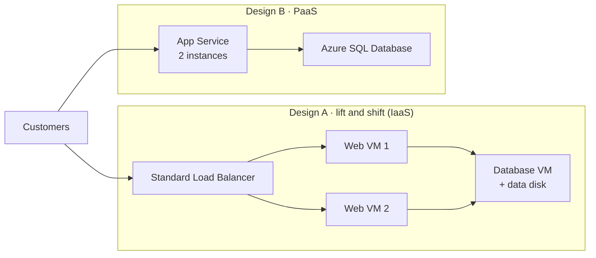

# Lab 02 · Make the business case

🇮🇩 [Baca dalam Bahasa Indonesia](README.id.md)

> **Pairs with:** [Lunch 02 · Cloud Concepts](../../lunches/02-cloud-concepts/README.md)
> **Time:** about 40 minutes · **Cost:** 💲 — no Azure resources are created (see [cost bands](../README.md#cost-bands)) · **Difficulty:** ★☆☆
> **Works on its own:** ✅ You do not need any earlier lab. The main tasks do not even need an Azure subscription.
> **Author:** Stefanus Pinarta · [About the author](../../README.md#about-the-author)

## 🎯 What you'll build

Ibu Sari wants a decision, not a lecture. In this lab you produce the three things a director needs to make one:

1. **Two cost estimates** in the Azure pricing calculator for moving the storefront off the pantry server:
   **Design A, lift and shift** to virtual machines (IaaS), and **Design B, PaaS** on App Service and Azure SQL Database.
2. **A completed worksheet** ([`worksheet.md`](worksheet.md)) that shows you can tell IaaS from PaaS from SaaS, CapEx
   from OpEx, and Nusantara Retail's responsibilities from Microsoft's.
3. **A one-page recommendation** that Ibu Sari can read in five minutes.



## ✅ Before you start

- A web browser. The [Azure pricing calculator](https://azure.microsoft.com/en-us/pricing/calculator/) is free and works
  without an Azure account.
- Optional: sign in to the calculator if you want to save your estimates online. Otherwise, use **Export** to download
  each estimate as a spreadsheet.
- The worksheet, [`worksheet.md`](worksheet.md), in this folder. Copy it into your own notes, or print it.
- Only for the optional Task 7: Azure Cloud Shell and the course files (see [Lab 01](../01-before-you-begin/README.md)).

> [!IMPORTANT]
> This lab creates nothing in Azure, so it has no `verify.sh` and no `cleanup.sh`. You check your own work with the
> answers in the worksheet and the checklist in *Verify your work*. Prices change and differ by region and currency, so
> your numbers will not match anyone else's exactly, and that is fine.

## 🧭 Choose your mode

| Mode | For you if… | How |
|---|---|---|
| **Guided** | you want every step explained | follow Tasks 1–6 below (Task 7 is optional) |
| **Challenge** | you already know the basics | read only the [Challenge brief](#-challenge-brief), do it your way, then check your answers in the worksheet |

## Task 1 · Read the requirements card

Every estimate starts from requirements, not from products. These are Nusantara Retail's, simplified for the exercise:

| Requirement | Value for this exercise |
|---|---|
| Region | **Indonesia Central**, because customer data should stay in Indonesia. If a service or size is not offered there, use **Southeast Asia** for that item and note it. |
| Availability | Survive the loss of one web server: at least **two** web instances. |
| Web tier | About what today's server provides: **2 vCPUs and 8 GB of memory** per web instance. |
| Database | One relational database of about **256 GB**, running around the clock. |
| Data sent to customers | About **100 GB per month** of data transfer out to the internet. |
| Running time | All month: **730 hours**, the calculator's standard month. |
| Pricing | **Pay-as-you-go** first. Commitments come in Task 4. |
| Licences | Assume the database software on a VM brings no extra licence cost, so both designs compare infrastructure and platform costs only. Licensing options are covered in Lunch 19. |

Open the calculator and pick the **currency** you will use (at the top or bottom of the estimate area). Keep the same
currency for everything in this lab.

> ✅ **Checkpoint:** you can explain in one sentence why the card asks for two web instances. (One server is a single
> point of failure, which is exactly the director's worry.)

## Task 2 · Price Design A: lift and shift (IaaS)

Design A moves today's setup to Azure almost unchanged: web servers and a database server, all virtual machines. Add
the following items. To add an item, search for the product on the **Products** tab, select it, then configure it under
**Your estimate**. Field names change from time to time; when a name below does not match exactly, choose the closest
option.

1. **Virtual Machines**, the web tier:
   - **Region:** Indonesia Central · **Operating system:** Linux · **Type:** Ubuntu (or *OS only*) · **Tier:** Standard
   - **Instance:** **D2s v5** (2 vCPUs, 8 GB RAM). If it is not listed, pick the closest general-purpose size with
     2 vCPUs and 8 GB and write down which one.
   - **Virtual machines:** **2** · **Hours:** **730** · **Savings options:** **Pay as you go**
   - **Managed disks (OS disk):** **Premium SSD**, **P6 (64 GiB)**, one per VM.
2. **Virtual Machines**, the database server: same settings, but **Instance:** **D4s v5** (4 vCPUs, 16 GB RAM) and
   **Virtual machines:** **1**. OS disk: **Premium SSD P6**.
3. **Managed Disks**, the database data disk: **Premium SSD**, **P15 (256 GiB)**, **1** disk.
4. **Load Balancer:** **Standard** tier, **2** rules (HTTP and HTTPS), **100 GB** of data processed per month.
5. **Bandwidth:** data transfer **out to the internet** from Indonesia Central, **100 GB** per month.

> [!TIP]
> If a VM item has no managed-disk section in your version of the calculator, add a separate **Managed Disks** item
> instead: Premium SSD, P6, quantity 3 (two web VMs and the database VM).

Write the monthly total of Design A in Part 6 of the worksheet, and note which line is the largest.

> ✅ **Checkpoint:** Design A has five items (web VMs, database VM, data disk, load balancer, bandwidth), all in the same
> region and currency, and its monthly total is in your worksheet.

## Task 3 · Price Design B: PaaS

Design B gives the operating systems and the database engine to Microsoft. Start a **new estimate** if your calculator
offers several estimates; otherwise add these items below Design A's and add up each design separately in the worksheet.

1. **App Service:**
   - **Region:** Indonesia Central · **Operating system:** Linux · **Tier:** **Premium V3**
   - **Instance:** **P1v3** (2 vCPUs, 8 GB RAM) · **Instances:** **2** · **Hours:** **730** · pay-as-you-go
2. **Azure SQL Database:**
   - **Type:** single database · **Purchase model:** vCore · **Service tier:** **General Purpose**
   - **Compute tier:** **Provisioned** · **Hardware type:** Standard-series (Gen 5) · **vCores:** **2**
   - **Storage:** **256 GB** · leave backup storage and zone redundancy at their defaults
3. **Bandwidth:** the same **100 GB** out to the internet from Indonesia Central.

Write Design B's monthly total in the worksheet.

> ✅ **Checkpoint:** Design B has three items and its monthly total is in your worksheet, next to Design A's.

## Task 4 · Compare like an analyst

A single total proves little. Run three experiments and write every result in Part 6 of the worksheet:

1. **Commitment.** On the virtual machines in Design A, change **Savings options** to a **1-year** option (savings
   plan or reserved). In Design B, look for the equivalent on App Service and Azure SQL Database. Not every item offers
   one; note which do. Write down both new totals.
2. **Region.** Switch every item to **Southeast Asia**, note both totals, then switch back. Prices differ by region,
   and a small saving has to be weighed against keeping customer data in Indonesia.
3. **People time.** The calculator only shows Azure's bill. For each design, list the regular tasks Nusantara Retail
   still performs, such as patching operating systems, backing up and testing restores, renewing certificates,
   monitoring disks, and answering alerts at night. Estimate the hours per month for each, using your own assumptions.

Finish by answering three questions in the worksheet: which design is cheaper on the Azure bill, which is cheaper once
people time is included, and which has fewer single points of failure?

> ✅ **Checkpoint:** Part 6 of the worksheet has pay-as-you-go, one-year and Southeast Asia totals for both designs,
> plus your people-time estimate.

## Task 5 · Classify (worksheet Parts 1–5)

Open [`worksheet.md`](worksheet.md) and complete Parts 1 to 5 *without* opening the answers: service types, CapEx or
OpEx, who is responsible, cloud models, and benefits. Then expand each answer block and mark your work. For every miss,
re-read the matching section of the Lunch 02 reading.

> ✅ **Checkpoint:** at least 35 of the 40 answers are right, and you can explain each one you missed.

## Task 6 · Write the one-page recommendation

Use the template in Part 7 of the worksheet. A good recommendation:

- answers the director's question, *"If that server dies, how long can't we sell?"*, for every option;
- makes **one** clear recommendation and says what you need to start (time, skills, approval);
- uses the numbers from your estimates and names the assumptions behind them;
- says plainly what stays Nusantara Retail's responsibility under the shared responsibility model.

> ✅ **Checkpoint:** someone who has not read Lunch 02 understands your page in five minutes. Compare it with the
> example in the worksheet; yours can reach a different conclusion, as long as you justify it.

## Task 7 (optional) · Look at regions and resource providers from Cloud Shell

The calculator listed regions and services; Azure Resource Manager knows them too. In Cloud Shell (Bash):

```bash
cd ~/azure-fundamentals-lunches/labs/02-cloud-concepts
bash explore.sh
```

The script is **read-only**: it creates and changes nothing. It shows the regions in the Asia Pacific geography and
their paired regions, the registration state of a few resource providers you will meet in this course, and some of the
resource types that `Microsoft.Web` (the PaaS provider behind App Service) offers. You can also run single queries
yourself:

```bash
az account list-locations \
  --query "[?metadata.regionType=='Physical'].{name:name, displayName:displayName, pair:metadata.pairedRegion[0].name}" \
  --output table
az provider show --namespace Microsoft.Web --query "resourceTypes[].resourceType" --output tsv | head -20
```

> ✅ **Checkpoint:** you can name the paired region of Southeast Asia (East Asia) and confirm that Indonesia Central
> shows no pair. Lunch 03 explains why that matters.

## 🔧 Break it and fix it

A comparison can be wrong even when every number in it is right. Make one unfair on purpose: switch Design A's web and
database VMs to a **3-year** commitment, leave Design B on pay-as-you-go, and compare the totals again.

**Symptom:** Design A suddenly looks much cheaper than Design B, although nothing about the designs changed.

<details><summary>Hint: how to fix it</summary>

You are comparing two different pricing models, not two designs. Compare like with like: both on pay-as-you-go, or
both with the nearest equivalent commitment on every item that offers one. Check the other usual suspects as well:
the same region, currency and hours on every item, and the same requirements on both sides (two web instances each,
the same database size, the same bandwidth). A one-VM Design A is cheaper too, but it fails the availability
requirement, which is the whole point of the project. Set Design A back to pay-as-you-go before you continue.

</details>

## 🧪 Verify your work

There is no `verify.sh`, because nothing is created in Azure. Check your work against this list:

- [ ] Both designs meet every line of the requirements card, in the same region and currency.
- [ ] Part 6 of the worksheet holds pay-as-you-go, one-year and Southeast Asia totals for both designs, plus people time.
- [ ] Worksheet Parts 1–5 are marked against the answers, and you can explain every miss.
- [ ] Your recommendation fits on one page, answers the director's question for each option and recommends one.

## 🧹 Clean up (do not skip!)

Nothing to delete in Azure: the calculator creates no resources, and `explore.sh` only reads. If you saved estimates in
the calculator while signed in and no longer need them, delete them there. Keep your worksheet and recommendation; Lunch
21 returns to the director's question.

## 🩺 Troubleshooting

| Symptom | Likely cause | Fix |
|---|---|---|
| *We encountered an error when loading your estimate.* | The estimate stored by your browser could not be loaded | Select **Reset now**, or open the calculator in a private browser window |
| Indonesia Central is missing from an item's region list | That service is not offered in that region (or not yet) | Use Southeast Asia for that item and note it in the worksheet |
| A size or tier, such as D2s v5 or P1v3, is missing | Not offered in that region, or a series or category filter hides it | Clear the filters; choose the closest size with the same vCPUs and memory and write it down |
| Your totals differ a lot from a colleague's | Different currency, region, hours, savings option, operating system or licensing setting | Compare the settings item by item |
| `explore.sh` prints `You are not signed in to Azure. Run: az login` | You are running it on your own computer without signing in | Run `az login`, or use Cloud Shell |
| `explore.sh` shows `NotRegistered` for some providers | Normal: many providers are registered only when they are first needed | Nothing to do; this lab creates nothing |

## 🚀 Stretch goals

- Add **Azure Backup** for the three VMs in Design A. Then check what Azure SQL Database includes as standard. Which
  design gets backups "for free"?
- Price a December scenario for Design B: keep two App Service instances for the whole month and add four more for
  three days (72 hours) around 12.12. How does that compare with sizing Design A for the peak all month?
- Replace provisioned compute with **serverless** compute in Azure SQL Database. When does auto-pause help, and why does
  it not help a shop that sells around the clock?
- Price Design B with **Azure Database for PostgreSQL flexible server** instead of Azure SQL Database, and note what
  changes besides the price.
- Read about the business case feature of Azure Migrate and list what it would add to your comparison.

## 🏁 Challenge brief

Build the following, any way you like:

1. Two pay-as-you-go estimates in the Azure pricing calculator, in Indonesia Central (Southeast Asia only for items not
   offered there) and one currency:
   - **Design A (IaaS):** two Linux web VMs with 2 vCPUs and 8 GB each, one database VM with 4 vCPUs and 16 GB,
     Premium SSD OS disks, a 256 GiB Premium SSD data disk, a Standard load balancer, and 100 GB of internet egress.
   - **Design B (PaaS):** App Service Premium v3 with two 2-vCPU, 8 GB instances; Azure SQL Database General
     Purpose with 2 vCores and 256 GB; and 100 GB of internet egress.
2. Both estimates again with one-year commitments where offered, and once in Southeast Asia.
3. Worksheet Parts 1–6 completed and marked.
4. A one-page recommendation for Ibu Sari, using the template in worksheet Part 7.

Then check your answers in the worksheet. There is no `verify.sh` for this lab, because nothing exists in Azure to verify.

---

⬅️ [Lunch 02 reading](../../lunches/02-cloud-concepts/README.md) · 🏠 [All labs](../README.md) · 🏠 [Course home](../../README.md)

<sub>Last validated: October 2026 · Something broken? [Report a lab problem](../../CONTRIBUTING.md).</sub>
