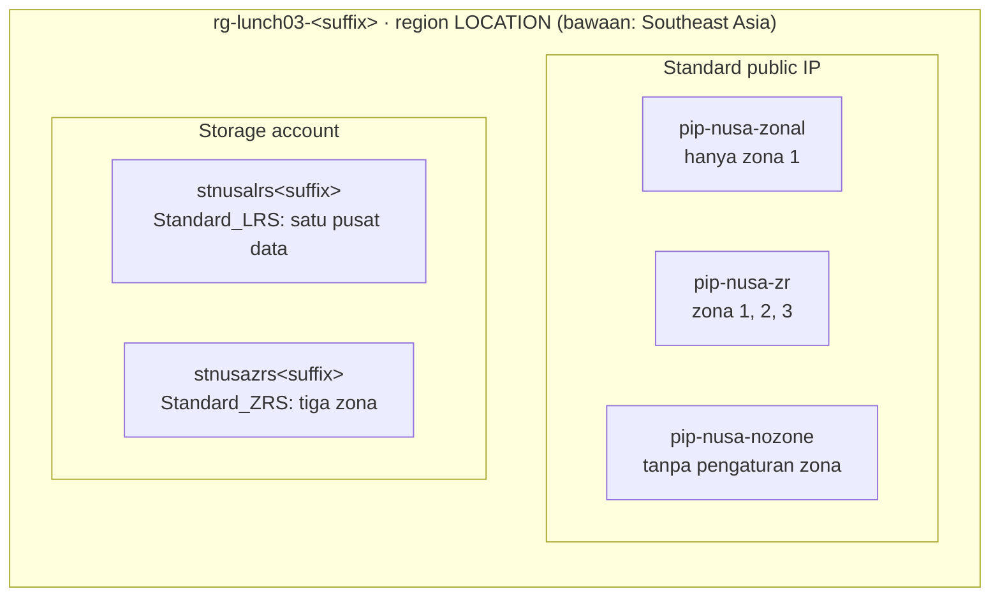

# Lab 03 · Menjelajahi region dan zona

🇬🇧 [Read in English](README.md)

> **Pasangan dari:** [Makan Siang 03 · Infrastruktur Global Azure: Region, Availability Zone, dan Region Pair (Dasar)](../../lunches/03-global-infrastructure/README.id.md)
> **Waktu:** sekitar 35 menit · **Biaya:** 💲 (lihat [kelompok biaya](../README.id.md#kelompok-biaya)) · **Tingkat kesulitan:** ★☆☆
> **Bisa dikerjakan terpisah:** ✅ Anda tidak memerlukan lab sebelumnya. Semua yang dibutuhkan lab ini dibuat oleh langkah-langkahnya sendiri.
> **Penulis:** Stefanus Pinarta · [Tentang penulis](../../README.id.md#tentang-penulis)

## 🎯 Yang akan Anda bangun

Sebelum Nusantara Retail menjatuhkan pilihan pada sebuah region, Ibu Sari ingin bukti, bukan opini. Di lab ini, Anda
yang mengumpulkannya. Anda memakai Azure CLI untuk menampilkan daftar region beserta geografi dan pasangannya, membaca
pemetaan zona logis ke zona fisik di subscription Anda, dan memeriksa ukuran VM serta layanan apa yang tersedia di
mana. Setelah itu, Anda membangun resource kecil dan murah yang membuat perbedaan antara zonal dan zone-redundant
terlihat jelas: tiga Standard public IP (zonal, zone-redundant, dan "tanpa pengaturan zona") dan dua storage account
(LRS dan ZRS). Anda menutupnya dengan pemeriksaan latensi singkat dari browser Anda sendiri.



## ✅ Sebelum mulai

- Subscription Azure tempat Anda bisa membuat resource (lihat [Lab 01](../01-before-you-begin/README.id.md)).
- **Azure Cloud Shell (Bash)** — buka [shell.azure.com](https://shell.azure.com). Tidak ada yang perlu dipasang.
- Ambil file lab dan muat pengaturan bersama:

```bash
git clone https://github.com/stefpin/azure-fundamentals-lunches.git   # first time only
cd azure-fundamentals-lunches/labs/03-global-infrastructure
source ../common/config.sh
RG=$(rg_name 03)
ST_LRS="stnusalrs${SUFFIX}"
ST_ZRS="stnusazrs${SUFFIX}"
```

- Lab ini tidak punya `setup.sh`: Anda membuat semuanya sendiri.
- `LOCATION` harus berupa region **yang punya availability zone**. Nilai bawaannya, `southeastasia`, punya tiga zona.
  Peserta di Indonesia bisa menjalankan `export LOCATION=indonesiacentral` lalu `source ../common/config.sh` sekali
  lagi; region ini juga punya tiga zona.
- Jika Cloud Shell kehabisan waktu (timeout) lalu dimulai ulang, `cd` kembali ke folder lab dan jalankan lagi empat
  baris setelah `cd`.

> [!IMPORTANT]
> Resource lab dikenai biaya selama masih ada. Alamat Standard public IPv4 ditagih per jam meskipun tidak dipakai apa
> pun. Akhiri lab dengan bagian **Bersihkan**, meskipun Anda berhenti di tengah jalan.

## 🧭 Pilih mode Anda

| Mode | Cocok untuk Anda jika… | Caranya |
|---|---|---|
| **Terpandu** | Anda ingin setiap langkah dijelaskan | ikuti Tugas 1–5 di bawah |
| **Tantangan** | Anda sudah menguasai dasarnya | baca hanya [Ringkasan tantangan](#-ringkasan-tantangan), bangun dengan cara Anda sendiri, lalu jalankan `bash verify.sh` |

## Tugas 1 · Region, geografi, dan pasangan

Setiap region termasuk dalam sebuah geografi (batas residensi data, yaitu batas wilayah tempat data boleh disimpan),
dan sebagian region punya region pasangan. CLI menampilkan persis apa yang bisa dilihat subscription Anda, jadi
mulailah dari sana.

```bash
# How many physical regions can your subscription see?
az account list-locations --query "length([?metadata.regionType=='Physical'])"

# The regions closest to Nusantara Retail: geography, city and paired region
az account list-locations \
  --query "[?contains(['indonesiacentral','southeastasia','eastasia','malaysiawest'], name)].{region:name, geography:metadata.geography, city:metadata.physicalLocation, pair:metadata.pairedRegion[0].name}" \
  --output table

# Which physical regions have no paired region at all?
az account list-locations \
  --query "[?metadata.regionType=='Physical' && !metadata.pairedRegion].displayName" \
  --output tsv | sort
```

Perintah pertama hanya menghitung region **fisik**. Daftarnya juga memuat entri *logis* seperti "Asia Pacific", yang
mengelompokkan region untuk sebagian layanan dan bukan tempat Anda men-deploy sesuatu.

> [!TIP]
> **Lebih suka portal?** Buka dropdown region di halaman *Create* mana pun (misalnya *Create a resource group*): region
> dikelompokkan per geografi, seperti "(Asia Pacific) Southeast Asia". Pasangan dan jumlah zona lebih mudah dibaca di
> [daftar region Azure](https://learn.microsoft.com/azure/reliability/regions-list) milik Microsoft.

> ✅ **Pemeriksaan:** tabel menampilkan `eastasia` sebagai pasangan `southeastasia` (dan sebaliknya), sementara
> `indonesiacentral` dan `malaysiawest` menampilkan kolom pair yang kosong. Indonesia Central muncul di daftar "tanpa
> pasangan". Kolom geografi menampilkan region Singapura dan Hong Kong dalam satu geografi dan Jakarta di geografi lain
> (kata-kata persisnya berasal dari platform dan bisa sedikit berbeda dari dokumentasi).

## Tugas 2 · Melihat ke dalam region Anda: zona, pemetaan zona, dan apa saja yang tersedia

Zona diberi nomor 1, 2, dan 3 di setiap subscription, tetapi nomor itu bersifat **logis**. Setiap subscription punya
pemetaannya sendiri ke zona fisik, dan Anda bisa membaca milik Anda.

```bash
# Your subscription's logical-to-physical zone mapping for LOCATION
az account list-locations \
  --query "[?name=='${LOCATION}'].availabilityZoneMappings | [0]" \
  --output table

# How many regions offer zones to your subscription?
az account list-locations --query "length([?availabilityZoneMappings])"
```

Berikutnya, periksa ukuran VM mana yang bisa di-deploy subscription Anda ke dalam zona. Daftar SKU-nya besar, jadi
perintah ini bisa memakan waktu satu atau dua menit; bacalah paragraf berikutnya sambil menunggu.

```bash
az vm list-skus --location "$LOCATION" --resource-type virtualMachines \
  --size Standard_B --zone --output table
```

`--zone` hanya menyisakan ukuran yang mendukung availability zone, dan kolom **Zones** menunjukkan di zona mana saja
setiap ukuran ditawarkan. Secara bawaan, daftar ini menyembunyikan ukuran yang dibatasi untuk subscription Anda;
tambahkan `--all` untuk ikut melihatnya, lengkap dengan alasannya di kolom **Restrictions**.

Terakhir, tanyakan kepada Azure Resource Manager apakah sebuah layanan tersedia di suatu region. Setiap resource
provider (layanan Azure di balik sekelompok tipe resource) menerbitkan lokasi untuk setiap tipe resource-nya:

```bash
for rt in Microsoft.Network/natGateways Microsoft.App/managedEnvironments; do
  ns="${rt%%/*}"; type="${rt#*/}"
  echo "== ${rt}"
  az provider show --namespace "$ns" \
    --query "resourceTypes[?resourceType=='${type}'].locations | [0]" --output tsv \
    | grep -i -E "indonesia|southeast asia|east asia" || echo "   (not listed in these regions)"
done
```

> [!TIP]
> **Lebih suka portal?** Halaman publik [produk yang tersedia per region](https://azure.microsoft.com/en-us/explore/global-infrastructure/products-by-region/)
> menjawab pertanyaan yang sama untuk setiap produk. CLI lebih cocok untuk tipe resource yang persis, ukuran VM, dan
> batasan khusus subscription Anda sendiri.

> ✅ **Pemeriksaan:** tabel pemetaan menampilkan tiga baris (zona logis 1, 2, dan 3, masing-masing dengan nama zona
> fisik seperti `southeastasia-az2`); zona logis 1 Anda belum tentu zona fisik 1. Tabel SKU menampilkan beberapa ukuran
> seri B dengan `1,2,3` di kolom Zones. Perulangan (loop) mencetak nama region tempat setiap tipe resource tersedia.

## Tugas 3 · Public IP zonal, zone-redundant, dan "tanpa zona"

Public IP adalah objek uji yang sempurna: dibuat dalam hitungan detik, biayanya sangat kecil, dan pengaturan zonanya
terlihat jelas. Buat resource group dan tiga alamat Standard public IPv4.

```bash
ensure_rg "$RG" 03

# Zonal: pinned to logical zone 1
az network public-ip create --resource-group "$RG" --name pip-nusa-zonal \
  --location "$LOCATION" --sku Standard --version IPv4 --allocation-method Static \
  --zone 1 --output none

# Zone-redundant: spread across zones 1, 2 and 3
az network public-ip create --resource-group "$RG" --name pip-nusa-zr \
  --location "$LOCATION" --sku Standard --version IPv4 --allocation-method Static \
  --zone 1 2 3 --output none

# No zone given: what does Azure do?
az network public-ip create --resource-group "$RG" --name pip-nusa-nozone \
  --location "$LOCATION" --sku Standard --version IPv4 --allocation-method Static \
  --output none
```

Sekarang bandingkan ketiganya:

```bash
az network public-ip list --resource-group "$RG" \
  --query "[].{name:name, sku:sku.name, allocation:publicIPAllocationMethod, zones:join(', ', zones || \`[]\`)}" \
  --output table
```

Cara membaca hasilnya:

- **pip-nusa-zonal** menampilkan `1`. IP ini **zonal**: tinggal di zona 1 dan berbagi nasib dengan zona itu.
- **pip-nusa-zr** menampilkan `1, 2, 3`. IP ini **zone-redundant**: tetap bertahan saat zona mana pun hilang.
- **pip-nusa-nozone** kemungkinan besar menampilkan kolom zones yang kosong. Jangan artikan itu sebagai "nonzonal". Di
  region yang punya availability zone, Microsoft memperlakukan Standard public IP tanpa pengaturan zona sebagai
  zone-redundant; IP yang tidak menampilkan zona berperilaku sama dengan IP yang menampilkan `1, 2, 3`. Hanya di region
  **tanpa** zona sebuah public IP benar-benar nonzonal. Tergantung versi API-nya, kolom itu juga mungkin kembali dalam
  keadaan terisi. Apa pun hasilnya, tetapkan `--zone` secara eksplisit di script Anda agar niat Anda jelas bagi
  pembaca berikutnya.

Satu aturan lagi: pengaturan zona sebuah public IP ditetapkan saat IP itu dibuat. Untuk mengubahnya, Anda harus membuat
IP baru, yang berarti juga alamat baru, jadi putuskan dulu sebelum Anda memberikan alamat itu kepada mitra atau
memasukkannya ke record DNS.

> [!TIP]
> **Lebih suka portal?** *Home › Public IP addresses › Create*: perhatikan pengaturan **Availability zone** dan pilihan
> yang ditawarkannya di region Anda, lalu tinggalkan halaman itu tanpa membuat apa pun.

> ✅ **Pemeriksaan:** tiga IP Standard dengan alokasi Static ada di `rg-lunch03-<suffix>`, dengan zona `1`, `1, 2, 3`, dan
> (kemungkinan besar) kosong.

## Tugas 4 · Storage LRS versus ZRS

Storage account menampilkan pilihan yang sama dalam bentuk **redundansi**. Locally redundant storage (LRS) menyimpan
tiga salinan di satu pusat data; zone-redundant storage (ZRS) menyimpan salinan di tiga zona dan baru mengonfirmasi
penulisan setelah setiap salinan menerimanya. Buat satu dari masing-masing jenis, keduanya dengan TLS 1.2 sebagai versi
minimum dan akses blob anonim dimatikan.

```bash
az storage account create --name "$ST_LRS" --resource-group "$RG" --location "$LOCATION" \
  --sku Standard_LRS --kind StorageV2 --min-tls-version TLS1_2 --allow-blob-public-access false \
  --output none

az storage account create --name "$ST_ZRS" --resource-group "$RG" --location "$LOCATION" \
  --sku Standard_ZRS --kind StorageV2 --min-tls-version TLS1_2 --allow-blob-public-access false \
  --output none
```

Bandingkan keduanya:

```bash
az storage account list --resource-group "$RG" \
  --query "[].{name:name, sku:sku.name, primary:primaryLocation, secondary:secondaryLocation, status:statusOfPrimary}" \
  --output table
```

Kedua account tinggal di `LOCATION` Anda, dan kolom **secondary** kosong untuk keduanya: LRS dan ZRS tidak pernah keluar
dari region. ZRS melindungi Anda dari kehilangan satu pusat data atau satu zona utuh; ZRS tidak melindungi Anda dari
kehilangan region, dan, seperti setiap opsi redundansi, ZRS juga ikut menyalin penghapusan dan penimpaan. Lokasi
sekunder hanya muncul pada opsi geo-redundant (GRS, GZRS), yang mereplikasi ke region **pasangan**. Tantangan tambahan
di akhir lab memberi Anda kesempatan untuk melihatnya.

> [!TIP]
> **Lebih suka portal?** *Home › Storage accounts › Create*: dropdown **Redundancy** di tab Basics menawarkan pilihan
> yang sama. Bandingkan apa yang ditawarkannya di Southeast Asia dan di Indonesia Central.

> ✅ **Pemeriksaan:** dua account StorageV2, `stnusalrs<suffix>` dengan `Standard_LRS` dan `stnusazrs<suffix>` dengan
> `Standard_ZRS`, keduanya dengan `LOCATION` Anda sebagai lokasi primer dan tanpa lokasi sekunder.

## Tugas 5 (opsional) · Pemeriksaan latensi kasar dari browser Anda

Cloud Shell berjalan di dalam pusat data Azure, jadi ia tidak bisa memberi tahu apa yang dirasakan para pembeli Anda.
Browser Anda sendiri bisa.

1. Buka halaman [Azure Latency Test](https://www.azurespeed.com/Azure/Latency) buatan komunitas (alat gratis dari pihak
   ketiga, bukan layanan Microsoft).
2. Pilih Indonesia Central, Southeast Asia, East Asia, dan Malaysia West, lalu biarkan berjalan selama satu menit.
3. Catat waktu bolak-balik (round trip) median untuk setiap region, lalu bandingkan.

Anggap angka-angka itu sebagai sinyal kasar: pengujian berjalan lewat HTTPS dari browser Anda, jadi waktu pencarian DNS
dan handshake TLS ikut terhitung, dan hasilnya bergantung pada penyedia internet Anda sendiri. Untuk angka antar-region
yang diukur di dalam jaringan Microsoft, gunakan [statistik latensi antar-region](https://learn.microsoft.com/azure/networking/azure-network-latency)
dari Microsoft.

> ✅ **Pemeriksaan:** Anda punya empat angka latensi. Dari sebagian besar tempat di Indonesia, Jakarta biasanya
> diharapkan menjadi yang tercepat, tetapi jaringan Anda yang punya keputusan akhir. Justru karena itulah Anda
> mengukurnya.

## 🔧 Rusak lalu perbaiki

Zone-redundant storage membutuhkan region yang punya availability zone. Cobalah membuat account ZRS di region yang sama
sekali tidak punya zona.

```bash
# Find a physical region without availability zones (falls back to westus, which has none)
NOZONE_REGION=$(az account list-locations \
  --query "[?metadata.regionType=='Physical' && metadata.regionCategory=='Recommended' && !availabilityZoneMappings].name | [0]" \
  --output tsv)
NOZONE_REGION=${NOZONE_REGION:-westus}
echo "Region without zones: ${NOZONE_REGION}"

az storage account create --name "stnusabrk${SUFFIX}" --resource-group "$RG" \
  --location "$NOZONE_REGION" --sku Standard_ZRS --kind StorageV2 --output none
```

**Gejala:** perintah gagal dengan error yang menyatakan bahwa SKU `Standard_ZRS` tidak didukung atau tidak tersedia di
lokasi itu. (Jika error-nya justru menyatakan bahwa lokasi itu tidak tersedia untuk subscription Anda, pilih region
lain dari daftar dan coba lagi.)

<details><summary>Petunjuk dan perbaikan</summary>

ZRS menyebarkan salinan ke beberapa availability zone, jadi ZRS hanya ada di region yang memiliki zona. Sebelum memilih
opsi redundansi, periksa region-nya:

```bash
az account list-locations --query "[?name=='${NOZONE_REGION}'].availabilityZoneMappings | [0]" --output table
```

Hasil kosong berarti tidak ada zona. Perbaiki dengan memilih region yang punya zona (`--location "$LOCATION"`) atau,
jika Anda benar-benar membutuhkan region itu, dengan memakai `Standard_LRS` dan menerima bahwa kegagalan satu pusat data
akan membuat data tidak bisa diakses. Lalu pastikan tidak ada resource tambahan yang telanjur terbuat:

```bash
if az storage account show --name "stnusabrk${SUFFIX}" --resource-group "$RG" --output none 2>/dev/null; then
  az storage account delete --name "stnusabrk${SUFFIX}" --resource-group "$RG" --yes
else
  echo "Nothing to remove: the failed request created nothing."
fi
```

</details>

## 🧪 Verifikasi hasil kerja Anda

```bash
bash verify.sh
```

Setiap pemeriksaan semestinya menampilkan **PASS**. Jika ada yang gagal, pesannya memberi tahu tugas mana yang perlu
Anda ulangi.

## 🧹 Bersihkan (jangan dilewati!)

```bash
bash cleanup.sh
```

Perintah ini menghapus semua yang dibuat lab: resource group `rg-lunch03-<suffix>` beserta public IP dan storage
account-nya. Tidak ada apa pun dari lab ini yang berada di luar resource group tersebut. Penghapusan berlanjut di latar
belakang selama beberapa menit.

## 🩺 Pemecahan masalah

| Gejala | Kemungkinan penyebab | Perbaikan |
|---|---|---|
| `az vm list-skus` tidak menampilkan apa pun dalam waktu lama | Perintah itu mengunduh seluruh katalog SKU untuk region tersebut sebelum menampilkan hasil | Tunggu hingga dua menit; pertahankan `--size` untuk mempersempit output |
| Tabel pemetaan zona kosong | `LOCATION` menunjuk ke region tanpa availability zone (atau ada salah ketik) | Jalankan `echo $LOCATION`; gunakan `southeastasia` atau `indonesiacentral` |
| `(StorageAccountAlreadyTaken) The storage account named ... is already taken.` | Nama storage account bersifat global dan orang lain sudah memakai nama Anda | Jalankan `bash cleanup.sh`, lalu `rm ~/.azlunches-suffix`, `source ../common/config.sh` lagi (suffix baru), dan ulangi Tugas 3–4 |
| Pembuatan public IP gagal dengan error tentang zona | Region itu tidak punya zona, atau tidak ketiga zonanya aktif di sana | Gunakan region yang punya zona untuk `LOCATION` |
| `(MissingSubscriptionRegistration) The subscription is not registered to use namespace 'Microsoft.Network'` | Subscription yang masih baru belum pernah memakai resource provider tersebut | `az provider register --namespace Microsoft.Network`, tunggu satu menit, lalu coba lagi |
| `pip-nusa-nozone` menampilkan kolom zones yang kosong | Memang begitu seharusnya: di region yang punya zona, IP ini tetap zone-redundant | Baca ulang penjelasan di Tugas 3 |
| `verify.sh` menyatakan resource group tidak ditemukan setelah Anda mengubah `LOCATION` | Suffix atau region di shell ini berbeda dari saat Anda membuat resource | `source ../common/config.sh` dengan `LOCATION` yang sama seperti sebelumnya |

## 🚀 Tantangan tambahan

- Buat account geo-redundant (`--sku Standard_GRS`) di Southeast Asia, jalankan query perbandingan dari Tugas 4, dan
  lihat kolom **secondary**: kolom itu menyebutkan region pasangannya. Hapus account itu setelahnya.
- Coba perintah `Standard_GRS` yang sama dengan `--location indonesiacentral`. Apa yang terjadi, dan mengapa?
  (Petunjuk: GRS mereplikasi ke region pasangan.)
- Hitung harga 100 GB storage LRS, ZRS, dan GRS di [pricing calculator](https://azure.microsoft.com/pricing/calculator/)
  untuk Southeast Asia dan Indonesia Central, lalu catat perbedaannya antar-region dan antar-opsi redundansi.
- Jika Anda punya akses ke subscription kedua, bandingkan pemetaan zona logis ke zona fisiknya dengan milik Anda.

## 🏁 Ringkasan tantangan

Bangun hal-hal berikut dengan cara apa pun yang Anda suka (portal, CLI, Bicep), di region **yang punya availability
zone**:

1. Resource group `rg-lunch03-<suffix>` di `LOCATION` Anda, dengan tag `course=azure-fundamentals-lunches` dan
   `lunch=03` (`ensure_rg` melakukannya untuk Anda).
2. Alamat public IPv4 Standard yang statis, `pip-nusa-zonal`, yang dipatok hanya ke zona 1.
3. Alamat public IPv4 Standard yang statis, `pip-nusa-zr`, yang secara eksplisit zone-redundant di zona 1, 2, dan 3.
4. Dua account StorageV2, `stnusalrs<suffix>` dengan `Standard_LRS` dan `stnusazrs<suffix>` dengan `Standard_ZRS`,
   keduanya dengan TLS 1.2 sebagai versi minimum dan akses blob anonim dinonaktifkan.
5. Tidak diperiksa oleh script: catat geografi region Anda, region pasangannya (jika ada), dan pemetaan zona logis ke
   zona fisik di subscription Anda.

Lalu jalankan `bash verify.sh`. Buntu? Intip `solution.sh` atau beralih ke mode Terpandu.

---

⬅️ [Bacaan Makan Siang 03](../../lunches/03-global-infrastructure/README.id.md) · 🏠 [Semua lab](../README.id.md) · 🏠 [Beranda kursus](../../README.id.md)

<sub>Terakhir divalidasi: Oktober 2026 · Ada yang tidak berfungsi? [Laporkan masalah lab](../../CONTRIBUTING.md).</sub>
