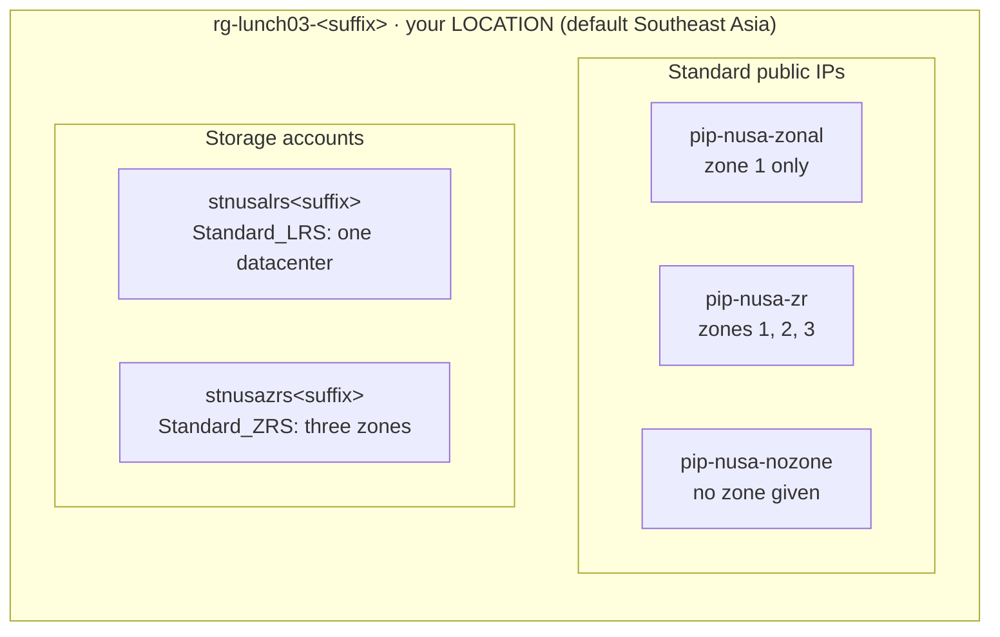

# Lab 03 · Explore regions and zones

> **Pairs with:** [Lunch 03 · Azure Global Infrastructure: Regions, Availability Zones and Region Pairs](../../lunches/03-global-infrastructure/README.md)
> **Time:** about 35 minutes · **Cost:** 💲 (see [cost bands](../README.md#cost-bands)) · **Difficulty:** ★☆☆
> **Works on its own:** ✅ You do not need any earlier lab. Everything this lab needs is created by its own steps.

## 🎯 What you'll build

Before Nusantara Retail commits to a region, Ibu Sari wants evidence, not opinions. In this lab you collect it. You use
the Azure CLI to list regions, their geographies and pairs, read your subscription's logical-to-physical zone mapping
and check which VM sizes and services are offered where. Then you build small, cheap resources that make the
difference between zonal and zone-redundant visible: three Standard public IPs (zonal, zone-redundant and "no zone
given") and two storage accounts (LRS and ZRS). You finish with a short latency check from your own browser.



## ✅ Before you start

- An Azure subscription where you can create resources (see [Lab 01](../01-before-you-begin/README.md)).
- **Azure Cloud Shell (Bash)** — open [shell.azure.com](https://shell.azure.com). Nothing to install.
- Get the lab files and load the shared settings:

```bash
git clone https://github.com/stefpin/azure-fundamentals-lunches.git   # first time only
cd azure-fundamentals-lunches/labs/03-global-infrastructure
source ../common/config.sh
RG=$(rg_name 03)
ST_LRS="stnusalrs${SUFFIX}"
ST_ZRS="stnusazrs${SUFFIX}"
```

- This lab has no `setup.sh`: you create everything yourself.
- `LOCATION` must be a region **with availability zones**. The default, `southeastasia`, has three. Learners in
  Indonesia can run `export LOCATION=indonesiacentral` and then `source ../common/config.sh` again; it also has three zones.
- If Cloud Shell times out and restarts, `cd` back into the lab folder and run the four lines after `cd` again.

> [!IMPORTANT]
> Lab resources cost money while they exist. Standard public IPv4 addresses are billed by the hour even when nothing
> uses them. Finish with the **Clean up** section, even if you stop halfway.

## 🧭 Choose your mode

| Mode | For you if… | How |
|---|---|---|
| **Guided** | you want every step explained | follow Tasks 1–5 below |
| **Challenge** | you already know the basics | read only the [Challenge brief](#-challenge-brief), build it your way, then run `bash verify.sh` |

## Task 1 · Regions, geographies and pairs

Every region belongs to a geography (a data residency boundary), and some regions have a paired region. The CLI shows
exactly what your subscription can see, so start there.

```bash
# How many physical regions can your subscription see?
az account list-locations --query "length([?metadata.regionType=='Physical'])"

# The regions closest to Nusantara Retail: geography, city and paired region
az account list-locations \
  --query "[?contains(['indonesiacentral','southeastasia','eastasia','malaysiawest'], name)].{region:name, geography:metadata.geography, city:metadata.physicalLocation, pair:metadata.pairedRegion[0].name}" \
  --output table

# Which physical regions have no paired region at all?
az account list-locations \
  --query "[?metadata.regionType=='Physical' && !metadata.pairedRegion].displayName" \
  --output tsv | sort
```

The first command counts only **physical** regions. The list also contains *logical* entries such as "Asia Pacific",
which group regions for some services and are not places you deploy to.

> [!TIP]
> **Prefer the portal?** Open the region dropdown on any *Create* page (for example *Create a resource group*): regions
> are grouped by geography, such as "(Asia Pacific) Southeast Asia". The pairs and zone counts are easier to read in
> Microsoft's [list of Azure regions](https://learn.microsoft.com/azure/reliability/regions-list).

> ✅ **Checkpoint:** the table shows `eastasia` as the pair of `southeastasia` (and the other way round), while
> `indonesiacentral` and `malaysiawest` show an empty pair column. Indonesia Central appears in the "no pair" list. The
> geography column shows the Singapore and Hong Kong regions in one geography and Jakarta in another (the exact
> wording comes from the platform and can differ slightly from the documentation).

## Task 2 · Look inside your region: zones, zone mapping and what's offered

Zones are numbered 1, 2 and 3 in every subscription, but the numbers are **logical**. Each subscription has its own
mapping to the physical zones, and you can read yours.

```bash
# Your subscription's logical-to-physical zone mapping for LOCATION
az account list-locations \
  --query "[?name=='${LOCATION}'].availabilityZoneMappings | [0]" \
  --output table

# How many regions offer zones to your subscription?
az account list-locations --query "length([?availabilityZoneMappings])"
```

Next, check which VM sizes your subscription can deploy into zones. The SKU list is big, so this command can take a
minute or two; read the next paragraph while you wait.

```bash
az vm list-skus --location "$LOCATION" --resource-type virtualMachines \
  --size Standard_B --zone --output table
```

`--zone` keeps only sizes that support availability zones, and the **Zones** column shows which zones each size is
offered in. By default the list hides sizes that are restricted for your subscription; add `--all` to see them too,
with the reason in the **Restrictions** column.

Finally, ask Azure Resource Manager whether a service is offered in a region. Every resource provider publishes the
locations of each resource type:

```bash
for rt in Microsoft.Network/natGateways Microsoft.App/managedEnvironments; do
  ns="${rt%%/*}"; type="${rt#*/}"
  echo "== ${rt}"
  az provider show --namespace "$ns" \
    --query "resourceTypes[?resourceType=='${type}'].locations | [0]" --output tsv \
    | grep -i -E "indonesia|southeast asia|east asia" || echo "   (not listed in these regions)"
done
```

> [!TIP]
> **Prefer the portal?** The public [products available by region](https://azure.microsoft.com/en-us/explore/global-infrastructure/products-by-region/)
> page answers the same question for every product. The CLI is better for exact resource types, sizes and your own
> subscription's restrictions.

> ✅ **Checkpoint:** the mapping table shows three rows (logical zones 1, 2 and 3, each with a physical zone name such
> as `southeastasia-az2`); your logical 1 is not necessarily physical 1. The SKU table lists several B-series sizes
> with `1,2,3` in the Zones column. The loop prints the region names where each resource type is offered.

## Task 3 · Zonal, zone-redundant and "no zone" public IPs

Public IPs are a perfect test object: they are created in seconds, cost very little, and their zone setting is
visible. Create the resource group and three Standard public IPv4 addresses.

```bash
ensure_rg "$RG" 03

# Zonal: pinned to logical zone 1
az network public-ip create --resource-group "$RG" --name pip-nusa-zonal \
  --location "$LOCATION" --sku Standard --version IPv4 --allocation-method Static \
  --zone 1 --output none

# Zone-redundant: spread across zones 1, 2 and 3
az network public-ip create --resource-group "$RG" --name pip-nusa-zr \
  --location "$LOCATION" --sku Standard --version IPv4 --allocation-method Static \
  --zone 1 2 3 --output none

# No zone given: what does Azure do?
az network public-ip create --resource-group "$RG" --name pip-nusa-nozone \
  --location "$LOCATION" --sku Standard --version IPv4 --allocation-method Static \
  --output none
```

Now compare them:

```bash
az network public-ip list --resource-group "$RG" \
  --query "[].{name:name, sku:sku.name, allocation:publicIPAllocationMethod, zones:join(', ', zones || \`[]\`)}" \
  --output table
```

How to read the result:

- **pip-nusa-zonal** shows `1`. It is **zonal**: it lives in zone 1 and shares that zone's fate.
- **pip-nusa-zr** shows `1, 2, 3`. It is **zone-redundant**: it survives the loss of any single zone.
- **pip-nusa-nozone** most likely shows an empty zones column. Don't read that as "nonzonal". In a region with
  availability zones, Microsoft treats a Standard public IP without a zone setting as zone-redundant; an IP that shows
  no zones behaves the same as one that shows `1, 2, 3`. Only in a region **without** zones is a public IP truly
  nonzonal. Depending on the API version, the field might also come back filled in. Either way, set `--zone`
  explicitly in your scripts so that your intent is clear to the next reader.

One more rule: the zone setting of a public IP is fixed at creation. To change it, you create a new IP, which also
means a new address, so decide before you hand the address to a partner or a DNS record.

> [!TIP]
> **Prefer the portal?** *Home › Public IP addresses › Create*: look at the **Availability zone** setting and the options
> it offers in your region, then leave the page without creating anything.

> ✅ **Checkpoint:** three Standard, Static IPs exist in `rg-lunch03-<suffix>`, with zones `1`, `1, 2, 3` and (most
> likely) nothing.

## Task 4 · LRS versus ZRS storage

Storage accounts make the same choice visible as **redundancy**. Locally redundant storage (LRS) keeps three copies in
one datacenter; zone-redundant storage (ZRS) keeps copies in three zones and confirms a write only after every copy has
it. Create one of each, both with TLS 1.2 as the minimum and anonymous blob access turned off.

```bash
az storage account create --name "$ST_LRS" --resource-group "$RG" --location "$LOCATION" \
  --sku Standard_LRS --kind StorageV2 --min-tls-version TLS1_2 --allow-blob-public-access false \
  --output none

az storage account create --name "$ST_ZRS" --resource-group "$RG" --location "$LOCATION" \
  --sku Standard_ZRS --kind StorageV2 --min-tls-version TLS1_2 --allow-blob-public-access false \
  --output none
```

Compare them:

```bash
az storage account list --resource-group "$RG" \
  --query "[].{name:name, sku:sku.name, primary:primaryLocation, secondary:secondaryLocation, status:statusOfPrimary}" \
  --output table
```

Both accounts live in your `LOCATION` and the **secondary** column is empty for both: LRS and ZRS never leave the
region. ZRS protects you from losing a datacenter or a whole zone; it doesn't protect you from losing the region, and,
like every redundancy option, it copies deletions and overwrites too. A secondary location only appears with the
geo-redundant options (GRS, GZRS), which replicate to the **paired** region. The stretch goals let you see that.

> [!TIP]
> **Prefer the portal?** *Home › Storage accounts › Create*: the **Redundancy** dropdown on the Basics tab offers the
> same choices. Compare what it offers in Southeast Asia and in Indonesia Central.

> ✅ **Checkpoint:** two StorageV2 accounts, `stnusalrs<suffix>` with `Standard_LRS` and `stnusazrs<suffix>` with
> `Standard_ZRS`, both with your `LOCATION` as primary and no secondary.

## Task 5 (optional) · A rough latency check from your browser

Cloud Shell runs inside an Azure datacenter, so it can't tell you what your shoppers feel. Your own browser can.

1. Open the community-built [Azure Latency Test](https://www.azurespeed.com/Azure/Latency) page (a free third-party
   tool, not a Microsoft service).
2. Select Indonesia Central, Southeast Asia, East Asia and Malaysia West, and let it run for a minute.
3. Note the median round trip for each region and compare.

Treat the numbers as a rough signal: the test runs over HTTPS from your browser, so DNS lookups and TLS handshakes are
included, and the result depends on your own internet provider. For region-to-region numbers measured inside
Microsoft's network, use Microsoft's [inter-region latency statistics](https://learn.microsoft.com/azure/networking/azure-network-latency).

> ✅ **Checkpoint:** you have four latency figures. From most places in Indonesia you would expect Jakarta to be the
> fastest, but your network has the final word. That's exactly why you measure.

## 🔧 Break it and fix it

Zone-redundant storage needs a region with availability zones. Try to create a ZRS account in a region that has none.

```bash
# Find a physical region without availability zones (falls back to westus, which has none)
NOZONE_REGION=$(az account list-locations \
  --query "[?metadata.regionType=='Physical' && metadata.regionCategory=='Recommended' && !availabilityZoneMappings].name | [0]" \
  --output tsv)
NOZONE_REGION=${NOZONE_REGION:-westus}
echo "Region without zones: ${NOZONE_REGION}"

az storage account create --name "stnusabrk${SUFFIX}" --resource-group "$RG" \
  --location "$NOZONE_REGION" --sku Standard_ZRS --kind StorageV2 --output none
```

**Symptom:** the command fails with an error saying that the `Standard_ZRS` SKU isn't supported or available in that
location. (If the error says instead that the location isn't available for your subscription, pick another region from
the list and try again.)

<details><summary>Hint and fix</summary>

ZRS spreads copies across availability zones, so it only exists where zones exist. Before you choose a redundancy
option, check the region:

```bash
az account list-locations --query "[?name=='${NOZONE_REGION}'].availabilityZoneMappings | [0]" --output table
```

An empty result means no zones. Fix it by choosing a zone-enabled region (`--location "$LOCATION"`) or, if you really
need that region, by using `Standard_LRS` and accepting that a datacenter failure takes the data offline. Then make sure
nothing extra was created:

```bash
if az storage account show --name "stnusabrk${SUFFIX}" --resource-group "$RG" --output none 2>/dev/null; then
  az storage account delete --name "stnusabrk${SUFFIX}" --resource-group "$RG" --yes
else
  echo "Nothing to remove: the failed request created nothing."
fi
```

</details>

## 🧪 Verify your work

```bash
bash verify.sh
```

Every check should say **PASS**. If one fails, the message tells you which task to revisit.

## 🧹 Clean up (do not skip!)

```bash
bash cleanup.sh
```

This deletes everything the lab created: the resource group `rg-lunch03-<suffix>` with its public IPs and storage
accounts. Nothing in this lab lives outside the resource group. Deletion continues in the background for a few minutes.

## 🩺 Troubleshooting

| Symptom | Likely cause | Fix |
|---|---|---|
| `az vm list-skus` prints nothing for a long time | It downloads the whole SKU catalogue for the region before printing | Wait up to two minutes; keep `--size` to narrow the output |
| Zone mapping table is empty | `LOCATION` points to a region without availability zones (or a typo) | Run `echo $LOCATION`; use `southeastasia` or `indonesiacentral` |
| `(StorageAccountAlreadyTaken) The storage account named ... is already taken.` | Storage account names are global and someone else has yours | Run `bash cleanup.sh`, then `rm ~/.azlunches-suffix`, `source ../common/config.sh` again (new suffix) and repeat Tasks 3–4 |
| Public IP creation fails with an error about zones | The region has no zones, or not all three zones are live there | Use a zone-enabled region for `LOCATION` |
| `(MissingSubscriptionRegistration) The subscription is not registered to use namespace 'Microsoft.Network'` | A brand-new subscription hasn't used that resource provider yet | `az provider register --namespace Microsoft.Network`, wait a minute, retry |
| `pip-nusa-nozone` shows an empty zones column | Expected: in a zone-enabled region it is zone-redundant anyway | Re-read the explanation in Task 3 |
| `verify.sh` says the resource group is missing after you changed `LOCATION` | The suffix or region in this shell differs from when you created things | `source ../common/config.sh` with the same `LOCATION` you used before |

## 🚀 Stretch goals

- Create a geo-redundant account (`--sku Standard_GRS`) in Southeast Asia, run the comparison query from Task 4 and look
  at the **secondary** column: it names the paired region. Delete the account afterwards.
- Try the same `Standard_GRS` command with `--location indonesiacentral`. What happens, and why? (Hint: GRS replicates
  to the paired region.)
- Price 100 GB of LRS, ZRS and GRS storage in the [pricing calculator](https://azure.microsoft.com/pricing/calculator/)
  for Southeast Asia and Indonesia Central, and note the differences between regions and redundancy options.
- If you have access to a second subscription, compare its logical-to-physical zone mapping with yours.

## 🏁 Challenge brief

Build the following, any way you like (portal, CLI, Bicep), in a region **with availability zones**:

1. A resource group `rg-lunch03-<suffix>` in your `LOCATION`, tagged `course=azure-fundamentals-lunches` and
   `lunch=03` (`ensure_rg` does this for you).
2. A Standard, static public IPv4 address `pip-nusa-zonal` pinned to zone 1 only.
3. A Standard, static public IPv4 address `pip-nusa-zr`, explicitly zone-redundant across zones 1, 2 and 3.
4. Two StorageV2 accounts, `stnusalrs<suffix>` with `Standard_LRS` and `stnusazrs<suffix>` with `Standard_ZRS`, both
   with TLS 1.2 as the minimum version and anonymous blob access disabled.
5. Not checked by the script: write down your region's geography, its paired region (if any) and your subscription's
   logical-to-physical zone mapping.

Then run `bash verify.sh`. Stuck? Peek at `solution.sh` or switch to Guided mode.

---

⬅️ [Lunch 03 reading](../../lunches/03-global-infrastructure/README.md) · 🏠 [All labs](../README.md) · 🏠 [Course home](../../README.md)

<sub>Last validated: October 2026 · Something broken? [Report a lab problem](../../CONTRIBUTING.md).</sub>
