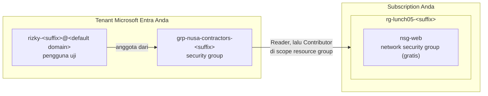

# Lab 05 · Beri kontraktor akses secukupnya

🇬🇧 [Read in English](README.md)

> **Pasangan dari:** [Makan Siang 05 · Identitas dan Akses (Dasar)](../../lunches/05-identity-access-basic/README.id.md)
> **Waktu:** sekitar 40 menit · **Biaya:** 💲 (lihat [kelompok biaya](../README.id.md#kelompok-biaya)) · **Tingkat kesulitan:** ★☆☆
> **Bisa dikerjakan terpisah:** ✅ Anda tidak memerlukan lab sebelumnya. Semua yang dibutuhkan lab ini dibuat oleh langkah-langkahnya sendiri.
> **Penulis:** Stefanus Pinarta · [Tentang penulis](../../README.id.md#tentang-penulis)

> [!CAUTION]
> **Gunakan hanya tenant milik Anda sendiri.** Lab ini membuat pengguna dan grup di Microsoft Entra ID. Jalankan hanya di tenant
> yang datang bersama akun gratis Azure pribadi Anda — di sana Anda adalah Global Administrator. **Jangan pernah** menjalankannya di
> tenant perusahaan atau kampus: Anda akan menambahkan identitas ke direktori organisasi Anda, dan kemungkinan besar Anda memang
> tidak punya haknya.
> (Subscription Azure for Students biasanya berada di tenant universitas Anda, jadi cukup baca lab ini sebagai bahan belajar, atau
> gunakan akun gratis pribadi.)

## 🎯 Yang akan Anda bangun

Rizky, kontraktor Nusantara Retail, perlu bekerja di lingkungan uji toko online — dan tidak di tempat lain. Di tenant
Microsoft Entra milik Anda sendiri, Anda akan membuat pengguna uji yang berperan sebagai Rizky, sebuah security group untuk
para kontraktor, dan sebuah resource group berisi network security group gratis sebagai bahan latihan. Anda akan memberi
**grup** tersebut role Reader, lalu Contributor, di satu resource group itu; sign in sebagai Rizky di jendela browser privat
untuk merasakan bedanya; menampilkan akses efektifnya dengan Azure CLI; dan terakhir sengaja menaruh role di scope yang salah
supaya Anda terlatih mengenalinya.



## ✅ Sebelum mulai

- Subscription Azure tempat Anda bisa membuat resource (lihat [Lab 01](../01-before-you-begin/README.id.md)), **di tenant milik
  Anda sendiri** — tenant yang dibuat bersama akun gratis pribadi Anda sangat cocok.
- **Azure Cloud Shell (Bash)** — buka [shell.azure.com](https://shell.azure.com). Tidak ada yang perlu diinstal.
- **Jendela browser privat (incognito)** untuk sign in sebagai pengguna uji, supaya sesi admin Anda di jendela biasa tidak
  tercampur dengan sesi Rizky.
- **Ponsel dengan Microsoft Authenticator** (atau aplikasi authenticator lain). Security defaults dan mandatory MFA di Azure
  membuat pengguna uji wajib menyiapkan MFA saat pertama kali sign in ke portal Azure. Anda bisa menambahkan akun uji ke
  aplikasi yang sudah Anda pakai, lalu menghapusnya setelah lab selesai.
- Ambil file lab dan muat pengaturan bersama:

```bash
git clone https://github.com/stefpin/azure-fundamentals-lunches.git   # first time only
cd azure-fundamentals-lunches/labs/05-identity-access-basic
source ../common/config.sh
RG=$(rg_name 05)
```

> [!IMPORTANT]
> Resource lab dikenai biaya selama masih ada. Selesaikan dengan bagian **Bersihkan**, bahkan jika Anda berhenti di tengah jalan. Resource
> lab ini gratis atau hampir gratis, tetapi pengguna uji yang terlupakan dan masih punya akses ke subscription Anda adalah risiko yang nyata.

## 🧭 Pilih mode Anda

| Mode | Cocok untuk Anda jika… | Caranya |
|---|---|---|
| **Terpandu** | Anda ingin setiap langkah dijelaskan | ikuti Tugas 1–8 di bawah |
| **Tantangan** | Anda sudah menguasai dasarnya | baca [Ringkasan tantangan](#-ringkasan-tantangan) saja, bangun dengan cara Anda sendiri, lalu jalankan `bash verify.sh` |

## Tugas 1 · Pastikan Anda berada di tenant sendiri

Semua yang ada di lab ini menyentuh direktori Anda, jadi pertama-tama buktikan bahwa direktori itu milik Anda dan bahwa Anda
berhak membuat pengguna di dalamnya. Perintah pertama menampilkan subscription, ID tenant, dan akun yang sedang sign-in;
perintah berikutnya bertanya ke Microsoft Graph (API untuk data direktori) apa domain default dan nama organisasi tenant Anda.

```bash
az account show --query "{subscription:name, tenantId:tenantId, signedInAs:user.name}" --output table
DOMAIN=$(az rest --method get --url https://graph.microsoft.com/v1.0/domains --query "value[?isDefault].id" --output tsv)
echo "Default domain: $DOMAIN"
az rest --method get --url https://graph.microsoft.com/v1.0/organization --query "value[0].displayName" --output tsv
```

Domain default tenant yang dibuat dengan akun gratis biasanya berakhiran `.onmicrosoft.com`. Jika yang muncul adalah domain
kantor atau kampus Anda, **berhenti di sini** dan beralihlah ke akun gratis pribadi.

Sekarang periksa role direktori Anda:

```bash
az rest --method get --url https://graph.microsoft.com/v1.0/me/memberOf \
  --query "value[?\"@odata.type\"=='#microsoft.graph.directoryRole'].displayName" --output tsv
```

> [!TIP]
> **Lebih suka portal?** *Microsoft Entra ID › Roles and administrators › Global Administrator › Assignments* — akun Anda
> seharusnya tercantum di sana. *Microsoft Entra ID › Overview* menampilkan nama tenant dan domain utamanya.

> ✅ **Pemeriksaan:** tenant dan domainnya milik Anda, dan daftar role mencantumkan **Global Administrator**.

## Tugas 2 · Buat resource group dan sesuatu untuk dilihat

Rizky butuh resource untuk dilihat dan, nanti, untuk diubah. Network security group tidak dikenai biaya, jadi sangat pas
untuk latihan ini.

```bash
ensure_rg "$RG" 05
az network nsg create --resource-group "$RG" --name nsg-web --location "$LOCATION" --output none
RG_ID=$(az group show --name "$RG" --query id --output tsv)
echo "$RG_ID"
```

`RG_ID` adalah resource ID dari resource group tersebut — semacam "alamat lengkap" resource di Azure — dan persis itulah
**scope** yang akan Anda pakai untuk role assignment.

> ✅ **Pemeriksaan:** `az resource list --resource-group "$RG" --output table` menampilkan `nsg-web`.

## Tugas 3 · Buat pengguna uji (Rizky)

Rizky mendapat identitasnya sendiri — tidak pernah identitas bersama. Nama penggunanya (user principal name, nama sign-in
yang bentuknya mirip alamat e-mail) berakhiran domain default tenant Anda, dan kata sandi sementaranya dibuat saat perintah
dijalankan, sehingga tidak ada satu pun kata sandi yang tertulis di repositori ini.

```bash
TEST_UPN="rizky-${SUFFIX}@${DOMAIN}"
TEST_PASSWORD="Lab5-$(openssl rand -base64 15 | tr -d '/+=')-x9"
az ad user create \
  --display-name "Rizky (Lab 05 test user)" \
  --user-principal-name "$TEST_UPN" \
  --password "$TEST_PASSWORD" \
  --force-change-password-next-sign-in true \
  --output none
USER_ID=$(az ad user show --id "$TEST_UPN" --query id --output tsv)
echo "Sign-in name:                     $TEST_UPN"
echo "Temporary password (shown once):  $TEST_PASSWORD"
```

Kata sandi itu hanya ada di variabel `TEST_PASSWORD` dalam sesi Cloud Shell ini dan di layar Anda — catat untuk Tugas 6.
Bagian tetap `Lab5-` dan `-x9` menjamin selalu ada huruf besar, huruf kecil, angka, dan simbol, apa pun karakter acaknya.
Rizky wajib memilih kata sandinya sendiri saat sign-in pertama. Kata sandinya hilang? Buat yang baru:

```bash
TEST_PASSWORD="Lab5-$(openssl rand -base64 15 | tr -d '/+=')-x9"
az ad user update --id "$TEST_UPN" --password "$TEST_PASSWORD" --force-change-password-next-sign-in true
echo "New temporary password: $TEST_PASSWORD"
```

> [!TIP]
> **Lebih suka portal?** *Microsoft Entra ID › Users › New user › Create new user*. Gunakan nama pengguna yang sama supaya
> `verify.sh` bisa menemukannya.

> ✅ **Pemeriksaan:** `az ad user show --id "$TEST_UPN" --query "{name:displayName, upn:userPrincipalName}" --output table`
> menampilkan Rizky.

## Tugas 4 · Buat grup kontraktor dan tambahkan Rizky

Akses diberikan ke grup, bukan ke orang: ketika kontraktor berikutnya datang, atau Rizky pergi, cukup satu perubahan
keanggotaan.

```bash
GROUP_NAME="grp-nusa-contractors-${SUFFIX}"
GROUP_ID=$(az ad group create \
  --display-name "$GROUP_NAME" \
  --mail-nickname "$GROUP_NAME" \
  --description "Lab 05: contractors working on the storefront test environment" \
  --query id --output tsv)
az ad group member add --group "$GROUP_ID" --member-id "$USER_ID"
az ad group member check --group "$GROUP_ID" --member-id "$USER_ID" --query value --output tsv
```

> [!TIP]
> **Lebih suka portal?** *Microsoft Entra ID › Groups › New group*: group type **Security**, lalu *Members › Add members*.

> ✅ **Pemeriksaan:** perintah terakhir mencetak `true`.

## Tugas 5 · Beri grup role Reader di resource group

Sebuah role assignment membutuhkan tiga hal: security principal (grupnya), role definition (Reader), dan scope (resource
group-nya).

```bash
az role assignment create \
  --assignee-object-id "$GROUP_ID" \
  --assignee-principal-type Group \
  --role "Reader" \
  --scope "$RG_ID" \
  --output none
az role assignment list --scope "$RG_ID" \
  --query "[].{principal:principalName, role:roleDefinitionName}" --output table
```

`--assignee-object-id` bersama `--assignee-principal-type` mencegah error ketika grup yang baru dibuat beberapa detik lalu
belum tereplikasi (tersalin) ke semua server direktori.

> [!TIP]
> **Lebih suka portal?** *Resource groups › rg-lunch05-&lt;suffix&gt; › Access control (IAM) › Add › Add role assignment*.
> Portal menampilkan ketiga bagian itu sebagai tab: **Role**, **Members** (principal-nya) — sedangkan scope-nya adalah halaman
> tempat Anda memulai.

> ✅ **Pemeriksaan:** tabel menampilkan grup Anda dengan **Reader**. Assignment Owner milik Anda sendiri tidak tercantum karena
> berada di scope subscription.

## Tugas 6 · Sign in sebagai Rizky dan lihat-lihat

1. Buka **jendela privat (incognito)** dan kunjungi <https://portal.azure.com>.
2. Sign in dengan nilai `$TEST_UPN` dan kata sandi sementara, lalu pilih kata sandi baru.
3. Saat muncul **More information required**, siapkan Microsoft Authenticator: di aplikasi, tambahkan **work or school
   account**, pindai kode QR, lalu setujui permintaan uji. Itulah security defaults dan mandatory MFA yang sedang bekerja.
4. Di kotak pencarian portal, ketik **Resource groups**. Anda seharusnya hanya melihat `rg-lunch05-<suffix>`. Jika daftarnya
   kosong, tunggu beberapa menit lalu sign out dan sign in lagi: role assignment bisa butuh waktu hingga 10 menit untuk berlaku.
5. Buka **nsg-web › Settings › Inbound security rules › + Add**. Buat aturan yang mengizinkan **TCP 443** dari **Any**,
   priority **300**, name **allow-https**. Upaya itu gagal dengan pesan error bahwa Rizky *does not have authorization to perform
   action 'Microsoft.Network/networkSecurityGroups/securityRules/write'* — artinya dia tidak berhak menulis aturan NSG.
6. Buka halaman **Access control (IAM)** di resource group: Rizky tidak bisa menambahkan role assignment.

Biarkan jendela privat tetap terbuka untuk Tugas 7.

> [!TIP]
> Pengguna uji tidak punya aplikasi authenticator? Lewati sign-in dan gunakan **Check access** di halaman *Access
> control (IAM)* resource group (Tugas 8) untuk melihat jawaban yang sama dari sisi administrator.

> ✅ **Pemeriksaan:** Rizky bisa melihat `rg-lunch05-<suffix>` dan `nsg-web`, tetapi setiap perubahan ditolak.

## Tugas 7 · Naikkan grup menjadi Contributor (lalu rapikan)

Pekerjaan migrasi dimulai, jadi para kontraktor perlu mengubah resource — hanya di resource group ini.

```bash
az role assignment create \
  --assignee-object-id "$GROUP_ID" \
  --assignee-principal-type Group \
  --role "Contributor" \
  --scope "$RG_ID" \
  --output none
az role assignment delete --assignee-object-id "$GROUP_ID" --role "Reader" --scope "$RG_ID"
az role assignment list --scope "$RG_ID" \
  --query "[].{principal:principalName, role:roleDefinitionName}" --output table
```

Mengapa Reader dihapus? Contributor sudah mencakup semua izin baca, dan assignment sisa membuat access review lebih sulit.
Least privilege juga berarti tidak menyisakan "sampah".

Kembali ke jendela privat Rizky, **sign out lalu sign in lagi** (sign-in yang baru akan membawa perubahan tersebut), kemudian
ulangi pembuatan aturan `allow-https` dari Tugas 6: kali ini berhasil. Coba lagi *Access control (IAM) › Add role assignment*:
tetap tidak diizinkan, karena Contributor bisa mengelola resource tetapi tidak bisa mengelola akses. Perhatikan juga bahwa
Contributor bisa menghapus seluruh resource group ini — justru karena itulah scope-nya Anda jaga tetap sekecil ini.

> ✅ **Pemeriksaan:** `az network nsg rule list --resource-group "$RG" --nsg-name nsg-web --query "[].{name:name, port:destinationPortRange, access:access}" --output table`
> menampilkan `allow-https` (setelah Rizky membuatnya), dan daftar role hanya menampilkan **Contributor** untuk grup Anda.

## Tugas 8 · Tampilkan akses efektif Rizky

Rizky tidak punya role assignment atas namanya sendiri; semuanya datang lewat grupnya. CLI bisa menelusurinya untuk Anda:

```bash
az role assignment list --assignee "$TEST_UPN" --all --include-groups \
  --query "[].{role:roleDefinitionName, scope:scope, via:principalName}" --output table
```

`--all` mencari di seluruh subscription, dan `--include-groups` menambahkan assignment yang diberikan ke grup tempat Rizky
menjadi anggota.

> [!TIP]
> **Lebih suka portal?** *rg-lunch05-&lt;suffix&gt; › Access control (IAM) › Check access*, lalu pilih Rizky. Anda akan
> melihat Contributor, yang diberikan melalui grup.

> ✅ **Pemeriksaan:** tepat satu baris: **Contributor**, scope = resource group Anda, via `grp-nusa-contractors-<suffix>`.

## 🔧 Rusak lalu perbaiki

**Scope yang salah.** Dewi, yang berniat membantu, mendengar bahwa Rizky "tidak bisa melihat subscription" lalu memberi
grup kontraktor role Reader di **subscription**, bukan di resource group:

```bash
SUB_SCOPE="/subscriptions/$(az account show --query id --output tsv)"
az role assignment create --assignee-object-id "$GROUP_ID" --assignee-principal-type Group \
  --role "Reader" --scope "$SUB_SCOPE" --output none
```

**Gejala:** setelah beberapa menit (sign out lalu sign in), daftar *Resource groups* milik Rizky menampilkan **semua**
resource group di subscription — termasuk milik proyek lain. Tidak ada yang tampak rusak, dan justru itulah yang membuat
kesalahan ini berbahaya. `bash verify.sh` kini melaporkan FAIL. Temukan masalahnya dengan perintah dari Tugas 8, dan
perhatikan kolom **scope**.

<details><summary>Petunjuk: cara memperbaikinya</summary>

Assignment di scope subscription diwariskan ke setiap resource group di bawahnya. Hapus assignment itu, dan pertahankan
yang berada di scope resource group:

```bash
az role assignment delete --assignee-object-id "$GROUP_ID" --role "Reader" --scope "$SUB_SCOPE"
az role assignment list --assignee "$TEST_UPN" --all --include-groups \
  --query "[].{role:roleDefinitionName, scope:scope}" --output table
```

Pelajarannya: selalu baca scope sebuah assignment, jangan hanya role-nya. Role yang terdengar tidak berbahaya di scope yang
tinggi bisa membuka jauh lebih banyak dari yang dimaksudkan.

</details>

## 🧪 Verifikasi hasil kerja Anda

```bash
bash verify.sh
```

Setiap pemeriksaan seharusnya menampilkan **PASS**. Jika ada yang gagal, pesannya memberi tahu tugas mana yang perlu Anda
ulangi.

## 🧹 Bersihkan (jangan dilewati!)

```bash
bash cleanup.sh
```

Skrip ini mencabut role assignment milik grup dan pengguna di semua scope (termasuk assignment di scope subscription yang
terlupakan), menghapus pengguna uji lalu membersihkannya secara permanen dari *Deleted users* supaya namanya bisa dipakai
lagi, menghapus grup, dan menghapus resource group `rg-lunch05-<suffix>`. Penghapusan resource group berlanjut di latar
belakang selama beberapa menit. Terakhir, hapus akun uji dari aplikasi Microsoft Authenticator di ponsel Anda.

## 🩺 Pemecahan masalah

| Gejala | Kemungkinan penyebab | Perbaikan |
|---|---|---|
| `Insufficient privileges to complete the operation.` saat membuat pengguna atau grup | Anda bukan administrator di tenant ini (lazim terjadi di tenant perusahaan dan kampus) | Gunakan tenant dari akun gratis pribadi Anda, tempat Anda menjadi Global Administrator |
| `Property userPrincipalName is invalid.` | Bagian domain bukan domain terverifikasi milik tenant Anda (sering karena `$DOMAIN` kosong) | Jalankan ulang perintah `DOMAIN=…` dari Tugas 1 dan pastikan hasilnya tidak kosong |
| `Another object with the same value for property userPrincipalName already exists.` | Pengguna sudah ada dari percobaan sebelumnya, mungkin di *Deleted users* | Pakai ulang pengguna itu (`USER_ID=$(az ad user show --id "$TEST_UPN" --query id -o tsv)`) atau jalankan `bash cleanup.sh` lalu mulai dari awal |
| `The specified password does not comply with password complexity requirements.` | Kata sandi yang dibuat ditolak | Jalankan lagi baris pembuat kata sandi, lalu coba ulang |
| `PrincipalNotFound … does not exist in the directory` saat memberi role | Grup yang baru dibuat belum tereplikasi | Tunggu satu menit lalu coba lagi; tetap gunakan `--assignee-principal-type Group` |
| Rizky tidak melihat resource group apa pun, atau portal menyatakan dia tidak punya subscription | Assignment belum sampai ke sesinya | Tunggu hingga 10 menit, lalu sign out dan sign in lagi |
| Rizky masih mendapat `does not have authorization to perform action` setelah Tugas 7 | Sesinya masih memakai izin lama | Sign out lalu sign in; pastikan `az role assignment list --scope "$RG_ID"` menampilkan Contributor |
| Pengguna uji tertahan di **More information required** | Security defaults mewajibkan pendaftaran MFA | Instal Microsoft Authenticator dan tambahkan work or school account dengan kode QR |
| `verify.sh` tidak menemukan pengguna atau grup | Namanya berbeda dari yang diharapkan lab, atau Cloud Shell baru dengan `SUFFIX` yang berbeda | Gunakan nama dari Ringkasan tantangan; `cat ~/.azlunches-suffix` menampilkan suffix Anda |

## 🚀 Tantangan tambahan

- **Lebih sempit lagi:** ganti Contributor dengan built-in role **Network Contributor**. Rizky masih bisa mengedit
  `nsg-web`, tetapi tidak bisa lagi membuat, misalnya, storage account di resource group tersebut.
- **Siapa melakukan apa?** Tanyakan ke activity log siapa yang membuat aturan `allow-https`:
  `az monitor activity-log list --resource-group "$RG" --offset 2h --query "[].{operation:operationName.localizedValue, caller:caller, status:status.value}" --output table`.
  Caller-nya (pemanggilnya) adalah Rizky, bukan Anda — itulah sebabnya orang tidak boleh berbagi akun.
- **Tamu sungguhan:** undang akun Microsoft pribadi kedua milik Anda sebagai tamu (*Microsoft Entra ID › Users ›
  New user › Invite external user*), tambahkan ke grup, lalu sign in dengan akun itu. Itulah B2B collaboration.
- **Lihat saja, jangan diubah:** buka *Microsoft Entra ID › Overview › Properties › Manage security defaults* untuk melihat
  pengaturan yang memaksa Rizky mendaftar MFA. Biarkan tetap aktif.

## 🏁 Ringkasan tantangan

Bangun hal-hal berikut dengan cara apa pun yang Anda suka (portal, CLI, Bicep), **di tenant milik Anda sendiri**:

1. Pengguna `rizky-<suffix>@<your default domain>` (suffix Anda ada di `~/.azlunches-suffix`).
2. Security group `grp-nusa-contractors-<suffix>` dengan pengguna tersebut sebagai anggotanya.
3. Resource group `rg-lunch05-<suffix>`, dengan tag `course=azure-fundamentals-lunches` dan `lunch=05`, yang berisi sebuah
   network security group.
4. Grup tersebut memegang **Contributor** di scope resource group.
5. Grup tersebut tidak punya role assignment di luar resource group itu, dan pengguna tersebut tidak punya role assignment
   langsung.

Lalu jalankan `bash verify.sh`. Buntu? Intip `solution.sh` atau beralih ke mode Terpandu.

---

⬅️ [Bacaan Makan Siang 05](../../lunches/05-identity-access-basic/README.id.md) · 🏠 [Semua lab](../README.id.md) · 🏠 [Beranda kursus](../../README.id.md)

<sub>Terakhir divalidasi: Oktober 2026 · Ada yang tidak berfungsi? [Laporkan masalah lab](../../CONTRIBUTING.md).</sub>
