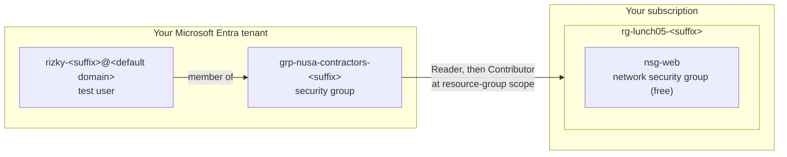

# Lab 05 · Give a contractor just enough access

🇮🇩 [Baca dalam Bahasa Indonesia](README.id.md)

> **Pairs with:** [Lunch 05 · Identity and Access (Basic)](../../lunches/05-identity-access-basic/README.md)
> **Time:** about 40 minutes · **Cost:** 💲 (see [cost bands](../README.md#cost-bands)) · **Difficulty:** ★☆☆
> **Works on its own:** ✅ You do not need any earlier lab. Everything this lab needs is created by its steps.
> **Author:** Stefanus Pinarta · [About the author](../../README.md#about-the-author)

> [!CAUTION]
> **Use your own tenant only.** This lab creates a user and a group in Microsoft Entra ID. Run it only in the tenant
> that came with your personal Azure free account — you are its Global Administrator. **Never** run it in a company or
> school tenant: you would be adding identities to your organisation's directory, and you probably lack the rights anyway.
> (Azure for Students subscriptions usually live in your university's tenant, so read along instead or use a personal
> free account.)

## 🎯 What you'll build

Rizky, Nusantara Retail's contractor, needs to work on the storefront's test environment — and nowhere else. In your own
Microsoft Entra tenant you'll create a test user who plays Rizky, a security group for contractors, and a resource group
with a free network security group to work on. You'll give the **group** Reader and then Contributor on that one
resource group, sign in as Rizky in a private browser window to feel the difference, list his effective access with the
Azure CLI, and finally put a role at the wrong scope on purpose so you learn to spot it.



## ✅ Before you start

- An Azure subscription where you can create resources (see [Lab 01](../01-before-you-begin/README.md)), **in a tenant you
  own** — the tenant created with your personal free account is perfect.
- **Azure Cloud Shell (Bash)** — open [shell.azure.com](https://shell.azure.com). Nothing to install.
- A **private (incognito) browser window** for signing in as the test user.
- A **phone with Microsoft Authenticator** (or another authenticator app). Security defaults and Azure's mandatory MFA
  mean the test user must set up MFA the first time it signs in to the Azure portal. You can add the test account to the
  app you already use and remove it after the lab.
- Get the lab files and load the shared settings:

```bash
git clone https://github.com/stefpin/azure-fundamentals-lunches.git   # first time only
cd azure-fundamentals-lunches/labs/05-identity-access-basic
source ../common/config.sh
RG=$(rg_name 05)
```

> [!IMPORTANT]
> Lab resources cost money while they exist. Finish with the **Clean up** section, even if you stop halfway. This lab's
> resources are free or nearly free, but a forgotten test user with access to your subscription is a real risk.

## 🧭 Choose your mode

| Mode | For you if… | How |
|---|---|---|
| **Guided** | you want every step explained | follow Tasks 1–8 below |
| **Challenge** | you already know the basics | read only the [Challenge brief](#-challenge-brief), build it your way, then run `bash verify.sh` |

## Task 1 · Make sure you're in your own tenant

Everything in this lab touches your directory, so first prove that the directory is yours and that you are allowed to
create users in it.

```bash
az account show --query "{subscription:name, tenantId:tenantId, signedInAs:user.name}" --output table
DOMAIN=$(az rest --method get --url https://graph.microsoft.com/v1.0/domains --query "value[?isDefault].id" --output tsv)
echo "Default domain: $DOMAIN"
az rest --method get --url https://graph.microsoft.com/v1.0/organization --query "value[0].displayName" --output tsv
```

The default domain of a tenant created with a free account usually ends in `.onmicrosoft.com`. If it is your employer's
or your university's domain, **stop here** and switch to a personal free account.

Now check your directory role:

```bash
az rest --method get --url https://graph.microsoft.com/v1.0/me/memberOf \
  --query "value[?\"@odata.type\"=='#microsoft.graph.directoryRole'].displayName" --output tsv
```

> [!TIP]
> **Prefer the portal?** *Microsoft Entra ID › Roles and administrators › Global Administrator › Assignments* — your
> account should be listed. *Microsoft Entra ID › Overview* shows the tenant name and its primary domain.

> ✅ **Checkpoint:** the tenant and domain are yours, and the role list includes **Global Administrator**.

## Task 2 · Create the resource group and something to look at

Rizky needs a resource to look at and, later, to change. A network security group costs nothing, so it's perfect.

```bash
ensure_rg "$RG" 05
az network nsg create --resource-group "$RG" --name nsg-web --location "$LOCATION" --output none
RG_ID=$(az group show --name "$RG" --query id --output tsv)
echo "$RG_ID"
```

`RG_ID` is the resource group's resource ID — exactly the **scope** you'll use for role assignments.

> ✅ **Checkpoint:** `az resource list --resource-group "$RG" --output table` lists `nsg-web`.

## Task 3 · Create the test user (Rizky)

Rizky gets his own identity — never a shared one. The user name ends with your tenant's default domain, and the
temporary password is generated at runtime, so no password is ever written in this repository.

```bash
TEST_UPN="rizky-${SUFFIX}@${DOMAIN}"
TEST_PASSWORD="Lab5-$(openssl rand -base64 15 | tr -d '/+=')-x9"
az ad user create \
  --display-name "Rizky (Lab 05 test user)" \
  --user-principal-name "$TEST_UPN" \
  --password "$TEST_PASSWORD" \
  --force-change-password-next-sign-in true \
  --output none
USER_ID=$(az ad user show --id "$TEST_UPN" --query id --output tsv)
echo "Sign-in name:                     $TEST_UPN"
echo "Temporary password (shown once):  $TEST_PASSWORD"
```

The password exists only in the `TEST_PASSWORD` variable of this Cloud Shell session and on your screen — note it down
for Task 6. The fixed `Lab5-` and `-x9` parts guarantee upper case, lower case, a digit and a symbol, whatever the random
characters are. Rizky must choose his own password at first sign-in. Lost it? Generate a new one:

```bash
TEST_PASSWORD="Lab5-$(openssl rand -base64 15 | tr -d '/+=')-x9"
az ad user update --id "$TEST_UPN" --password "$TEST_PASSWORD" --force-change-password-next-sign-in true
echo "New temporary password: $TEST_PASSWORD"
```

> [!TIP]
> **Prefer the portal?** *Microsoft Entra ID › Users › New user › Create new user*. Use the same user name so that
> `verify.sh` finds it.

> ✅ **Checkpoint:** `az ad user show --id "$TEST_UPN" --query "{name:displayName, upn:userPrincipalName}" --output table`
> shows Rizky.

## Task 4 · Create the contractors group and add Rizky

Access goes to groups, not people: when the next contractor arrives, or Rizky leaves, it's one membership change.

```bash
GROUP_NAME="grp-nusa-contractors-${SUFFIX}"
GROUP_ID=$(az ad group create \
  --display-name "$GROUP_NAME" \
  --mail-nickname "$GROUP_NAME" \
  --description "Lab 05: contractors working on the storefront test environment" \
  --query id --output tsv)
az ad group member add --group "$GROUP_ID" --member-id "$USER_ID"
az ad group member check --group "$GROUP_ID" --member-id "$USER_ID" --query value --output tsv
```

> [!TIP]
> **Prefer the portal?** *Microsoft Entra ID › Groups › New group*: group type **Security**, then *Members › Add members*.

> ✅ **Checkpoint:** the last command prints `true`.

## Task 5 · Give the group Reader on the resource group

A role assignment needs three things: a security principal (the group), a role definition (Reader) and a scope (the
resource group).

```bash
az role assignment create \
  --assignee-object-id "$GROUP_ID" \
  --assignee-principal-type Group \
  --role "Reader" \
  --scope "$RG_ID" \
  --output none
az role assignment list --scope "$RG_ID" \
  --query "[].{principal:principalName, role:roleDefinitionName}" --output table
```

`--assignee-object-id` with `--assignee-principal-type` avoids errors when a group created a few seconds ago hasn't
replicated everywhere yet.

> [!TIP]
> **Prefer the portal?** *Resource groups › rg-lunch05-&lt;suffix&gt; › Access control (IAM) › Add › Add role assignment*.
> The portal shows the three parts as tabs: **Role**, **Members** (the principal) — and the scope is the page you
> started from.

> ✅ **Checkpoint:** the table shows your group with **Reader**. Your own Owner assignment isn't listed because it sits at
> subscription scope.

## Task 6 · Sign in as Rizky and look around

1. Open a **private (incognito) window** and go to <https://portal.azure.com>.
2. Sign in with the value of `$TEST_UPN` and the temporary password, then choose a new password.
3. When you see **More information required**, set up Microsoft Authenticator: in the app add a **work or school
   account**, scan the QR code, and approve the test prompt. That's security defaults and mandatory MFA at work.
4. In the portal's search box type **Resource groups**. You should see only `rg-lunch05-<suffix>`. If the list is empty,
   wait a few minutes and sign out and in again: role assignments can take up to 10 minutes to apply.
5. Open **nsg-web › Settings › Inbound security rules › + Add**. Create a rule that allows **TCP 443** from **Any**,
   priority **300**, name **allow-https**. It fails with an error saying Rizky *does not have authorization to perform
   action 'Microsoft.Network/networkSecurityGroups/securityRules/write'*.
6. Open the resource group's **Access control (IAM)** page: Rizky can't add role assignments.

Keep the private window open for Task 7.

> [!TIP]
> No authenticator app for the test user? Skip the sign-in and use **Check access** on the resource group's *Access
> control (IAM)* page (Task 8) to see the same answer from the administrator's side.

> ✅ **Checkpoint:** Rizky can see `rg-lunch05-<suffix>` and `nsg-web`, but every change is refused.

## Task 7 · Upgrade the group to Contributor (and tidy up)

The migration work starts, so the contractors need to change resources — in this resource group only.

```bash
az role assignment create \
  --assignee-object-id "$GROUP_ID" \
  --assignee-principal-type Group \
  --role "Contributor" \
  --scope "$RG_ID" \
  --output none
az role assignment delete --assignee-object-id "$GROUP_ID" --role "Reader" --scope "$RG_ID"
az role assignment list --scope "$RG_ID" \
  --query "[].{principal:principalName, role:roleDefinitionName}" --output table
```

Why remove Reader? Contributor already includes every read permission, and leftover assignments make access reviews
harder. Least privilege also means no clutter.

Back in Rizky's private window, **sign out and sign in again** (a fresh sign-in picks up the change), then retry the
`allow-https` rule from Task 6: it works now. Try *Access control (IAM) › Add role assignment* again: still not allowed,
because Contributor can manage resources but not access. Notice, too, that Contributor could delete this whole resource
group — which is exactly why you keep its scope this small.

> ✅ **Checkpoint:** `az network nsg rule list --resource-group "$RG" --nsg-name nsg-web --query "[].{name:name, port:destinationPortRange, access:access}" --output table`
> shows `allow-https` (after Rizky created it), and the role list shows only **Contributor** for your group.

## Task 8 · List Rizky's effective access

Rizky has no role assignment of his own; everything comes through his group. The CLI can resolve that for you:

```bash
az role assignment list --assignee "$TEST_UPN" --all --include-groups \
  --query "[].{role:roleDefinitionName, scope:scope, via:principalName}" --output table
```

`--all` searches the whole subscription, and `--include-groups` adds assignments made to groups Rizky belongs to.

> [!TIP]
> **Prefer the portal?** *rg-lunch05-&lt;suffix&gt; › Access control (IAM) › Check access*, then select Rizky. You'll
> see Contributor, assigned through the group.

> ✅ **Checkpoint:** exactly one line: **Contributor**, scope = your resource group, via `grp-nusa-contractors-<suffix>`.

## 🔧 Break it and fix it

**The wrong scope.** Dewi, trying to help, hears that Rizky "can't see the subscription" and assigns the contractors
group Reader on the **subscription** instead of the resource group:

```bash
SUB_SCOPE="/subscriptions/$(az account show --query id --output tsv)"
az role assignment create --assignee-object-id "$GROUP_ID" --assignee-principal-type Group \
  --role "Reader" --scope "$SUB_SCOPE" --output none
```

**Symptom:** after a few minutes (sign out and in), Rizky's *Resource groups* list shows **every** resource group in the
subscription — other projects included. Nothing looks broken, which is what makes this mistake dangerous. `bash verify.sh`
now reports a FAIL. Find the problem with the command from Task 8, and look at the **scope** column.

<details><summary>Hint: how to fix it</summary>

The subscription-scope assignment is inherited by every resource group below it. Remove it, and keep the one at
resource-group scope:

```bash
az role assignment delete --assignee-object-id "$GROUP_ID" --role "Reader" --scope "$SUB_SCOPE"
az role assignment list --assignee "$TEST_UPN" --all --include-groups \
  --query "[].{role:roleDefinitionName, scope:scope}" --output table
```

Lesson: always read the scope of an assignment, not just the role. A harmless-sounding role at a high scope can expose
far more than intended.

</details>

## 🧪 Verify your work

```bash
bash verify.sh
```

Every check should say **PASS**. If one fails, the message tells you which task to revisit.

## 🧹 Clean up (do not skip!)

```bash
bash cleanup.sh
```

This removes the group's and the user's role assignments at every scope (including a forgotten subscription-scope
one), deletes the test user and purges it from *Deleted users* so the name can be reused, deletes the group, and deletes
the resource group `rg-lunch05-<suffix>`. Deletion of the resource group continues in the background for a few minutes.
Finally, remove the test account from the Microsoft Authenticator app on your phone.

## 🩺 Troubleshooting

| Symptom | Likely cause | Fix |
|---|---|---|
| `Insufficient privileges to complete the operation.` when creating the user or group | You aren't an administrator in this tenant (typical for company and school tenants) | Use the tenant of your personal free account, where you're Global Administrator |
| `Property userPrincipalName is invalid.` | The domain part isn't a verified domain of your tenant (often an empty `$DOMAIN`) | Re-run the `DOMAIN=…` command from Task 1 and check it isn't empty |
| `Another object with the same value for property userPrincipalName already exists.` | The user exists from an earlier attempt, possibly in *Deleted users* | Reuse it (`USER_ID=$(az ad user show --id "$TEST_UPN" --query id -o tsv)`) or run `bash cleanup.sh` and start again |
| `The specified password does not comply with password complexity requirements.` | The generated password was rejected | Run the password-generation line again and retry |
| `PrincipalNotFound … does not exist in the directory` when assigning a role | The new group hasn't replicated yet | Wait a minute and retry; keep `--assignee-principal-type Group` |
| Rizky sees no resource groups, or the portal says he has no subscriptions | The assignment hasn't reached his session yet | Wait up to 10 minutes, then sign out and sign in again |
| Rizky still gets `does not have authorization to perform action` after Task 7 | His session still uses the old permissions | Sign out and in; check that `az role assignment list --scope "$RG_ID"` shows Contributor |
| The test user is stuck on **More information required** | Security defaults require MFA registration | Install Microsoft Authenticator and add a work or school account with the QR code |
| `verify.sh` can't find the user or group | Different names than the lab expects, or a new Cloud Shell with a different `SUFFIX` | Use the names from the Challenge brief; `cat ~/.azlunches-suffix` shows your suffix |

## 🚀 Stretch goals

- **Narrower still:** replace Contributor with the built-in **Network Contributor** role. Rizky can still edit
  `nsg-web`, but could no longer create, say, a storage account in the resource group.
- **Who did what?** Ask the activity log who created the `allow-https` rule:
  `az monitor activity-log list --resource-group "$RG" --offset 2h --query "[].{operation:operationName.localizedValue, caller:caller, status:status.value}" --output table`.
  The caller is Rizky, not you — that's why people never share accounts.
- **A real guest:** invite a second personal Microsoft account of your own as a guest (*Microsoft Entra ID › Users ›
  New user › Invite external user*), add it to the group, and sign in with it. That's B2B collaboration.
- **Look, don't touch:** open *Microsoft Entra ID › Overview › Properties › Manage security defaults* to see the setting
  that forced Rizky to register MFA. Leave it enabled.

## 🏁 Challenge brief

Build the following, any way you like (portal, CLI, Bicep), **in your own tenant**:

1. A user `rizky-<suffix>@<your default domain>` (your suffix is in `~/.azlunches-suffix`).
2. A security group `grp-nusa-contractors-<suffix>` with that user as a member.
3. A resource group `rg-lunch05-<suffix>`, tagged `course=azure-fundamentals-lunches` and `lunch=05`, containing a
   network security group.
4. The group holds **Contributor** at the resource-group scope.
5. The group has no role assignments outside that resource group, and the user has no direct role assignments.

Then run `bash verify.sh`. Stuck? Peek at `solution.sh` or switch to Guided mode.

---

⬅️ [Lunch 05 reading](../../lunches/05-identity-access-basic/README.md) · 🏠 [All labs](../README.md) · 🏠 [Course home](../../README.md)

<sub>Last validated: October 2026 · Something broken? [Report a lab problem](../../CONTRIBUTING.md).</sub>
