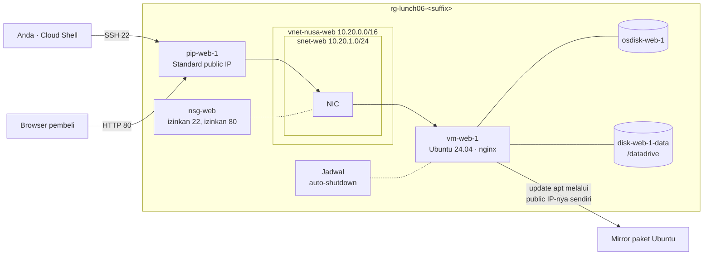

# Lab 06 · VM web server pertama Anda

🇬🇧 [Read in English](README.md)

> **Pasangan dari:** [Makan Siang 06 · Virtual Machines (Dasar)](../../lunches/06-virtual-machines-basic/README.id.md)
> **Waktu:** sekitar 45 menit · **Biaya:** 💲💲 (lihat [kelompok biaya](../README.id.md#kelompok-biaya)) · **Tingkat kesulitan:** ★☆☆
> **Bisa dikerjakan terpisah:** ✅ Anda tidak memerlukan lab sebelumnya. Semua yang dibutuhkan lab ini dibuat oleh langkah-langkahnya sendiri.
> **Penulis:** Stefanus Pinarta · [Tentang penulis](../../README.id.md#tentang-penulis)

## 🎯 Yang akan Anda bangun

Toko online Nusantara Retail mendapat rumah pertamanya di Azure: sebuah virtual machine Ubuntu Server 24.04 LTS bernama
`vm-web-1` yang menjalankan nginx dan menyajikan halaman Nusantara Retail ke internet. Lalu lintas masuk melalui Standard
public IP dan melewati network security group yang hanya mengizinkan SSH dan HTTP. Foto produk mendapat data disk sendiri
berukuran 8 GiB, yang di-mount di `/datadrive`. Anda akan me-resize VM, menjadwalkan auto-shutdown harian, dan membuktikan
kepada tim keuangan power state mana yang menghentikan tagihan compute.



## ✅ Sebelum mulai

- Subscription Azure tempat Anda bisa membuat resource (lihat [Lab 01](../01-before-you-begin/README.id.md)).
- **Azure Cloud Shell (Bash)** — buka [shell.azure.com](https://shell.azure.com). Tidak ada yang perlu diinstal.
- Ambil file lab dan muat pengaturan bersama:

```bash
git clone https://github.com/stefpin/azure-fundamentals-lunches.git   # first time only
cd azure-fundamentals-lunches/labs/06-virtual-machines-basic
source ../common/config.sh
RG=$(rg_name 06)
VM=vm-web-1
echo "Resource group: $RG · region: $LOCATION · size: $VM_SIZE · image: $VM_IMAGE"
```

- Lab ini membutuhkan kuota regional sebanyak **2 vCPU**. Jika Anda tidak yakin size-nya ditawarkan untuk Anda, jalankan
  `bash ../common/check-environment.sh` terlebih dahulu.
- Tidak perlu `setup.sh`: Anda membangun semuanya sendiri.

> [!IMPORTANT]
> Resource lab dikenai biaya selama masih ada. Selesaikan dengan bagian **Bersihkan**, bahkan jika Anda berhenti di tengah jalan.

> [!TIP]
> Cloud Shell terputus setelah sekitar 20 menit tanpa input dan melupakan variabel Anda. Jika itu terjadi, `cd` kembali
> ke folder lab dan jalankan lagi baris `source`, `RG=`, dan `VM=` — serta `IP=` dari Tugas 2.

## 🧭 Pilih mode Anda

| Mode | Cocok untuk Anda jika… | Caranya |
|---|---|---|
| **Terpandu** | Anda ingin setiap langkah dijelaskan | ikuti Tugas 1–8 di bawah |
| **Tantangan** | Anda sudah menguasai dasarnya | baca [Ringkasan tantangan](#-ringkasan-tantangan) saja, bangun dengan cara Anda sendiri, lalu jalankan `bash verify.sh` |

## Tugas 1 · Buat VM

Satu perintah membuat VM *beserta* semua resource yang dibutuhkannya. Anda memberi nama setiap resource supaya resource group
tetap mudah dibaca, dan Anda memilih rentang jaringan (10.20.0.0/16) yang tidak akan pernah bentrok dengan 10.0.0.0/16 milik
kantor pusat.

```bash
ensure_rg "$RG" 06

az vm create \
  --resource-group "$RG" \
  --name "$VM" \
  --location "$LOCATION" \
  --image "$VM_IMAGE" \
  --size "$VM_SIZE" \
  --admin-username "$ADMIN_USER" \
  --generate-ssh-keys \
  --vnet-name vnet-nusa-web --vnet-address-prefix 10.20.0.0/16 \
  --subnet snet-web --subnet-address-prefix 10.20.1.0/24 \
  --nsg nsg-web \
  --public-ip-address pip-web-1 --public-ip-sku Standard \
  --os-disk-name osdisk-web-1 --storage-sku StandardSSD_LRS \
  --output table
```

Prosesnya memakan waktu satu sampai tiga menit. Inilah fungsi opsi-opsi yang kurang jelas:

| Opsi | Gunanya |
|---|---|
| `--image "$VM_IMAGE"` | `Ubuntu2404` adalah alias CLI untuk Ubuntu Server 24.04 LTS (Gen2, sehingga Trusted Launch aktif secara default) |
| `--size "$VM_SIZE"` | `Standard_B2ats_v2`: 2 vCPU burstable dan memori 1 GiB — cukup untuk nginx |
| `--generate-ssh-keys` | Membuat `~/.ssh/id_rsa` dan `~/.ssh/id_rsa.pub` di Cloud Shell jika belum ada, lalu memasang public key di VM. Tidak ada kata sandi yang ditetapkan |
| `--nsg nsg-web` | Membuat network security group pada NIC milik VM. Untuk Linux, CLI menambahkan satu aturan inbound: SSH (22) dari mana saja |
| `--public-ip-sku Standard` | Public IP Basic sudah dipensiunkan. IP Standard bersifat statis dan tertutup sampai NSG mengizinkan lalu lintas |
| `--storage-sku StandardSSD_LRS` | OS disk Standard SSD membuat lab tetap murah. Production akan memakai Premium SSD (Makan Siang 06, bagian 3) |

Sekarang lihat apa yang benar-benar dibuat:

```bash
az resource list --resource-group "$RG" --query "[].{type:type, name:name}" --output table
```

> [!TIP]
> **Lebih suka portal?** *Home › Virtual machines › Create › Azure virtual machine.* Di tab **Basics**: resource group Anda,
> name `vm-web-1`, region Anda, *No infrastructure redundancy required*, security type *Trusted launch*, image *Ubuntu
> Server 24.04 LTS – x64 Gen2*, size *Standard_B2ats_v2*, authentication *SSH public key* dengan source *Use existing
> public key* (tempel output `cat ~/.ssh/id_rsa.pub` dari Cloud Shell), username `azureuser`, inbound port *SSH
> (22)*. Di tab **Disks**: *Standard SSD*. Di tab **Networking**: buat virtual network `vnet-nusa-web` (10.20.0.0/16) dengan
> subnet `snet-web` (10.20.1.0/24) dan public IP baru. Lalu **Review + create**. Portal memberi nama yang berbeda untuk
> beberapa resource (misalnya `vm-web-1-nsg`); itu tidak masalah — pemeriksaan menemukannya melalui VM.

> ✅ **Pemeriksaan:** daftar resource menampilkan enam resource: sebuah virtual machine, sebuah disk, sebuah network interface,
> sebuah network security group, sebuah public IP address, dan sebuah virtual network (ditambah VM extension apa pun yang
> otomatis ditambahkan oleh policy di subscription Anda). Pastikan VM sedang berjalan:
>
> ```bash
> az vm show -d -g "$RG" -n "$VM" \
>   --query "{power:powerState, size:hardwareProfile.vmSize, publicIp:publicIps, privateIp:privateIps}" -o table
> ```

Penasaran dengan perubahan outbound yang dibahas di bacaan? Tanyakan ke subnet-nya:

```bash
az network vnet subnet show -g "$RG" --vnet-name vnet-nusa-web -n snet-web --query defaultOutboundAccess -o tsv
```

`false` berarti private subnet: tidak ada akses outbound default. Hasil kosong berarti jaringannya dibuat dengan default yang
lebih lama. Apa pun hasilnya, VM Anda bisa menjangkau internet, karena punya public IP sendiri — metode outbound yang
*eksplisit*.

## Tugas 2 · Terhubung dengan SSH dari Cloud Shell

SSH adalah cara Anda mengelola server Linux ini dari jauh. Private key Anda sudah ada di Cloud Shell, jadi tidak ada yang
perlu diketik kecuali `yes` pada kali pertama.

```bash
IP=$(az vm show -d -g "$RG" -n "$VM" --query publicIps -o tsv)
echo "Public IP: $IP"
ssh "$ADMIN_USER@$IP"
```

Jawab `yes` untuk pertanyaan host key (semacam sidik jari server yang diminta SSH untuk Anda percayai). Sekarang Anda berada
*di dalam* VM. Lihat-lihat sebentar, lalu keluar:

```bash
uname -r                                   # the kernel Azure booted from the image
lsblk -o NAME,SIZE,TYPE,MOUNTPOINTS        # disks the VM can see
curl -s -H Metadata:true "http://169.254.169.254/metadata/instance/compute/vmSize?api-version=2021-02-01&format=text"; echo
exit
```

Perintah `curl` di bagian akhir bertanya ke **Instance Metadata Service** — alamat khusus yang bisa dijangkau setiap VM
Azure — sedang berjalan di size apa VM tersebut.

> ✅ **Pemeriksaan:** prompt Anda berubah menjadi `azureuser@vm-web-1` selama terhubung; `lsblk` menampilkan satu disk sekitar
> 30 GB (OS disk) dan tidak ada temporary disk, karena size Basv2 memang tidak punya; metadata service menjawab
> `Standard_B2ats_v2`.

## Tugas 3 · Pasang nginx dan terbitkan halaman Nusantara Retail

VM mengunduh nginx dari mirror paket Ubuntu. Itu berhasil karena public IP-nya memberinya akses outbound yang eksplisit.
Anda bisa menjalankan perintah lewat SSH tanpa membuka sesi interaktif:

```bash
ssh "$ADMIN_USER@$IP" 'sudo apt-get update -q && sudo DEBIAN_FRONTEND=noninteractive apt-get install -y -q nginx'
```

Sekarang salin halaman contoh dari folder lab dan taruh di tempat nginx menyajikan file:

```bash
head -n 12 app/index.html                             # have a quick look first
scp app/index.html "$ADMIN_USER@$IP:index.html"
ssh "$ADMIN_USER@$IP" 'sudo cp ~/index.html /var/www/html/index.html && curl -s localhost | grep -o "<title>.*</title>"'
```

Terakhir, coba buka situsnya dari Cloud Shell — artinya, dari internet:

```bash
curl -s -m 5 -o /dev/null -w '%{http_code}\n' "http://$IP/"
```

> ✅ **Pemeriksaan:** di dalam VM, `curl localhost` mencetak `<title>Nusantara Retail · Online Store</title>`. Dari
> Cloud Shell Anda mendapat `000` — permintaannya habis waktu (timeout). nginx berfungsi; ada sesuatu di depannya yang tidak
> membiarkan pembeli masuk. Itulah Tugas 4.

## Tugas 4 · Buka port 80

NSG punya aturan untuk SSH, tetapi tidak untuk HTTP, dan aturan default-nya menolak semua lalu lintas lain yang datang dari
internet. `az vm open-port` menambahkan aturan allow ke NSG pada network interface milik VM (angka priority yang lebih kecil
diperiksa lebih dulu).

```bash
az vm open-port -g "$RG" -n "$VM" --port 80 --priority 900 --output none

az network nsg rule list -g "$RG" --nsg-name nsg-web \
  --query "[].{name:name, priority:priority, port:destinationPortRange, source:sourceAddressPrefix, access:access}" -o table

curl -s -o /dev/null -w '%{http_code}\n' "http://$IP/"
```

Buka juga `http://<your public IP>` di tab browser, dengan public IP milik Anda.

> [!TIP]
> **Lebih suka portal?** *vm-web-1 › Networking › Network settings › Create port rule › Inbound port rule*, service
> **HTTP**, priority **900**. Portal menampilkan effective rules (aturan yang benar-benar berlaku) di halaman yang sama — cara
> praktis untuk melihat aturan subnet dan NIC sekaligus.

> ✅ **Pemeriksaan:** daftar aturan menampilkan aturan SSH (priority 1000) dan aturan baru untuk port 80 (priority 900). `curl`
> mencetak `200`, dan browser menampilkan halaman Nusantara Retail.

## Tugas 5 · Tambahkan dan mount data disk

Foto produk akan terus bertambah; tempatnya bukan di OS disk. Pasang (attach) Standard SSD baru berukuran 8 GiB di LUN 0
(logical unit number — slot data disk pertama):

```bash
az vm disk attach -g "$RG" --vm-name "$VM" \
  --name disk-web-1-data --new --size-gb 8 --sku StandardSSD_LRS --lun 0 --output none

az vm show -g "$RG" -n "$VM" --query "storageProfile.dataDisks[].{lun:lun, name:name, sizeGb:diskSizeGb}" -o table
```

Azure sudah memasang disknya, tetapi Linux hanya melihat perangkat mentah yang kosong. Disk itu masih butuh partisi,
filesystem, dan mount point. Ibaratnya membeli lemari baru: Azure mengantarkan lemarinya ke kamar, tetapi Anda sendiri yang
memasang rak di dalamnya dan menempelkan label di pintunya. `mount-data-disk.sh` milik lab mengerjakan semua itu, dan Anda bisa
menjalankannya lewat **Run Command** — tanpa SSH, tanpa port terbuka, cukup Azure VM agent:

```bash
az vm run-command invoke -g "$RG" -n "$VM" --command-id RunShellScript \
  --scripts @mount-data-disk.sh --query "value[0].message" -o tsv
```

Skrip itu menemukan disk di LUN 0, membuat satu partisi GPT, memformatnya sebagai ext4 (filesystem standar Linux), me-mount-nya
di `/datadrive`, menambahkan satu baris ke `/etc/fstab` (daftar disk yang otomatis di-mount saat boot) memakai UUID partisi
(pengenal uniknya) dengan opsi `nofail` (supaya disk yang hilang tidak pernah menghentikan VM saat boot), lalu membuat
`/datadrive/images`. Skrip ini aman dijalankan dua kali. Run Command butuh waktu 30–60 detik.

<details><summary>Lebih suka mengerjakannya manual lewat SSH?</summary>

```bash
ssh "$ADMIN_USER@$IP"
lsblk -o NAME,HCTL,SIZE,MOUNTPOINTS          # the new 8G disk has no partitions; the last HCTL number is the LUN
ls -l /dev/disk/azure/scsi1/ 2>/dev/null     # lun0 -> ../../../sdX on most images
DISK=/dev/sdc                                # <-- use the device you found!
sudo parted --script "$DISK" mklabel gpt mkpart primary ext4 0% 100%
sudo mkfs.ext4 -L datadrive "${DISK}1"
sudo mkdir -p /datadrive
echo "UUID=$(sudo blkid -s UUID -o value ${DISK}1) /datadrive ext4 defaults,nofail 0 2" | sudo tee -a /etc/fstab
sudo mount /datadrive && df -h /datadrive
exit
```

Periksa ulang nama perangkatnya: memformat disk yang salah akan menghancurkan datanya.

</details>

> ✅ **Pemeriksaan:** output Run Command diakhiri baris `df` untuk `/datadrive` berukuran sekitar 8 GB. Pastikan lewat SSH:
> `ssh "$ADMIN_USER@$IP" 'df -h /datadrive && grep datadrive /etc/fstab'`

## Tugas 6 · Resize VM

Promo Ramadan sudah dekat dan Dewi ingin memori yang lebih besar. Resizing adalah scaling *vertikal*: VM yang sama, size yang
berbeda, satu kali restart. Pertama, lihat size apa saja yang ditawarkan hardware cluster VM Anda saat ini dengan jumlah vCPU
yang sama:

```bash
az vm list-vm-resize-options -g "$RG" -n "$VM" \
  --query '[?numberOfCores==`2`].{size:name, memoryMb:memoryInMb}' -o table
```

Resize ke `Standard_B2als_v2` (2 vCPU, 4 GiB) — atau size 2 vCPU lain dari daftar — dan perhatikan situsnya:

```bash
az vm resize -g "$RG" -n "$VM" --size Standard_B2als_v2 --output none
az vm show -d -g "$RG" -n "$VM" --query "{size:hardwareProfile.vmSize, power:powerState, ip:publicIps}" -o table
curl -s -o /dev/null -w '%{http_code}\n' "http://$IP/"
```

Jatah jam VM bulanan dari akun gratis mencakup `Standard_B2ats_v2`, tetapi tidak mencakup size yang lebih besar, jadi kecilkan
lagi size-nya setelah selesai:

```bash
az vm resize -g "$RG" -n "$VM" --size "$VM_SIZE" --output none
```

> ✅ **Pemeriksaan:** setelah setiap resize, VM berjalan dengan size barunya, public IP tidak berubah (IP Standard bersifat
> statis), dan situs kembali menjawab `200`. Selama setiap resize, situs sempat mati sebentar — ingat itu ketika ada yang
> mengusulkan me-resize VM production pada jam makan siang.

## Tugas 7 · Jadwalkan auto-shutdown

Salinan uji toko online tidak perlu menyala sepanjang malam. Auto-shutdown melakukan deallocate pada VM di jam yang sama
setiap hari. CLI menerima waktu dalam **UTC**: pukul 19.00 di Jakarta (UTC+7) adalah `1200`. Supaya VM tidak mematikan
dirinya sendiri di tengah lab ini, jadwalkan tiga jam dari sekarang:

```bash
date -u +"It is now %H:%M UTC"
SHUTDOWN_UTC=$(date -u -d '+3 hours' +%H00)
az vm auto-shutdown -g "$RG" -n "$VM" --time "$SHUTDOWN_UTC" --output none
# Optional: add --email you@example.com to get a warning 30 minutes before each shutdown.

SCHED=$(az resource list -g "$RG" --resource-type Microsoft.DevTestLab/schedules --query "[0].name" -o tsv)
az resource show -g "$RG" --resource-type Microsoft.DevTestLab/schedules -n "$SCHED" \
  --query "{name:name, status:properties.status, time:properties.dailyRecurrence.time, timeZone:properties.timeZoneId}" -o table
```

> [!TIP]
> **Lebih suka portal?** *vm-web-1 › Operations › Auto-shutdown*: aktifkan, pilih jam, lalu pilih zona waktu
> *(UTC+07:00) Bangkok, Hanoi, Jakarta* supaya Anda tidak perlu mengonversi ke UTC. Anda juga bisa menambahkan e-mail
> notifikasi di sana.

> ✅ **Pemeriksaan:** ada resource schedule (tipe `Microsoft.DevTestLab/schedules`) di resource group Anda dengan
> status `Enabled`, jam pilihan Anda, dan zona waktu `UTC`.

## Tugas 8 · Stopped versus deallocated

Tim keuangan bertanya apakah mereka tetap membayar di malam hari. Buktikan jawabannya. Pertama, **stop** VM:

```bash
az vm stop -g "$RG" -n "$VM"
az vm show -d -g "$RG" -n "$VM" --query powerState -o tsv
```

Power state menunjukkan `VM stopped`: sistem operasi mati, tetapi VM masih dialokasikan ke host-nya, sehingga meteran
compute terus berjalan. Sekarang lakukan **deallocate**:

```bash
az vm deallocate -g "$RG" -n "$VM"
az vm get-instance-view -g "$RG" -n "$VM" --query "instanceView.statuses[].displayStatus" -o tsv
az vm show -d -g "$RG" -n "$VM" --query publicIps -o tsv
```

Lalu hidupkan kembali tokonya:

```bash
az vm start -g "$RG" -n "$VM"
curl -s -o /dev/null -w '%{http_code}\n' "http://$IP/"
ssh "$ADMIN_USER@$IP" 'df -h /datadrive'
```

| Status yang Anda lihat | Compute ditagih? | Disk ditagih? | Public IP |
|---|---|---|---|
| `VM stopped` | **Ya** | Ya | Tetap |
| `VM deallocated` | Tidak | Ya | Tetap (IP Standard bersifat statis) dan ditagih |

> ✅ **Pemeriksaan:** Anda melihat `VM stopped`, lalu `VM deallocated`, lalu `VM running`. Public IP tidak pernah berubah,
> situs menjawab `200`, dan `/datadrive` otomatis ter-mount lagi berkat entri `fstab`.

## 🔧 Rusak lalu perbaiki

Seorang rekan "merapikan" NSG. Jadilah rekan itu — hapus aturan yang mengizinkan port 80:

```bash
RULE=$(az network nsg rule list -g "$RG" --nsg-name nsg-web --query "[?destinationPortRange=='80'].name | [0]" -o tsv)
echo "Deleting rule: $RULE"
az network nsg rule delete -g "$RG" --nsg-name nsg-web --name "$RULE"
curl -s -m 5 -o /dev/null -w '%{http_code}\n' "http://$IP/"
```

**Gejala:** toko mati — `curl` mencetak `000` setelah timeout lima detik, browser terus berputar, dan `bash
verify.sh` gagal di dua pemeriksaan. Padahal nginx baik-baik saja: `ssh "$ADMIN_USER@$IP" 'curl -s -o /dev/null -w "%{http_code}\n"
localhost'` mencetak `200`. Temukan penyebabnya dan perbaiki tanpa melihat petunjuk.

<details><summary>Petunjuk dan perbaikan</summary>

VM menjawab secara lokal tetapi tidak dari internet, dan SSH masih berfungsi — jadi masalahnya ada di antara internet dan
VM, khusus di port 80. Tampilkan daftar aturannya (`az network nsg rule list -g "$RG" --nsg-name nsg-web -o table`): hanya SSH
yang diizinkan, dan aturan default `DenyAllInBound` membuang HTTP. Kembalikan aturannya:

```bash
az vm open-port -g "$RG" -n "$VM" --port 80 --priority 900 --output none
curl -s -o /dev/null -w '%{http_code}\n' "http://$IP/"
```

Bonus: Azure Network Watcher bisa memberi tahu Anda aturan *mana* yang memblokir sebuah paket (Makan Siang 08 membahasnya):
`az network watcher test-ip-flow -g "$RG" --vm "$VM" --direction Inbound --protocol TCP --local "$(az vm show -d -g "$RG" -n "$VM" --query privateIps -o tsv):80" --remote 203.0.113.10:50000`

</details>

## 🧪 Verifikasi hasil kerja Anda

```bash
bash verify.sh
```

Setiap pemeriksaan seharusnya menampilkan **PASS**. Jika ada yang gagal, pesannya memberi tahu tugas mana yang perlu Anda
ulangi. Pemeriksaan mount data disk memakai Run Command, jadi skrip ini butuh waktu sekitar satu menit.

## 🧹 Bersihkan (jangan dilewati!)

```bash
bash cleanup.sh
```

Skrip ini menghapus semua yang dibuat lab (resource group `rg-lunch06-<suffix>`, termasuk VM, disk, public IP, dan jadwal
auto-shutdown) dan menghapus host key VM dari `~/.ssh/known_hosts`. Pasangan SSH key Anda tetap disimpan, karena lab lain
memakainya lagi. Penghapusan berlanjut di latar belakang selama beberapa menit.

## 🩺 Pemecahan masalah

| Gejala | Kemungkinan penyebab | Perbaikan |
|---|---|---|
| `SkuNotAvailable` … "The requested size for resource … is currently not available in location …" | Size itu tidak ditawarkan untuk subscription Anda di region atau zona tersebut | Jalankan `bash ../common/check-environment.sh`, pilih size 2 vCPU lain, lalu `export VM_SIZE=<size>` dan `source ../common/config.sh` lagi |
| "Operation could not be completed as it results in exceeding approved Total Regional Cores quota" | VM lain sudah memakai kuota vCPU Anda | Hapus sisa resource dari lab lain (`bash ../common/check-environment.sh` menampilkannya) atau minta tambahan kuota |
| `ssh: connect to host … port 22: Connection timed out` | VM sedang stopped/deallocated, atau aturan SSH hilang | `az vm start …`; tampilkan aturan NSG dan pastikan port 22 diizinkan |
| `Permission denied (publickey)` | Kunci Cloud Shell Anda berubah (misalnya sesi sementara tanpa storage) | Kirim kunci Anda yang sekarang ke VM: `az vm user update -g "$RG" -n "$VM" -u "$ADMIN_USER" --ssh-key-value "$(cat ~/.ssh/id_rsa.pub)"` |
| `WARNING: REMOTE HOST IDENTIFICATION HAS CHANGED!` | VM sebelumnya memakai public IP yang sama | `ssh-keygen -R "$IP"`, lalu hubungkan lagi |
| `E: Could not get lock /var/lib/dpkg/lock-frontend` | Ubuntu masih memasang update dari boot pertama | Tunggu dua atau tiga menit lalu jalankan perintahnya lagi |
| `curl` mencetak `000` | Tidak ada aturan NSG untuk port 80, atau VM tidak sedang berjalan | Tugas 4; `az vm show -d … --query powerState` |
| `curl` mencetak `200` tetapi Anda melihat "Welcome to nginx!" | Halaman contoh belum tersalin | Ulangi baris `scp` dan `sudo cp` di Tugas 3 |
| Run Command gagal dengan konflik atau "execution is in progress" | Run Command lain masih berjalan di VM | Tunggu satu menit lalu jalankan lagi |
| `mount-data-disk.sh` menyatakan "No data disk found at LUN 0" | Disk belum terpasang, atau terpasang di LUN lain | Periksa tabel `dataDisks` di Tugas 5; gunakan `--lun 0` |
| Resize gagal karena size-nya "not available in the current hardware cluster" | Cluster tempat VM Anda berjalan tidak menawarkan size itu | `az vm deallocate`, lalu `az vm resize`, lalu `az vm start` |
| `verify.sh` menyatakan VM tidak sedang berjalan | Auto-shutdown sudah terpicu, atau Anda membiarkannya dalam keadaan deallocated | `az vm start -g "$RG" -n "$VM"` |

## 🚀 Tantangan tambahan

- **Kunci SSH rapat-rapat.** Izinkan port 22 hanya dari alamat Cloud Shell Anda saat ini (alamat ini bisa berubah antar-sesi):
  `R22=$(az network nsg rule list -g "$RG" --nsg-name nsg-web --query "[?destinationPortRange=='22'].name | [0]" -o tsv)`
  lalu `az network nsg rule update -g "$RG" --nsg-name nsg-web -n "$R22" --source-address-prefixes "$(my_public_ip)/32"`.
- **Sajikan foto dari data disk.** Lewat SSH: `sudo ln -s /datadrive/images /var/www/html/images`, salin sebuah gambar
  ke `/datadrive/images` lalu buka `http://<IP>/images/<file>`.
- **Sign in dengan Microsoft Entra ID, bukan dengan key.** Beri VM sebuah system-assigned identity
  (`az vm identity assign -g "$RG" -n "$VM"`), pasang extension login-nya
  (`az vm extension set -g "$RG" --vm-name "$VM" --publisher Microsoft.Azure.ActiveDirectory --name AADSSHLoginForLinux`),
  beri diri Anda role *Virtual Machine Administrator Login* di VM tersebut
  (`az role assignment create --role "Virtual Machine Administrator Login" --assignee "$(my_upn)" --scope "$(az vm show -g "$RG" -n "$VM" --query id -o tsv)"`),
  lalu hubungkan dengan `az ssh vm -g "$RG" -n "$VM"`.
- **Coba Azure Bastion.** Di portal, buka *vm-web-1 › Connect › Bastion*. Jika region Anda menawarkan SKU Developer yang gratis,
  Anda bisa terhubung dari browser — lalu hapus aturan SSH sepenuhnya dan lihat bahwa Bastion tetap berfungsi.

## 🏁 Ringkasan tantangan

Bangun hal-hal berikut dengan cara apa pun yang Anda suka (portal, CLI, Bicep):

1. Resource group bernama `rg-lunch06-<suffix>` (`rg_name 06`) dengan tag `course=azure-fundamentals-lunches` dan
   `lunch=06` — `ensure_rg "$RG" 06` mengerjakannya untuk Anda.
2. VM Ubuntu Server 24.04 LTS yang sedang berjalan bernama `vm-web-1`, size `$VM_SIZE`, dengan autentikasi SSH key saja (tanpa
   kata sandi) dan Standard public IP address.
3. NSG pada NIC atau subnet VM yang mengizinkan TCP port 80 inbound dari internet.
4. nginx yang menyajikan halaman berisi teks `Nusantara Retail`, dengan respons HTTP 200 di `http://<public IP>/`.
5. Minimal satu managed data disk yang terpasang ke VM, sudah diformat dan di-mount di `/datadrive` sehingga tetap ada
   setelah restart.
6. Jadwal auto-shutdown harian yang aktif untuk VM tersebut.
7. Tidak diperiksa oleh skrip, tetapi tetap kerjakan: resize VM lalu kembalikan, dan amati *stopped* versus *deallocated*.

Lalu jalankan `bash verify.sh`. Buntu? Intip `solution.sh` atau beralih ke mode Terpandu.

---

⬅️ [Bacaan Makan Siang 06](../../lunches/06-virtual-machines-basic/README.id.md) · 🏠 [Semua lab](../README.id.md) · 🏠 [Beranda kursus](../../README.id.md)

<sub>Terakhir divalidasi: Oktober 2026 · Ada yang tidak berfungsi? [Laporkan masalah lab](../../CONTRIBUTING.md).</sub>
