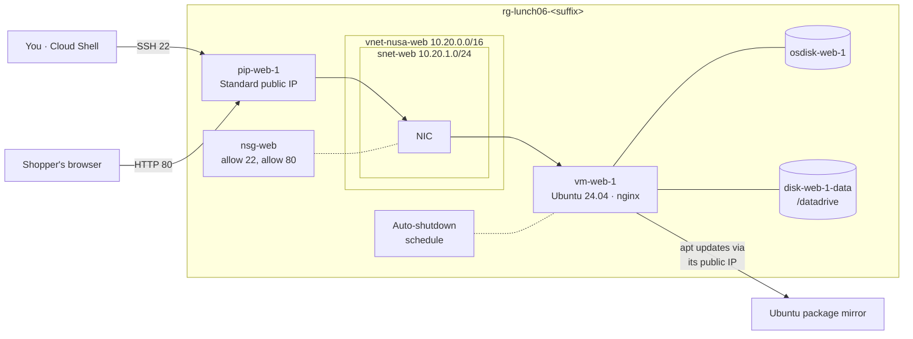

# Lab 06 · Your first web server VM

> **Pairs with:** [Lunch 06 · Virtual Machines (Basic)](../../lunches/06-virtual-machines-basic/README.md)
> **Time:** about 45 minutes · **Cost:** 💲💲 (see [cost bands](../README.md#cost-bands)) · **Difficulty:** ★☆☆
> **Works on its own:** ✅ You do not need any earlier lab. Everything this lab needs is created by its steps.

## 🎯 What you'll build

Nusantara Retail's storefront gets its first home in Azure: an Ubuntu Server 24.04 LTS virtual machine called
`vm-web-1` that runs nginx and serves a Nusantara Retail page to the internet. Traffic arrives through a Standard public
IP and passes a network security group that allows only SSH and HTTP. Product images get their own 8 GiB data disk,
mounted at `/datadrive`. You will resize the VM, schedule a daily auto-shutdown, and prove to the finance team which
power state stops the compute bill.



## ✅ Before you start

- An Azure subscription where you can create resources (see [Lab 01](../01-before-you-begin/README.md)).
- **Azure Cloud Shell (Bash)** — open [shell.azure.com](https://shell.azure.com). Nothing to install.
- Get the lab files and load the shared settings:

```bash
git clone https://github.com/stefpin/azure-fundamentals-lunches.git   # first time only
cd azure-fundamentals-lunches/labs/06-virtual-machines-basic
source ../common/config.sh
RG=$(rg_name 06)
VM=vm-web-1
echo "Resource group: $RG · region: $LOCATION · size: $VM_SIZE · image: $VM_IMAGE"
```

- This lab needs **2 vCPUs** of regional quota. If you are not sure the size is offered to you, run
  `bash ../common/check-environment.sh` first.
- No `setup.sh` is needed: you build everything yourself.

> [!IMPORTANT]
> Lab resources cost money while they exist. Finish with the **Clean up** section, even if you stop halfway.

> [!TIP]
> Cloud Shell disconnects after about 20 minutes without input and forgets your variables. If that happens, `cd` back
> into the lab folder and run the `source`, `RG=`, `VM=` lines again — and `IP=` from Task 2.

## 🧭 Choose your mode

| Mode | For you if… | How |
|---|---|---|
| **Guided** | you want every step explained | follow Tasks 1–8 below |
| **Challenge** | you already know the basics | read only the [Challenge brief](#-challenge-brief), build it your way, then run `bash verify.sh` |

## Task 1 · Create the VM

One command creates the VM *and* every resource it depends on. You name each one so the resource group stays readable,
and you choose a network range (10.20.0.0/16) that will never collide with head office's 10.0.0.0/16.

```bash
ensure_rg "$RG" 06

az vm create \
  --resource-group "$RG" \
  --name "$VM" \
  --location "$LOCATION" \
  --image "$VM_IMAGE" \
  --size "$VM_SIZE" \
  --admin-username "$ADMIN_USER" \
  --generate-ssh-keys \
  --vnet-name vnet-nusa-web --vnet-address-prefix 10.20.0.0/16 \
  --subnet snet-web --subnet-address-prefix 10.20.1.0/24 \
  --nsg nsg-web \
  --public-ip-address pip-web-1 --public-ip-sku Standard \
  --os-disk-name osdisk-web-1 --storage-sku StandardSSD_LRS \
  --output table
```

It takes one to three minutes. What the less obvious options do:

| Option | Why |
|---|---|
| `--image "$VM_IMAGE"` | `Ubuntu2404` is the CLI alias for Ubuntu Server 24.04 LTS (Gen2, so Trusted Launch is on by default) |
| `--size "$VM_SIZE"` | `Standard_B2ats_v2`: 2 burstable vCPUs and 1 GiB of memory — enough for nginx |
| `--generate-ssh-keys` | Creates `~/.ssh/id_rsa` and `~/.ssh/id_rsa.pub` in Cloud Shell if they don't exist yet, and puts the public key on the VM. No password is set |
| `--nsg nsg-web` | Creates a network security group on the VM's NIC. For Linux the CLI adds one inbound rule: SSH (22) from anywhere |
| `--public-ip-sku Standard` | Basic public IPs are retired. A Standard IP is static and closed until an NSG allows traffic |
| `--storage-sku StandardSSD_LRS` | A Standard SSD OS disk keeps the lab cheap. Production would use Premium SSD (Lunch 06, section 3) |

Now look at what was really created:

```bash
az resource list --resource-group "$RG" --query "[].{type:type, name:name}" --output table
```

> [!TIP]
> **Prefer the portal?** *Home › Virtual machines › Create › Azure virtual machine.* On **Basics**: your resource group,
> name `vm-web-1`, your region, *No infrastructure redundancy required*, security type *Trusted launch*, image *Ubuntu
> Server 24.04 LTS – x64 Gen2*, size *Standard_B2ats_v2*, authentication *SSH public key* with source *Use existing
> public key* (paste the output of `cat ~/.ssh/id_rsa.pub` from Cloud Shell), username `azureuser`, inbound port *SSH
> (22)*. On **Disks**: *Standard SSD*. On **Networking**: create a virtual network `vnet-nusa-web` (10.20.0.0/16) with
> subnet `snet-web` (10.20.1.0/24) and a new public IP. Then **Review + create**. The portal names some resources
> differently (for example `vm-web-1-nsg`); that's fine — the checks find them through the VM.

> ✅ **Checkpoint:** the resource list shows six resources: a virtual machine, a disk, a network interface, a network
> security group, a public IP address and a virtual network (plus any VM extensions that your subscription's policies
> add automatically). Confirm the VM is running:
>
> ```bash
> az vm show -d -g "$RG" -n "$VM" \
>   --query "{power:powerState, size:hardwareProfile.vmSize, publicIp:publicIps, privateIp:privateIps}" -o table
> ```

Curious about the outbound change from the reading? Ask the subnet:

```bash
az network vnet subnet show -g "$RG" --vnet-name vnet-nusa-web -n snet-web --query defaultOutboundAccess -o tsv
```

`false` means a private subnet: no default outbound access. An empty result means the network was created with an
older default. Either way your VM can reach the internet, because it has its own public IP — an *explicit* outbound
method.

## Task 2 · Connect with SSH from Cloud Shell

SSH is how you will administer this Linux server. Your private key is already in Cloud Shell, so there is nothing to
type except `yes` the first time.

```bash
IP=$(az vm show -d -g "$RG" -n "$VM" --query publicIps -o tsv)
echo "Public IP: $IP"
ssh "$ADMIN_USER@$IP"
```

Answer `yes` to the host-key question. You are now *inside* the VM. Look around, then leave:

```bash
uname -r                                   # the kernel Azure booted from the image
lsblk -o NAME,SIZE,TYPE,MOUNTPOINTS        # disks the VM can see
curl -s -H Metadata:true "http://169.254.169.254/metadata/instance/compute/vmSize?api-version=2021-02-01&format=text"; echo
exit
```

The last command asks the **Instance Metadata Service** — a special address every Azure VM can reach — which size
it is running on.

> ✅ **Checkpoint:** your prompt changed to `azureuser@vm-web-1` while connected; `lsblk` showed one disk of about
> 30 GB (the OS disk) and no temporary disk, because Basv2 sizes don't have one; the metadata service answered
> `Standard_B2ats_v2`.

## Task 3 · Install nginx and publish the Nusantara Retail page

The VM downloads nginx from the Ubuntu package mirror. That works because its public IP gives it explicit outbound
access. You can run commands over SSH without opening an interactive session:

```bash
ssh "$ADMIN_USER@$IP" 'sudo apt-get update -q && sudo DEBIAN_FRONTEND=noninteractive apt-get install -y -q nginx'
```

Now copy the sample page from the lab folder and put it where nginx serves files from:

```bash
head -n 12 app/index.html                             # have a quick look first
scp app/index.html "$ADMIN_USER@$IP:index.html"
ssh "$ADMIN_USER@$IP" 'sudo cp ~/index.html /var/www/html/index.html && curl -s localhost | grep -o "<title>.*</title>"'
```

Finally, try the site from Cloud Shell — that is, from the internet:

```bash
curl -s -m 5 -o /dev/null -w '%{http_code}\n' "http://$IP/"
```

> ✅ **Checkpoint:** inside the VM, `curl localhost` printed `<title>Nusantara Retail · Online Store</title>`. From
> Cloud Shell you got `000` — the request timed out. nginx is working; something in front of it is not letting the
> shopper in. That is Task 4.

## Task 4 · Open port 80

The NSG has a rule for SSH but none for HTTP, and its default rules deny everything else coming from the internet.
`az vm open-port` adds an allow rule to the NSG on the VM's network interface.

```bash
az vm open-port -g "$RG" -n "$VM" --port 80 --priority 900 --output none

az network nsg rule list -g "$RG" --nsg-name nsg-web \
  --query "[].{name:name, priority:priority, port:destinationPortRange, source:sourceAddressPrefix, access:access}" -o table

curl -s -o /dev/null -w '%{http_code}\n' "http://$IP/"
```

Open `http://<your public IP>` in a browser tab too.

> [!TIP]
> **Prefer the portal?** *vm-web-1 › Networking › Network settings › Create port rule › Inbound port rule*, service
> **HTTP**, priority **900**. The portal shows the effective rules on the same page — a handy way to see subnet and NIC
> rules together.

> ✅ **Checkpoint:** the rule list shows the SSH rule (priority 1000) and a new rule for port 80 (priority 900). `curl`
> prints `200`, and the browser shows the Nusantara Retail page.

## Task 5 · Add and mount a data disk

Product images will grow; they don't belong on the OS disk. Attach a new 8 GiB Standard SSD at LUN 0 (the first data
disk slot):

```bash
az vm disk attach -g "$RG" --vm-name "$VM" \
  --name disk-web-1-data --new --size-gb 8 --sku StandardSSD_LRS --lun 0 --output none

az vm show -g "$RG" -n "$VM" --query "storageProfile.dataDisks[].{lun:lun, name:name, sizeGb:diskSizeGb}" -o table
```

Azure has attached the disk, but Linux sees only a raw, empty device. It still needs a partition, a filesystem and a
mount point. The lab's `mount-data-disk.sh` does that, and you can run it through **Run Command** — no SSH, no open
port, just the Azure VM agent:

```bash
az vm run-command invoke -g "$RG" -n "$VM" --command-id RunShellScript \
  --scripts @mount-data-disk.sh --query "value[0].message" -o tsv
```

The script finds the disk at LUN 0, creates one GPT partition, formats it as ext4, mounts it at `/datadrive`, adds a
line to `/etc/fstab` using the partition's UUID with the `nofail` option (so a missing disk never stops the VM from
booting), and creates `/datadrive/images`. It is safe to run twice. Run Command takes 30–60 seconds.

<details><summary>Prefer to do it by hand over SSH?</summary>

```bash
ssh "$ADMIN_USER@$IP"
lsblk -o NAME,HCTL,SIZE,MOUNTPOINTS          # the new 8G disk has no partitions; the last HCTL number is the LUN
ls -l /dev/disk/azure/scsi1/ 2>/dev/null     # lun0 -> ../../../sdX on most images
DISK=/dev/sdc                                # <-- use the device you found!
sudo parted --script "$DISK" mklabel gpt mkpart primary ext4 0% 100%
sudo mkfs.ext4 -L datadrive "${DISK}1"
sudo mkdir -p /datadrive
echo "UUID=$(sudo blkid -s UUID -o value ${DISK}1) /datadrive ext4 defaults,nofail 0 2" | sudo tee -a /etc/fstab
sudo mount /datadrive && df -h /datadrive
exit
```

Double-check the device name: formatting the wrong disk destroys its data.

</details>

> ✅ **Checkpoint:** the Run Command output ends with a `df` line for `/datadrive` of about 8 GB. Confirm over SSH:
> `ssh "$ADMIN_USER@$IP" 'df -h /datadrive && grep datadrive /etc/fstab'`

## Task 6 · Resize the VM

The Ramadan promotion is coming and Dewi wants more memory. Resizing is *vertical* scaling: same VM, different
size, one restart. First see which sizes the VM's current hardware cluster offers with the same number of vCPUs:

```bash
az vm list-vm-resize-options -g "$RG" -n "$VM" \
  --query '[?numberOfCores==`2`].{size:name, memoryMb:memoryInMb}' -o table
```

Resize to `Standard_B2als_v2` (2 vCPUs, 4 GiB) — or another 2-vCPU size from the list — and watch the site:

```bash
az vm resize -g "$RG" -n "$VM" --size Standard_B2als_v2 --output none
az vm show -d -g "$RG" -n "$VM" --query "{size:hardwareProfile.vmSize, power:powerState, ip:publicIps}" -o table
curl -s -o /dev/null -w '%{http_code}\n' "http://$IP/"
```

The free account's monthly VM hours cover `Standard_B2ats_v2` but not the bigger size, so size back down when you are
done:

```bash
az vm resize -g "$RG" -n "$VM" --size "$VM_SIZE" --output none
```

> ✅ **Checkpoint:** after each resize the VM is running with the new size, the public IP is unchanged (Standard IPs are
> static) and the site answers `200` again. During each resize the site was briefly down — remember that when someone
> suggests resizing the production VM at noon.

## Task 7 · Schedule auto-shutdown

The test copy of the storefront should not run all night. Auto-shutdown deallocates the VM at the same time every
day. The CLI takes the time in **UTC**: 19:00 in Jakarta (UTC+7) is `1200`. So that the VM doesn't switch itself off
in the middle of this lab, schedule it three hours from now:

```bash
date -u +"It is now %H:%M UTC"
SHUTDOWN_UTC=$(date -u -d '+3 hours' +%H00)
az vm auto-shutdown -g "$RG" -n "$VM" --time "$SHUTDOWN_UTC" --output none
# Optional: add --email you@example.com to get a warning 30 minutes before each shutdown.

SCHED=$(az resource list -g "$RG" --resource-type Microsoft.DevTestLab/schedules --query "[0].name" -o tsv)
az resource show -g "$RG" --resource-type Microsoft.DevTestLab/schedules -n "$SCHED" \
  --query "{name:name, status:properties.status, time:properties.dailyRecurrence.time, timeZone:properties.timeZoneId}" -o table
```

> [!TIP]
> **Prefer the portal?** *vm-web-1 › Operations › Auto-shutdown*: turn it on, pick a time, and choose the time zone
> *(UTC+07:00) Bangkok, Hanoi, Jakarta* so you never have to convert to UTC. You can add a notification email there.

> ✅ **Checkpoint:** a schedule resource (type `Microsoft.DevTestLab/schedules`) exists in your resource group with
> status `Enabled`, your chosen time and time zone `UTC`.

## Task 8 · Stopped versus deallocated

Finance asked whether they pay at night. Prove the answer. First **stop** the VM:

```bash
az vm stop -g "$RG" -n "$VM"
az vm show -d -g "$RG" -n "$VM" --query powerState -o tsv
```

The power state says `VM stopped`: the operating system is off, but the VM is still allocated to its host, so the
compute meter keeps running. Now **deallocate** it:

```bash
az vm deallocate -g "$RG" -n "$VM"
az vm get-instance-view -g "$RG" -n "$VM" --query "instanceView.statuses[].displayStatus" -o tsv
az vm show -d -g "$RG" -n "$VM" --query publicIps -o tsv
```

Then bring the shop back:

```bash
az vm start -g "$RG" -n "$VM"
curl -s -o /dev/null -w '%{http_code}\n' "http://$IP/"
ssh "$ADMIN_USER@$IP" 'df -h /datadrive'
```

| State you saw | Compute billed? | Disks billed? | Public IP |
|---|---|---|---|
| `VM stopped` | **Yes** | Yes | Kept |
| `VM deallocated` | No | Yes | Kept (Standard IPs are static) and billed |

> ✅ **Checkpoint:** you saw `VM stopped`, then `VM deallocated`, then `VM running`. The public IP never changed, the
> site answers `200`, and `/datadrive` was mounted again automatically thanks to the `fstab` entry.

## 🔧 Break it and fix it

A colleague "tidied up" the NSG. Play the colleague — delete the rule that allows port 80:

```bash
RULE=$(az network nsg rule list -g "$RG" --nsg-name nsg-web --query "[?destinationPortRange=='80'].name | [0]" -o tsv)
echo "Deleting rule: $RULE"
az network nsg rule delete -g "$RG" --nsg-name nsg-web --name "$RULE"
curl -s -m 5 -o /dev/null -w '%{http_code}\n' "http://$IP/"
```

**Symptom:** the shop is down — `curl` prints `000` after a five-second timeout, the browser spins, and `bash
verify.sh` fails two checks. Yet nginx is fine: `ssh "$ADMIN_USER@$IP" 'curl -s -o /dev/null -w "%{http_code}\n"
localhost'` prints `200`. Find the cause and fix it without looking at the hint.

<details><summary>Hint and fix</summary>

The VM answers locally but not from the internet, and SSH still works — so the problem is between the internet and
the VM, on port 80 only. List the rules (`az network nsg rule list -g "$RG" --nsg-name nsg-web -o table`): only SSH
is allowed, and the default `DenyAllInBound` rule drops HTTP. Put the rule back:

```bash
az vm open-port -g "$RG" -n "$VM" --port 80 --priority 900 --output none
curl -s -o /dev/null -w '%{http_code}\n' "http://$IP/"
```

Bonus: Azure Network Watcher can tell you *which* rule blocks a packet (Lunch 08 covers it):
`az network watcher test-ip-flow -g "$RG" --vm "$VM" --direction Inbound --protocol TCP --local "$(az vm show -d -g "$RG" -n "$VM" --query privateIps -o tsv):80" --remote 203.0.113.10:50000`

</details>

## 🧪 Verify your work

```bash
bash verify.sh
```

Every check should say **PASS**. If one fails, the message tells you which task to revisit. The data-disk mount check
uses Run Command, so the script takes about a minute.

## 🧹 Clean up (do not skip!)

```bash
bash cleanup.sh
```

This deletes everything the lab created (resource group `rg-lunch06-<suffix>`, including the VM, disks, public IP and
the auto-shutdown schedule) and forgets the VM's host key in `~/.ssh/known_hosts`. Your SSH key pair stays, because
other labs reuse it. Deletion continues in the background for a few minutes.

## 🩺 Troubleshooting

| Symptom | Likely cause | Fix |
|---|---|---|
| `SkuNotAvailable` … "The requested size for resource … is currently not available in location …" | The size isn't offered to your subscription in that region or zone | Run `bash ../common/check-environment.sh`, pick another 2-vCPU size, then `export VM_SIZE=<size>` and `source ../common/config.sh` again |
| "Operation could not be completed as it results in exceeding approved Total Regional Cores quota" | Other VMs already use your vCPU quota | Delete leftovers from other labs (`bash ../common/check-environment.sh` lists them) or request more quota |
| `ssh: connect to host … port 22: Connection timed out` | The VM is stopped/deallocated, or the SSH rule is missing | `az vm start …`; list the NSG rules and make sure port 22 is allowed |
| `Permission denied (publickey)` | Your Cloud Shell keys changed (for example an ephemeral session without storage) | Push your current key: `az vm user update -g "$RG" -n "$VM" -u "$ADMIN_USER" --ssh-key-value "$(cat ~/.ssh/id_rsa.pub)"` |
| `WARNING: REMOTE HOST IDENTIFICATION HAS CHANGED!` | An earlier VM used the same public IP | `ssh-keygen -R "$IP"`, then connect again |
| `E: Could not get lock /var/lib/dpkg/lock-frontend` | Ubuntu is still installing updates from the first boot | Wait two or three minutes and run the command again |
| `curl` prints `000` | No NSG rule for port 80, or the VM isn't running | Task 4; `az vm show -d … --query powerState` |
| `curl` prints `200` but you see "Welcome to nginx!" | The sample page wasn't copied | Repeat the `scp` and `sudo cp` lines in Task 3 |
| Run Command fails with a conflict or "execution is in progress" | Another Run Command is still running on the VM | Wait a minute and run it again |
| `mount-data-disk.sh` says "No data disk found at LUN 0" | The disk isn't attached, or it was attached at another LUN | Check Task 5's `dataDisks` table; use `--lun 0` |
| Resize fails because the size is "not available in the current hardware cluster" | The cluster your VM runs on doesn't offer that size | `az vm deallocate`, then `az vm resize`, then `az vm start` |
| `verify.sh` says the VM is not running | Auto-shutdown fired, or you left it deallocated | `az vm start -g "$RG" -n "$VM"` |

## 🚀 Stretch goals

- **Lock SSH down.** Allow port 22 only from your current Cloud Shell address (it can change between sessions):
  `R22=$(az network nsg rule list -g "$RG" --nsg-name nsg-web --query "[?destinationPortRange=='22'].name | [0]" -o tsv)`
  then `az network nsg rule update -g "$RG" --nsg-name nsg-web -n "$R22" --source-address-prefixes "$(my_public_ip)/32"`.
- **Serve images from the data disk.** Over SSH: `sudo ln -s /datadrive/images /var/www/html/images`, copy a picture
  into `/datadrive/images` and open `http://<IP>/images/<file>`.
- **Sign in with Microsoft Entra ID instead of a key.** Give the VM a system-assigned identity
  (`az vm identity assign -g "$RG" -n "$VM"`), install the login extension
  (`az vm extension set -g "$RG" --vm-name "$VM" --publisher Microsoft.Azure.ActiveDirectory --name AADSSHLoginForLinux`),
  grant yourself *Virtual Machine Administrator Login* on the VM
  (`az role assignment create --role "Virtual Machine Administrator Login" --assignee "$(my_upn)" --scope "$(az vm show -g "$RG" -n "$VM" --query id -o tsv)"`),
  then connect with `az ssh vm -g "$RG" -n "$VM"`.
- **Try Azure Bastion.** In the portal, open *vm-web-1 › Connect › Bastion*. If your region offers the free Developer
  SKU you can connect from the browser — then remove the SSH rule entirely and see that Bastion still works.

## 🏁 Challenge brief

Build the following, any way you like (portal, CLI, Bicep):

1. A resource group named `rg-lunch06-<suffix>` (`rg_name 06`) tagged `course=azure-fundamentals-lunches` and
   `lunch=06` — `ensure_rg "$RG" 06` does this for you.
2. A running Ubuntu Server 24.04 LTS VM named `vm-web-1`, size `$VM_SIZE`, with SSH-key authentication only (no
   password) and a Standard public IP address.
3. An NSG on the VM's NIC or subnet that allows inbound TCP port 80 from the internet.
4. nginx serving a page that contains the text `Nusantara Retail`, returning HTTP 200 on `http://<public IP>/`.
5. At least one managed data disk attached to the VM, formatted and mounted at `/datadrive` so it survives a restart.
6. An enabled daily auto-shutdown schedule for the VM.
7. Not checked by the script, but do it: resize the VM and back, and observe *stopped* versus *deallocated*.

Then run `bash verify.sh`. Stuck? Peek at `solution.sh` or switch to Guided mode.

---

⬅️ [Lunch 06 reading](../../lunches/06-virtual-machines-basic/README.md) · 🏠 [All labs](../README.md) · 🏠 [Course home](../../README.md)

<sub>Last validated: October 2026 · Something broken? [Report a lab problem](../../CONTRIBUTING.md).</sub>
