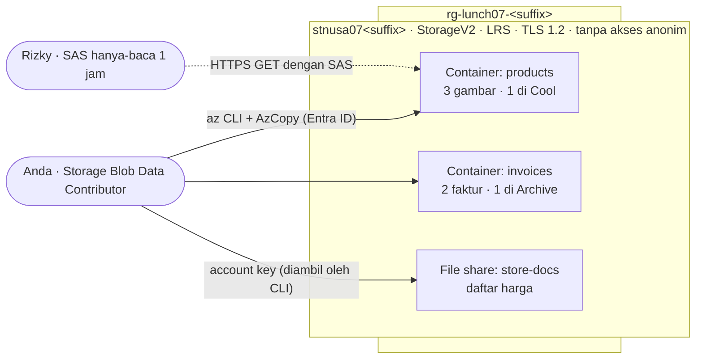

# Lab 07 · Menyimpan gambar produk dan faktur

🇬🇧 [Read in English](README.md)

> **Pasangan dari:** [Makan Siang 07 · Penyimpanan (Dasar)](../../lunches/07-storage-basic/README.id.md)
> **Waktu:** sekitar 45 menit · **Biaya:** 💲 (lihat [kelompok biaya](../README.id.md#kelompok-biaya)) · **Tingkat kesulitan:** ★☆☆
> **Bisa dikerjakan terpisah:** ✅ Anda tidak memerlukan lab sebelumnya. Semua yang dibutuhkan lab ini dibuat oleh langkah-langkahnya sendiri.
> **Penulis:** Stefanus Pinarta · [Tentang penulis](../../README.id.md#tentang-penulis)

## 🎯 Yang akan Anda bangun

Nusantara Retail sedang memindahkan file-filenya dari server di sebelah pantry. Anda membuat storage account (*akun
penyimpanan*) general-purpose v2 yang aman, memberi diri Anda sendiri sebuah data role, mengunggah faktur dengan Azure
CLI dan gambar produk dengan AzCopy, memindahkan data lama ke access tier yang lebih murah, membagikan satu gambar
produk kepada Rizky si kontraktor lewat tautan yang kedaluwarsa setelah satu jam, dan membuat share Azure Files untuk
daftar harga toko.



## ✅ Sebelum mulai

- Subscription Azure tempat Anda bisa membuat resource dan menetapkan role (Owner, atau Contributor ditambah User
  Access Administrator) — lihat [Lab 01](../01-before-you-begin/README.id.md).
- **Azure Cloud Shell (Bash)** — buka [shell.azure.com](https://shell.azure.com). Tidak ada yang perlu dipasang: Azure
  CLI, AzCopy, dan `curl` sudah tersedia.
- Ambil file lab dan muat pengaturan bersama:

```bash
git clone https://github.com/stefpin/azure-fundamentals-lunches.git   # first time only
cd azure-fundamentals-lunches/labs/07-storage-basic
source ../common/config.sh
RG=$(rg_name 07)
ACCOUNT="stnusa07${SUFFIX}"
mkdir -p work
echo "Resource group: $RG   Storage account: $ACCOUNT"
```

- Lab ini tidak punya `setup.sh`: membuat account adalah bagian dari lab.

> [!IMPORTANT]
> Resource lab memakan biaya selama masih ada. Di sini biayanya sangat kecil (hanya beberapa kilobyte data), tetapi
> tetap akhiri dengan bagian **Bersihkan**, bahkan kalau Anda berhenti di tengah jalan. Kalau Cloud Shell dimulai ulang,
> jalankan lagi blok di atas untuk memulihkan variabel Anda.

## 🧭 Pilih mode Anda

| Mode | Cocok untuk Anda jika… | Caranya |
|---|---|---|
| **Terpandu** | Anda ingin setiap langkah dijelaskan | ikuti Tugas 1–7 di bawah |
| **Tantangan** | Anda sudah menguasai dasarnya | baca hanya [Ringkasan tantangan](#-ringkasan-tantangan), bangun dengan cara Anda sendiri, lalu jalankan `bash verify.sh` |

## Tugas 1 · Membuat storage account yang aman

Storage account adalah namespace untuk semua data Anda, jadi pengaturan keamanannya didahulukan. Anda menyetelnya
secara eksplisit, karena secara default Azure CLI memakai read-access geo-redundant storage (`Standard_RAGRS`) dan
membiarkan minimum TLS version kosong kecuali Anda memintanya.

```bash
ensure_rg "$RG" 07

az storage account create \
  --name "$ACCOUNT" \
  --resource-group "$RG" \
  --location "$LOCATION" \
  --kind StorageV2 \
  --sku Standard_LRS \
  --access-tier Hot \
  --min-tls-version TLS1_2 \
  --allow-blob-public-access false \
  --https-only true \
  --output none
```

Arti setiap pilihan: **StorageV2** adalah jenis account general-purpose v2; **Standard_LRS** menyimpan tiga salinan
di satu pusat data (termurah — cukup untuk lab); **Hot** adalah tier default untuk blob baru; **TLS 1.2** menolak
protokol enkripsi yang lebih lama; akses blob anonim **dilarang** untuk seluruh account; dan hanya **HTTPS** yang
diterima.

> [!TIP]
> **Lebih suka portal?** *Storage accounts › Create*. Di tab **Basics**, pilih resource group, nama, region Anda,
> performa *Standard*, dan *LRS*. Di tab **Advanced**, biarkan *Require secure transfer* tercentang, hapus centang
> *Allow enabling anonymous access on individual containers*, dan setel *Minimum TLS version* ke 1.2. Setelah itu
> kembali ke sini untuk Tugas 2.

> ✅ **Pemeriksaan:** perintah ini menampilkan `StorageV2`, `Standard_LRS`, `TLS1_2`, `False` (akses anonim), dan
> `True` (hanya HTTPS), beserta blob endpoint Anda:
>
> ```bash
> az storage account show --name "$ACCOUNT" --resource-group "$RG" \
>   --query "{kind:kind, sku:sku.name, tls:minimumTlsVersion, anonymous:allowBlobPublicAccess, httpsOnly:enableHttpsTrafficOnly, blob:primaryEndpoints.blob}" \
>   --output table
> ```

## Tugas 2 · Memberi diri Anda sebuah data role

Anda memang yang membuat account itu, tetapi mengelola account (control plane) dan membaca datanya (data plane) adalah
dua izin yang berbeda. Pertama, lihat apa yang terjadi tanpa data role:

```bash
az storage container list --account-name "$ACCOUNT" --auth-mode login --output table
```

Kecuali Anda sudah memegang blob data role di cakupan yang lebih tinggi, perintah itu gagal dengan pesan *"You do not
have the required permissions needed to perform this operation…"* — bahkan kalau Anda Owner dari subscription
tersebut. `--auth-mode login` berarti "gunakan identitas Microsoft Entra saya", dan identitas itu membutuhkan **data
role**. Tetapkan **Storage Blob Data Contributor** untuk diri Anda sendiri, dengan cakupan hanya account ini (prinsip
hak akses minimum/least privilege), lalu tunggu sampai berlaku:

```bash
ACCOUNT_ID=$(az storage account show --name "$ACCOUNT" --resource-group "$RG" --query id --output tsv)

az role assignment create \
  --assignee-object-id "$(my_object_id)" \
  --assignee-principal-type User \
  --role "Storage Blob Data Contributor" \
  --scope "$ACCOUNT_ID" \
  --output none

wait_until "your data role to take effect" 600 \
  az storage container list --account-name "$ACCOUNT" --auth-mode login \
  && echo "Data role is active."
```

Penetapan role baru biasanya sudah berfungsi dalam satu-dua menit, tetapi bisa juga butuh beberapa menit;
`wait_until` mencoba ulang setiap 10 detik.

> [!TIP]
> **Lebih suka portal?** Storage account › *Access control (IAM)* › *Add role assignment* › *Storage Blob Data
> Contributor* › *Members: User, group, or service principal* › pilih diri Anda › *Review + assign*.

> ✅ **Pemeriksaan:** `az storage container list --account-name "$ACCOUNT" --auth-mode login --output table` kini
> mengembalikan daftar kosong tanpa error, dan
> `az role assignment list --assignee "$(my_object_id)" --scope "$ACCOUNT_ID" --query "[].roleDefinitionName" --output tsv`
> mencetak `Storage Blob Data Contributor`.

## Tugas 3 · Membuat container dan mengunggah faktur dengan Azure CLI

Container mengelompokkan blob. Buat satu untuk gambar produk dan satu untuk faktur, lalu unggah dua contoh faktur
dengan identitas Entra Anda:

```bash
for c in products invoices; do
  az storage container create --account-name "$ACCOUNT" --name "$c" --auth-mode login --output none
done

for f in sample-files/invoices/*.txt; do
  az storage blob upload \
    --account-name "$ACCOUNT" \
    --container-name invoices \
    --name "$(basename "$f")" \
    --file "$f" \
    --overwrite \
    --auth-mode login \
    --output none
done
```

`--overwrite` memungkinkan Anda menjalankan ulang perulangan itu dengan aman; tanpanya, mengunggah blob yang sudah ada
akan gagal.

> ✅ **Pemeriksaan:** dua faktur di tier hot:
>
> ```bash
> az storage blob list --account-name "$ACCOUNT" --container-name invoices --auth-mode login \
>   --query "[].{name:name, bytes:properties.contentLength, tier:properties.blobTier}" --output table
> ```

## Tugas 4 · Mengunggah gambar produk dengan AzCopy

AzCopy dibuat untuk transfer massal: ia menyalin banyak file secara paralel dan bisa melanjutkan pekerjaan yang
terputus. AzCopy sudah terpasang di Cloud Shell, tetapi **tidak** otomatis memakai sesi masuk Cloud Shell Anda. Ada
tiga cara untuk mengotorisasinya: menempelkan SAS di URL, menjalankan `azcopy login` (masuk dengan device code yang
membutuhkan penyimpanan rahasia seperti Linux keyring), atau menyuruh AzCopy meminjam token milik Azure CLI. Cara
terakhir paling sederhana di Cloud Shell:

```bash
export AZCOPY_AUTO_LOGIN_TYPE=AZCLI
export AZCOPY_TENANT_ID="$(az account show --query tenantId --output tsv)"
azcopy --version

azcopy copy "sample-files/products/*" "https://${ACCOUNT}.blob.core.windows.net/products/"
azcopy list "https://${ACCOUNT}.blob.core.windows.net/products"
```

AzCopy tetap memakai **data role** Anda — ia hanya mengambil tokennya dari Azure CLI. Ringkasan pekerjaannya
seharusnya diakhiri dengan `Final Job Status: Completed` dan tiga transfer file yang selesai. AzCopy juga menebak
content type setiap file dari ekstensinya, sehingga gambar disimpan sebagai `image/svg+xml` dan tampil dengan benar di
browser.

> ✅ **Pemeriksaan:** tiga gambar di `products`, masing-masing dengan content type `image/svg+xml`:
>
> ```bash
> az storage blob list --account-name "$ACCOUNT" --container-name products --auth-mode login \
>   --query "[].{name:name, type:properties.contentSettings.contentType, tier:properties.blobTier}" --output table
> ```

## Tugas 5 · Memindahkan blob ke tier yang lebih dingin — dan berkenalan dengan rehidrasi

Foto selendang songket musim lalu jarang dilihat, jadi dipindahkan ke **Cool**. Faktur INV-2026-0001 sudah lunas dan
ditutup, jadi dipindahkan ke **Archive**:

```bash
az storage blob set-tier --account-name "$ACCOUNT" --container-name products \
  --name songket-scarf.svg --tier Cool --auth-mode login
az storage blob set-tier --account-name "$ACCOUNT" --container-name invoices \
  --name INV-2026-0001.txt --tier Archive --auth-mode login

for c in products invoices; do
  az storage blob list --account-name "$ACCOUNT" --container-name "$c" --auth-mode login \
    --query "[].{name:name, tier:properties.blobTier, inferred:properties.blobTierInferred}" --output table
done
```

Blob yang tidak pernah Anda sentuh menampilkan tier default account (`Hot`) sebagai tier *inferred* (hasil simpulan,
bukan disetel langsung). Sekarang coba baca faktur yang sudah diarsipkan:

```bash
az storage blob download --account-name "$ACCOUNT" --container-name invoices \
  --name INV-2026-0001.txt --file work/INV-2026-0001.txt --auth-mode login --output none
```

Perintah itu gagal dengan pesan *"This operation is not permitted on an archived blob"* (`BlobArchived`). Blob di
archive bersifat offline. Untuk membacanya, Anda harus melakukan **rehydrate**. Menyalinnya ke blob baru di tier online
membuat blob asli di archive tetap utuh, sehingga menghindari biaya early deletion (archive mengharapkan masa simpan
180 hari):

```bash
az storage blob copy start \
  --account-name "$ACCOUNT" \
  --source-container invoices --source-blob INV-2026-0001.txt \
  --destination-container invoices --destination-blob INV-2026-0001-rehydrated.txt \
  --tier Hot --rehydrate-priority Standard \
  --auth-mode login --output none

az storage blob show --account-name "$ACCOUNT" --container-name invoices \
  --name INV-2026-0001-rehydrated.txt --auth-mode login \
  --query "{tier:properties.blobTier, status:properties.rehydrationStatus, priority:rehydratePriority}" \
  --output table
```

Salinannya menampilkan tier `Archive` dan status `rehydrate-pending-to-hot`. Prioritas Standard bisa makan waktu
hingga 15 jam, jadi **tidak usah ditunggu** — pelajarannya justru ada pada penundaan itu sendiri. (Prioritas High
lebih cepat dan lebih mahal, dan ditujukan untuk keadaan darurat.)

> [!TIP]
> **Lebih suka portal?** *Storage browser › Blob containers › invoices* › pilih sebuah blob › *Change tier*. Saat Anda
> mengubah blob archive kembali ke tier online, dialog yang sama akan meminta *Rehydrate priority*.

> ✅ **Pemeriksaan:** `songket-scarf.svg` menampilkan tier `Cool`, `INV-2026-0001.txt` menampilkan `Archive`, dan
> salinan hasil rehidrasi melaporkan `rehydrate-pending-to-hot`.

## Tugas 6 · Membagikan satu gambar dengan user delegation SAS

Rizky perlu mengunduh satu gambar produk sore ini. Anda tidak akan memberinya account key (key itu membuka segalanya)
dan tidak akan menyalakan akses anonim. Sebagai gantinya, Anda membuat **user delegation SAS**: token URL yang
ditandatangani dengan key yang Anda peroleh lewat identitas Entra Anda, dibatasi hanya untuk **read** pada **satu
blob** selama **satu jam**:

```bash
EXPIRY=$(date -u -d "+1 hour" '+%Y-%m-%dT%H:%MZ')

SAS_URL=$(az storage blob generate-sas \
  --account-name "$ACCOUNT" \
  --container-name products \
  --name batik-shirt.svg \
  --permissions r \
  --expiry "$EXPIRY" \
  --https-only \
  --auth-mode login \
  --as-user \
  --full-uri \
  --output tsv)

echo "${SAS_URL%%sig=*}sig=<hidden>"
```

URL yang dicetak menyembunyikan tanda tangannya, tetapi perhatikan parameter query lainnya: `sp=r` (hanya baca), `se=`
(waktu kedaluwarsa), `spr=https` (hanya HTTPS), dan `skoid`/`sktid` — object ID dan tenant milik pengguna yang
menandatanganinya. Kolom-kolom `sk…` itulah yang menjadikannya *user delegation* SAS. Sekarang uji seperti yang akan
dilakukan Rizky, tanpa masuk ke Azure sama sekali:

```bash
curl -s -o work/batik-shirt.svg -w "With the SAS:    HTTP %{http_code}\n" "$SAS_URL"
curl -s -o /dev/null -w "Without the SAS: HTTP %{http_code}\n" \
  "https://${ACCOUNT}.blob.core.windows.net/products/batik-shirt.svg"
curl -s "https://${ACCOUNT}.blob.core.windows.net/products/batik-shirt.svg" | grep -o '<Code>[^<]*</Code>'
head -c 100 work/batik-shirt.svg; echo
```

Dengan SAS, Anda mendapat `200` dan file SVG-nya mendarat di `work/`. Tanpa SAS, Anda mendapat error, biasanya `409`
dengan `PublicAccessNotPermitted` — akses anonim mati untuk seluruh account. Selalu apit URL SAS dengan tanda kutip
ganda: kalau tidak, karakter `&` akan memecah perintahnya.

Kalau sebuah tautan sampai bocor, Anda bisa membatalkan **semua** user delegation SAS untuk account itu sekaligus (bisa
butuh beberapa menit, karena key-nya di-cache):

```bash
# Only when you need it — this breaks all user delegation SAS links for the account:
# az storage account revoke-delegation-keys --name "$ACCOUNT" --resource-group "$RG"
```

> [!TIP]
> **Lebih suka portal?** *Storage browser › products* › pilih `batik-shirt.svg` › *Generate SAS*. Pilih *Signing
> method: User delegation key*, *Permissions: Read*, waktu kedaluwarsa satu jam dari sekarang, dan *HTTPS only*.

> ✅ **Pemeriksaan:** `curl` pertama mencetak `HTTP 200`, yang kedua mencetak kode error, dan
> `work/batik-shirt.svg` diawali dengan `<svg`.

## Tugas 7 · Membuat share Azure Files untuk toko-toko

Para kepala toko menginginkan drive bersama untuk daftar harga. Azure Files memberi Anda SMB share yang terkelola. Buat
share berukuran 1 GiB (share standard di account general-purpose v2 ditagih berdasarkan data yang benar-benar Anda
simpan) lalu unggah daftar harga bulan ini:

```bash
az storage share-rm create \
  --resource-group "$RG" \
  --storage-account "$ACCOUNT" \
  --name store-docs \
  --quota 1 \
  --enabled-protocols SMB \
  --output none

az storage file upload \
  --account-name "$ACCOUNT" \
  --share-name store-docs \
  --source sample-files/store-docs/price-list-2026-10.csv \
  --auth-mode key \
  --output none

az storage file list --account-name "$ACCOUNT" --share-name store-docs --auth-mode key --output table
```

Perhatikan `--auth-mode key`. Tanpa kredensial lain, CLI memakai izin Owner atau Contributor Anda untuk **mengambil
account key** lalu menandatangani permintaan dengannya — itulah otorisasi Shared Key yang sedang bekerja, dan itulah
sebabnya izin list-keys begitu berkuasa. Untuk data file, akses berbasis Entra membutuhkan role dan flag tambahan
(lihat tantangan tambahan), dan klien SMB biasanya me-mount share dengan autentikasi berbasis identitas atau dengan
account key. Makan Siang 24 menunjukkan cara mematikan Shared Key setelah tidak ada lagi yang bergantung padanya.

> [!TIP]
> **Lebih suka portal?** Storage account › *Data storage › File shares* (portal mungkin menyebutnya *Classic file
> shares*) › *+ File share*. Buka share-nya dan pilih **Connect** untuk melihat skrip mount siap pakai untuk Windows,
> Linux, atau macOS. Proses mount membutuhkan port TCP 445 keluar, yang diblokir oleh banyak jaringan rumah dan kantor.

> ✅ **Pemeriksaan:**
> `az storage share-rm list --resource-group "$RG" --storage-account "$ACCOUNT" --query "[].name" --output tsv` mencetak
> `store-docs`, dan daftar file menampilkan `price-list-2026-10.csv`.

## 🔧 Rusak lalu perbaiki

SAS hanya bisa melakukan apa yang tertulis di dalamnya, selama waktu yang tertulis di dalamnya. Rusak dua kali.

**A — SAS hanya-baca tidak bisa dipakai mengunggah.** Rizky juga ingin mengunggah foto produk baru, jadi Anda
mengiriminya… SAS hanya-baca:

```bash
RO_URL=$(az storage blob generate-sas --account-name "$ACCOUNT" --container-name products \
  --name new-arrival.svg --permissions r --expiry "$EXPIRY" --https-only \
  --auth-mode login --as-user --full-uri --output tsv)

curl -s -o work/put-result.xml -w "Upload with a read-only SAS: HTTP %{http_code}\n" \
  -X PUT -H "x-ms-blob-type: BlockBlob" \
  --data-binary @sample-files/products/kebaya-blue.svg "$RO_URL"
grep -o '<Code>[^<]*</Code>' work/put-result.xml
```

Anda mendapat `403` dengan `AuthorizationPermissionMismatch`: tanda tangannya sah, tetapi SAS itu tidak memberi izin
menulis.

<details><summary>Petunjuk: perbaikan A</summary>

Buat SAS baru untuk nama blob itu dengan izin **create** dan **write**, tetap dengan masa berlaku singkat:

```bash
RW_URL=$(az storage blob generate-sas --account-name "$ACCOUNT" --container-name products \
  --name new-arrival.svg --permissions cw --expiry "$EXPIRY" --https-only \
  --auth-mode login --as-user --full-uri --output tsv)
curl -s -o /dev/null -w "Upload with a create/write SAS: HTTP %{http_code}\n" \
  -X PUT -H "x-ms-blob-type: BlockBlob" -H "Content-Type: image/svg+xml" \
  --data-binary @sample-files/products/kebaya-blue.svg "$RW_URL"
```

`201` berarti blob berhasil dibuat. Berikan kumpulan izin terkecil yang cukup untuk menyelesaikan tugas — dan tidak
lebih.

</details>

**B — SAS yang kedaluwarsa berhenti berfungsi.** Buat tautan yang hidup sekitar dua menit, buktikan bahwa ia berfungsi,
lalu tunggu:

```bash
SHORT_EXPIRY=$(date -u -d "+2 minutes" '+%Y-%m-%dT%H:%MZ')
SHORT_URL=$(az storage blob generate-sas --account-name "$ACCOUNT" --container-name products \
  --name batik-shirt.svg --permissions r --expiry "$SHORT_EXPIRY" --https-only \
  --auth-mode login --as-user --full-uri --output tsv)

curl -s -o /dev/null -w "Before expiry: HTTP %{http_code}\n" "$SHORT_URL"
echo "Waiting 3 minutes for the SAS to expire…"; sleep 180
curl -s -o work/expired.xml -w "After expiry:  HTTP %{http_code}\n" "$SHORT_URL"
grep -o '<Code>[^<]*</Code>' work/expired.xml
```

Setelah menunggu, Anda mendapat `403` dengan `AuthenticationFailed`; detail error-nya menyebutkan bahwa tanda tangan
tidak berlaku pada rentang waktu saat ini.

<details><summary>Petunjuk: perbaikan B</summary>

SAS tidak bisa diperpanjang — waktu kedaluwarsanya adalah bagian dari tanda tangan. Buat yang baru dengan masa berlaku
yang wajar (seperti di Tugas 6) lalu kirim tautan barunya. Sengajalah membuat masa berlaku singkat: tautan yang sudah
kedaluwarsa tidak berguna bagi siapa pun yang menemukannya belakangan.

</details>

## 🧪 Verifikasi hasil kerja Anda

```bash
bash verify.sh
```

Setiap pemeriksaan seharusnya menampilkan **PASS**. Kalau ada yang gagal, pesannya memberi tahu tugas mana yang perlu
Anda ulangi. Pemeriksaan data plane memakai data role Anda dari Tugas 2.

## 🧹 Bersihkan (jangan dilewati!)

```bash
bash cleanup.sh
unset AZCOPY_AUTO_LOGIN_TYPE AZCOPY_TENANT_ID SAS_URL RO_URL RW_URL SHORT_URL
```

Perintah ini menghapus resource group `rg-lunch07-<suffix>` (beserta storage account dan penetapan role-nya) dan folder
lokal `work/`. Penghapusan berlanjut di latar belakang selama beberapa menit. Menghapus faktur archive lebih awal
memicu biaya early deletion prorata untuk beberapa kilobyte — hanya sepersekian sen dolar.

## 🩺 Pemecahan masalah

| Gejala | Kemungkinan penyebab | Perbaikan |
|---|---|---|
| `The storage account named stnusa07… is already taken.` | Nama storage account bersifat global; ada pihak lain yang memakai nama yang sama | Setel nama lain, misalnya `ACCOUNT="stnusa07${SUFFIX}x"`, dan gunakan di setiap perintah |
| `You do not have the required permissions needed to perform this operation…` | Belum ada data role, atau role-nya belum tersebar ke seluruh sistem | Selesaikan Tugas 2; tunggu beberapa menit lalu coba lagi |
| `az role assignment create` gagal dengan `AuthorizationFailed` | Anda tidak bisa menetapkan role (Contributor saja tidak bisa) | Gunakan subscription tempat Anda menjadi Owner atau User Access Administrator |
| AzCopy melaporkan error autentikasi atau 403 | Variabel `AZCOPY_*` hilang (sesi Cloud Shell baru) atau data role belum aktif | Jalankan lagi dua baris `export` di Tugas 4; atau coba `export AZCOPY_AUTO_LOGIN_TYPE=DEVICE` dan ikuti petunjuk device code |
| `This operation is not permitted on an archived blob.` | Blob berada di tier archive | Memang diharapkan di Tugas 5 — lakukan rehydrate dulu |
| `curl` mengembalikan `403` dengan `AuthenticationFailed` | SAS sudah kedaluwarsa, atau URL terpotong di sebuah `&` | Buat SAS baru; apit URL dengan tanda kutip ganda |
| `curl` mengembalikan `403` dengan `AuthorizationPermissionMismatch` | SAS tidak punya izin untuk operasi itu | Buat SAS dengan izin yang tepat (Rusak lalu perbaiki, bagian A) |
| `az storage file upload` gagal dengan `KeyBasedAuthenticationNotPermitted` | Shared Key dinonaktifkan di account (misalnya oleh sebuah policy) | Gunakan jalur Entra dari tantangan tambahan |
| `date: invalid date '+1 hour'` | Anda memakai macOS, bukan Cloud Shell | Gunakan Cloud Shell, atau `date -u -v+1H '+%Y-%m-%dT%H:%MZ'` di macOS |

## 🚀 Tantangan tambahan

- Unggah ke file share dengan Entra ID alih-alih key: tetapkan **Storage File Data Privileged Contributor** untuk diri
  Anda di account itu, lalu gunakan `--auth-mode login --enable-file-backup-request-intent` dengan
  `az storage file upload`. Apa yang dilewati (bypass) oleh "backup intent", dan mengapa role itu disebut *privileged*?
- Buka halaman **Redundancy** account itu di portal. Opsi mana yang bisa langsung Anda pilih, dan mana yang membutuhkan
  konversi? Mengapa faktur yang diarsipkan akan menghalangi perpindahan ke ZRS?
- Ubah access tier default account ke **Cool** (`az storage account update --access-tier Cool`) lalu tampilkan daftar
  blob lagi. Blob mana yang berubah tier, dan mana yang mempertahankan tier yang disetel secara eksplisit?
- Gunakan **Azure Storage Explorer** di PC Anda untuk menjelajahi account itu dengan sesi masuk Entra Anda.
- Mount share `store-docs` dari laptop Anda dengan skrip *Connect* dari portal (kalau jaringan Anda mengizinkan port
  445).

## 🏁 Ringkasan tantangan

Bangun hal-hal berikut dengan cara apa pun yang Anda suka (portal, CLI, Bicep):

1. Resource group bernama `rg-lunch07-<suffix>` (gunakan `ensure_rg "$RG" 07` agar skrip pembersihan bisa
   menemukannya).
2. Storage account bernama `stnusa07<suffix>`: general-purpose v2 (`StorageV2`), `Standard_LRS`, minimum TLS 1.2,
   akses blob anonim dilarang, hanya HTTPS.
3. Anda memegang **Storage Blob Data Contributor** (atau Owner) di account tersebut.
4. Sebuah container dengan minimal dua blob, dan minimal satu blob di tier **Cool**. (Jalur terpandu juga mengarsipkan
   sebuah faktur — verify.sh melaporkan blob yang diarsipkan sebagai catatan.)
5. Sebuah **user delegation SAS** hanya-baca berdurasi satu jam untuk satu gambar, yang mengembalikan HTTP 200 dengan
   `curl` — verify.sh tidak bisa memeriksa yang satu ini, jadi buktikan sendiri.
6. Share Azure Files bernama `store-docs` yang berisi minimal satu file.

Lalu jalankan `bash verify.sh`. Buntu? Intip `solution.sh` atau beralih ke mode Terpandu.

---

⬅️ [Bacaan Makan Siang 07](../../lunches/07-storage-basic/README.id.md) · 🏠 [Semua lab](../README.id.md) · 🏠 [Beranda kursus](../../README.id.md)

<sub>Terakhir divalidasi: Oktober 2026 · Ada yang tidak berfungsi? [Laporkan masalah lab](../../CONTRIBUTING.md).</sub>
