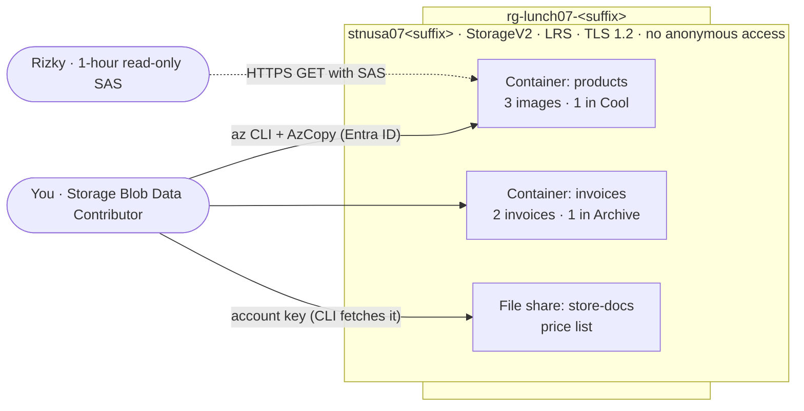

# Lab 07 · Store product images and invoices

> **Pairs with:** [Lunch 07 · Storage (Basic)](../../lunches/07-storage-basic/README.md)
> **Time:** about 45 minutes · **Cost:** 💲 (see [cost bands](../README.md#cost-bands)) · **Difficulty:** ★☆☆
> **Works on its own:** ✅ You do not need any earlier lab. Everything this lab needs is created by its steps.

## 🎯 What you'll build

Nusantara Retail is moving its files off the server next to the pantry. You create a secure general-purpose v2 storage
account, give yourself a data role, upload invoices with the Azure CLI and product images with AzCopy, move older data
to cheaper access tiers, share one product image with Rizky the contractor through a link that expires after an hour,
and create an Azure Files share for the stores' price lists.



## ✅ Before you start

- An Azure subscription where you can create resources and assign roles (Owner, or Contributor plus User Access
  Administrator) — see [Lab 01](../01-before-you-begin/README.md).
- **Azure Cloud Shell (Bash)** — open [shell.azure.com](https://shell.azure.com). Nothing to install: the Azure CLI,
  AzCopy and `curl` are already there.
- Get the lab files and load the shared settings:

```bash
git clone https://github.com/stefpin/azure-fundamentals-lunches.git   # first time only
cd azure-fundamentals-lunches/labs/07-storage-basic
source ../common/config.sh
RG=$(rg_name 07)
ACCOUNT="stnusa07${SUFFIX}"
mkdir -p work
echo "Resource group: $RG   Storage account: $ACCOUNT"
```

- This lab has no `setup.sh`: creating the account is part of the lab.

> [!IMPORTANT]
> Lab resources cost money while they exist. Here the cost is tiny (a few kilobytes of data), but finish with the
> **Clean up** section anyway, even if you stop halfway. If Cloud Shell restarts, run the block above again to restore
> your variables.

## 🧭 Choose your mode

| Mode | For you if… | How |
|---|---|---|
| **Guided** | you want every step explained | follow Tasks 1–7 below |
| **Challenge** | you already know the basics | read only the [Challenge brief](#-challenge-brief), build it your way, then run `bash verify.sh` |

## Task 1 · Create a secure storage account

A storage account is the namespace for all your data, so its security settings come first. You set them explicitly:
the Azure CLI defaults to read-access geo-redundant storage (`Standard_RAGRS`) and leaves the minimum TLS version unset
unless you ask.

```bash
ensure_rg "$RG" 07

az storage account create \
  --name "$ACCOUNT" \
  --resource-group "$RG" \
  --location "$LOCATION" \
  --kind StorageV2 \
  --sku Standard_LRS \
  --access-tier Hot \
  --min-tls-version TLS1_2 \
  --allow-blob-public-access false \
  --https-only true \
  --output none
```

What each choice means: **StorageV2** is the general-purpose v2 account type; **Standard_LRS** keeps three copies in one
datacenter (cheapest — fine for a lab); **Hot** is the default tier for new blobs; **TLS 1.2** rejects older encryption
protocols; anonymous blob access is **disallowed** for the whole account; and only **HTTPS** is accepted.

> [!TIP]
> **Prefer the portal?** *Storage accounts › Create*. On **Basics** choose your resource group, the name, your region,
> *Standard* performance and *LRS*. On **Advanced** keep *Require secure transfer* checked, uncheck *Allow enabling
> anonymous access on individual containers*, and set *Minimum TLS version* to 1.2. Then come back for Task 2.

> ✅ **Checkpoint:** this command shows `StorageV2`, `Standard_LRS`, `TLS1_2`, `False` (anonymous access) and `True`
> (HTTPS only), plus your blob endpoint:
>
> ```bash
> az storage account show --name "$ACCOUNT" --resource-group "$RG" \
>   --query "{kind:kind, sku:sku.name, tls:minimumTlsVersion, anonymous:allowBlobPublicAccess, httpsOnly:enableHttpsTrafficOnly, blob:primaryEndpoints.blob}" \
>   --output table
> ```

## Task 2 · Give yourself a data role

You created the account, but managing an account (control plane) and reading its data (data plane) are different
permissions. First, see what happens without a data role:

```bash
az storage container list --account-name "$ACCOUNT" --auth-mode login --output table
```

Unless you already hold a blob data role at a higher scope, the command fails with *"You do not have the required
permissions needed to perform this operation…"* — even if you are Owner of the subscription. `--auth-mode login`
means "use my Microsoft Entra identity", and that identity needs a **data role**. Assign **Storage Blob Data
Contributor** to yourself, scoped to just this account (least privilege), and wait until it takes effect:

```bash
ACCOUNT_ID=$(az storage account show --name "$ACCOUNT" --resource-group "$RG" --query id --output tsv)

az role assignment create \
  --assignee-object-id "$(my_object_id)" \
  --assignee-principal-type User \
  --role "Storage Blob Data Contributor" \
  --scope "$ACCOUNT_ID" \
  --output none

wait_until "your data role to take effect" 600 \
  az storage container list --account-name "$ACCOUNT" --auth-mode login \
  && echo "Data role is active."
```

New role assignments usually work within a minute or two, but they can take several minutes; `wait_until` retries every
10 seconds.

> [!TIP]
> **Prefer the portal?** Storage account › *Access control (IAM)* › *Add role assignment* › *Storage Blob Data
> Contributor* › *Members: User, group, or service principal* › select yourself › *Review + assign*.

> ✅ **Checkpoint:** `az storage container list --account-name "$ACCOUNT" --auth-mode login --output table` now returns an
> empty list without an error, and
> `az role assignment list --assignee "$(my_object_id)" --scope "$ACCOUNT_ID" --query "[].roleDefinitionName" --output tsv`
> prints `Storage Blob Data Contributor`.

## Task 3 · Create containers and upload invoices with the Azure CLI

Containers group blobs. Create one for product images and one for invoices, then upload the two sample invoices with
your Entra identity:

```bash
for c in products invoices; do
  az storage container create --account-name "$ACCOUNT" --name "$c" --auth-mode login --output none
done

for f in sample-files/invoices/*.txt; do
  az storage blob upload \
    --account-name "$ACCOUNT" \
    --container-name invoices \
    --name "$(basename "$f")" \
    --file "$f" \
    --overwrite \
    --auth-mode login \
    --output none
done
```

`--overwrite` lets you re-run the loop safely; without it, uploading a blob that already exists fails.

> ✅ **Checkpoint:** two invoices in the hot tier:
>
> ```bash
> az storage blob list --account-name "$ACCOUNT" --container-name invoices --auth-mode login \
>   --query "[].{name:name, bytes:properties.contentLength, tier:properties.blobTier}" --output table
> ```

## Task 4 · Upload product images with AzCopy

AzCopy is built for bulk transfers: it copies many files in parallel and can resume an interrupted job. It is
preinstalled in Cloud Shell, but it does **not** automatically use your Cloud Shell sign-in. You have three ways to
authorize it: append a SAS to the URL, run `azcopy login` (a device-code sign-in that needs a secret store such as a
Linux keyring), or tell AzCopy to borrow the Azure CLI's token. The last option is the simplest in Cloud Shell:

```bash
export AZCOPY_AUTO_LOGIN_TYPE=AZCLI
export AZCOPY_TENANT_ID="$(az account show --query tenantId --output tsv)"
azcopy --version

azcopy copy "sample-files/products/*" "https://${ACCOUNT}.blob.core.windows.net/products/"
azcopy list "https://${ACCOUNT}.blob.core.windows.net/products"
```

AzCopy still uses your **data role** — it simply obtains the token from the Azure CLI. The job summary should end
with `Final Job Status: Completed` and three completed file transfers. AzCopy also guesses each file's content type
from its extension, so the images are stored as `image/svg+xml` and display correctly in a browser.

> ✅ **Checkpoint:** three images in `products`, each with content type `image/svg+xml`:
>
> ```bash
> az storage blob list --account-name "$ACCOUNT" --container-name products --auth-mode login \
>   --query "[].{name:name, type:properties.contentSettings.contentType, tier:properties.blobTier}" --output table
> ```

## Task 5 · Move blobs to cooler tiers — and meet rehydration

Last season's songket scarf photo is rarely viewed, so it moves to **Cool**. Invoice INV-2026-0001 is paid and closed,
so it moves to **Archive**:

```bash
az storage blob set-tier --account-name "$ACCOUNT" --container-name products \
  --name songket-scarf.svg --tier Cool --auth-mode login
az storage blob set-tier --account-name "$ACCOUNT" --container-name invoices \
  --name INV-2026-0001.txt --tier Archive --auth-mode login

for c in products invoices; do
  az storage blob list --account-name "$ACCOUNT" --container-name "$c" --auth-mode login \
    --query "[].{name:name, tier:properties.blobTier, inferred:properties.blobTierInferred}" --output table
done
```

Blobs you never touched show the account default (`Hot`) as an *inferred* tier. Now try to read the archived invoice:

```bash
az storage blob download --account-name "$ACCOUNT" --container-name invoices \
  --name INV-2026-0001.txt --file work/INV-2026-0001.txt --auth-mode login --output none
```

It fails with *"This operation is not permitted on an archived blob"* (`BlobArchived`). An archived blob is offline.
To read it you **rehydrate** it. Copying it to a new blob in an online tier leaves the archived original untouched,
which avoids the early deletion charge (archive expects 180 days):

```bash
az storage blob copy start \
  --account-name "$ACCOUNT" \
  --source-container invoices --source-blob INV-2026-0001.txt \
  --destination-container invoices --destination-blob INV-2026-0001-rehydrated.txt \
  --tier Hot --rehydrate-priority Standard \
  --auth-mode login --output none

az storage blob show --account-name "$ACCOUNT" --container-name invoices \
  --name INV-2026-0001-rehydrated.txt --auth-mode login \
  --query "{tier:properties.blobTier, status:properties.rehydrationStatus, priority:rehydratePriority}" \
  --output table
```

The copy shows tier `Archive` and status `rehydrate-pending-to-hot`. Standard priority can take up to 15 hours, so
**don't wait** — the lesson is the delay itself. (High priority is faster and pricier, and is meant for emergencies.)

> [!TIP]
> **Prefer the portal?** *Storage browser › Blob containers › invoices* › select a blob › *Change tier*. When you change
> an archived blob back to an online tier, the same dialog asks for a *Rehydrate priority*.

> ✅ **Checkpoint:** `songket-scarf.svg` shows tier `Cool`, `INV-2026-0001.txt` shows `Archive`, and the rehydrated
> copy reports `rehydrate-pending-to-hot`.

## Task 6 · Share one image with a user delegation SAS

Rizky needs to download one product image this afternoon. You won't give him the account key (it unlocks
everything) and you won't turn on anonymous access. Instead you create a **user delegation SAS**: a URL token signed
with a key you obtain through your Entra identity, limited to **read** on **one blob** for **one hour**:

```bash
EXPIRY=$(date -u -d "+1 hour" '+%Y-%m-%dT%H:%MZ')

SAS_URL=$(az storage blob generate-sas \
  --account-name "$ACCOUNT" \
  --container-name products \
  --name batik-shirt.svg \
  --permissions r \
  --expiry "$EXPIRY" \
  --https-only \
  --auth-mode login \
  --as-user \
  --full-uri \
  --output tsv)

echo "${SAS_URL%%sig=*}sig=<hidden>"
```

The printed URL hides the signature, but look at the other query parameters: `sp=r` (read only), `se=` (the expiry),
`spr=https` (HTTPS only), and `skoid`/`sktid` — the object ID and tenant of the user who signed it. Those `sk…` fields are
what make it a *user delegation* SAS. Now test it like Rizky would, with no Azure sign-in at all:

```bash
curl -s -o work/batik-shirt.svg -w "With the SAS:    HTTP %{http_code}\n" "$SAS_URL"
curl -s -o /dev/null -w "Without the SAS: HTTP %{http_code}\n" \
  "https://${ACCOUNT}.blob.core.windows.net/products/batik-shirt.svg"
curl -s "https://${ACCOUNT}.blob.core.windows.net/products/batik-shirt.svg" | grep -o '<Code>[^<]*</Code>'
head -c 100 work/batik-shirt.svg; echo
```

With the SAS you get `200` and the SVG lands in `work/`. Without it you get an error, typically `409` with
`PublicAccessNotPermitted` — anonymous access is off for the whole account. Always quote SAS URLs in double quotes:
the `&` characters would otherwise split the command.

If a link ever leaks, you can invalidate **every** user delegation SAS for the account at once (it can take a few
minutes, because keys are cached):

```bash
# Only when you need it — this breaks all user delegation SAS links for the account:
# az storage account revoke-delegation-keys --name "$ACCOUNT" --resource-group "$RG"
```

> [!TIP]
> **Prefer the portal?** *Storage browser › products* › select `batik-shirt.svg` › *Generate SAS*. Choose *Signing
> method: User delegation key*, *Permissions: Read*, an expiry one hour from now and *HTTPS only*.

> ✅ **Checkpoint:** the first `curl` prints `HTTP 200`, the second prints an error code, and
> `work/batik-shirt.svg` starts with `<svg`.

## Task 7 · Create an Azure Files share for the stores

Store managers want a shared drive for price lists. Azure Files gives you a managed SMB share. Create a 1 GiB share
(standard shares in a general-purpose v2 account bill for the data you actually store) and upload this month's price
list:

```bash
az storage share-rm create \
  --resource-group "$RG" \
  --storage-account "$ACCOUNT" \
  --name store-docs \
  --quota 1 \
  --enabled-protocols SMB \
  --output none

az storage file upload \
  --account-name "$ACCOUNT" \
  --share-name store-docs \
  --source sample-files/store-docs/price-list-2026-10.csv \
  --auth-mode key \
  --output none

az storage file list --account-name "$ACCOUNT" --share-name store-docs --auth-mode key --output table
```

Notice `--auth-mode key`. With no other credentials, the CLI uses your Owner or Contributor permission to **fetch the
account key** and signs the request with it — that is Shared Key authorization in action, and it is why the list-keys
permission is so powerful. For file data, Entra-based access needs extra roles and flags (see the stretch goals), and
SMB clients typically mount shares with identity-based authentication or the account key. Lunch 24 shows how to switch
Shared Key off once nothing depends on it.

> [!TIP]
> **Prefer the portal?** Storage account › *Data storage › File shares* (the portal may call them *Classic file
> shares*) › *+ File share*. Open the share and select **Connect** to see a ready-made mount script for Windows, Linux or
> macOS. Mounting needs outbound TCP port 445, which many home and office networks block.

> ✅ **Checkpoint:**
> `az storage share-rm list --resource-group "$RG" --storage-account "$ACCOUNT" --query "[].name" --output tsv` prints
> `store-docs`, and the file list shows `price-list-2026-10.csv`.

## 🔧 Break it and fix it

A SAS can only do what it says, for as long as it says. Break it twice.

**A — A read-only SAS can't upload.** Rizky also wants to upload a new product photo, so you send him… a read-only SAS:

```bash
RO_URL=$(az storage blob generate-sas --account-name "$ACCOUNT" --container-name products \
  --name new-arrival.svg --permissions r --expiry "$EXPIRY" --https-only \
  --auth-mode login --as-user --full-uri --output tsv)

curl -s -o work/put-result.xml -w "Upload with a read-only SAS: HTTP %{http_code}\n" \
  -X PUT -H "x-ms-blob-type: BlockBlob" \
  --data-binary @sample-files/products/kebaya-blue.svg "$RO_URL"
grep -o '<Code>[^<]*</Code>' work/put-result.xml
```

You get `403` with `AuthorizationPermissionMismatch`: the signature is valid, but the SAS doesn't grant write access.

<details><summary>Hint: fix A</summary>

Generate a new SAS for that blob name with **create** and **write** permissions, still short-lived:

```bash
RW_URL=$(az storage blob generate-sas --account-name "$ACCOUNT" --container-name products \
  --name new-arrival.svg --permissions cw --expiry "$EXPIRY" --https-only \
  --auth-mode login --as-user --full-uri --output tsv)
curl -s -o /dev/null -w "Upload with a create/write SAS: HTTP %{http_code}\n" \
  -X PUT -H "x-ms-blob-type: BlockBlob" -H "Content-Type: image/svg+xml" \
  --data-binary @sample-files/products/kebaya-blue.svg "$RW_URL"
```

`201` means the blob was created. Grant the smallest set of permissions that does the job — and nothing more.

</details>

**B — An expired SAS stops working.** Create a link that lives for about two minutes, prove it works, then wait:

```bash
SHORT_EXPIRY=$(date -u -d "+2 minutes" '+%Y-%m-%dT%H:%MZ')
SHORT_URL=$(az storage blob generate-sas --account-name "$ACCOUNT" --container-name products \
  --name batik-shirt.svg --permissions r --expiry "$SHORT_EXPIRY" --https-only \
  --auth-mode login --as-user --full-uri --output tsv)

curl -s -o /dev/null -w "Before expiry: HTTP %{http_code}\n" "$SHORT_URL"
echo "Waiting 3 minutes for the SAS to expire…"; sleep 180
curl -s -o work/expired.xml -w "After expiry:  HTTP %{http_code}\n" "$SHORT_URL"
grep -o '<Code>[^<]*</Code>' work/expired.xml
```

After the wait you get `403` with `AuthenticationFailed`; the error details say the signature isn't valid in the
current time frame.

<details><summary>Hint: fix B</summary>

You can't extend a SAS — its expiry is part of the signature. Generate a new one with a sensible lifetime (as in
Task 6) and send the new link. Keep lifetimes short on purpose: an expired link is useless to whoever finds it later.

</details>

## 🧪 Verify your work

```bash
bash verify.sh
```

Every check should say **PASS**. If one fails, the message tells you which task to revisit. The data-plane checks use
your data role from Task 2.

## 🧹 Clean up (do not skip!)

```bash
bash cleanup.sh
unset AZCOPY_AUTO_LOGIN_TYPE AZCOPY_TENANT_ID SAS_URL RO_URL RW_URL SHORT_URL
```

This deletes the resource group `rg-lunch07-<suffix>` (with the storage account and its role assignment) and the local
`work/` folder. Deletion continues in the background for a few minutes. Deleting the archived invoice early triggers a
prorated early deletion charge for a few kilobytes — a fraction of a cent.

## 🩺 Troubleshooting

| Symptom | Likely cause | Fix |
|---|---|---|
| `The storage account named stnusa07… is already taken.` | Storage account names are global; someone has the same name | Set a different name, for example `ACCOUNT="stnusa07${SUFFIX}x"`, and use it in every command |
| `You do not have the required permissions needed to perform this operation…` | No data role yet, or it hasn't propagated | Finish Task 2; wait a few minutes and retry |
| `az role assignment create` fails with `AuthorizationFailed` | You can't assign roles (Contributor alone can't) | Use a subscription where you are Owner or User Access Administrator |
| AzCopy reports an authentication or 403 error | The `AZCOPY_*` variables were lost (new Cloud Shell session) or the data role isn't active | Re-run the two `export` lines in Task 4; or try `export AZCOPY_AUTO_LOGIN_TYPE=DEVICE` and follow the device-code prompt |
| `This operation is not permitted on an archived blob.` | The blob is in the archive tier | Expected in Task 5 — rehydrate it first |
| `curl` returns `403` with `AuthenticationFailed` | The SAS expired, or the URL was cut at an `&` | Generate a new SAS; wrap the URL in double quotes |
| `curl` returns `403` with `AuthorizationPermissionMismatch` | The SAS lacks the permission for that operation | Generate a SAS with the right permissions (Break it and fix it, part A) |
| `az storage file upload` fails with `KeyBasedAuthenticationNotPermitted` | Shared Key is disabled on the account (for example by a policy) | Use the Entra route from the stretch goals |
| `date: invalid date '+1 hour'` | You are on macOS, not Cloud Shell | Use Cloud Shell, or `date -u -v+1H '+%Y-%m-%dT%H:%MZ'` on macOS |

## 🚀 Stretch goals

- Upload to the file share with Entra ID instead of the key: assign yourself **Storage File Data Privileged
  Contributor** on the account, then use `--auth-mode login --enable-file-backup-request-intent` with
  `az storage file upload`. What does "backup intent" bypass, and why is that role called *privileged*?
- Open the account's **Redundancy** page in the portal. Which options can you switch to directly, and which need a
  conversion? Why would the archived invoice block a move to ZRS?
- Change the account's default access tier to **Cool** (`az storage account update --access-tier Cool`) and list the
  blobs again. Which blobs changed tier, and which kept an explicitly set tier?
- Use **Azure Storage Explorer** on your PC to browse the account with your Entra sign-in.
- Mount the `store-docs` share from your laptop with the portal's *Connect* script (if your network allows port 445).

## 🏁 Challenge brief

Build the following, any way you like (portal, CLI, Bicep):

1. A resource group named `rg-lunch07-<suffix>` (use `ensure_rg "$RG" 07` so cleanup can find it).
2. A storage account named `stnusa07<suffix>`: general-purpose v2 (`StorageV2`), `Standard_LRS`, minimum TLS 1.2,
   anonymous blob access disallowed, HTTPS only.
3. You hold **Storage Blob Data Contributor** (or Owner) on the account.
4. A container with at least two blobs, and at least one blob in the **Cool** tier. (The guided path also archives an
   invoice — verify.sh reports archived blobs as a note.)
5. A one-hour, read-only **user delegation SAS** for one image that returns HTTP 200 with `curl` — verify.sh can't
   check this one, so prove it to yourself.
6. An Azure Files share named `store-docs` containing at least one file.

Then run `bash verify.sh`. Stuck? Peek at `solution.sh` or switch to Guided mode.

---

⬅️ [Lunch 07 reading](../../lunches/07-storage-basic/README.md) · 🏠 [All labs](../README.md) · 🏠 [Course home](../../README.md)

<sub>Last validated: October 2026 · Something broken? [Report a lab problem](../../CONTRIBUTING.md).</sub>
