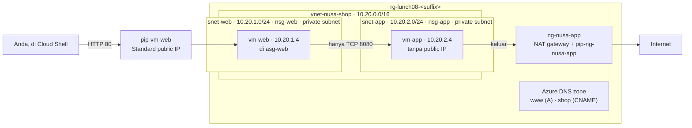

# Lab 08 · Membangun jaringan Nusantara Retail

🇬🇧 [Read in English](README.md)

> **Pasangan dari:** [Makan Siang 08 · Virtual Networking (Dasar)](../../lunches/08-networking-basic/README.id.md)
> **Waktu:** sekitar 50 menit · **Biaya:** 💲💲 (lihat [kelompok biaya](../README.id.md#kelompok-biaya)) · **Tingkat kesulitan:** ★★☆
> **Bisa dikerjakan terpisah:** ✅ Anda tidak memerlukan lab sebelumnya. Semua yang dibutuhkan lab ini dibuat oleh langkah-langkahnya sendiri.
> **Penulis:** Stefanus Pinarta · [Tentang penulis](../../README.id.md#tentang-penulis)

## 🎯 Yang akan Anda bangun

Jaringan toko online yang diminta Dewi: sebuah virtual network (*jaringan virtual*) di `10.20.0.0/16` yang tidak
pernah tumpang tindih dengan kantor pusat Pak Budi (`10.0.0.0/16`), dibagi menjadi **web tier** yang bisa dijangkau
pembeli dan **app tier privat** yang tidak bisa dilihat siapa pun dari internet. Network security group dan sebuah
application security group hanya mengizinkan tepat dua hal masuk — HTTP ke web server dan TCP 8080 dari web server ke
app tier — dan sebuah NAT gateway memberi app tier satu alamat yang bisa diprediksi untuk panggilan keluar. Anda
membuktikan setiap aturan dengan lalu lintas sungguhan dan dengan IP flow verify dari Network Watcher, lalu menerbitkan
nama `www` dan `shop` di sebuah public Azure DNS zone.



## ✅ Sebelum mulai

- Subscription Azure tempat Anda bisa membuat resource (lihat [Lab 01](../01-before-you-begin/README.id.md)).
- **Azure Cloud Shell (Bash)** — buka [shell.azure.com](https://shell.azure.com). Tidak ada yang perlu dipasang.
- Sekitar 4 vCPU kuota kosong di region Anda: lab ini menjalankan dua VM `$VM_SIZE_SMALL` (masing-masing 2 vCPU secara
  default).
- Ambil file lab, muat pengaturan bersama, dan definisikan beberapa variabel. Kalau Cloud Shell tersambung ulang di
  tengah lab, jalankan lagi blok ini sebelum melanjutkan:

```bash
git clone https://github.com/stefpin/azure-fundamentals-lunches.git   # first time only
cd azure-fundamentals-lunches/labs/08-networking-basic
source ../common/config.sh
RG=$(rg_name 08)
VNET=vnet-nusa-shop
ZONE="nusantara-retail-${SUFFIX}.xyz"

# Helper: run shell commands inside a VM through the Azure VM agent (no SSH, no public IP needed).
# Each call takes 20-40 seconds.
run_on() {
  az vm run-command invoke -g "$RG" -n "$1" --command-id RunShellScript \
    --scripts "$2" --query "value[0].message" -o tsv
}
```

- Lab ini tidak punya `setup.sh`: membangun jaringannya *adalah* lab itu sendiri.

> [!IMPORTANT]
> Resource lab memakan biaya selama masih ada — terutama dua VM, public IP, dan NAT gateway. Akhiri dengan bagian
> **Bersihkan**, bahkan kalau Anda berhenti di tengah jalan.

## 🧭 Pilih mode Anda

| Mode | Cocok untuk Anda jika… | Caranya |
|---|---|---|
| **Terpandu** | Anda ingin setiap langkah dijelaskan | ikuti Tugas 1–7 di bawah |
| **Tantangan** | Anda sudah menguasai dasarnya | baca hanya [Ringkasan tantangan](#-ringkasan-tantangan), bangun dengan cara Anda sendiri, lalu jalankan `bash verify.sh` |

## Tugas 1 · Merencanakan dan membuat virtual network

Rencana alamat didahulukan, karena itulah satu-satunya hal yang tidak bisa Anda ubah belakangan tanpa membangun ulang.
Toko online mendapat `10.20.0.0/16` — jauh dari `10.0.0.0/16` milik kantor pusat — dengan satu /24 per tier dan ruang
yang lega untuk tumbuh. Kedua subnet adalah **private subnet**: tanpa akses internet keluar default. Alat-alat Azure
versi terbaru sudah membuat subnet di VNet baru dengan cara itu; menyetel flag-nya secara eksplisit mendokumentasikan
niat Anda dan memberi hasil yang sama di alat versi lama.

```bash
ensure_rg "$RG" 08

az network vnet create -g "$RG" -n "$VNET" --location "$LOCATION" \
  --address-prefixes 10.20.0.0/16 --output none

az network vnet subnet create -g "$RG" --vnet-name "$VNET" -n snet-web \
  --address-prefixes 10.20.1.0/24 --default-outbound-access false --output none

az network vnet subnet create -g "$RG" --vnet-name "$VNET" -n snet-app \
  --address-prefixes 10.20.2.0/24 --default-outbound-access false --output none
```

> [!TIP]
> **Lebih suka portal?** *Home › Virtual networks › Create* — di tab **IP addresses**, setel address space ke
> `10.20.0.0/16`, hapus subnet default yang disarankan, lalu tambahkan `snet-web` dan `snet-app`. Biarkan opsi private
> subnet (tanpa default outbound access) tetap aktif; portal mengaktifkannya secara default. Setelah itu kembali ke
> sini untuk Tugas 2.

> ✅ **Pemeriksaan:** dua subnet, keduanya dengan `False` di kolom *defaultOutbound*:
>
> ```bash
> az network vnet subnet list -g "$RG" --vnet-name "$VNET" \
>   --query "[].{subnet:name, prefix:addressPrefix || addressPrefixes[0], defaultOutbound:defaultOutboundAccess}" -o table
> ```

## Tugas 2 · Menulis aturan keamanan: NSG dan sebuah application security group

Satu NSG per subnet membuat aturan setiap tier terkumpul di satu tempat yang mudah dibaca. Application security group
`asg-web` memberi nama pada *peran* "web server", sehingga aturan tidak bergantung pada alamat IP.

```bash
az network nsg create -g "$RG" -n nsg-web --location "$LOCATION" --output none
az network nsg create -g "$RG" -n nsg-app --location "$LOCATION" --output none
az network asg create -g "$RG" -n asg-web --location "$LOCATION" --output none

# nsg-web: shoppers may reach the web servers on HTTP, nothing else from the internet.
az network nsg rule create -g "$RG" --nsg-name nsg-web -n Allow-HTTP-Internet \
  --priority 100 --direction Inbound --access Allow --protocol Tcp \
  --source-address-prefixes Internet --source-port-ranges '*' \
  --destination-asgs asg-web --destination-port-ranges 80 --output none

# nsg-app: only web servers may call the app tier, and only on TCP 8080 ...
az network nsg rule create -g "$RG" --nsg-name nsg-app -n Allow-Web-To-App-8080 \
  --priority 100 --direction Inbound --access Allow --protocol Tcp \
  --source-asgs asg-web --source-port-ranges '*' \
  --destination-address-prefixes 10.20.2.0/24 --destination-port-ranges 8080 --output none

# ... and everything else from inside the VNet is denied, long before the default AllowVnetInBound (65000).
az network nsg rule create -g "$RG" --nsg-name nsg-app -n Deny-VNet-Inbound \
  --priority 4000 --direction Inbound --access Deny --protocol '*' \
  --source-address-prefixes VirtualNetwork --source-port-ranges '*' \
  --destination-address-prefixes '*' --destination-port-ranges '*' --output none

# Attach each NSG to its subnet.
az network vnet subnet update -g "$RG" --vnet-name "$VNET" -n snet-web --nsg nsg-web --output none
az network vnet subnet update -g "$RG" --vnet-name "$VNET" -n snet-app --nsg nsg-app --output none
```

Perhatikan apa yang *tidak* Anda tulis: tidak ada aturan untuk SSH. SSH yang masuk dari internet akan jatuh sampai ke
`DenyAllInBound`.

> [!TIP]
> **Lebih suka portal?** Buka **nsg-app › Inbound security rules** untuk melihat dua aturan Anda tersusun di atas tiga
> aturan default. Portal menampilkan urutan prioritas dengan sangat visual. Setelah itu kembali ke sini untuk Tugas 3.

> ✅ **Pemeriksaan:** `nsg-app` menampilkan aturan Anda di 100 dan 4000 di atas aturan default, dan kedua subnet
> menampilkan NSG-nya:
>
> ```bash
> az network nsg rule list -g "$RG" --nsg-name nsg-app --include-default \
>   --query "[?direction=='Inbound'] | sort_by(@, &priority)[].{priority:priority, name:name, access:access, port:destinationPortRange}" -o table
> az network vnet subnet list -g "$RG" --vnet-name "$VNET" --query "[].{subnet:name, nsg:networkSecurityGroup.id}" -o table
> ```

## Tugas 3 · Membuat VM web dan VM app

`vm-web` mendapat public IP Standard dan bergabung dengan `asg-web`. `vm-app` tidak mendapat public IP sama sekali.
Keduanya memakai `--nsg ""` agar CLI tidak menambahkan NSG tingkat NIC di samping NSG subnet Anda. VM web menjalankan
web server cloud-init bersama milik kursus (port 80); VM app menjalankan `app-cloud-init.yml` milik lab ini, sebuah
layanan mungil di port 8080. Keduanya tidak butuh akses internet untuk mulai berjalan. Setiap VM butuh 2–4 menit; baca
bagian 4 dari bacaan makan siang ini sambil menunggu.

```bash
az vm create -g "$RG" -n vm-web --location "$LOCATION" \
  --image "$VM_IMAGE" --size "$VM_SIZE_SMALL" \
  --vnet-name "$VNET" --subnet snet-web --private-ip-address 10.20.1.4 \
  --public-ip-address pip-vm-web --public-ip-sku Standard \
  --nsg "" --asgs asg-web \
  --admin-username "$ADMIN_USER" --generate-ssh-keys \
  --custom-data "$AZL_COMMON_DIR/cloud-init-web.yml" --output none

az vm create -g "$RG" -n vm-app --location "$LOCATION" \
  --image "$VM_IMAGE" --size "$VM_SIZE_SMALL" \
  --vnet-name "$VNET" --subnet snet-app --private-ip-address 10.20.2.4 \
  --public-ip-address "" --nsg "" \
  --admin-username "$ADMIN_USER" --generate-ssh-keys \
  --custom-data app-cloud-init.yml --output none
```

> [!TIP]
> **Lebih suka portal?** Tab *Create a virtual machine › Networking*: pilih `vnet-nusa-shop` dan subnet-nya, lalu
> setel **NIC network security group** ke **None** (NSG subnet sudah melindunginya). Setelah `vm-web` dibuat, buka
> *vm-web › Networking › Application security groups* dan tambahkan network interface-nya ke `asg-web`.

> ✅ **Pemeriksaan:** `vm-web` punya public IP dan `vm-app` tidak punya; NIC milik `vm-web` adalah anggota `asg-web`:
>
> ```bash
> az vm list -g "$RG" -d --query "[].{vm:name, private:privateIps, public:publicIps, state:powerState}" -o table
> WEB_NIC_ID=$(az vm show -g "$RG" -n vm-web --query "networkProfile.networkInterfaces[0].id" -o tsv)
> az network nic show --ids "$WEB_NIC_ID" --query "ipConfigurations[0].applicationSecurityGroups[].id" -o tsv
> ```

## Tugas 4 · Menguji lalu lintas dari internet dan antar-tier

Sekarang buktikan aturan-aturan itu dengan paket sungguhan. Beri cloud-init waktu satu-dua menit setelah VM dibuat.

```bash
WEB_IP=$(az network public-ip show -g "$RG" -n pip-vm-web --query ipAddress -o tsv)
echo "vm-web public IP: $WEB_IP"

# From Cloud Shell (the internet): HTTP works, SSH doesn't.
curl -s --max-time 10 "http://$WEB_IP" | grep -o '<h1>.*</h1>'
timeout 5 bash -c "</dev/tcp/$WEB_IP/22" 2>/dev/null && echo "port 22 is OPEN" || echo "port 22 is closed"

# From vm-web to vm-app: 8080 works, SSH (22) is blocked by Deny-VNet-Inbound.
run_on vm-web 'curl -s --max-time 5 http://10.20.2.4:8080/ || echo "8080 BLOCKED"'
run_on vm-web 'timeout 5 bash -c "</dev/tcp/10.20.2.4/22" && echo "22 OPEN" || echo "22 BLOCKED"'
```

Tanpa aturan Anda di 4000, Run Command yang kedua akan mencetak `22 OPEN`: aturan default `AllowVnetInBound`
meloloskan semua lalu lintas di dalam VNet.

> ✅ **Pemeriksaan:** `<h1>Nusantara Retail</h1>`, `port 22 is closed`, satu baris JSON yang berisi
> `nusantara-retail-app-tier`, dan `22 BLOCKED`.

## Tugas 5 · Memberi app tier yang privat jalan keluar

`vm-app` harus memanggil penyedia pembayaran di internet. Pertama, lihat apa arti private subnet dalam praktik, lalu
tambahkan metode outbound eksplisit yang direkomendasikan: NAT gateway.

```bash
# Before: vm-app has no public IP and lives in a private subnet.
run_on vm-app 'curl -s --max-time 10 https://api.ipify.org || echo "NO OUTBOUND ACCESS"'
```

Perintah itu berjalan sedikit lebih lama lalu mencetak `NO OUTBOUND ACCESS` — padahal `nsg-app` berisi aturan default
`AllowInternetOutBound`. Izin bukanlah jalur. Run Command sendiri tetap berfungsi, karena VM agent berbicara dengan
Azure melalui alamat platform `168.63.129.16`, bukan melalui internet.

```bash
az network public-ip create -g "$RG" -n pip-ng-nusa-app --location "$LOCATION" \
  --sku Standard --allocation-method Static --output none

az network nat gateway create -g "$RG" -n ng-nusa-app --location "$LOCATION" \
  --public-ip-addresses pip-ng-nusa-app --idle-timeout 4 --output none

az network vnet subnet update -g "$RG" --vnet-name "$VNET" -n snet-app \
  --nat-gateway ng-nusa-app --output none

NAT_IP=$(az network public-ip show -g "$RG" -n pip-ng-nusa-app --query ipAddress -o tsv)
echo "NAT gateway public IP: $NAT_IP"

# After: the same test now succeeds and shows which address the internet sees.
run_on vm-app 'curl -s --max-time 10 https://api.ipify.org || echo "NO OUTBOUND ACCESS"'
```

Tanpa route table, tanpa perubahan di VM: NAT gateway melayani setiap VM di `snet-app`. Tidak ada apa pun di internet
yang bisa membuka koneksi ke `vm-app` melaluinya.

> [!TIP]
> **Lebih suka portal?** *Create a resource › NAT gateway* — di tab **Outbound IP**, buat public IP baru, dan di tab
> **Networking**, pilih `vnet-nusa-shop` lalu centang `snet-app`.

> ✅ **Pemeriksaan:** sebelum ada NAT gateway, `NO OUTBOUND ACCESS`; sesudahnya, sebuah alamat IP yang sama dengan
> `$NAT_IP`. Kalau percobaan pertama setelah NAT gateway dibuat masih gagal, tunggu satu menit lalu jalankan lagi.

## Tugas 6 · Mendiagnosis dengan IP flow verify

**IP flow verify** dari Network Watcher menguji satu paket terhadap aturan NSG yang berlaku untuk sebuah VM, tanpa
mengirim lalu lintas apa pun, lalu menyebutkan aturan yang memutuskan. Gunakan setiap kali "tidak bisa tersambung" dan
Anda menginginkan bukti.

```bash
MY_IP=$(my_public_ip); echo "Your public IP: $MY_IP"

# 1. Web tier -> app tier on 8080: expect Allow, rule Allow-Web-To-App-8080.
az network watcher test-ip-flow -g "$RG" --vm vm-app --direction Inbound --protocol TCP \
  --local 10.20.2.4:8080 --remote 10.20.1.4:50000 -o table

# 2. Web tier -> app tier on 22: expect Deny, rule Deny-VNet-Inbound.
az network watcher test-ip-flow -g "$RG" --vm vm-app --direction Inbound --protocol TCP \
  --local 10.20.2.4:22 --remote 10.20.1.4:50000 -o table

# 3. You (the internet) -> vm-web on 22 and on 80: expect Deny (DenyAllInBound), then Allow (Allow-HTTP-Internet).
az network watcher test-ip-flow -g "$RG" --vm vm-web --direction Inbound --protocol TCP \
  --local 10.20.1.4:22 --remote "$MY_IP":50000 -o table
az network watcher test-ip-flow -g "$RG" --vm vm-web --direction Inbound --protocol TCP \
  --local 10.20.1.4:80 --remote "$MY_IP":50000 -o table

# 4. vm-app -> internet on 443: Allow (AllowInternetOutBound). IP flow verify checks rules, not paths.
az network watcher test-ip-flow -g "$RG" --vm vm-app --direction Outbound --protocol TCP \
  --local 10.20.2.4:50000 --remote 13.107.21.200:443 -o table
```

Ingin gambaran lengkapnya? Effective security rules menampilkan gabungan aturan di sebuah NIC, dengan `asg-web` dan
service tag yang dijabarkan menjadi rentang alamat sungguhan:

```bash
APP_NIC_ID=$(az vm show -g "$RG" -n vm-app --query "networkProfile.networkInterfaces[0].id" -o tsv)
az network nic list-effective-nsg --ids "$APP_NIC_ID" \
  --query "value[].effectiveSecurityRules[].{name:name, priority:priority, direction:direction, access:access}" -o table
```

> [!TIP]
> **Lebih suka portal?** *Network Watcher › IP flow verify* menanyakan lima nilai yang sama dalam sebuah formulir, dan
> *Network Watcher › Effective security rules* menampilkan tampilan gabungan per NIC.

> ✅ **Pemeriksaan:** Allow · Deny · Deny · Allow · Allow, masing-masing dengan nama aturan yang memutuskan — misalnya
> `securityRules/Deny-VNet-Inbound` atau `defaultSecurityRules/DenyAllInBound`.

## Tugas 7 · Menerbitkan nama di public DNS zone

Pembeli mengetik nama, bukan alamat IP. Buat sebuah public zone, tambahkan record `A` untuk `www` dan sebuah `CNAME`
yang menjadikan `shop` alias dari `www`. Anda tidak memiliki domain `nusantara-retail-<suffix>.xyz`, jadi tidak ada
seorang pun di internet yang akan diarahkan ke name server Azure Anda — tetapi Anda bisa bertanya langsung kepada name
server itu, dan begitulah cara menguji sebuah zone sebelum mendelegasikan domain sungguhan.

```bash
az network dns zone create -g "$RG" -n "$ZONE" --output none
az network dns record-set a add-record -g "$RG" -z "$ZONE" -n www -a "$WEB_IP" --ttl 300 --output none
az network dns record-set cname set-record -g "$RG" -z "$ZONE" -n shop -c "www.$ZONE" --ttl 300 --output none

az network dns record-set list -g "$RG" -z "$ZONE" -o table

NS1=$(az network dns zone show -g "$RG" -n "$ZONE" --query "nameServers[0]" -o tsv)
echo "Asking name server $NS1"
nslookup "www.$ZONE" "$NS1"
nslookup "shop.$ZONE" "$NS1"

# Without the name server, your normal resolver can't find it: the domain isn't delegated to Azure DNS.
nslookup "www.$ZONE" || true
```

> [!TIP]
> **Lebih suka portal?** *Create a resource › DNS zone*, lalu **+ Record set** di dalam zone itu. Halaman **Overview**
> mencantumkan empat name server yang akan Anda berikan ke registrar domain. `dig @"$NS1" "www.$ZONE"` juga bisa
> dipakai di Cloud Shell.

> ✅ **Pemeriksaan:** query `www` mengembalikan `$WEB_IP`; query `shop` menampilkan `canonical name = www.<your zone>`
> dan alamat yang sama; query terakhir gagal menemukan nama itu.

## 🔧 Rusak lalu perbaiki

Pada suatu Jumat sore, Rizky "memperketat keamanan". Tambahkan aturannya:

```bash
az network nsg rule create -g "$RG" --nsg-name nsg-app -n Deny-Web-Subnet \
  --priority 90 --direction Inbound --access Deny --protocol '*' \
  --source-address-prefixes 10.20.1.0/24 --source-port-ranges '*' \
  --destination-address-prefixes '*' --destination-port-ranges '*' --output none
```

Tunggu sekitar 30 detik, lalu ulangi panggilan ke aplikasi dari Tugas 4:

```bash
run_on vm-web 'curl -s --max-time 5 http://10.20.2.4:8080/ || echo "8080 BLOCKED"'
```

**Gejala:** `8080 BLOCKED`, padahal `Allow-Web-To-App-8080` masih ada. Temukan biang keroknya dengan bukti, lalu
perbaiki.

<details><summary>Petunjuk dan perbaikan</summary>

Jalankan lagi tes IP flow verify pertama dari Tugas 6. Kini jawabannya **Deny** dengan `securityRules/Deny-Web-Subnet`:
prioritas 90 diperiksa sebelum allow Anda di 100, dan kecocokan pertama yang menang. Hapus aturan itu (atau ganti
nomornya menjadi di atas 100 kalau Rizky memang benar-benar membutuhkannya):

```bash
az network nsg rule delete -g "$RG" --nsg-name nsg-app -n Deny-Web-Subnet
run_on vm-web 'curl -s --max-time 5 http://10.20.2.4:8080/ || echo "8080 BLOCKED"'
```

</details>

## 🧪 Verifikasi hasil kerja Anda

```bash
bash verify.sh
```

Setiap pemeriksaan seharusnya menampilkan **PASS**. Skrip ini butuh sekitar tiga menit karena menjalankan tes lalu
lintas sungguhan lewat Run Command dan menanyakan aturan-aturan kunci kepada IP flow verify. Kalau ada pemeriksaan yang
gagal, pesannya memberi tahu tugas mana yang perlu Anda ulangi.

## 🧹 Bersihkan (jangan dilewati!)

```bash
bash cleanup.sh
```

Perintah ini menghapus resource group `rg-lunch08-<suffix>` beserta seluruh isinya: VM, disk, public IP, NAT gateway,
NSG, ASG, dan DNS zone. Penghapusan berlanjut di latar belakang selama beberapa menit. Tidak ada yang dibuat di luar
resource group: Network Watcher (di `NetworkWatcherRG`) adalah resource regional bersama yang gratis dan diaktifkan
Azure untuk Anda, dan SSH key di `~/.ssh` dipakai ulang oleh lab-lab lain.

## 🩺 Pemecahan masalah

| Gejala | Kemungkinan penyebab | Perbaikan |
|---|---|---|
| `curl` ke public IP VM web menggantung atau tidak mencetak apa-apa | cloud-init masih menyalakan web server, aturan HTTP belum ada, atau NIC `vm-web` tidak ada di `asg-web` | Tunggu dua menit; periksa pemeriksaan di Tugas 2 dan Tugas 3; jalankan tes IP flow verify nomor 3 untuk port 80 |
| `az vm create` gagal dengan `SkuNotAvailable` | `$VM_SIZE_SMALL` tidak ditawarkan untuk subscription Anda di region ini | Tampilkan ukuran yang tersedia dengan `az vm list-skus -l "$LOCATION" --size Standard_B -o table`, lalu `export VM_SIZE_SMALL=<size>` dan `source ../common/config.sh` lagi |
| `Operation could not be completed as it results in exceeding approved ... Cores quota` | Kuota vCPU kosong di region itu tidak cukup | Hapus VM dari lab lain (`bash cleanup.sh` di folder masing-masing) atau minta tambahan kuota |
| `Run command extension execution is in progress. Please wait for completion before invoking a run command.` | Run Command hanya menjalankan satu skrip dalam satu waktu per VM | Tunggu 30 detik lalu jalankan lagi |
| Tes *sebelum* di Tugas 5 mencetak alamat IP alih-alih `NO OUTBOUND ACCESS` | Subnet-nya bukan private, atau NAT gateway sudah terpasang | `az network vnet subnet show -g "$RG" --vnet-name "$VNET" -n snet-app --query "{private:defaultOutboundAccess, nat:natGateway.id}"`. Kalau Anda menjadikan subnet private setelah membuat `vm-app`, deallocate lalu nyalakan lagi VM-nya |
| Tes *sesudah* di Tugas 5 masih mencetak `NO OUTBOUND ACCESS` | Asosiasinya masih diterapkan, atau NAT gateway tidak punya public IP | Tunggu satu menit lalu coba lagi; periksa `natGateway.id` di `snet-app` dan `az network nat gateway show -g "$RG" -n ng-nusa-app --query publicIpAddresses` |
| `az network watcher test-ip-flow` melaporkan bahwa Network Watcher tidak aktif atau tidak ditemukan untuk region itu | Anda memilih keluar (opt out) dari pengaktifan otomatis | `az network watcher configure -g NetworkWatcherRG -l "$LOCATION" --enabled true` |
| IP flow verify gagal hanya untuk satu VM | VM itu sedang berhenti (deallocated) | `az vm start -g "$RG" -n <vm>` |
| `nslookup` mengatakan `NXDOMAIN` bahkan dengan `$NS1` | Salah ketik di nama zone atau record, atau `$ZONE` belum disetel di shell ini | Jalankan lagi blok *Sebelum mulai*; `az network dns record-set list -g "$RG" -z "$ZONE" -o table` |

## 🚀 Tantangan tambahan

- Buat `asg-app`, tambahkan NIC milik `vm-app` ke dalamnya, lalu ubah `Allow-Web-To-App-8080` agar memakai
  `--destination-asgs asg-app`. Kini aturan Anda sama sekali tidak berisi alamat IP.
- Tambahkan **alias record** yang mengikuti resource public IP alih-alih menyalin alamatnya:
  `az network dns record-set a create -g "$RG" -z "$ZONE" -n store --target-resource "$(az network public-ip show -g "$RG" -n pip-vm-web --query id -o tsv)"`.
- Di portal, jalankan **Network Watcher › Connection troubleshoot** dari `vm-web` ke `10.20.2.4` port 8080, lalu ke
  port 22, dan bandingkan jawabannya dengan IP flow verify.
- Aktifkan **VNet flow logs** untuk `vnet-nusa-shop` di portal (*Network Watcher › Flow logs › Create*, target type
  *Virtual network*). Fitur ini membutuhkan storage account di region yang sama; hapus keduanya setelah selesai.
- Pelajari SKU NAT gateway **StandardV2** yang zone-redundant, yang membutuhkan public IP StandardV2, lalu tentukan
  kapan toko online akan membutuhkannya.

## 🏁 Ringkasan tantangan

Bangun hal-hal berikut dengan cara apa pun yang Anda suka (portal, CLI, Bicep). Gunakan nama-nama ini agar `verify.sh`
bisa menemukan resource Anda:

1. Resource group `rg-lunch08-<suffix>` (nilai dari `rg_name 08`) di `$LOCATION`, dibuat dengan `ensure_rg` agar
   membawa tag kursus.
2. Virtual network `vnet-nusa-shop` dengan address space `10.20.0.0/16`, dan dua **private subnet** (tanpa default
   outbound access): `snet-web` `10.20.1.0/24` dan `snet-app` `10.20.2.0/24`.
3. NSG `nsg-web` yang dikaitkan dengan `snet-web` dan NSG `nsg-app` yang dikaitkan dengan `snet-app`. Simpan semua
   aturan di kedua NSG subnet ini: network interface VM tidak punya NSG sendiri.
4. Application security group `asg-web`.
5. VM `vm-web` (`$VM_SIZE_SMALL`, `$VM_IMAGE`, `cloud-init-web.yml` bersama) di `snet-web`, dengan public IP
   Standard, dan NIC-nya di `asg-web`. HTTP (TCP 80) dari internet bisa menjangkaunya; SSH (TCP 22) dari internet
   tidak bisa.
6. VM `vm-app` (`$VM_SIZE_SMALL`, `$VM_IMAGE`, `app-cloud-init.yml` milik lab ini) di `snet-app` **tanpa** public IP.
   Anggota `asg-web` bisa menjangkaunya hanya di TCP 8080; lalu lintas lain dari dalam VNet (misalnya TCP 22 dari
   `vm-web`) ditolak.
7. NAT gateway dengan public IP Standard yang terpasang di `snet-app`; koneksi keluar `vm-app` berangkat dari IP
   tersebut.
8. Public DNS zone di resource group itu dengan record `A` `www` yang menunjuk ke public IP `vm-web` dan record `CNAME`
   `shop` yang menunjuk ke `www.<your zone>`.

Lalu jalankan `bash verify.sh`. Buntu? Intip `solution.sh` atau beralih ke mode Terpandu.

---

⬅️ [Bacaan Makan Siang 08](../../lunches/08-networking-basic/README.id.md) · 🏠 [Semua lab](../README.id.md) · 🏠 [Beranda kursus](../../README.id.md)

<sub>Terakhir divalidasi: Oktober 2026 · Ada yang tidak berfungsi? [Laporkan masalah lab](../../CONTRIBUTING.md).</sub>
