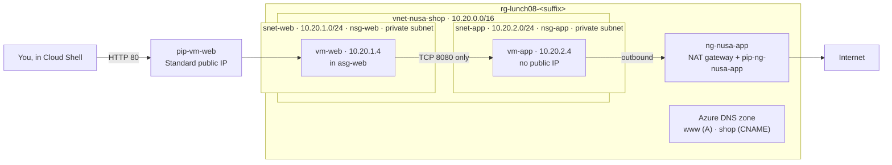

# Lab 08 · Build Nusantara Retail's network

> **Pairs with:** [Lunch 08 · Virtual Networking (Basic)](../../lunches/08-networking-basic/README.md)
> **Time:** about 50 minutes · **Cost:** 💲💲 (see [cost bands](../README.md#cost-bands)) · **Difficulty:** ★★☆
> **Works on its own:** ✅ You do not need any earlier lab. Everything this lab needs is created by its steps.

## 🎯 What you'll build

The storefront network Dewi asked for: a virtual network on `10.20.0.0/16` that never overlaps Pak Budi's head office
(`10.0.0.0/16`), split into a **web tier** that shoppers can reach and a **private app tier** that nobody on the internet
can see. Network security groups and an application security group allow exactly two things in — HTTP to the web
servers and TCP 8080 from the web servers to the app tier — and a NAT gateway gives the app tier one predictable address
for outbound calls. You prove every rule with real traffic and with Network Watcher's IP flow verify, and publish `www`
and `shop` names in a public Azure DNS zone.



## ✅ Before you start

- An Azure subscription where you can create resources (see [Lab 01](../01-before-you-begin/README.md)).
- **Azure Cloud Shell (Bash)** — open [shell.azure.com](https://shell.azure.com). Nothing to install.
- About 4 vCPUs of free quota in your region: the lab runs two `$VM_SIZE_SMALL` VMs (2 vCPUs each by default).
- Get the lab files, load the shared settings and define a few variables. If Cloud Shell reconnects during the lab,
  run this block again before you continue:

```bash
git clone https://github.com/stefpin/azure-fundamentals-lunches.git   # first time only
cd azure-fundamentals-lunches/labs/08-networking-basic
source ../common/config.sh
RG=$(rg_name 08)
VNET=vnet-nusa-shop
ZONE="nusantara-retail-${SUFFIX}.xyz"

# Helper: run shell commands inside a VM through the Azure VM agent (no SSH, no public IP needed).
# Each call takes 20-40 seconds.
run_on() {
  az vm run-command invoke -g "$RG" -n "$1" --command-id RunShellScript \
    --scripts "$2" --query "value[0].message" -o tsv
}
```

- This lab has no `setup.sh`: building the network *is* the lab.

> [!IMPORTANT]
> Lab resources cost money while they exist — mainly the two VMs, the public IPs and the NAT gateway. Finish with the
> **Clean up** section, even if you stop halfway.

## 🧭 Choose your mode

| Mode | For you if… | How |
|---|---|---|
| **Guided** | you want every step explained | follow Tasks 1–7 below |
| **Challenge** | you already know the basics | read only the [Challenge brief](#-challenge-brief), build it your way, then run `bash verify.sh` |

## Task 1 · Plan and create the virtual network

The address plan comes first, because it is the one thing you can't change later without rebuilding. The storefront
gets `10.20.0.0/16` — far away from head office's `10.0.0.0/16` — with one /24 per tier and plenty of room to grow.
Both subnets are **private subnets**: no default outbound internet access. Recent Azure tools already create subnets in
new VNets that way; setting the flag explicitly documents your intent and gives the same result with older tools.

```bash
ensure_rg "$RG" 08

az network vnet create -g "$RG" -n "$VNET" --location "$LOCATION" \
  --address-prefixes 10.20.0.0/16 --output none

az network vnet subnet create -g "$RG" --vnet-name "$VNET" -n snet-web \
  --address-prefixes 10.20.1.0/24 --default-outbound-access false --output none

az network vnet subnet create -g "$RG" --vnet-name "$VNET" -n snet-app \
  --address-prefixes 10.20.2.0/24 --default-outbound-access false --output none
```

> [!TIP]
> **Prefer the portal?** *Home › Virtual networks › Create* — on the **IP addresses** tab, set the address space to
> `10.20.0.0/16`, delete the suggested default subnet and add `snet-web` and `snet-app`. Keep the private subnet option
> (no default outbound access) switched on; the portal enables it by default. Then come back for Task 2.

> ✅ **Checkpoint:** two subnets, both with `False` in the *defaultOutbound* column:
>
> ```bash
> az network vnet subnet list -g "$RG" --vnet-name "$VNET" \
>   --query "[].{subnet:name, prefix:addressPrefix || addressPrefixes[0], defaultOutbound:defaultOutboundAccess}" -o table
> ```

## Task 2 · Write the security rules: NSGs and an application security group

One NSG per subnet keeps the rules in one readable place per tier. The application security group `asg-web` names the
*role* "web server", so rules don't depend on IP addresses.

```bash
az network nsg create -g "$RG" -n nsg-web --location "$LOCATION" --output none
az network nsg create -g "$RG" -n nsg-app --location "$LOCATION" --output none
az network asg create -g "$RG" -n asg-web --location "$LOCATION" --output none

# nsg-web: shoppers may reach the web servers on HTTP, nothing else from the internet.
az network nsg rule create -g "$RG" --nsg-name nsg-web -n Allow-HTTP-Internet \
  --priority 100 --direction Inbound --access Allow --protocol Tcp \
  --source-address-prefixes Internet --source-port-ranges '*' \
  --destination-asgs asg-web --destination-port-ranges 80 --output none

# nsg-app: only web servers may call the app tier, and only on TCP 8080 ...
az network nsg rule create -g "$RG" --nsg-name nsg-app -n Allow-Web-To-App-8080 \
  --priority 100 --direction Inbound --access Allow --protocol Tcp \
  --source-asgs asg-web --source-port-ranges '*' \
  --destination-address-prefixes 10.20.2.0/24 --destination-port-ranges 8080 --output none

# ... and everything else from inside the VNet is denied, long before the default AllowVnetInBound (65000).
az network nsg rule create -g "$RG" --nsg-name nsg-app -n Deny-VNet-Inbound \
  --priority 4000 --direction Inbound --access Deny --protocol '*' \
  --source-address-prefixes VirtualNetwork --source-port-ranges '*' \
  --destination-address-prefixes '*' --destination-port-ranges '*' --output none

# Attach each NSG to its subnet.
az network vnet subnet update -g "$RG" --vnet-name "$VNET" -n snet-web --nsg nsg-web --output none
az network vnet subnet update -g "$RG" --vnet-name "$VNET" -n snet-app --nsg nsg-app --output none
```

Notice what you did *not* write: no rule for SSH. Inbound SSH from the internet falls through to `DenyAllInBound`.

> [!TIP]
> **Prefer the portal?** Open **nsg-app › Inbound security rules** to see your two rules sorted above the three default
> rules. The portal makes the priority order very visual. Then come back for Task 3.

> ✅ **Checkpoint:** `nsg-app` lists your rules at 100 and 4000 above the defaults, and both subnets show their NSG:
>
> ```bash
> az network nsg rule list -g "$RG" --nsg-name nsg-app --include-default \
>   --query "[?direction=='Inbound'] | sort_by(@, &priority)[].{priority:priority, name:name, access:access, port:destinationPortRange}" -o table
> az network vnet subnet list -g "$RG" --vnet-name "$VNET" --query "[].{subnet:name, nsg:networkSecurityGroup.id}" -o table
> ```

## Task 3 · Create the web and app VMs

`vm-web` gets a Standard public IP and joins `asg-web`. `vm-app` gets no public IP at all. Both use `--nsg ""` so the
CLI doesn't add a NIC-level NSG next to your subnet NSGs. The web VM runs the course's shared cloud-init web server
(port 80); the app VM runs this lab's `app-cloud-init.yml`, a tiny service on port 8080. Neither needs internet access
to start. Each VM takes 2–4 minutes; read section 4 of the lunch while you wait.

```bash
az vm create -g "$RG" -n vm-web --location "$LOCATION" \
  --image "$VM_IMAGE" --size "$VM_SIZE_SMALL" \
  --vnet-name "$VNET" --subnet snet-web --private-ip-address 10.20.1.4 \
  --public-ip-address pip-vm-web --public-ip-sku Standard \
  --nsg "" --asgs asg-web \
  --admin-username "$ADMIN_USER" --generate-ssh-keys \
  --custom-data "$AZL_COMMON_DIR/cloud-init-web.yml" --output none

az vm create -g "$RG" -n vm-app --location "$LOCATION" \
  --image "$VM_IMAGE" --size "$VM_SIZE_SMALL" \
  --vnet-name "$VNET" --subnet snet-app --private-ip-address 10.20.2.4 \
  --public-ip-address "" --nsg "" \
  --admin-username "$ADMIN_USER" --generate-ssh-keys \
  --custom-data app-cloud-init.yml --output none
```

> [!TIP]
> **Prefer the portal?** *Create a virtual machine › Networking* tab: choose `vnet-nusa-shop` and the subnet, and set
> **NIC network security group** to **None** (the subnet NSG already protects it). After `vm-web` is created, open
> *vm-web › Networking › Application security groups* and add its network interface to `asg-web`.

> ✅ **Checkpoint:** `vm-web` has a public IP and `vm-app` has none; `vm-web`'s NIC is a member of `asg-web`:
>
> ```bash
> az vm list -g "$RG" -d --query "[].{vm:name, private:privateIps, public:publicIps, state:powerState}" -o table
> WEB_NIC_ID=$(az vm show -g "$RG" -n vm-web --query "networkProfile.networkInterfaces[0].id" -o tsv)
> az network nic show --ids "$WEB_NIC_ID" --query "ipConfigurations[0].applicationSecurityGroups[].id" -o tsv
> ```

## Task 4 · Test traffic from the internet and between the tiers

Now prove the rules with real packets. Give cloud-init a minute or two after the VMs are created.

```bash
WEB_IP=$(az network public-ip show -g "$RG" -n pip-vm-web --query ipAddress -o tsv)
echo "vm-web public IP: $WEB_IP"

# From Cloud Shell (the internet): HTTP works, SSH doesn't.
curl -s --max-time 10 "http://$WEB_IP" | grep -o '<h1>.*</h1>'
timeout 5 bash -c "</dev/tcp/$WEB_IP/22" 2>/dev/null && echo "port 22 is OPEN" || echo "port 22 is closed"

# From vm-web to vm-app: 8080 works, SSH (22) is blocked by Deny-VNet-Inbound.
run_on vm-web 'curl -s --max-time 5 http://10.20.2.4:8080/ || echo "8080 BLOCKED"'
run_on vm-web 'timeout 5 bash -c "</dev/tcp/10.20.2.4/22" && echo "22 OPEN" || echo "22 BLOCKED"'
```

Without your rule at 4000, the second Run Command would print `22 OPEN`: the default `AllowVnetInBound` lets everything
inside the VNet through.

> ✅ **Checkpoint:** `<h1>Nusantara Retail</h1>`, `port 22 is closed`, a JSON line containing
> `nusantara-retail-app-tier`, and `22 BLOCKED`.

## Task 5 · Give the private app tier a way out

`vm-app` must call the payment provider on the internet. First see what a private subnet means in practice, then add
the recommended explicit outbound method: a NAT gateway.

```bash
# Before: vm-app has no public IP and lives in a private subnet.
run_on vm-app 'curl -s --max-time 10 https://api.ipify.org || echo "NO OUTBOUND ACCESS"'
```

The command takes a little longer and prints `NO OUTBOUND ACCESS` — even though `nsg-app` contains the default rule
`AllowInternetOutBound`. Permission isn't a path. Run Command itself still works, because the VM agent talks to Azure
through the platform address `168.63.129.16`, not through the internet.

```bash
az network public-ip create -g "$RG" -n pip-ng-nusa-app --location "$LOCATION" \
  --sku Standard --allocation-method Static --output none

az network nat gateway create -g "$RG" -n ng-nusa-app --location "$LOCATION" \
  --public-ip-addresses pip-ng-nusa-app --idle-timeout 4 --output none

az network vnet subnet update -g "$RG" --vnet-name "$VNET" -n snet-app \
  --nat-gateway ng-nusa-app --output none

NAT_IP=$(az network public-ip show -g "$RG" -n pip-ng-nusa-app --query ipAddress -o tsv)
echo "NAT gateway public IP: $NAT_IP"

# After: the same test now succeeds and shows which address the internet sees.
run_on vm-app 'curl -s --max-time 10 https://api.ipify.org || echo "NO OUTBOUND ACCESS"'
```

No route table, no change on the VM: the NAT gateway serves every VM in `snet-app`. Nothing on the internet can open a
connection to `vm-app` through it.

> [!TIP]
> **Prefer the portal?** *Create a resource › NAT gateway* — on the **Outbound IP** tab create a new public IP, and on
> the **Networking** tab pick `vnet-nusa-shop` and tick `snet-app`.

> ✅ **Checkpoint:** before the NAT gateway, `NO OUTBOUND ACCESS`; afterwards, an IP address that equals `$NAT_IP`. If
> the first try after creating the NAT gateway still fails, wait a minute and run it again.

## Task 6 · Diagnose with IP flow verify

Network Watcher's **IP flow verify** tests one packet against the NSG rules that apply to a VM, without sending any
traffic, and names the rule that decided. Use it whenever "it doesn't connect" and you want evidence.

```bash
MY_IP=$(my_public_ip); echo "Your public IP: $MY_IP"

# 1. Web tier -> app tier on 8080: expect Allow, rule Allow-Web-To-App-8080.
az network watcher test-ip-flow -g "$RG" --vm vm-app --direction Inbound --protocol TCP \
  --local 10.20.2.4:8080 --remote 10.20.1.4:50000 -o table

# 2. Web tier -> app tier on 22: expect Deny, rule Deny-VNet-Inbound.
az network watcher test-ip-flow -g "$RG" --vm vm-app --direction Inbound --protocol TCP \
  --local 10.20.2.4:22 --remote 10.20.1.4:50000 -o table

# 3. You (the internet) -> vm-web on 22 and on 80: expect Deny (DenyAllInBound), then Allow (Allow-HTTP-Internet).
az network watcher test-ip-flow -g "$RG" --vm vm-web --direction Inbound --protocol TCP \
  --local 10.20.1.4:22 --remote "$MY_IP":50000 -o table
az network watcher test-ip-flow -g "$RG" --vm vm-web --direction Inbound --protocol TCP \
  --local 10.20.1.4:80 --remote "$MY_IP":50000 -o table

# 4. vm-app -> internet on 443: Allow (AllowInternetOutBound). IP flow verify checks rules, not paths.
az network watcher test-ip-flow -g "$RG" --vm vm-app --direction Outbound --protocol TCP \
  --local 10.20.2.4:50000 --remote 13.107.21.200:443 -o table
```

Want the full picture? The effective security rules show the merged rules on a NIC, with `asg-web` and the service tags
expanded into real address ranges:

```bash
APP_NIC_ID=$(az vm show -g "$RG" -n vm-app --query "networkProfile.networkInterfaces[0].id" -o tsv)
az network nic list-effective-nsg --ids "$APP_NIC_ID" \
  --query "value[].effectiveSecurityRules[].{name:name, priority:priority, direction:direction, access:access}" -o table
```

> [!TIP]
> **Prefer the portal?** *Network Watcher › IP flow verify* asks for the same five values in a form, and *Network
> Watcher › Effective security rules* shows the merged view per NIC.

> ✅ **Checkpoint:** Allow · Deny · Deny · Allow · Allow, each with the name of the rule that decided — for example
> `securityRules/Deny-VNet-Inbound` or `defaultSecurityRules/DenyAllInBound`.

## Task 7 · Publish names in a public DNS zone

Shoppers type names, not IP addresses. Create a public zone, add an `A` record for `www` and a `CNAME` that makes `shop`
an alias of `www`. You don't own the domain `nusantara-retail-<suffix>.xyz`, so nobody on the internet will be sent to
your Azure name servers — but you can ask them directly, which is how you test a zone before delegating a real domain.

```bash
az network dns zone create -g "$RG" -n "$ZONE" --output none
az network dns record-set a add-record -g "$RG" -z "$ZONE" -n www -a "$WEB_IP" --ttl 300 --output none
az network dns record-set cname set-record -g "$RG" -z "$ZONE" -n shop -c "www.$ZONE" --ttl 300 --output none

az network dns record-set list -g "$RG" -z "$ZONE" -o table

NS1=$(az network dns zone show -g "$RG" -n "$ZONE" --query "nameServers[0]" -o tsv)
echo "Asking name server $NS1"
nslookup "www.$ZONE" "$NS1"
nslookup "shop.$ZONE" "$NS1"

# Without the name server, your normal resolver can't find it: the domain isn't delegated to Azure DNS.
nslookup "www.$ZONE" || true
```

> [!TIP]
> **Prefer the portal?** *Create a resource › DNS zone*, then **+ Record set** inside the zone. The **Overview** page
> lists the four name servers you would give to a domain registrar. `dig @"$NS1" "www.$ZONE"` works in Cloud Shell too.

> ✅ **Checkpoint:** the `www` query returns `$WEB_IP`; the `shop` query shows `canonical name = www.<your zone>` and
> the same address; the last query fails to find the name.

## 🔧 Break it and fix it

Rizky "tightens security" on a Friday afternoon. Add his rule:

```bash
az network nsg rule create -g "$RG" --nsg-name nsg-app -n Deny-Web-Subnet \
  --priority 90 --direction Inbound --access Deny --protocol '*' \
  --source-address-prefixes 10.20.1.0/24 --source-port-ranges '*' \
  --destination-address-prefixes '*' --destination-port-ranges '*' --output none
```

Wait about 30 seconds, then repeat the app call from Task 4:

```bash
run_on vm-web 'curl -s --max-time 5 http://10.20.2.4:8080/ || echo "8080 BLOCKED"'
```

**Symptom:** `8080 BLOCKED`, although `Allow-Web-To-App-8080` is still there. Find the culprit with evidence, then fix
it.

<details><summary>Hint and fix</summary>

Run the first IP flow verify test from Task 6 again. It now answers **Deny** with `securityRules/Deny-Web-Subnet`:
priority 90 is checked before your allow at 100, and the first match wins. Remove the rule (or renumber it above 100
if Rizky really needs it):

```bash
az network nsg rule delete -g "$RG" --nsg-name nsg-app -n Deny-Web-Subnet
run_on vm-web 'curl -s --max-time 5 http://10.20.2.4:8080/ || echo "8080 BLOCKED"'
```

</details>

## 🧪 Verify your work

```bash
bash verify.sh
```

Every check should say **PASS**. The script takes about three minutes because it runs real traffic tests through Run
Command and asks IP flow verify about the key rules. If a check fails, the message tells you which task to revisit.

## 🧹 Clean up (do not skip!)

```bash
bash cleanup.sh
```

This deletes the resource group `rg-lunch08-<suffix>` and everything in it: VMs, disks, public IPs, the NAT gateway,
NSGs, the ASG and the DNS zone. Deletion continues in the background for a few minutes. Nothing was created outside the
resource group: Network Watcher (in `NetworkWatcherRG`) is a free, shared regional resource that Azure enabled for you,
and the SSH key in `~/.ssh` is reused by other labs.

## 🩺 Troubleshooting

| Symptom | Likely cause | Fix |
|---|---|---|
| `curl` to the web VM's public IP hangs or prints nothing | cloud-init still starting the web server, the HTTP rule missing, or `vm-web`'s NIC not in `asg-web` | Wait two minutes; check the Task 2 and Task 3 checkpoints; run IP flow verify test 3 for port 80 |
| `az vm create` fails with `SkuNotAvailable` | `$VM_SIZE_SMALL` isn't offered to your subscription in this region | List sizes with `az vm list-skus -l "$LOCATION" --size Standard_B -o table`, then `export VM_SIZE_SMALL=<size>` and `source ../common/config.sh` again |
| `Operation could not be completed as it results in exceeding approved ... Cores quota` | Not enough free vCPU quota in the region | Delete VMs from other labs (`bash cleanup.sh` in their folders) or request more quota |
| `Run command extension execution is in progress. Please wait for completion before invoking a run command.` | Run Command runs one script at a time per VM | Wait 30 seconds and run it again |
| The *before* test in Task 5 prints an IP address instead of `NO OUTBOUND ACCESS` | The subnet isn't private, or the NAT gateway is already attached | `az network vnet subnet show -g "$RG" --vnet-name "$VNET" -n snet-app --query "{private:defaultOutboundAccess, nat:natGateway.id}"`. If you made the subnet private after creating `vm-app`, deallocate and start the VM |
| The *after* test in Task 5 still prints `NO OUTBOUND ACCESS` | The association is still applying, or the NAT gateway has no public IP | Wait a minute and retry; check `natGateway.id` on `snet-app` and `az network nat gateway show -g "$RG" -n ng-nusa-app --query publicIpAddresses` |
| `az network watcher test-ip-flow` reports that Network Watcher isn't enabled or found for the region | You opted out of automatic enablement | `az network watcher configure -g NetworkWatcherRG -l "$LOCATION" --enabled true` |
| IP flow verify fails for one VM only | The VM is stopped (deallocated) | `az vm start -g "$RG" -n <vm>` |
| `nslookup` says `NXDOMAIN` even with `$NS1` | Typo in the zone or record name, or `$ZONE` not set in this shell | Re-run the *Before you start* block; `az network dns record-set list -g "$RG" -z "$ZONE" -o table` |

## 🚀 Stretch goals

- Create `asg-app`, add `vm-app`'s NIC to it, and change `Allow-Web-To-App-8080` to use `--destination-asgs asg-app`.
  Your rules now contain no IP addresses at all.
- Add an **alias record** that follows the public IP resource instead of copying its address:
  `az network dns record-set a create -g "$RG" -z "$ZONE" -n store --target-resource "$(az network public-ip show -g "$RG" -n pip-vm-web --query id -o tsv)"`.
- In the portal, run **Network Watcher › Connection troubleshoot** from `vm-web` to `10.20.2.4` port 8080, then to port
  22, and compare the answer with IP flow verify.
- Turn on **VNet flow logs** for `vnet-nusa-shop` in the portal (*Network Watcher › Flow logs › Create*, target type
  *Virtual network*). They need a storage account in the same region; delete both when you finish.
- Read about the zone-redundant **StandardV2** NAT gateway SKU, which needs StandardV2 public IPs, and decide when the
  storefront would need it.

## 🏁 Challenge brief

Build the following, any way you like (portal, CLI, Bicep). Use these names so `verify.sh` can find your resources:

1. Resource group `rg-lunch08-<suffix>` (the value of `rg_name 08`) in `$LOCATION`, created with `ensure_rg` so it
   carries the course tags.
2. Virtual network `vnet-nusa-shop` with address space `10.20.0.0/16`, and two **private subnets** (no default outbound
   access): `snet-web` `10.20.1.0/24` and `snet-app` `10.20.2.0/24`.
3. NSG `nsg-web` associated with `snet-web` and NSG `nsg-app` associated with `snet-app`. Keep all rules on these two
   subnet NSGs: the VMs' network interfaces have no NSG of their own.
4. Application security group `asg-web`.
5. VM `vm-web` (`$VM_SIZE_SMALL`, `$VM_IMAGE`, the shared `cloud-init-web.yml`) in `snet-web`, with a Standard public
   IP, its NIC in `asg-web`. HTTP (TCP 80) from the internet reaches it; SSH (TCP 22) from the internet does not.
6. VM `vm-app` (`$VM_SIZE_SMALL`, `$VM_IMAGE`, this lab's `app-cloud-init.yml`) in `snet-app` with **no** public IP.
   Members of `asg-web` can reach it on TCP 8080 only; any other traffic from inside the VNet (for example TCP 22 from
   `vm-web`) is denied.
7. A NAT gateway with a Standard public IP attached to `snet-app`; `vm-app`'s outbound connections leave from that IP.
8. A public DNS zone in the resource group with an `A` record `www` pointing to `vm-web`'s public IP and a `CNAME`
   record `shop` pointing to `www.<your zone>`.

Then run `bash verify.sh`. Stuck? Peek at `solution.sh` or switch to Guided mode.

---

⬅️ [Lunch 08 reading](../../lunches/08-networking-basic/README.md) · 🏠 [All labs](../README.md) · 🏠 [Course home](../../README.md)

<sub>Last validated: October 2026 · Something broken? [Report a lab problem](../../CONTRIBUTING.md).</sub>
