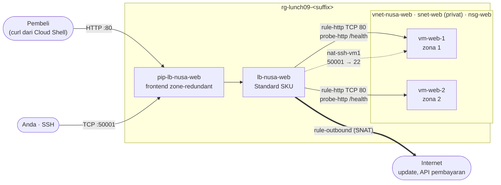

# Lab 09 · Menjaga toko tetap buka saat server gagal

🇬🇧 [Read in English](README.md)

> **Pasangan dari:** [Makan Siang 09 · Load Balancing (Dasar): Azure Load Balancer](../../lunches/09-load-balancing-basic/README.id.md)
> **Waktu:** sekitar 50 menit (termasuk sekitar 8 menit persiapan) · **Biaya:** 💲💲 (lihat [kelompok biaya](../README.id.md#kelompok-biaya)) · **Tingkat kesulitan:** ★★☆
> **Bisa dikerjakan terpisah:** ✅ Anda tidak memerlukan lab sebelumnya. Semua yang dibutuhkan lab ini dibuat oleh langkah-langkahnya atau oleh `setup.sh`.
> **Penulis:** Stefanus Pinarta · [Tentang penulis](../../README.id.md#tentang-penulis)

## 🎯 Yang akan Anda bangun

Toko online Nusantara Retail kini berjalan di dua server web kecil, satu di availability zone 1 dan satu lagi di zona 2.
Keduanya tidak punya alamat IP publik, dan keduanya berada di subnet privat tanpa akses internet default. Anda akan
memberi mereka **satu pintu depan**: Standard load balancer publik dengan IP frontend yang zone-redundant, health probe
yang memeriksa `/health`, dan sebuah rule yang membagi pembeli ke kedua server. Setelah itu Anda sengaja merusak satu
server dan menyaksikan toko tetap buka, menambahkan inbound NAT rule agar administrator tetap bisa menjangkau `vm-web-1`
lewat SSH, dan menambahkan outbound rule agar server bisa menjangkau internet untuk update dan penyedia pembayaran.



## ✅ Sebelum mulai

- Subscription (*langganan*) Azure tempat Anda bisa membuat resource (lihat [Lab 01](../01-before-you-begin/README.id.md)).
- **Azure Cloud Shell (Bash)** — buka [shell.azure.com](https://shell.azure.com). Tidak ada yang perlu diinstal.
- Sekitar **4 vCPU kuota yang masih kosong** di region Anda (dua VM `Standard_B2ats_v2`, masing-masing 2 vCPU).
  `bash ../common/check-environment.sh` menampilkannya.
- Ambil file lab dan muat pengaturan bersama:

```bash
git clone https://github.com/stefpin/azure-fundamentals-lunches.git   # first time only
cd azure-fundamentals-lunches/labs/09-load-balancing-basic
source ../common/config.sh
source lab.env          # the resource names this lab uses: RG, LB, PIP, POOL, PROBE, ...
RG=$(rg_name 09)
```

- Buat titik awalnya — butuh sekitar 6–10 menit (dua VM, lalu pemeriksaan singkat bahwa setiap server web menjawab):

```bash
bash setup.sh
```

Sambil menunggu, baca ulang bagian 3 dari makan siang ini (health probe). Skrip ini membuat `nsg-web` (mengizinkan TCP 80
dari service tag `Internet` dan `AzureLoadBalancer`), virtual network `vnet-nusa-web` dengan subnet **privat**
`snet-web`, serta `vm-web-1`/`vm-web-2` yang menjalankan server web mungil milik kursus ini (`/` menampilkan nama VM dan
zonanya, `/health` menjawab `ok`).

> [!IMPORTANT]
> Resource lab dikenai biaya selama masih ada (dua VM, sebuah load balancer, dan sebuah IP publik). Akhiri lab dengan
> bagian **Bersihkan**, bahkan jika Anda berhenti di tengah jalan. Jika Cloud Shell timeout, sambungkan kembali lalu
> jalankan ulang baris `cd` dan kedua baris `source` di atas sebelum melanjutkan.

## 🧭 Pilih mode Anda

| Mode | Cocok untuk Anda jika… | Caranya |
|---|---|---|
| **Terpandu** | Anda ingin setiap langkah dijelaskan | ikuti Tugas 1–7 di bawah |
| **Tantangan** | Anda sudah menguasai dasarnya | jalankan `bash setup.sh`, baca hanya [Ringkasan tantangan](#-ringkasan-tantangan), bangun dengan cara Anda sendiri, lalu jalankan `bash verify.sh` |

## Tugas 1 · Melihat titik awal

Sebelum menambahkan load balancer, pastikan dulu apa yang akan Anda seimbangkan: dua server di dua zona, tanpa IP
publik, dan sebuah subnet yang tidak bisa menjangkau internet dengan sendirinya.

```bash
az vm list -g "$RG" -d \
  --query "[].{name:name, zone:zones[0], privateIp:privateIps, publicIp:publicIps}" -o table

az network vnet subnet show -g "$RG" --vnet-name "$VNET" -n "$SUBNET" \
  --query "{prefix:addressPrefix, defaultOutboundAccess:defaultOutboundAccess, nsg:networkSecurityGroup.id}" -o yaml

az network nsg rule list -g "$RG" --nsg-name "$NSG" \
  --query "[].{name:name, priority:priority, source:sourceAddressPrefix, port:destinationPortRange}" -o table

# Ask vm-web-1 for its own home page (Run Command works without any public IP)
az vm run-command invoke -g "$RG" -n "$VM1" --command-id RunShellScript \
  --scripts "curl -s localhost | grep 'Served by'" --query "value[0].message" -o tsv
```

> ✅ **Pemeriksaan:** dua VM di zona `1` dan `2` dengan IP privat `10.9.1.x` dan kolom IP publik yang **kosong**;
> `defaultOutboundAccess: false`; dua aturan NSG untuk port 80; dan halaman dari `vm-web-1` bertuliskan
> *Served by vm-web-1 in availability zone 1*.

## Tugas 2 · Membuat IP frontend yang zone-redundant

Pembeli membutuhkan satu alamat yang stabil. IP publik **Standard** yang tersebar di zona 1, 2, dan 3 tetap menjawab
bahkan jika satu zona lumpuh total. (IP publik Basic sudah dipensiunkan pada 30 September 2025.)

```bash
az network public-ip create -g "$RG" -n "$PIP" -l "$LOCATION" \
  --sku Standard --allocation-method Static --zone 1 2 3 --output none

az network public-ip show -g "$RG" -n "$PIP" \
  --query "{sku:sku.name, zones:join(',', zones), address:ipAddress}" -o table
```

> ✅ **Pemeriksaan:** `Standard`, zona `1,2,3`, dan sebuah alamat IP. `lb_ip` (fungsi bantu dari `lab.env`) mencetak
> alamat yang sama.

## Tugas 3 · Membuat load balancer dan mengisi backend pool

Buat Standard load balancer yang memakai IP tadi sebagai **frontend**, dengan **backend pool** yang masih kosong. Lalu
masukkan network interface (NIC, kartu jaringan virtual) kedua server ke dalam pool. Menambahkan NIC (bukan alamat IP)
adalah jenis pool yang direkomendasikan.

```bash
az network lb create -g "$RG" -n "$LB" -l "$LOCATION" --sku Standard \
  --public-ip-address "$PIP" --frontend-ip-name "$FE" --backend-pool-name "$POOL" --output none

for nic in "$NIC1" "$NIC2"; do
  az network nic ip-config address-pool add -g "$RG" --nic-name "$nic" \
    --ip-config-name "$IPCONFIG" --lb-name "$LB" --address-pool "$POOL" --output none
done

az network lb address-pool show -g "$RG" --lb-name "$LB" -n "$POOL" \
  --query "backendIPConfigurations[].id" -o tsv
```

Sekarang coba frontend-nya: `curl -s --max-time 5 "http://$(lb_ip)/" || echo "no answer"`. Belum ada yang menjawab —
load balancer tidak meneruskan apa pun sampai sebuah **rule** memberitahunya lalu lintas mana yang harus dikirim ke mana.

> [!TIP]
> **Lebih suka portal?** *Load balancers › Create*: SKU **Standard**, Type **Public**, Tier **Regional**; di *Frontend IP
> configuration* pilih `pip-lb-nusa-web` yang sudah ada; di *Backend pools* tambahkan `vm-web-1` dan `vm-web-2`
> (configuration type **NIC**). Lewati rule untuk saat ini, review, create — lalu kembali untuk Tugas 4. Wizard di portal
> menampilkan setiap komponen dari bagian 2 makan siang ini dalam satu layar.

> ✅ **Pemeriksaan:** dua ID yang berakhiran `nic-vm-web-1/ipConfigurations/ipconfig1` dan
> `nic-vm-web-2/ipConfigurations/ipconfig1`.

## Tugas 4 · Menambahkan health probe dan load-balancing rule

**Probe** menanyakan `/health` kepada setiap anggota pool setiap 5 detik; hanya anggota yang menjawab `200 OK` yang
menerima koneksi baru. **Rule** menyatakan: lalu lintas TCP yang tiba di port frontend 80 diteruskan ke port 80 pada
anggota pool yang sehat.

```bash
az network lb probe create -g "$RG" --lb-name "$LB" -n "$PROBE" \
  --protocol Http --port 80 --path /health --interval 5 --output none

az network lb rule create -g "$RG" --lb-name "$LB" -n "$RULE" \
  --protocol Tcp --frontend-port 80 --backend-port 80 \
  --frontend-ip "$FE" --backend-pool-name "$POOL" --probe "$PROBE" \
  --disable-outbound-snat true --idle-timeout 15 --enable-tcp-reset true --output none
```

Arti flag-flag tersebut:

- `--interval 5` — probe setiap 5 detik. Default CLI adalah 15 detik; portal menyarankan 5.
- `--disable-outbound-snat true` — rule ini hanya menangani lalu lintas **masuk** (inbound). Anda memberi server akses
  keluar secara sengaja di Tugas 7, dengan sebuah outbound rule.
- `--idle-timeout 15 --enable-tcp-reset true` — koneksi yang menganggur ditutup setelah 15 menit, dan kedua ujungnya
  diberi tahu lewat TCP reset alih-alih diputus diam-diam.

Tunggu sekitar 30 detik sampai probe pertama berjalan, lalu kirim sepuluh request dan lihat siapa yang menjawab:

```bash
who_answers 10
curl -s -o /dev/null -w "HTTP %{http_code}\n" "http://$(lb_ip)/"
```

> ✅ **Pemeriksaan:** baris-baris keluarannya menyebut `vm-web-1 … zone 1` dan `vm-web-2 … zone 2` (tidak bergantian
> secara ketat — setiap koneksi baru ditempatkan berdasarkan hash), dan statusnya `HTTP 200`. Buka
> `http://<frontend IP>` di browser Anda dan refresh beberapa kali.

## Tugas 5 · Menggagalkan sebuah server dan menyaksikan toko tetap buka

Hentikan layanan web di `vm-web-2` — VM-nya tetap berjalan, tetapi tidak ada lagi yang menjawab di port 80, persis
seperti aplikasi yang crash.

```bash
az vm run-command invoke -g "$RG" -n "$VM2" --command-id RunShellScript \
  --scripts "systemctl stop nusa-web && echo stopped" --query "value[0].message" -o tsv

who_answers 10
```

Dalam beberapa detik setelah layanan berhenti, probe ke `vm-web-2` gagal dan setiap koneksi baru diarahkan ke
`vm-web-1`. Toko tetap buka; pembeli tidak perlu alamat baru. Sekarang perbaiki servernya:

```bash
az vm run-command invoke -g "$RG" -n "$VM2" --command-id RunShellScript \
  --scripts "systemctl start nusa-web && echo started" --query "value[0].message" -o tsv

who_answers 10
```

> [!TIP]
> **Lebih suka portal?** Buka `lb-nusa-web` › *Monitoring* › *Metrics*, pilih metrik **Health Probe Status**, lalu
> *Apply splitting* berdasarkan **Backend IP Address**. Hentikan dan jalankan lagi layanannya, lalu saksikan satu garis
> turun ke 0% dan pulih kembali (metrik datang dengan jeda satu atau dua menit).

> ✅ **Pemeriksaan:** selama layanan dihentikan, setiap jawaban menyebut `vm-web-1`; setelah Anda menjalankannya lagi,
> `vm-web-2` muncul kembali tanpa Anda menyentuh load balancer.

## Tugas 6 · Menjangkau satu VM dengan inbound NAT rule

Server tidak punya IP publik, tetapi administrator sesekali memerlukan SSH. **Inbound NAT rule** meneruskan satu port
frontend ke satu VM: di sini `50001` di frontend diteruskan ke port `22` di `vm-web-1`. Ini port forwarding (penerusan
port), bukan load balancing — rule ini selalu mendarat di VM yang sama.

```bash
az network lb inbound-nat-rule create -g "$RG" --lb-name "$LB" -n "$NAT_RULE" \
  --protocol Tcp --frontend-ip "$FE" --frontend-port "$NAT_PORT" --backend-port 22 --output none

az network nic ip-config inbound-nat-rule add -g "$RG" --nic-name "$NIC1" \
  --ip-config-name "$IPCONFIG" --lb-name "$LB" --inbound-nat-rule "$NAT_RULE" --output none
```

Load balancer ini secure by default, jadi NSG juga harus mengizinkan lalu lintasnya. NSG mengevaluasi paket **setelah**
penerjemahan, jadi aturannya membuka port **22** (bukan 50001) — dan hanya untuk alamat Anda sendiri:

```bash
MY_IP=$(my_public_ip); echo "Your public IP: $MY_IP"

az network nsg rule create -g "$RG" --nsg-name "$NSG" -n Allow-SSH-MyIP \
  --priority 120 --direction Inbound --access Allow --protocol Tcp \
  --source-address-prefixes "${MY_IP}/32" --source-port-ranges '*' \
  --destination-address-prefixes '*' --destination-port-ranges 22 --output none

ssh -p "$NAT_PORT" -o StrictHostKeyChecking=accept-new "${ADMIN_USER}@$(lb_ip)" 'hostname; cat /var/www/nusa/health'
```

`setup.sh` membuat VM dengan `--generate-ssh-keys`, jadi pasangan kuncinya ada di `~/.ssh` milik Cloud Shell ini.

> ✅ **Pemeriksaan:** perintah SSH mencetak `vm-web-1` dan `ok`. Jalankan tiga kali — hasilnya selalu `vm-web-1`.
> Di production, Anda sebaiknya memakai Azure Bastion (Makan Siang 06) alih-alih membuka SSH lewat frontend publik.

## Tugas 7 · Memberi backend jalan keluar dengan outbound rule

Subnet-nya privat dan load-balancing rule menonaktifkan outbound SNAT, sehingga server tidak bisa menjangkau internet —
tidak ada update, tidak ada panggilan ke penyedia pembayaran. Buktikan dulu:

```bash
az vm run-command invoke -g "$RG" -n "$VM1" --command-id RunShellScript \
  --scripts "curl -s --max-time 10 https://api.ipify.org || echo no-outbound" \
  --query "value[0].message" -o tsv
```

Anda seharusnya melihat `no-outbound`. Sekarang tambahkan **outbound rule**: server di `be-web` keluar melalui IP
frontend, dan setiap VM mendapat 10.000 SNAT port (kelipatan 8; dua VM × 10.000 muat dengan mudah di 64.000 port yang
ditawarkan satu IP publik).

```bash
az network lb outbound-rule create -g "$RG" --lb-name "$LB" -n "$OUT_RULE" \
  --frontend-ip-configs "$FE" --address-pool "$POOL" --protocol All \
  --outbound-ports 10000 --idle-timeout 15 --enable-tcp-reset true --output none
```

Jalankan lagi tes Run Command yang sama (beri waktu satu menit), lalu bandingkan jawabannya dengan `lb_ip`.

> ✅ **Pemeriksaan:** `vm-web-1` kini menjangkau `api.ipify.org`, dan alamat yang dilihat internet adalah IP frontend
> Anda. Untuk banyak VM atau lalu lintas keluar yang berat, NAT gateway pada subnet adalah pilihan yang lebih mudah
> diskalakan (Makan Siang 08).

## 🔧 Rusak lalu perbaiki

Ubah path probe ke halaman yang tidak ada (salah ketik satu huruf):

```bash
az network lb probe update -g "$RG" --lb-name "$LB" -n "$PROBE" --path /healthz --output none
sleep 20
who_answers 5
```

**Gejala:** setiap request menghasilkan `(no answer)` — padahal kedua VM berjalan dan server web-nya baik-baik saja.

<details><summary>Petunjuk</summary>

Tanyakan kepada setiap server hal yang sama dengan yang ditanyakan probe:
`az vm run-command invoke -g "$RG" -n "$VM1" --command-id RunShellScript --scripts "curl -s -o /dev/null -w '%{http_code}' localhost/healthz"`
mengembalikan `404`. Probe HTTP menganggap apa pun selain `200` sebagai "down". Jika **semua** anggota down, Standard
load balancer tidak mengirim koneksi baru ke mana pun.

</details>

<details><summary>Perbaikan</summary>

```bash
az network lb probe update -g "$RG" --lb-name "$LB" -n "$PROBE" --path /health --output none
sleep 20
who_answers 5
```

Pelajarannya: ketika semua yang ada di belakang load balancer "gagal" bersamaan, periksa probe sebelum memeriksa
server.

</details>

## 🧪 Verifikasi hasil kerja Anda

```bash
bash verify.sh
```

Setiap pemeriksaan seharusnya menampilkan **PASS**. Jika ada yang gagal, pesannya memberi tahu tugas mana yang perlu
Anda ulangi. Pemeriksaan terakhir menjalankan perintah di `vm-web-1` dan memakan waktu sekitar 30 detik.

## 🧹 Bersihkan (jangan dilewati!)

```bash
bash cleanup.sh
```

Perintah ini menghapus resource group (*grup sumber daya*) `rg-lunch09-<suffix>` beserta semua isinya (VM, disk, NIC,
load balancer, IP publik, jaringan). Tidak ada satu pun bagian lab ini yang berada di luar grup tersebut. Penghapusan
berlanjut di latar belakang selama beberapa menit.

## 🩺 Pemecahan masalah

| Gejala | Kemungkinan penyebab | Perbaikan |
|---|---|---|
| `who_answers` mencetak `(no answer)` untuk setiap request | probe gagal (path atau port salah), NSG memblokir port 80, atau belum ada rule | `az network lb probe show -g "$RG" --lb-name "$LB" -n "$PROBE" -o table`; periksa aturan `nsg-web`; pastikan `rule-http` sudah ada |
| Hanya satu VM yang pernah menjawab | VM lainnya tidak ada di pool, atau layanan web-nya berhenti | `az network lb address-pool show ... --query "backendIPConfigurations[].id"`; jalankan `systemctl start nusa-web` di VM itu dengan Run Command |
| `setup.sh` melaporkan `no answer from /health yet` | cloud-init masih berjalan pada boot pertama yang lambat | tunggu dua menit, lalu: `az vm run-command invoke -g "$RG" -n "$VM1" --command-id RunShellScript --scripts "curl -s localhost/health"` |
| `az vm create` gagal dengan `SkuNotAvailable` | ukuran VM tersebut tidak ditawarkan di zona atau region itu | `export VM_SIZE_SMALL=Standard_B2ts_v2`, jalankan lagi `source ../common/config.sh`, lalu jalankan ulang `bash setup.sh` |
| `az vm create` gagal dengan `OperationNotAllowed` yang menyebut kuota | kuota vCPU regional tidak cukup | hapus VM dari lab lain, atau gunakan region lain (`export LOCATION=...`, lalu `source ../common/config.sh` lagi) |
| Outbound rule gagal dengan `LoadBalancingRuleMustDisableSNATSinceSameFrontendIPConfigurationIsReferencedByOutboundRule` | load-balancing rule masih melakukan outbound SNAT otomatis pada frontend yang sama | `az network lb rule update -g "$RG" --lb-name "$LB" -n "$RULE" --disable-outbound-snat true` |
| `ssh: connect to host … port 50001: Connection timed out` | NSG belum mengizinkan port **22** dari IP Anda, NAT rule belum terpasang ke NIC, atau IP publik Cloud Shell berubah | jalankan ulang `MY_IP=$(my_public_ip)` dan perintah aturan NSG; periksa `az network nic show -g "$RG" -n "$NIC1" --query "ipConfigurations[0].loadBalancerInboundNatRules"` |
| `Permission denied (publickey)` | Anda tidak berada di Cloud Shell tempat `setup.sh` membuat kuncinya | `az vm user update -g "$RG" -n "$VM1" -u "$ADMIN_USER" --ssh-key-value ~/.ssh/id_rsa.pub` |
| Run Command menyatakan ada operasi lain yang sedang berjalan | hanya boleh ada satu Run Command per VM dalam satu waktu | tunggu satu menit, lalu jalankan lagi |

## 🚀 Tantangan tambahan

- **Session persistence:** `az network lb rule update -g "$RG" --lb-name "$LB" -n "$RULE" --load-distribution SourceIP`,
  lalu `who_answers 10` — kini setiap jawaban datang dari VM yang sama. Kembalikan dengan
  `--load-distribution Default`.
- **Ganti outbound rule dengan NAT gateway:** buat NAT gateway Standard dengan IP publiknya sendiri, pasang ke
  `snet-web`, lalu ulangi tes `api.ipify.org`. NAT gateway diutamakan di atas outbound rule.
- **Tambahkan load balancer internal** dengan IP frontend privat di subnet kedua, seperti yang akan Anda lakukan untuk
  tier API pesanan.
- **Lihat topologinya:** buka load balancer di portal, *Monitoring › Insights*, lalu jelajahi diagramnya.

## 🏁 Ringkasan tantangan

Jalankan `bash setup.sh`, lalu bangun hal-hal berikut dengan cara apa pun yang Anda suka (portal, CLI, Bicep), memakai
nama-nama dari `lab.env`:

1. Load balancer publik **Standard** `lb-nusa-web` yang frontend-nya memakai IP publik Standard yang **zone-redundant**.
2. Backend pool berbasis NIC `be-web` yang berisi NIC milik `vm-web-1` dan `vm-web-2`.
3. Health probe **HTTP** `probe-http` di port 80, path `/health`.
4. Load-balancing rule `rule-http`: TCP 80 → 80, memakai `probe-http`, dengan **outbound SNAT dinonaktifkan** pada rule
   tersebut.
5. Inbound NAT rule `nat-ssh-vm1`: port frontend 50001 → port 22 di `vm-web-1` (SSH hanya diizinkan dari IP Anda).
6. Outbound rule `rule-outbound` yang memberi backend pool akses internet melalui IP frontend.
7. Kedua server menjawab `http://<frontend IP>/` dengan HTTP 200.

Lalu jalankan `bash verify.sh`. Buntu? Intip `solution.sh` atau beralih ke mode Terpandu.

---

⬅️ [Bacaan Makan Siang 09](../../lunches/09-load-balancing-basic/README.id.md) · 🏠 [Semua lab](../README.id.md) · 🏠 [Beranda kursus](../../README.id.md)

<sub>Terakhir divalidasi: Oktober 2026 · Ada yang tidak berfungsi? [Laporkan masalah lab](../../CONTRIBUTING.md).</sub>
