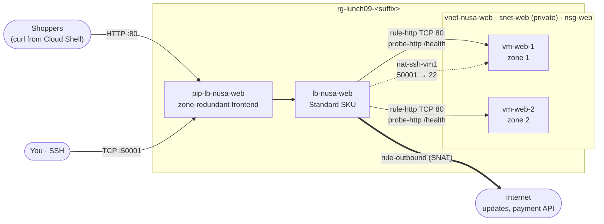

# Lab 09 · Keep the shop open when a server fails

🇮🇩 [Baca dalam Bahasa Indonesia](README.id.md)

> **Pairs with:** [Lunch 09 · Load Balancing (Basic): Azure Load Balancer](../../lunches/09-load-balancing-basic/README.md)
> **Time:** about 50 minutes (including about 8 minutes of setup) · **Cost:** 💲💲 (see [cost bands](../README.md#cost-bands)) · **Difficulty:** ★★☆
> **Works on its own:** ✅ You do not need any earlier lab. Everything this lab needs is created by its steps or by `setup.sh`.
> **Author:** Stefanus Pinarta · [About the author](../../README.md#about-the-author)

## 🎯 What you'll build

Nusantara Retail's storefront now runs on two small web servers, one in availability zone 1 and one in zone 2. Neither
has a public IP address, and they sit in a private subnet with no default internet access. You give them **one front
door**: a Standard public load balancer with a zone-redundant frontend IP, a health probe that checks `/health`, and a
rule that spreads shoppers across both servers. Then you break one server on purpose and watch the shop stay open, add
an inbound NAT rule so an administrator can still reach `vm-web-1` over SSH, and add an outbound rule so the servers
can reach the internet for updates and the payment provider.



## ✅ Before you start

- An Azure subscription where you can create resources (see [Lab 01](../01-before-you-begin/README.md)).
- **Azure Cloud Shell (Bash)** — open [shell.azure.com](https://shell.azure.com). Nothing to install.
- About **4 vCPUs of free quota** in your region (two `Standard_B2ats_v2` VMs with 2 vCPUs each). `bash ../common/check-environment.sh` shows it.
- Get the lab files and load the shared settings:

```bash
git clone https://github.com/stefpin/azure-fundamentals-lunches.git   # first time only
cd azure-fundamentals-lunches/labs/09-load-balancing-basic
source ../common/config.sh
source lab.env          # the resource names this lab uses: RG, LB, PIP, POOL, PROBE, ...
RG=$(rg_name 09)
```

- Create the starting point — takes about 6–10 minutes (two VMs, then a quick check that each web server answers):

```bash
bash setup.sh
```

While you wait, reread section 3 of the lunch (health probes). The script creates `nsg-web` (allows TCP 80 from the
`Internet` and `AzureLoadBalancer` service tags), the virtual network `vnet-nusa-web` with the **private** subnet
`snet-web`, and `vm-web-1`/`vm-web-2` running the course's tiny web server (`/` shows the VM name and zone,
`/health` answers `ok`).

> [!IMPORTANT]
> Lab resources cost money while they exist (two VMs, a load balancer and a public IP). Finish with the
> **Clean up** section, even if you stop halfway. If Cloud Shell times out, reconnect and rerun the `cd` and both
> `source` lines above before you continue.

## 🧭 Choose your mode

| Mode | For you if… | How |
|---|---|---|
| **Guided** | you want every step explained | follow Tasks 1–7 below |
| **Challenge** | you already know the basics | run `bash setup.sh`, read only the [Challenge brief](#-challenge-brief), build it your way, then run `bash verify.sh` |

## Task 1 · Look at the starting point

Before adding a load balancer, confirm what you are balancing: two servers in two zones, no public IPs, and a subnet
that cannot reach the internet on its own.

```bash
az vm list -g "$RG" -d \
  --query "[].{name:name, zone:zones[0], privateIp:privateIps, publicIp:publicIps}" -o table

az network vnet subnet show -g "$RG" --vnet-name "$VNET" -n "$SUBNET" \
  --query "{prefix:addressPrefix, defaultOutboundAccess:defaultOutboundAccess, nsg:networkSecurityGroup.id}" -o yaml

az network nsg rule list -g "$RG" --nsg-name "$NSG" \
  --query "[].{name:name, priority:priority, source:sourceAddressPrefix, port:destinationPortRange}" -o table

# Ask vm-web-1 for its own home page (Run Command works without any public IP)
az vm run-command invoke -g "$RG" -n "$VM1" --command-id RunShellScript \
  --scripts "curl -s localhost | grep 'Served by'" --query "value[0].message" -o tsv
```

> ✅ **Checkpoint:** two VMs in zones `1` and `2` with private IPs `10.9.1.x` and an **empty** public IP column;
> `defaultOutboundAccess: false`; two NSG rules for port 80; and the page from `vm-web-1` says
> *Served by vm-web-1 in availability zone 1*.

## Task 2 · Create a zone-redundant frontend IP

Shoppers need one stable address. A **Standard** public IP spread across zones 1, 2 and 3 keeps answering even if a
whole zone fails. (Basic public IPs were retired on September 30, 2025.)

```bash
az network public-ip create -g "$RG" -n "$PIP" -l "$LOCATION" \
  --sku Standard --allocation-method Static --zone 1 2 3 --output none

az network public-ip show -g "$RG" -n "$PIP" \
  --query "{sku:sku.name, zones:join(',', zones), address:ipAddress}" -o table
```

> ✅ **Checkpoint:** `Standard`, zones `1,2,3`, and an IP address. `lb_ip` (a helper from `lab.env`) prints the same address.

## Task 3 · Create the load balancer and fill the backend pool

Create a Standard load balancer that uses the IP as its **frontend**, with an empty **backend pool**. Then put both
servers' network interfaces into the pool. Adding NICs (rather than IP addresses) is the recommended pool type.

```bash
az network lb create -g "$RG" -n "$LB" -l "$LOCATION" --sku Standard \
  --public-ip-address "$PIP" --frontend-ip-name "$FE" --backend-pool-name "$POOL" --output none

for nic in "$NIC1" "$NIC2"; do
  az network nic ip-config address-pool add -g "$RG" --nic-name "$nic" \
    --ip-config-name "$IPCONFIG" --lb-name "$LB" --address-pool "$POOL" --output none
done

az network lb address-pool show -g "$RG" --lb-name "$LB" -n "$POOL" \
  --query "backendIPConfigurations[].id" -o tsv
```

Now try the frontend: `curl -s --max-time 5 "http://$(lb_ip)/" || echo "no answer"`. Nothing answers yet — a load
balancer forwards nothing until a **rule** tells it which traffic to send where.

> [!TIP]
> **Prefer the portal?** *Load balancers › Create*: SKU **Standard**, Type **Public**, Tier **Regional**; on
> *Frontend IP configuration* choose the existing `pip-lb-nusa-web`; on *Backend pools* add `vm-web-1` and `vm-web-2`
> (configuration type **NIC**). Skip rules for now, review, create — then come back for Task 4. The portal wizard shows
> every component of section 2 of the lunch on one screen.

> ✅ **Checkpoint:** two IDs ending in `nic-vm-web-1/ipConfigurations/ipconfig1` and `nic-vm-web-2/ipConfigurations/ipconfig1`.

## Task 4 · Add a health probe and a load-balancing rule

The **probe** asks every pool member for `/health` every 5 seconds; only members that answer `200 OK` receive new
connections. The **rule** says: TCP traffic arriving on frontend port 80 goes to port 80 on healthy pool members.

```bash
az network lb probe create -g "$RG" --lb-name "$LB" -n "$PROBE" \
  --protocol Http --port 80 --path /health --interval 5 --output none

az network lb rule create -g "$RG" --lb-name "$LB" -n "$RULE" \
  --protocol Tcp --frontend-port 80 --backend-port 80 \
  --frontend-ip "$FE" --backend-pool-name "$POOL" --probe "$PROBE" \
  --disable-outbound-snat true --idle-timeout 15 --enable-tcp-reset true --output none
```

What the flags mean:

- `--interval 5` — probe every 5 seconds. The CLI default is 15 seconds; the portal suggests 5.
- `--disable-outbound-snat true` — this rule handles **inbound** traffic only. You give the servers outbound access
  deliberately in Task 7, with an outbound rule.
- `--idle-timeout 15 --enable-tcp-reset true` — idle connections are closed after 15 minutes, and both ends are told
  with a TCP reset instead of being silently dropped.

Wait about 30 seconds for the first probes, then send ten requests and see who answers:

```bash
who_answers 10
curl -s -o /dev/null -w "HTTP %{http_code}\n" "http://$(lb_ip)/"
```

> ✅ **Checkpoint:** the lines mention both `vm-web-1 … zone 1` and `vm-web-2 … zone 2` (not strictly alternating —
> each new connection is placed by a hash), and the status is `HTTP 200`. Open `http://<frontend IP>` in your browser
> and refresh a few times.

## Task 5 · Fail a server and watch the shop stay open

Stop the web service on `vm-web-2` — the VM keeps running, but nothing answers on port 80 any more, just like a
crashed application.

```bash
az vm run-command invoke -g "$RG" -n "$VM2" --command-id RunShellScript \
  --scripts "systemctl stop nusa-web && echo stopped" --query "value[0].message" -o tsv

who_answers 10
```

Within a few seconds of the service stopping, the probe to `vm-web-2` fails and every new connection goes to
`vm-web-1`. The shop stays open; shoppers do not need a new address. Now repair the server:

```bash
az vm run-command invoke -g "$RG" -n "$VM2" --command-id RunShellScript \
  --scripts "systemctl start nusa-web && echo started" --query "value[0].message" -o tsv

who_answers 10
```

> [!TIP]
> **Prefer the portal?** Open `lb-nusa-web` › *Monitoring* › *Metrics*, choose the metric **Health Probe Status** and
> *Apply splitting* by **Backend IP Address**. Stop and start the service again and watch one line drop to 0 % and
> recover (metrics arrive with a delay of a minute or two).

> ✅ **Checkpoint:** while the service is stopped, every answer says `vm-web-1`; after you start it again, `vm-web-2`
> reappears without you touching the load balancer.

## Task 6 · Reach one VM with an inbound NAT rule

The servers have no public IPs, but an administrator sometimes needs SSH. An **inbound NAT rule** forwards one
frontend port to one VM: here `50001` on the frontend goes to port `22` on `vm-web-1`. It is port forwarding, not
load balancing — it always lands on the same VM.

```bash
az network lb inbound-nat-rule create -g "$RG" --lb-name "$LB" -n "$NAT_RULE" \
  --protocol Tcp --frontend-ip "$FE" --frontend-port "$NAT_PORT" --backend-port 22 --output none

az network nic ip-config inbound-nat-rule add -g "$RG" --nic-name "$NIC1" \
  --ip-config-name "$IPCONFIG" --lb-name "$LB" --inbound-nat-rule "$NAT_RULE" --output none
```

The load balancer is secure by default, so the NSG must also allow the traffic. The NSG evaluates the packet **after**
translation, so the rule opens port **22** (not 50001) — and only for your own address:

```bash
MY_IP=$(my_public_ip); echo "Your public IP: $MY_IP"

az network nsg rule create -g "$RG" --nsg-name "$NSG" -n Allow-SSH-MyIP \
  --priority 120 --direction Inbound --access Allow --protocol Tcp \
  --source-address-prefixes "${MY_IP}/32" --source-port-ranges '*' \
  --destination-address-prefixes '*' --destination-port-ranges 22 --output none

ssh -p "$NAT_PORT" -o StrictHostKeyChecking=accept-new "${ADMIN_USER}@$(lb_ip)" 'hostname; cat /var/www/nusa/health'
```

`setup.sh` created the VMs with `--generate-ssh-keys`, so the key pair is in `~/.ssh` of this Cloud Shell.

> ✅ **Checkpoint:** the SSH command prints `vm-web-1` and `ok`. Run it three times — it is always `vm-web-1`.
> In production you would prefer Azure Bastion (Lunch 06) over opening SSH through a public frontend.

## Task 7 · Give the backends a way out with an outbound rule

The subnet is private and the load-balancing rule has outbound SNAT disabled, so the servers cannot reach the
internet — no updates, no calls to the payment provider. Prove it first:

```bash
az vm run-command invoke -g "$RG" -n "$VM1" --command-id RunShellScript \
  --scripts "curl -s --max-time 10 https://api.ipify.org || echo no-outbound" \
  --query "value[0].message" -o tsv
```

You should see `no-outbound`. Now add an **outbound rule**: the servers in `be-web` leave through the frontend IP,
and each VM gets 10,000 SNAT ports (a multiple of 8; two VMs × 10,000 fits easily in the 64,000 ports one public IP
offers).

```bash
az network lb outbound-rule create -g "$RG" --lb-name "$LB" -n "$OUT_RULE" \
  --frontend-ip-configs "$FE" --address-pool "$POOL" --protocol All \
  --outbound-ports 10000 --idle-timeout 15 --enable-tcp-reset true --output none
```

Run the same Run Command test again (give it a minute), and compare the answer with `lb_ip`.

> ✅ **Checkpoint:** `vm-web-1` now reaches `api.ipify.org`, and the address the internet sees is your frontend IP.
> For many VMs or heavy outbound traffic, a NAT gateway on the subnet is the more scalable choice (Lunch 08).

## 🔧 Break it and fix it

Change the probe path to a page that does not exist (a one-letter typo):

```bash
az network lb probe update -g "$RG" --lb-name "$LB" -n "$PROBE" --path /healthz --output none
sleep 20
who_answers 5
```

**Symptom:** every request says `(no answer)` — yet both VMs are running and their web servers are fine.

<details><summary>Hint</summary>

Ask each server what the probe asks for:
`az vm run-command invoke -g "$RG" -n "$VM1" --command-id RunShellScript --scripts "curl -s -o /dev/null -w '%{http_code}' localhost/healthz"`
returns `404`. An HTTP probe treats anything except `200` as "down". With **all** members down, a Standard load
balancer sends no new connections anywhere.

</details>

<details><summary>Fix</summary>

```bash
az network lb probe update -g "$RG" --lb-name "$LB" -n "$PROBE" --path /health --output none
sleep 20
who_answers 5
```

Lesson: when everything behind a load balancer "fails" at once, check the probe before you check the servers.

</details>

## 🧪 Verify your work

```bash
bash verify.sh
```

Every check should say **PASS**. If one fails, the message tells you which task to revisit. The last check runs a
command on `vm-web-1` and takes about 30 seconds.

## 🧹 Clean up (do not skip!)

```bash
bash cleanup.sh
```

This deletes the resource group `rg-lunch09-<suffix>` with everything inside it (VMs, disks, NICs, load balancer, public
IP, network). Nothing in this lab lives outside the group. Deletion continues in the background for a few minutes.

## 🩺 Troubleshooting

| Symptom | Likely cause | Fix |
|---|---|---|
| `who_answers` prints `(no answer)` for every request | probe failing (wrong path or port), NSG blocking port 80, or no rule yet | `az network lb probe show -g "$RG" --lb-name "$LB" -n "$PROBE" -o table`; check `nsg-web` rules; confirm `rule-http` exists |
| Only one VM ever answers | the other VM is not in the pool, or its web service is stopped | `az network lb address-pool show ... --query "backendIPConfigurations[].id"`; run `systemctl start nusa-web` on it with Run Command |
| `setup.sh` reports `no answer from /health yet` | cloud-init is still running on a slow first boot | wait two minutes, then: `az vm run-command invoke -g "$RG" -n "$VM1" --command-id RunShellScript --scripts "curl -s localhost/health"` |
| `az vm create` fails with `SkuNotAvailable` | the VM size is not offered in that zone or region | `export VM_SIZE_SMALL=Standard_B2ts_v2`, run `source ../common/config.sh` again, rerun `bash setup.sh` |
| `az vm create` fails with `OperationNotAllowed` mentioning quota | not enough regional vCPU quota | delete VMs from other labs, or use another region (`export LOCATION=...`, then `source ../common/config.sh` again) |
| Outbound rule fails with `LoadBalancingRuleMustDisableSNATSinceSameFrontendIPConfigurationIsReferencedByOutboundRule` | the load-balancing rule still does automatic outbound SNAT on the same frontend | `az network lb rule update -g "$RG" --lb-name "$LB" -n "$RULE" --disable-outbound-snat true` |
| `ssh: connect to host … port 50001: Connection timed out` | NSG has no allow for port **22** from your IP, NAT rule not attached to the NIC, or Cloud Shell's public IP changed | rerun `MY_IP=$(my_public_ip)` and the NSG rule command; check `az network nic show -g "$RG" -n "$NIC1" --query "ipConfigurations[0].loadBalancerInboundNatRules"` |
| `Permission denied (publickey)` | you are not in the Cloud Shell where `setup.sh` generated the key | `az vm user update -g "$RG" -n "$VM1" -u "$ADMIN_USER" --ssh-key-value ~/.ssh/id_rsa.pub` |
| Run Command says another operation is in progress | one Run Command at a time per VM | wait a minute and run it again |

## 🚀 Stretch goals

- **Session persistence:** `az network lb rule update -g "$RG" --lb-name "$LB" -n "$RULE" --load-distribution SourceIP`,
  then `who_answers 10` — every answer now comes from the same VM. Switch back with `--load-distribution Default`.
- **Swap the outbound rule for a NAT gateway:** create a Standard NAT gateway with its own public IP, attach it to
  `snet-web`, and repeat the `api.ipify.org` test. A NAT gateway takes precedence over outbound rules.
- **Add an internal load balancer** with a private frontend IP in a second subnet, as you would for an order API tier.
- **Look at the topology:** open the load balancer in the portal, *Monitoring › Insights*, and explore the diagram.

## 🏁 Challenge brief

Run `bash setup.sh`, then build the following, any way you like (portal, CLI, Bicep), using the names from `lab.env`:

1. A **Standard** public load balancer `lb-nusa-web` whose frontend uses a **zone-redundant** Standard public IP.
2. A NIC-based backend pool `be-web` that contains the NICs of `vm-web-1` and `vm-web-2`.
3. An **HTTP** health probe `probe-http` on port 80, path `/health`.
4. A load-balancing rule `rule-http`: TCP 80 → 80, using `probe-http`, with **outbound SNAT disabled** on the rule.
5. An inbound NAT rule `nat-ssh-vm1`: frontend port 50001 → port 22 on `vm-web-1` (SSH allowed only from your IP).
6. An outbound rule `rule-outbound` that gives the backend pool internet access through the frontend IP.
7. Both servers answer `http://<frontend IP>/` with HTTP 200.

Then run `bash verify.sh`. Stuck? Peek at `solution.sh` or switch to Guided mode.

---

⬅️ [Lunch 09 reading](../../lunches/09-load-balancing-basic/README.md) · 🏠 [All labs](../README.md) · 🏠 [Course home](../../README.md)

<sub>Last validated: October 2026 · Something broken? [Report a lab problem](../../CONTRIBUTING.md).</sub>
