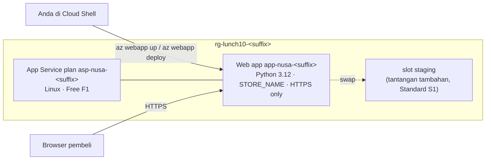

# Lab 10 · Memindahkan toko online ke PaaS

🇬🇧 [Read in English](README.md)

> **Pasangan dari:** [Makan Siang 10 · Aplikasi Web dengan Azure App Service](../../lunches/10-app-service/README.id.md)
> **Waktu:** sekitar 45 menit (+15 menit untuk tantangan tambahan slot yang opsional) · **Biaya:** 💲 di tier Free · 💲💲 untuk tantangan tambahan slot (lihat [kelompok biaya](../README.id.md#kelompok-biaya)) · **Tingkat kesulitan:** ★☆☆
> **Bisa dikerjakan terpisah:** ✅ Anda tidak memerlukan lab sebelumnya. Semua yang dibutuhkan lab ini dibuat oleh langkah-langkahnya.
> **Penulis:** Stefanus Pinarta · [Tentang penulis](../../README.id.md#tentang-penulis)

## 🎯 Yang akan Anda bangun

Toko online Nusantara Retail pindah dari virtual machine ke **Azure App Service**. Anda men-deploy toko online Python
(Flask) yang sudah disediakan ke App Service plan Linux pada tier **Free (F1)**, mengonfigurasi nama toko sebagai **app
setting**, memaksa **HTTPS**, dan menyaksikan **log stream** aplikasi. Setelah itu Anda sengaja merusak konfigurasinya,
membaca log untuk mencari tahu penyebabnya, lalu memperbaikinya. Di tantangan tambahan yang opsional, Anda menaikkan
plan ke **Standard (S1)**, men-deploy versi 2 ke **slot staging**, lalu melakukan **swap** ke production tanpa downtime.



## ✅ Sebelum mulai

- Subscription (*langganan*) Azure tempat Anda bisa membuat resource (lihat [Lab 01](../01-before-you-begin/README.id.md)).
- **Azure Cloud Shell (Bash)** — buka [shell.azure.com](https://shell.azure.com). Tidak ada yang perlu diinstal.
- Ambil file lab, lalu muat pengaturan bersama dan nama-nama yang dipakai lab ini:

```bash
git clone https://github.com/stefpin/azure-fundamentals-lunches.git   # first time only
cd azure-fundamentals-lunches/labs/10-app-service
source ../common/config.sh
source lab.env
echo "Group: $RG   Plan: $PLAN   App: $APP   Runtime: $RUNTIME"
```

> [!IMPORTANT]
> Tier Free tidak dikenai biaya, tetapi tantangan tambahan memakai plan Standard yang ditagih per jam selama masih ada.
> Akhiri lab dengan bagian **Bersihkan**, bahkan jika Anda berhenti di tengah jalan. Membuka sesi Cloud Shell baru?
> Jalankan lagi tiga baris yang diawali `cd`, `source`, dan `source` agar variabelnya kembali.

## 🧭 Pilih mode Anda

| Mode | Cocok untuk Anda jika… | Caranya |
|---|---|---|
| **Terpandu** | Anda ingin setiap langkah dijelaskan | ikuti Tugas 1–6 di bawah |
| **Tantangan** | Anda sudah menguasai dasarnya | baca hanya [Ringkasan tantangan](#-ringkasan-tantangan), bangun dengan cara Anda sendiri, lalu jalankan `bash verify.sh` |

## Tugas 1 · Mengenal aplikasinya dan membuat resource group

Sebelum menyerahkan kode ke sebuah platform, pahami dulu apa yang diharapkan kode itu. Toko online ini membutuhkan satu
setting, `STORE_NAME`, dan menampilkan instance serta host name mana yang melayani setiap request.

```bash
ensure_rg "$RG" 10
sed -n '1,14p' app/app.py          # the docstring explains the settings the app reads
cat app/requirements.txt           # Flask and Gunicorn: App Service installs these for you
az webapp list-runtimes --os-type linux --output table | grep -i python
```

Perintah terakhir menampilkan daftar versi Python yang ditawarkan App Service di Linux. Anda seharusnya melihat
`PYTHON:3.12` di antaranya. Jika Azure CLI yang lebih baru menampilkan tata letak yang berbeda, tetap cari baris 3.12.
Jika 3.12 sudah tidak ada, pilih versi yang tercantum, jalankan `export LAB10_RUNTIME="PYTHON:3.13"` (sebagai contoh),
lalu `source lab.env` lagi.

> ✅ **Pemeriksaan:** resource group (*grup sumber daya*) sudah ada dan membawa tag lab:
> `az group show --name "$RG" --query "{name:name, location:location, lunch:tags.lunch}" --output table`

## Tugas 2 · Deploy dengan satu perintah

`az webapp up` adalah jalan tersingkat dari sebuah folder berisi kode menuju web app yang berjalan. Perintah ini membuat
plan dan aplikasinya, mengaktifkan build automation, men-zip folder saat ini, lalu men-deploy-nya. Perintah ini harus
dijalankan **dari folder yang berisi kode**. Perkirakan 3–6 menit, sebagian besar dipakai App Service untuk menginstal
Flask dan Gunicorn.

```bash
cd app
az webapp up \
  --name "$APP" \
  --resource-group "$RG" \
  --plan "$PLAN" \
  --location "$LOCATION" \
  --runtime "$RUNTIME" \
  --sku F1
cd ..
```

Sambil menunggu, pahami apa yang sedang dikerjakannya: membuat plan `asp-nusa-<suffix>` pada tier Free (selalu Linux
untuk aplikasi Python, jadi tidak ada sistem operasi yang perlu dipilih), membuat web app dengan stack Python,
mengaktifkan setting build `SCM_DO_BUILD_DURING_DEPLOYMENT`, mengunggah zip dari folder tersebut, lalu mencetak
ringkasan. Di sisi server, sistem build (Oryx) membuat virtual environment dan menginstal isi `requirements.txt`; lalu
App Service menemukan `app.py` dan menjalankannya dengan Gunicorn. `az webapp up` juga menyimpan pilihan Anda di
`app/.azure/config`, sehingga menjalankannya untuk kedua kali di folder yang sama tidak memerlukan parameter.

> [!NOTE]
> Azure CLI 2.87 (Juni 2026) secara resmi menandai `az webapp up` sebagai **deprecated** (usang). Perintah ini masih
> berfungsi dan mencetak peringatan berwarna kuning. Skrip sebaiknya memakai perintah-perintah eksplisit di bawah ini,
> seperti yang dilakukan `solution.sh`. Jika CLI Anda sudah tidak memiliki `az webapp up`, gunakan perintah berikut
> sebagai gantinya:
>
> ```bash
> az appservice plan create -g "$RG" -n "$PLAN" --location "$LOCATION" --is-linux --sku F1 --output none
> az webapp create -g "$RG" -n "$APP" --plan "$PLAN" --runtime "$RUNTIME" --output none
> az webapp config appsettings set -g "$RG" -n "$APP" --settings SCM_DO_BUILD_DURING_DEPLOYMENT=true --output none
> mkdir -p "$OUT_DIR"
> (cd app && python3 -m zipfile -c "$OUT_DIR/storefront-v1.zip" app.py requirements.txt)
> az webapp deploy -g "$RG" -n "$APP" --src-path "$OUT_DIR/storefront-v1.zip" --type zip
> ```

Sekarang baca host name aplikasi dari Azure (aplikasi baru bisa mendapat host name yang lebih panjang dan unik, jadi
jangan ditebak) dan panggil endpoint health:

```bash
HOST=$(az webapp show -g "$RG" -n "$APP" --query defaultHostName --output tsv)
echo "https://$HOST"
curl -s "https://$HOST/health"; echo
```

Jangan buka halaman utamanya dulu: halaman itu membutuhkan setting yang baru akan Anda tambahkan di Tugas 3. (Kalau Anda
penasaran dan tetap membukanya, Anda akan mendapat halaman error yang sopan. Itu memang disengaja; Anda akan tahu
alasannya di *Rusak lalu perbaiki*.)

> [!TIP]
> **Lebih suka portal?** *Create a resource › Web App*: Publish **Code**, Runtime stack **Python 3.12**, Operating
> System **Linux**, region Anda, Pricing plan **Free F1** › *Review + create*. Lalu deploy kodenya dengan perintah
> `az webapp deploy` eksplisit dari catatan di atas, dan lanjutkan ke Tugas 3.

> ✅ **Pemeriksaan:** `curl` mencetak `ok`, dan
> `az webapp show -g "$RG" -n "$APP" --query "{state:state, host:defaultHostName}" --output table` menampilkan `Running`.

## Tugas 3 · Mengonfigurasi toko dengan app setting

App settings adalah pasangan nama–nilai yang diteruskan App Service ke kode Anda sebagai **environment variable**
(variabel lingkungan). Dengan begitu, kode yang sama bisa berjalan sebagai toko Kemang di production dan sebagai toko
uji coba di staging, tanpa perubahan kode. Mengubah sebuah setting akan me-restart aplikasi, jadi beri waktu sekitar 30
detik.

```bash
az webapp config appsettings set -g "$RG" -n "$APP" --settings "STORE_NAME=${STORE}" --output none
az webapp config appsettings list -g "$RG" -n "$APP" --query "[].name" --output tsv
```

Anda seharusnya melihat `STORE_NAME` dan `SCM_DO_BUILD_DURING_DEPLOYMENT`. Sekarang buka `https://$HOST` di browser
Anda: halamannya menampilkan nama toko, **Version 1.0**, instance yang melayani Anda, dan host name-nya.

> [!TIP]
> **Lebih suka portal?** Buka web app › *Settings › Environment variables › App settings* › **+ Add**, masukkan
> `STORE_NAME`, pilih **Apply**, lalu **Confirm** untuk restart. Siapa pun yang bisa membaca konfigurasi aplikasi bisa
> membaca nilai-nilai ini, jadi jangan pernah menaruh password di sini: Makan Siang 15 mengganti secret dengan Key Vault
> reference.

> ✅ **Pemeriksaan:** `curl -s "https://$HOST/" | grep -o "$STORE"` mencetak `Nusantara Retail - Kemang`.

## Tugas 4 · Memaksa HTTPS

App Service mengakhiri TLS di front end-nya, dan setiap aplikasi mendapat sertifikat untuk nama `azurewebsites.net`-nya.
HTTP biasa masih berfungsi sampai Anda mengaktifkan **HTTPS Only**, yang mengalihkan setiap request `http://` ke
`https://`.

```bash
curl -s -o /dev/null -w "%{http_code}\n" "http://$HOST/"                       # probably 200: plain HTTP is allowed
az webapp update -g "$RG" -n "$APP" --https-only true --output none
curl -s -o /dev/null -w "%{http_code} -> %{redirect_url}\n" "http://$HOST/"    # now a 301 redirect to https://
az webapp config show -g "$RG" -n "$APP" --query minTlsVersion --output tsv    # 1.2 or higher
```

> [!TIP]
> **Lebih suka portal?** *Settings › Configuration › General settings*: ubah **HTTPS Only** menjadi *On* dan periksa
> **Minimum inbound TLS Version**.

> ✅ **Pemeriksaan:** `az webapp show -g "$RG" -n "$APP" --query httpsOnly --output tsv` mencetak `true`, dan `curl`
> yang kedua menampilkan `301 -> https://...`.

## Tugas 5 · Menyaksikan log stream

Ketika terjadi masalah di production, tempat pertama yang perlu dilihat adalah apa yang ditulis oleh aplikasi itu
sendiri. App Service mengumpulkan keluaran konsol container; **log stream** menampilkannya secara langsung.

```bash
az webapp log config -g "$RG" -n "$APP" --docker-container-logging filesystem --output none
az webapp log tail -g "$RG" -n "$APP"
```

Biarkan tetap berjalan, lalu refresh toko online di browser Anda beberapa kali. Dalam sekitar 30 detik, Anda akan
melihat baris seperti `INFO [storefront] Served the home page for Nusantara Retail - Kemang (version 1.0, instance ...)`,
bercampur dengan pesan platform tentang container. Tekan **Ctrl+C** untuk menghentikan streaming.

> [!TIP]
> **Lebih suka portal?** *Monitoring › Log stream* menampilkan keluaran yang sama. *Diagnose and solve problems* adalah
> persinggahan berikutnya jika log saja tidak cukup.

> ✅ **Pemeriksaan:** setidaknya satu baris `[storefront] Served the home page` muncul di stream.

## Tugas 6 · Melihat apa yang Anda bayar

Aplikasi Anda berjalan di plan, dan plan itulah yang Anda bayar. Mari kita lihat.

```bash
az appservice plan show -g "$RG" -n "$PLAN" \
  --query "{tier:sku.tier, size:sku.name, instances:sku.capacity, linux:reserved}" --output table
az webapp list-instances -g "$RG" -n "$APP" --query "[].name" --output tsv
```

Tier Free menjalankan aplikasi Anda di infrastruktur **bersama** (shared) dengan kuota CPU harian 60 menit, satu
instance, tanpa custom domain, tanpa deployment slot, tanpa autoscale, dan tanpa SLA. Sempurna untuk belajar, tetapi
tidak berguna untuk promo 12.12. Di portal, buka halaman *Scale up (App Service plan)* milik plan untuk membandingkan
apa yang ditambahkan setiap tier, tanpa mengubah apa pun.

> ✅ **Pemeriksaan:** tabel menampilkan tier `Free`, ukuran `F1`, satu instance, dan `linux` = `True`.

## 🔧 Rusak lalu perbaiki

Seseorang "merapikan" konfigurasi dan menghapus setting yang tidak dikenalinya. Lakukan sendiri:

```bash
az webapp config appsettings delete -g "$RG" -n "$APP" --setting-names STORE_NAME --output none
sleep 45                                                     # the app restarts after a settings change
curl -s -o /dev/null -w "%{http_code}\n" "https://$HOST/"
```

**Gejala:** halaman menjawab **500**, dan browser menampilkan *"Sorry, the shop is having a moment."* (Maaf, toko
sedang ada kendala.) Halaman itu sengaja tidak memberi pelanggan detail apa pun. Cari penyebabnya seperti seorang
engineer: jalankan log stream dengan `az webapp log tail -g "$RG" -n "$APP"`, refresh halaman, lalu baca baris `ERROR`.

<details><summary>Petunjuk dan perbaikan</summary>

Log-nya menyatakan `Required app setting STORE_NAME is missing`. Kembalikan setting itu dan tunggu restart-nya:

```bash
az webapp config appsettings set -g "$RG" -n "$APP" --settings "STORE_NAME=${STORE}" --output none
sleep 30 && curl -s -o /dev/null -w "%{http_code}\n" "https://$HOST/"     # 200 again
```

Dua pelajaran: buat halaman error tetap umum bagi pelanggan tetapi spesifik di log Anda, dan perlakukan konfigurasi
sebagai bagian dari rilis (di Makan Siang 20, konfigurasi menjadi kode). Di production Anda juga akan memasang alert
(*pemberitahuan*) untuk kenaikan respons HTTP 5xx (Makan Siang 16).

</details>

## 🧪 Verifikasi hasil kerja Anda

```bash
bash verify.sh
```

Setiap pemeriksaan seharusnya menampilkan **PASS**. Jika ada yang gagal, pesannya memberi tahu tugas mana yang perlu
Anda ulangi. Slot dari tantangan tambahan dilaporkan sebagai catatan, sehingga lab inti tetap lulus tanpanya.

## 🧹 Bersihkan (jangan dilewati!)

```bash
bash cleanup.sh
```

Perintah ini menghapus resource group `rg-lunch10-<suffix>` (plan, web app, dan slot mana pun) serta menghapus file
lokal di `~/lab10-out` dan `app/.azure`. Tidak ada apa pun yang dibuat di luar resource group. Penghapusan berlanjut di
latar belakang selama beberapa menit.

## 🩺 Pemecahan masalah

| Gejala | Kemungkinan penyebab | Perbaikan |
|---|---|---|
| Peringatan kuning bahwa `az webapp up` sudah deprecated | Azure CLI 2.87 dan yang lebih baru menandai perintah ini sebagai deprecated | Memang begitu. Perintahnya tetap berfungsi; atau gunakan perintah eksplisit di catatan Tugas 2 |
| `Website with given name app-nusa-… already exists.` | Nama web app bersifat global, dan nama Anda sudah dipakai | `export LAB10_APP="app-nusa-${SUFFIX}2"`, lalu `source lab.env` dan ulangi Tugas 2 |
| `This region has quota of 0 instances for your subscription. Try selecting different region or SKU.` | Sebagian subscription trial dan pelajar tidak punya kuota App Service di suatu region | Jalankan `cleanup.sh`, `export LOCATION=eastasia` (atau region lain), source kedua file lagi, lalu mulai ulang lab |
| Browser menampilkan halaman Python default milik App Service, bukan toko online | Kode belum ter-deploy, atau App Service tidak menemukan `app.py` | Jalankan lagi Tugas 2 dari dalam folder `app`; pastikan `app.py` dan `requirements.txt` berada di root zip |
| Halaman `:( Application Error` | Container gagal dijalankan | Jalankan `az webapp log tail` dan cari traceback Python; *Diagnose and solve problems* juga membantu |
| *"Sorry, the shop is having a moment."* (HTTP 500) | `STORE_NAME` hilang atau kosong | Jalankan lagi perintah dari Tugas 3 |
| `Error 403 - This web app is stopped.` | Aplikasi dihentikan, atau tier Free sudah menghabiskan jatah 60 menit CPU hari itu | `az webapp start -g "$RG" -n "$APP"`, atau tunggu sampai kuota hariannya di-reset |
| `az webapp log tail` tidak menampilkan apa-apa | Logging mati, atau belum ada yang mengunjungi situsnya | Jalankan perintah `az webapp log config`, tunggu 30 detik, lalu refresh halaman |
| Pembuatan slot `staging` gagal | Deployment slot membutuhkan tier Standard atau lebih tinggi | Naikkan plan ke S1 terlebih dahulu (langkah 1 tantangan tambahan) |
| `curl: (6) Could not resolve host` | `$HOST` kosong, biasanya di sesi Cloud Shell yang baru | Source kedua file lagi dan jalankan ulang baris `HOST=$(...)` dari Tugas 2 |

## 🚀 Tantangan tambahan

**Rilis tanpa downtime dengan slot staging** (💲💲, sekitar 15 menit). Deployment slot dimulai dari tier Standard, jadi
Anda membayar sebuah instance S1 selama masih ada.

1. Naikkan plan (scale up) dan buat slot-nya, dengan menyalin setting production. HTTPS Only melekat pada setiap slot
   dan tidak pernah ikut berpindah saat swap, jadi aktifkan juga di slot:

   ```bash
   az appservice plan update -g "$RG" -n "$PLAN" --sku S1 --output none
   az webapp deployment slot create -g "$RG" -n "$APP" --slot staging --configuration-source "$APP" --output none
   az webapp update -g "$RG" -n "$APP" --slot staging --https-only true --output none
   az webapp config appsettings set -g "$RG" -n "$APP" --slot staging --settings SCM_DO_BUILD_DURING_DEPLOYMENT=true --output none
   ```

2. Build versi 2.0 dari salinan kode, lalu deploy hanya ke slot:

   ```bash
   rm -rf "$OUT_DIR/v2" && mkdir -p "$OUT_DIR/v2" && cp app/app.py app/requirements.txt "$OUT_DIR/v2/"
   sed -i 's/^APP_VERSION = "1.0"/APP_VERSION = "2.0"/' "$OUT_DIR/v2/app.py"
   (cd "$OUT_DIR/v2" && python3 -m zipfile -c "$OUT_DIR/storefront-v2.zip" app.py requirements.txt)
   az webapp deploy -g "$RG" -n "$APP" --slot staging --src-path "$OUT_DIR/storefront-v2.zip" --type zip
   ```

3. Uji slot di host name-nya sendiri. Production masih menampilkan Version 1.0:

   ```bash
   STAGING_HOST=$(az webapp show -g "$RG" -n "$APP" --slot staging --query defaultHostName --output tsv)
   curl -s "https://$STAGING_HOST/" | grep -o "Version [0-9.]*"
   curl -s "https://$HOST/" | grep -o "Version [0-9.]*"
   ```

4. Lakukan swap. Untuk melihat bahwa tidak ada request yang gagal, buka sesi Cloud Shell kedua (tombol *Open new
   session*) dan jalankan poller (skrip yang terus memanggil halaman) di sana terlebih dahulu:

   ```bash
   cd ~/azure-fundamentals-lunches/labs/10-app-service && source ../common/config.sh && source lab.env
   HOST=$(az webapp show -g "$RG" -n "$APP" --query defaultHostName --output tsv)
   for i in $(seq 1 60); do curl -s -o /dev/null -w "%{http_code} " "https://$HOST/"; sleep 2; done
   ```

   Lalu, di sesi pertama:

   ```bash
   az webapp deployment slot swap -g "$RG" -n "$APP" --slot staging --target-slot production
   curl -s "https://$HOST/" | grep -o "Version [0-9.]*"      # Version 2.0
   ```

5. Lakukan rollback dengan menjalankan swap yang sama sekali lagi: Version 1.0 kembali setelah warm-up singkat, tanpa
   deploy ulang.

**Ide lainnya**

- Di S1, lakukan scale out ke dua instance dengan `az appservice plan update -g "$RG" -n "$PLAN" --number-of-workers 2`,
  lalu jalankan `curl -s "https://$HOST/" | grep -o 'instance</dt><dd>[^<]*'` beberapa kali. Request tanpa cookie sesi
  bisa mendarat di instance mana pun.
- Beri App Service sebuah path health check agar ia bisa mengeluarkan instance yang sakit dari giliran:
  `az webapp config set -g "$RG" -n "$APP" --generic-configurations '{"healthCheckPath": "/health"}'`.
- Fork repositori ini dan hubungkan *Deployment Center* ke GitHub Actions, sehingga setiap push ke `main` langsung
  ter-deploy.

## 🏁 Ringkasan tantangan

Bangun hal-hal berikut dengan cara apa pun yang Anda suka (portal, CLI, Bicep):

1. Resource group `rg-lunch10-<suffix>` di region lab Anda.
2. App Service plan **Linux** `asp-nusa-<suffix>` (tier Free F1 sudah cukup).
3. Web app `app-nusa-<suffix>` dengan stack **Python 3.12**, yang menjalankan kode di `app/`.
4. App setting `STORE_NAME` berisi nama toko Anda; `https://<host>/` mengembalikan HTTP 200 dan menampilkan nama itu.
5. **HTTPS Only** dalam keadaan aktif.

Opsional: slot `staging` di plan Standard, dengan versi 2.0 yang sudah di-swap ke production (`verify.sh` melaporkannya
sebagai catatan). Lalu jalankan `bash verify.sh`. Buntu? Intip `solution.sh` atau beralih ke mode Terpandu.

---

⬅️ [Bacaan Makan Siang 10](../../lunches/10-app-service/README.id.md) · 🏠 [Semua lab](../README.id.md) · 🏠 [Beranda kursus](../../README.id.md)

<sub>Terakhir divalidasi: Oktober 2026 · Ada yang tidak berfungsi? [Laporkan masalah lab](../../CONTRIBUTING.md).</sub>
