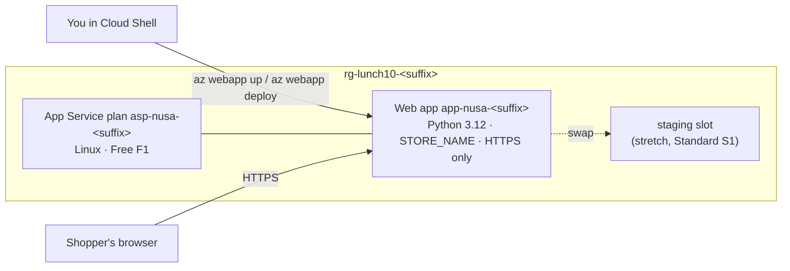

# Lab 10 · Move the storefront to PaaS

> **Pairs with:** [Lunch 10 · Web Apps with Azure App Service](../../lunches/10-app-service/README.md)
> **Time:** about 45 minutes (+15 minutes for the optional slot stretch) · **Cost:** 💲 on the Free tier · 💲💲 for the slot stretch (see [cost bands](../README.md#cost-bands)) · **Difficulty:** ★☆☆
> **Works on its own:** ✅ You do not need any earlier lab. Everything this lab needs is created by its steps.

## 🎯 What you'll build

Nusantara Retail's storefront moves off its virtual machines and onto **Azure App Service**. You deploy the provided
Python (Flask) storefront to a Linux App Service plan on the **Free (F1)** tier, configure the store name as an **app
setting**, force **HTTPS**, and watch the app's **log stream**. Then you break the configuration on purpose, read the
logs to find out why, and fix it. In the optional stretch you scale the plan to **Standard (S1)**, deploy version 2 to a
**staging slot** and **swap** it into production without downtime.



## ✅ Before you start

- An Azure subscription where you can create resources (see [Lab 01](../01-before-you-begin/README.md)).
- **Azure Cloud Shell (Bash)** — open [shell.azure.com](https://shell.azure.com). Nothing to install.
- Get the lab files and load the shared settings and this lab's names:

```bash
git clone https://github.com/stefpin/azure-fundamentals-lunches.git   # first time only
cd azure-fundamentals-lunches/labs/10-app-service
source ../common/config.sh
source lab.env
echo "Group: $RG   Plan: $PLAN   App: $APP   Runtime: $RUNTIME"
```

> [!IMPORTANT]
> The Free tier costs nothing, but the stretch goal uses a Standard plan that is billed per hour while it exists. Finish
> with the **Clean up** section, even if you stop halfway. Opened a new Cloud Shell session? Run the three lines starting
> with `cd`, `source` and `source` again so the variables come back.

## 🧭 Choose your mode

| Mode | For you if… | How |
|---|---|---|
| **Guided** | you want every step explained | follow Tasks 1–6 below |
| **Challenge** | you already know the basics | read only the [Challenge brief](#-challenge-brief), build it your way, then run `bash verify.sh` |

## Task 1 · Meet the app and create the resource group

Before you hand code to a platform, know what the code expects. This storefront needs one setting, `STORE_NAME`, and
shows which instance and host name served each request.

```bash
ensure_rg "$RG" 10
sed -n '1,14p' app/app.py          # the docstring explains the settings the app reads
cat app/requirements.txt           # Flask and Gunicorn: App Service installs these for you
az webapp list-runtimes --os-type linux --output table | grep -i python
```

The last command lists the Python versions App Service offers on Linux. You should see `PYTHON:3.12` among them. If a
newer Azure CLI shows a different layout, look for the 3.12 line anyway. If 3.12 has gone, pick a listed version, run
`export LAB10_RUNTIME="PYTHON:3.13"` (for example) and `source lab.env` again.

> ✅ **Checkpoint:** the group exists and carries the lab tags:
> `az group show --name "$RG" --query "{name:name, location:location, lunch:tags.lunch}" --output table`

## Task 2 · Deploy with one command

`az webapp up` is the shortest path from a folder of code to a running web app. It creates the plan and the app, turns
on build automation, zips the current folder and deploys it. It must run **from the folder that contains the code**.
Expect 3–6 minutes, most of it while App Service installs Flask and Gunicorn.

```bash
cd app
az webapp up \
  --name "$APP" \
  --resource-group "$RG" \
  --plan "$PLAN" \
  --location "$LOCATION" \
  --runtime "$RUNTIME" \
  --sku F1
cd ..
```

While it runs, read what it is doing: it creates the plan `asp-nusa-<suffix>` on the Free tier (always Linux for
Python apps, so there's no operating system to choose), creates the web app with the Python stack, enables the `SCM_DO_BUILD_DURING_DEPLOYMENT` build setting, uploads a zip of the folder and
prints a summary. On the server, the build system (Oryx) creates a virtual environment and installs `requirements.txt`;
then App Service finds `app.py` and starts it with Gunicorn. `az webapp up` also saves your choices in `app/.azure/config`
so that a second run in the same folder needs no parameters.

> [!NOTE]
> Azure CLI 2.87 (June 2026) formally **deprecated** `az webapp up`. It still works and prints a yellow warning. Scripts
> should use the explicit commands below, which is what `solution.sh` does. If your CLI no longer has `az webapp up`,
> use these instead:
>
> ```bash
> az appservice plan create -g "$RG" -n "$PLAN" --location "$LOCATION" --is-linux --sku F1 --output none
> az webapp create -g "$RG" -n "$APP" --plan "$PLAN" --runtime "$RUNTIME" --output none
> az webapp config appsettings set -g "$RG" -n "$APP" --settings SCM_DO_BUILD_DURING_DEPLOYMENT=true --output none
> mkdir -p "$OUT_DIR"
> (cd app && python3 -m zipfile -c "$OUT_DIR/storefront-v1.zip" app.py requirements.txt)
> az webapp deploy -g "$RG" -n "$APP" --src-path "$OUT_DIR/storefront-v1.zip" --type zip
> ```

Now read the app's host name from Azure (new apps can get a longer, unique host name, so don't guess it) and call the
health endpoint:

```bash
HOST=$(az webapp show -g "$RG" -n "$APP" --query defaultHostName --output tsv)
echo "https://$HOST"
curl -s "https://$HOST/health"; echo
```

Don't open the home page yet: it needs the setting you add in Task 3. (If you're curious and open it anyway, you get a
polite error page. That is on purpose; you'll see why in *Break it and fix it*.)

> [!TIP]
> **Prefer the portal?** *Create a resource › Web App*: Publish **Code**, Runtime stack **Python 3.12**, Operating System
> **Linux**, your region, Pricing plan **Free F1** › *Review + create*. Then deploy the code with the explicit
> `az webapp deploy` commands from the note above and continue with Task 3.

> ✅ **Checkpoint:** `curl` prints `ok`, and
> `az webapp show -g "$RG" -n "$APP" --query "{state:state, host:defaultHostName}" --output table` shows `Running`.

## Task 3 · Configure the store with an app setting

App settings are name–value pairs that App Service passes to your code as **environment variables**. The same code can
then run as the Kemang store in production and as a test store in staging, with no code change. Changing a setting
restarts the app, so give it about 30 seconds.

```bash
az webapp config appsettings set -g "$RG" -n "$APP" --settings "STORE_NAME=${STORE}" --output none
az webapp config appsettings list -g "$RG" -n "$APP" --query "[].name" --output tsv
```

You should see `STORE_NAME` and `SCM_DO_BUILD_DURING_DEPLOYMENT`. Now open `https://$HOST` in your browser: the page shows
the store name, **Version 1.0**, the instance that served you and the host name.

> [!TIP]
> **Prefer the portal?** Open the web app › *Settings › Environment variables › App settings* › **+ Add**, enter
> `STORE_NAME`, select **Apply**, then **Confirm** the restart. Anyone who can read the app's configuration can read
> these values, so never put passwords here: Lunch 15 replaces secrets with Key Vault references.

> ✅ **Checkpoint:** `curl -s "https://$HOST/" | grep -o "$STORE"` prints `Nusantara Retail - Kemang`.

## Task 4 · Force HTTPS

App Service terminates TLS at its front ends, and every app gets a certificate for its `azurewebsites.net` name. Plain
HTTP still works until you switch on **HTTPS Only**, which redirects every `http://` request to `https://`.

```bash
curl -s -o /dev/null -w "%{http_code}\n" "http://$HOST/"                       # probably 200: plain HTTP is allowed
az webapp update -g "$RG" -n "$APP" --https-only true --output none
curl -s -o /dev/null -w "%{http_code} -> %{redirect_url}\n" "http://$HOST/"    # now a 301 redirect to https://
az webapp config show -g "$RG" -n "$APP" --query minTlsVersion --output tsv    # 1.2 or higher
```

> [!TIP]
> **Prefer the portal?** *Settings › Configuration › General settings*: set **HTTPS Only** to *On* and check
> **Minimum inbound TLS Version**.

> ✅ **Checkpoint:** `az webapp show -g "$RG" -n "$APP" --query httpsOnly --output tsv` prints `true`, and the second
> `curl` shows `301 -> https://...`.

## Task 5 · Watch the log stream

When something goes wrong in production, the first place to look is what the app itself writes. App Service collects
the container's console output; the **log stream** shows it live.

```bash
az webapp log config -g "$RG" -n "$APP" --docker-container-logging filesystem --output none
az webapp log tail -g "$RG" -n "$APP"
```

Leave it running and refresh the storefront in your browser a few times. Within about 30 seconds you see lines such as
`INFO [storefront] Served the home page for Nusantara Retail - Kemang (version 1.0, instance ...)`, mixed with
platform messages about the container. Press **Ctrl+C** to stop streaming.

> [!TIP]
> **Prefer the portal?** *Monitoring › Log stream* shows the same output. *Diagnose and solve problems* is the next
> stop when the log isn't enough.

> ✅ **Checkpoint:** at least one `[storefront] Served the home page` line appeared in the stream.

## Task 6 · See what you are paying for

Your app runs on the plan, and the plan is what you pay for. Look at it.

```bash
az appservice plan show -g "$RG" -n "$PLAN" \
  --query "{tier:sku.tier, size:sku.name, instances:sku.capacity, linux:reserved}" --output table
az webapp list-instances -g "$RG" -n "$APP" --query "[].name" --output tsv
```

The Free tier runs your app on **shared** infrastructure with a daily CPU quota of 60 minutes, one instance, no custom
domains, no deployment slots, no autoscale and no SLA. That is perfect for learning and useless for the 12.12 sale.
In the portal, open the plan's *Scale up (App Service plan)* page to compare what each tier adds, without changing
anything.

> ✅ **Checkpoint:** the table shows tier `Free`, size `F1`, one instance and `linux` = `True`.

## 🔧 Break it and fix it

Someone "tidies up" the configuration and deletes a setting they didn't recognise. Do it yourself:

```bash
az webapp config appsettings delete -g "$RG" -n "$APP" --setting-names STORE_NAME --output none
sleep 45                                                     # the app restarts after a settings change
curl -s -o /dev/null -w "%{http_code}\n" "https://$HOST/"
```

**Symptom:** the page answers **500**, and the browser shows *"Sorry, the shop is having a moment."* The page gives
customers no details, which is deliberate. Find the cause the way an engineer would: start the log stream with
`az webapp log tail -g "$RG" -n "$APP"`, refresh the page, and read the `ERROR` line.

<details><summary>Hint and fix</summary>

The log says `Required app setting STORE_NAME is missing`. Put the setting back and wait for the restart:

```bash
az webapp config appsettings set -g "$RG" -n "$APP" --settings "STORE_NAME=${STORE}" --output none
sleep 30 && curl -s -o /dev/null -w "%{http_code}\n" "https://$HOST/"     # 200 again
```

Two lessons: keep error pages generic for customers but specific in your logs, and treat configuration as part of the
release (in Lunch 20 it becomes code). In production you would also alert on a rise in HTTP 5xx responses (Lunch 16).

</details>

## 🧪 Verify your work

```bash
bash verify.sh
```

Every check should say **PASS**. If one fails, the message tells you which task to revisit. The stretch slot is
reported as a note, so the core lab passes without it.

## 🧹 Clean up (do not skip!)

```bash
bash cleanup.sh
```

This deletes the resource group `rg-lunch10-<suffix>` (the plan, the web app and any slot) and removes the local files
in `~/lab10-out` and `app/.azure`. Nothing is created outside the resource group. Deletion continues in the background
for a few minutes.

## 🩺 Troubleshooting

| Symptom | Likely cause | Fix |
|---|---|---|
| Yellow warning that `az webapp up` is deprecated | Azure CLI 2.87 and later mark the command as deprecated | Expected. The command still works; or use the explicit commands in the Task 2 note |
| `Website with given name app-nusa-… already exists.` | Web app names are global and yours is taken | `export LAB10_APP="app-nusa-${SUFFIX}2"`, then `source lab.env` and repeat Task 2 |
| `This region has quota of 0 instances for your subscription. Try selecting different region or SKU.` | Some trial and student subscriptions have no App Service quota in a region | Run `cleanup.sh`, `export LOCATION=eastasia` (or another region), source both files again and restart the lab |
| The browser shows the App Service default Python page, not the storefront | The code wasn't deployed, or App Service couldn't find `app.py` | Run Task 2 again from inside the `app` folder; check that `app.py` and `requirements.txt` are at the root of the zip |
| `:( Application Error` page | The container failed to start | Run `az webapp log tail` and look for a Python traceback; *Diagnose and solve problems* helps too |
| *"Sorry, the shop is having a moment."* (HTTP 500) | `STORE_NAME` is missing or empty | Run the Task 3 command again |
| `Error 403 - This web app is stopped.` | The app was stopped, or the Free tier used its 60 CPU minutes for the day | `az webapp start -g "$RG" -n "$APP"`, or wait for the daily quota to reset |
| `az webapp log tail` shows nothing | Logging is off, or nobody has visited the site yet | Run the `az webapp log config` command, wait 30 seconds and refresh the page |
| Creating the `staging` slot fails | Deployment slots need the Standard tier or higher | Scale the plan to S1 first (stretch step 1) |
| `curl: (6) Could not resolve host` | `$HOST` is empty, usually in a new Cloud Shell session | Source both files again and re-run the `HOST=$(...)` line from Task 2 |

## 🚀 Stretch goals

**A zero-downtime release with a staging slot** (💲💲, about 15 minutes). Deployment slots start at the Standard tier,
so you pay for an S1 instance while it exists.

1. Scale the plan up and create the slot, copying production's settings. HTTPS Only belongs to each slot and never
   travels in a swap, so set it on the slot too:

   ```bash
   az appservice plan update -g "$RG" -n "$PLAN" --sku S1 --output none
   az webapp deployment slot create -g "$RG" -n "$APP" --slot staging --configuration-source "$APP" --output none
   az webapp update -g "$RG" -n "$APP" --slot staging --https-only true --output none
   az webapp config appsettings set -g "$RG" -n "$APP" --slot staging --settings SCM_DO_BUILD_DURING_DEPLOYMENT=true --output none
   ```

2. Build version 2.0 from a copy of the code and deploy it to the slot only:

   ```bash
   rm -rf "$OUT_DIR/v2" && mkdir -p "$OUT_DIR/v2" && cp app/app.py app/requirements.txt "$OUT_DIR/v2/"
   sed -i 's/^APP_VERSION = "1.0"/APP_VERSION = "2.0"/' "$OUT_DIR/v2/app.py"
   (cd "$OUT_DIR/v2" && python3 -m zipfile -c "$OUT_DIR/storefront-v2.zip" app.py requirements.txt)
   az webapp deploy -g "$RG" -n "$APP" --slot staging --src-path "$OUT_DIR/storefront-v2.zip" --type zip
   ```

3. Test the slot on its own host name. Production still shows Version 1.0:

   ```bash
   STAGING_HOST=$(az webapp show -g "$RG" -n "$APP" --slot staging --query defaultHostName --output tsv)
   curl -s "https://$STAGING_HOST/" | grep -o "Version [0-9.]*"
   curl -s "https://$HOST/" | grep -o "Version [0-9.]*"
   ```

4. Swap. To see that no request fails, open a second Cloud Shell session (the *Open new session* button) and start a
   poller there first:

   ```bash
   cd ~/azure-fundamentals-lunches/labs/10-app-service && source ../common/config.sh && source lab.env
   HOST=$(az webapp show -g "$RG" -n "$APP" --query defaultHostName --output tsv)
   for i in $(seq 1 60); do curl -s -o /dev/null -w "%{http_code} " "https://$HOST/"; sleep 2; done
   ```

   Then, in the first session:

   ```bash
   az webapp deployment slot swap -g "$RG" -n "$APP" --slot staging --target-slot production
   curl -s "https://$HOST/" | grep -o "Version [0-9.]*"      # Version 2.0
   ```

5. Roll back by running the same swap again: Version 1.0 returns after a short warm-up, with no redeployment.

**More ideas**

- On S1, scale out to two instances with `az appservice plan update -g "$RG" -n "$PLAN" --number-of-workers 2`, then
  run `curl -s "https://$HOST/" | grep -o 'instance</dt><dd>[^<]*'` a few times. Requests without a session cookie can
  land on either instance.
- Give App Service a health check path so it can take a sick instance out of rotation:
  `az webapp config set -g "$RG" -n "$APP" --generic-configurations '{"healthCheckPath": "/health"}'`.
- Fork the repository and connect *Deployment Center* to GitHub Actions, so every push to `main` deploys.

## 🏁 Challenge brief

Build the following, any way you like (portal, CLI, Bicep):

1. A resource group `rg-lunch10-<suffix>` in your lab region.
2. A **Linux** App Service plan `asp-nusa-<suffix>` (the Free F1 tier is enough).
3. A web app `app-nusa-<suffix>` with the **Python 3.12** stack, running the code in `app/`.
4. An app setting `STORE_NAME` with your store's name; `https://<host>/` returns HTTP 200 and shows that name.
5. **HTTPS Only** switched on.

Optional: a `staging` slot on a Standard plan, with version 2.0 swapped into production (`verify.sh` reports it as a
note). Then run `bash verify.sh`. Stuck? Peek at `solution.sh` or switch to Guided mode.

---

⬅️ [Lunch 10 reading](../../lunches/10-app-service/README.md) · 🏠 [All labs](../README.md) · 🏠 [Course home](../../README.md)

<sub>Last validated: October 2026 · Something broken? [Report a lab problem](../../CONTRIBUTING.md).</sub>
