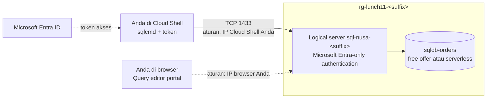

# Lab 11 · Database pesanan Nusantara Retail

🇬🇧 [Read in English](README.md)

> **Pasangan dari:** [Makan Siang 11 · Database Relasional (Dasar): Azure SQL](../../lunches/11-relational-databases-basic/README.id.md)
> **Waktu:** sekitar 45 menit · **Biaya:** 💲 (lihat [kelompok biaya](../README.id.md#kelompok-biaya)) · **Tingkat kesulitan:** ★☆☆
> **Bisa dikerjakan terpisah:** ✅ Anda tidak memerlukan lab sebelumnya. Semua yang dibutuhkan lab ini dibuat oleh langkah-langkahnya sendiri.
> **Penulis:** Stefanus Pinarta · [Tentang penulis](../../README.id.md#tentang-penulis)

## 🎯 Yang akan Anda bangun

Data pesanan Nusantara Retail pindah dari database SQL Server Express di sebelah pantry ke Azure SQL Database. Anda membuat sebuah logical server yang **hanya menerima login Microsoft Entra** — tidak ada lagi kata sandi `sa` yang dipakai bersama — dengan diri Anda sendiri sebagai admin. Anda menambahkan sebuah database, `sqldb-orders`, memakai **free offer** (penawaran gratis), atau memakai komputasi serverless dengan auto-pause jika free offer tidak tersedia untuk Anda. Anda membuka firewall server untuk tepat satu alamat IP, lalu membuat dan meng-query tabel `Orders` dari Cloud Shell dengan **sqlcmd** dan dari **Query editor** di portal. Terakhir, Anda sengaja merusak aturan firewall untuk melihat error yang akan dialami pengguna Anda, lalu memperbaikinya.



## ✅ Sebelum mulai

- Sebuah subscription Azure tempat Anda bisa membuat resource (lihat [Lab 01](../01-before-you-begin/README.id.md)). Login dengan sebuah **akun pengguna** (user account): lab ini menjadikan akun tersebut administrator database.
- **Azure Cloud Shell (Bash)** — buka [shell.azure.com](https://shell.azure.com). Tidak ada yang perlu dipasang: Cloud Shell sudah berisi Azure CLI dan sqlcmd.
- Ambil file lab, lalu muat pengaturan bersama dan beberapa nama yang akan Anda pakai berulang kali:

```bash
git clone https://github.com/stefpin/azure-fundamentals-lunches.git   # first time only
cd azure-fundamentals-lunches/labs/11-relational-databases-basic
source ../common/config.sh
RG=$(rg_name 11)
SQL_SERVER="sql-nusa-${SUFFIX}"
SQL_FQDN="${SQL_SERVER}.database.windows.net"
DB=sqldb-orders
source azsql.sh            # defines the 'azsql' helper used in Task 4
```

> [!TIP]
> Cloud Shell mengakhiri sesi setelah sekitar 20 menit tanpa aktivitas, dan variabel ikut hilang bersamanya. Jika itu terjadi, `cd` kembali ke folder lab dan jalankan lagi blok di atas (lewati `git clone`).

> [!IMPORTANT]
> Resource lab menimbulkan biaya selama masih ada. Selesaikan lab dengan bagian **Bersihkan**, meskipun Anda berhenti di tengah jalan.

## 🧭 Pilih mode Anda

| Mode | Cocok untuk Anda jika… | Caranya |
|---|---|---|
| **Terpandu** | Anda ingin setiap langkah dijelaskan | ikuti Tugas 1–5 di bawah |
| **Tantangan** | Anda sudah menguasai dasarnya | baca hanya [Ringkasan tantangan](#-ringkasan-tantangan), bangun dengan cara Anda sendiri, lalu jalankan `bash verify.sh` |

## Tugas 1 · Membuat logical server dengan Microsoft Entra-only authentication

Logical server memberi database Anda nama DNS-nya serta menyimpan aturan firewall dan Microsoft Entra admin. Dengan **Entra-only authentication**, login dan kata sandi SQL dimatikan untuk seluruh server, sehingga tidak ada kata sandi `sa` yang bisa bocor. Anda akan menjadi admin-nya, dikenali melalui user principal name (UPN — nama login Anda, yang bentuknya mirip alamat e-mail) dan object ID (nomor identitas unik akun Anda di Entra).

```bash
ensure_rg "$RG" 11
MY_UPN=$(my_upn)
MY_OID=$(my_object_id)
echo "The admin will be: $MY_UPN ($MY_OID)"

az sql server create \
  --name "$SQL_SERVER" \
  --resource-group "$RG" \
  --location "$LOCATION" \
  --enable-ad-only-auth \
  --external-admin-principal-type User \
  --external-admin-name "$MY_UPN" \
  --external-admin-sid "$MY_OID" \
  --output none
```

Pembuatan server memakan waktu satu sampai tiga menit. Perhatikan apa yang **tidak** Anda ketik: login dan kata sandi admin. Azure tetap membuat admin SQL internal dengan kata sandi acak, tetapi Entra-only authentication memastikan tidak ada seorang pun yang bisa memakainya. Ibaratnya rumah yang hanya bisa dibuka dengan sidik jari penghuninya: kunci cadangan memang ada di dalam laci, tetapi lubang kuncinya sudah ditutup.

> [!TIP]
> **Lebih suka portal?** *Home › SQL servers › + Create* — pilih resource group, isi nama server dan region, pilih **Authentication method: Use Microsoft Entra-only authentication**, klik **Set admin**, lalu pilih akun Anda sendiri. Setelah itu kembali ke sini dan lanjutkan dengan Tugas 2.

> ✅ **Pemeriksaan:** kedua perintah ini menampilkan pengaturan Anda — `azureAdOnlyAuthentication` bernilai `True`, dan admin-nya adalah Anda.
>
> ```bash
> az sql server ad-only-auth get --resource-group "$RG" --name "$SQL_SERVER" --output table
> az sql server ad-admin list --resource-group "$RG" --server "$SQL_SERVER" \
>   --query "[].{admin:login, type:administratorType, objectId:sid}" --output table
> ```

## Tugas 2 · Membuat database dengan free offer (atau serverless)

**Free offer** memberi setiap subscription hingga sepuluh database General Purpose serverless dengan jatah bulanan untuk komputasi, data, dan penyimpanan backup. Anda memintanya dengan `--use-free-limit`, sedangkan `--free-limit-exhaustion-behavior AutoPause` memberi tahu Azure untuk menjeda database — dan tidak pernah menagih Anda — jika jatahnya habis.

```bash
az sql db create \
  --resource-group "$RG" \
  --server "$SQL_SERVER" \
  --name "$DB" \
  --edition GeneralPurpose --family Gen5 --capacity 2 \
  --compute-model Serverless \
  --use-free-limit \
  --free-limit-exhaustion-behavior AutoPause \
  --output none
```

> [!IMPORTANT]
> **Jika free offer gagal** — misalnya karena subscription Anda sudah memakai semua database gratisnya, database gratis itu berada di region lain, atau jenis subscription Anda tidak memenuhi syarat — buatlah database **serverless** biasa dengan auto-pause sebagai gantinya. Biayanya sedikit selama berjalan, dan hanya biaya penyimpanan selama dijeda:
>
> ```bash
> az sql db create \
>   --resource-group "$RG" \
>   --server "$SQL_SERVER" \
>   --name "$DB" \
>   --edition GeneralPurpose --family Gen5 --capacity 1 \
>   --compute-model Serverless --min-capacity 0.5 --auto-pause-delay 60 \
>   --backup-storage-redundancy Local \
>   --output none
> ```
>
> `--capacity 1` adalah jumlah vCore maksimum, `--min-capacity 0.5` jumlah minimum selama berjalan, dan `--auto-pause-delay 60` jumlah menit tanpa aktivitas sebelum database dijeda. Backup locally redundant adalah opsi termurah dan sudah cukup untuk keperluan lab.

> [!TIP]
> **Lebih suka portal?** *Home › SQL databases › + Create*. Dengan free offer, spanduk "Free offer applied" muncul di bagian atas halaman dan ringkasan biaya menunjukkan nol. Pilih server dari Tugas 1 dan biarkan pengaturan lainnya pada nilai bawaan.

> ✅ **Pemeriksaan:** database sudah ada dan berjalan di komputasi serverless (`GP_S_Gen5_…`) dengan auto-pause delay. `freeOffer` menunjukkan `True` jika free offer berhasil diterapkan.
>
> ```bash
> az sql db show --resource-group "$RG" --server "$SQL_SERVER" --name "$DB" \
>   --query "{sku:currentServiceObjectiveName, status:status, autoPauseMinutes:autoPauseDelay, freeOffer:useFreeLimit, whenFreeUsedUp:freeLimitExhaustionBehavior}" \
>   --output table
> ```

## Tugas 3 · Membuka firewall untuk alamat IP client Anda

Server baru menolak semua alamat IP. Tambahkan **aturan firewall tingkat server** (server-level firewall rule) untuk alamat IP publik yang sedang dipakai Cloud Shell saat ini. Helper `my_public_ip` menanyakan alamat itu ke sebuah layanan publik semacam "berapa IP saya".

```bash
MY_IP=$(my_public_ip)
echo "Cloud Shell's public IP right now: $MY_IP"

az sql server firewall-rule create \
  --resource-group "$RG" \
  --server "$SQL_SERVER" \
  --name AllowMyClientIP \
  --start-ip-address "$MY_IP" \
  --end-ip-address "$MY_IP" \
  --output none
```

Ada dua hal yang perlu diketahui. Pertama, Cloud Shell bisa mendapat **alamat IP publik yang berbeda** pada sesi baru; jika itu terjadi, jalankan lagi perintah-perintah ini — membuat aturan dengan nama yang sudah ada akan memperbaruinya. Kedua, perubahan firewall bisa memerlukan waktu **hingga lima menit** untuk berlaku.

> [!WARNING]
> **Jangan** menyalakan *Allow Azure services and resources to access this server* supaya Cloud Shell bisa masuk. Cara itu memang berhasil, karena Cloud Shell berjalan di Azure — tetapi resource milik semua pelanggan Azure lain juga ikut bisa masuk.

> [!TIP]
> **Lebih suka portal?** *SQL server › Security › Networking › Firewall rules › + Add your client IPv4 address*. Perhatikan baik-baik: tombol itu menambahkan alamat IP **browser Anda**, bukan alamat Cloud Shell. Anda akan membutuhkan persis itu di Tugas 5.

> ✅ **Pemeriksaan:** ada satu aturan, `AllowMyClientIP`, yang alamat awal dan alamat akhirnya sama dengan `$MY_IP`.
>
> ```bash
> az sql server firewall-rule list --resource-group "$RG" --server "$SQL_SERVER" --output table
> ```

## Tugas 4 · Terhubung dengan sqlcmd sebagai diri sendiri dan membuat tabel Orders

Cloud Shell menyertakan **sqlcmd** versi berbasis ODBC. Untuk autentikasi Microsoft Entra, sqlcmd tidak menerima kata sandi: Anda memberinya **token akses** dari Microsoft Entra ID di dalam sebuah file kecil. Helper `azsql` yang Anda muat di awal melakukan persis hal itu setiap kali dipanggil — meminta token baru untuk Azure SQL kepada Azure CLI, menjalankan sqlcmd dengan `-G` (pakai Entra) dan `-P <token file>`, lalu menghapus file tersebut.

<details><summary>Penasaran? Inilah yang dijalankan <code>azsql</code> untuk Anda</summary>

```bash
( umask 077                                                        # keep the token file private
  az account get-access-token --resource https://database.windows.net --query accessToken --output tsv \
    | tr -d '\r\n' | iconv -f ascii -t UTF-16LE > ~/.azsql-token )  # sqlcmd wants UTF-16LE, no BOM
sqlcmd -S "$SQL_FQDN" -d "$DB" -G -P ~/.azsql-token -Q "SELECT SUSER_SNAME();"
rm ~/.azsql-token                                                  # the token is valid for about an hour
```

</details>

Pertama, periksa siapa Anda di dalam database:

```bash
azsql "$SQL_FQDN" "$DB" -W -Q "SELECT SUSER_SNAME() AS signed_in_as, DB_NAME() AS database_name;"
```

Anda seharusnya melihat UPN Anda sendiri — tanpa kata sandi sama sekali. Jika Anda mendapat error **40613** ("is not currently available"), berarti database yang sedang dijeda sedang bangun: tunggu 30–60 detik, lalu jalankan perintahnya lagi.

Sekarang buat tabel beserta contoh pesanannya. Lihat dulu isi [`orders.sql`](orders.sql): skrip ini membuat `dbo.Orders` dan memasukkan tujuh pesanan dari berbagai toko. Skrip ini aman dijalankan dua kali.

```bash
azsql "$SQL_FQDN" "$DB" -i orders.sql
```

Query datanya:

```bash
azsql "$SQL_FQDN" "$DB" -W -Q "SELECT OrderId, StoreCode, CustomerName, TotalIdr, Status FROM dbo.Orders ORDER BY OrderId;"
```

> ✅ **Pemeriksaan:** perintah terakhir menampilkan tujuh pesanan, dari `JKT-01` sampai `MKS-01`. `orders.sql` diakhiri dengan `order_count` = 7.

## Tugas 5 · Meng-query database dari Query editor di portal

**Query editor** berjalan di browser Anda, sehingga ia terhubung dari alamat IP publik browser Anda — client yang berbeda, dengan alamat yang berbeda pula dari Cloud Shell. Inilah cara tercepat untuk memeriksa data tanpa memasang apa pun.

1. Di portal, buka *SQL databases › sqldb-orders › Query editor*.
2. Pilih **Microsoft Entra authentication** dan lanjutkan sebagai diri Anda sendiri.
3. Jika Anda melihat error firewall yang menyebutkan sebuah alamat IP, pilih tautan **Allowlist IP …** di pesan error tersebut (atau tambahkan alamatnya di halaman *Networking* milik server), tunggu sebentar, lalu hubungkan lagi.
4. Tempel query ini ke editor dan pilih **Run**:

   ```sql
   SELECT StoreCode, COUNT(*) AS orders, SUM(TotalIdr) AS revenue_idr
   FROM dbo.Orders
   GROUP BY StoreCode
   ORDER BY revenue_idr DESC;
   ```

5. Tambahkan satu pesanan dari browser, lalu jalankan lagi query dari langkah 4:

   ```sql
   INSERT INTO dbo.Orders (StoreCode, CustomerName, TotalIdr) VALUES ('JKT-01', N'Dewi Anggraini', 99000);
   ```

> ✅ **Pemeriksaan:** grid hasil menampilkan pendapatan per toko, dan `JKT-01` kini punya dua pesanan. Di Cloud Shell, `az sql server firewall-rule list --resource-group "$RG" --server "$SQL_SERVER" --output table` menampilkan aturan kedua untuk alamat browser Anda.

## 🔧 Rusak lalu perbaiki

Aturan firewall Anda adalah satu-satunya hal yang mengizinkan Cloud Shell masuk. Hapus aturan itu dan lihat apa yang akan dialami pengguna Anda.

```bash
az sql server firewall-rule delete --resource-group "$RG" --server "$SQL_SERVER" --name AllowMyClientIP
azsql "$SQL_FQDN" "$DB" -Q "SELECT COUNT(*) AS orders FROM dbo.Orders;"
```

**Gejala:** error **40615** — *Cannot open server 'sql-nusa-…' requested by the login. Client with IP address '…' is not allowed to access the server.* Jika query masih berhasil, tunggu satu atau dua menit lalu coba lagi: perubahan firewall bisa memerlukan waktu hingga lima menit untuk berlaku. Perhatikan bahwa autentikasi tidak pernah terjadi — firewall sudah menghentikan koneksinya lebih dulu, seperti satpam kompleks yang menolak mobil di gerbang sebelum pengemudinya sempat mengeluarkan kunci rumah. Sementara itu, Query editor di portal tetap berfungsi. Mengapa?

<details><summary>Petunjuk: cara memperbaikinya</summary>

Buat ulang aturan untuk alamat Anda saat ini — pesan error-nya bahkan memberi tahu alamat mana yang ditolak:

```bash
MY_IP=$(my_public_ip)
az sql server firewall-rule create --resource-group "$RG" --server "$SQL_SERVER" --name AllowMyClientIP \
  --start-ip-address "$MY_IP" --end-ip-address "$MY_IP" --output none
```

Tunggu sebentar, lalu jalankan lagi query `azsql`. Query editor tetap berfungsi karena alamat IP browser Anda punya aturannya sendiri: setiap alamat client diizinkan (atau ditolak) secara terpisah.

</details>

## 🧪 Verifikasi hasil kerja Anda

```bash
bash verify.sh
```

Setiap pemeriksaan seharusnya menampilkan **PASS**. Jika ada yang gagal, pesannya memberi tahu tugas mana yang perlu Anda ulangi. Jumlah baris hanya diperiksa di lingkungan yang memiliki sqlcmd — jalankan `verify.sh` di Cloud Shell.

## 🧹 Bersihkan (jangan dilewati!)

```bash
bash cleanup.sh
```

Perintah ini menghapus resource group `rg-lunch11-<suffix>`, beserta server, database, dan aturan firewall di dalamnya. Lab ini tidak membuat apa pun di luar resource group tersebut. Penghapusan berlanjut di latar belakang selama beberapa menit.

## 🩺 Pemecahan masalah

| Gejala | Kemungkinan penyebab | Perbaikan |
|---|---|---|
| `Location '…' is not accepting creation of new Windows Azure SQL Database servers for the subscription '…' at this time.` | Subscription Anda saat ini tidak bisa membuat SQL server di region tersebut | Jalankan `bash cleanup.sh` dan tunggu sampai `az group list --tag lunch=11 --output table` kosong (resource group-nya sudah telanjur dibuat di region lama), lalu `export LOCATION=<another region>`, `source ../common/config.sh`, dan mulai lagi dari Tugas 1 |
| `az sql server create` menyatakan nama server sudah ada | Nama server adalah nama DNS global; nama Anda sudah terpakai (mungkin oleh lab yang pernah Anda jalankan sebelumnya) | Hapus server lama, atau tetapkan `SUFFIX` baru sebelum menjalankan `source` untuk `config.sh` |
| `az sql db create` dengan `--use-free-limit` gagal | Tidak ada lagi database gratis yang tersisa di subscription Anda, database gratisnya berada di region lain, atau jenis subscription Anda tidak memenuhi syarat | Gunakan perintah serverless di kotak Tugas 2 |
| Error 40615: *Client with IP address '…' is not allowed to access the server* | Tidak ada aturan firewall yang cocok dengan IP Anda saat ini — IP Cloud Shell mungkin sudah berubah | Jalankan ulang perintah-perintah di Tugas 3, tunggu hingga lima menit, lalu coba lagi |
| Error 40613: *Database 'sqldb-orders' on server '…' is not currently available* | Database serverless sedang dijeda dan sedang dibangunkan | Tunggu 30–60 detik, lalu jalankan perintahnya lagi |
| `Login failed for user '<token-identified principal>'` | Anda login ke Azure dengan akun yang berbeda dari Entra admin server | Jalankan `az account show --query user.name`; login sebagai admin atau tambahkan diri Anda sebagai pengguna database |
| `Could not get a Microsoft Entra access token for Azure SQL` | Sesi Cloud Shell atau CLI Anda sudah kedaluwarsa | Jalankan `az login`, lalu coba lagi |
| `sqlcmd: command not found` atau login timeout dari PC Anda sendiri | Anda tidak sedang berada di Cloud Shell, atau jaringan Anda memblokir port 1433 ke arah luar | Gunakan Cloud Shell, atau Query editor di portal (hanya butuh port 443) |

## 🚀 Tantangan tambahan

- Berikan akses baca-saja (read-only) kepada akun kedua di tenant Anda sendiri: di Query editor, jalankan `CREATE USER [user@yourtenant.onmicrosoft.com] FROM EXTERNAL PROVIDER;` dan `ALTER ROLE db_datareader ADD MEMBER [user@yourtenant.onmicrosoft.com];`, lalu login sebagai pengguna itu di jendela browser privat (incognito) dan coba jalankan sebuah `INSERT`.
- Hubungkan dari **VS Code** dengan **ekstensi MSSQL** di PC Anda sendiri, memakai autentikasi Microsoft Entra ID. Anda juga memerlukan aturan firewall untuk alamat PC Anda.
- Jika Anda memakai opsi pengganti serverless, atur `--auto-pause-delay 15` dengan `az sql db update`, tutup semua tool, lalu periksa `az sql db show ... --query status` setelah sekitar 20 menit: hasilnya seharusnya `Paused`.
- Dengan free offer, buka metrik *Overview › Free monthly vCore amount* milik database dan buat alert (*pemberitahuan*) yang aktif saat sisa jatahnya kurang dari 10.000 vCore-detik.

## 🏁 Ringkasan tantangan

Bangun hal-hal berikut dengan cara apa pun yang Anda suka (portal, CLI, Bicep):

1. Resource group `rg-lunch11-<suffix>` yang dibuat dengan `ensure_rg` (atau diberi tag `course=azure-fundamentals-lunches` dan `lunch=11`) di region lab Anda.
2. Logical server `sql-nusa-<suffix>` dengan **Microsoft Entra-only authentication** aktif dan **akun Anda sendiri** sebagai Microsoft Entra admin.
3. Database `sqldb-orders` di komputasi **General Purpose serverless** dengan auto-pause aktif — memakai free offer jika subscription Anda mengizinkan.
4. Aturan firewall tingkat server yang mengizinkan **alamat IP Cloud Shell Anda saat ini**, dan tidak ada aturan yang mengizinkan semua layanan Azure atau seluruh internet.
5. Tabel `dbo.Orders` dengan **setidaknya satu pesanan** di dalamnya (`orders.sql` menambahkan tujuh).

Lalu jalankan `bash verify.sh`. Buntu? Intip `solution.sh` atau beralih ke mode Terpandu.

---

⬅️ [Bacaan Makan Siang 11](../../lunches/11-relational-databases-basic/README.id.md) · 🏠 [Semua lab](../README.id.md) · 🏠 [Beranda kursus](../../README.id.md)

<sub>Terakhir divalidasi: Oktober 2026 · Ada yang tidak berfungsi? [Laporkan masalah lab](../../CONTRIBUTING.md).</sub>
