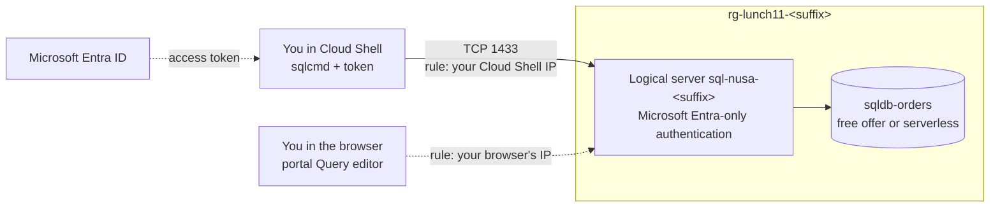

# Lab 11 · Nusantara Retail's orders database

🇮🇩 [Baca dalam Bahasa Indonesia](README.id.md)

> **Pairs with:** [Lunch 11 · Relational Databases (Basic): Azure SQL](../../lunches/11-relational-databases-basic/README.md)
> **Time:** about 45 minutes · **Cost:** 💲 (see [cost bands](../README.md#cost-bands)) · **Difficulty:** ★☆☆
> **Works on its own:** ✅ You do not need any earlier lab. Everything this lab needs is created by its steps.
> **Author:** Stefanus Pinarta · [About the author](../../README.md#about-the-author)

## 🎯 What you'll build

Nusantara Retail's orders move out of the SQL Server Express database next to the pantry and into Azure SQL Database.
You create a logical server that accepts **only Microsoft Entra sign-ins** — no shared `sa` password exists — with
yourself as the admin. You add a database, `sqldb-orders`, on the **free offer** (or on serverless compute with
auto-pause if the free offer is not available to you). You open the server firewall for exactly one IP address, then
create and query an `Orders` table from Cloud Shell with **sqlcmd** and from the portal **Query editor**. Finally, you
break the firewall rule on purpose to see the error your users would get, and fix it.



## ✅ Before you start

- An Azure subscription where you can create resources (see [Lab 01](../01-before-you-begin/README.md)). Sign in with
  a **user account**: the lab makes that account the database administrator.
- **Azure Cloud Shell (Bash)** — open [shell.azure.com](https://shell.azure.com). Nothing to install: Cloud Shell
  already has the Azure CLI and sqlcmd.
- Get the lab files and load the shared settings and a few names you will reuse:

```bash
git clone https://github.com/stefpin/azure-fundamentals-lunches.git   # first time only
cd azure-fundamentals-lunches/labs/11-relational-databases-basic
source ../common/config.sh
RG=$(rg_name 11)
SQL_SERVER="sql-nusa-${SUFFIX}"
SQL_FQDN="${SQL_SERVER}.database.windows.net"
DB=sqldb-orders
source azsql.sh            # defines the 'azsql' helper used in Task 4
```

> [!TIP]
> Cloud Shell ends a session after about 20 minutes without activity, and variables disappear with it. If that
> happens, `cd` back into the lab folder and run the block above again (skip the `git clone`).

> [!IMPORTANT]
> Lab resources cost money while they exist. Finish with the **Clean up** section, even if you stop halfway.

## 🧭 Choose your mode

| Mode | For you if… | How |
|---|---|---|
| **Guided** | you want every step explained | follow Tasks 1–5 below |
| **Challenge** | you already know the basics | read only the [Challenge brief](#-challenge-brief), build it your way, then run `bash verify.sh` |

## Task 1 · Create a logical server with Microsoft Entra-only authentication

The logical server gives your database its DNS name and holds the firewall rules and the Microsoft Entra admin. With
**Entra-only authentication**, SQL logins and passwords are switched off for the whole server, so there is no `sa`
password to leak. You will be the admin, identified by your user principal name (UPN) and object ID.

```bash
ensure_rg "$RG" 11
MY_UPN=$(my_upn)
MY_OID=$(my_object_id)
echo "The admin will be: $MY_UPN ($MY_OID)"

az sql server create \
  --name "$SQL_SERVER" \
  --resource-group "$RG" \
  --location "$LOCATION" \
  --enable-ad-only-auth \
  --external-admin-principal-type User \
  --external-admin-name "$MY_UPN" \
  --external-admin-sid "$MY_OID" \
  --output none
```

Creating the server takes one to three minutes. Notice what you did **not** type: an admin login and password. Azure
still creates an internal SQL admin with a random password, but Entra-only authentication means nobody can use it.

> [!TIP]
> **Prefer the portal?** *Home › SQL servers › + Create* — pick the resource group, enter the server name and region,
> choose **Authentication method: Use Microsoft Entra-only authentication**, select **Set admin** and choose your own
> account. Then come back and continue with Task 2.

> ✅ **Checkpoint:** both commands show your settings — `azureAdOnlyAuthentication` is `True`, and the admin is you.
>
> ```bash
> az sql server ad-only-auth get --resource-group "$RG" --name "$SQL_SERVER" --output table
> az sql server ad-admin list --resource-group "$RG" --server "$SQL_SERVER" \
>   --query "[].{admin:login, type:administratorType, objectId:sid}" --output table
> ```

## Task 2 · Create the database on the free offer (or serverless)

The **free offer** gives each subscription up to ten General Purpose serverless databases with a monthly allowance of
compute, data and backup storage. You ask for it with `--use-free-limit`, and `--free-limit-exhaustion-behavior
AutoPause` tells Azure to pause the database — never to bill you — if the allowance runs out.

```bash
az sql db create \
  --resource-group "$RG" \
  --server "$SQL_SERVER" \
  --name "$DB" \
  --edition GeneralPurpose --family Gen5 --capacity 2 \
  --compute-model Serverless \
  --use-free-limit \
  --free-limit-exhaustion-behavior AutoPause \
  --output none
```

> [!IMPORTANT]
> **If the free offer fails** — for example because your subscription already uses its free databases, they live in
> another region, or your subscription type is not eligible — create a regular **serverless** database with
> auto-pause instead. It costs a little while it runs and only storage while it is paused:
>
> ```bash
> az sql db create \
>   --resource-group "$RG" \
>   --server "$SQL_SERVER" \
>   --name "$DB" \
>   --edition GeneralPurpose --family Gen5 --capacity 1 \
>   --compute-model Serverless --min-capacity 0.5 --auto-pause-delay 60 \
>   --backup-storage-redundancy Local \
>   --output none
> ```
>
> `--capacity 1` is the maximum number of vCores, `--min-capacity 0.5` the minimum while it runs, and
> `--auto-pause-delay 60` the idle minutes before it pauses. Locally redundant backups are the cheapest option and are
> fine for a lab.

> [!TIP]
> **Prefer the portal?** *Home › SQL databases › + Create*. On the free offer, a "Free offer applied" banner appears at
> the top of the page and the cost summary shows zero. Choose the server from Task 1 and keep the defaults.

> ✅ **Checkpoint:** the database exists on serverless compute (`GP_S_Gen5_…`) with an auto-pause delay. `freeOffer`
> shows `True` if the free offer applied.
>
> ```bash
> az sql db show --resource-group "$RG" --server "$SQL_SERVER" --name "$DB" \
>   --query "{sku:currentServiceObjectiveName, status:status, autoPauseMinutes:autoPauseDelay, freeOffer:useFreeLimit, whenFreeUsedUp:freeLimitExhaustionBehavior}" \
>   --output table
> ```

## Task 3 · Open the firewall for your client IP address

A new server rejects every IP address. Add a **server-level firewall rule** for the public IP address that Cloud
Shell uses right now. The `my_public_ip` helper asks a public "what is my IP" service.

```bash
MY_IP=$(my_public_ip)
echo "Cloud Shell's public IP right now: $MY_IP"

az sql server firewall-rule create \
  --resource-group "$RG" \
  --server "$SQL_SERVER" \
  --name AllowMyClientIP \
  --start-ip-address "$MY_IP" \
  --end-ip-address "$MY_IP" \
  --output none
```

Two things to know. First, Cloud Shell can get a **different public IP address** in a new session; when that happens,
run these commands again — creating a rule with an existing name updates it. Second, firewall changes can take **up
to five minutes** to apply.

> [!WARNING]
> Do **not** turn on *Allow Azure services and resources to access this server* to make Cloud Shell work. It would,
> because Cloud Shell runs in Azure — but so would every other Azure customer's resources.

> [!TIP]
> **Prefer the portal?** *SQL server › Security › Networking › Firewall rules › + Add your client IPv4 address*. Look
> closely: that button adds **your browser's** IP address, not Cloud Shell's. You will need exactly that in Task 5.

> ✅ **Checkpoint:** one rule, `AllowMyClientIP`, whose start and end address equal `$MY_IP`.
>
> ```bash
> az sql server firewall-rule list --resource-group "$RG" --server "$SQL_SERVER" --output table
> ```

## Task 4 · Connect with sqlcmd as yourself and create the Orders table

Cloud Shell includes the ODBC-based **sqlcmd**. For Microsoft Entra authentication it does not take a password: you
give it an **access token** from Microsoft Entra ID in a small file. The `azsql` helper you loaded at the start does
exactly that on every call — it asks the Azure CLI for a fresh token for Azure SQL, runs sqlcmd with `-G` (use Entra)
and `-P <token file>`, then deletes the file.

<details><summary>Curious? This is what <code>azsql</code> runs for you</summary>

```bash
( umask 077                                                        # keep the token file private
  az account get-access-token --resource https://database.windows.net --query accessToken --output tsv \
    | tr -d '\r\n' | iconv -f ascii -t UTF-16LE > ~/.azsql-token )  # sqlcmd wants UTF-16LE, no BOM
sqlcmd -S "$SQL_FQDN" -d "$DB" -G -P ~/.azsql-token -Q "SELECT SUSER_SNAME();"
rm ~/.azsql-token                                                  # the token is valid for about an hour
```

</details>

First, check who you are inside the database:

```bash
azsql "$SQL_FQDN" "$DB" -W -Q "SELECT SUSER_SNAME() AS signed_in_as, DB_NAME() AS database_name;"
```

You should see your own UPN — no password was involved. If you get error **40613** ("is not currently available"), a
paused database is waking up: wait 30–60 seconds and run the command again.

Now create the table and the sample orders. Have a look at [`orders.sql`](orders.sql) first: it creates `dbo.Orders`
and inserts seven orders from different stores. The script is safe to run twice.

```bash
azsql "$SQL_FQDN" "$DB" -i orders.sql
```

Query the data:

```bash
azsql "$SQL_FQDN" "$DB" -W -Q "SELECT OrderId, StoreCode, CustomerName, TotalIdr, Status FROM dbo.Orders ORDER BY OrderId;"
```

> ✅ **Checkpoint:** the last command lists seven orders, from `JKT-01` to `MKS-01`. `orders.sql` ended with
> `order_count` = 7.

## Task 5 · Query the database from the portal Query editor

The **Query editor** runs in your browser, so it connects from your browser's public IP address — a different client,
with a different address, from Cloud Shell. It is the quickest way to check data without installing anything.

1. In the portal, open *SQL databases › sqldb-orders › Query editor*.
2. Choose **Microsoft Entra authentication** and continue as yourself.
3. If you see a firewall error that names an IP address, select the **Allowlist IP …** link in the error (or add the
   address under the server's *Networking* page), wait a moment, and connect again.
4. Paste this query into the editor and select **Run**:

   ```sql
   SELECT StoreCode, COUNT(*) AS orders, SUM(TotalIdr) AS revenue_idr
   FROM dbo.Orders
   GROUP BY StoreCode
   ORDER BY revenue_idr DESC;
   ```

5. Add one order from the browser, then run the query from step 4 again:

   ```sql
   INSERT INTO dbo.Orders (StoreCode, CustomerName, TotalIdr) VALUES ('JKT-01', N'Dewi Anggraini', 99000);
   ```

> ✅ **Checkpoint:** the results grid shows revenue per store, and `JKT-01` now has two orders. In Cloud Shell,
> `az sql server firewall-rule list --resource-group "$RG" --server "$SQL_SERVER" --output table` shows a second rule
> for your browser's address.

## 🔧 Break it and fix it

Your firewall rule is the only thing that lets Cloud Shell in. Remove it and see what your users would see.

```bash
az sql server firewall-rule delete --resource-group "$RG" --server "$SQL_SERVER" --name AllowMyClientIP
azsql "$SQL_FQDN" "$DB" -Q "SELECT COUNT(*) AS orders FROM dbo.Orders;"
```

**Symptom:** error **40615** — *Cannot open server 'sql-nusa-…' requested by the login. Client with IP address '…' is
not allowed to access the server.* If the query still works, wait a minute or two and try again: firewall changes can
take up to five minutes to apply. Notice that authentication never happened — the firewall stopped the connection first.
Meanwhile, the portal Query editor keeps working. Why?

<details><summary>Hint: how to fix it</summary>

Recreate the rule for your current address — the error message even tells you which address was refused:

```bash
MY_IP=$(my_public_ip)
az sql server firewall-rule create --resource-group "$RG" --server "$SQL_SERVER" --name AllowMyClientIP \
  --start-ip-address "$MY_IP" --end-ip-address "$MY_IP" --output none
```

Wait a minute, then run the `azsql` query again. The Query editor kept working because your browser's IP address has
its own rule: each client address is allowed (or refused) separately.

</details>

## 🧪 Verify your work

```bash
bash verify.sh
```

Every check should say **PASS**. If one fails, the message tells you which task to revisit. The row count is checked
only where sqlcmd is installed — run `verify.sh` in Cloud Shell.

## 🧹 Clean up (do not skip!)

```bash
bash cleanup.sh
```

This deletes the resource group `rg-lunch11-<suffix>`, and with it the server, the database and the firewall rules.
The lab created nothing outside the resource group. Deletion continues in the background for a few minutes.

## 🩺 Troubleshooting

| Symptom | Likely cause | Fix |
|---|---|---|
| `Location '…' is not accepting creation of new Windows Azure SQL Database servers for the subscription '…' at this time.` | Your subscription cannot create SQL servers in that region right now | Run `bash cleanup.sh` and wait until `az group list --tag lunch=11 --output table` is empty (the resource group was already created in the old region), then `export LOCATION=<another region>`, `source ../common/config.sh`, and start again from Task 1 |
| `az sql server create` says the server name already exists | Server names are global DNS names; yours is already taken (perhaps by an old lab run) | Delete the old server, or set a new `SUFFIX` before sourcing `config.sh` |
| `az sql db create` with `--use-free-limit` fails | No free database left in your subscription, free databases in another region, or a subscription type that is not eligible | Use the serverless command in the Task 2 box |
| Error 40615: *Client with IP address '…' is not allowed to access the server* | No firewall rule matches your current IP — Cloud Shell's IP may have changed | Re-run the Task 3 commands, wait up to five minutes, retry |
| Error 40613: *Database 'sqldb-orders' on server '…' is not currently available* | The serverless database is paused and is resuming | Wait 30–60 seconds and run the command again |
| `Login failed for user '<token-identified principal>'` | You are signed in to Azure as a different account from the server's Entra admin | Run `az account show --query user.name`; sign in as the admin or add yourself as a database user |
| `Could not get a Microsoft Entra access token for Azure SQL` | Your Cloud Shell or CLI session has expired | Run `az login`, then try again |
| `sqlcmd: command not found` or a login timeout from your own PC | You are not in Cloud Shell, or your network blocks outbound port 1433 | Use Cloud Shell, or the portal Query editor (port 443 only) |

## 🚀 Stretch goals

- Give a second account in your own tenant read-only access: in the Query editor run
  `CREATE USER [user@yourtenant.onmicrosoft.com] FROM EXTERNAL PROVIDER;` and
  `ALTER ROLE db_datareader ADD MEMBER [user@yourtenant.onmicrosoft.com];`, then sign in as that user in a private
  browser window and try an `INSERT`.
- Connect from **VS Code** with the **MSSQL extension** on your own PC, using Microsoft Entra ID authentication. You will
  need a firewall rule for your PC's address too.
- If you used the serverless fallback, set `--auto-pause-delay 15` with `az sql db update`, close every tool, and check
  `az sql db show ... --query status` after about 20 minutes: it should say `Paused`.
- On the free offer, open the database's *Overview › Free monthly vCore amount* metric and create an alert for when
  fewer than 10,000 vCore-seconds remain.

## 🏁 Challenge brief

Build the following, any way you like (portal, CLI, Bicep):

1. A resource group `rg-lunch11-<suffix>` created with `ensure_rg` (or tagged `course=azure-fundamentals-lunches` and
   `lunch=11`) in your lab region.
2. A logical server `sql-nusa-<suffix>` with **Microsoft Entra-only authentication** enabled and **your own account**
   as the Microsoft Entra admin.
3. A database `sqldb-orders` on **General Purpose serverless** compute with auto-pause enabled — on the free offer if
   your subscription allows it.
4. A server-level firewall rule that allows your **current Cloud Shell IP address**, and no rule that allows all Azure
   services or the whole internet.
5. A table `dbo.Orders` with **at least one order** in it (`orders.sql` adds seven).

Then run `bash verify.sh`. Stuck? Peek at `solution.sh` or switch to Guided mode.

---

⬅️ [Lunch 11 reading](../../lunches/11-relational-databases-basic/README.md) · 🏠 [All labs](../README.md) · 🏠 [Course home](../../README.md)

<sub>Last validated: October 2026 · Something broken? [Report a lab problem](../../CONTRIBUTING.md).</sub>
