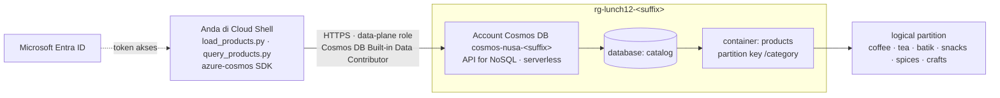

# Lab 12 · Katalog produk yang siap tumbuh

🇬🇧 [Read in English](README.md)

> **Pasangan dari:** [Makan Siang 12 · NoSQL dengan Azure Cosmos DB (Dasar)](../../lunches/12-cosmos-db/README.id.md)
> **Waktu:** sekitar 45 menit · **Biaya:** 💲 (lihat [kelompok biaya](../README.id.md#kelompok-biaya)) · **Tingkat kesulitan:** ★★☆
> **Bisa dikerjakan terpisah:** ✅ Anda tidak memerlukan lab sebelumnya. Semua yang dibutuhkan lab ini dibuat oleh langkah-langkahnya sendiri.
> **Penulis:** Stefanus Pinarta · [Tentang penulis](../../README.id.md#tentang-penulis)

## 🎯 Yang akan Anda bangun

Toko web Nusantara Retail menjual kopi, teh, batik, camilan, rempah, dan kerajinan, dan setiap kategori menggambarkan produknya dengan cara berbeda: kopi punya tingkat sangrai dan tingkat gilingan, batik punya teknik, bahan, dan motif. Anda memberi katalog itu rumah yang tidak memaksakan satu bentuk tabel untuk semuanya: sebuah account **Azure Cosmos DB for NoSQL serverless** dengan database `catalog` dan container `products` yang dipartisi berdasarkan **`/category`**. Anda memberi diri sendiri akses ke data dengan **Microsoft Entra ID** alih-alih account key, memuat 30 produk dengan program Python kecil yang memakai SDK `azure-cosmos`, lalu mengukur berapa biaya setiap hal: sebuah point read, sebuah single-partition query, dan sebuah cross-partition query, masing-masing lengkap dengan request charge dalam RU. Anda mengubah consistency level bawaan dan melihat harga sebuah pembacaan berubah, dan terakhir Anda memperbaiki query pencarian yang membaca seluruh katalog hanya untuk menjawab pertanyaan tentang kopi.



## ✅ Sebelum mulai

- Sebuah subscription Azure tempat Anda bisa membuat resource (lihat [Lab 01](../01-before-you-begin/README.id.md)). Role Contributor pada subscription atau resource group sudah cukup: data-plane role di Tugas 3 adalah pengaturan milik Cosmos DB, bukan role assignment Azure.
- **Azure Cloud Shell (Bash)** — buka [shell.azure.com](https://shell.azure.com). Cloud Shell sudah berisi Azure CLI dan Python 3; Tugas 4 akan memasang dua paket Python ke direktori home Anda.
- Ambil file lab, lalu muat pengaturan bersama dan nama-nama untuk lab ini:

```bash
git clone https://github.com/stefpin/azure-fundamentals-lunches.git   # first time only
cd azure-fundamentals-lunches/labs/12-cosmos-db
source ../common/config.sh
source lab.env
echo "Account: $ACCOUNT  ·  endpoint: $COSMOS_ENDPOINT"
```

- Jika subscription ini belum pernah memakai Cosmos DB, daftarkan resource provider-nya (butuh satu atau dua menit dan aman untuk diulang):

```bash
az provider register --namespace Microsoft.DocumentDB --wait
```

> [!TIP]
> Cloud Shell mengakhiri sesi setelah sekitar 20 menit tanpa aktivitas, dan variabel ikut hilang bersamanya. Jika itu terjadi, `cd` kembali ke folder lab dan jalankan lagi blok di atas (lewati `git clone`).

> [!IMPORTANT]
> Account serverless hanya menagih request unit yang Anda konsumsi dan penyimpanan yang Anda pakai, jadi biaya lab ini nyaris nol. Tetap selesaikan lab dengan bagian **Bersihkan**, meskipun Anda berhenti di tengah jalan.

## 🧭 Pilih mode Anda

| Mode | Cocok untuk Anda jika… | Caranya |
|---|---|---|
| **Terpandu** | Anda ingin setiap langkah dijelaskan | ikuti Tugas 1–6 di bawah |
| **Tantangan** | Anda sudah menguasai dasarnya | baca hanya [Ringkasan tantangan](#-ringkasan-tantangan), bangun dengan cara Anda sendiri, lalu jalankan `bash verify.sh` |

## Tugas 1 · Membuat account serverless untuk API for NoSQL

Account adalah puncak hierarki Cosmos DB: ia memiliki endpoint, region, consistency level, dan model penagihan. Sekarang Anda memilih dua hal yang sulit atau bahkan mustahil diubah belakangan: **API** (NoSQL) dan **capacity mode**. Lab ini memakai **serverless**, dan inilah alasannya:

| | Serverless (lab ini) | Provisioned throughput dengan free tier |
|---|---|---|
| Yang Anda bayar | RU yang benar-benar dikonsumsi permintaan Anda, ditambah penyimpanan | RU/s yang dipesan setiap jam (1.000 RU/s dan 25 GB pertama gratis selama account itu ada) |
| Tersedia untuk | setiap subscription | **satu** account per subscription, dipilih saat pembuatan; free tier Anda mungkin sudah terpakai |
| Region | **hanya satu region**; Anda tidak bisa menambah region belakangan | sebanyak yang Anda mau, masing-masing ditagih |
| Cocok untuk | pengembangan, pengujian, trafik kecil atau yang sesekali melonjak | trafik stabil, beberapa region, produksi |

Serverless bisa dipakai di subscription mana pun dan biayanya nyaris nol untuk lab yang hanya menjalankan beberapa ratus permintaan. Komprominya: account serverless tetap tinggal di satu region; bagian [Tantangan tambahan](#-tantangan-tambahan) menunjukkan region kedua pada account provisioned yang terpisah.

```bash
az group create --name "$RG" --location "$LOCATION" \
  --tags course="$COURSE_TAG" lunch=12 --output table

az cosmosdb create \
  --name "$ACCOUNT" \
  --resource-group "$RG" \
  --kind GlobalDocumentDB \
  --locations regionName="$LOCATION" failoverPriority=0 isZoneRedundant=False \
  --capabilities EnableServerless \
  --default-consistency-level Session \
  --output none
```

`--kind GlobalDocumentDB` adalah API for NoSQL (sekaligus nilai bawaannya). Pembuatan account memakan waktu sekitar 3–10 menit: saat yang tepat untuk membaca ulang bagian *Partisi* di bacaan Makan Siang 12.

> [!TIP]
> **Lebih suka portal?** Jalur di portal: *Home › Create a resource › Azure Cosmos DB › Azure Cosmos DB for NoSQL › Create*. Pilih resource group `rg-lunch12-<suffix>`, nama account `cosmos-nusa-<suffix>`, region Anda, dan **Capacity mode: Serverless**. Biarkan tab-tab lainnya pada pengaturan bawaan — lalu kembali ke sini dan lanjutkan dengan Tugas 2.

> ✅ **Pemeriksaan:** account sudah ada, berbicara NoSQL, berjenis serverless, dan memakai konsistensi Session:
>
> ```bash
> az cosmosdb show -g "$RG" -n "$ACCOUNT" --query "{api:kind, capabilities:capabilities[].name, \
>   consistency:consistencyPolicy.defaultConsistencyLevel, regions:locations[].locationName, \
>   endpoint:documentEndpoint}" --output jsonc
> ```
>
> Harapkan `"api": "GlobalDocumentDB"`, `"capabilities": ["EnableServerless"]`, `"consistency": "Session"`, satu region, dan endpoint yang sama dengan `$COSMOS_ENDPOINT`.

## Tugas 2 · Membuat database catalog dan container products

**Database** mengelompokkan container; **container** menyimpan item dan merupakan tempat Anda memilih **partition key**, yaitu property yang di-hash Cosmos DB untuk menentukan lokasi setiap item. Nusantara Retail menelusuri katalognya berdasarkan kategori (setiap halaman toko adalah satu kategori), dan setiap kategori paling banyak berisi beberapa ribu produk, jauh di bawah 20 GB yang bisa ditampung sebuah logical partition. Jadi `/category` cocok untuk *katalog*. Namun, kunci itu akan buruk untuk riwayat pesanan, di mana satu kategori bisa mengumpulkan jutaan penulisan selama promo 12.12; container tersebut akan memakai sesuatu seperti `/customerId`.

```bash
az cosmosdb sql database create \
  --account-name "$ACCOUNT" --resource-group "$RG" \
  --name "$DATABASE" --output none

az cosmosdb sql container create \
  --account-name "$ACCOUNT" --resource-group "$RG" \
  --database-name "$DATABASE" --name "$CONTAINER" \
  --partition-key-path "$PARTITION_KEY" --output none
```

Tidak ada `--throughput`: container serverless memang tidak punya throughput yang perlu diatur. Dan partition key bersifat permanen. Untuk mengubahnya belakangan, Anda harus menyalin setiap item ke container baru.

> [!TIP]
> **Lebih suka portal?** Jalur di portal: *account Cosmos DB Anda › Data Explorer › New Container*. Database id: **Create new** `catalog`; container id `products`; partition key `/category` — lalu kembali ke sini dan lanjutkan dengan Tugas 3.

> ✅ **Pemeriksaan:** container sudah ada dengan partition key yang benar dan pengindeksan bawaan (consistent):
>
> ```bash
> az cosmosdb sql container show -a "$ACCOUNT" -g "$RG" -d "$DATABASE" -n "$CONTAINER" \
>   --query "{name:name, partitionKey:resource.partitionKey.paths[0], indexing:resource.indexingPolicy.indexingMode}" \
>   --output jsonc
> ```
>
> Harapkan `"partitionKey": "/category"` dan `"indexing": "consistent"`.

## Tugas 3 · Memberi diri sendiri akses data dengan Microsoft Entra ID

Cosmos DB punya dua "bidang" (plane). **Control plane** (membuat account, container, pengaturan) memakai role Azure biasa seperti Contributor. **Data plane** (membaca dan menulis *item*) memakai sistem role milik Cosmos DB sendiri: menjadi Owner subscription **tidak** membuat Anda bisa membaca satu produk pun dengan identitas Entra Anda. Ibaratnya gedung kantor: kartu akses pengelola gedung bisa mengatur ruangan dan lift (control plane), tetapi tidak otomatis bisa membuka lemari arsip di dalam ruangan (data plane) — lemari itu punya kuncinya sendiri. Anda membutuhkan data-plane role. Ada dua role bawaan; tampilkan daftarnya:

```bash
az cosmosdb sql role definition list -a "$ACCOUNT" -g "$RG" \
  --query "[].{role:roleName, id:name}" --output table
```

Anda akan melihat **Cosmos DB Built-in Data Reader** dan **Cosmos DB Built-in Data Contributor**. Berikan role contributor kepada diri Anda sendiri, dengan cakupan seluruh account (`/`). Anda juga bisa membatasi cakupannya ke `/dbs/catalog` atau ke satu container saja:

```bash
ME=$(my_object_id)
az cosmosdb sql role assignment create \
  --account-name "$ACCOUNT" \
  --resource-group "$RG" \
  --scope "/" \
  --principal-id "$ME" \
  --role-definition-name "$DATA_ROLE" \
  --output none
```

> [!NOTE]
> Halaman **Access control (IAM)** di portal mengelola role Azure di control plane. Halaman itu tidak menampilkan assignment data-plane ini, itulah sebabnya tugas ini memakai CLI.

> ✅ **Pemeriksaan:** ada satu assignment untuk object ID Anda:
>
> ```bash
> az cosmosdb sql role assignment list -a "$ACCOUNT" -g "$RG" \
>   --query "[?principalId=='$ME'].{role:roleDefinitionId, scope:scope}" --output table
> ```
>
> Kolom role berakhiran `/sqlRoleDefinitions/00000000-0000-0000-0000-000000000002`, yaitu Data Contributor bawaan. Assignment baru bisa butuh beberapa menit sebelum permintaan berhasil.

<details>
<summary><b>Hanya untuk keadaan darurat:</b> organisasi Anda memblokir assignment ini? Pakai account key, dan pahami apa yang Anda korbankan.</summary>

Jika `role assignment create` gagal dengan error otorisasi dan Anda tidak bisa mendapatkan izinnya, skrip-skrip ini juga menerima primary key milik account:

```bash
export COSMOS_KEY=$(az cosmosdb keys list -g "$RG" -n "$ACCOUNT" --query primaryMasterKey --output tsv)
```

Komprominya: primary key adalah rahasia bersama dengan akses baca dan tulis penuh ke **setiap** database di dalam account. Key itu tidak mencatat *siapa* yang memakainya, tidak pernah kedaluwarsa dengan sendirinya, dan siapa pun yang melihatnya di tangkapan layar atau di riwayat shell Anda langsung memegang seluruh katalog. Merotasinya (menggantinya dengan key baru) merusak setiap aplikasi yang memakainya. Identitas Entra bersifat per orang (atau per managed identity untuk aplikasi), bisa dibatasi ke satu container, dan bisa dicabut dengan satu perintah. Itulah sebabnya account produksi sering mematikan key sepenuhnya (lihat tantangan tambahan). Setelah selesai, jalankan `unset COSMOS_KEY`.
</details>

## Tugas 4 · Memasang SDK dan memuat katalog

Dua skrip di `app/` memakai Azure Cosmos DB SDK for Python. `azure-identity` membuat keduanya bisa memakai ulang login Azure CLI Anda, sehingga tidak ada kata sandi atau key di dalam kode. Pasang keduanya ke direktori home Anda:

```bash
pip install --user azure-cosmos azure-identity
```

`app/products.json` berisi 30 produk: lima per kategori, masing-masing dengan field umum (`id`, `category`, `name`, `price` dalam rupiah, `stock`) dan sebuah objek `attributes` yang bentuknya bergantung pada kategori. Muat produk-produk itu:

```bash
python3 app/load_products.py
```

```text
Writing 30 items to catalog/products (partition key /category)
Signed in with: Microsoft Entra ID (your Azure CLI / Cloud Shell sign-in)

  upsert p-coffee-001           [coffee]    x.xx RU
  ...
Done: 30 items written for ... RU (about ... RU per write).
Items per logical partition (category): batik=5, coffee=5, crafts=5, snacks=5, spices=5, tea=5
```

Setiap penulisan adalah **upsert** (update atau insert: perbarui jika item sudah ada, tambahkan jika belum), sehingga menjalankan skrip ini lagi akan menimpa 30 item yang sama, bukan menggandakannya. Perhatikan bahwa satu penulisan berbiaya beberapa RU, lebih mahal daripada satu pembacaan: secara bawaan Cosmos DB mengindeks **setiap** property dari setiap item, sehingga setiap penulisan juga memperbarui indeks. Itu juga alasan Anda tidak pernah mendeklarasikan skema atau indeks untuk `motif` batik maupun `roast` kopi.

> [!TIP]
> **Lebih suka portal?** Buka *Data Explorer › catalog › products › Items* untuk menelusuri data yang Anda muat. Buka dua item dari kategori yang berbeda dan bandingkan isi `attributes` keduanya.

> ✅ **Pemeriksaan:** container berisi 30 item:
>
> ```bash
> python3 app/query_products.py count
> ```
>
> Pesan yang berakhiran `HTTP 403` berarti role dari Tugas 3 belum berlaku: tunggu dua menit dan jalankan loader-nya lagi.

## Tugas 5 · Membandingkan point read, query satu partisi, dan query lintas partisi

Tagihan Cosmos DB sebagian besar adalah jumlah dari request charge, jadi cara Anda *meminta* data sama pentingnya dengan seberapa banyak data yang Anda punya. Jalankan tiga cara mencari kopi secara berdampingan:

```bash
python3 app/query_products.py compare
```

```text
Operation                                      Scope             Items      RU
---------------------------------------------- ----------------- ----- -------
Point read  id='p-coffee-001', key='coffee'    one item              1    1.00
Query  WHERE c.category = 'coffee'             single partition      5    x.xx
Query  WHERE c.price < 50000                   cross-partition      13    x.xx
```

Biaya query bergantung pada data dan versi SDK Anda (masing-masing beberapa RU). Inilah yang ditunjukkan hasilnya:

- **Point read** (id **dan** partition key): Cosmos DB langsung menuju satu item tanpa menjalankan mesin query. Item hingga 1 KB berbiaya 1 RU. Inilah cara termurah untuk mengambil apa pun, itulah sebabnya desain yang baik selalu mengetahui kedua nilai tersebut.
- **Single-partition query**: partition key di dalam filter mengirim query ke satu logical partition beserta indeksnya.
- **Cross-partition query**: tanpa partition key, query **menyebar (fan out)** ke setiap physical partition. Skrip ini mencetak berapa banyak physical partition yang dimiliki container Anda: hanya **1** pada ukuran sekecil ini, jadi biaya tambahannya kecil. Katalog besar yang tersebar di puluhan physical partition membayar beberapa RU, ditambah latensi, untuk setiap partisi yang dikunjungi query.

Ibaratnya mengambil paket di loker: dengan nomor loker dan kode resi (point read), Anda langsung membuka satu pintu; tanpa keduanya, petugas harus memeriksa semua loker satu per satu (cross-partition query).

Jalankan setiap query secara terpisah untuk melihat detail yang dikumpulkan skrip:

```bash
python3 app/query_products.py read p-coffee-001 coffee
python3 app/query_products.py query "SELECT c.id, c.name, c.price FROM c WHERE c.price < 50000"
python3 app/query_products.py query "SELECT c.id, c.name, c.price FROM c WHERE c.category = 'tea'" --pk tea
```

Setiap query juga mencetak **Documents the engine had to load** (jumlah dokumen yang harus dimuat mesin query) di samping **documents returned** (jumlah dokumen yang dikembalikan). Ingat pasangan angka itu; itulah kunci latihan Rusak lalu perbaiki.

> [!TIP]
> **Lebih suka portal?** Di *Data Explorer › products › New SQL Query*, jalankan `SELECT * FROM c WHERE c.category = 'coffee'` lalu buka tab **Query Stats**: tab itu menampilkan request charge, retrieved document count, dan output document count.

> ✅ **Pemeriksaan:** Anda bisa menjelaskan, dengan angka Anda sendiri, mengapa point read paling murah, dan berapa jumlah physical partition yang dicetak skrip.

## Tugas 6 · Mengubah consistency level bawaan

Konsistensi bawaan account ini adalah **Session**: Anda selalu membaca penulisan Anda sendiri, dan pembacaan dilayani oleh satu replika. **Strong** dan **Bounded staleness** membaca dari dua replika untuk menepati janjinya, sehingga pembacaan yang sama berbiaya sekitar dua kali lipat. Ubah bawaannya menjadi Strong, yang memakan waktu satu atau dua menit:

```bash
az cosmosdb update -g "$RG" -n "$ACCOUNT" --default-consistency-level Strong --output none
python3 app/query_products.py read p-coffee-001 coffee
```

Baris pertama kini berbunyi `consistency: account default (Strong)` dan point read berbiaya sekitar **2 RU**. Sebuah client juga bisa *melonggarkan* konsistensi untuk permintaannya sendiri tanpa menyentuh account:

```bash
python3 app/query_products.py read p-coffee-001 coffee --consistency Eventual
```

Kembali ke sekitar **1 RU**. Ini hanya berlaku ke satu arah: client boleh memilih bawaan account atau level apa pun yang lebih lemah, tidak pernah yang lebih kuat. Kembalikan bawaannya ke Session, pilihan yang tepat untuk toko yang setiap pembelinya harus melihat keranjang belanjanya sendiri:

```bash
az cosmosdb update -g "$RG" -n "$ACCOUNT" --default-consistency-level Session --output none
```

> [!TIP]
> **Lebih suka portal?** Jalur di portal: *account Cosmos DB Anda › Settings › Default consistency* — pilih sebuah level lalu **Save**, kemudian kembali ke sini dan jalankan perintah `read` yang sama.

> ✅ **Pemeriksaan:** account sudah kembali ke Session:
>
> ```bash
> az cosmosdb show -g "$RG" -n "$ACCOUNT" --query consistencyPolicy.defaultConsistencyLevel --output tsv
> ```

## 🔧 Rusak lalu perbaiki

Seorang developer membuat kotak pencarian di **halaman kopi** toko web. Kotak itu berfungsi, jadi langsung dirilis:

```bash
python3 app/query_products.py query \
  "SELECT c.id, c.category, c.name, c.price FROM c WHERE CONTAINS(LOWER(c.name), 'kopi')"
```

Lihat baris-baris terakhir output-nya. Cakupannya **cross-partition**, mesin query **memuat semua 30 dokumen** hanya untuk mengembalikan 6, dan salah satu dari 6 itu adalah camilan (Dodol Kopi) yang tidak semestinya muncul di halaman kopi. Dengan 30 produk, pemborosannya hanya beberapa RU. Sekarang beri katalog 10 salinan sintetis dari setiap produk (330 item) dan jalankan query yang sama lagi:

```bash
python3 app/load_products.py --copies 10
python3 app/query_products.py query \
  "SELECT c.id, c.category, c.name, c.price FROM c WHERE CONTAINS(LOWER(c.name), 'kopi')"
```

Jumlah dokumen yang dimuat dan RU-nya tumbuh seiring **seluruh katalog**, pada setiap ketikan dari setiap pembeli. Tugas Anda: buat pencarian kopi ini murah, dan buat biayanya hanya tumbuh seiring kategori kopi saja.

<details>
<summary>Petunjuk</summary>

Ada dua masalah terpisah. Query itu tidak memberi tahu Cosmos DB logical partition mana yang harus dicari. Selain itu, membungkus property dengan `LOWER()` membuat indeks tidak bisa membantu, sehingga setiap dokumen harus dimuat lalu diubah ke huruf kecil. `CONTAINS` punya argumen ketiga untuk pencocokan yang tidak membedakan huruf besar dan kecil.
</details>

<details>
<summary>Perbaikan</summary>

```bash
python3 app/query_products.py query \
  "SELECT c.id, c.category, c.name, c.price FROM c WHERE c.category = 'coffee' AND CONTAINS(c.name, 'kopi', true)" \
  --pk coffee
```

Cakupannya kini **single partition**, dokumen yang dimuat turun menjadi produk kopi saja, request charge-nya turun, dan camilan itu hilang dari hasil. `LOWER()` dan `UPPER()` tidak bisa memakai indeks, sehingga mesin query harus memuat setiap dokumen. `CONTAINS(..., true)` melakukan sendiri pencocokan tanpa membedakan huruf besar dan kecil. Jika sebuah pencarian benar-benar harus mencakup semua kategori, simpan salinan nama dalam huruf kecil saat Anda menulis item, lalu filter berdasarkan property itu. Panduan query tuning dari Microsoft mencatat bahwa penghematan dari partition key menjadi besar pada container berukuran besar (sekitar 100 GB atau 30.000 RU/s ke atas); kebiasaan ini tetap layak dimiliki jauh sebelum itu.
</details>

Salinan-salinan itu tidak berbahaya dan `verify.sh` tidak mempermasalahkannya. Proses pembersihan akan menghapusnya bersama semua yang lain.

## 🧪 Verifikasi hasil kerja Anda

```bash
bash verify.sh
```

Setiap pemeriksaan seharusnya menampilkan **PASS**. Jika ada yang gagal, pesannya memberi tahu tugas mana yang perlu Anda ulangi. Skrip ini hanya membaca: ia menghitung item melalui kode Python yang sama dengan yang Anda pakai, jadi SDK dari Tugas 4 harus sudah terpasang.

## 🧹 Bersihkan (jangan dilewati!)

```bash
bash cleanup.sh
```

Perintah ini menghapus resource group `rg-lunch12-<suffix>` dan, bersamanya, account, database, item, serta role assignment data-plane yang tinggal di dalam account. Tidak ada yang dibuat di luar resource group. Penghapusan berlanjut di latar belakang selama beberapa menit. Jika Anda memakai opsi darurat dengan key, jalankan juga `unset COSMOS_KEY`.

## 🩺 Pemecahan masalah

| Gejala | Kemungkinan penyebab | Perbaikan |
|---|---|---|
| `az cosmosdb create` gagal dengan *Sorry, we are currently experiencing high demand in Southeast Asia region…* | Kapasitas di region itu sedang tidak mencukupi | Ulangi perintahnya dengan region lain, misalnya `regionName=eastasia` atau `regionName=indonesiacentral`; resource group boleh tetap di tempatnya |
| `az cosmosdb create` menyatakan nama sudah dipakai | Nama account adalah nama DNS global | `export LAB12_ACCOUNT=cosmos-nusa-<something-unique>`, jalankan lagi `source lab.env`, lalu ulangi Tugas 1 |
| Sebuah skrip mencetak *Cosmos DB refused the request (HTTP 403)* dengan *does not have required RBAC permissions to perform action [Microsoft.DocumentDB/databaseAccounts/readMetadata]* | Belum ada data-plane role, atau role-nya belum berlaku | Cek bagian pemeriksaan di Tugas 3; jika assignment-nya sudah ada, tunggu beberapa menit lalu coba lagi |
| *Could not get a Microsoft Entra token from the Azure CLI* | CLI belum login (berjalan di PC Anda sendiri), atau sesi Cloud Shell sudah kedaluwarsa | Jalankan `az login` (PC) atau mulai ulang Cloud Shell, lalu jalankan `source` untuk kedua file itu lagi |
| *The Azure Cosmos DB SDK for Python is not installed* | `pip install` dari Tugas 4 belum dijalankan di lingkungan ini | `pip install --user azure-cosmos azure-identity` |
| `pip` berhenti dengan `error: externally-managed-environment` (pada sebagian instalasi Linux dan macOS) | Python Anda dikelola oleh sistem operasi | Gunakan virtual environment: `python3 -m venv ~/.venv-lab12 && source ~/.venv-lab12/bin/activate && pip install azure-cosmos azure-identity` |
| *Set COSMOS_ENDPOINT first* | Shell baru: variabelnya sudah hilang | `cd` ke folder lab lalu jalankan lagi `source ../common/config.sh` dan `source lab.env` |
| *Not found (HTTP 404)* dari `read` | id yang salah **atau** partition key yang salah, misalnya `read p-coffee-001 tea` | Point read membutuhkan keduanya, dengan ejaan yang persis sama; nilainya peka huruf besar-kecil |
| Tantangan tambahan dengan free tier gagal karena subscription sudah punya account free tier | Hanya boleh ada satu account free tier per subscription | Temukan account itu dengan `az cosmosdb list --query "[?enableFreeTier].{name:name, rg:resourceGroup}" --output table`, atau lewati tantangan ini (tanpa free tier, biayanya berjalan setiap jam) |

## 🚀 Tantangan tambahan

- **Region kedua (💲 jika free tier Anda sudah terpakai).** Account serverless hanya tinggal di satu region, jadi buat sebuah account *provisioned* kecil dengan dua region dan satu container 400 RU/s. Penagihannya RU/s × jumlah region, jadi totalnya 800 RU/s, masih di dalam jatah 1.000 RU/s milik free tier jika free tier masih tersedia di subscription Anda. Tanpa free tier, account ini ditagih setiap jam sampai Anda menghapusnya.

  ```bash
  GEO="cosmos-nusa-geo-${SUFFIX}"
  az cosmosdb create -n "$GEO" -g "$RG" --enable-free-tier true --default-consistency-level Session \
    --locations regionName="$LOCATION" failoverPriority=0 isZoneRedundant=False \
    --locations regionName="$SECONDARY_LOCATION" failoverPriority=1 isZoneRedundant=False --output none
  az cosmosdb sql database create -a "$GEO" -g "$RG" -n "$DATABASE" --output none
  az cosmosdb sql container create -a "$GEO" -g "$RG" -d "$DATABASE" -n "$CONTAINER" -p "$PARTITION_KEY" \
    --throughput 400 --output none
  az cosmosdb sql role assignment create -a "$GEO" -g "$RG" --scope "/" --principal-id "$(my_object_id)" \
    --role-definition-name "$DATA_ROLE" --output none
  COSMOS_ENDPOINT="https://${GEO}.documents.azure.com:443/" python3 app/load_products.py
  ```

  Lalu buka *Replicate data globally* di portal untuk melihat kedua region di peta. Hapus account itu setelah selesai (`az cosmosdb delete -n "$GEO" -g "$RG" --yes`), atau biarkan `cleanup.sh` menghapusnya bersama resource group.
- **Matikan key.** Jadikan Entra ID satu-satunya jalan masuk, lalu buktikan bahwa key tidak lagi berfungsi:
  `az resource update -g "$RG" -n "$ACCOUNT" --resource-type "Microsoft.DocumentDB/databaseAccounts" --set properties.disableLocalAuth=true`.
- **Rancang riwayat pesanan.** Di Data Explorer, buat container `orders` dengan partition key *hierarkis* (`/storeId`, lalu `/orderMonth`), lalu tuliskan query mana dari bacaan Makan Siang 12 yang dilayaninya dengan baik dan mana yang tidak.

## 🏁 Ringkasan tantangan

Bangun hal-hal berikut dengan cara apa pun yang Anda suka (portal, CLI, Bicep):

1. Sebuah account **Cosmos DB for NoSQL** di `rg-lunch12-<suffix>` (beri nama `cosmos-nusa-<suffix>`) yang **serverless**, atau provisioned dengan **free tier**, dan memakai **Session** sebagai konsistensi bawaannya.
2. Database **`catalog`** dengan container **`products`** yang partition key-nya **`/category`**.
3. Identitas Entra Anda sendiri memegang **Cosmos DB Built-in Data Contributor** pada account tersebut (akses dengan key adalah opsi darurat yang dicatat oleh `verify.sh`, tetapi tidak dianggap gagal).
4. Setidaknya **20 produk** di dalam container. `app/load_products.py` memuat 30.
5. Anda bisa menunjukkan, lengkap dengan request charge-nya, sebuah point read, sebuah single-partition query, dan sebuah cross-partition query (`app/query_products.py compare`).

Lalu jalankan `bash verify.sh`. Buntu? Intip `solution.sh` atau beralih ke mode Terpandu.

---

⬅️ [Bacaan Makan Siang 12](../../lunches/12-cosmos-db/README.id.md) · 🏠 [Semua lab](../README.id.md) · 🏠 [Beranda kursus](../../README.id.md)

<sub>Terakhir divalidasi: Oktober 2026 · Ada yang tidak berfungsi? [Laporkan masalah lab](../../CONTRIBUTING.md).</sub>
