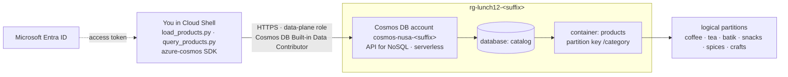

# Lab 12 · A product catalogue that scales

🇮🇩 [Baca dalam Bahasa Indonesia](README.id.md)

> **Pairs with:** [Lunch 12 · NoSQL with Azure Cosmos DB (Basic)](../../lunches/12-cosmos-db/README.md)
> **Time:** about 45 minutes · **Cost:** 💲 (see [cost bands](../README.md#cost-bands)) · **Difficulty:** ★★☆
> **Works on its own:** ✅ You do not need any earlier lab. Everything this lab needs is created by its steps.
> **Author:** Stefanus Pinarta · [About the author](../../README.md#about-the-author)

## 🎯 What you'll build

Nusantara Retail's web shop sells coffee, tea, batik, snacks, spices and crafts, and every category describes its
products differently: coffee has a roast and a grind, batik has a technique, a fabric and a motif. You give the
catalogue a home that doesn't force one table shape on all of them: a **serverless Azure Cosmos DB for NoSQL** account
with a database `catalog` and a container `products` partitioned by **`/category`**. You give yourself access to the
data with **Microsoft Entra ID** instead of account keys, load 30 products with a small Python program that uses the
`azure-cosmos` SDK, and then measure what things cost: a point read, a single-partition query and a cross-partition
query, each with its request charge in RU. You change the default consistency level and watch the price of a read
change, and finally you fix a search query that reads the whole catalogue to answer a question about coffee.



## ✅ Before you start

- An Azure subscription where you can create resources (see [Lab 01](../01-before-you-begin/README.md)). Contributor on
  the subscription or resource group is enough: the data-plane role in Task 3 is a Cosmos DB setting, not an Azure role
  assignment.
- **Azure Cloud Shell (Bash)** — open [shell.azure.com](https://shell.azure.com). It already has the Azure CLI and
  Python 3; Task 4 installs two Python packages into your home directory.
- Get the lab files and load the shared settings and this lab's names:

```bash
git clone https://github.com/stefpin/azure-fundamentals-lunches.git   # first time only
cd azure-fundamentals-lunches/labs/12-cosmos-db
source ../common/config.sh
source lab.env
echo "Account: $ACCOUNT  ·  endpoint: $COSMOS_ENDPOINT"
```

- If this subscription has never used Cosmos DB, register its resource provider (it takes a minute or two and is
  harmless to repeat):

```bash
az provider register --namespace Microsoft.DocumentDB --wait
```

> [!TIP]
> Cloud Shell ends a session after about 20 minutes without activity, and variables disappear with it. If that
> happens, `cd` back into the lab folder and run the block above again (skip the `git clone`).

> [!IMPORTANT]
> A serverless account bills only for the request units you consume and the storage you use, so this lab costs next
> to nothing. Finish with the **Clean up** section anyway, even if you stop halfway.

## 🧭 Choose your mode

| Mode | For you if… | How |
|---|---|---|
| **Guided** | you want every step explained | follow Tasks 1–6 below |
| **Challenge** | you already know the basics | read only the [Challenge brief](#-challenge-brief), build it your way, then run `bash verify.sh` |

## Task 1 · Create a serverless account for the API for NoSQL

The account is the top of the Cosmos DB hierarchy: it owns the endpoint, the regions, the consistency level and the
billing model. You choose two things now that are hard or impossible to change later: the **API** (NoSQL) and the
**capacity mode**. This lab uses **serverless**, and here is why:

| | Serverless (this lab) | Provisioned throughput with the free tier |
|---|---|---|
| You pay for | the RUs your requests actually consume, plus storage | RU/s reserved every hour (the first 1,000 RU/s and 25 GB are free for the account's lifetime) |
| Available to | every subscription | **one** account per subscription, chosen at creation; your free tier may already be in use |
| Regions | **one region only**; you can't add regions later | as many as you like, each billed |
| Good for | development, tests, small or spiky traffic | steady traffic, several regions, production |

Serverless works in any subscription and costs almost nothing for a lab that runs a few hundred requests. The
trade-off is that it stays in one region; the [Stretch goals](#-stretch-goals) show a second region on a separate,
provisioned account.

```bash
az group create --name "$RG" --location "$LOCATION" \
  --tags course="$COURSE_TAG" lunch=12 --output table

az cosmosdb create \
  --name "$ACCOUNT" \
  --resource-group "$RG" \
  --kind GlobalDocumentDB \
  --locations regionName="$LOCATION" failoverPriority=0 isZoneRedundant=False \
  --capabilities EnableServerless \
  --default-consistency-level Session \
  --output none
```

`--kind GlobalDocumentDB` is the API for NoSQL (it's also the default). Creating an account takes about 3–10 minutes:
a good moment to reread *Partitioning* in the Lunch 12 reading.

> [!TIP]
> **Prefer the portal?** Portal path: *Home › Create a resource › Azure Cosmos DB › Azure Cosmos DB for NoSQL ›
> Create*. Pick resource group `rg-lunch12-<suffix>`, account name `cosmos-nusa-<suffix>`, your region, and
> **Capacity mode: Serverless**. Leave the other tabs at their defaults — then come back and continue with Task 2.

> ✅ **Checkpoint:** the account exists, speaks NoSQL, is serverless and uses Session consistency:
>
> ```bash
> az cosmosdb show -g "$RG" -n "$ACCOUNT" --query "{api:kind, capabilities:capabilities[].name, \
>   consistency:consistencyPolicy.defaultConsistencyLevel, regions:locations[].locationName, \
>   endpoint:documentEndpoint}" --output jsonc
> ```
>
> Expect `"api": "GlobalDocumentDB"`, `"capabilities": ["EnableServerless"]`, `"consistency": "Session"`, one region,
> and an endpoint that matches `$COSMOS_ENDPOINT`.

## Task 2 · Create the catalog database and the products container

A **database** groups containers; a **container** holds the items and is where you choose the **partition key**, the
property Cosmos DB hashes to decide where every item lives. Nusantara Retail browses its catalogue by category (every
shop page is one category) and each category holds at most a few thousand products, far below the 20 GB a logical
partition can hold. So `/category` is a good fit for the *catalogue*. It would be a poor key for the order history,
where one category would collect millions of writes during the 12.12 sale; that container would use something like
`/customerId` instead.

```bash
az cosmosdb sql database create \
  --account-name "$ACCOUNT" --resource-group "$RG" \
  --name "$DATABASE" --output none

az cosmosdb sql container create \
  --account-name "$ACCOUNT" --resource-group "$RG" \
  --database-name "$DATABASE" --name "$CONTAINER" \
  --partition-key-path "$PARTITION_KEY" --output none
```

There is no `--throughput`: serverless containers have none to set. And the partition key is permanent. To change it
later you would copy every item into a new container.

> [!TIP]
> **Prefer the portal?** Portal path: *your Cosmos DB account › Data Explorer › New Container*. Database id:
> **Create new** `catalog`; container id `products`; partition key `/category` — then come back and continue with
> Task 3.

> ✅ **Checkpoint:** the container exists with the right partition key and default (consistent) indexing:
>
> ```bash
> az cosmosdb sql container show -a "$ACCOUNT" -g "$RG" -d "$DATABASE" -n "$CONTAINER" \
>   --query "{name:name, partitionKey:resource.partitionKey.paths[0], indexing:resource.indexingPolicy.indexingMode}" \
>   --output jsonc
> ```
>
> Expect `"partitionKey": "/category"` and `"indexing": "consistent"`.

## Task 3 · Give yourself data access with Microsoft Entra ID

Cosmos DB has two planes. The **control plane** (create accounts, containers, settings) uses ordinary Azure roles such
as Contributor. The **data plane** (read and write *items*) uses Cosmos DB's own role system: being Owner of the
subscription does **not** let you read a single product with your Entra identity. You need a data-plane role. There are
two built-in ones; list them:

```bash
az cosmosdb sql role definition list -a "$ACCOUNT" -g "$RG" \
  --query "[].{role:roleName, id:name}" --output table
```

You'll see **Cosmos DB Built-in Data Reader** and **Cosmos DB Built-in Data Contributor**. Give the contributor role to
yourself, scoped to the whole account (`/`). You could also scope it to `/dbs/catalog` or to a single container:

```bash
ME=$(my_object_id)
az cosmosdb sql role assignment create \
  --account-name "$ACCOUNT" \
  --resource-group "$RG" \
  --scope "/" \
  --principal-id "$ME" \
  --role-definition-name "$DATA_ROLE" \
  --output none
```

> [!NOTE]
> The portal's **Access control (IAM)** page manages control-plane Azure roles. It doesn't show this data-plane
> assignment, which is why this task uses the CLI.

> ✅ **Checkpoint:** one assignment for your object ID:
>
> ```bash
> az cosmosdb sql role assignment list -a "$ACCOUNT" -g "$RG" \
>   --query "[?principalId=='$ME'].{role:roleDefinitionId, scope:scope}" --output table
> ```
>
> The role column ends in `/sqlRoleDefinitions/00000000-0000-0000-0000-000000000002`, the built-in Data Contributor.
> New assignments can take a few minutes before requests succeed.

<details>
<summary><b>Fallback only:</b> your organisation blocks the assignment? Use an account key, and know what you give up.</summary>

If `role assignment create` fails with an authorisation error and you can't get the permission, the scripts also
accept the account's primary key:

```bash
export COSMOS_KEY=$(az cosmosdb keys list -g "$RG" -n "$ACCOUNT" --query primaryMasterKey --output tsv)
```

The trade-off: a primary key is a shared secret with full read and write access to **every** database in the account.
It doesn't record *who* used it, it never expires on its own, and anyone who sees it in a screenshot or your shell
history has the whole catalogue. Rotating it breaks every app that uses it. An Entra identity is per person (or per
managed identity for apps), can be scoped to one container, and is removed in one command. That's why production
accounts often switch keys off entirely (see the stretch goals). When you finish, run `unset COSMOS_KEY`.
</details>

## Task 4 · Install the SDK and load the catalogue

The two scripts in `app/` use the Azure Cosmos DB SDK for Python. `azure-identity` lets them reuse your Azure CLI
sign-in, so there is no password or key in the code. Install both into your home directory:

```bash
pip install --user azure-cosmos azure-identity
```

`app/products.json` holds 30 products: five per category, each with the common fields (`id`, `category`, `name`,
`price` in rupiah, `stock`) and an `attributes` object whose shape depends on the category. Load them:

```bash
python3 app/load_products.py
```

```text
Writing 30 items to catalog/products (partition key /category)
Signed in with: Microsoft Entra ID (your Azure CLI / Cloud Shell sign-in)

  upsert p-coffee-001           [coffee]    x.xx RU
  ...
Done: 30 items written for ... RU (about ... RU per write).
Items per logical partition (category): batik=5, coffee=5, crafts=5, snacks=5, spices=5, tea=5
```

Each write is an **upsert**, so running the script again overwrites the same 30 items instead of duplicating them.
Notice that a write costs several RU, more than a read: by default Cosmos DB indexes **every** property of every item,
so each write also updates the index. That's also why you never declared a schema or an index for the batik
`motif` or the coffee `roast`.

> [!TIP]
> **Prefer the portal?** Open *Data Explorer › catalog › products › Items* to browse what you loaded. Open two items
> from different categories and compare their `attributes`.

> ✅ **Checkpoint:** the container counts 30 items:
>
> ```bash
> python3 app/query_products.py count
> ```
>
> A message ending in `HTTP 403` means the role from Task 3 hasn't taken effect yet: wait two minutes and run the
> loader again.

## Task 5 · Point read, single-partition query, cross-partition query

A Cosmos DB bill is mostly a sum of request charges, so how you *ask* for data matters as much as how much data you
have. Run the three ways of finding coffee side by side:

```bash
python3 app/query_products.py compare
```

```text
Operation                                      Scope             Items      RU
---------------------------------------------- ----------------- ----- -------
Point read  id='p-coffee-001', key='coffee'    one item              1    1.00
Query  WHERE c.category = 'coffee'             single partition      5    x.xx
Query  WHERE c.price < 50000                   cross-partition      13    x.xx
```

The query charges depend on your data and SDK version (a few RU each). What they show:

- **Point read** (id **and** partition key): Cosmos DB goes straight to one item without running the query engine.
  An item up to 1 KB costs 1 RU. It's the cheapest way to fetch anything, which is why good designs know both values.
- **Single-partition query**: the partition key in the filter sends the query to one logical partition and its index.
- **Cross-partition query**: with no partition key, the query **fans out** to every physical partition. The script
  prints how many your container has: just **1** at this size, so the extra cost is small. A big catalogue spread over
  dozens of physical partitions pays a few RU, and some latency, for every partition the query visits.

Run each query on its own to see the details the script collects:

```bash
python3 app/query_products.py read p-coffee-001 coffee
python3 app/query_products.py query "SELECT c.id, c.name, c.price FROM c WHERE c.price < 50000"
python3 app/query_products.py query "SELECT c.id, c.name, c.price FROM c WHERE c.category = 'tea'" --pk tea
```

Each query also prints **Documents the engine had to load** next to **documents returned**. Remember that pair; it's
the key to the Break-and-fix exercise.

> [!TIP]
> **Prefer the portal?** In *Data Explorer › products › New SQL Query*, run `SELECT * FROM c WHERE c.category = 'coffee'`
> and open the **Query Stats** tab: it shows the request charge, the retrieved document count and the output document
> count.

> ✅ **Checkpoint:** you can say, using your own numbers, why the point read is the cheapest, and what the script
> printed as the number of physical partitions.

## Task 6 · Change the default consistency level

The account's default consistency is **Session**: you always read your own writes, and reads are served by a single
replica. **Strong** and **Bounded staleness** read from two replicas to guarantee their promise, so the same read costs
about twice as much. Switch the default to Strong, which takes a minute or two:

```bash
az cosmosdb update -g "$RG" -n "$ACCOUNT" --default-consistency-level Strong --output none
python3 app/query_products.py read p-coffee-001 coffee
```

The first line now says `consistency: account default (Strong)` and the point read costs about **2 RU**. A client can
also *relax* consistency for its own requests without touching the account:

```bash
python3 app/query_products.py read p-coffee-001 coffee --consistency Eventual
```

Back to about **1 RU**. It only works in that direction: a client can choose the account default or anything weaker,
never something stronger. Put the default back to Session, the right choice for a shop where every shopper must see
their own basket:

```bash
az cosmosdb update -g "$RG" -n "$ACCOUNT" --default-consistency-level Session --output none
```

> [!TIP]
> **Prefer the portal?** Portal path: *your Cosmos DB account › Settings › Default consistency* — pick a level and
> **Save**, then come back and run the same `read` commands.

> ✅ **Checkpoint:** the account is back on Session:
>
> ```bash
> az cosmosdb show -g "$RG" -n "$ACCOUNT" --query consistencyPolicy.defaultConsistencyLevel --output tsv
> ```

## 🔧 Break it and fix it

A developer builds the search box on the **coffee page** of the web shop. It works, so it ships:

```bash
python3 app/query_products.py query \
  "SELECT c.id, c.category, c.name, c.price FROM c WHERE CONTAINS(LOWER(c.name), 'kopi')"
```

Look at the last lines of the output. The scope is **cross-partition**, the engine **loaded all 30 documents** to
return 6, and one of the 6 is a snack (Dodol Kopi) that doesn't belong on the coffee page. With 30 products the
waste is a few RU. Now give the catalogue 10 synthetic copies of every product (330 items) and run the same query
again:

```bash
python3 app/load_products.py --copies 10
python3 app/query_products.py query \
  "SELECT c.id, c.category, c.name, c.price FROM c WHERE CONTAINS(LOWER(c.name), 'kopi')"
```

The documents loaded and the RU grow with the **whole catalogue**, on every keystroke of every shopper. Your job: make
the coffee search cheap, and make its cost grow only with the coffee category.

<details>
<summary>Hint</summary>

Two separate problems. The query doesn't tell Cosmos DB which logical partition to search. And wrapping the property in
`LOWER()` stops the index from helping, so every document has to be loaded and lower-cased. `CONTAINS` has a third
argument for case-insensitive matching.
</details>

<details>
<summary>Fix</summary>

```bash
python3 app/query_products.py query \
  "SELECT c.id, c.category, c.name, c.price FROM c WHERE c.category = 'coffee' AND CONTAINS(c.name, 'kopi', true)" \
  --pk coffee
```

The scope is now **single partition**, the documents loaded fall to the coffee products only, the request charge
drops, and the snack is gone from the results. `LOWER()` and `UPPER()` can't use the index, so the engine must load
every document. `CONTAINS(..., true)` does the case-insensitive match itself. If a search really must cover every
category, store a lower-case copy of the name when you write the item and filter on that property instead. Microsoft's
query-tuning guidance notes that the partition-key saving becomes large on big containers (around 100 GB or 30,000
RU/s and up); the habit is worth having long before that.
</details>

The copies are harmless and `verify.sh` doesn't mind them. Clean-up removes them with everything else.

## 🧪 Verify your work

```bash
bash verify.sh
```

Every check should say **PASS**. If one fails, the message tells you which task to revisit. The script only reads: it
counts the items through the same Python code you used, so the SDK from Task 4 must be installed.

## 🧹 Clean up (do not skip!)

```bash
bash cleanup.sh
```

This deletes the resource group `rg-lunch12-<suffix>` and with it the account, its database, its items and the
data-plane role assignment, which lives inside the account. Nothing was created outside the resource group.
Deletion continues in the background for a few minutes. If you used the key fallback, also run `unset COSMOS_KEY`.

## 🩺 Troubleshooting

| Symptom | Likely cause | Fix |
|---|---|---|
| `az cosmosdb create` fails with *Sorry, we are currently experiencing high demand in Southeast Asia region…* | Not enough capacity in that region right now | Repeat the command with another region, for example `regionName=eastasia` or `regionName=indonesiacentral`; the resource group can stay where it is |
| `az cosmosdb create` says the name is already in use | Account names are global DNS names | `export LAB12_ACCOUNT=cosmos-nusa-<something-unique>`, run `source lab.env` again and repeat Task 1 |
| A script prints *Cosmos DB refused the request (HTTP 403)* with *does not have required RBAC permissions to perform action [Microsoft.DocumentDB/databaseAccounts/readMetadata]* | No data-plane role yet, or it hasn't taken effect | Check Task 3's checkpoint; if the assignment is there, wait a few minutes and retry |
| *Could not get a Microsoft Entra token from the Azure CLI* | The CLI isn't signed in (running on your own PC), or the Cloud Shell session expired | Run `az login` (PC) or restart Cloud Shell, then `source` the two files again |
| *The Azure Cosmos DB SDK for Python is not installed* | Task 4's `pip install` didn't run in this environment | `pip install --user azure-cosmos azure-identity` |
| `pip` stops with `error: externally-managed-environment` (some Linux and macOS installs) | Your Python is managed by the operating system | Use a virtual environment: `python3 -m venv ~/.venv-lab12 && source ~/.venv-lab12/bin/activate && pip install azure-cosmos azure-identity` |
| *Set COSMOS_ENDPOINT first* | New shell: the variables are gone | `cd` into the lab folder and run `source ../common/config.sh` and `source lab.env` again |
| *Not found (HTTP 404)* from `read` | Wrong id **or** wrong partition key, for example `read p-coffee-001 tea` | A point read needs both, spelled exactly; values are case-sensitive |
| Free-tier stretch goal fails because the subscription already has a free-tier account | Only one free-tier account per subscription | Find it with `az cosmosdb list --query "[?enableFreeTier].{name:name, rg:resourceGroup}" --output table`, or skip the stretch goal (without the free tier it costs money every hour) |

## 🚀 Stretch goals

- **A second region (💲 if your free tier is used up).** Serverless accounts live in one region, so create a small
  *provisioned* account with two regions and one 400 RU/s container. Billing is RU/s × regions, so that's 800 RU/s,
  inside the free tier's 1,000 RU/s if it's still available in your subscription. Without the free tier it bills every
  hour until you delete it.

  ```bash
  GEO="cosmos-nusa-geo-${SUFFIX}"
  az cosmosdb create -n "$GEO" -g "$RG" --enable-free-tier true --default-consistency-level Session \
    --locations regionName="$LOCATION" failoverPriority=0 isZoneRedundant=False \
    --locations regionName="$SECONDARY_LOCATION" failoverPriority=1 isZoneRedundant=False --output none
  az cosmosdb sql database create -a "$GEO" -g "$RG" -n "$DATABASE" --output none
  az cosmosdb sql container create -a "$GEO" -g "$RG" -d "$DATABASE" -n "$CONTAINER" -p "$PARTITION_KEY" \
    --throughput 400 --output none
  az cosmosdb sql role assignment create -a "$GEO" -g "$RG" --scope "/" --principal-id "$(my_object_id)" \
    --role-definition-name "$DATA_ROLE" --output none
  COSMOS_ENDPOINT="https://${GEO}.documents.azure.com:443/" python3 app/load_products.py
  ```

  Then open *Replicate data globally* in the portal to see both regions on the map. Delete the account when you're done
  (`az cosmosdb delete -n "$GEO" -g "$RG" --yes`), or let `cleanup.sh` remove it with the resource group.
- **Switch keys off.** Make Entra ID the only way in, then prove a key no longer works:
  `az resource update -g "$RG" -n "$ACCOUNT" --resource-type "Microsoft.DocumentDB/databaseAccounts" --set properties.disableLocalAuth=true`.
- **Design the order history.** In Data Explorer, create a container `orders` with a *hierarchical* partition key
  (`/storeId`, then `/orderMonth`) and write down which queries from the Lunch 12 reading it serves well and which it
  doesn't.

## 🏁 Challenge brief

Build the following, any way you like (portal, CLI, Bicep):

1. A **Cosmos DB for NoSQL** account in `rg-lunch12-<suffix>` (name it `cosmos-nusa-<suffix>`) that is **serverless**,
   or provisioned with the **free tier**, and uses **Session** as its default consistency.
2. A database **`catalog`** with a container **`products`** whose partition key is **`/category`**.
3. Your own Entra identity holds **Cosmos DB Built-in Data Contributor** on the account (key access is a fallback that
   `verify.sh` notes but doesn't fail).
4. At least **20 products** in the container. `app/load_products.py` loads 30.
5. You can show, with request charges, a point read, a single-partition query and a cross-partition query
   (`app/query_products.py compare`).

Then run `bash verify.sh`. Stuck? Peek at `solution.sh` or switch to Guided mode.

---

⬅️ [Lunch 12 reading](../../lunches/12-cosmos-db/README.md) · 🏠 [All labs](../README.md) · 🏠 [Course home](../../README.md)

<sub>Last validated: October 2026 · Something broken? [Report a lab problem](../../CONTRIBUTING.md).</sub>
