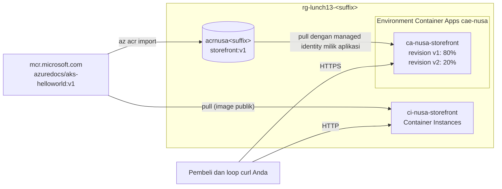

# Lab 13 · Mengemas toko online

🇬🇧 [Read in English](README.md)

> **Pasangan dari:** [Makan Siang 13 · Containers (Dasar): Container Registry, Container Instances, dan Container Apps](../../lunches/13-containers-basic/README.id.md)
> **Waktu:** sekitar 45 menit · **Biaya:** 💲 (lihat [kelompok biaya](../README.id.md#kelompok-biaya)) · **Tingkat kesulitan:** ★★☆
> **Bisa dikerjakan terpisah:** ✅ Anda tidak memerlukan lab sebelumnya. Semua yang dibutuhkan lab ini dibuat oleh langkah-langkahnya sendiri.
> **Penulis:** Stefanus Pinarta · [Tentang penulis](../../README.id.md#tentang-penulis)

## 🎯 Yang akan Anda bangun

Nusantara Retail menginginkan satu kemasan toko online yang berjalan sama persis di mana pun, dan pilihan hosting yang
tidak memakan biaya pada pukul tiga pagi. Anda akan membuat **Azure Container Registry** privat dan mengimpor sebuah
aplikasi web contoh berukuran kecil buatan Microsoft ke dalamnya sebagai `storefront:v1`. Anda akan menjalankan image
yang sama dalam hitungan detik di **Azure Container Instances**, lalu men-deploy-nya dari registry Anda ke **Azure
Container Apps**, dengan menarik image memakai managed identity milik aplikasi, bukan kata sandi. Terakhir, Anda akan
menguji bebannya (replica 0 → 5 → 0), merilis revision kedua ke 20% request, dan memperbaiki target port yang rusak.



Image contoh ini adalah aplikasi web mungil buatan Microsoft yang mendengarkan di **port 80** dan menampilkan nilai
environment variable `TITLE` sebagai judul halamannya. Aplikasi ini sebenarnya dibuat untuk panduan AKS, tetapi itu
tidak masalah: container image bisa berjalan di mana saja. Dengan mengubah `TITLE`, Anda bisa langsung melihat salinan
atau revision mana yang menjawab sebuah request.

## ✅ Sebelum mulai

- Sebuah subscription (*langganan*) Azure tempat Anda boleh membuat resource (lihat [Lab 01](../01-before-you-begin/README.id.md)).
- **Azure Cloud Shell (Bash)** — buka [shell.azure.com](https://shell.azure.com). Tidak ada yang perlu dipasang.
- Ambil file lab dan muat pengaturan bersama:

```bash
git clone https://github.com/stefpin/azure-fundamentals-lunches.git   # first time only
cd azure-fundamentals-lunches/labs/13-containers-basic
source ../common/config.sh
RG=$(rg_name 13)
ACR_NAME="acrnusa${SUFFIX}"
APP=ca-nusa-storefront
```

- Pastikan resource provider yang dipakai lab ini sudah terdaftar. Ini langkah sekali jalan untuk setiap subscription
  dan bisa memakan waktu satu atau dua menit:

```bash
for ns in Microsoft.ContainerRegistry Microsoft.ContainerInstance Microsoft.App Microsoft.OperationalInsights; do
  az provider register --namespace "$ns" --wait
done
```

> [!IMPORTANT]
> Resource lab menimbulkan biaya selama resource itu masih ada. Akhiri dengan bagian **Bersihkan**, bahkan jika Anda
> berhenti di tengah jalan. Jika Cloud Shell kehabisan waktu (timeout), buka lagi, `cd` kembali ke folder ini, lalu
> jalankan ulang baris `source` dan baris variabel di atas (serta baris `LOGIN_SERVER=`, `FQDN=`, atau `REV1=` dari
> tugas yang sedang Anda kerjakan).

## 🧭 Pilih mode Anda

| Mode | Cocok untuk Anda jika… | Caranya |
|---|---|---|
| **Terpandu** | Anda ingin setiap langkah dijelaskan | ikuti Tugas 1–5 di bawah |
| **Tantangan** | Anda sudah menguasai dasar-dasarnya | baca [Ringkasan tantangan](#-ringkasan-tantangan) saja, bangun dengan cara Anda sendiri, lalu jalankan `bash verify.sh` |

## Tugas 1 · Membuat registry privat dan mengimpor image toko online

Registry adalah satu-satunya sumber acuan (single source of truth) untuk image Anda. `az acr import` menyalin image dari
registry lain di dalam Azure, jadi Anda tidak memerlukan Docker di Cloud Shell.

```bash
ensure_rg "$RG" 13

az acr create \
  --resource-group "$RG" \
  --name "$ACR_NAME" \
  --sku Basic \
  --location "$LOCATION" \
  --output none

LOGIN_SERVER=$(az acr show --name "$ACR_NAME" --query loginServer --output tsv)
echo "Login server: $LOGIN_SERVER"

az acr import \
  --name "$ACR_NAME" \
  --source mcr.microsoft.com/azuredocs/aks-helloworld:v1 \
  --image storefront:v1

az acr repository show-tags --name "$ACR_NAME" --repository storefront --output table
az acr show --name "$ACR_NAME" --query "{tier:sku.name, adminUser:adminUserEnabled}" --output table
```

Perhatikan bahwa image itu kini punya nama baru di registry Anda, `storefront:v1`, sementara isinya (dan digest-nya)
identik dengan aslinya dari Microsoft. Admin user bernilai `false`: tidak ada satu pun bagian lab ini yang membutuhkan
kata sandi registry.

**Opsional — build di cloud dengan ACR Tasks.** File [`app/Dockerfile`](app/Dockerfile) menambahkan satu layer di atas
image contoh (judul default yang baru). Jika subscription Anda mengizinkan ACR Tasks, build image itu di Azure:

```bash
az acr build --registry "$ACR_NAME" --image storefront:v1-built ./app
```

Jika Anda melihat `TasksOperationsNotAllowed`, berarti subscription Anda memakai kredit gratis Azure, dan saat tulisan
ini dibuat eksekusi ACR Tasks sedang dihentikan sementara untuk subscription seperti itu. Lewati langkah ini; impor di
atas sudah cukup untuk seluruh lab.

> [!TIP]
> **Lebih suka portal?** *Home › Container registries › acrnusa… › Services › Repositories › storefront* menampilkan tag
> beserta digest-nya. *Settings › Access keys* menunjukkan bahwa admin user nonaktif.

> ✅ **Pemeriksaan:** `az acr repository show-tags` menampilkan `v1`, dan registry menunjukkan `Basic` dengan admin user
> `false`.

## Tugas 2 · Menjalankan container dalam hitungan detik dengan Container Instances

Container Instances menjalankan satu container group tanpa cluster dan tanpa VM yang perlu Anda urus. Anda membayar per
detik selama container group itu berjalan.

```bash
az container create \
  --resource-group "$RG" \
  --name ci-nusa-storefront \
  --image mcr.microsoft.com/azuredocs/aks-helloworld:v1 \
  --os-type Linux \
  --cpu 1 --memory 1.5 \
  --ports 80 \
  --dns-name-label "nusa-store-${SUFFIX}" \
  --environment-variables TITLE="Nusantara Retail storefront on Container Instances" \
  --output none

az container show --resource-group "$RG" --name ci-nusa-storefront \
  --query "{state:instanceView.state, fqdn:ipAddress.fqdn}" --output table

ACI_FQDN=$(az container show --resource-group "$RG" --name ci-nusa-storefront --query ipAddress.fqdn --output tsv)
curl -s "http://${ACI_FQDN}/" | grep -o "<title>[^<]*</title>"
az container logs --resource-group "$RG" --name ci-nusa-storefront
```

Mengapa container group ini menarik image dari registry publik Microsoft, bukan dari registry Anda? Untuk menarik image
dari registry privat, Container Instances memerlukan managed identity jenis **user-assigned** yang memegang AcrPull; ia
tidak bisa memakai system-assigned identity untuk menarik image. Tantangan tambahan 1 menunjukkan caranya. Container
Apps, yang akan Anda pakai berikutnya, bisa memakai system-assigned identity miliknya sendiri. Perhatikan juga bahwa
alamatnya hanya HTTP biasa: Container Instances memberi Anda alamat IP dan nama DNS, bukan endpoint HTTPS yang
terkelola.

> [!TIP]
> **Lebih suka portal?** *Home › Container instances › ci-nusa-storefront* menampilkan status dan FQDN (fully qualified
> domain name, nama domain lengkap) di **Overview**, dan **Containers › Logs** menampilkan output yang sama dengan
> `az container logs`.

> ✅ **Pemeriksaan:** statusnya `Running`, FQDN-nya berbentuk `nusa-store-<suffix>.<region>.azurecontainer.io`, dan
> `curl` mencetak `<title>Nusantara Retail storefront on Container Instances</title>`.

## Tugas 3 · Men-deploy ke Container Apps dan menarik image dengan managed identity

Pertama, buat environment, yaitu batas aman yang dipakai bersama oleh aplikasi-aplikasi Anda. Prosesnya memakan waktu
dua sampai empat menit. Jika Anda tidak menyebutkan workspace Log Analytics, CLI akan membuatkannya untuk log
environment dan memberi tahu Anda.

```bash
az containerapp env create \
  --name cae-nusa \
  --resource-group "$RG" \
  --location "$LOCATION" \
  --output none
```

Sekarang buat aplikasinya dari registry **Anda**:

```bash
az containerapp create \
  --name "$APP" \
  --resource-group "$RG" \
  --environment cae-nusa \
  --image "${LOGIN_SERVER}/storefront:v1" \
  --registry-server "$LOGIN_SERVER" \
  --registry-identity system \
  --ingress external \
  --target-port 80 \
  --min-replicas 0 \
  --max-replicas 5 \
  --scale-rule-name http-busy \
  --scale-rule-type http \
  --scale-rule-http-concurrency 10 \
  --env-vars TITLE="Nusantara Retail storefront v1" \
  --output none
```

Fungsi flag-flag yang penting:

| Flag | Arti |
|---|---|
| `--registry-identity system` | Mengaktifkan system-assigned managed identity milik aplikasi, memberinya **AcrPull** pada registry Anda, lalu menarik image dengan identitas itu. Karena CLI mengerjakan beberapa langkah sekaligus untuk Anda, `--no-wait` tidak diizinkan bersama opsi ini. |
| `--ingress external --target-port 80` | Menerbitkan aplikasi di alamat HTTPS publik dan meneruskan request ke port 80, tempat aplikasi contoh mendengarkan. |
| `--min-replicas 0 --max-replicas 5` | Menyusut ke nol saat menganggur; tidak pernah menjalankan lebih dari lima replica. |
| `--scale-rule-type http --scale-rule-http-concurrency 10` | Menambah satu replica untuk kira-kira setiap 10 request bersamaan. |
| `--env-vars TITLE=...` | Pengaturan di dalam template revision; mengubahnya nanti akan membuat revision baru. |

Buka aplikasinya dan buktikan bahwa tidak ada kata sandi yang terlibat:

```bash
FQDN=$(az containerapp show --name "$APP" --resource-group "$RG" \
  --query properties.configuration.ingress.fqdn --output tsv)
echo "https://${FQDN}"
curl -s "https://${FQDN}/" | grep -o "<title>[^<]*</title>"

az containerapp show --name "$APP" --resource-group "$RG" \
  --query "properties.configuration.registries" --output table

PRINCIPAL_ID=$(az containerapp show --name "$APP" --resource-group "$RG" --query identity.principalId --output tsv)
ACR_ID=$(az acr show --name "$ACR_NAME" --query id --output tsv)
az role assignment list --assignee "$PRINCIPAL_ID" --scope "$ACR_ID" --query "[].roleDefinitionName" --output tsv
```

Request pertama mungkin memakan waktu beberapa detik: itulah cold start dari replica pertama.

> [!TIP]
> **Lebih suka portal?** Buka *Container Apps › ca-nusa-storefront*. **Settings › Identity** menampilkan
> system-assigned identity, **Application › Containers** menampilkan image dari registry Anda, dan **Application ›
> Revisions and replicas** menampilkan revision yang sedang berjalan.

> ✅ **Pemeriksaan:** `curl` mencetak `<title>Nusantara Retail storefront v1</title>`, tabel registries menampilkan login
> server Anda dengan identity `system`, dan daftar role mencetak `AcrPull`.

## Tugas 4 · Menyaksikan penskalaan dari nol ke lima dan kembali lagi

Periksa berapa replica yang sedang berjalan sekarang. Sesaat setelah aplikasi dibuat, Anda mungkin melihat 1; setelah
sekitar lima menit tanpa trafik, seharusnya Anda melihat 0.

```bash
az containerapp replica list --name "$APP" --resource-group "$RG" --query "length(@)" --output tsv
```

Sekarang, mari bermain peran promo 12.12. Loop di bawah ini mengirim trafik selama sekitar dua menit, 40 request
sekaligus, dan menghitung replica setiap 15 detik selama loop berjalan:

```bash
end=$((SECONDS + 120))
while (( SECONDS < end )); do
  seq 1 400 | xargs -P 40 -I{} curl -s -o /dev/null "https://${FQDN}/"
done &
LOAD_PID=$!

for i in $(seq 1 8); do
  sleep 15
  echo "$(date +%T)  replicas: $(az containerapp replica list --name "$APP" --resource-group "$RG" --query 'length(@)' --output tsv)"
done
wait "$LOAD_PID"
```

Jumlahnya naik, dan tidak pernah melewati lima karena itulah batas maksimum Anda. Ketika beban berhenti, platform
menunggu dulu sebelum menghapus replica: masa tenang (cool-down) sebelum replica terakhir hilang secara default adalah
300 detik. Periksa lagi setelah sekitar tujuh menit:

```bash
sleep 420
az containerapp replica list --name "$APP" --resource-group "$RG" --query "length(@)" --output tsv
```

> [!TIP]
> **Lebih suka portal?** *ca-nusa-storefront › Monitoring › Metrics*, metric **Replica Count**, aggregation **Max**, time
> range **Last 30 minutes** menggambar seluruh kurva 0 → 5 → 0. Metric **Requests** menampilkan beban yang Anda kirim.

> ✅ **Pemeriksaan:** Anda melihat jumlah replica naik ke 5 (dan tidak lebih) selama beban berlangsung, lalu turun
> kembali ke 0 setelah trafik berhenti.

## Tugas 5 · Merilis v2 ke 20% pembeli

Canary release memerlukan dua revision yang aktif dan sebuah aturan trafik. Urutan langkahnya penting.

```bash
# 1. Allow several revisions to be active at the same time.
az containerapp revision set-mode --name "$APP" --resource-group "$RG" --mode multiple --output none

# 2. Pin all traffic to the current revision BEFORE you deploy anything new.
REV1=$(az containerapp show --name "$APP" --resource-group "$RG" --query properties.latestRevisionName --output tsv)
az containerapp ingress traffic set --name "$APP" --resource-group "$RG" \
  --revision-weight "${REV1}=100" --output none

# 3. Deploy v2. A new environment variable is a revision-scope change, so it creates a new revision.
az containerapp update --name "$APP" --resource-group "$RG" \
  --set-env-vars TITLE="Nusantara Retail storefront v2" \
  --revision-suffix v2 \
  --output none
REV2="${APP}--v2"

# 4. Test v2 on its own address before any shopper sees it.
REV2_FQDN=$(az containerapp revision show --name "$APP" --resource-group "$RG" --revision "$REV2" \
  --query properties.fqdn --output tsv)
curl -s "https://${REV2_FQDN}/" | grep -o "<title>[^<]*</title>"

# 5. Canary: 80% stays on v1, 20% goes to v2.
az containerapp ingress traffic set --name "$APP" --resource-group "$RG" \
  --revision-weight "${REV1}=80" "${REV2}=20" --output none

az containerapp revision list --name "$APP" --resource-group "$RG" \
  --query "[].{revision:name, active:properties.active, traffic:properties.trafficWeight, replicas:properties.replicas}" \
  --output table
```

Tanpa langkah 2, aturan yang sudah ada, "100% ke revision terbaru", akan mengirim semua pembeli ke v2 begitu v2 siap.
Sekarang ambil sampel alamat publik sebanyak 40 kali dan hitung judul mana yang menjawab:

```bash
for i in $(seq 1 40); do curl -s "https://${FQDN}/" | grep -o "<title>[^<]*</title>"; done | sort | uniq -c
```

Perkirakan sekitar 32 jawaban dari v1 dan 8 dari v2; angka pastinya berbeda-beda di setiap percobaan.

> [!TIP]
> **Lebih suka portal?** *Application › Revisions and replicas* (di beberapa versi portal bernama *Revision
> management*) menampilkan kedua revision, persentase trafik masing-masing, dan URL-nya sendiri, serta memungkinkan Anda
> mengubah pembagian trafik dengan beberapa klik.

> ✅ **Pemeriksaan:** daftar revision menampilkan dua revision aktif dengan trafik `80` dan `20`, dan sampel Anda
> menampilkan kedua judul, sebagian besar v1.

## 🔧 Rusak lalu perbaiki

Rizky memutuskan bahwa "mulai sekarang semua aplikasi kita mendengarkan di 8080", lalu memperbarui ingress tanpa
memeriksa image-nya:

```bash
az containerapp ingress update --name "$APP" --resource-group "$RG" --target-port 8080 --output none

for i in $(seq 1 5); do
  curl -s -o /dev/null -w "%{http_code}\n" --max-time 30 "https://${FQDN}/"
done
```

**Gejala:** alih-alih `200`, Anda mendapat error atau timeout (`000` berarti `curl` menyerah), dan setelah beberapa saat
revision-revision itu melaporkan bahwa mereka tidak sehat:

```bash
az containerapp revision list --name "$APP" --resource-group "$RG" \
  --query "[].{revision:name, health:properties.healthState, running:properties.runningState}" --output table
```

Perhatikan bahwa **kedua** revision rusak sekaligus. Temukan penyebabnya dan perbaiki.

<details><summary>Petunjuk</summary>

Bandingkan `az containerapp show --name "$APP" --resource-group "$RG" --query properties.configuration.ingress.targetPort`
dengan port yang benar-benar didengarkan oleh aplikasi contoh (lihat kembali `--ports 80` di Tugas 2). Ingress adalah
pengaturan **application-scope** (berlaku di tingkat aplikasi): ia berlaku untuk semua revision sekaligus dan tidak
membuat revision baru.

</details>

<details><summary>Perbaikan</summary>

```bash
az containerapp ingress update --name "$APP" --resource-group "$RG" --target-port 80 --output none
curl -s -o /dev/null -w "%{http_code}\n" --max-time 60 "https://${FQDN}/"
```

Target port harus sama dengan port tempat proses mendengarkan di dalam container. `EXPOSE` di Dockerfile hanya
mendokumentasikannya.

</details>

## 🧪 Verifikasi hasil kerja Anda

```bash
bash verify.sh
```

Setiap pemeriksaan seharusnya menampilkan **PASS**. Jika ada yang gagal, pesannya memberi tahu tugas mana yang perlu
Anda ulangi.

## 🧹 Bersihkan (jangan dilewati!)

```bash
bash cleanup.sh
```

Perintah ini menghapus resource group (*grup sumber daya*) `rg-lunch13-<suffix>` beserta seluruh isinya: registry,
container group, environment dan aplikasi Container Apps, serta workspace Log Analytics. Tidak ada satu pun bagian lab
ini yang berada di luar resource group: role assignment AcrPull menempel pada registry, dan system-assigned identity
milik aplikasi ikut terhapus bersama aplikasinya. Penghapusan masih berlanjut di latar belakang selama beberapa menit.

## 🩺 Pemecahan masalah

| Gejala | Kemungkinan penyebab | Perbaikan |
|---|---|---|
| `The registry DNS name acrnusa….azurecr.io is already in use` | Nama registry bersifat global, dan orang lain sudah memakai nama Anda | Pilih suffix lain: `export SUFFIX=<5 new lowercase letters or digits>`, lalu jalankan `source ../common/config.sh` lagi dan atur ulang variabelnya |
| `(TasksOperationsNotAllowed) ACR Tasks requests for the registry … are not permitted` | Eksekusi ACR Tasks dihentikan sementara untuk subscription yang memakai kredit gratis Azure | Lewati `az acr build` yang opsional; `az acr import` sudah cukup untuk lab ini |
| `(MissingSubscriptionRegistration) The subscription is not registered to use namespace 'Microsoft.App'` | Resource provider belum terdaftar | Jalankan loop `az provider register` dari **Sebelum mulai** lalu coba lagi |
| `DNS name label not available` saat membuat container group | Orang lain sudah memakai label itu di region tersebut | Gunakan label lain, misalnya `--dns-name-label "nusa-store-${SUFFIX}-2"` |
| Pembuatan container app gagal dengan `... UNAUTHORIZED: authentication required ...` | Penetapan AcrPull untuk identitas itu belum tersebar (propagate), atau registry Anda memakai mode izin ABAC | Tunggu satu menit lalu jalankan `az containerapp update --name "$APP" --resource-group "$RG" --image "${LOGIN_SERVER}/storefront:v1"`. Jika `az acr show --name "$ACR_NAME" --query roleAssignmentMode` menampilkan `AbacRepositoryPermissions`, tetapkan **Container Registry Repository Reader** ke identitas aplikasi, bukan AcrPull |
| `unrecognized arguments` atau `the following arguments are required` dari perintah `az containerapp` | Azure CLI versi lama (kemungkinan besar di PC lokal) | Jalankan `az upgrade`; jika Anda memakai extension Container Apps, `az extension add --name containerapp --upgrade` |
| Jumlah replica tidak pernah mencapai 5 | Request yang berjalan bersamaan kurang banyak | Naikkan paralelismenya (`-P 60`) atau durasinya, dan pastikan `FQDN` sudah diatur |
| Replica tetap di atas 0 lama setelah pengujian | Masa cool-down belum selesai, atau masih ada loop beban yang berjalan | Tunggu 5–10 menit; jalankan `jobs` dan `kill %1` jika loop di latar belakang masih hidup |
| Ke-40 sampel request semuanya menampilkan v1 | v2 masih mendapat 0% trafik | `az containerapp ingress traffic show --name "$APP" --resource-group "$RG"` lalu ulangi langkah 5 di Tugas 5 |

## 🚀 Tantangan tambahan

1. **Tarik image ke Container Instances dari registry Anda.** Buat user-assigned identity, beri identitas itu AcrPull,
   lalu biarkan container group kedua memakainya:

   ```bash
   az identity create --resource-group "$RG" --name id-nusa-acrpull --output none
   ID_RES=$(az identity show --resource-group "$RG" --name id-nusa-acrpull --query id --output tsv)
   ID_PRINCIPAL=$(az identity show --resource-group "$RG" --name id-nusa-acrpull --query principalId --output tsv)
   ACR_ID=$(az acr show --name "$ACR_NAME" --query id --output tsv)
   az role assignment create --assignee-object-id "$ID_PRINCIPAL" --assignee-principal-type ServicePrincipal \
     --role AcrPull --scope "$ACR_ID" --output none
   sleep 60   # give the role assignment time to propagate
   az container create --resource-group "$RG" --name ci-nusa-private \
     --image "${LOGIN_SERVER}/storefront:v1" --acr-identity "$ID_RES" --assign-identity "$ID_RES" \
     --os-type Linux --cpu 1 --memory 1.5 --ports 80 --dns-name-label "nusa-private-${SUFFIX}" --output none
   ```

   Jika penarikan image ditolak, baca prasyaratnya di artikel Container Instances tentang deployment dari registry
   dengan managed identity; prasyarat itu berubah dari waktu ke waktu.
2. **Pakai hasil build Anda sendiri.** Jika `az acr build` berhasil di Tugas 1, deploy `storefront:v1-built` sebagai
   revision ketiga dan beri revision itu 10% trafik.
3. **Tambahkan label.** Label memberi v2 alamat uji yang stabil, yang tidak berubah ketika Anda memindahkan label itu ke
   revision lain; temukan URL label tersebut di *Revisions and replicas*:

   ```bash
   az containerapp revision label add --name "$APP" --resource-group "$RG" --label staging --revision "$REV2"
   ```

4. **Pantau log.** Alirkan output konsol selagi Anda mengirim request; tambahkan `--type system` untuk melihat event
   penskalaan dari platform sebagai gantinya:

   ```bash
   az containerapp logs show --name "$APP" --resource-group "$RG" --follow
   ```

5. **Tuntaskan rilisnya.** Setelah `verify.sh` lulus, pindahkan 100% trafik ke v2 dan nonaktifkan v1:

   ```bash
   az containerapp ingress traffic set --name "$APP" --resource-group "$RG" --revision-weight "${REV2}=100"
   az containerapp revision deactivate --name "$APP" --resource-group "$RG" --revision "$REV1"
   ```

## 🏁 Ringkasan tantangan

Bangun hal-hal berikut dengan cara apa pun yang Anda suka (portal, CLI, Bicep):

1. Resource group `rg-lunch13-<suffix>` di region lab Anda, dibuat dengan `ensure_rg "$(rg_name 13)" 13` agar
   `cleanup.sh` bisa menemukannya.
2. Container registry `acrnusa<suffix>` dengan admin user nonaktif, berisi image `storefront:v1` yang disalin dari
   `mcr.microsoft.com/azuredocs/aks-helloworld:v1` (aplikasinya mendengarkan di port 80).
3. Container group `ci-nusa-storefront` yang menjalankan image contoh yang sama dengan DNS name label publik dan
   menjawab HTTP 200 di port 80.
4. Environment Container Apps `cae-nusa` dengan container app `ca-nusa-storefront` yang menjalankan `storefront:v1` dari
   registry Anda dan melakukan autentikasi dengan **system-assigned managed identity** miliknya (tanpa kata sandi
   registry), dengan external ingress pada target port 80, antara 0 dan 5 replica, serta sebuah HTTP scale rule.
5. Multiple revision mode dengan dua revision yang aktif. Revision yang lebih baru mengatur environment variable
   `TITLE`, dan trafik dibagi 80/20 dengan 20% menuju revision yang lebih baru.

Lalu jalankan `bash verify.sh`. Buntu? Intip `solution.sh` atau beralih ke mode Terpandu.

---

⬅️ [Bacaan Makan Siang 13](../../lunches/13-containers-basic/README.id.md) · 🏠 [Semua lab](../README.id.md) · 🏠 [Beranda kursus](../../README.id.md)

<sub>Terakhir divalidasi: Oktober 2026 · Ada yang tidak berfungsi? [Laporkan masalah lab](../../CONTRIBUTING.md).</sub>
