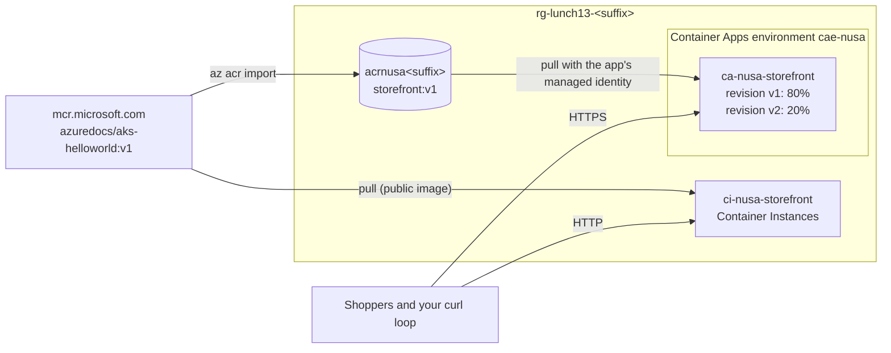

# Lab 13 · Package the storefront

🇮🇩 [Baca dalam Bahasa Indonesia](README.id.md)

> **Pairs with:** [Lunch 13 · Containers (Basic): Container Registry, Container Instances and Container Apps](../../lunches/13-containers-basic/README.md)
> **Time:** about 45 minutes · **Cost:** 💲 (see [cost bands](../README.md#cost-bands)) · **Difficulty:** ★★☆
> **Works on its own:** ✅ You do not need any earlier lab. Everything this lab needs is created by its steps.
> **Author:** Stefanus Pinarta · [About the author](../../README.md#about-the-author)

## 🎯 What you'll build

Nusantara Retail wants one package for the storefront that runs the same everywhere, and a hosting option that costs
nothing at three in the morning. You will create a private **Azure Container Registry** and import a small Microsoft
sample web app into it as `storefront:v1`. You will run the same image in seconds on **Azure Container Instances**,
then deploy it from your registry to **Azure Container Apps**, pulling with the app's managed identity instead of a
password. Finally you will load-test it (replicas 0 → 5 → 0), release a second revision to 20% of requests, and repair
a broken target port.



The sample image is a tiny Microsoft web app that listens on **port 80** and shows the value of the `TITLE` environment
variable as its page title. It was written for AKS walkthroughs, but that does not matter: a container image runs
anywhere. Changing `TITLE` lets you see at a glance which copy or revision answered a request.

## ✅ Before you start

- An Azure subscription where you can create resources (see [Lab 01](../01-before-you-begin/README.md)).
- **Azure Cloud Shell (Bash)** — open [shell.azure.com](https://shell.azure.com). Nothing to install.
- Get the lab files and load the shared settings:

```bash
git clone https://github.com/stefpin/azure-fundamentals-lunches.git   # first time only
cd azure-fundamentals-lunches/labs/13-containers-basic
source ../common/config.sh
RG=$(rg_name 13)
ACR_NAME="acrnusa${SUFFIX}"
APP=ca-nusa-storefront
```

- Make sure the resource providers this lab uses are registered. It is a one-time step per subscription and can take a
  minute or two:

```bash
for ns in Microsoft.ContainerRegistry Microsoft.ContainerInstance Microsoft.App Microsoft.OperationalInsights; do
  az provider register --namespace "$ns" --wait
done
```

> [!IMPORTANT]
> Lab resources cost money while they exist. Finish with the **Clean up** section, even if you stop halfway.
> If Cloud Shell times out, open it again, `cd` back into this folder and re-run the `source` and variable lines above
> (and any `LOGIN_SERVER=`, `FQDN=` or `REV1=` lines from the task you were on).

## 🧭 Choose your mode

| Mode | For you if… | How |
|---|---|---|
| **Guided** | you want every step explained | follow Tasks 1–5 below |
| **Challenge** | you already know the basics | read only the [Challenge brief](#-challenge-brief), build it your way, then run `bash verify.sh` |

## Task 1 · Create a private registry and import the storefront image

A registry is the single source of truth for your images. `az acr import` copies an image from another registry
inside Azure, so you do not need Docker in Cloud Shell.

```bash
ensure_rg "$RG" 13

az acr create \
  --resource-group "$RG" \
  --name "$ACR_NAME" \
  --sku Basic \
  --location "$LOCATION" \
  --output none

LOGIN_SERVER=$(az acr show --name "$ACR_NAME" --query loginServer --output tsv)
echo "Login server: $LOGIN_SERVER"

az acr import \
  --name "$ACR_NAME" \
  --source mcr.microsoft.com/azuredocs/aks-helloworld:v1 \
  --image storefront:v1

az acr repository show-tags --name "$ACR_NAME" --repository storefront --output table
az acr show --name "$ACR_NAME" --query "{tier:sku.name, adminUser:adminUserEnabled}" --output table
```

Notice that the image now has a new name in your registry, `storefront:v1`, while its content (and digest) is
identical to the Microsoft original. The admin user is `false`: nothing in this lab needs a registry password.

**Optional — build in the cloud with ACR Tasks.** The [`app/Dockerfile`](app/Dockerfile) adds one layer on top of
the sample image (a new default title). If your subscription allows ACR Tasks, build it in Azure:

```bash
az acr build --registry "$ACR_NAME" --image storefront:v1-built ./app
```

If you see `TasksOperationsNotAllowed`, your subscription uses Azure free credits and ACR Tasks runs are paused for it
at the time of writing. Skip this step; the import above is all the lab needs.

> [!TIP]
> **Prefer the portal?** *Home › Container registries › acrnusa… › Services › Repositories › storefront* shows the tag
> and its digest. *Settings › Access keys* shows that the admin user is off.

> ✅ **Checkpoint:** `az acr repository show-tags` lists `v1`, and the registry shows `Basic` with the admin user `false`.

## Task 2 · Run a container in seconds with Container Instances

Container Instances runs one container group with no cluster and no VM to look after. You pay per second while it runs.

```bash
az container create \
  --resource-group "$RG" \
  --name ci-nusa-storefront \
  --image mcr.microsoft.com/azuredocs/aks-helloworld:v1 \
  --os-type Linux \
  --cpu 1 --memory 1.5 \
  --ports 80 \
  --dns-name-label "nusa-store-${SUFFIX}" \
  --environment-variables TITLE="Nusantara Retail storefront on Container Instances" \
  --output none

az container show --resource-group "$RG" --name ci-nusa-storefront \
  --query "{state:instanceView.state, fqdn:ipAddress.fqdn}" --output table

ACI_FQDN=$(az container show --resource-group "$RG" --name ci-nusa-storefront --query ipAddress.fqdn --output tsv)
curl -s "http://${ACI_FQDN}/" | grep -o "<title>[^<]*</title>"
az container logs --resource-group "$RG" --name ci-nusa-storefront
```

Why does this container group pull from Microsoft's public registry and not from yours? To pull from a private
registry, Container Instances needs a **user-assigned** managed identity that holds AcrPull; it cannot use a
system-assigned identity for image pulls. Stretch goal 1 shows how. Container Apps, next, can use its own
system-assigned identity. Notice also that the address is plain HTTP: Container Instances gives you an IP address and a
DNS name, not a managed HTTPS endpoint.

> [!TIP]
> **Prefer the portal?** *Home › Container instances › ci-nusa-storefront* shows the state and FQDN on **Overview**,
> and **Containers › Logs** shows the same output as `az container logs`.

> ✅ **Checkpoint:** the state is `Running`, the FQDN looks like `nusa-store-<suffix>.<region>.azurecontainer.io`, and
> `curl` prints `<title>Nusantara Retail storefront on Container Instances</title>`.

## Task 3 · Deploy to Container Apps and pull with a managed identity

First create the environment, the secure boundary that your apps share. It takes two to four minutes. If you do not
name a Log Analytics workspace, the CLI creates one for the environment's logs and tells you so.

```bash
az containerapp env create \
  --name cae-nusa \
  --resource-group "$RG" \
  --location "$LOCATION" \
  --output none
```

Now create the app from **your** registry:

```bash
az containerapp create \
  --name "$APP" \
  --resource-group "$RG" \
  --environment cae-nusa \
  --image "${LOGIN_SERVER}/storefront:v1" \
  --registry-server "$LOGIN_SERVER" \
  --registry-identity system \
  --ingress external \
  --target-port 80 \
  --min-replicas 0 \
  --max-replicas 5 \
  --scale-rule-name http-busy \
  --scale-rule-type http \
  --scale-rule-http-concurrency 10 \
  --env-vars TITLE="Nusantara Retail storefront v1" \
  --output none
```

What the important flags do:

| Flag | Meaning |
|---|---|
| `--registry-identity system` | Turn on the app's system-assigned managed identity, grant it **AcrPull** on your registry and pull with it. Because the CLI does several steps for you, `--no-wait` is not allowed with this option. |
| `--ingress external --target-port 80` | Publish the app on a public HTTPS address and forward requests to port 80, where the sample app listens. |
| `--min-replicas 0 --max-replicas 5` | Scale to zero when idle; never run more than five replicas. |
| `--scale-rule-type http --scale-rule-http-concurrency 10` | Add a replica for roughly every 10 concurrent requests. |
| `--env-vars TITLE=...` | A setting inside the revision template; changing it later creates a new revision. |

Open the app and prove that no password was involved:

```bash
FQDN=$(az containerapp show --name "$APP" --resource-group "$RG" \
  --query properties.configuration.ingress.fqdn --output tsv)
echo "https://${FQDN}"
curl -s "https://${FQDN}/" | grep -o "<title>[^<]*</title>"

az containerapp show --name "$APP" --resource-group "$RG" \
  --query "properties.configuration.registries" --output table

PRINCIPAL_ID=$(az containerapp show --name "$APP" --resource-group "$RG" --query identity.principalId --output tsv)
ACR_ID=$(az acr show --name "$ACR_NAME" --query id --output tsv)
az role assignment list --assignee "$PRINCIPAL_ID" --scope "$ACR_ID" --query "[].roleDefinitionName" --output tsv
```

The first request may take a few seconds: that is the cold start of the first replica.

> [!TIP]
> **Prefer the portal?** Open *Container Apps › ca-nusa-storefront*. **Settings › Identity** shows the system-assigned
> identity, **Application › Containers** shows the image from your registry, and **Application › Revisions and
> replicas** shows the running revision.

> ✅ **Checkpoint:** `curl` prints `<title>Nusantara Retail storefront v1</title>`, the registries table shows your
> login server with identity `system`, and the role list prints `AcrPull`.

## Task 4 · Watch it scale from zero to five and back

Check how many replicas are running now. Just after creation you may see 1; after about five quiet minutes you
should see 0.

```bash
az containerapp replica list --name "$APP" --resource-group "$RG" --query "length(@)" --output tsv
```

Now play the 12.12 sale. The loop below sends about two minutes of traffic, 40 requests at a time, and counts the
replicas every 15 seconds while it runs:

```bash
end=$((SECONDS + 120))
while (( SECONDS < end )); do
  seq 1 400 | xargs -P 40 -I{} curl -s -o /dev/null "https://${FQDN}/"
done &
LOAD_PID=$!

for i in $(seq 1 8); do
  sleep 15
  echo "$(date +%T)  replicas: $(az containerapp replica list --name "$APP" --resource-group "$RG" --query 'length(@)' --output tsv)"
done
wait "$LOAD_PID"
```

The count climbs, and it never passes five because that is your maximum. When the load stops, the platform waits
before it removes replicas: the cool-down before the last replica goes is 300 seconds by default. Check again after
about seven minutes:

```bash
sleep 420
az containerapp replica list --name "$APP" --resource-group "$RG" --query "length(@)" --output tsv
```

> [!TIP]
> **Prefer the portal?** *ca-nusa-storefront › Monitoring › Metrics*, metric **Replica Count**, aggregation **Max**,
> time range **Last 30 minutes** draws the whole 0 → 5 → 0 curve. The **Requests** metric shows the load you sent.

> ✅ **Checkpoint:** you saw the replica count rise to 5 (and no higher) during the load, and fall back to 0 once
> traffic stopped.

## Task 5 · Release v2 to 20% of shoppers

A canary release needs two active revisions and a traffic rule. The order of the steps matters.

```bash
# 1. Allow several revisions to be active at the same time.
az containerapp revision set-mode --name "$APP" --resource-group "$RG" --mode multiple --output none

# 2. Pin all traffic to the current revision BEFORE you deploy anything new.
REV1=$(az containerapp show --name "$APP" --resource-group "$RG" --query properties.latestRevisionName --output tsv)
az containerapp ingress traffic set --name "$APP" --resource-group "$RG" \
  --revision-weight "${REV1}=100" --output none

# 3. Deploy v2. A new environment variable is a revision-scope change, so it creates a new revision.
az containerapp update --name "$APP" --resource-group "$RG" \
  --set-env-vars TITLE="Nusantara Retail storefront v2" \
  --revision-suffix v2 \
  --output none
REV2="${APP}--v2"

# 4. Test v2 on its own address before any shopper sees it.
REV2_FQDN=$(az containerapp revision show --name "$APP" --resource-group "$RG" --revision "$REV2" \
  --query properties.fqdn --output tsv)
curl -s "https://${REV2_FQDN}/" | grep -o "<title>[^<]*</title>"

# 5. Canary: 80% stays on v1, 20% goes to v2.
az containerapp ingress traffic set --name "$APP" --resource-group "$RG" \
  --revision-weight "${REV1}=80" "${REV2}=20" --output none

az containerapp revision list --name "$APP" --resource-group "$RG" \
  --query "[].{revision:name, active:properties.active, traffic:properties.trafficWeight, replicas:properties.replicas}" \
  --output table
```

Without step 2, the existing rule "100% to the latest revision" would have sent every shopper to v2 the moment it
became ready. Now sample the public address 40 times and count which title answered:

```bash
for i in $(seq 1 40); do curl -s "https://${FQDN}/" | grep -o "<title>[^<]*</title>"; done | sort | uniq -c
```

Expect roughly 32 answers from v1 and 8 from v2; the exact numbers vary from run to run.

> [!TIP]
> **Prefer the portal?** *Application › Revisions and replicas* (called *Revision management* in some portal
> versions) shows both revisions, their traffic percentages and their own URLs, and lets you change the split with a
> few clicks.

> ✅ **Checkpoint:** the revision list shows two active revisions with traffic `80` and `20`, and your sample shows
> both titles, mostly v1.

## 🔧 Break it and fix it

Rizky has decided that "all our apps listen on 8080 now" and updates the ingress without checking the image:

```bash
az containerapp ingress update --name "$APP" --resource-group "$RG" --target-port 8080 --output none

for i in $(seq 1 5); do
  curl -s -o /dev/null -w "%{http_code}\n" --max-time 30 "https://${FQDN}/"
done
```

**Symptom:** instead of `200` you get errors or timeouts (`000` means `curl` gave up), and after a while the revisions
report that they are not healthy:

```bash
az containerapp revision list --name "$APP" --resource-group "$RG" \
  --query "[].{revision:name, health:properties.healthState, running:properties.runningState}" --output table
```

Notice that **both** revisions broke at once. Find the cause and repair it.

<details><summary>Hint</summary>

Compare `az containerapp show --name "$APP" --resource-group "$RG" --query properties.configuration.ingress.targetPort`
with the port the sample app actually listens on (look back at `--ports 80` in Task 2). Ingress is an
**application-scope** setting: it applies to every revision at once and does not create a new revision.

</details>

<details><summary>Fix</summary>

```bash
az containerapp ingress update --name "$APP" --resource-group "$RG" --target-port 80 --output none
curl -s -o /dev/null -w "%{http_code}\n" --max-time 60 "https://${FQDN}/"
```

The target port must match the port the process listens on inside the container. `EXPOSE` in a Dockerfile only
documents it.

</details>

## 🧪 Verify your work

```bash
bash verify.sh
```

Every check should say **PASS**. If one fails, the message tells you which task to revisit.

## 🧹 Clean up (do not skip!)

```bash
bash cleanup.sh
```

This deletes the resource group `rg-lunch13-<suffix>` with everything in it: the registry, the container group, the
Container Apps environment and app, and the Log Analytics workspace. Nothing in this lab lives outside the resource
group: the AcrPull role assignment sits on the registry, and the app's system-assigned identity is deleted with the
app. Deletion continues in the background for a few minutes.

## 🩺 Troubleshooting

| Symptom | Likely cause | Fix |
|---|---|---|
| `The registry DNS name acrnusa….azurecr.io is already in use` | Registry names are global and someone else has yours | Choose another suffix: `export SUFFIX=<5 new lowercase letters or digits>` then `source ../common/config.sh` again and re-set the variables |
| `(TasksOperationsNotAllowed) ACR Tasks requests for the registry … are not permitted` | ACR Tasks runs are paused for subscriptions on Azure free credits | Skip the optional `az acr build`; `az acr import` is all the lab needs |
| `(MissingSubscriptionRegistration) The subscription is not registered to use namespace 'Microsoft.App'` | Resource provider not registered yet | Run the `az provider register` loop from **Before you start** and try again |
| `DNS name label not available` when creating the container group | Someone already uses that label in the region | Use another label, for example `--dns-name-label "nusa-store-${SUFFIX}-2"` |
| Container app creation fails with `... UNAUTHORIZED: authentication required ...` | The identity's AcrPull assignment has not propagated yet, or your registry uses the ABAC permissions mode | Wait a minute and run `az containerapp update --name "$APP" --resource-group "$RG" --image "${LOGIN_SERVER}/storefront:v1"`. If `az acr show --name "$ACR_NAME" --query roleAssignmentMode` says `AbacRepositoryPermissions`, assign **Container Registry Repository Reader** to the app's identity instead of AcrPull |
| `unrecognized arguments` or `the following arguments are required` from an `az containerapp` command | An older Azure CLI (likely on a local PC) | Run `az upgrade`; if you use the Container Apps extension, `az extension add --name containerapp --upgrade` |
| The replica count never reaches 5 | Not enough concurrent requests | Raise the parallelism (`-P 60`) or the duration, and make sure `FQDN` is set |
| Replicas stay above 0 long after the test | The cool-down has not finished, or a load loop is still running | Wait 5–10 minutes; run `jobs` and `kill %1` if a background loop is still alive |
| All 40 sample requests show v1 | v2 still has 0% of the traffic | `az containerapp ingress traffic show --name "$APP" --resource-group "$RG"` and repeat Task 5 step 5 |

## 🚀 Stretch goals

1. **Pull into Container Instances from your registry.** Create a user-assigned identity, give it AcrPull, and let a
   second container group use it:

   ```bash
   az identity create --resource-group "$RG" --name id-nusa-acrpull --output none
   ID_RES=$(az identity show --resource-group "$RG" --name id-nusa-acrpull --query id --output tsv)
   ID_PRINCIPAL=$(az identity show --resource-group "$RG" --name id-nusa-acrpull --query principalId --output tsv)
   ACR_ID=$(az acr show --name "$ACR_NAME" --query id --output tsv)
   az role assignment create --assignee-object-id "$ID_PRINCIPAL" --assignee-principal-type ServicePrincipal \
     --role AcrPull --scope "$ACR_ID" --output none
   sleep 60   # give the role assignment time to propagate
   az container create --resource-group "$RG" --name ci-nusa-private \
     --image "${LOGIN_SERVER}/storefront:v1" --acr-identity "$ID_RES" --assign-identity "$ID_RES" \
     --os-type Linux --cpu 1 --memory 1.5 --ports 80 --dns-name-label "nusa-private-${SUFFIX}" --output none
   ```

   If the pull is refused, read the prerequisites in the Container Instances article about deploying from a registry
   with a managed identity; they change from time to time.
2. **Use your own build.** If `az acr build` worked in Task 1, deploy `storefront:v1-built` as a third revision and
   give it 10% of the traffic.
3. **Add a label.** A label gives v2 a stable test address that does not change when you move it to another
   revision; find the label's URL under *Revisions and replicas*:

   ```bash
   az containerapp revision label add --name "$APP" --resource-group "$RG" --label staging --revision "$REV2"
   ```

4. **Watch the logs.** Stream console output while you send requests; add `--type system` to see the platform's
   scaling events instead:

   ```bash
   az containerapp logs show --name "$APP" --resource-group "$RG" --follow
   ```

5. **Finish the release.** After `verify.sh` passes, move 100% of the traffic to v2 and deactivate v1:

   ```bash
   az containerapp ingress traffic set --name "$APP" --resource-group "$RG" --revision-weight "${REV2}=100"
   az containerapp revision deactivate --name "$APP" --resource-group "$RG" --revision "$REV1"
   ```

## 🏁 Challenge brief

Build the following, any way you like (portal, CLI, Bicep):

1. A resource group `rg-lunch13-<suffix>` in your lab region, created with `ensure_rg "$(rg_name 13)" 13` so that
   `cleanup.sh` can find it.
2. A container registry `acrnusa<suffix>` with the admin user disabled, containing the image `storefront:v1` copied
   from `mcr.microsoft.com/azuredocs/aks-helloworld:v1` (the app listens on port 80).
3. A container group `ci-nusa-storefront` that runs the same sample image with a public DNS name label and answers
   HTTP 200 on port 80.
4. A Container Apps environment `cae-nusa` with a container app `ca-nusa-storefront` that runs `storefront:v1` from your
   registry and authenticates with its **system-assigned managed identity** (no registry passwords), with external
   ingress on target port 80, between 0 and 5 replicas, and an HTTP scale rule.
5. Multiple revision mode with two active revisions. The newer revision sets the environment variable `TITLE`, and
   traffic is split 80/20 with the 20% going to the newer revision.

Then run `bash verify.sh`. Stuck? Peek at `solution.sh` or switch to Guided mode.

---

⬅️ [Lunch 13 reading](../../lunches/13-containers-basic/README.md) · 🏠 [All labs](../README.md) · 🏠 [Course home](../../README.md)

<sub>Last validated: October 2026 · Something broken? [Report a lab problem](../../CONTRIBUTING.md).</sub>
