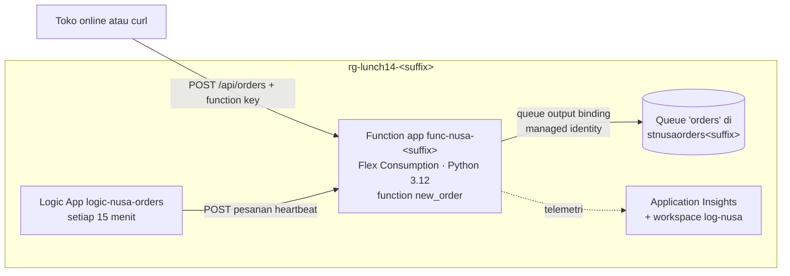

# Lab 14 · Menanggapi pesanan baru secara otomatis

🇬🇧 [Read in English](README.md)

> **Pasangan dari:** [Makan Siang 14 · Serverless: Azure Functions, Logic Apps, dan Event Grid](../../lunches/14-serverless/README.id.md)
> **Waktu:** sekitar 50 menit · **Biaya:** 💲 (lihat [kelompok biaya](../README.id.md#kelompok-biaya)) · **Tingkat kesulitan:** ★★☆
> **Bisa dikerjakan terpisah:** ✅ Anda tidak memerlukan lab sebelumnya. Semua yang dibutuhkan lab ini dibuat oleh langkah-langkahnya sendiri atau oleh `setup.sh`.
> **Penulis:** Stefanus Pinarta · [Tentang penulis](../../README.id.md#tentang-penulis)

## 🎯 Yang akan Anda bangun

Saat ini toko online mengerjakan semuanya di dalam request checkout pelanggan, sehingga API kurir yang lambat berarti
checkout yang lambat. Anda membangun bagian pertama dari desain yang lebih baik: sebuah **function yang dipicu HTTP**
bernama `new_order` yang memvalidasi pesanan dan memasukkannya ke **Storage queue** melalui **output binding**, lalu
langsung menjawab. Sisi gudang bisa memproses queue itu dengan kecepatannya sendiri. Function app berjalan di plan
**Flex Consumption** (Python, bisa menyusut ke nol) dan menjangkau queue dengan **managed identity** miliknya, sehingga
tidak ada storage key di koneksinya. Terakhir, sebuah **Logic App Consumption** mengirim pesanan "heartbeat" (detak
jantung) setiap 15 menit untuk membuktikan bahwa alur pesanan masih berfungsi.



## ✅ Sebelum mulai

- Sebuah subscription (*langganan*) Azure tempat Anda boleh membuat resource **dan menetapkan role** (Owner di
  subscription lab milik Anda sendiri adalah yang ideal; lihat [Lab 01](../01-before-you-begin/README.id.md)).
- **Azure Cloud Shell (Bash)** — buka [shell.azure.com](https://shell.azure.com). Tidak ada yang perlu dipasang.
- Ambil file lab, lalu muat pengaturan bersama dan nama-nama resource untuk lab ini:

```bash
git clone https://github.com/stefpin/azure-fundamentals-lunches.git   # first time only
cd azure-fundamentals-lunches/labs/14-serverless
source ../common/config.sh
source lab.env
```

- Buat titik awalnya — butuh sekitar 2 menit:

```bash
bash setup.sh
```

`setup.sh` pertama-tama memeriksa apakah region Anda menyediakan plan **Flex Consumption**, karena tidak semua region
menyediakannya. Southeast Asia, region default kursus ini, menyediakannya saat tulisan ini dibuat. Jika Anda memakai
Indonesia Central atau region lain yang tidak ada di daftar, skrip akan berhenti dan menampilkan region yang
menyediakannya; pilih salah satunya (misalnya `export LOCATION=eastasia`), jalankan `source` untuk kedua file itu lagi,
lalu jalankan ulang `setup.sh`. Tidak ada jalan mundur ke plan Consumption yang lebih lama: plan itu sudah legacy, dan
versi Linux-nya, satu-satunya yang bisa menjalankan Python, sedang dipensiunkan. Setelah itu, skrip membuat resource
group (*grup sumber daya*), sebuah storage account (*akun penyimpanan*) dengan queue kosong bernama `orders`, sebuah
workspace Log Analytics untuk Application Insights, dan memasang extension `logic` untuk Azure CLI.

> [!IMPORTANT]
> Semua yang ada di sini nyaris gratis: Flex Consumption hanya menagih selama function berjalan (dengan jatah gratis
> bulanan), dan Logic App hanya menjalankan segelintir action per jam. Meski begitu, akhiri dengan bagian
> **Bersihkan**, bahkan jika Anda berhenti di tengah jalan. Membuka sesi Cloud Shell baru? Jalankan lagi baris `cd` dan
> kedua baris `source`.

## 🧭 Pilih mode Anda

| Mode | Cocok untuk Anda jika… | Caranya |
|---|---|---|
| **Terpandu** | Anda ingin setiap langkah dijelaskan | ikuti Tugas 1–6 di bawah |
| **Tantangan** | Anda sudah menguasai dasar-dasarnya | baca [Ringkasan tantangan](#-ringkasan-tantangan) saja, bangun dengan cara Anda sendiri, lalu jalankan `bash verify.sh` |

## Tugas 1 · Memeriksa titik awal dan kodenya

Serverless tidak berarti "tanpa resource": function app memerlukan storage account untuk pembukuannya sendiri, dan
function kita memerlukan tempat untuk menaruh pesanan. Periksa apa saja yang dibuat oleh `setup.sh`, lalu baca kode yang
akan Anda deploy.

```bash
az resource list -g "$RG" --query "[].{name:name, type:type}" --output table
az storage queue exists --name "$QUEUE" --account-name "$ST" --auth-mode key --only-show-errors --output tsv
cat function/function_app.py
cat function/host.json
```

Di `function_app.py`, perhatikan tiga decorator pada `new_order`: `@app.function_name` memberi nama fungsi,
`@app.route` menjadikannya **HTTP trigger** untuk `POST /api/orders`, dan
`@app.queue_output(..., connection="OrdersStorage")` adalah **output binding**-nya. Sementara itu,
`http_auth_level=FUNCTION` yang berlaku untuk seluruh aplikasi berarti pemanggil memerlukan **function key**. Kode hanya
memanggil `msg.set(...)`; host Functions-lah yang menulis pesan ke queue. `host.json` mengunci extension bundle
(kumpulan extension untuk binding) ke versi 4 dan mengatur `messageEncoding` ke `none`, sehingga pesan di queue berupa
JSON biasa yang bisa Anda baca.

> ✅ **Pemeriksaan:** tabel menampilkan sebuah storage account dan sebuah workspace Log Analytics, dan perintah kedua
> mencetak `True`.

## Tugas 2 · Membuat function app di Flex Consumption

Satu perintah membuat function app, plan Flex Consumption-nya (satu aplikasi per plan), dan sebuah resource Application
Insights yang menyimpan datanya di workspace Anda. Prosesnya memakan waktu satu atau dua menit.

```bash
az functionapp create \
  --resource-group "$RG" \
  --name "$FUNC" \
  --storage-account "$ST" \
  --flexconsumption-location "$LOCATION" \
  --runtime python --runtime-version "$PY_VERSION" \
  --functions-version 4 \
  --instance-memory 2048 \
  --maximum-instance-count 10 \
  --workspace "$LAW" \
  --https-only true \
  --output none
```

`--instance-memory 2048` memilih ukuran instance default (pilihan lainnya adalah 512 MB dan 4.096 MB).
`--maximum-instance-count 10` membatasi seberapa jauh aplikasi bisa scale out, yang melindungi anggaran Anda dan semua
sistem di hilirnya. Tidak ada always-ready instance, jadi aplikasi menyusut ke nol saat menganggur dan Anda hanya
membayar selama ia berjalan.

Lihat pengaturan yang ditulis oleh CLI:

```bash
az functionapp config appsettings list -g "$RG" -n "$FUNC" --query "[].name" --output tsv
```

`AzureWebJobsStorage` dan `DEPLOYMENT_STORAGE_CONNECTION_STRING` menghubungkan **host** ke storage account-nya dengan
connection string; itulah default dari CLI, dan cukup baik untuk lab. `APPLICATIONINSIGHTS_CONNECTION_STRING` mengirim
telemetri. Aplikasi production juga mengalihkan storage untuk host ke managed identity (lihat *Pelajari lebih lanjut* di
bacaan).

> [!TIP]
> **Lebih suka portal?** *Create a resource › Function App › Flex Consumption*: runtime **Python 3.12**, region Anda,
> instance size **2048 MB**; di tab *Storage* pilih `stnusaorders<suffix>`; di tab *Monitoring* aktifkan Application
> Insights dengan workspace `log-nusa`. Tab *Authentication* bisa mengalihkan semua koneksi ke managed identity
> sekaligus.

> ✅ **Pemeriksaan:**
> `az functionapp plan list -g "$RG" --query "[].{plan:name, sku:sku.name, tier:sku.tier}" --output table`
> menampilkan satu plan dengan SKU `FC1` (Flex Consumption), dan
> `az functionapp show -g "$RG" -n "$FUNC" --query state --output tsv` mencetak `Running`.

## Tugas 3 · Memberi function koneksi tanpa kata sandi ke queue

Kode meminta sebuah koneksi bernama `OrdersStorage`. Alih-alih menempelkan storage key ke sebuah pengaturan, Anda memberi
function app **managed identity**-nya sendiri, mengizinkan identitas itu menulis pesan ke queue, lalu memberi tahu host
di mana layanan queue berada. Tiga langkah:

```bash
# 1. A system-assigned managed identity for the function app
PRINCIPAL_ID=$(az functionapp identity assign -g "$RG" -n "$FUNC" --query principalId --output tsv)

# 2. Permission to send messages to queues in this storage account (data-plane role)
ST_ID=$(az storage account show -g "$RG" -n "$ST" --query id --output tsv)
az role assignment create \
  --assignee-object-id "$PRINCIPAL_ID" \
  --assignee-principal-type ServicePrincipal \
  --role "Storage Queue Data Contributor" \
  --scope "$ST_ID" \
  --output none

# 3. The connection: <name>__queueServiceUri tells the host "use an identity for this queue service"
QUEUE_URI=$(az storage account show -g "$RG" -n "$ST" --query primaryEndpoints.queue --output tsv)
az functionapp config appsettings set -g "$RG" -n "$FUNC" \
  --settings "OrdersStorage__queueServiceUri=${QUEUE_URI%/}" --output none
```

Garis bawah ganda itu penting: setiap pengaturan yang diawali `OrdersStorage__` adalah bagian dari koneksi
`OrdersStorage`. Karena pengaturan itu hanya berisi alamat dan tanpa secret, kebocorannya tidak memberi akses kepada
siapa pun. Role assignment yang baru bisa memerlukan beberapa menit sampai berlaku; Tugas 4 memberinya waktu itu.

> ✅ **Pemeriksaan:**
> `az role assignment list --assignee "$PRINCIPAL_ID" --scope "$ST_ID" --query "[].roleDefinitionName" --output tsv`
> mencetak `Storage Queue Data Contributor`, dan
> `az functionapp config appsettings list -g "$RG" -n "$FUNC" --query "[?starts_with(name, 'OrdersStorage')].name" --output tsv`
> mencetak `OrdersStorage__queueServiceUri`.

## Tugas 4 · Men-deploy kode

Aplikasi Flex Consumption berjalan dari paket zip di sebuah blob container. Untuk Python, selalu minta **remote build**,
agar dependensinya dipasang di Linux di Azure, bukan di mesin Anda. Perkirakan waktunya 1–3 menit.

```bash
mkdir -p "$OUT_DIR"
(cd function && python3 -m zipfile -c "$OUT_DIR/function.zip" function_app.py host.json requirements.txt)
az functionapp deployment source config-zip -g "$RG" -n "$FUNC" \
  --src "$OUT_DIR/function.zip" --build-remote true
```

> [!TIP]
> **Lebih suka alat lain?** Azure Functions Core Tools (`func azure functionapp publish <app>`) dan extension Azure
> Functions di VS Code men-deploy paket yang sama; GitHub Actions melakukannya pada setiap push.

> ✅ **Pemeriksaan:** `az functionapp function list -g "$RG" -n "$FUNC" --query "[].name" --output tsv` mencetak sebuah
> nama yang berakhiran `/new_order`. Jika hasilnya kosong, tunggu 30 detik lalu coba lagi.

## Tugas 5 · Mengirim pesanan dengan curl dan mengintip queue

Baca URL dan key function dari Azure, lalu buat pesanan seperti yang akan dilakukan toko online:

```bash
ORDER_URL=$(az functionapp function show -g "$RG" -n "$FUNC" --function-name new_order --query invokeUrlTemplate --output tsv)
FUNC_KEY=$(az functionapp function keys list -g "$RG" -n "$FUNC" --function-name new_order --query default --output tsv)
echo "$ORDER_URL"

curl -s -w '\nHTTP %{http_code}\n' -X POST "$ORDER_URL" \
  -H "x-functions-key: $FUNC_KEY" -H "Content-Type: application/json" \
  -d '{"orderId":"JKT-1001","store":"Jakarta - Kemang","items":[{"sku":"KOPI-TORAJA-250G","qty":2},{"sku":"SAMBAL-MATAH-200ML","qty":1}]}'
```

Anda mendapat `{"status": "queued", ...}` dan `HTTP 200`. Panggilan pertama setelah masa sepi bisa memakan beberapa
detik: itulah **cold start**, saat platform menyalakan sebuah instance dari nol. Sekarang coba dua panggilan yang salah:

```bash
curl -s -w '\nHTTP %{http_code}\n' -X POST "$ORDER_URL" -H "x-functions-key: $FUNC_KEY" \
  -H "Content-Type: application/json" -d '{"orderId":"JKT-1002"}'                    # 400 with the reasons
curl -s -o /dev/null -w 'HTTP %{http_code}\n' -X POST "$ORDER_URL" -d '{}'           # 401: no function key
```

Terakhir, intip isi queue. Mengintip (peek) membaca pesan tanpa menghapusnya:

```bash
az storage message peek --queue-name "$QUEUE" --account-name "$ST" --auth-mode key \
  --num-messages 5 --only-show-errors --query "[].content" --output tsv
```

> [!NOTE]
> Mendapat `HTTP 500` di beberapa menit pertama? Role assignment dari Tugas 3 kemungkinan besar belum berlaku. Tunggu
> satu menit lalu kirim pesanan itu lagi.

> ✅ **Pemeriksaan:** hasil peek menampilkan pesan JSON dengan `"orderId": "JKT-1001"`, waktu `receivedAtUtc`, dan sebuah
> `trackingId`. Pesanan yang ditolak tidak ada di queue.

## Tugas 6 · Menjadwalkan pesanan heartbeat dengan Logic App

Ibu Sari ingin bukti setiap seperempat jam bahwa alur pesanan masih hidup. Itu pekerjaan untuk sebuah workflow, bukan
untuk kode tambahan. Buka definisinya di `logicapp/workflow.json`: sebuah trigger **Recurrence** (setiap 15 menit) dan
satu action **HTTP** yang mengirim pesanan heartbeat dengan function key di header `x-functions-key`. URL dan key-nya
tertulis sebagai `__ORDER_URL__` dan `__FUNCTION_KEY__` di file itu; isilah di luar repository, karena hasilnya berisi
secret:

```bash
cat logicapp/workflow.json
sed -e "s|__ORDER_URL__|${ORDER_URL}|" -e "s|__FUNCTION_KEY__|${FUNC_KEY}|" \
  logicapp/workflow.json > "$OUT_DIR/workflow.json"
chmod 600 "$OUT_DIR/workflow.json"

az logic workflow create -g "$RG" -n "$LOGIC" -l "$LOCATION" \
  --definition "$OUT_DIR/workflow.json" --output none
az logic workflow show -g "$RG" -n "$LOGIC" --query state --output tsv
```

Run terjadwal yang pertama bisa baru terjadi hingga 15 menit lagi, jadi mulai satu run sekarang dan baca run history-nya
melalui REST API Logic Apps:

```bash
LOGIC_ID=$(az logic workflow show -g "$RG" -n "$LOGIC" --query id --output tsv)
az rest --method post --url "https://management.azure.com${LOGIC_ID}/triggers/Every_15_minutes/run?api-version=2016-06-01"
sleep 20
az rest --method get --url "https://management.azure.com${LOGIC_ID}/runs?api-version=2016-06-01" \
  --query "value[:3].{started:properties.startTime, status:properties.status}" --output table
```

> [!TIP]
> **Lebih suka portal?** Buka `logic-nusa-orders` › *Development Tools › Logic app designer* untuk melihat trigger dan
> action yang sama dalam bentuk kotak-kotak; *Code view* menampilkan JSON-nya. *Overview › Run trigger › Run* memulai
> sebuah run, dan setiap entri di *Run history* menampilkan input, output, dan durasi setiap langkah. Anda juga bisa
> membangun seluruh workflow di designer: *Recurrence* (15 menit), lalu *HTTP* (POST, URL, kedua header, dan body
> JSON).

> [!NOTE]
> Extension `az logic` ditandai experimental oleh Microsoft. Jika `az logic workflow create` berperilaku aneh, buat
> workflow-nya di designer portal seperti dijelaskan di tip tadi; `verify.sh` tidak peduli bagaimana Anda membangunnya.

> ✅ **Pemeriksaan:** statusnya `Enabled`, run terbaru menunjukkan `Succeeded`, dan mengintip queue (Tugas 5)
> menampilkan sebuah pesan yang `orderId`-nya diawali `HB-`.

## 🔧 Rusak lalu perbaiki

Seorang rekan kerja merapikan pengaturan yang "tidak terpakai" di function app dan menghapus pengaturan dengan garis
bawah ganda yang tampak aneh itu:

```bash
az functionapp config appsettings delete -g "$RG" -n "$FUNC" --setting-names OrdersStorage__queueServiceUri --output none
sleep 60                                                     # the app restarts after a settings change
curl -s -w '\nHTTP %{http_code}\n' -X POST "$ORDER_URL" -H "x-functions-key: $FUNC_KEY" \
  -H "Content-Type: application/json" -d '{"orderId":"JKT-2001","store":"Jakarta - Kemang","items":[{"sku":"KOPI-TORAJA-250G","qty":1}]}'
```

**Gejala:** pesanan tidak lagi diterima. Tergantung kapan host menyadarinya, Anda mendapat **HTTP 404** (host menolak
memuat `new_order` karena binding-nya tidak punya koneksi, sehingga route-nya hilang) atau **HTTP 500** (function
berjalan, tetapi binding tidak bisa menjangkau queue). Run Logic App terjadwal berikutnya juga gagal. Temukan buktinya
sebelum memperbaiki apa pun:

1. Bandingkan konfigurasi dengan apa yang diharapkan oleh kode:
   `az functionapp config appsettings list -g "$RG" -n "$FUNC" --query "[?starts_with(name, 'OrdersStorage')]" --output table`
2. Baca penjelasan dari host itu sendiri. Di portal, buka resource Application Insights `func-nusa-<suffix>` ›
   *Monitoring › Logs* lalu jalankan query ini (entri log baru bisa butuh 2–5 menit untuk muncul):

   ```kusto
   traces
   | where timestamp > ago(30m)
   | where severityLevel >= 3 or message has "OrdersStorage"
   | project timestamp, severityLevel, message
   | order by timestamp desc
   ```

<details><summary>Petunjuk dan perbaikan</summary>

Log menyebut koneksi `OrdersStorage` dan mengatakan bahwa pengaturan untuk koneksi itu tidak ada. Binding masih meminta
`connection="OrdersStorage"`, tetapi tidak ada satu pun bagian konfigurasi yang mendefinisikannya. Kembalikan
pengaturannya:

```bash
QUEUE_URI=$(az storage account show -g "$RG" -n "$ST" --query primaryEndpoints.queue --output tsv)
az functionapp config appsettings set -g "$RG" -n "$FUNC" \
  --settings "OrdersStorage__queueServiceUri=${QUEUE_URI%/}" --output none
```

Setelah sekitar satu menit, `curl` yang sama mengembalikan `HTTP 200`, dan run Logic App berikutnya berhasil.
Pelajarannya: pengaturan adalah bagian dari aplikasi. Beri nama yang jelas, simpan dalam kode (Makan Siang 20), dan
pantau request yang gagal (Makan Siang 16).

</details>

## 🧪 Verifikasi hasil kerja Anda

```bash
bash verify.sh
```

Setiap pemeriksaan seharusnya menampilkan **PASS**. Skrip ini mengirim satu pesanan ujinya sendiri (`VERIFY-hhmmss`).
Jika ada pemeriksaan yang gagal, pesannya memberi tahu tugas mana yang perlu Anda ulangi.

## 🧹 Bersihkan (jangan dilewati!)

```bash
bash cleanup.sh
```

Perintah ini menghapus resource group `rg-lunch14-<suffix>` beserta seluruh isinya: storage account dan queue-nya,
function app dan plan-nya, Application Insights, workspace (secara permanen, agar pengulangan lab dimulai dari kondisi
bersih), dan Logic App. Role assignment ikut hilang bersama storage account. File lokal di `~/lab14-out`, termasuk file
workflow yang berisi function key, juga dihapus. Penghapusan masih berlanjut di latar belakang selama beberapa menit.

## 🩺 Pemecahan masalah

| Gejala | Kemungkinan penyebab | Perbaikan |
|---|---|---|
| `setup.sh` mengatakan Flex Consumption tidak tersedia di region Anda | Tidak semua region punya plan Flex Consumption | `export LOCATION=<a listed region>`, jalankan `source` untuk kedua file lagi, lalu jalankan `setup.sh` |
| `The storage account named stnusaorders… is already taken.` | Nama storage account bersifat global | `export LAB14_ST="stnusaorders${SUFFIX}2"`, `source lab.env`, jalankan `setup.sh` |
| `az functionapp create` gagal karena nama function app sudah dipakai | Nama function app juga bersifat global | `export LAB14_FUNC="func-nusa-${SUFFIX}2"`, `source lab.env`, ulangi Tugas 2 |
| `HTTP 500` tepat setelah Tugas 3 | Role assignment yang baru belum berlaku | Tunggu 2–5 menit lalu coba lagi |
| `HTTP 401` | Header `x-functions-key` tidak ada atau berisi key lama | Jalankan ulang baris `FUNC_KEY=$(...)` dari Tugas 5 |
| `HTTP 404` | Kode belum di-deploy, `$ORDER_URL` kosong, atau host tidak bisa memuat `new_order` karena sebuah pengaturan koneksi tidak ada | Cek bagian Pemeriksaan di Tugas 4, baca ulang `$ORDER_URL`, periksa pengaturan dari Tugas 3 |
| `Encountered an error (ServiceUnavailable) from host runtime.` saat membaca key | Host function masih dalam proses start | Tunggu 30 detik lalu coba lagi |
| `Key based authentication is not permitted on this storage account.` | Sebuah policy menonaktifkan akses shared key di account itu | Gunakan subscription lab pribadi (Lab 01). Host function di lab ini memerlukan akses shared key |
| `az: 'logic' is not in the 'az' command group.` | Extension CLI-nya belum terpasang | `az extension add --name logic` |
| `Expecting value: line 1 column 1 (char 0)` dari `az logic workflow create` | Path file definisi salah atau file-nya kosong | Pastikan `$OUT_DIR/workflow.json` ada; ulangi baris `sed` |
| Run Logic App gagal di *Send_heartbeat_order* dengan status 401 | Key belum diisi, atau key-nya sudah berubah | Ulangi Tugas 6 mulai dari baris `sed` |

## 🚀 Tantangan tambahan

- **Saksikan penskalaannya.** Buka function app › *Monitoring › Application Insights › Live metrics* (atau
  *Investigate › Live metrics* di resource Application Insights), lalu kirim 200 pesanan dari Cloud Shell:

  ```bash
  seq 1 200 | xargs -P 20 -I{} curl -s -o /dev/null -X POST "$ORDER_URL" -H "x-functions-key: $FUNC_KEY" \
    -H "Content-Type: application/json" -d '{"orderId":"LOAD-{}","store":"Load test","items":[{"sku":"TEST","qty":1}]}'
  ```

  Perhatikan jumlah server dan request rate, lalu saksikan aplikasi kembali sepi.
- **Tambahkan consumer-nya.** Tambahkan function yang dipicu queue ke `function_app.py` yang membaca setiap pesanan dan
  mencatatnya ke log, memakai `@app.queue_trigger(arg_name="msg", queue_name="orders", connection="OrdersStorage")` dan
  parameter `msg: func.QueueMessage`. Deploy ulang (Tugas 4) dan saksikan queue terkuras. Perhatikan bahwa `verify.sh`
  mengharapkan setidaknya satu pesan di queue, jadi jalankan `verify.sh` sebelum mencoba tantangan ini.
- **Singkirkan secret terakhir.** Alihkan `AzureWebJobsStorage` dan storage untuk deployment ke managed identity (tab
  *Authentication* pada aplikasi Flex Consumption baru di portal menampilkan pengaturan tujuannya), dan lindungi function
  dengan autentikasi Microsoft Entra, bukan key (Makan Siang 15 dan Makan Siang 22).
- **Bangun ulang workflow di designer** lalu bandingkan *Code view*-nya dengan `logicapp/workflow.json`.

## 🏁 Ringkasan tantangan

Bangun hal-hal berikut dengan cara apa pun yang Anda suka (portal, CLI, Bicep):

1. Resource group `rg-lunch14-<suffix>` di region yang menyediakan plan Flex Consumption.
2. Storage account `stnusaorders<suffix>` dengan queue bernama `orders`.
3. Function app `func-nusa-<suffix>` di plan **Flex Consumption**, **Python 3.12**, yang menjalankan kode di
   `function/`. `POST /api/orders` dengan pesanan yang valid dan function key mengembalikan HTTP 200.
4. Koneksi `OrdersStorage` yang didefinisikan di app settings, sebaiknya berbasis identitas
   (`OrdersStorage__queueServiceUri` ditambah role data queue untuk managed identity milik aplikasi).
5. Setidaknya satu pesan pesanan di queue `orders`.
6. Logic App **Consumption** `logic-nusa-orders` berstatus **Enabled** yang mengirim pesanan ke function sesuai jadwal.

Lalu jalankan `bash verify.sh`. Buntu? Intip `solution.sh` atau beralih ke mode Terpandu.

---

⬅️ [Bacaan Makan Siang 14](../../lunches/14-serverless/README.id.md) · 🏠 [Semua lab](../README.id.md) · 🏠 [Beranda kursus](../../README.id.md)

<sub>Terakhir divalidasi: Oktober 2026 · Ada yang tidak berfungsi? [Laporkan masalah lab](../../CONTRIBUTING.md).</sub>
