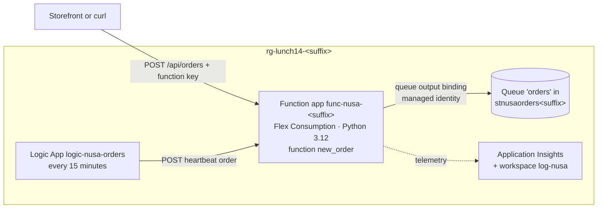

# Lab 14 · React to new orders automatically

> **Pairs with:** [Lunch 14 · Serverless: Azure Functions, Logic Apps and Event Grid](../../lunches/14-serverless/README.md)
> **Time:** about 50 minutes · **Cost:** 💲 (see [cost bands](../README.md#cost-bands)) · **Difficulty:** ★★☆
> **Works on its own:** ✅ You do not need any earlier lab. Everything this lab needs is created by its steps or by `setup.sh`.

## 🎯 What you'll build

Today the storefront does everything inside the customer's checkout request, so a slow courier API means a slow
checkout. You build the first piece of a better design: an **HTTP-triggered function** called `new_order` that
validates an order and drops it into a **Storage queue** through an **output binding**, then answers immediately. The
warehouse side can process the queue at its own pace. The function app runs on the **Flex Consumption** plan (Python,
scales to zero) and reaches the queue with its **managed identity**, so there's no storage key in its connection.
Finally, a **Consumption Logic App** sends a "heartbeat" order every 15 minutes to prove that the pipeline still works.



## ✅ Before you start

- An Azure subscription where you can create resources **and assign roles** (Owner of your own lab subscription is
  ideal; see [Lab 01](../01-before-you-begin/README.md)).
- **Azure Cloud Shell (Bash)** — open [shell.azure.com](https://shell.azure.com). Nothing to install.
- Get the lab files and load the shared settings and this lab's names:

```bash
git clone https://github.com/stefpin/azure-fundamentals-lunches.git   # first time only
cd azure-fundamentals-lunches/labs/14-serverless
source ../common/config.sh
source lab.env
```

- Create the starting point — takes about 2 minutes:

```bash
bash setup.sh
```

`setup.sh` first checks that your region offers the **Flex Consumption** plan, because not every region does. Southeast
Asia, the course default, offered it at the time of writing. If you use Indonesia Central or another region that isn't
on the list, the script stops and shows regions that are; choose one (for example `export LOCATION=eastasia`), source
both files again and re-run `setup.sh`. There is no fallback to the older Consumption plan: it's a legacy plan, and its
Linux version, the only one that runs Python, is being retired. It then creates the resource group, a storage account
with an empty queue called `orders`, a Log Analytics workspace for Application Insights, and installs the Azure CLI
`logic` extension.

> [!IMPORTANT]
> Everything here stays close to free: Flex Consumption bills only while functions run (with a monthly free grant),
> and the Logic App runs a handful of actions per hour. Still, finish with the **Clean up** section, even if you stop
> halfway. Opened a new Cloud Shell session? Run the `cd` and both `source` lines again.

## 🧭 Choose your mode

| Mode | For you if… | How |
|---|---|---|
| **Guided** | you want every step explained | follow Tasks 1–6 below |
| **Challenge** | you already know the basics | read only the [Challenge brief](#-challenge-brief), build it your way, then run `bash verify.sh` |

## Task 1 · Look at the starting point and the code

Serverless doesn't mean "no resources": a function app needs a storage account for its own bookkeeping, and our
function needs somewhere to put orders. Check what `setup.sh` made, then read the code you are about to deploy.

```bash
az resource list -g "$RG" --query "[].{name:name, type:type}" --output table
az storage queue exists --name "$QUEUE" --account-name "$ST" --auth-mode key --only-show-errors --output tsv
cat function/function_app.py
cat function/host.json
```

In `function_app.py`, notice the three decorators on `new_order`: `@app.route` makes it an **HTTP trigger** for
`POST /api/orders`; the app-wide `http_auth_level=FUNCTION` means callers need a **function key**; and
`@app.queue_output(..., connection="OrdersStorage")` is the **output binding**. The code only calls `msg.set(...)`; the
Functions host writes the queue message. `host.json` pins the extension bundle (the set of binding extensions) to
version 4 and sets `messageEncoding` to `none`, so queue messages are plain JSON that you can read.

> ✅ **Checkpoint:** the table lists a storage account and a Log Analytics workspace, and the second command prints
> `True`.

## Task 2 · Create the function app on Flex Consumption

One command creates the function app, its Flex Consumption plan (one app per plan) and an Application Insights
resource that stores its data in your workspace. It takes a minute or two.

```bash
az functionapp create \
  --resource-group "$RG" \
  --name "$FUNC" \
  --storage-account "$ST" \
  --flexconsumption-location "$LOCATION" \
  --runtime python --runtime-version "$PY_VERSION" \
  --functions-version 4 \
  --instance-memory 2048 \
  --maximum-instance-count 10 \
  --workspace "$LAW" \
  --https-only true \
  --output none
```

`--instance-memory 2048` picks the default instance size (512 MB and 4,096 MB are the other choices).
`--maximum-instance-count 10` caps how far the app can scale out, which protects your budget and anything downstream.
There are no always-ready instances, so the app scales to zero when idle and you pay only while it runs.

Look at the settings the CLI wrote:

```bash
az functionapp config appsettings list -g "$RG" -n "$FUNC" --query "[].name" --output tsv
```

`AzureWebJobsStorage` and `DEPLOYMENT_STORAGE_CONNECTION_STRING` connect the **host** to its storage account with a
connection string; that's the CLI default and fine for a lab. `APPLICATIONINSIGHTS_CONNECTION_STRING` sends telemetry.
Production apps switch the host storage to a managed identity too (see *Go further* in the reading).

> [!TIP]
> **Prefer the portal?** *Create a resource › Function App › Flex Consumption*: runtime **Python 3.12**, your region,
> instance size **2048 MB**; on *Storage* pick `stnusaorders<suffix>`; on *Monitoring* enable Application Insights with
> workspace `log-nusa`. The *Authentication* tab can switch every connection to a managed identity in one go.

> ✅ **Checkpoint:**
> `az functionapp plan list -g "$RG" --query "[].{plan:name, sku:sku.name, tier:sku.tier}" --output table`
> shows one plan with SKU `FC1` (Flex Consumption), and
> `az functionapp show -g "$RG" -n "$FUNC" --query state --output tsv` prints `Running`.

## Task 3 · Give the function a passwordless connection to the queue

The code asks for a connection called `OrdersStorage`. Instead of pasting a storage key into a setting, you give the
function app its own **managed identity**, allow that identity to write queue messages, and tell the host where the
queue service is. Three steps:

```bash
# 1. A system-assigned managed identity for the function app
PRINCIPAL_ID=$(az functionapp identity assign -g "$RG" -n "$FUNC" --query principalId --output tsv)

# 2. Permission to send messages to queues in this storage account (data-plane role)
ST_ID=$(az storage account show -g "$RG" -n "$ST" --query id --output tsv)
az role assignment create \
  --assignee-object-id "$PRINCIPAL_ID" \
  --assignee-principal-type ServicePrincipal \
  --role "Storage Queue Data Contributor" \
  --scope "$ST_ID" \
  --output none

# 3. The connection: <name>__queueServiceUri tells the host "use an identity for this queue service"
QUEUE_URI=$(az storage account show -g "$RG" -n "$ST" --query primaryEndpoints.queue --output tsv)
az functionapp config appsettings set -g "$RG" -n "$FUNC" \
  --settings "OrdersStorage__queueServiceUri=${QUEUE_URI%/}" --output none
```

The double underscore matters: every setting that starts with `OrdersStorage__` belongs to the `OrdersStorage`
connection. Because the setting holds only an address and no secret, leaking it gives nobody access. New role
assignments can take a few minutes to apply; Task 4 gives them that time.

> ✅ **Checkpoint:**
> `az role assignment list --assignee "$PRINCIPAL_ID" --scope "$ST_ID" --query "[].roleDefinitionName" --output tsv`
> prints `Storage Queue Data Contributor`, and
> `az functionapp config appsettings list -g "$RG" -n "$FUNC" --query "[?starts_with(name, 'OrdersStorage')].name" --output tsv`
> prints `OrdersStorage__queueServiceUri`.

## Task 4 · Deploy the code

Flex Consumption apps run from a zip package in a blob container. For Python, always ask for a **remote build**, so
the dependencies are installed on Linux in Azure, not on your machine. Expect 1–3 minutes.

```bash
mkdir -p "$OUT_DIR"
(cd function && python3 -m zipfile -c "$OUT_DIR/function.zip" function_app.py host.json requirements.txt)
az functionapp deployment source config-zip -g "$RG" -n "$FUNC" \
  --src "$OUT_DIR/function.zip" --build-remote true
```

> [!TIP]
> **Prefer other tools?** Azure Functions Core Tools (`func azure functionapp publish <app>`) and the VS Code Azure
> Functions extension deploy the same package; GitHub Actions does it on every push.

> ✅ **Checkpoint:** `az functionapp function list -g "$RG" -n "$FUNC" --query "[].name" --output tsv` prints a
> name ending in `/new_order`. If it's empty, wait 30 seconds and try again.

## Task 5 · Send orders with curl and peek at the queue

Read the function's URL and key from Azure, then place an order the way the storefront would:

```bash
ORDER_URL=$(az functionapp function show -g "$RG" -n "$FUNC" --function-name new_order --query invokeUrlTemplate --output tsv)
FUNC_KEY=$(az functionapp function keys list -g "$RG" -n "$FUNC" --function-name new_order --query default --output tsv)
echo "$ORDER_URL"

curl -s -w '\nHTTP %{http_code}\n' -X POST "$ORDER_URL" \
  -H "x-functions-key: $FUNC_KEY" -H "Content-Type: application/json" \
  -d '{"orderId":"JKT-1001","store":"Jakarta - Kemang","items":[{"sku":"KOPI-TORAJA-250G","qty":2},{"sku":"SAMBAL-MATAH-200ML","qty":1}]}'
```

You get `{"status": "queued", ...}` and `HTTP 200`. The first call after a quiet period can take a few seconds: that
is a **cold start**, as the platform brings an instance up from zero. Now try two bad calls:

```bash
curl -s -w '\nHTTP %{http_code}\n' -X POST "$ORDER_URL" -H "x-functions-key: $FUNC_KEY" \
  -H "Content-Type: application/json" -d '{"orderId":"JKT-1002"}'                    # 400 with the reasons
curl -s -o /dev/null -w 'HTTP %{http_code}\n' -X POST "$ORDER_URL" -d '{}'           # 401: no function key
```

Finally, peek at the queue. Peeking reads messages without removing them:

```bash
az storage message peek --queue-name "$QUEUE" --account-name "$ST" --auth-mode key \
  --num-messages 5 --only-show-errors --query "[].content" --output tsv
```

> [!NOTE]
> Got `HTTP 500` in the first few minutes? The role assignment from Task 3 probably hasn't applied yet. Wait a minute
> and send the order again.

> ✅ **Checkpoint:** the peek shows a JSON message with `"orderId": "JKT-1001"`, a `receivedAtUtc` time and a
> `trackingId`. The rejected order is not in the queue.

## Task 6 · Schedule a heartbeat order with a Logic App

Ibu Sari wants proof every quarter of an hour that the order pipeline is alive. That's a job for a workflow, not for
more code. Open the definition in `logicapp/workflow.json`: a **Recurrence** trigger (every 15 minutes) and one
**HTTP** action that posts a heartbeat order with the function key in the `x-functions-key` header. The URL and key are
`__ORDER_URL__` and `__FUNCTION_KEY__` in the file; fill them in, outside the repository, because the result contains
a secret:

```bash
cat logicapp/workflow.json
sed -e "s|__ORDER_URL__|${ORDER_URL}|" -e "s|__FUNCTION_KEY__|${FUNC_KEY}|" \
  logicapp/workflow.json > "$OUT_DIR/workflow.json"
chmod 600 "$OUT_DIR/workflow.json"

az logic workflow create -g "$RG" -n "$LOGIC" -l "$LOCATION" \
  --definition "$OUT_DIR/workflow.json" --output none
az logic workflow show -g "$RG" -n "$LOGIC" --query state --output tsv
```

The schedule's first run can be up to 15 minutes away, so start one now and read the run history through the
Logic Apps REST API:

```bash
LOGIC_ID=$(az logic workflow show -g "$RG" -n "$LOGIC" --query id --output tsv)
az rest --method post --url "https://management.azure.com${LOGIC_ID}/triggers/Every_15_minutes/run?api-version=2016-06-01"
sleep 20
az rest --method get --url "https://management.azure.com${LOGIC_ID}/runs?api-version=2016-06-01" \
  --query "value[:3].{started:properties.startTime, status:properties.status}" --output table
```

> [!TIP]
> **Prefer the portal?** Open `logic-nusa-orders` › *Development Tools › Logic app designer* to see the same trigger and
> action as boxes; *Code view* shows the JSON. *Overview › Run trigger › Run* starts a run, and each entry under *Run
> history* shows every step's inputs, outputs and duration. You can also build the whole workflow in the designer:
> *Recurrence* (15 minutes), then *HTTP* (POST, the URL, the two headers and the JSON body).

> [!NOTE]
> The `az logic` extension is marked experimental by Microsoft. If `az logic workflow create` misbehaves, create the
> workflow in the portal designer as described in the tip; `verify.sh` doesn't care how you built it.

> ✅ **Checkpoint:** the state is `Enabled`, the latest run says `Succeeded`, and peeking at the queue (Task 5) shows a
> message whose `orderId` starts with `HB-`.

## 🔧 Break it and fix it

A colleague cleans up "unused" settings on the function app and deletes the one with the strange double underscore:

```bash
az functionapp config appsettings delete -g "$RG" -n "$FUNC" --setting-names OrdersStorage__queueServiceUri --output none
sleep 60                                                     # the app restarts after a settings change
curl -s -w '\nHTTP %{http_code}\n' -X POST "$ORDER_URL" -H "x-functions-key: $FUNC_KEY" \
  -H "Content-Type: application/json" -d '{"orderId":"JKT-2001","store":"Jakarta - Kemang","items":[{"sku":"KOPI-TORAJA-250G","qty":1}]}'
```

**Symptom:** the order is no longer accepted. Depending on when the host notices, you get **HTTP 404** (it refused to
load `new_order` because the binding has no connection, so the route is gone) or **HTTP 500** (the function ran, but
the binding couldn't reach the queue). The next scheduled Logic App run fails too. Find the evidence before you fix
anything:

1. Compare the configuration with what the code expects:
   `az functionapp config appsettings list -g "$RG" -n "$FUNC" --query "[?starts_with(name, 'OrdersStorage')]" --output table`
2. Read the host's own explanation. In the portal, open the Application Insights resource `func-nusa-<suffix>` ›
   *Monitoring › Logs* and run this query (new log entries can take 2–5 minutes to arrive):

   ```kusto
   traces
   | where timestamp > ago(30m)
   | where severityLevel >= 3 or message has "OrdersStorage"
   | project timestamp, severityLevel, message
   | order by timestamp desc
   ```

<details><summary>Hint and fix</summary>

The logs mention the `OrdersStorage` connection and say that a setting for it doesn't exist. The binding still asks for
`connection="OrdersStorage"`, but nothing in the configuration defines it. Put the setting back:

```bash
QUEUE_URI=$(az storage account show -g "$RG" -n "$ST" --query primaryEndpoints.queue --output tsv)
az functionapp config appsettings set -g "$RG" -n "$FUNC" \
  --settings "OrdersStorage__queueServiceUri=${QUEUE_URI%/}" --output none
```

After about a minute, the same `curl` returns `HTTP 200`, and the next Logic App run succeeds. Lesson: settings are part
of the application. Name them clearly, keep them in code (Lunch 20) and watch for failed requests (Lunch 16).

</details>

## 🧪 Verify your work

```bash
bash verify.sh
```

Every check should say **PASS**. The script sends one test order of its own (`VERIFY-hhmmss`). If a check fails, the
message tells you which task to revisit.

## 🧹 Clean up (do not skip!)

```bash
bash cleanup.sh
```

This deletes the resource group `rg-lunch14-<suffix>` with everything in it: the storage account and queue, the function
app and its plan, Application Insights, the workspace (permanently, so a re-run starts clean) and the Logic App. The
role assignment goes with the storage account. The local files in `~/lab14-out`, including the workflow file with the
function key, are removed too. Deletion continues in the background for a few minutes.

## 🩺 Troubleshooting

| Symptom | Likely cause | Fix |
|---|---|---|
| `setup.sh` says Flex Consumption isn't offered in your region | Not every region has the Flex Consumption plan | `export LOCATION=<a listed region>`, source both files again, run `setup.sh` |
| `The storage account named stnusaorders… is already taken.` | Storage account names are global | `export LAB14_ST="stnusaorders${SUFFIX}2"`, `source lab.env`, run `setup.sh` |
| `az functionapp create` fails because the function app name is taken | Function app names are global too | `export LAB14_FUNC="func-nusa-${SUFFIX}2"`, `source lab.env`, repeat Task 2 |
| `HTTP 500` right after Task 3 | The new role assignment isn't effective yet | Wait 2–5 minutes and retry |
| `HTTP 401` | The `x-functions-key` header is missing or holds an old key | Re-run the `FUNC_KEY=$(...)` line from Task 5 |
| `HTTP 404` | The code isn't deployed yet, `$ORDER_URL` is empty, or the host couldn't load `new_order` because a connection setting is missing | Check the Task 4 checkpoint, re-read `$ORDER_URL`, check the Task 3 setting |
| `Encountered an error (ServiceUnavailable) from host runtime.` when reading the key | The function host is still starting | Wait 30 seconds and try again |
| `Key based authentication is not permitted on this storage account.` | A policy turned off shared key access on the account | Use a personal lab subscription (Lab 01). The function host in this lab needs shared key access |
| `az: 'logic' is not in the 'az' command group.` | The CLI extension is missing | `az extension add --name logic` |
| `Expecting value: line 1 column 1 (char 0)` from `az logic workflow create` | The definition file path is wrong or the file is empty | Check that `$OUT_DIR/workflow.json` exists; repeat the `sed` line |
| Logic App run fails on *Send_heartbeat_order* with status 401 | The key wasn't filled in, or it changed | Repeat Task 6 from the `sed` line |

## 🚀 Stretch goals

- **Watch it scale.** Open the function app › *Monitoring › Application Insights › Live metrics* (or *Investigate ›
  Live metrics* on the Application Insights resource), then send 200 orders from Cloud Shell:

  ```bash
  seq 1 200 | xargs -P 20 -I{} curl -s -o /dev/null -X POST "$ORDER_URL" -H "x-functions-key: $FUNC_KEY" \
    -H "Content-Type: application/json" -d '{"orderId":"LOAD-{}","store":"Load test","items":[{"sku":"TEST","qty":1}]}'
  ```

  Watch the server count and request rate, then watch the app go quiet again.
- **Add the consumer.** Add a queue-triggered function to `function_app.py` that reads each order and logs it, using
  `@app.queue_trigger(arg_name="msg", queue_name="orders", connection="OrdersStorage")` and a parameter
  `msg: func.QueueMessage`. Redeploy (Task 4) and watch the queue drain. Note that `verify.sh` expects at least one
  message in the queue, so run it before this stretch.
- **Remove the last secrets.** Switch `AzureWebJobsStorage` and the deployment storage to the managed identity (the
  *Authentication* tab of a new Flex Consumption app in the portal shows the target settings), and protect the
  function with Microsoft Entra authentication instead of a key (Lunch 15 and Lunch 22).
- **Rebuild the workflow in the designer** and compare its *Code view* with `logicapp/workflow.json`.

## 🏁 Challenge brief

Build the following, any way you like (portal, CLI, Bicep):

1. A resource group `rg-lunch14-<suffix>` in a region that offers the Flex Consumption plan.
2. A storage account `stnusaorders<suffix>` with a queue named `orders`.
3. A function app `func-nusa-<suffix>` on the **Flex Consumption** plan, **Python 3.12**, running the code in
   `function/`. `POST /api/orders` with a valid order and a function key returns HTTP 200.
4. The connection `OrdersStorage` defined in app settings, preferably identity-based
   (`OrdersStorage__queueServiceUri` plus a queue data role for the app's managed identity).
5. At least one order message in the `orders` queue.
6. A **Consumption** Logic App `logic-nusa-orders`, **Enabled**, that posts an order to the function on a schedule.

Then run `bash verify.sh`. Stuck? Peek at `solution.sh` or switch to Guided mode.

---

⬅️ [Lunch 14 reading](../../lunches/14-serverless/README.md) · 🏠 [All labs](../README.md) · 🏠 [Course home](../../README.md)

<sub>Last validated: October 2026 · Something broken? [Report a lab problem](../../CONTRIBUTING.md).</sub>
