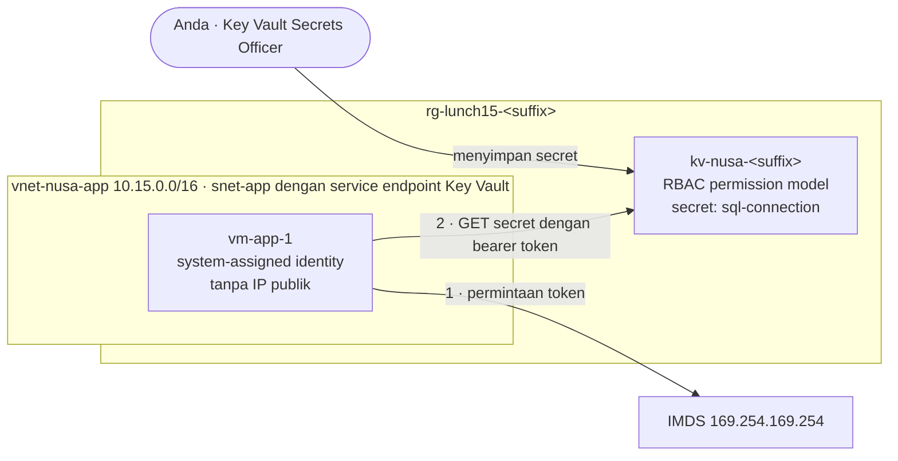

# Lab 15 · Keluarkan kata sandi dari file konfigurasi

🇬🇧 [Read in English](README.md)

> **Pasangan dari:** [Makan Siang 15 · Esensi Keamanan: Defense in Depth, Key Vault, dan Defender for Cloud (Dasar)](../../lunches/15-security-essentials/README.id.md)
> **Waktu:** sekitar 45 menit · **Biaya:** 💲💲 (lihat [kelompok biaya](../README.id.md#kelompok-biaya)) · **Tingkat kesulitan:** ★★☆
> **Bisa dikerjakan terpisah:** ✅ Anda tidak memerlukan lab sebelumnya. Semua yang dibutuhkan lab ini dibuat oleh langkah-langkahnya sendiri atau oleh `setup.sh`.
> **Penulis:** Stefanus Pinarta · [Tentang penulis](../../README.id.md#tentang-penulis)

## 🎯 Yang akan Anda bangun

Server aplikasi toko online Nusantara Retail menyimpan kata sandi database pesanan dalam teks biasa di
`/etc/nusa/appsettings.json`. Anda akan memindahkan secret itu ke **Azure Key Vault** (dengan RBAC permission model),
memberi server tersebut **system-assigned managed identity**, lalu membuktikan — dari dalam VM — bahwa identitas itu
ditolak dengan **403** sampai Anda memberinya peran **Key Vault Secrets User**, dan setelah itu berhasil membaca secret
dengan **200 OK**. Terakhir, Anda menghapus kata sandi dari file dan meninjau **secure score** Anda di Microsoft
Defender for Cloud.



## ✅ Sebelum mulai

- Subscription Azure tempat Anda bisa membuat resource dan **menetapkan peran** (Owner, atau Contributor ditambah User
  Access Administrator). Lihat [Lab 01](../01-before-you-begin/README.id.md).
- Masuk dengan **akun pengguna** (user account) — skrip-skrip lab mencari object ID Anda sendiri untuk memberi Anda
  peran Key Vault.
- **Azure Cloud Shell (Bash)** — buka [shell.azure.com](https://shell.azure.com). Tidak ada yang perlu dipasang.
- Ambil file lab dan muat pengaturan bersama:

```bash
git clone https://github.com/stefpin/azure-fundamentals-lunches.git   # first time only
cd azure-fundamentals-lunches/labs/15-security-essentials
source ../common/config.sh
RG=$(rg_name 15)
KV_NAME="kv-nusa-${SUFFIX}"
```

- Buat titik awalnya — server aplikasi dengan masalah kata sandi tadi. Prosesnya sekitar 4 menit:

```bash
bash setup.sh
```

`setup.sh` membuat virtual network yang subnet-nya **tidak punya akses internet keluar** (outbound), dan VM-nya **tanpa
IP publik**. Agar VM tetap bisa menjangkau Key Vault, subnet itu diberi **service endpoint** untuk `Microsoft.KeyVault`:
lalu lintas ke Key Vault berjalan melalui jaringan tulang punggung (backbone) milik Azure. Anda mengelola VM hanya
melalui **Run Command**, sehingga tidak ada port SSH yang terbuka.

> [!IMPORTANT]
> Resource lab dikenai biaya selama masih ada (VM kecil, disk-nya, dan sebuah key vault). Selalu akhiri dengan bagian
> **Bersihkan**, bahkan jika Anda berhenti di tengah jalan. Pembersihan juga melakukan **purge** pada vault yang sudah
> di-soft-delete, sehingga namanya bisa dipakai lagi.

## 🧭 Pilih mode Anda

| Mode | Cocok untuk Anda jika… | Caranya |
|---|---|---|
| **Terpandu** | Anda ingin setiap langkah dijelaskan | ikuti Tugas 1–8 di bawah |
| **Tantangan** | Anda sudah menguasai dasarnya | jalankan `setup.sh`, baca hanya [Ringkasan tantangan](#-ringkasan-tantangan), bangun dengan cara Anda sendiri, lalu jalankan `bash verify.sh` |

## Tugas 1 · Melihat masalahnya

Sebelum memperbaiki apa pun, lihat dulu apa yang akan ditemukan oleh penyerang — atau oleh siapa saja yang mendapat
salinan cadangan (backup) — di server ini.

```bash
az vm run-command invoke --resource-group "$RG" --name vm-app-1 \
  --command-id RunShellScript \
  --scripts "cloud-init status --wait > /dev/null; ls -l /etc/nusa; cat /etc/nusa/appsettings.json" \
  --query "value[0].message" --output tsv
```

Run Command memakai VM agent (program kecil milik Azure yang berjalan di dalam VM) untuk menjalankan skrip sebagai root,
lalu mengembalikan output-nya. Eksekusi pertama memakan waktu sekitar satu menit, karena Azure memasang ekstensi Run
Command di VM.

> ✅ **Pemeriksaan:** Anda melihat `appsettings.json` dengan izin `-rw-r--r--` (setiap pengguna bisa membacanya) dan
> connection string yang berisi `Password=`. Kata sandi itu adalah nilai sekali pakai yang dibuat saat VM pertama kali
> menyala. Anggap saja sudah bocor: solusinya bukan menyembunyikannya dengan lebih rapi, melainkan menggantinya dan
> menyimpan kata sandi yang baru di tempat yang lebih aman.

## Tugas 2 · Membuat key vault dengan RBAC permission model

```bash
az keyvault create --name "$KV_NAME" --resource-group "$RG" --location "$LOCATION" \
  --enable-rbac-authorization true \
  --retention-days 7 \
  --output none

az keyvault show --name "$KV_NAME" \
  --query "{name:name, rbacModel:properties.enableRbacAuthorization, retentionDays:properties.softDeleteRetentionInDays, purgeProtection:properties.enablePurgeProtection, uri:properties.vaultUri}" \
  --output table
```

Arti setiap flag:

- `--enable-rbac-authorization true` memilih **Azure RBAC permission model** untuk data plane. Versi CLI saat ini
  sebenarnya sudah memakainya sebagai default; menuliskannya secara eksplisit membuat niat Anda jelas.
- `--retention-days 7` membuat vault yang dihapus tetap bisa dipulihkan selama 7 hari (nilai minimum; default-nya 90).
  Soft delete sendiri selalu aktif.
- Tidak ada `--enable-purge-protection`: purge protection tidak bisa dibatalkan, padahal Anda ingin melakukan purge pada
  vault lab ini di akhir. Di produksi, aktifkan fitur ini.

> [!TIP]
> **Lebih suka memakai portal?** *Home › Key vaults › Create*: pilih resource group dan region Anda, beri nama
> `kv-nusa-<suffix>`, tier **Standard**, days to retain deleted vaults **7**, purge protection **Disable**; di tab
> **Access configuration**, pilih **Azure role-based access control**.

> ✅ **Pemeriksaan:** tabel menampilkan `rbacModel` **True**, `retentionDays` **7**, dan kolom `purgeProtection` yang
> kosong (tidak diatur). Catat `uri`-nya: `https://kv-nusa-<suffix>.vault.azure.net/`.

## Tugas 3 · Memberi diri Anda peran data, lalu menyimpan secret

Kemungkinan besar Anda membuat vault tadi sebagai Owner atau Contributor. Coba saja tampilkan daftar secret-nya:

```bash
az keyvault secret list --vault-name "$KV_NAME" --output table
```

Anda mendapat **Forbidden**: *"Caller is not authorized to perform action on resource"* dengan kode internal
`ForbiddenByRbac`. Owner dan Contributor adalah peran control plane, sedangkan secret berada di data plane. Berikan diri
Anda peran data plane untuk orang yang mengelola secret, dengan cakupan hanya vault ini:

```bash
KV_ID=$(az keyvault show --name "$KV_NAME" --query id --output tsv)
ME=$(az ad signed-in-user show --query id --output tsv)

az role assignment create --assignee-object-id "$ME" --assignee-principal-type User \
  --role "Key Vault Secrets Officer" --scope "$KV_ID" --output none
```

Sekarang simpan connection string untuk database pesanan. Karena kata sandi lama dianggap sudah bocor, buat kata sandi
yang **baru**. (Di dunia nyata, Anda akan menggantinya di database terlebih dahulu; lab ini tidak memiliki database
sungguhan.)

```bash
NEW_PW="$(openssl rand -base64 18)"
az keyvault secret set --vault-name "$KV_NAME" --name sql-connection \
  --value "Server=tcp:sql-nusa-orders.database.windows.net,1433;Database=orders;User ID=storefront;Password=${NEW_PW};Encrypt=True;" \
  --output none
unset NEW_PW

az keyvault secret list --vault-name "$KV_NAME" \
  --query "[].{id:id, enabled:attributes.enabled, created:attributes.created}" --output table
```

`--output none` itu penting: `secret set` mengembalikan secret beserta nilainya, dan Anda tidak ingin nilai itu muncul
di riwayat terminal atau di rekaman layar. `secret list` hanya menampilkan metadata.

> [!TIP]
> **Masih Forbidden tepat setelah role assignment?** Role assignment butuh beberapa menit untuk menyebar. Tunggu satu
> menit, lalu jalankan perintahnya lagi.

> ✅ **Pemeriksaan:** `secret list` menampilkan satu baris yang `id`-nya berakhir dengan `/secrets/sql-connection`,
> dengan `enabled` **True**.

## Tugas 4 · Memberi VM sebuah managed identity

```bash
az vm identity assign --resource-group "$RG" --name vm-app-1 --output none

PRINCIPAL_ID=$(az vm show --resource-group "$RG" --name vm-app-1 --query identity.principalId --output tsv)
echo "VM identity object ID: $PRINCIPAL_ID"

az ad sp show --id "$PRINCIPAL_ID" --query "{displayName:displayName, type:servicePrincipalType}" --output table
```

Azure telah membuat service principal di Microsoft Entra ID untuk VM tersebut dan mengelola kredensialnya. Tidak ada
seorang pun — termasuk Anda — yang pernah melihat kata sandinya.

> [!TIP]
> **Lebih suka memakai portal?** Buka `vm-app-1` › **Identity** › **System assigned** › Status **On** › **Save**.

> ✅ **Pemeriksaan:** `displayName` milik service principal tersebut adalah **vm-app-1** dan `type`-nya
> **ManagedIdentity**.

## Tugas 5 · Meminta secret dari dalam VM — dan ditolak

Skrip [`vm/read-secret.sh`](vm/read-secret.sh) berjalan **di dalam** VM dan melakukan apa yang dikerjakan aplikasi
sungguhan (atau Azure SDK) di balik layar:

1. memanggil instance metadata endpoint `http://169.254.169.254/metadata/identity/oauth2/token` dengan `curl`, membawa
   header `Metadata: true` dan `resource=https://vault.azure.net`, untuk mendapatkan access token bagi Key Vault;
2. memanggil REST API Key Vault dengan `curl` — `GET https://<vault>.vault.azure.net/secrets/sql-connection?api-version=2025-07-01`
   — dengan header `Authorization: Bearer <token>`.

Skrip ini mencetak audience token dan object ID identitas (keduanya klaim di dalam token, bukan rahasia), status HTTP,
dan — jika berhasil — hanya pratinjau nilai yang disamarkan.

```bash
az vm run-command invoke --resource-group "$RG" --name vm-app-1 \
  --command-id RunShellScript --scripts @vm/read-secret.sh --parameters "$KV_NAME" \
  --query "value[0].message" --output tsv
```

Output yang diharapkan (ID Anda akan berbeda):

```text
Enable succeeded:
[stdout]
Step 1: ask the managed identity endpoint (IMDS) for a token, audience https://vault.azure.net
  got a token (1500 characters); the token itself is never printed
  token audience (aud):     https://vault.azure.net
  identity object ID (oid): 4f6c1d2e-...
Step 2: GET https://kv-nusa-ab12c.vault.azure.net/secrets/sql-connection
  HTTP 403
  error:   Forbidden / ForbiddenByRbac
  message: Caller is not authorized to perform action on resource.
RESULT: HTTP 403

[stderr]
```

Bacalah seperti seorang security engineer: **autentikasi berhasil** (Key Vault menerima token yang valid untuk audience
yang benar), tetapi **otorisasi gagal** (identitas ini belum punya peran apa pun di vault).

> ✅ **Pemeriksaan:** `RESULT: HTTP 403`, dan `oid` di output sama dengan `$PRINCIPAL_ID` dari Tugas 4.

## Tugas 6 · Memberikan hak akses minimum dan mencoba lagi

Aplikasi hanya perlu **membaca** secret dari vault **ini**, jadi berikan **Key Vault Secrets User** — bukan Officer,
bukan Administrator — pada cakupan vault:

```bash
az role assignment create --assignee-object-id "$PRINCIPAL_ID" --assignee-principal-type ServicePrincipal \
  --role "Key Vault Secrets User" --scope "$KV_ID" --output none
```

Peran ini butuh beberapa menit untuk menyebar. Loop berikut mencoba ulang setiap menit, paling lama sepuluh menit:

```bash
for i in 1 2 3 4 5 6 7 8 9 10; do
  OUT=$(az vm run-command invoke --resource-group "$RG" --name vm-app-1 \
    --command-id RunShellScript --scripts @vm/read-secret.sh --parameters "$KV_NAME" \
    --query "value[0].message" --output tsv)
  echo "$OUT" | grep "RESULT:"
  if echo "$OUT" | grep -q "RESULT: HTTP 200"; then echo "$OUT"; break; fi
  echo "Not yet - waiting 60 seconds for the role assignment to propagate..."; sleep 60
done
```

> [!TIP]
> **Lebih suka memakai portal?** Key vault › **Access control (IAM)** › **Add role assignment** › **Key Vault Secrets
> User** › Assign access to **Managed identity** › **Virtual machine** › `vm-app-1` › **Review + assign**.

> ✅ **Pemeriksaan:** `RESULT: HTTP 200` dan nilai tersamar yang diawali `Server=tcp:sql-nusa-orders...`. VM berhasil
> membaca secret tanpa memiliki kata sandi apa pun.

## Tugas 7 · Menghapus kata sandi dari file konfigurasi

Kini aplikasi hanya perlu tahu **di mana** secret itu disimpan. [`vm/remove-password.sh`](vm/remove-password.sh)
menulis ulang file konfigurasi dengan URI vault dan nama secret-nya:

```bash
az vm run-command invoke --resource-group "$RG" --name vm-app-1 \
  --command-id RunShellScript --scripts @vm/remove-password.sh --parameters "$KV_NAME" \
  --query "value[0].message" --output tsv
```

Aplikasi toko online sungguhan akan membaca secret saat start-up dengan Azure SDK (`DefaultAzureCredential` otomatis
memakai managed identity), menyimpannya di memori, lalu mengambil versi baru setelah rotasi.

> ✅ **Pemeriksaan:** file yang baru memiliki bagian `KeyVault` berisi `VaultUri` dan `OrdersConnectionSecretName`, dan
> baris terakhirnya berbunyi `RESULT: CONFIG CLEAN`.

## Tugas 8 · Meninjau secure score dan rekomendasi Anda

**Foundational CSPM** yang gratis di Defender for Cloud menilai subscription Anda berdasarkan Microsoft cloud security
benchmark.

1. Di portal, buka **Microsoft Defender for Cloud** › **Overview** dan temukan tile **secure score**.
2. Buka **Recommendations**. Filter berdasarkan resource group Anda, `rg-lunch15-<suffix>`, lalu buka satu rekomendasi
   untuk VM atau key vault. Baca deskripsinya, resource yang terdampak, dan langkah perbaikannya.
3. Buka **Environment settings** › subscription Anda › **Defender plans**. Perhatikan bahwa foundational CSPM gratis,
   sedangkan paket perlindungan workload (Servers, Storage, Key Vault…) dibayar per resource. **Jangan** mengaktifkan
   paket berbayar untuk lab ini.

Anda juga bisa membaca skornya dari CLI:

```bash
az security secure-scores list --output jsonc
```

Cari nilai skor saat ini dan nilai maksimumnya di output.

> [!NOTE]
> Resource baru tidak langsung muncul: Defender for Cloud menghitung ulang setiap kontrol kira-kira setiap delapan jam,
> dan subscription yang benar-benar baru bisa butuh waktu lebih lama untuk penilaian pertamanya. Jika belum ada apa pun
> untuk resource lab Anda, lihat rekomendasi untuk resource lain di subscription tersebut, lalu kembali ke tugas ini
> besok.

> ✅ **Pemeriksaan:** Anda bisa menyebutkan secure score Anda saat ini dan satu rekomendasi, serta menjelaskan apakah
> perbaikannya gratis (cukup mengubah konfigurasi) atau membutuhkan paket berbayar.

## 🔧 Rusak lalu perbaiki

Kesalahan klasik adalah meminta token untuk **audience yang salah** — misalnya audience Azure Resource Manager yang
tersalin dari contoh lain. Berikan audience itu sebagai parameter kedua skrip:

```bash
az vm run-command invoke --resource-group "$RG" --name vm-app-1 \
  --command-id RunShellScript --scripts @vm/read-secret.sh \
  --parameters "$KV_NAME" "https://management.azure.com/" \
  --query "value[0].message" --output tsv
```

**Gejala:** `HTTP 401`, error `Unauthorized`, dengan pesan
`AKV10022: Invalid audience. Expected https://vault.azure.net, found: https://management.azure.com/.`

<details><summary>Petunjuk: apa yang salah, dan cara memperbaikinya</summary>

Tokennya sepenuhnya valid — tetapi untuk Azure Resource Manager. Setiap token diterbitkan untuk satu audience, dan Key
Vault menolak token yang ditujukan untuk pihak lain. Ini adalah kegagalan **autentikasi** (401), berbeda dengan
kegagalan **otorisasi** (403) di Tugas 5. Perbaiki dengan meminta `resource=https://vault.azure.net`: jalankan lagi
perintahnya tanpa parameter kedua, dan Anda kembali mendapat `RESULT: HTTP 200`.

</details>

## 🧪 Verifikasi hasil kerja Anda

```bash
bash verify.sh
```

Setiap pemeriksaan harus menampilkan **PASS**. Jika ada yang gagal, pesannya memberi tahu tugas mana yang perlu Anda
ulangi. Skrip ini menjalankan dua skrip kecil yang hanya membaca (read-only) di dalam VM, jadi prosesnya sekitar satu
menit.

## 🧹 Bersihkan (jangan dilewati!)

```bash
bash cleanup.sh
```

Skrip ini meminta konfirmasi (atur `ASSUME_YES=1` untuk melewati pertanyaan itu). Skrip menghapus key vault, menghapus
resource group `rg-lunch15-<suffix>` (VM, disk, jaringan) di latar belakang, lalu melakukan **purge** pada vault yang
sudah di-soft-delete, sehingga nama `kv-nusa-<suffix>` bisa dipakai lagi. Role assignment pada cakupan vault ikut hilang
bersama vault-nya. Jika sebuah vault memiliki purge protection (lihat tantangan tambahan), skrip memberi tahu bahwa vault
itu tidak bisa di-purge dan bahwa Azure akan menghapusnya setelah masa retensinya berakhir.

## 🩺 Pemecahan masalah

| Gejala | Kemungkinan penyebab | Perbaikan |
|---|---|---|
| `az keyvault create` gagal dengan `VaultAlreadyExists` — namanya "is already in use" | Masih ada vault yang di-soft-delete dengan nama yang sama dari percobaan sebelumnya (nama vault yang di-soft-delete tetap dicadangkan) | Jalankan `bash cleanup.sh` (skrip itu melakukan purge), atau `az keyvault purge --name "$KV_NAME" --location "$LOCATION"`; atau pulihkan vault dengan `az keyvault recover --name "$KV_NAME"` |
| `Forbidden` / `ForbiddenByRbac` dari `az keyvault secret set` atau `secret list` | Anda belum punya peran data plane, atau perannya belum selesai menyebar | Kerjakan role assignment di Tugas 3; tunggu satu sampai lima menit, lalu coba lagi |
| Output Run Command berbunyi `RESULT: HTTP 403` setelah Tugas 6 | Penundaan propagasi, atau peran diberikan ke principal atau cakupan yang salah | Tunggu beberapa menit; periksa apakah `az role assignment list --scope "$KV_ID" --output table` menampilkan `Key Vault Secrets User` untuk object ID milik VM |
| `RESULT: HTTP 401` dengan `AKV10022: Invalid audience` | Token diminta untuk resource yang berbeda | Minta `resource=https://vault.azure.net` (lihat Rusak lalu perbaiki) |
| `RESULT: NO TOKEN` dan IMDS menjawab `Identity not found` | VM belum punya managed identity, atau identity itu baru diberikan beberapa detik sebelumnya | Kerjakan Tugas 4; tunggu satu menit, lalu coba lagi |
| `RESULT: HTTP 000` — "the VM could not reach the vault" (VM tidak bisa menjangkau vault) | Tidak ada jalur jaringan: service endpoint hilang, atau Anda membatasi firewall vault | Jalankan lagi `bash setup.sh` (skrip itu menerapkan ulang service endpoint); jika Anda mengubah firewall vault, izinkan `snet-app` |
| `(Conflict) Run command extension execution is in progress` | Run Command lain masih berjalan di VM | Tunggu sampai selesai, lalu coba lagi — satu skrip dalam satu waktu |
| `az ad signed-in-user show` gagal | Cloud Shell masuk dengan service principal atau managed identity, bukan dengan akun pengguna | Jalankan `az login` dengan akun pengguna Anda |
| Defender for Cloud tidak menampilkan rekomendasi untuk resource lab | Penilaian berjalan sesuai jadwal | Kembali lagi nanti — lihat catatan di Tugas 8 |

## 🚀 Tantangan tambahan

- **Kebersihan secret:** beri secret tanggal kedaluwarsa dan content type:
  `az keyvault secret set-attributes --vault-name "$KV_NAME" --name sql-connection --expires 2027-01-31T00:00:00Z --content-type "text/plain"`.
  Lalu rotasikan dengan menetapkan nilai baru, dan tampilkan daftar versinya dengan `az keyvault secret list-versions`.
- **Kunci jaringannya:** tolak akses publik dan izinkan hanya subnet aplikasi:
  `az keyvault network-rule add --resource-group "$RG" --name "$KV_NAME" --vnet-name vnet-nusa-app --subnet snet-app`,
  lalu `az keyvault update --resource-group "$RG" --name "$KV_NAME" --default-action Deny`. VM tetap bisa membaca
  secret; `az keyvault secret list` dari Cloud Shell kini diblokir oleh firewall vault. Atur kembali
  `--default-action Allow` sebelum Anda menjalankan `verify.sh`.
- **Rasakan purge protection:** buat vault kedua `kv-nusa2-${SUFFIX}` dengan `--enable-purge-protection true
  --retention-days 7`, hapus vault itu, lalu coba `az keyvault purge` padanya. Perintah itu ditolak. (`cleanup.sh`
  menghapusnya, tetapi namanya tetap dicadangkan selama tujuh hari.)
- **Tukar identitas:** buat user-assigned identity (`az identity create`), pasang ke VM
  (`az vm identity assign --identities <its resource ID>`), lalu berikan peran itu kepadanya sebagai gantinya. VM yang
  punya beberapa identitas harus menyebutkan identitas mana yang ia inginkan, jadi tambahkan
  `--data-urlencode "client_id=<its client ID>"` ke permintaan IMDS di salinan `vm/read-secret.sh`. Makan Siang 22
  menjelaskan kapan user-assigned identity menjadi pilihan yang lebih baik.
- **Audit:** tambahkan diagnostic setting yang mengirim log `AuditEvent` milik vault ke Log Analytics workspace, lalu
  temukan aktivitas pembacaan oleh VM (Makan Siang 16 dan 30).

## 🏁 Ringkasan tantangan

Jalankan `bash setup.sh`, lalu bangun hal-hal berikut dengan cara apa pun yang Anda suka (portal, CLI, Bicep):

1. Key vault bernama `kv-nusa-<suffix>` di `rg-lunch15-<suffix>`, yang memakai permission model **Azure RBAC**.
2. Anda memegang **Key Vault Secrets Officer** di vault tersebut (cakupan vault).
3. Vault berisi secret bernama `sql-connection` yang menyimpan connection string dengan kata sandi **baru**.
4. `vm-app-1` memiliki **system-assigned managed identity**.
5. Identitas itu memegang **Key Vault Secrets User** pada cakupan vault dan **tidak memiliki role assignment lain** di
   subscription.
6. Dari dalam `vm-app-1`, `vm/read-secret.sh` (dijalankan melalui Run Command) melaporkan `RESULT: HTTP 200`.
7. `/etc/nusa/appsettings.json` di VM tidak lagi berisi kata sandi.
8. Anda sudah melihat secure score dan setidaknya satu rekomendasi di Defender for Cloud (tidak diperiksa oleh skrip).

Lalu jalankan `bash verify.sh`. Buntu? Intip `solution.sh` atau beralih ke mode Terpandu.

---

⬅️ [Bacaan Makan Siang 15](../../lunches/15-security-essentials/README.id.md) · 🏠 [Semua lab](../README.id.md) · 🏠 [Beranda kursus](../../README.id.md)

<sub>Terakhir divalidasi: Oktober 2026 · Ada yang tidak berfungsi? [Laporkan masalah lab](../../CONTRIBUTING.md).</sub>
