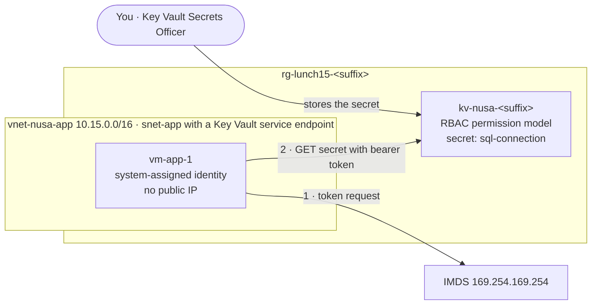

# Lab 15 · Get the password out of the config file

🇮🇩 [Baca dalam Bahasa Indonesia](README.id.md)

> **Pairs with:** [Lunch 15 · Security Essentials: Defense in Depth, Key Vault and Defender for Cloud](../../lunches/15-security-essentials/README.md)
> **Time:** about 45 minutes · **Cost:** 💲💲 (see [cost bands](../README.md#cost-bands)) · **Difficulty:** ★★☆
> **Works on its own:** ✅ You do not need any earlier lab. Everything this lab needs is created by its steps or by `setup.sh`.
> **Author:** Stefanus Pinarta · [About the author](../../README.md#about-the-author)

## 🎯 What you'll build

Nusantara Retail's storefront app server keeps the orders database password in plain text in
`/etc/nusa/appsettings.json`. You will move that secret into **Azure Key Vault** (RBAC permission model), give the
server a **system-assigned managed identity**, and prove — from inside the VM — that the identity is refused with
**403** until you grant it **Key Vault Secrets User**, and then reads the secret with **200 OK**. Finally you remove the
password from the file and review your **secure score** in Microsoft Defender for Cloud.



## ✅ Before you start

- An Azure subscription where you can create resources and **assign roles** (Owner, or Contributor plus User Access
  Administrator). See [Lab 01](../01-before-you-begin/README.md).
- Sign in with a **user account** — the scripts look up your own object ID to give you a Key Vault role.
- **Azure Cloud Shell (Bash)** — open [shell.azure.com](https://shell.azure.com). Nothing to install.
- Get the lab files and load the shared settings:

```bash
git clone https://github.com/stefpin/azure-fundamentals-lunches.git   # first time only
cd azure-fundamentals-lunches/labs/15-security-essentials
source ../common/config.sh
RG=$(rg_name 15)
KV_NAME="kv-nusa-${SUFFIX}"
```

- Create the starting point — the app server with the password problem. It takes about 4 minutes:

```bash
bash setup.sh
```

`setup.sh` creates a virtual network whose subnet has **no outbound internet access** and **no public IP** on the VM.
So that the VM can still reach Key Vault, the subnet gets a **service endpoint** for `Microsoft.KeyVault`: traffic to
Key Vault travels over the Azure backbone. You manage the VM only through **Run Command**, so no SSH port is open.

> [!IMPORTANT]
> Lab resources cost money while they exist (a small VM, its disk, a key vault). Finish with the **Clean up** section,
> even if you stop halfway. Cleanup also **purges** the soft-deleted vault so its name is free again.

## 🧭 Choose your mode

| Mode | For you if… | How |
|---|---|---|
| **Guided** | you want every step explained | follow Tasks 1–8 below |
| **Challenge** | you already know the basics | run `setup.sh`, read only the [Challenge brief](#-challenge-brief), build it your way, then run `bash verify.sh` |

## Task 1 · See the problem

Before fixing anything, look at what an attacker — or anyone who gets a copy of a backup — would find on the server.

```bash
az vm run-command invoke --resource-group "$RG" --name vm-app-1 \
  --command-id RunShellScript \
  --scripts "cloud-init status --wait > /dev/null; ls -l /etc/nusa; cat /etc/nusa/appsettings.json" \
  --query "value[0].message" --output tsv
```

Run Command uses the VM agent to run a script as root and returns the output. The first run takes a minute or so,
because Azure installs the Run Command extension on the VM.

> ✅ **Checkpoint:** you see `appsettings.json` with permissions `-rw-r--r--` (every user can read it) and a connection
> string containing `Password=`. The password is a throwaway value generated when the VM first booted. Treat it as
> leaked: the fix is not to hide it better, but to replace it and store the new one somewhere safer.

## Task 2 · Create the key vault with the RBAC permission model

```bash
az keyvault create --name "$KV_NAME" --resource-group "$RG" --location "$LOCATION" \
  --enable-rbac-authorization true \
  --retention-days 7 \
  --output none

az keyvault show --name "$KV_NAME" \
  --query "{name:name, rbacModel:properties.enableRbacAuthorization, retentionDays:properties.softDeleteRetentionInDays, purgeProtection:properties.enablePurgeProtection, uri:properties.vaultUri}" \
  --output table
```

What the flags mean:

- `--enable-rbac-authorization true` selects the **Azure RBAC permission model** for the data plane. Current CLI
  versions already default to it; writing it out makes your intent obvious.
- `--retention-days 7` keeps a deleted vault recoverable for 7 days (the minimum; 90 is the default). Soft delete
  itself is always on.
- No `--enable-purge-protection`: purge protection is irreversible, and you want to purge this lab vault at the end.
  In production, turn it on.

> [!TIP]
> **Prefer the portal?** *Home › Key vaults › Create*: pick your resource group and region, name `kv-nusa-<suffix>`,
> tier **Standard**, days to retain deleted vaults **7**, purge protection **Disable**; on the **Access configuration**
> tab choose **Azure role-based access control**.

> ✅ **Checkpoint:** the table shows `rbacModel` **True**, `retentionDays` **7** and an empty `purgeProtection` column
> (not set). Note the `uri`: `https://kv-nusa-<suffix>.vault.azure.net/`.

## Task 3 · Give yourself a data role, then store the secret

You probably created the vault as Owner or Contributor. Try to list its secrets anyway:

```bash
az keyvault secret list --vault-name "$KV_NAME" --output table
```

You get **Forbidden**: *"Caller is not authorized to perform action on resource"* with the inner code
`ForbiddenByRbac`. Owner and Contributor are control-plane roles; secrets live in the data plane. Give yourself the
data-plane role for people who manage secrets, scoped to this vault only:

```bash
KV_ID=$(az keyvault show --name "$KV_NAME" --query id --output tsv)
ME=$(az ad signed-in-user show --query id --output tsv)

az role assignment create --assignee-object-id "$ME" --assignee-principal-type User \
  --role "Key Vault Secrets Officer" --scope "$KV_ID" --output none
```

Now store the orders connection string. Because the old password counts as leaked, generate a **new** one. (In real
life you would change it in the database first; this lab has no real database.)

```bash
NEW_PW="$(openssl rand -base64 18)"
az keyvault secret set --vault-name "$KV_NAME" --name sql-connection \
  --value "Server=tcp:sql-nusa-orders.database.windows.net,1433;Database=orders;User ID=storefront;Password=${NEW_PW};Encrypt=True;" \
  --output none
unset NEW_PW

az keyvault secret list --vault-name "$KV_NAME" \
  --query "[].{id:id, enabled:attributes.enabled, created:attributes.created}" --output table
```

`--output none` matters: `secret set` returns the secret, value included, and you don't want it in your terminal
history or a screen recording. `secret list` shows metadata only.

> [!TIP]
> **Still Forbidden right after the role assignment?** Role assignments take a few minutes to propagate. Wait a minute
> and run the command again.

> ✅ **Checkpoint:** `secret list` shows one row whose `id` ends in `/secrets/sql-connection`, with `enabled` **True**.

## Task 4 · Give the VM a managed identity

```bash
az vm identity assign --resource-group "$RG" --name vm-app-1 --output none

PRINCIPAL_ID=$(az vm show --resource-group "$RG" --name vm-app-1 --query identity.principalId --output tsv)
echo "VM identity object ID: $PRINCIPAL_ID"

az ad sp show --id "$PRINCIPAL_ID" --query "{displayName:displayName, type:servicePrincipalType}" --output table
```

Azure created a service principal in Microsoft Entra ID for the VM and manages its credentials. Nobody — including
you — ever sees a password for it.

> [!TIP]
> **Prefer the portal?** Open `vm-app-1` › **Identity** › **System assigned** › Status **On** › **Save**.

> ✅ **Checkpoint:** the service principal's `displayName` is **vm-app-1** and its `type` is **ManagedIdentity**.

## Task 5 · Ask for the secret from inside the VM — and get refused

The script [`vm/read-secret.sh`](vm/read-secret.sh) runs **inside** the VM and does what a real app (or an Azure SDK)
does behind the scenes:

1. `curl` the instance metadata endpoint `http://169.254.169.254/metadata/identity/oauth2/token` with the header
   `Metadata: true` and `resource=https://vault.azure.net` to get an access token for Key Vault;
2. `curl` the Key Vault REST API — `GET https://<vault>.vault.azure.net/secrets/sql-connection?api-version=2025-07-01`
   — with `Authorization: Bearer <token>`.

It prints the token's audience and the identity's object ID (claims, not secrets), the HTTP status, and — on success —
only a masked preview of the value.

```bash
az vm run-command invoke --resource-group "$RG" --name vm-app-1 \
  --command-id RunShellScript --scripts @vm/read-secret.sh --parameters "$KV_NAME" \
  --query "value[0].message" --output tsv
```

Expected output (your IDs differ):

```text
Enable succeeded:
[stdout]
Step 1: ask the managed identity endpoint (IMDS) for a token, audience https://vault.azure.net
  got a token (1500 characters); the token itself is never printed
  token audience (aud):     https://vault.azure.net
  identity object ID (oid): 4f6c1d2e-...
Step 2: GET https://kv-nusa-ab12c.vault.azure.net/secrets/sql-connection
  HTTP 403
  error:   Forbidden / ForbiddenByRbac
  message: Caller is not authorized to perform action on resource.
RESULT: HTTP 403

[stderr]
```

Read it like a security engineer: **authentication worked** (Key Vault accepted a valid token for the right audience),
but **authorization failed** (this identity has no role on the vault).

> ✅ **Checkpoint:** `RESULT: HTTP 403`, and the `oid` in the output equals `$PRINCIPAL_ID` from Task 4.

## Task 6 · Grant least privilege and try again

The app only needs to **read** secrets from **this** vault, so assign **Key Vault Secrets User** — not Officer, not
Administrator — at vault scope:

```bash
az role assignment create --assignee-object-id "$PRINCIPAL_ID" --assignee-principal-type ServicePrincipal \
  --role "Key Vault Secrets User" --scope "$KV_ID" --output none
```

The role needs a few minutes to propagate. This loop retries every minute for up to ten minutes:

```bash
for i in 1 2 3 4 5 6 7 8 9 10; do
  OUT=$(az vm run-command invoke --resource-group "$RG" --name vm-app-1 \
    --command-id RunShellScript --scripts @vm/read-secret.sh --parameters "$KV_NAME" \
    --query "value[0].message" --output tsv)
  echo "$OUT" | grep "RESULT:"
  if echo "$OUT" | grep -q "RESULT: HTTP 200"; then echo "$OUT"; break; fi
  echo "Not yet - waiting 60 seconds for the role assignment to propagate..."; sleep 60
done
```

> [!TIP]
> **Prefer the portal?** Key vault › **Access control (IAM)** › **Add role assignment** › **Key Vault Secrets User** ›
> Assign access to **Managed identity** › **Virtual machine** › `vm-app-1` › **Review + assign**.

> ✅ **Checkpoint:** `RESULT: HTTP 200` and a masked value starting with `Server=tcp:sql-nusa-orders...`. The VM read the
> secret without any password of its own.

## Task 7 · Remove the password from the config file

The app now needs only to know **where** the secret lives. [`vm/remove-password.sh`](vm/remove-password.sh) rewrites
the config file with the vault URI and the secret's name:

```bash
az vm run-command invoke --resource-group "$RG" --name vm-app-1 \
  --command-id RunShellScript --scripts @vm/remove-password.sh --parameters "$KV_NAME" \
  --query "value[0].message" --output tsv
```

A real storefront would read the secret at start-up with an Azure SDK (`DefaultAzureCredential` uses the managed
identity automatically), keep it in memory, and pick up a new version after a rotation.

> ✅ **Checkpoint:** the new file has a `KeyVault` section with `VaultUri` and `OrdersConnectionSecretName`, and the last
> line says `RESULT: CONFIG CLEAN`.

## Task 8 · Review your secure score and recommendations

Defender for Cloud's free **foundational CSPM** assesses your subscription against the Microsoft cloud security
benchmark.

1. In the portal, open **Microsoft Defender for Cloud** › **Overview** and find the **secure score** tile.
2. Open **Recommendations**. Filter by your resource group `rg-lunch15-<suffix>` and open one recommendation for the
   VM or the key vault. Read the description, the affected resources and the remediation steps.
3. Open **Environment settings** › your subscription › **Defender plans**. Notice that foundational CSPM is free and
   the workload protection plans (Servers, Storage, Key Vault…) are paid per resource. **Don't** turn paid plans on
   for this lab.

You can also read the score from the CLI:

```bash
az security secure-scores list --output jsonc
```

Look for the current and maximum values of the score in the output.

> [!NOTE]
> New resources don't show up instantly: Defender for Cloud recalculates each control about every eight hours, and a
> brand-new subscription can take longer for its first assessment. If you see nothing for your lab resources yet, look
> at the recommendations for anything else in the subscription and come back to this task tomorrow.

> ✅ **Checkpoint:** you can name your current secure score and one recommendation, and say whether fixing it would be
> free (a configuration change) or need a paid plan.

## 🔧 Break it and fix it

A classic mistake is asking for a token for the **wrong audience** — for example the Azure Resource Manager audience
copied from another sample. Pass it as the second parameter of the script:

```bash
az vm run-command invoke --resource-group "$RG" --name vm-app-1 \
  --command-id RunShellScript --scripts @vm/read-secret.sh \
  --parameters "$KV_NAME" "https://management.azure.com/" \
  --query "value[0].message" --output tsv
```

**Symptom:** `HTTP 401`, error `Unauthorized`, message
`AKV10022: Invalid audience. Expected https://vault.azure.net, found: https://management.azure.com/.`

<details><summary>Hint: what went wrong, and the fix</summary>

The token is perfectly valid — for Azure Resource Manager. Each token is minted for one audience, and Key Vault rejects
tokens meant for someone else. That is an **authentication** failure (401), unlike the **authorization** failure (403)
in Task 5. Fix it by requesting `resource=https://vault.azure.net` — run the command again without the second
parameter, and you are back to `RESULT: HTTP 200`.

</details>

## 🧪 Verify your work

```bash
bash verify.sh
```

Every check should say **PASS**. If one fails, the message tells you which task to revisit. The script runs two small
read-only scripts inside the VM, so it takes about a minute.

## 🧹 Clean up (do not skip!)

```bash
bash cleanup.sh
```

The script asks for confirmation (set `ASSUME_YES=1` to skip the question). It deletes the key vault, deletes the
resource group `rg-lunch15-<suffix>` (VM, disk, network) in the background, and then **purges** the soft-deleted vault
so the name `kv-nusa-<suffix>` is free again. Role assignments at vault scope disappear with the vault. If a vault
has purge protection (see the stretch goals), the script tells you it can't be purged and that Azure removes it after
its retention period.

## 🩺 Troubleshooting

| Symptom | Likely cause | Fix |
|---|---|---|
| `az keyvault create` fails with `VaultAlreadyExists` — the name "is already in use" | A soft-deleted vault with the same name is left over from an earlier attempt (soft-deleted names stay reserved) | Run `bash cleanup.sh` (it purges it), or `az keyvault purge --name "$KV_NAME" --location "$LOCATION"`; or recover it with `az keyvault recover --name "$KV_NAME"` |
| `Forbidden` / `ForbiddenByRbac` from `az keyvault secret set` or `secret list` | You have no data-plane role yet, or it hasn't propagated | Do Task 3's role assignment; wait one to five minutes and retry |
| Run Command output says `RESULT: HTTP 403` after Task 6 | Propagation delay, or the role went to the wrong principal or scope | Wait a few minutes; check `az role assignment list --scope "$KV_ID" --output table` shows `Key Vault Secrets User` for the VM's object ID |
| `RESULT: HTTP 401` with `AKV10022: Invalid audience` | The token was requested for a different resource | Request `resource=https://vault.azure.net` (see Break it and fix it) |
| `RESULT: NO TOKEN` and IMDS answered `Identity not found` | The VM has no managed identity yet, or it was assigned seconds ago | Do Task 4; wait a minute and retry |
| `RESULT: HTTP 000` — "the VM could not reach the vault" | No network path: the service endpoint is missing, or you restricted the vault firewall | Run `bash setup.sh` again (it re-applies the service endpoint); if you changed the vault firewall, allow `snet-app` |
| `(Conflict) Run command extension execution is in progress` | Another Run Command is still running on the VM | Wait until it finishes, then retry — one script at a time |
| `az ad signed-in-user show` fails | Cloud Shell is signed in with a service principal or managed identity, not a user | Run `az login` with your user account |
| Defender for Cloud shows no recommendations for the lab resources | Assessments run on a schedule | Come back later — see the note in Task 8 |

## 🚀 Stretch goals

- **Secret hygiene:** give the secret an expiry date and a content type:
  `az keyvault secret set-attributes --vault-name "$KV_NAME" --name sql-connection --expires 2027-01-31T00:00:00Z --content-type "text/plain"`.
  Then rotate it by setting a new value and list the versions with `az keyvault secret list-versions`.
- **Lock the network:** deny public access and allow only the app subnet:
  `az keyvault network-rule add --resource-group "$RG" --name "$KV_NAME" --vnet-name vnet-nusa-app --subnet snet-app`,
  then `az keyvault update --resource-group "$RG" --name "$KV_NAME" --default-action Deny`. The VM still reads the
  secret; `az keyvault secret list` from Cloud Shell is now blocked by the vault firewall. Set `--default-action Allow`
  again before you run `verify.sh`.
- **Feel purge protection:** create a second vault `kv-nusa2-${SUFFIX}` with `--enable-purge-protection true
  --retention-days 7`, delete it, and try `az keyvault purge` on it. It refuses. (`cleanup.sh` deletes it, but its name
  stays reserved for seven days.)
- **Swap identities:** create a user-assigned identity (`az identity create`), attach it to the VM
  (`az vm identity assign --identities <its resource ID>`) and give it the role instead. A VM with several identities
  must say which one it wants, so add `--data-urlencode "client_id=<its client ID>"` to the IMDS request in a copy of
  `vm/read-secret.sh`. Lunch 22 explains when a user-assigned identity is the better choice.
- **Audit:** add a diagnostic setting that sends the vault's `AuditEvent` logs to a Log Analytics workspace, then find
  the VM's reads (Lunches 16 and 30).

## 🏁 Challenge brief

Run `bash setup.sh`, then build the following any way you like (portal, CLI, Bicep):

1. A key vault named `kv-nusa-<suffix>` in `rg-lunch15-<suffix>`, using the **Azure RBAC** permission model.
2. You hold **Key Vault Secrets Officer** on that vault (vault scope).
3. The vault contains a secret named `sql-connection` holding a connection string with a **new** password.
4. `vm-app-1` has a **system-assigned managed identity**.
5. That identity holds **Key Vault Secrets User** at vault scope and **no other role assignment** in the subscription.
6. From inside `vm-app-1`, `vm/read-secret.sh` (run through Run Command) reports `RESULT: HTTP 200`.
7. `/etc/nusa/appsettings.json` on the VM no longer contains a password.
8. You have looked at your secure score and at least one recommendation in Defender for Cloud (not checked by the script).

Then run `bash verify.sh`. Stuck? Peek at `solution.sh` or switch to Guided mode.

---

⬅️ [Lunch 15 reading](../../lunches/15-security-essentials/README.md) · 🏠 [All labs](../README.md) · 🏠 [Course home](../../README.md)

<sub>Last validated: October 2026 · Something broken? [Report a lab problem](../../CONTRIBUTING.md).</sub>
