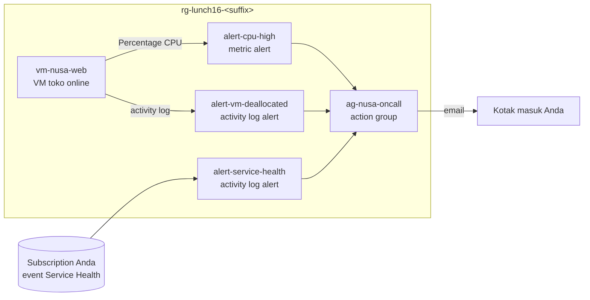

# Lab 16 · Tahu lebih dulu daripada pelanggan

🇬🇧 [Read in English](README.md)

> **Pasangan dari:** [Makan Siang 16 · Pemantauan (Dasar): Azure Monitor, Alert, Service Health, dan Advisor](../../lunches/16-monitoring-basic/README.id.md)
> **Waktu:** sekitar 45 menit · **Biaya:** 💲💲 (lihat [kelompok biaya](../README.id.md#kelompok-biaya)) · **Tingkat kesulitan:** ★☆☆
> **Bisa dikerjakan terpisah:** ✅ Anda tidak memerlukan lab sebelumnya. Semua yang dibutuhkan lab ini dibuat oleh langkah-langkahnya sendiri atau oleh `setup.sh`.
> **Penulis:** Stefanus Pinarta · [Tentang penulis](../../README.id.md#tentang-penulis)

## 🎯 Yang akan Anda bangun

Jumat lalu, pelanggan Nusantara Retail menyadari toko yang lambat sebelum ada seorang pun di kantor pusat yang tahu,
dan pada hari Sabtu tidak ada yang bisa menjawab siapa yang menghentikan VM toko online. Di lab ini Anda membangun
sistem peringatan dini yang mengatasi kedua masalah itu. `setup.sh` memberi Anda sebuah VM toko online yang kecil. Anda
menambahkan action group yang mengirim email kepada Anda, metric alert untuk CPU, activity log alert yang menangkap VM
yang di-deallocate, dan Service Health alert untuk subscription Anda. Setelah itu Anda sengaja membuat CPU ngos-ngosan
dan menerima alert-nya, menjawab "siapa pelakunya?" dari activity log, meminta saran dari Advisor, dan memperbaiki alert
rule milik seorang rekan yang tidak pernah terpicu.



## ✅ Sebelum mulai

- Subscription Azure tempat Anda bisa membuat resource (lihat [Lab 01](../01-before-you-begin/README.id.md)).
- **Azure Cloud Shell (Bash)** — buka [shell.azure.com](https://shell.azure.com). Tidak ada yang perlu dipasang.
- Alamat email yang bisa Anda baca di ponsel selama lab berlangsung (alamat pribadi pun tidak masalah).
- Ambil file lab dan muat pengaturan bersama:

```bash
git clone https://github.com/stefpin/azure-fundamentals-lunches.git   # first time only
cd azure-fundamentals-lunches/labs/16-monitoring-basic
source ../common/config.sh
RG=$(rg_name 16)
export ALERT_EMAIL="you@example.com"     # change this to your own address
```

- Buat titik awalnya — satu VM Linux kecil tanpa port masuk (inbound) yang terbuka. Prosesnya sekitar 3–5 menit:

```bash
bash setup.sh
```

> [!IMPORTANT]
> Resource lab dikenai biaya selama masih ada. Selalu akhiri dengan bagian **Bersihkan**, bahkan jika Anda berhenti di
> tengah jalan.

> [!TIP]
> Cloud Shell terputus setelah sekitar 20 menit tanpa ketikan. Jika itu terjadi, sambungkan lagi dan muat ulang
> variabelnya:
>
> ```bash
> cd ~/azure-fundamentals-lunches/labs/16-monitoring-basic && source ../common/config.sh
> RG=$(rg_name 16); export ALERT_EMAIL="you@example.com"
> VM_ID=$(az vm show -g "$RG" -n vm-nusa-web --query id -o tsv)
> AG_ID=$(az monitor action-group show -g "$RG" -n ag-nusa-oncall --query id -o tsv 2>/dev/null)
> ```

## 🧭 Pilih mode Anda

| Mode | Cocok untuk Anda jika… | Caranya |
|---|---|---|
| **Terpandu** | Anda ingin setiap langkah dijelaskan | ikuti Tugas 1–7 di bawah |
| **Tantangan** | Anda sudah menguasai dasarnya | baca hanya [Ringkasan tantangan](#-ringkasan-tantangan), bangun dengan cara Anda sendiri, lalu jalankan `bash verify.sh` |

## Tugas 1 · Melihat apa yang sudah dikumpulkan Azure

Sebelum membangun apa pun, lihat dulu data yang Anda dapatkan secara gratis: metrik platform dan activity log. Tanpa
agent, tanpa workspace, tanpa pengaturan.

```bash
VM_ID=$(az vm show --resource-group "$RG" --name vm-nusa-web --query id --output tsv)

# Which CPU metrics does a VM publish?
az monitor metrics list-definitions --resource "$VM_ID" \
  --query "[?contains(name.value, 'CPU')].{metric:name.value, unit:unit, aggregation:primaryAggregationType}" \
  --output table

# The last hour of CPU in 5-minute buckets
az monitor metrics list --resource "$VM_ID" --metric "Percentage CPU" \
  --interval PT5M --aggregation Average Maximum \
  --query "value[0].timeseries[0].data[].{time:timeStamp, avg:average, max:maximum}" \
  --output table

# Who created the VM? The activity log already knows.
az monitor activity-log list --resource-group "$RG" --offset 2h \
  --query "[?operationName.value=='Microsoft.Compute/virtualMachines/write'].{time:eventTimestamp, caller:caller, status:status.value}" \
  --output table
```

Anda akan melihat metrik seperti *CPU Credits Remaining*: `$VM_SIZE_SMALL` adalah ukuran B-series yang burstable, yang
hanya bisa berlari dengan kecepatan penuh selama masih punya CPU credit. Ibaratnya kuota internet: selama kuotanya masih
ada, kecepatannya penuh. VM baru dimulai dengan credit yang cukup untuk lab ini.

> [!TIP]
> **Lebih suka memakai portal?** Buka VM, lalu *Monitoring › Metrics* dan pilih *Percentage CPU*; ganti agregasinya
> antara Avg dan Max, lalu perhatikan garisnya berubah. Setelah itu buka *Activity log* di menu VM.

> ✅ **Pemeriksaan:** Anda melihat *Percentage CPU* di daftar definisi, satu kolom berisi nilai CPU yang rendah (VM
> sedang menganggur), dan satu atau beberapa baris activity log untuk `virtualMachines/write` dengan akun **Anda** sebagai
> caller.

## Tugas 2 · Membuat action group yang mengirim email kepada Anda

Action group adalah daftar "siapa yang diberi tahu". Satu grup bisa melayani banyak alert rule, jadi Anda membuatnya
lebih dulu.

```bash
az monitor action-group create \
  --resource-group "$RG" \
  --name ag-nusa-oncall \
  --short-name nusaoncall \
  --action email oncall-email "$ALERT_EMAIL" usecommonalertschema \
  --output none

AG_ID=$(az monitor action-group show --resource-group "$RG" --name ag-nusa-oncall --query id --output tsv)

az monitor action-group show --resource-group "$RG" --name ag-nusa-oncall \
  --query "{enabled:enabled, shortName:groupShortName, receivers:emailReceivers[].{name:name, status:status, commonSchema:useCommonAlertSchema}}" \
  --output yaml
```

- `--short-name` (maksimal 12 karakter) muncul di pesan SMS.
- `--action email <receiver-name> <address> usecommonalertschema` menambahkan satu penerima email (receiver) yang memakai
  common alert schema.
- Email alert dikirim dari alamat no-reply milik Microsoft (misalnya `azure-noreply@microsoft.com`). Jika Anda memakai
  kotak surat kantor dengan filter yang ketat, tambahkan pengirim itu ke daftar aman (safe list).

> [!TIP]
> **Lebih suka memakai portal?** *Monitor › Alerts › Action groups › Create*. Setelah menyimpan, buka grupnya dan pilih
> **Test action group** untuk mengirim email contoh kepada diri sendiri — cara terbaik untuk menemukan masalah folder
> spam sejak awal.

> ✅ **Pemeriksaan:** `enabled: true` dan satu receiver bernama `oncall-email` dengan status `Enabled`.

## Tugas 3 · Membuat metric alert untuk CPU

Sekarang rule-nya: "setiap menit, rata-ratakan CPU selama lima menit terakhir; jika di atas 70%, picu alert Sev 2 dan
jalankan action group".

```bash
az monitor metrics alert create \
  --resource-group "$RG" \
  --name alert-cpu-high \
  --scopes "$VM_ID" \
  --condition "avg Percentage CPU > 70" \
  --window-size 5m \
  --evaluation-frequency 1m \
  --severity 2 \
  --action "$AG_ID" \
  --description "Storefront VM: average CPU above 70% for 5 minutes" \
  --output none

az monitor metrics alert show --resource-group "$RG" --name alert-cpu-high \
  --query "{enabled:enabled, severity:severity, window:windowSize, every:evaluationFrequency, metric:criteria.allOf[0].metricName, aggregation:criteria.allOf[0].timeAggregation, operator:criteria.allOf[0].operator, threshold:criteria.allOf[0].threshold, autoResolve:autoMitigate}" \
  --output yaml
```

| Flag | Arti |
|---|---|
| `--condition "avg Percentage CPU > 70"` | agregasi (`avg`), nama metrik, operator, dan ambang batas (threshold) |
| `--window-size 5m` | periode lookback: seberapa banyak data yang dilihat pada setiap evaluasi |
| `--evaluation-frequency 1m` | seberapa sering rule dijalankan |
| `--severity 2` | Sev 0 berarti kritis, Sev 4 berarti verbose |
| `--action "$AG_ID"` | action group mana yang dijalankan saat rule terpicu |

> [!TIP]
> **Lebih suka memakai portal?** VM › *Alerts* › *Create* › *Alert rule*. Signal *Percentage CPU*, threshold *Static*,
> aggregation *Average*, operator *Greater than*, value *70*, check every *1 minute*, lookback period *5 minutes*. Pilih
> `ag-nusa-oncall` di tab *Actions*.

> ✅ **Pemeriksaan:** output menampilkan `enabled: true`, `window: PT5M`, `every: PT1M`, `aggregation: Average`,
> `operator: GreaterThan`, dan `threshold: 70.0`.

## Tugas 4 · Membuat CPU ngos-ngosan dan menangkap alert-nya

Saatnya menguji alarm. Anda akan menjalankan skrip kecil **di dalam** VM dengan **Run Command** — tanpa SSH, tanpa port
yang terbuka, tanpa memasang paket apa pun. Lihat dulu isinya:

```bash
cat cpu-load.sh
```

Skrip ini menjalankan satu loop sibuk (busy loop) untuk setiap vCPU, dibungkus dengan `timeout`, sehingga bebannya
berhenti dengan sendirinya. Mulai beban selama 15 menit:

```bash
az vm run-command invoke \
  --resource-group "$RG" \
  --name vm-nusa-web \
  --command-id RunShellScript \
  --scripts @cpu-load.sh \
  --parameters 15 \
  --query "value[0].message" --output tsv
```

Run Command butuh 20–60 detik untuk mengembalikan hasil. Setelah itu, saksikan CPU naik (jalankan perintah ini lagi
setiap beberapa menit):

```bash
az monitor metrics list --resource "$VM_ID" --metric "Percentage CPU" \
  --interval PT1M --offset 20m --aggregation Average \
  --query "value[0].timeseries[0].data[].{time:timeStamp, avg:average}" \
  --output table
```

CPU seharusnya mendekati 100% dalam dua atau tiga menit, dan email alert tiba sekitar 5–10 menit setelah Anda memulai
beban. Sambil menunggu, baca lagi bagian 3 dari bacaan makan siang, atau buka *Monitor › Alerts* di portal dan filter
berdasarkan resource group Anda untuk melihat alert-nya muncul.

Setelah email-nya tiba, Anda bisa menghentikan beban lebih awal tanpa menunggu timer habis:

```bash
az vm run-command invoke --resource-group "$RG" --name vm-nusa-web --command-id RunShellScript \
  --scripts @cpu-load.sh --parameters stop --query "value[0].message" --output tsv
```

Beberapa menit setelah CPU turun, rule itu resolved dengan sendirinya dan mengirim email kedua, "Resolved" — metric
alert bersifat stateful.

> [!TIP]
> **Lebih suka memakai portal?** VM › *Operations › Run command › RunShellScript*, tempel isi `cpu-load.sh` dan ganti
> `${1:-10}` dengan jumlah menit. Output-nya muncul di portal saat skrip selesai.

> ✅ **Pemeriksaan:** email dari Azure Monitor yang menyebutkan `alert-cpu-high` dan Sev 2 ada di kotak masuk Anda, dan
> alert-nya muncul di *Monitor › Alerts* dengan monitor condition **Fired** (kemudian **Resolved**).

## Tugas 5 · Mendengar kabar masalah Azure: Service Health alert

Service Health alert memberi tahu Anda ketika Azure memublikasikan insiden, pemeliharaan terencana, atau advisory yang
memengaruhi layanan yang Anda pakai. Rule-nya berupa activity log alert. Rule ini *disimpan* di resource group lab Anda
(sehingga ikut terhapus saat pembersihan), tetapi *cakupannya* adalah seluruh subscription.

```bash
SUB_ID=$(az account show --query id --output tsv)

az monitor activity-log alert create \
  --resource-group "$RG" \
  --name alert-service-health \
  --scope "/subscriptions/$SUB_ID" \
  --condition category=ServiceHealth \
  --action-group "$AG_ID" \
  --description "Azure service issues, planned maintenance and advisories for this subscription" \
  --output none

az monitor activity-log alert show --resource-group "$RG" --name alert-service-health \
  --query "{enabled:enabled, location:location, scope:scopes[0], condition:condition.allOf}" --output yaml
```

Jangan berharap ada email hari ini: alert ini hanya terpicu ketika Azure memublikasikan event Service Health yang
memengaruhi Anda.

> [!TIP]
> **Lebih suka memakai portal?** *Service Health › Health alerts › Create service health alert* memungkinkan Anda
> mencentang layanan, region, dan jenis event (service issue, planned maintenance, health advisory, security advisory),
> alih-alih mendengarkan semuanya. Begitulah yang Anda lakukan di produksi.

> ✅ **Pemeriksaan:** `enabled: true`, `location: Global`, scope-nya `/subscriptions/<your-subscription-id>`, dan
> condition-nya berisi `category` yang bernilai `ServiceHealth`.

## Tugas 6 · "Siapa yang menghentikan toko?" — activity log alert dan sebuah kueri

Pertama, alarmnya: activity log alert yang terpicu setiap kali sebuah VM di resource group ini di-deallocate.

```bash
RG_ID=$(az group show --name "$RG" --query id --output tsv)

az monitor activity-log alert create \
  --resource-group "$RG" \
  --name alert-vm-deallocated \
  --scope "$RG_ID" \
  --condition "category=Administrative and operationName=Microsoft.Compute/virtualMachines/deallocate/action and status=Succeeded" \
  --action-group "$AG_ID" \
  --description "A VM in this resource group was deallocated" \
  --output none
```

Sekarang berperanlah sebagai Rizky dan hentikan VM-nya. Langkah ini juga menghentikan argo biaya komputasi, kabar baik
untuk anggaran (budget) Anda:

```bash
az vm deallocate --resource-group "$RG" --name vm-nusa-web
```

Lalu jawab pertanyaan Ibu Sari dari activity log. Entri baru bisa butuh beberapa menit untuk muncul, jadi ulangi
perintahnya jika tabelnya masih kosong:

```bash
az monitor activity-log list --resource-group "$RG" --offset 1h \
  --query "[?operationName.value=='Microsoft.Compute/virtualMachines/deallocate/action'].{time:eventTimestamp, caller:caller, status:status.value}" \
  --output table
```

Email alert biasanya tiba dalam beberapa menit; activity log alert bisa butuh waktu hingga sekitar 20 menit.

> [!TIP]
> **Lebih suka memakai portal?** *Monitor › Activity log*, filter berdasarkan resource group dan operasi *Deallocate
> Virtual Machine*, lalu buka salah satu entri: bagian **Summary** menampilkan *Event initiated by*. Setelah itu buka
> *Help › Resource health* milik VM: VM ditampilkan sebagai unavailable karena seorang pengguna menghentikannya — "kita",
> bukan Azure.

> ✅ **Pemeriksaan:** tabel menampilkan operasi deallocate dengan akun **Anda** sebagai caller dan sebuah baris
> `Succeeded`, dan email untuk `alert-vm-deallocated` tiba.

## Tugas 7 · Meminta pendapat kedua dari Advisor

Advisor meninjau subscription Anda secara gratis. Tampilkan rekomendasinya, lalu filter berdasarkan kategori:

```bash
az advisor recommendation list \
  --query "[].{category:category, impact:impact, problem:shortDescription.problem, resource:impactedValue}" \
  --output table

az advisor recommendation list --category Cost --output table
```

Kategori di CLI adalah `HighAvailability` (ditampilkan sebagai Reliability di portal), `Security`, `Performance`, `Cost`,
dan `OperationalExcellence`. Advisor menganalisis resource secara berkala, jadi VM yang benar-benar baru bisa butuh waktu
hingga satu hari untuk mendapat rekomendasi; yang Anda lihat sekarang mungkin menyangkut resource lain di subscription
Anda, atau daftarnya mungkin kosong.

> [!TIP]
> **Lebih suka memakai portal?** Cari **Advisor**. Halaman overview menampilkan lima kategori dan **Advisor score**
> Anda. Buka sebuah rekomendasi untuk melihat resource yang terdampak serta opsi *Postpone* dan *Dismiss*.

> ✅ **Pemeriksaan:** perintahnya berjalan tanpa error. Catat satu rekomendasi (jika ada) beserta kategorinya. Daftar
> kosong adalah hasil yang sah untuk subscription yang masih baru.

## 🔧 Rusak lalu perbaiki

Rizky menyalin alert CPU untuk tim operasional, "supaya alarm palsunya lebih sedikit". Buat rule-nya persis seperti yang
ia buat:

```bash
az monitor metrics alert create \
  --resource-group "$RG" \
  --name alert-cpu-rizky \
  --scopes "$VM_ID" \
  --condition "min Percentage CPU > 70" \
  --window-size 1h \
  --evaluation-frequency 15m \
  --severity 3 \
  --action "$AG_ID" \
  --description "Rizky's CPU alert" \
  --output none
```

**Gejala:** selama flash sale 15 menit dengan CPU 100%, `alert-cpu-high` terpicu, tetapi `alert-cpu-rizky` tidak
pernah. Anda tidak perlu menjalankan beban lagi untuk membuktikannya: lihat apa yang akan dilihat setiap rule selama
lonjakan di Tugas 4.

```bash
# Hourly view: what Rizky's rule evaluates
az monitor metrics list --resource "$VM_ID" --metric "Percentage CPU" \
  --interval PT1H --offset 3h --aggregation Minimum Average Maximum \
  --query "value[0].timeseries[0].data[].{hour:timeStamp, min:minimum, avg:average, max:maximum}" \
  --output table

# 5-minute view: the windows where the good rule saw an average above 70
az monitor metrics list --resource "$VM_ID" --metric "Percentage CPU" \
  --interval PT5M --offset 3h --aggregation Average \
  --query "value[0].timeseries[0].data[?average > \`70\`].{time:timeStamp, avg:average}" \
  --output table
```

<details><summary>Petunjuk: mengapa rule itu tidak pernah terpicu, dan bagaimana memperbaikinya?</summary>

Dua pilihan membuat rule itu buta:

- **Minimum** berarti "nilai terendah dalam window". Agar nilai minimum melebihi 70, CPU harus bertahan di atas 70%
  *sepanjang* window.
- **Window satu jam** berarti satu jam penuh. Lonjakan Anda hanya berlangsung 15 menit, sehingga nilai minimum per jam
  tetap rendah (lihat kolom `min`), bahkan rata-rata per jamnya pun tetap jauh di bawah 70.

Agregasi pada kondisi yang sudah ada tidak bisa diganti hanya dengan satu flag, jadi ganti rule-nya (atau hapus saja:
`alert-cpu-high` sudah menangani kasus ini, dan rule ganda berarti email ganda):

```bash
az monitor metrics alert delete --resource-group "$RG" --name alert-cpu-rizky

az monitor metrics alert create \
  --resource-group "$RG" \
  --name alert-cpu-rizky \
  --scopes "$VM_ID" \
  --condition "avg Percentage CPU > 70" \
  --window-size 5m \
  --evaluation-frequency 1m \
  --severity 3 \
  --action "$AG_ID" \
  --description "Rizky's CPU alert, fixed: average over 5 minutes" \
  --output none
```

Ingin bukti? Nyalakan VM (`az vm start -g "$RG" -n vm-nusa-web`), jalankan lagi beban dari Tugas 4 selama 10 menit, dan
saksikan kedua rule terpicu. Setelah itu, deallocate lagi VM-nya.

</details>

## 🧪 Verifikasi hasil kerja Anda

```bash
bash verify.sh
```

Setiap pemeriksaan harus menampilkan **PASS**. Jika ada yang gagal, pesannya memberi tahu tugas mana yang perlu Anda
ulangi. Atur `ALERT_EMAIL` sebelum menjalankannya agar alamat receiver juga ikut diperiksa.

## 🧹 Bersihkan (jangan dilewati!)

```bash
bash cleanup.sh
```

Skrip ini menghapus resource group `rg-lunch16-<suffix>` beserta seluruh isinya: VM, disk-nya, network interface, IP
publik, network security group, dan virtual network, action group, serta keempat alert rule — termasuk Service Health
alert, yang tinggal di resource group walaupun mengawasi seluruh subscription. Tidak ada yang dibuat di luar resource
group. Penghapusan berlanjut di latar belakang selama beberapa menit. Alert yang sudah terpicu tetap terlihat hingga 30
hari dan entri activity log hingga 90 hari; keduanya tidak dikenai biaya.

## 🩺 Pemecahan masalah

| Gejala | Kemungkinan penyebab | Perbaikan |
|---|---|---|
| `(ResourceGroupNotFound) Resource group 'rg-lunch16-…' could not be found.` | `setup.sh` belum dijalankan, atau Cloud Shell ini memakai akhiran (suffix) acak yang berbeda | jalankan `bash setup.sh`; periksa akhirannya dengan `cat ~/.azlunches-suffix` |
| Tidak ada email alert 15 menit setelah beban dimulai | email-nya masuk folder spam, receiver-nya berhenti berlangganan (unsubscribed), atau CPU tidak pernah melewati 70% | periksa folder junk; jalankan perintah `show` di Tugas 2 — jika status receiver bukan `Enabled`, jalankan `az monitor action-group enable-receiver --resource-group "$RG" --action-group-name ag-nusa-oncall --name oncall-email`; periksa nilai CPU dari Tugas 4 |
| CPU bertahan di sekitar 10–20% saat beban berjalan | VM burstable sudah menghabiskan CPU credit-nya dan ditahan di level baseline | periksa metrik *CPU Credits Remaining*; hentikan beban, tunggu, lalu coba durasi yang lebih pendek — atau pakai ukuran yang lebih besar dengan mengatur `VM_SIZE_SMALL` sebelum menjalankan `setup.sh` |
| `(Conflict) Run command extension execution is in progress. Please wait for completion before invoking a run command.` | Run Command hanya menjalankan satu skrip dalam satu waktu | tunggu satu menit, lalu coba lagi |
| Run Command berjalan bermenit-menit dan tidak mengembalikan apa pun | VM masih booting, atau tidak bisa menjangkau Azure lewat HTTPS untuk mengembalikan output | tunggu dua menit setelah membuat atau menyalakan VM; pastikan VM masih punya IP publik (IP itulah yang menyediakan akses keluar) |
| Alert deallocate belum tiba setelah 10 menit | event activity log bisa butuh hingga sekitar 20 menit untuk mencapai sistem alert | tunggu, lalu periksa condition rule-nya dengan kueri di Tugas 6 dan `az monitor activity-log alert show` |
| `az advisor recommendation list` tidak mencetak apa pun | Advisor belum menganalisis resource yang baru | itu normal; coba `az advisor recommendation list --refresh` atau lihat lagi besok di portal |
| Error tentang kombinasi window size dan frequency | sebagian kombinasi lookback dan frequency tidak diizinkan | gunakan nilai di panduan ini (5 menit dan 1 menit) |

## 🚀 Tantangan tambahan

- **Resource Health alert:** buat activity log alert dengan `--condition category=ResourceHealth` dan
  `--scope "$VM_ID"`, lalu deallocate dan nyalakan lagi VM-nya, kemudian bandingkan email-nya dengan email dari Tugas 6.
- **Jam tenang:** di *Monitor › Alerts › Alert processing rules*, buat aturan yang meredam notifikasi untuk resource
  group Anda selama jendela pemeliharaan mingguan, lalu uji dengan Tugas 4.
- **Dynamic threshold:** buat rule CPU kedua dengan `--condition "avg Percentage CPU > dynamic medium 2 of 4"` dan
  pelajari bagaimana Azure mengenali pola normalnya.
- **SMS:** tambahkan receiver SMS dengan `az monitor action-group update --add-action sms …` (pastikan dulu negara Anda
  didukung).
- **Ingatan lebih panjang:** ekspor activity log ke Log Analytics workspace (*Monitor › Activity log › Export Activity
  Logs*) dan kueri tabel `AzureActivity` — cuplikan awal Makan Siang 30.
- **Tampilan satu halaman:** sematkan grafik CPU ke Azure dashboard, atau buka *Monitor › Dashboards with Grafana* dan
  jelajahi dashboard VM yang sudah tersedia.

## 🏁 Ringkasan tantangan

Jalankan `bash setup.sh` untuk mendapatkan resource group `rg-lunch16-<suffix>` dengan VM `vm-nusa-web`. Lalu bangun
hal-hal berikut di resource group tersebut, dengan cara apa pun yang Anda suka (portal, CLI, Bicep):

1. Action group bernama `ag-nusa-oncall` dengan setidaknya satu receiver email.
2. Metric alert bernama `alert-cpu-high` pada `vm-nusa-web`: **Average** *Percentage CPU* **lebih besar dari 70** dalam
   window **5 menit**, dalam keadaan aktif, dan tersambung ke action group.
3. Activity log alert bernama `alert-service-health`, disimpan di resource group, **dengan cakupan seluruh subscription
   Anda**, untuk kategori **ServiceHealth**, dan tersambung ke action group.
4. Activity log alert bernama `alert-vm-deallocated` yang terpicu saat sebuah VM di resource group **di-deallocate**, dan
   tersambung ke action group.
5. Buktikan semuanya berfungsi: terima email alert CPU saat VM diberi beban, dan email deallocate setelah VM dihentikan.
6. Jika Anda membuat rule Rizky (`alert-cpu-rizky`), pastikan rule itu memakai agregasi **Average** dan window
   **15 menit atau kurang** — atau hapus saja.

Lalu jalankan `bash verify.sh`. Buntu? Intip `solution.sh` atau beralih ke mode Terpandu.

---

⬅️ [Bacaan Makan Siang 16](../../lunches/16-monitoring-basic/README.id.md) · 🏠 [Semua lab](../README.id.md) · 🏠 [Beranda kursus](../../README.id.md)

<sub>Terakhir divalidasi: Oktober 2026 · Ada yang tidak berfungsi? [Laporkan masalah lab](../../CONTRIBUTING.md).</sub>
