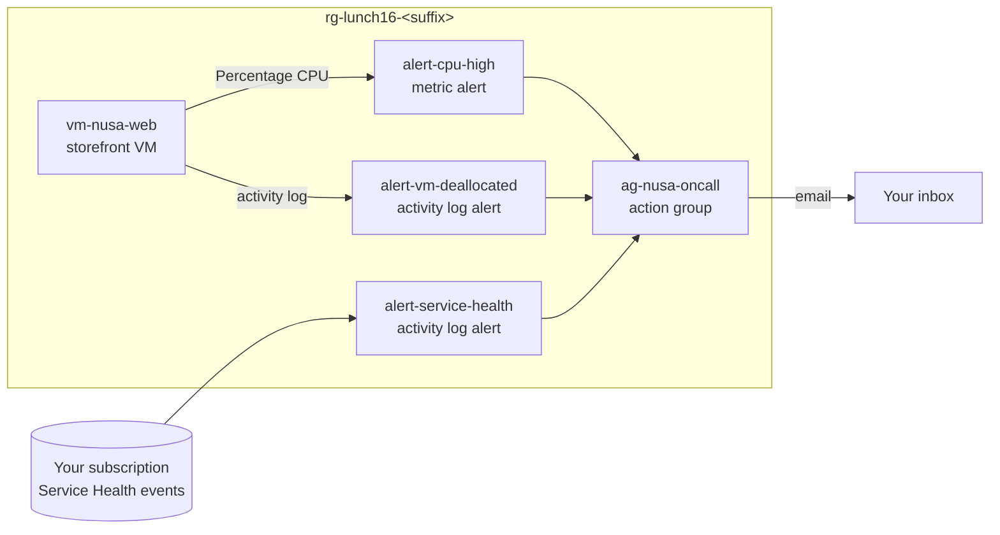

# Lab 16 · Know before customers do

🇮🇩 [Baca dalam Bahasa Indonesia](README.id.md)

> **Pairs with:** [Lunch 16 · Monitoring (Basic): Azure Monitor, Alerts, Service Health and Advisor](../../lunches/16-monitoring-basic/README.md)
> **Time:** about 45 minutes · **Cost:** 💲💲 (see [cost bands](../README.md#cost-bands)) · **Difficulty:** ★☆☆
> **Works on its own:** ✅ You do not need any earlier lab. Everything this lab needs is created by its steps or by `setup.sh`.
> **Author:** Stefanus Pinarta · [About the author](../../README.md#about-the-author)

## 🎯 What you'll build

Last Friday Nusantara Retail's customers noticed a slow shop before anyone at head office did, and on Saturday nobody
could say who had stopped the storefront VM. In this lab you build the early-warning system that fixes both problems.
`setup.sh` gives you a small storefront VM. You add an action group that emails you, a CPU metric alert, an activity
log alert that catches a deallocated VM, and a Service Health alert for your subscription. Then you make the CPU sweat
on purpose and receive the alert, answer "who did it?" from the activity log, ask Advisor for advice, and repair a
colleague's alert rule that never fires.



## ✅ Before you start

- An Azure subscription where you can create resources (see [Lab 01](../01-before-you-begin/README.md)).
- **Azure Cloud Shell (Bash)** — open [shell.azure.com](https://shell.azure.com). Nothing to install.
- An email address you can read on your phone during the lab (a personal address is fine).
- Get the lab files and load the shared settings:

```bash
git clone https://github.com/stefpin/azure-fundamentals-lunches.git   # first time only
cd azure-fundamentals-lunches/labs/16-monitoring-basic
source ../common/config.sh
RG=$(rg_name 16)
export ALERT_EMAIL="you@example.com"     # change this to your own address
```

- Create the starting point — one small Linux VM with no inbound ports open. It takes about 3–5 minutes:

```bash
bash setup.sh
```

> [!IMPORTANT]
> Lab resources cost money while they exist. Finish with the **Clean up** section, even if you stop halfway.

> [!TIP]
> Cloud Shell disconnects after about 20 minutes without typing. If that happens, reconnect and reload the variables:
>
> ```bash
> cd ~/azure-fundamentals-lunches/labs/16-monitoring-basic && source ../common/config.sh
> RG=$(rg_name 16); export ALERT_EMAIL="you@example.com"
> VM_ID=$(az vm show -g "$RG" -n vm-nusa-web --query id -o tsv)
> AG_ID=$(az monitor action-group show -g "$RG" -n ag-nusa-oncall --query id -o tsv 2>/dev/null)
> ```

## 🧭 Choose your mode

| Mode | For you if… | How |
|---|---|---|
| **Guided** | you want every step explained | follow Tasks 1–7 below |
| **Challenge** | you already know the basics | read only the [Challenge brief](#-challenge-brief), build it your way, then run `bash verify.sh` |

## Task 1 · See what Azure already collects

Before you build anything, look at the data you get for free: platform metrics and the activity log. No agent, no
workspace, no settings.

```bash
VM_ID=$(az vm show --resource-group "$RG" --name vm-nusa-web --query id --output tsv)

# Which CPU metrics does a VM publish?
az monitor metrics list-definitions --resource "$VM_ID" \
  --query "[?contains(name.value, 'CPU')].{metric:name.value, unit:unit, aggregation:primaryAggregationType}" \
  --output table

# The last hour of CPU in 5-minute buckets
az monitor metrics list --resource "$VM_ID" --metric "Percentage CPU" \
  --interval PT5M --aggregation Average Maximum \
  --query "value[0].timeseries[0].data[].{time:timeStamp, avg:average, max:maximum}" \
  --output table

# Who created the VM? The activity log already knows.
az monitor activity-log list --resource-group "$RG" --offset 2h \
  --query "[?operationName.value=='Microsoft.Compute/virtualMachines/write'].{time:eventTimestamp, caller:caller, status:status.value}" \
  --output table
```

You'll notice metrics such as *CPU Credits Remaining*: `$VM_SIZE_SMALL` is a burstable B-series size, which can run at
full speed only while it has CPU credits. A new VM starts with enough credits for this lab.

> [!TIP]
> **Prefer the portal?** Open the VM, then *Monitoring › Metrics* and pick *Percentage CPU*; switch the aggregation
> between Avg and Max and watch the line change. Then open *Activity log* in the VM's menu.

> ✅ **Checkpoint:** you see *Percentage CPU* in the definitions, a column of low CPU values (the VM is idle), and one or
> more activity log rows for `virtualMachines/write` with **your** account as the caller.

## Task 2 · Create an action group that emails you

An action group is the "who to tell" list. One group can serve many alert rules, so you create it first.

```bash
az monitor action-group create \
  --resource-group "$RG" \
  --name ag-nusa-oncall \
  --short-name nusaoncall \
  --action email oncall-email "$ALERT_EMAIL" usecommonalertschema \
  --output none

AG_ID=$(az monitor action-group show --resource-group "$RG" --name ag-nusa-oncall --query id --output tsv)

az monitor action-group show --resource-group "$RG" --name ag-nusa-oncall \
  --query "{enabled:enabled, shortName:groupShortName, receivers:emailReceivers[].{name:name, status:status, commonSchema:useCommonAlertSchema}}" \
  --output yaml
```

- `--short-name` (up to 12 characters) appears in SMS messages.
- `--action email <receiver-name> <address> usecommonalertschema` adds one email receiver that uses the common alert
  schema.
- Alert emails come from Microsoft no-reply addresses (for example `azure-noreply@microsoft.com`). If you use a work
  mailbox with strict filters, add that sender to your safe list.

> [!TIP]
> **Prefer the portal?** *Monitor › Alerts › Action groups › Create*. After saving, open the group and select
> **Test action group** to send yourself a sample email — the best way to discover spam-folder problems early.

> ✅ **Checkpoint:** `enabled: true` and one receiver named `oncall-email` with status `Enabled`.

## Task 3 · Create the CPU metric alert

Now the rule: "every minute, average the last five minutes of CPU; if it's above 70%, fire a Sev 2 alert and run the
action group".

```bash
az monitor metrics alert create \
  --resource-group "$RG" \
  --name alert-cpu-high \
  --scopes "$VM_ID" \
  --condition "avg Percentage CPU > 70" \
  --window-size 5m \
  --evaluation-frequency 1m \
  --severity 2 \
  --action "$AG_ID" \
  --description "Storefront VM: average CPU above 70% for 5 minutes" \
  --output none

az monitor metrics alert show --resource-group "$RG" --name alert-cpu-high \
  --query "{enabled:enabled, severity:severity, window:windowSize, every:evaluationFrequency, metric:criteria.allOf[0].metricName, aggregation:criteria.allOf[0].timeAggregation, operator:criteria.allOf[0].operator, threshold:criteria.allOf[0].threshold, autoResolve:autoMitigate}" \
  --output yaml
```

| Flag | Meaning |
|---|---|
| `--condition "avg Percentage CPU > 70"` | aggregation (`avg`), metric name, operator and threshold |
| `--window-size 5m` | the lookback period: how much data each evaluation looks at |
| `--evaluation-frequency 1m` | how often the rule runs |
| `--severity 2` | Sev 0 is critical, Sev 4 is verbose |
| `--action "$AG_ID"` | which action group to run when it fires |

> [!TIP]
> **Prefer the portal?** VM › *Alerts* › *Create* › *Alert rule*. Signal *Percentage CPU*, threshold *Static*,
> aggregation *Average*, operator *Greater than*, value *70*, check every *1 minute*, lookback period *5 minutes*. Pick
> `ag-nusa-oncall` on the *Actions* tab.

> ✅ **Checkpoint:** the output shows `enabled: true`, `window: PT5M`, `every: PT1M`, `aggregation: Average`,
> `operator: GreaterThan` and `threshold: 70.0`.

## Task 4 · Make the CPU sweat and catch the alert

Time to test the alarm. You'll run a tiny script **inside** the VM with **Run Command** — no SSH, no open ports, no
packages installed. Take a look at it first:

```bash
cat cpu-load.sh
```

It starts one busy loop per vCPU, wrapped in `timeout`, so the load stops by itself. Start 15 minutes of load:

```bash
az vm run-command invoke \
  --resource-group "$RG" \
  --name vm-nusa-web \
  --command-id RunShellScript \
  --scripts @cpu-load.sh \
  --parameters 15 \
  --query "value[0].message" --output tsv
```

Run Command takes 20–60 seconds to return. Then watch the CPU climb (run it again every couple of minutes):

```bash
az monitor metrics list --resource "$VM_ID" --metric "Percentage CPU" \
  --interval PT1M --offset 20m --aggregation Average \
  --query "value[0].timeseries[0].data[].{time:timeStamp, avg:average}" \
  --output table
```

Expect CPU near 100% within two or three minutes, and the alert email about 5–10 minutes after you started the load.
While you wait, re-read section 3 of the lunch, or open *Monitor › Alerts* in the portal and filter on your resource
group to watch the alert appear.

When the email has arrived, you can stop the load early instead of waiting for the timer:

```bash
az vm run-command invoke --resource-group "$RG" --name vm-nusa-web --command-id RunShellScript \
  --scripts @cpu-load.sh --parameters stop --query "value[0].message" --output tsv
```

A few minutes after CPU drops, the rule resolves itself and sends a second, "Resolved" email — metric alerts are
stateful.

> [!TIP]
> **Prefer the portal?** VM › *Operations › Run command › RunShellScript*, paste the contents of `cpu-load.sh` and
> replace `${1:-10}` with the number of minutes. The output appears in the portal when the script returns.

> ✅ **Checkpoint:** an email from Azure Monitor mentioning `alert-cpu-high` and Sev 2 is in your inbox, and the alert
> appears under *Monitor › Alerts* with monitor condition **Fired** (later **Resolved**).

## Task 5 · Hear about Azure's problems: a Service Health alert

Service Health alerts tell you when Azure publishes an incident, planned maintenance or an advisory that affects the
services you use. The rule is an activity log alert. It is *stored* in your lab resource group (so the clean-up removes
it) but its *scope* is the whole subscription.

```bash
SUB_ID=$(az account show --query id --output tsv)

az monitor activity-log alert create \
  --resource-group "$RG" \
  --name alert-service-health \
  --scope "/subscriptions/$SUB_ID" \
  --condition category=ServiceHealth \
  --action-group "$AG_ID" \
  --description "Azure service issues, planned maintenance and advisories for this subscription" \
  --output none

az monitor activity-log alert show --resource-group "$RG" --name alert-service-health \
  --query "{enabled:enabled, location:location, scope:scopes[0], condition:condition.allOf}" --output yaml
```

Don't expect an email today: it fires only when Azure publishes a Service Health event that affects you.

> [!TIP]
> **Prefer the portal?** *Service Health › Health alerts › Create service health alert* lets you tick the services,
> regions and event types (service issue, planned maintenance, health advisory, security advisory) instead of
> listening to everything. That's what you'd do in production.

> ✅ **Checkpoint:** `enabled: true`, `location: Global`, the scope is `/subscriptions/<your-subscription-id>` and the
> condition contains `category` equals `ServiceHealth`.

## Task 6 · "Who stopped the shop?" — an activity log alert and a query

First the alarm: an activity log alert that fires whenever a VM in this resource group is deallocated.

```bash
RG_ID=$(az group show --name "$RG" --query id --output tsv)

az monitor activity-log alert create \
  --resource-group "$RG" \
  --name alert-vm-deallocated \
  --scope "$RG_ID" \
  --condition "category=Administrative and operationName=Microsoft.Compute/virtualMachines/deallocate/action and status=Succeeded" \
  --action-group "$AG_ID" \
  --description "A VM in this resource group was deallocated" \
  --output none
```

Now play Rizky and stop the VM. This also stops the compute meter, which is good for your budget:

```bash
az vm deallocate --resource-group "$RG" --name vm-nusa-web
```

Then answer Ibu Sari's question from the activity log. New entries can take a few minutes to appear, so repeat the
command if the table is empty:

```bash
az monitor activity-log list --resource-group "$RG" --offset 1h \
  --query "[?operationName.value=='Microsoft.Compute/virtualMachines/deallocate/action'].{time:eventTimestamp, caller:caller, status:status.value}" \
  --output table
```

The alert email usually arrives within a few minutes; activity log alerts can take up to about 20 minutes.

> [!TIP]
> **Prefer the portal?** *Monitor › Activity log*, filter on the resource group and the operation *Deallocate Virtual
> Machine*, and open an entry: the **Summary** shows *Event initiated by*. Then open the VM's *Help › Resource health*:
> it shows the VM as unavailable because a user stopped it — "us", not Azure.

> ✅ **Checkpoint:** the table lists the deallocate operation with **your** account as the caller and a `Succeeded`
> row, and an email for `alert-vm-deallocated` arrives.

## Task 7 · Ask Advisor for a second opinion

Advisor reviews your subscription for free. List its recommendations, then filter by category:

```bash
az advisor recommendation list \
  --query "[].{category:category, impact:impact, problem:shortDescription.problem, resource:impactedValue}" \
  --output table

az advisor recommendation list --category Cost --output table
```

The CLI's categories are `HighAvailability` (shown as Reliability in the portal), `Security`, `Performance`, `Cost` and
`OperationalExcellence`. Advisor analyses resources periodically, so a brand-new VM may take up to a day to get
recommendations; what you see now may concern other resources in your subscription, or the list may be empty.

> [!TIP]
> **Prefer the portal?** Search for **Advisor**. The overview shows the five categories and your **Advisor score**. Open
> a recommendation to see the affected resources and the *Postpone* and *Dismiss* options.

> ✅ **Checkpoint:** the command runs without errors. Note one recommendation (if any) and its category. An empty list
> is a valid result in a fresh subscription.

## 🔧 Break it and fix it

Rizky copied the CPU alert for the operations team, "with fewer false alarms". Create his rule exactly as he did:

```bash
az monitor metrics alert create \
  --resource-group "$RG" \
  --name alert-cpu-rizky \
  --scopes "$VM_ID" \
  --condition "min Percentage CPU > 70" \
  --window-size 1h \
  --evaluation-frequency 15m \
  --severity 3 \
  --action "$AG_ID" \
  --description "Rizky's CPU alert" \
  --output none
```

**Symptom:** during a 15-minute flash sale at 100% CPU, `alert-cpu-high` fires but `alert-cpu-rizky` never does. You
don't need to run the load again to prove it: look at what each rule would have seen during your Task 4 spike.

```bash
# Hourly view: what Rizky's rule evaluates
az monitor metrics list --resource "$VM_ID" --metric "Percentage CPU" \
  --interval PT1H --offset 3h --aggregation Minimum Average Maximum \
  --query "value[0].timeseries[0].data[].{hour:timeStamp, min:minimum, avg:average, max:maximum}" \
  --output table

# 5-minute view: the windows where the good rule saw an average above 70
az monitor metrics list --resource "$VM_ID" --metric "Percentage CPU" \
  --interval PT5M --offset 3h --aggregation Average \
  --query "value[0].timeseries[0].data[?average > \`70\`].{time:timeStamp, avg:average}" \
  --output table
```

<details><summary>Hint: why does it never fire, and how do you fix it?</summary>

Two choices make the rule blind:

- **Minimum** means "the lowest value in the window". For the minimum to exceed 70, the CPU must stay above 70% for the
  *entire* window.
- A **one-hour window** means the whole hour. Your spike lasted 15 minutes, so the hourly minimum stayed low (look at
  the `min` column) — even the hourly average stayed far below 70.

You can't switch the aggregation of an existing condition with a simple flag, so replace the rule (or simply delete it:
`alert-cpu-high` already covers this case, and duplicate rules mean duplicate emails):

```bash
az monitor metrics alert delete --resource-group "$RG" --name alert-cpu-rizky

az monitor metrics alert create \
  --resource-group "$RG" \
  --name alert-cpu-rizky \
  --scopes "$VM_ID" \
  --condition "avg Percentage CPU > 70" \
  --window-size 5m \
  --evaluation-frequency 1m \
  --severity 3 \
  --action "$AG_ID" \
  --description "Rizky's CPU alert, fixed: average over 5 minutes" \
  --output none
```

Want proof? Start the VM (`az vm start -g "$RG" -n vm-nusa-web`), run Task 4's load again for 10 minutes, and watch both
rules fire. Deallocate the VM again afterwards.

</details>

## 🧪 Verify your work

```bash
bash verify.sh
```

Every check should say **PASS**. If one fails, the message tells you which task to revisit. Set `ALERT_EMAIL` before
running it to also check the receiver's address.

## 🧹 Clean up (do not skip!)

```bash
bash cleanup.sh
```

This deletes resource group `rg-lunch16-<suffix>` and everything in it: the VM, its disk, network interface, public IP,
network security group and virtual network, the action group and all four alert rules — including the Service Health
alert, which lives in the resource group even though it watches the subscription. Nothing is created outside the
resource group. Deletion continues in the background for a few minutes. Fired alerts stay visible for up to 30 days and
activity log entries for 90 days; they cost nothing.

## 🩺 Troubleshooting

| Symptom | Likely cause | Fix |
|---|---|---|
| `(ResourceGroupNotFound) Resource group 'rg-lunch16-…' could not be found.` | `setup.sh` hasn't run, or this Cloud Shell has a different random suffix | run `bash setup.sh`; check the suffix with `cat ~/.azlunches-suffix` |
| No alert email 15 minutes after starting the load | the email is in a spam folder, the receiver was unsubscribed, or CPU never passed 70% | check junk mail; run the Task 2 `show` command — if the receiver's status isn't `Enabled`, run `az monitor action-group enable-receiver --resource-group "$RG" --action-group-name ag-nusa-oncall --name oncall-email`; check the CPU values from Task 4 |
| CPU stays around 10–20% while the load runs | the burstable VM has used its CPU credits and is held at its baseline | check the *CPU Credits Remaining* metric; stop the load, wait, and try a shorter run — or use a larger size by setting `VM_SIZE_SMALL` before `setup.sh` |
| `(Conflict) Run command extension execution is in progress. Please wait for completion before invoking a run command.` | Run Command runs one script at a time | wait a minute and try again |
| Run Command runs for minutes and returns nothing | the VM is still booting, or it can't reach Azure over HTTPS to return the output | wait two minutes after creating or starting the VM; make sure the VM still has its public IP (it provides outbound access) |
| The deallocate alert hasn't arrived after 10 minutes | activity log events can take up to about 20 minutes to reach alerting | wait, then check the rule's condition with the Task 6 query and `az monitor activity-log alert show` |
| `az advisor recommendation list` prints nothing | Advisor hasn't analysed the new resources yet | that's normal; try `az advisor recommendation list --refresh` or look again tomorrow in the portal |
| An error about the combination of window size and frequency | some lookback and frequency combinations aren't allowed | use the values in this guide (5 minutes and 1 minute) |

## 🚀 Stretch goals

- **Resource Health alert:** create an activity log alert with `--condition category=ResourceHealth` and
  `--scope "$VM_ID"`, then deallocate and start the VM and compare the email with the Task 6 one.
- **Quiet hours:** in *Monitor › Alerts › Alert processing rules*, create a rule that suppresses notifications for
  your resource group during a weekly maintenance window, and test it with Task 4.
- **Dynamic threshold:** create a second CPU rule with `--condition "avg Percentage CPU > dynamic medium 2 of 4"` and
  read how Azure learns the normal pattern.
- **SMS:** add an SMS receiver with `az monitor action-group update --add-action sms …` (check that your country is
  supported first).
- **Longer memory:** export the activity log to a Log Analytics workspace (*Monitor › Activity log › Export Activity
  Logs*) and query the `AzureActivity` table — a preview of Lunch 30.
- **A one-page view:** pin the CPU chart to an Azure dashboard, or open *Monitor › Dashboards with Grafana* and explore
  the prebuilt VM dashboard.

## 🏁 Challenge brief

Run `bash setup.sh` to get resource group `rg-lunch16-<suffix>` with the VM `vm-nusa-web`. Then build the following, any
way you like (portal, CLI, Bicep), in that resource group:

1. An action group named `ag-nusa-oncall` with at least one email receiver.
2. A metric alert named `alert-cpu-high` on `vm-nusa-web`: **Average** *Percentage CPU* **greater than 70** over a
   **5-minute** window, enabled, wired to the action group.
3. An activity log alert named `alert-service-health`, stored in the resource group, **scoped to your whole
   subscription**, for the **ServiceHealth** category, wired to the action group.
4. An activity log alert named `alert-vm-deallocated` that fires when a VM in the resource group is **deallocated**,
   wired to the action group.
5. Prove it works: receive the CPU alert email under load, and the deallocate email after stopping the VM.
6. If you create Rizky's rule (`alert-cpu-rizky`), make it use the **Average** aggregation and a window of **15 minutes
   or less** — or delete it.

Then run `bash verify.sh`. Stuck? Peek at `solution.sh` or switch to Guided mode.

---

⬅️ [Lunch 16 reading](../../lunches/16-monitoring-basic/README.md) · 🏠 [All labs](../README.md) · 🏠 [Course home](../../README.md)

<sub>Last validated: October 2026 · Something broken? [Report a lab problem](../../CONTRIBUTING.md).</sub>
