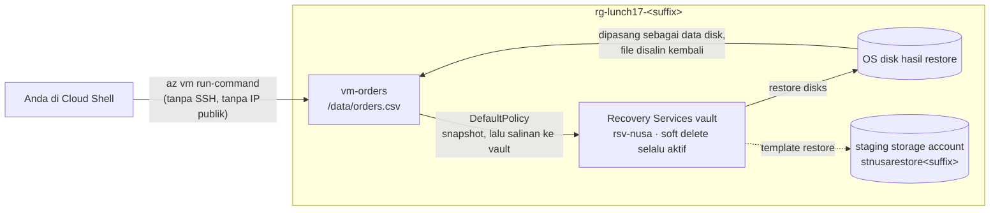

# Lab 17 · Latihan pemulihan data

🇬🇧 [Read in English](README.md)

> **Pasangan dari:** [Makan Siang 17 · Pencadangan Data dan Pemulihan Bencana (Dasar)](../../lunches/17-backup-disaster-recovery/README.id.md)
> **Waktu:** 60–90 menit, sebagian besar menunggu backup pertama · **Biaya:** 💲💲 (lihat [kelompok biaya](../README.id.md#kelompok-biaya)) · **Tingkat kesulitan:** ★★☆
> **Bisa dikerjakan terpisah:** ✅ Anda tidak memerlukan lab sebelumnya. Semua yang dibutuhkan lab ini dibuat oleh langkah-langkahnya sendiri atau oleh `setup.sh`.
> **Penulis:** Stefanus Pinarta · [Tentang penulis](../../README.id.md#tentang-penulis)

## 🎯 Yang akan Anda bangun

Pak Budi sudah mengaku belum pernah me-restore apa pun, jadi Andalah yang akan menjalankan latihan restore pertama
Nusantara Retail. `setup.sh` membuat `vm-orders`, sebuah VM Ubuntu kecil di subnet privat, tanpa IP publik dan tanpa
akses internet. VM ini menyimpan ekspor pesanan harian `/data/orders.csv` beserta sidik jari (fingerprint) file
tersebut. Anda akan membuat **Recovery Services vault**, melihat perlindungan soft delete yang tidak bisa Anda matikan,
melindungi VM dengan **DefaultPolicy**, dan mengambil backup on-demand (sesuai permintaan, tanpa menunggu jadwal).
Setelah itu Anda menghapus file pesanan, persis seperti yang akan dilakukan skrip yang ceroboh atau seorang penyerang,
lalu mengembalikannya: me-restore disk VM dari recovery point, memasangnya ke VM, menyalin file-nya, dan membuktikan
bahwa file itu identik dengan aslinya. Terakhir, Anda berperan sebagai penyerang yang menghapus cadangan, lalu
mengembalikan cadangan itu juga.



## ✅ Sebelum mulai

- Sebuah subscription Azure tempat Anda bisa membuat resource (lihat [Lab 01](../01-before-you-begin/README.id.md)).
- **Azure Cloud Shell (Bash)** — buka [shell.azure.com](https://shell.azure.com). Tidak ada yang perlu dipasang. Anda
  membutuhkan Azure CLI 2.75 atau yang lebih baru, dan Cloud Shell selalu memilikinya; periksa dengan
  `az version --query '"azure-cli"'`.
- Ambil file lab, lalu muat pengaturan bersama dan nama-nama resource lab ini. `lab.env` juga mendefinisikan `vm_run`,
  sebuah helper yang menjalankan perintah di dalam VM:

```bash
git clone https://github.com/stefpin/azure-fundamentals-lunches.git   # first time only
cd azure-fundamentals-lunches/labs/17-backup-disaster-recovery
source ../common/config.sh
source lab.env
```

- Buat titik awalnya. Prosesnya sekitar 5 menit:

```bash
bash setup.sh
```

`setup.sh` mendaftarkan resource provider Recovery Services, lalu membuat jaringan, VM (`$VM_SIZE`, karena Azure Backup
membutuhkan minimal 2 vCPU dan memori 1 GB), dan file pesanannya. Skrip ini tidak pernah menimpa file tersebut, dan
menolak membuatnya ulang setelah file itu hilang. Mengembalikannya adalah tugas Anda.

> [!TIP]
> Cloud Shell mengakhiri sesi setelah sekitar 20 menit tanpa aktivitas, dan variabel Anda ikut hilang bersamanya; hal
> ini penting di lab yang banyak menunggu. Jika itu terjadi, `cd` kembali ke folder lab dan jalankan lagi kedua baris
> `source` (lewati `git clone`). Tidak ada yang hilang di Azure.

> [!IMPORTANT]
> VM, disk-disknya, dan backup yang dilindungi menimbulkan sedikit biaya setiap jam selama masih ada. Selesaikan dengan
> bagian **Bersihkan** dalam sesi yang sama, meskipun Anda berhenti di tengah jalan. Pembersihan butuh beberapa menit,
> karena backup harus dihapus sebelum vault-nya.

## 🧭 Pilih mode Anda

| Mode | Cocok untuk Anda jika… | Caranya |
|---|---|---|
| **Terpandu** | Anda ingin setiap langkah dijelaskan | ikuti Tugas 1–7 di bawah |
| **Tantangan** | Anda sudah menguasai dasarnya | baca hanya [Ringkasan tantangan](#-ringkasan-tantangan), bangun dengan cara Anda sendiri, lalu jalankan `bash verify.sh` |

## Tugas 1 · Berkenalan dengan file pesanan

`vm-orders` tidak punya IP publik dan tidak punya akses internet, jadi Anda tidak bisa masuk lewat SSH. Sebagai
gantinya, **Run Command** mengirim skrip melalui Azure VM agent, dan cara ini tetap berfungsi bahkan pada VM yang
tertutup rapat seperti ini. Lihat file dan sidik jarinya:

```bash
vm_run "head -n 4 /data/orders.csv; wc -l /data/orders.csv; cat /var/lib/nusa/orders.sha256"
```

File itu berisi satu baris header dan 50 pesanan. Sidik jarinya adalah hash SHA-256 dari seluruh isi file. Jika satu
karakter saja berubah, hash-nya ikut berubah, dan dengan cara itulah Anda akan membuktikan bahwa file hasil restore
adalah file aslinya. Ibaratnya sidik jari manusia: dua orang bisa mirip wajahnya, tetapi sidik jarinya pasti berbeda.

> ✅ **Pemeriksaan:** skrip pemeriksa bersama melaporkan bahwa file itu utuh:
>
> ```bash
> vm_run @vm/check-orders.sh
> ```
>
> Seharusnya muncul sebuah baris yang diawali `ORDERS_OK`.

## Tugas 2 · Membuat Recovery Services vault

Vault menyimpan cadangan, di luar VM yang dilindunginya. Vault harus berada di **region yang sama dengan VM**.

```bash
az backup vault create --resource-group "$RG" --name "$VAULT" --location "$LOCATION" --output none
```

Secara default, vault baru menyimpan backup dalam mode geo-redundant (GRS), dan pengaturan ini hanya bisa diubah
**sebelum backup pertama**. Lab tidak membutuhkan salinan di region kedua, jadi jadikan vault ini locally redundant:

```bash
az backup vault backup-properties set --resource-group "$RG" --name "$VAULT" \
  --backup-storage-redundancy LocallyRedundant --output none
```

Di lingkungan produksi, Anda akan memilih zone-redundant storage, atau GRS dengan Cross Region Restore bila region-nya
punya pasangan. Indonesia Central tidak punya pasangan, jadi GRS tidak ditawarkan di sana.

> [!TIP]
> **Lebih suka portal?** Jalur portal: *Home › Create a resource › Recovery Services vault*: resource group
> `rg-lunch17-<suffix>`, nama `rsv-nusa`, region Anda. Lalu buka *vault tersebut › Properties › Backup configuration ›
> Update* dan pilih **Locally-redundant** — setelah itu kembali ke sini dan lanjutkan ke Tugas 3.

> ✅ **Pemeriksaan:** vault sudah ada dan bersifat locally redundant:
>
> ```bash
> az backup vault show -g "$RG" -n "$VAULT" \
>   --query "{name:name, region:location, redundancy:properties.redundancySettings.standardTierStorageRedundancy}" \
>   --output jsonc
> ```

## Tugas 3 · Melihat soft delete, lalu mencoba mematikannya

Dulu, panduan lab biasanya mematikan soft delete pada tahap ini, supaya pembersihan bisa langsung menghapus vault.
Cobalah sendiri, dan temukan mengapa cara itu tidak lagi berhasil. Pertama, lihat pengaturan keamanan vault:

```bash
az backup vault show -g "$RG" -n "$VAULT" --query "properties.securitySettings" --output jsonc
```

Cari `softDeleteSettings`: `softDeleteState` bernilai `AlwaysON` atau `Enabled`, dan `softDeleteRetentionPeriodInDays`
bernilai `14`. Anda juga akan melihat `immutabilitySettings` (`Disabled`) dan `multiUserAuthorization` (`Disabled`),
dua lapisan lain dari bacaan. Sekarang coba matikan soft delete, seperti yang akan dilakukan penyerang yang mencuri
kata sandi admin:

```bash
az backup vault backup-properties set -g "$RG" -n "$VAULT" --soft-delete-feature-state Disable
```

Perintah itu gagal. **Secure by default** mewajibkan soft delete di Recovery Services vault: portal, PowerShell, REST,
dan Azure CLI 2.75 atau yang lebih baru semuanya menolak mematikannya. Itulah tepatnya yang Anda inginkan di produksi.
Backup yang dihapus tetap bisa dipulihkan setidaknya selama 14 hari tanpa biaya tambahan, sehingga penyerang tidak bisa
menghancurkannya dalam satu kali serangan. Konsekuensinya untuk lab: pembersihan akan meninggalkan backup yang
dihapus dan vault-nya dalam status soft-deleted, lalu Azure menghapusnya secara permanen (purge) dengan sendirinya
setelah 14 hari.

> [!WARNING]
> Jika perintah itu **berhasil** (CLI versi lama, atau region tempat penegakan ini belum aktif), segera nyalakan lagi
> soft delete: `az backup vault backup-properties set -g "$RG" -n "$VAULT" --soft-delete-feature-state Enable`.
> Latihan Rusak lalu perbaiki membutuhkannya, dan vault produksi harus selalu mempertahankannya.

> ✅ **Pemeriksaan:** Anda bisa menyebutkan nilai `softDeleteState` untuk vault Anda, dan menjelaskan mengapa percobaan
> mematikannya adalah fitur, bukan bug.

## Tugas 4 · Melindungi VM dengan DefaultPolicy

Setiap vault dilengkapi sebuah policy VM bawaan bernama `DefaultPolicy`. Bacalah dulu sebelum Anda memakainya:

```bash
az backup policy show -g "$RG" --vault-name "$VAULT" --name "$POLICY" \
  --query "{frequency:properties.schedulePolicy.scheduleRunFrequency, time:properties.schedulePolicy.scheduleRunTimes[0], keepDailyDays:properties.retentionPolicy.dailySchedule.retentionDuration.count, instantRestoreDays:properties.instantRpRetentionRangeInDays}" \
  --output jsonc
```

Satu backup per hari, masing-masing disimpan 30 hari, dengan snapshot yang disimpan di samping disk selama 2 hari agar
restore berjalan cepat. Itu berarti RPO hingga 24 jam: cukup untuk ekspor harian, tetapi tidak untuk database pesanan
(Makan Siang 17, bagian 1). Aktifkan untuk VM; prosesnya butuh satu atau dua menit:

```bash
az backup protection enable-for-vm -g "$RG" --vault-name "$VAULT" --vm "$VM" --policy-name "$POLICY" --output none
```

Azure menambahkan ekstensi backup ke VM melalui VM agent. Tidak ada yang perlu dipasang dan tidak ada port yang perlu
dibuka.

> [!TIP]
> **Lebih suka portal?** Jalur portal: *vm-orders › Backup + disaster recovery › Backup*. VM ini memakai Trusted Launch
> (default untuk VM baru), dan untuk VM seperti itu portal hanya menawarkan policy **Enhanced**. Policy Standard
> seperti DefaultPolicy diterapkan ke VM Trusted Launch melalui CLI (2.73 atau yang lebih baru), PowerShell, atau REST.
> Policy Enhanced juga bisa dipakai untuk sisa lab ini; `verify.sh` hanya akan mencatat bahwa policy-nya berbeda.

> ✅ **Pemeriksaan:** VM sudah menjadi backup item di vault, dengan DefaultPolicy:
>
> ```bash
> az backup item list -g "$RG" --vault-name "$VAULT" --backup-management-type AzureIaasVM \
>   --query "[].{vm:properties.friendlyName, state:properties.protectionState, policy:properties.policyName}" --output table
> ```
>
> Seharusnya statusnya `IRPending` ("initial backup pending", artinya backup awal masih menunggu) sampai backup pertama
> selesai, lalu `Protected`.

## Tugas 5 · Backup sekarang, dan manfaatkan waktu tunggu dengan baik

Backup terjadwal baru akan berjalan nanti malam. Sebuah latihan tidak bisa menunggu selama itu, jadi mulailah backup
on-demand dan simpan nama job-nya:

```bash
JOB=$(az backup protection backup-now -g "$RG" --vault-name "$VAULT" \
  --container-name "$VM" --item-name "$VM" --backup-management-type AzureIaasVM \
  --query name --output tsv)
echo "Backup job: $JOB"
```

Job ini punya dua fase. **Take Snapshot** biasanya selesai dalam 5–15 menit, dan fase ini sudah menghasilkan recovery
point yang bisa Anda pakai untuk restore (instant restore). **Transfer data to vault** menyalin data ke dalam vault;
untuk pertama kalinya sering butuh 20–60 menit, kadang lebih lama. Periksa kemajuannya kapan saja:

```bash
az backup job show -g "$RG" --vault-name "$VAULT" --name "$JOB" \
  --query "{status:properties.status, duration:properties.duration, phases:properties.extendedInfo.tasksList[].{phase:taskId, status:status}}" \
  --output jsonc
```

**Sambil menunggu** (setiap butir butuh 5–10 menit):

- Baca ulang bagian 3 dari [bacaan Makan Siang 17](../../lunches/17-backup-disaster-recovery/README.id.md) dan gambar
  ketiga lapisan perlindungan dari ingatan.
- Buka vault di portal: *Backup items*, *Backup jobs › View details* (perhatikan kedua fasenya), dan hub
  **Resiliency**, yang menampilkan semua item yang Anda lindungi di satu tempat.
- Baca [Aman secara default dengan soft delete untuk Azure Backup](https://learn.microsoft.com/azure/backup/secure-by-default)
  untuk melihat apa yang terjadi pada backup yang dihapus, dan pada vault yang dihapus.
- Tuliskan RPO dan RTO untuk satu sistem yang Anda kenal, di kantor atau di rumah, beserta susunan Azure termurah yang
  bisa memenuhinya.

Anda tidak perlu menunggu fase transfer selesai. Begitu **satu recovery point** sudah ada, Anda bisa melanjutkan:

```bash
az backup recoverypoint list -g "$RG" --vault-name "$VAULT" --container-name "$VM" --item-name "$VM" \
  --backup-management-type AzureIaasVM \
  --query "[].{name:name, time:properties.recoveryPointTime, type:properties.recoveryPointType}" --output table
```

> ✅ **Pemeriksaan:** daftar itu menampilkan setidaknya satu recovery point. Jangan mulai Tugas 6 sebelum itu terjadi:
> file yang dihapus sebelum snapshot adalah file yang tidak bisa Anda kembalikan.

## Tugas 6 · Menghilangkan file pesanan

Sekarang tibalah sore yang buruk itu: sebuah skrip bersih-bersih dengan path yang salah menghapus file ekspor.

```bash
vm_run "rm -f /data/orders.csv; ls -l /data"
vm_run @vm/check-orders.sh
```

> ✅ **Pemeriksaan:** `check-orders.sh` melaporkan `ORDERS_MISSING`.

## Tugas 7 · Me-restore file dari recovery point

Me-restore seluruh VM akan ikut memutar balik semua hal lain di dalamnya, padahal hanya satu file yang hilang. Sebagai
gantinya, Anda **me-restore OS disk** dari recovery point sebagai managed disk baru, memasangnya ke VM sebagai data
disk tambahan, menyalin file-nya kembali, lalu melepas disk itu dan menghapusnya. Jalur ini tidak membutuhkan akses
internet di VM. File Recovery di portal membutuhkannya, seperti dijelaskan di bagian tantangan tambahan.

**7a · Sebuah staging storage account.** Job restore menuliskan sebuah template deployment di sana. Storage account
(*akun penyimpanan*) ini harus berada di region yang sama dengan vault:

```bash
az storage account create -g "$RG" -n "$STAGING" -l "$LOCATION" \
  --sku Standard_LRS --kind StorageV2 --min-tls-version TLS1_2 --output none
```

**7b · Me-restore OS disk dari recovery point terbaru.** Proses ini butuh sekitar 5–15 menit selama snapshot-nya masih
tersedia:

```bash
RP=$(az backup recoverypoint list -g "$RG" --vault-name "$VAULT" -c "$VM" -i "$VM" \
  --backup-management-type AzureIaasVM --query "sort_by(@, &properties.recoveryPointTime)[-1].name" --output tsv)
RJOB=$(az backup restore restore-disks -g "$RG" --vault-name "$VAULT" -c "$VM" -i "$VM" \
  --rp-name "$RP" --storage-account "$STAGING" --target-resource-group "$RG" \
  --restore-only-osdisk true --query name --output tsv)
az backup job wait -g "$RG" --vault-name "$VAULT" --name "$RJOB" --timeout 3600
az backup job show -g "$RG" --vault-name "$VAULT" --name "$RJOB" --query properties.status --output tsv
```

**7c · Memasang disk hasil restore ke VM.** Disk hasil restore adalah disk terbaru yang tidak terpasang (unattached) di
resource group:

```bash
DISK=$(az disk list -g "$RG" --query "sort_by([?diskState=='Unattached'], &timeCreated)[-1].name" --output tsv)
echo "Restored disk: $DISK"
az vm disk attach -g "$RG" --vm-name "$VM" --name "$DISK" --lun 0 --output none
```

**7d · Menyalin file kembali.** `vm/recover-orders.sh` mencari sistem file hasil restore: label-nya sama dengan sistem
file yang sedang aktif, tetapi tidak di-mount. Skrip ini me-mount-nya dalam mode read-only, menyalin `orders.csv`
kembali, melepas mount-nya, lalu memeriksa sidik jarinya:

```bash
vm_run @vm/recover-orders.sh
```

**7e · Melepas dan menghapus disk hasil restore.** Jangan me-restart VM selama disk itu masih terpasang: dua disk dengan
label sistem file yang sama bisa membingungkan proses boot.

```bash
az vm disk detach -g "$RG" --vm-name "$VM" --name "$DISK" --output none
az disk delete -g "$RG" -n "$DISK" --yes --no-wait
```

> [!TIP]
> **Lebih suka portal?** Jalur portal: *vm-orders › Backup + disaster recovery › Backup › Restore VM*: pilih recovery
> point, **Create new › Restore disks**, resource group `rg-lunch17-<suffix>`, dan staging account tadi. Lalu pasang
> disk itu di *vm-orders › Settings › Disks › Attach existing disks*, dan kembali ke sini untuk langkah 7d dan 7e.

> ✅ **Pemeriksaan:** langkah 7d mencetak `RESTORE_OK`, dan pemeriksaan bersama sepakat:
>
> ```bash
> vm_run @vm/check-orders.sh
> ```

## 🔧 Rusak lalu perbaiki

Mainkan peran penyerang dari cerita Makan Siang 17. Dengan akun admin curian, Anda menghentikan perlindungan **dan
menghapus semua data backup**:

```bash
az backup protection disable -g "$RG" --vault-name "$VAULT" -c "$VM" -i "$VM" \
  --backup-management-type AzureIaasVM --delete-backup-data true --yes
```

Sekarang lihat apa yang tersisa, lalu jalankan pemeriksaannya:

```bash
az backup item list -g "$RG" --vault-name "$VAULT" --backup-management-type AzureIaasVM \
  --query "[].{vm:properties.friendlyName, state:properties.protectionState, softDeleted:properties.isScheduledForDeferredDelete}" \
  --output table
bash verify.sh
```

Item itu berstatus `ProtectionStopped` dan ditandai sebagai soft-deleted, dan `verify.sh` gagal pada pemeriksaan
perlindungan. Tanpa soft delete, setiap recovery point kini sudah lenyap. Tugas Anda: kembalikan data backup itu dan
mulai lagi perlindungan dengan DefaultPolicy.

<details>
<summary>Petunjuk</summary>

Item yang soft-deleted bisa di-**undelete** selama 14 hari. Undelete mengembalikan item ke status "stop protection,
retain data", sehingga recovery point-nya kembali, tetapi tanpa jadwal. Setelah itu, **resume** (lanjutkan)
perlindungan dengan sebuah policy.
</details>

<details>
<summary>Perbaikan</summary>

```bash
az backup protection undelete -g "$RG" --vault-name "$VAULT" -c "$VM" -i "$VM" \
  --backup-management-type AzureIaasVM --workload-type VM
az backup protection resume -g "$RG" --vault-name "$VAULT" -c "$VM" -i "$VM" \
  --backup-management-type AzureIaasVM --policy-name "$POLICY"
bash verify.sh
```

Di produksi, Anda akan membuat perintah pertama si penyerang jauh lebih sulit. **Multi-user authorization** akan
mewajibkan persetujuan di Resource Guard milik tim keamanan sebelum perlindungan bisa dihentikan dengan penghapusan
data, dan **immutable vault yang locked** akan menolak menghapus recovery point sebelum masa simpannya habis.
</details>

## 🧪 Verifikasi hasil kerja Anda

```bash
bash verify.sh
```

Setiap pemeriksaan seharusnya menampilkan **PASS**. Jika ada yang gagal, pesannya memberi tahu tugas mana yang perlu
Anda ulangi. Skrip ini hanya membaca, tetapi menjalankan `vm/check-orders.sh` di dalam VM, jadi beri waktu sekitar satu
menit.

## 🧹 Bersihkan (jangan dilewati!)

```bash
bash cleanup.sh
```

Dalam urusan backup, urutan itu penting, dan skrip ini mengikutinya:

1. Jika Anda membuat vault menjadi immutable (tantangan tambahan) selagi masih unlocked, skrip ini mematikan
   immutability.
2. Skrip menghentikan perlindungan dan menghapus data backup. Dengan soft delete, data itu pindah ke status
   soft-deleted.
3. Skrip menghapus snapshot instant restore milik `vm-orders`. Azure Backup menyimpannya di resource group bernama
   `AzureBackupRG_<region>_1` (atau yang mirip) *di luar* resource group lab, dan snapshot yang soft-deleted tetap
   menimbulkan biaya, jadi skrip menghapusnya secara eksplisit.
4. Skrip menghapus vault. Vault yang hanya berisi item soft-deleted akan masuk ke status soft-deleted juga, tanpa
   biaya, dan Azure membersihkannya secara permanen setelah 14 hari.
5. Skrip menghapus `rg-lunch17-<suffix>`: VM, disk, jaringan, dan staging account.

Penghapusan berlanjut di latar belakang selama beberapa menit.
`az backup deleted-vault list --location "$LOCATION"` menampilkan vault yang soft-deleted sampai Azure membersihkannya.

## 🩺 Pemecahan masalah

| Gejala | Kemungkinan penyebab | Perbaikan |
|---|---|---|
| `setup.sh` atau `vm_run` gagal dengan pesan *Run command extension execution is in progress. Please wait for completion before invoking a run command.* | Run Command sebelumnya masih berjalan | Tunggu satu menit lalu jalankan lagi; jalankan `vm_run` satu per satu |
| `enable-for-vm` menolak policy, dengan pesan yang menyebut Trusted Launch atau policy Enhanced | Azure CLI lebih lama dari 2.73, yang tidak bisa menerapkan policy Standard ke VM Trusted Launch | Gunakan Cloud Shell atau jalankan `az upgrade`; atau buat policy Enhanced di portal lalu pakai policy itu |
| `backup-properties set --backup-storage-redundancy` gagal | Vault sudah menyimpan backup, jadi redundansinya sudah terkunci | Pertahankan redundansi yang ada untuk lab ini; untuk vault baru, atur sebelum backup pertama |
| `backup-now` ditolak setelah beberapa kali percobaan dalam sehari | Sebuah VM mengizinkan satu backup terjadwal dan tiga backup on-demand per hari, dengan maksimal sembilan percobaan on-demand per 24 jam (UTC) | Tunggu hari UTC berikutnya, atau pakai recovery point yang sudah Anda miliki |
| Job backup tetap *InProgress* lebih dari satu jam | Transfer pertama ke vault menyalin setiap blok yang terpakai | Normal. Anda hanya membutuhkan fase snapshot: lanjutkan begitu `recoverypoint list` menampilkan sebuah titik |
| `recover-orders.sh` mencetak *RESTORE_FAILED: no unmounted disk with a restored root file system was found* | Disk hasil restore belum terpasang, atau disk yang salah yang terpasang | Periksa langkah 7c: `az vm show -g "$RG" -n "$VM" --query "storageProfile.dataDisks[].name"` seharusnya mencantumkan disk hasil restore |
| `recover-orders.sh` mencetak *the recovery point has no /data/orders.csv* | Recovery point yang Anda restore lebih tua daripada file-nya | Restore recovery point terbaru; jika semua titik lebih tua daripada file itu, jalankan lagi Tugas 5 sebelum menghapus apa pun |
| Job restore langsung gagal | Staging account berada di region yang berbeda dari vault, atau merupakan akun premium | Buat akun Standard general-purpose v2 di `$LOCATION` (langkah 7a) |
| `cleanup.sh` melaporkan *Vault cannot be deleted as there are existing resources within the vault.* | Job penghapusan data belum selesai | Jalankan lagi `bash cleanup.sh` beberapa menit kemudian; aman untuk diulang |
| `cleanup.sh` melaporkan *Recovery Services vault cannot be deleted as there are backup items in soft deleted state in the vault.* | Perilaku vault versi lama, dari masa sebelum ada vault yang soft-deleted | Biarkan vault-nya (data soft-deleted tidak dikenai biaya selama 14 hari) dan jalankan lagi `bash cleanup.sh` setelah 14 hari |

## 🚀 Tantangan tambahan

- **File Recovery, cara portal.** *vm-orders › Backup › File Recovery* mengunduh sebuah skrip yang memasang recovery
  point melalui iSCSI di mesin tempat Anda menjalankannya. Mesin itu membutuhkan akses internet keluar (outbound) ke
  Azure Backup, sesuatu yang sengaja tidak dimiliki `vm-orders`. Cobalah di VM Linux yang punya akses keluar, lalu
  gunakan **Unmount disks** setelah selesai.
- **Jadikan vault immutable, tetapi biarkan tetap unlocked.** `az backup vault update -g "$RG" -n "$VAULT"
  --immutability-state Unlocked`, lalu coba kurangi retensi DefaultPolicy di portal dan saksikan permintaan itu
  ditolak. Jangan pernah memilih **Locked** di lab: pilihan itu tidak bisa dibatalkan, dan pembersihan tidak akan bisa
  menghapus data sebelum masa simpannya habis.
- **Ukur RTO Anda.** Catat waktu Tugas 6 dan 7 dari awal sampai akhir, lalu perkirakan berapa lama restore yang sama
  untuk disk 500 GB, dan apa yang akan berubah jika memakai Site Recovery.

## 🏁 Ringkasan tantangan

Bangun hal-hal berikut dengan cara apa pun yang Anda suka (portal, CLI, Bicep), dimulai dari `bash setup.sh`:

1. Sebuah **Recovery Services vault** di `rg-lunch17-<suffix>`, di region yang sama dengan VM, dengan penyimpanan
   **locally redundant** dan soft delete dalam keadaan **aktif**.
2. `vm-orders` **dilindungi** oleh vault tersebut dengan **DefaultPolicy** (policy Enhanced akan dicatat, tetapi tetap
   diterima).
3. Setidaknya **satu recovery point** untuk VM itu.
4. `/data/orders.csv` dihapus **setelah** recovery point itu ada, lalu **di-restore darinya**, sehingga
   `vm/check-orders.sh` melaporkan `ORDERS_OK`.

Lalu jalankan `bash verify.sh`. Buntu? Intip `solution.sh` atau beralih ke mode Terpandu.

---

⬅️ [Bacaan Makan Siang 17](../../lunches/17-backup-disaster-recovery/README.id.md) · 🏠 [Semua lab](../README.id.md) · 🏠 [Beranda kursus](../../README.id.md)

<sub>Terakhir divalidasi: Oktober 2026 · Ada yang tidak berfungsi? [Laporkan masalah lab](../../CONTRIBUTING.md).</sub>
