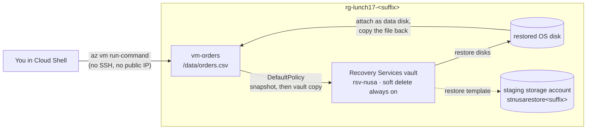

# Lab 17 · The restore drill

🇮🇩 [Baca dalam Bahasa Indonesia](README.id.md)

> **Pairs with:** [Lunch 17 · Backup and Disaster Recovery (Basic)](../../lunches/17-backup-disaster-recovery/README.md)
> **Time:** 60–90 minutes, mostly waiting for the first backup · **Cost:** 💲💲 (see [cost bands](../README.md#cost-bands)) · **Difficulty:** ★★☆
> **Works on its own:** ✅ You do not need any earlier lab. Everything this lab needs is created by its steps or by `setup.sh`.
> **Author:** Stefanus Pinarta · [About the author](../../README.md#about-the-author)

## 🎯 What you'll build

Pak Budi admitted he has never restored anything, so you'll run Nusantara Retail's first restore drill. `setup.sh`
creates `vm-orders`, a small Ubuntu VM in a private subnet, with no public IP and no internet access. It holds the daily
order export `/data/orders.csv` and a fingerprint of that file. You create a **Recovery Services vault**, look at the
soft-delete protection you can't switch off, protect the VM with **DefaultPolicy** and take an on-demand backup. Then
you delete the orders file, the way a careless script or an attacker would, and get it back: restore the VM's disk
from the recovery point, attach it to the VM, copy the file and prove it's identical. Finally, you play the attacker
who deletes the backups, and get those back too.



## ✅ Before you start

- An Azure subscription where you can create resources (see [Lab 01](../01-before-you-begin/README.md)).
- **Azure Cloud Shell (Bash)** — open [shell.azure.com](https://shell.azure.com). Nothing to install. You need Azure
  CLI 2.75 or later, which Cloud Shell always has; check with `az version --query '"azure-cli"'`.
- Get the lab files and load the shared settings and this lab's names. `lab.env` also defines `vm_run`, a helper that
  runs a command inside the VM:

```bash
git clone https://github.com/stefpin/azure-fundamentals-lunches.git   # first time only
cd azure-fundamentals-lunches/labs/17-backup-disaster-recovery
source ../common/config.sh
source lab.env
```

- Create the starting point. It takes about 5 minutes:

```bash
bash setup.sh
```

`setup.sh` registers the Recovery Services resource provider, creates the network, the VM (`$VM_SIZE`, because Azure
Backup needs at least 2 vCPUs and 1 GB of memory) and the orders file. It never overwrites the file, and it refuses to
recreate it once it has been lost. Getting it back is your job.

> [!TIP]
> Cloud Shell ends a session after about 20 minutes without activity, and variables disappear with it, which matters
> in a lab with long waits. If that happens, `cd` back into the lab folder and run the two `source` lines again (skip
> the `git clone`). Nothing in Azure is lost.

> [!IMPORTANT]
> The VM, its disks and the protected backup cost a little every hour they exist. Finish with the **Clean up** section
> in the same sitting, even if you stop halfway. Clean-up takes a few minutes, because backups have to be deleted
> before the vault.

## 🧭 Choose your mode

| Mode | For you if… | How |
|---|---|---|
| **Guided** | you want every step explained | follow Tasks 1–7 below |
| **Challenge** | you already know the basics | read only the [Challenge brief](#-challenge-brief), build it your way, then run `bash verify.sh` |

## Task 1 · Meet the orders file

`vm-orders` has no public IP and no internet access, so you can't SSH into it. **Run Command** sends a script through
the Azure VM agent instead, and that works even on a VM sealed off like this one. Look at the file and its fingerprint:

```bash
vm_run "head -n 4 /data/orders.csv; wc -l /data/orders.csv; cat /var/lib/nusa/orders.sha256"
```

The file has a header and 50 orders. The fingerprint is a SHA-256 hash of the whole file. If a single character
changes, the hash changes, which is how you'll prove the restored file is the original.

> ✅ **Checkpoint:** the shared check script reports the file as intact:
>
> ```bash
> vm_run @vm/check-orders.sh
> ```
>
> Expect a line starting with `ORDERS_OK`.

## Task 2 · Create the Recovery Services vault

The vault holds the backups, outside the VM it protects. It must be in the **same region as the VM**.

```bash
az backup vault create --resource-group "$RG" --name "$VAULT" --location "$LOCATION" --output none
```

A new vault stores backups geo-redundantly (GRS) by default, and you can change that only **before the first backup**.
A lab doesn't need a copy in a second region, so make it locally redundant:

```bash
az backup vault backup-properties set --resource-group "$RG" --name "$VAULT" \
  --backup-storage-redundancy LocallyRedundant --output none
```

In production you would pick zone-redundant storage, or GRS with Cross Region Restore when the region has a pair.
Indonesia Central has no pair, so GRS isn't offered there.

> [!TIP]
> **Prefer the portal?** Portal path: *Home › Create a resource › Recovery Services vault*: resource group
> `rg-lunch17-<suffix>`, name `rsv-nusa`, your region. Then open *the vault › Properties › Backup configuration ›
> Update* and choose **Locally-redundant** — then come back and continue with Task 3.

> ✅ **Checkpoint:** the vault exists and is locally redundant:
>
> ```bash
> az backup vault show -g "$RG" -n "$VAULT" \
>   --query "{name:name, region:location, redundancy:properties.redundancySettings.standardTierStorageRedundancy}" \
>   --output jsonc
> ```

## Task 3 · Look at soft delete, then try to switch it off

Lab guides used to switch soft delete off at this point, so clean-up could delete the vault at once. Try it yourself,
and find out why that no longer works. First, look at the vault's security settings:

```bash
az backup vault show -g "$RG" -n "$VAULT" --query "properties.securitySettings" --output jsonc
```

Look for `softDeleteSettings`: `softDeleteState` is `AlwaysON` or `Enabled`, and `softDeleteRetentionPeriodInDays` is
`14`. You'll also see `immutabilitySettings` (`Disabled`) and `multiUserAuthorization` (`Disabled`), the two other
layers from the reading. Now try to turn soft delete off, as an attacker who has stolen an admin password would:

```bash
az backup vault backup-properties set -g "$RG" -n "$VAULT" --soft-delete-feature-state Disable
```

The command fails. **Secure by default** enforces soft delete on Recovery Services vaults: the portal, PowerShell,
REST and Azure CLI 2.75 or later all refuse to disable it. That's exactly what you want in production. Deleted backups
stay recoverable for at least 14 days at no extra cost, so an attacker can't destroy them in one sitting. The price for
a lab is that clean-up leaves the deleted backups and the vault in a soft-deleted state, and Azure purges them
automatically after 14 days.

> [!WARNING]
> If the command **succeeds** (an old CLI, or a region where the enforcement isn't active yet), switch soft delete
> straight back on: `az backup vault backup-properties set -g "$RG" -n "$VAULT" --soft-delete-feature-state Enable`.
> The Break-and-fix exercise needs it, and production vaults must always keep it.

> ✅ **Checkpoint:** you can say what `softDeleteState` shows for your vault, and why the attempt to disable it is a
> feature rather than a bug.

## Task 4 · Protect the VM with DefaultPolicy

Every vault comes with a built-in VM policy called `DefaultPolicy`. Read it before you use it:

```bash
az backup policy show -g "$RG" --vault-name "$VAULT" --name "$POLICY" \
  --query "{frequency:properties.schedulePolicy.scheduleRunFrequency, time:properties.schedulePolicy.scheduleRunTimes[0], keepDailyDays:properties.retentionPolicy.dailySchedule.retentionDuration.count, instantRestoreDays:properties.instantRpRetentionRangeInDays}" \
  --output jsonc
```

One backup a day, each kept 30 days, with snapshots kept next to the disks for 2 days for fast restores. That's an RPO
of up to 24 hours, fine for a daily export but not for the orders database (Lunch 17, section 1). Turn it on for the
VM; it takes a minute or two:

```bash
az backup protection enable-for-vm -g "$RG" --vault-name "$VAULT" --vm "$VM" --policy-name "$POLICY" --output none
```

Azure adds the backup extension to the VM through the VM agent. There's nothing to install and no port to open.

> [!TIP]
> **Prefer the portal?** Portal path: *vm-orders › Backup + disaster recovery › Backup*. The VM uses Trusted Launch (the
> default for new VMs), and the portal offers only **Enhanced** policies for those. Standard policies such as
> DefaultPolicy are applied to Trusted Launch VMs through the CLI (2.73 or later), PowerShell or REST. An Enhanced
> policy works for the rest of the lab too; `verify.sh` just notes the different policy.

> ✅ **Checkpoint:** the VM is a backup item of the vault, with DefaultPolicy:
>
> ```bash
> az backup item list -g "$RG" --vault-name "$VAULT" --backup-management-type AzureIaasVM \
>   --query "[].{vm:properties.friendlyName, state:properties.protectionState, policy:properties.policyName}" --output table
> ```
>
> Expect `IRPending` ("initial backup pending") until the first backup completes, then `Protected`.

## Task 5 · Back up now, and use the wait well

The scheduled backup would run tonight. A drill can't wait that long, so start an on-demand backup and keep its job
name:

```bash
JOB=$(az backup protection backup-now -g "$RG" --vault-name "$VAULT" \
  --container-name "$VM" --item-name "$VM" --backup-management-type AzureIaasVM \
  --query name --output tsv)
echo "Backup job: $JOB"
```

The job has two phases. **Take Snapshot** usually finishes within 5–15 minutes, and it already creates a recovery
point you can restore from (instant restore). **Transfer data to vault** copies the data into the vault; the first
time it often takes 20–60 minutes, sometimes longer. Check progress whenever you like:

```bash
az backup job show -g "$RG" --vault-name "$VAULT" --name "$JOB" \
  --query "{status:properties.status, duration:properties.duration, phases:properties.extendedInfo.tasksList[].{phase:taskId, status:status}}" \
  --output jsonc
```

**While you wait** (each item takes 5–10 minutes):

- Reread section 3 of the [Lunch 17 reading](../../lunches/17-backup-disaster-recovery/README.md) and draw the three
  protection layers from memory.
- Open the vault in the portal: *Backup items*, *Backup jobs › View details* (watch the two phases), and the
  **Resiliency** hub, which shows all your protected items in one place.
- Read [Secure by default with soft delete for Azure Backup](https://learn.microsoft.com/azure/backup/secure-by-default)
  to see what happens to deleted backups, and to a deleted vault.
- Write down an RPO and an RTO for one system you know, at work or at home, and the cheapest Azure setup that meets them.

You don't have to wait for the transfer phase. As soon as **one recovery point** exists, you can continue:

```bash
az backup recoverypoint list -g "$RG" --vault-name "$VAULT" --container-name "$VM" --item-name "$VM" \
  --backup-management-type AzureIaasVM \
  --query "[].{name:name, time:properties.recoveryPointTime, type:properties.recoveryPointType}" --output table
```

> ✅ **Checkpoint:** the list shows at least one recovery point. Don't start Task 6 before it does: a file deleted
> before the snapshot is a file you can't get back.

## Task 6 · Lose the orders file

Now the bad afternoon: a clean-up script with a wrong path deletes the export.

```bash
vm_run "rm -f /data/orders.csv; ls -l /data"
vm_run @vm/check-orders.sh
```

> ✅ **Checkpoint:** `check-orders.sh` reports `ORDERS_MISSING`.

## Task 7 · Restore the file from the recovery point

Restoring the whole VM would roll back everything else on it as well, and only one file is missing. Instead, you
**restore the OS disk** from the recovery point as a new managed disk, attach it to the VM as an extra data disk, copy
the file back, then detach the disk and delete it. This path needs no internet access on the VM. The portal's File
Recovery would need it, as the stretch goals explain.

**7a · A staging storage account.** The restore job writes a deployment template there. It must be in the same region
as the vault:

```bash
az storage account create -g "$RG" -n "$STAGING" -l "$LOCATION" \
  --sku Standard_LRS --kind StorageV2 --min-tls-version TLS1_2 --output none
```

**7b · Restore the OS disk from the newest recovery point.** This takes about 5–15 minutes when the snapshot is still
available:

```bash
RP=$(az backup recoverypoint list -g "$RG" --vault-name "$VAULT" -c "$VM" -i "$VM" \
  --backup-management-type AzureIaasVM --query "sort_by(@, &properties.recoveryPointTime)[-1].name" --output tsv)
RJOB=$(az backup restore restore-disks -g "$RG" --vault-name "$VAULT" -c "$VM" -i "$VM" \
  --rp-name "$RP" --storage-account "$STAGING" --target-resource-group "$RG" \
  --restore-only-osdisk true --query name --output tsv)
az backup job wait -g "$RG" --vault-name "$VAULT" --name "$RJOB" --timeout 3600
az backup job show -g "$RG" --vault-name "$VAULT" --name "$RJOB" --query properties.status --output tsv
```

**7c · Attach the restored disk to the VM.** The restored disk is the newest unattached disk in the resource group:

```bash
DISK=$(az disk list -g "$RG" --query "sort_by([?diskState=='Unattached'], &timeCreated)[-1].name" --output tsv)
echo "Restored disk: $DISK"
az vm disk attach -g "$RG" --vm-name "$VM" --name "$DISK" --lun 0 --output none
```

**7d · Copy the file back.** `vm/recover-orders.sh` finds the restored file system: it carries the same label as the
live one but isn't mounted. The script mounts it read-only, copies `orders.csv` back, unmounts it and checks the
fingerprint:

```bash
vm_run @vm/recover-orders.sh
```

**7e · Detach and delete the restored disk.** Don't restart the VM while the disk is attached: two disks with the same
file-system label can confuse the boot.

```bash
az vm disk detach -g "$RG" --vm-name "$VM" --name "$DISK" --output none
az disk delete -g "$RG" -n "$DISK" --yes --no-wait
```

> [!TIP]
> **Prefer the portal?** Portal path: *vm-orders › Backup + disaster recovery › Backup › Restore VM*: pick the recovery
> point, **Create new › Restore disks**, resource group `rg-lunch17-<suffix>` and the staging account. Then attach the
> disk under *vm-orders › Settings › Disks › Attach existing disks*, and come back for steps 7d and 7e.

> ✅ **Checkpoint:** step 7d printed `RESTORE_OK`, and the shared check agrees:
>
> ```bash
> vm_run @vm/check-orders.sh
> ```

## 🔧 Break it and fix it

Play the attacker from the Lunch 17 story. With a stolen admin account, you stop protection **and delete all backup
data**:

```bash
az backup protection disable -g "$RG" --vault-name "$VAULT" -c "$VM" -i "$VM" \
  --backup-management-type AzureIaasVM --delete-backup-data true --yes
```

Now look at what's left, and run the checks:

```bash
az backup item list -g "$RG" --vault-name "$VAULT" --backup-management-type AzureIaasVM \
  --query "[].{vm:properties.friendlyName, state:properties.protectionState, softDeleted:properties.isScheduledForDeferredDelete}" \
  --output table
bash verify.sh
```

The item is `ProtectionStopped` and marked as soft-deleted, and `verify.sh` fails its protection check. Without soft
delete, every recovery point would now be gone. Your job: bring the backup data back and restart protection with
DefaultPolicy.

<details>
<summary>Hint</summary>

Soft-deleted items can be **undeleted** for 14 days. Undeleting returns the item to "stop protection, retain data",
so it has its recovery points again but no schedule. Then **resume** protection with a policy.
</details>

<details>
<summary>Fix</summary>

```bash
az backup protection undelete -g "$RG" --vault-name "$VAULT" -c "$VM" -i "$VM" \
  --backup-management-type AzureIaasVM --workload-type VM
az backup protection resume -g "$RG" --vault-name "$VAULT" -c "$VM" -i "$VM" \
  --backup-management-type AzureIaasVM --policy-name "$POLICY"
bash verify.sh
```

In production you'd make the attacker's first command much harder. **Multi-user authorization** would require
approval on a Resource Guard owned by the security team before protection can be stopped with data deletion, and a
**locked immutable vault** would refuse to delete recovery points before they expire.
</details>

## 🧪 Verify your work

```bash
bash verify.sh
```

Every check should say **PASS**. If one fails, the message tells you which task to revisit. The script only reads,
but it runs `vm/check-orders.sh` inside the VM, so allow it a minute.

## 🧹 Clean up (do not skip!)

```bash
bash cleanup.sh
```

Order matters with backups, and the script follows it:

1. If you made the vault immutable (stretch goal) while it was still unlocked, it switches immutability off.
2. It stops protection and deletes the backup data. With soft delete, the data moves to the soft-deleted state.
3. It deletes the instant-restore snapshots of `vm-orders`. Azure Backup keeps them in a resource group called
   `AzureBackupRG_<region>_1` (or similar) *outside* the lab resource group, and soft-deleted snapshots keep costing
   money, so the script removes them explicitly.
4. It deletes the vault. A vault that holds only soft-deleted items moves into a soft-deleted state itself, at no cost,
   and Azure purges it after 14 days.
5. It deletes `rg-lunch17-<suffix>`: the VM, disks, network and the staging account.

Deletion continues in the background for a few minutes.
`az backup deleted-vault list --location "$LOCATION"` shows the soft-deleted vault until Azure purges it.

## 🩺 Troubleshooting

| Symptom | Likely cause | Fix |
|---|---|---|
| `setup.sh` or `vm_run` fails with *Run command extension execution is in progress. Please wait for completion before invoking a run command.* | A previous Run Command is still busy | Wait a minute and run it again; run one `vm_run` at a time |
| `enable-for-vm` refuses the policy, mentioning Trusted Launch or an Enhanced policy | Azure CLI older than 2.73, which can't apply a Standard policy to a Trusted Launch VM | Use Cloud Shell or run `az upgrade`; or create an Enhanced policy in the portal and use that |
| `backup-properties set --backup-storage-redundancy` fails | The vault already holds a backup, so its redundancy is fixed | Keep the current redundancy for this lab; for a new vault, set it before the first backup |
| `backup-now` is rejected after several tries in one day | A VM allows one scheduled and three on-demand backups a day, with at most nine on-demand attempts per 24 hours (UTC) | Wait for the next UTC day, or use the recovery point you already have |
| The backup job stays *InProgress* for over an hour | The first transfer to the vault copies every used block | Normal. You only need the snapshot phase: continue once `recoverypoint list` shows a point |
| `recover-orders.sh` prints *RESTORE_FAILED: no unmounted disk with a restored root file system was found* | The restored disk isn't attached, or the wrong disk was attached | Check step 7c: `az vm show -g "$RG" -n "$VM" --query "storageProfile.dataDisks[].name"` should list the restored disk |
| `recover-orders.sh` prints *the recovery point has no /data/orders.csv* | The recovery point you restored is older than the file | Restore the newest recovery point; if all points predate the file, run Task 5 again before deleting anything |
| The restore job fails right away | The staging account is in a different region from the vault, or is a premium account | Create a Standard general-purpose v2 account in `$LOCATION` (step 7a) |
| `cleanup.sh` reports *Vault cannot be deleted as there are existing resources within the vault.* | The data-deletion job hasn't finished yet | Run `bash cleanup.sh` again in a few minutes; it is safe to repeat |
| `cleanup.sh` reports *Recovery Services vault cannot be deleted as there are backup items in soft deleted state in the vault.* | Older vault behaviour, from before soft-deleted vaults existed | Leave the vault (soft-deleted data costs nothing for 14 days) and run `bash cleanup.sh` again after 14 days |

## 🚀 Stretch goals

- **File Recovery, the portal way.** *vm-orders › Backup › File Recovery* downloads a script that mounts a recovery
  point over iSCSI on the machine where you run it. That machine needs outbound internet access to Azure Backup,
  which `vm-orders` deliberately lacks. Try it on a Linux VM that has outbound access, then use **Unmount disks** when
  you're done.
- **Make the vault immutable, but keep it unlocked.** `az backup vault update -g "$RG" -n "$VAULT"
  --immutability-state Unlocked`, then try to reduce the retention of DefaultPolicy in the portal and watch it being
  refused. Never choose **Locked** in a lab: it can't be undone, and clean-up couldn't delete the data before it expires.
- **Measure your RTO.** Time Tasks 6 and 7 end to end, then estimate how long the same restore would take for a
  500 GB disk, and what Site Recovery would change.

## 🏁 Challenge brief

Build the following, any way you like (portal, CLI, Bicep), starting from `bash setup.sh`:

1. A **Recovery Services vault** in `rg-lunch17-<suffix>`, in the VM's region, with **locally redundant** storage and
   soft delete **on**.
2. `vm-orders` **protected** by the vault with **DefaultPolicy** (an Enhanced policy is noted but accepted).
3. At least **one recovery point** for the VM.
4. `/data/orders.csv` deleted **after** that recovery point existed, and **restored from it**, so that
   `vm/check-orders.sh` reports `ORDERS_OK`.

Then run `bash verify.sh`. Stuck? Peek at `solution.sh` or switch to Guided mode.

---

⬅️ [Lunch 17 reading](../../lunches/17-backup-disaster-recovery/README.md) · 🏠 [All labs](../README.md) · 🏠 [Course home](../../README.md)

<sub>Last validated: October 2026 · Something broken? [Report a lab problem](../../CONTRIBUTING.md).</sub>
