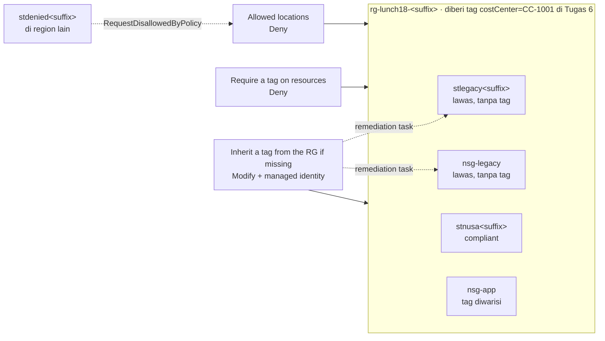

# Lab 18 · Menjaga data tetap di tempat yang benar

🇬🇧 [Read in English](README.md)

> **Pasangan dari:** [Makan Siang 18 · Tata Kelola dan Kepatuhan (Dasar): Azure Policy, Lock, Tag, dan Microsoft Purview](../../lunches/18-governance-compliance-basic/README.id.md)
> **Waktu:** sekitar 45 menit, termasuk 10–20 menit menunggu Azure Policy · **Biaya:** 💲 (lihat [kelompok biaya](../README.id.md#kelompok-biaya)) · **Tingkat kesulitan:** ★★☆
> **Bisa dikerjakan terpisah:** ✅ Anda tidak memerlukan lab sebelumnya. Semua yang dibutuhkan lab ini dibuat oleh langkah-langkahnya sendiri atau oleh `setup.sh`.
> **Penulis:** Stefanus Pinarta · [Tentang penulis](../../README.id.md#tentang-penulis)

## 🎯 Yang akan Anda bangun

Ibu Sari menginginkan tiga pagar pengaman sebelum ada yang men-deploy resource lagi: semuanya tetap di region yang
disetujui, semuanya membawa tag `costCenter` untuk bagian keuangan, dan tidak ada yang perlu ingat mengetikkan tag itu.
Anda akan memasang aturan-aturan tersebut pada sebuah resource group lab dengan tiga definisi Azure Policy **bawaan**
(built-in), membuktikan bahwa deployment di region yang salah ditolak, menyaksikan policy **Modify** menambahkan tag
yang hilang dengan sendirinya, memperbaiki dua resource "lawas" yang sudah ada sebelum aturan dibuat dengan
**remediation task**, dan membaca laporan **kepatuhan** (compliance) yang akan diminta seorang auditor.



## ✅ Sebelum mulai

- Sebuah subscription Azure tempat Anda bisa membuat resource (lihat [Lab 01](../01-before-you-begin/README.id.md)) dan
  tempat Anda berperan sebagai **Owner** (atau Contributor ditambah User Access Administrator). Assignment Modify di
  Tugas 4 membuat role assignment untuk managed identity-nya, dan Contributor biasa tidak bisa melakukan itu. Gunakan
  subscription pribadi atau subscription khusus lab.
- **Azure Cloud Shell (Bash)** — buka [shell.azure.com](https://shell.azure.com). Tidak ada yang perlu dipasang.
- Ambil file lab, lalu muat pengaturan bersama ditambah nama-nama yang dipakai di lab ini:

```bash
git clone https://github.com/stefpin/azure-fundamentals-lunches.git   # first time only
cd azure-fundamentals-lunches/labs/18-governance-compliance-basic
source ../common/config.sh
source lab-vars.sh        # RG, RG_ID, DENIED_LOCATION, resource and assignment names
echo "Lab RG: $RG | allowed region: $LOCATION | region used for the denial test: $DENIED_LOCATION"
```

- Buat titik awalnya — resource group dan dua resource "lawas" tanpa tag (sekitar 2 menit):

```bash
bash setup.sh
```

> [!IMPORTANT]
> Resource lab menimbulkan biaya selama masih ada (di sini: hampir nol — satu atau dua storage account kosong dan
> beberapa network security group). Selesaikan dengan bagian **Bersihkan**, meskipun Anda berhenti di tengah jalan.
> Setiap assignment di lab ini dibatasi pada resource group lab, sehingga bagian lain subscription Anda tidak
> terpengaruh.

> [!TIP]
> Cloud Shell melupakan variabel Anda saat sesinya habis. Jika sebuah perintah mengeluhkan nilai yang kosong, kembali
> ke folder lab dan jalankan lagi `source ../common/config.sh && source lab-vars.sh`. Tugas 1 juga menjelaskan cara
> memulihkan ketiga ID policy.

## 🧭 Pilih mode Anda

| Mode | Cocok untuk Anda jika… | Caranya |
|---|---|---|
| **Terpandu** | Anda ingin setiap langkah dijelaskan | ikuti Tugas 1–8 di bawah |
| **Tantangan** | Anda sudah menguasai dasarnya | baca hanya [Ringkasan tantangan](#-ringkasan-tantangan), bangun dengan cara Anda sendiri, lalu jalankan `bash verify.sh` |

## Tugas 1 · Menemukan tiga definisi bawaan berdasarkan nama tampilannya

Definisi bawaan ditulis dan dikelola oleh Microsoft, dan masing-masing dikenali lewat sebuah GUID (kode unik panjang
seperti nomor seri). Skrip yang menyalin-nyalin GUID sulit dibaca dan mudah rusak, jadi kursus ini selalu mencarinya
berdasarkan **nama tampilan** (display name). Setiap panggilan `az policy definition list` menelusuri ribuan definisi,
jadi beri waktu 10–30 detik.

Pertama, lihat ketiga definisi itu — mode, parameter, dan effect-nya:

```bash
az policy definition list \
  --query "[?policyType=='BuiltIn' && contains(['Allowed locations', 'Require a tag on resources', 'Inherit a tag from the resource group if missing'], displayName)].{name:displayName, mode:mode, parameters:join(', ', keys(parameters)), effect:policyRule.then.effect}" \
  --output table
```

Ketiganya memakai mode **Indexed** (mereka memeriksa resource yang mendukung tag dan lokasi, bukan resource group).
Nama parameternya — `listOfAllowedLocations` dan `tagName` — persis sama dengan yang akan Anda kirimkan di Tugas 2–4.
Jika *Allowed locations* menampilkan `[parameters('effect')]` sebagai effect-nya, berarti effect itu sendiri adalah
parameter dengan nilai default Deny; dua definisi lainnya menuliskan effect-nya (`deny`, `modify`) langsung di dalam
aturan.

Sekarang simpan ketiga ID itu. `lookup_builtin_ids` (didefinisikan di `lab-vars.sh`) menjalankan satu query seperti di
bawah ini, lalu mengisi tiga variabel:

```bash
# What lookup_builtin_ids does, for one definition:
az policy definition list --query "[?policyType=='BuiltIn' && displayName=='Allowed locations'].id | [0]" --output tsv

lookup_builtin_ids
printf '%s\n' "$ALLOWED_LOCATIONS_ID" "$REQUIRE_TAG_ID" "$INHERIT_TAG_ID"
```

Terakhir, cari tahu role apa yang dibutuhkan policy Modify untuk melakukan tugasnya. Definisinya mencantumkan role itu
di `roleDefinitionIds`:

```bash
ROLE_ID=$(az policy definition list \
  --query "[?id=='$INHERIT_TAG_ID'] | [0].policyRule.then.details.roleDefinitionIds[0]" --output tsv)
az role definition list --query "[?name=='${ROLE_ID##*/}'].roleName | [0]" --output tsv
```

> [!TIP]
> **Lebih suka portal?** *Policy › Definitions*, cari setiap nama tampilan dan buka untuk membaca JSON-nya: kondisi
> `if`, effect `then`, parameter, dan (untuk policy inherit) `roleDefinitionIds`. Lalu kembali ke sini dan jalankan
> `lookup_builtin_ids`.

> ✅ **Pemeriksaan:** tiga ID yang diawali `/providers/Microsoft.Authorization/policyDefinitions/`, dan nama role
> **Contributor**.

## Tugas 2 · Meng-assign "Allowed locations" ke resource group

Sebuah assignment menghubungkan definisi ke sebuah scope dan mengisi nilai parameternya. Scope di sini adalah resource
group lab, yang ditulis sebagai resource ID. Nama region harus berupa nama programatis (`southeastasia`, bukan
"Southeast Asia"). Non-compliance message muncul di dalam pesan error, sehingga orang tahu apa yang harus dilakukan
alih-alih membuka tiket.

```bash
az policy assignment create \
  --name "$A_LOCATIONS" \
  --display-name "Lunch 18 - Allowed locations" \
  --scope "$RG_ID" \
  --policy "$ALLOWED_LOCATIONS_ID" \
  --params "{ 'listOfAllowedLocations': { 'value': [ '$LOCATION' ] } }" \
  --output none

az policy assignment non-compliance-message create \
  --name "$A_LOCATIONS" \
  --scope "$RG_ID" \
  --message "Nusantara Retail keeps lab resources in $LOCATION. Please choose that region." \
  --output none
```

> ✅ **Pemeriksaan:** assignment menampilkan region Anda dan enforcement mode `Default`:
> `az policy assignment show --name "$A_LOCATIONS" --scope "$RG_ID" --query "{scope:scope, locations:parameters.listOfAllowedLocations.value, enforcement:enforcementMode}" --output jsonc`

## Tugas 3 · Meng-assign "Require a tag on resources"

Aturan ini menolak setiap resource baru atau resource yang diperbarui di dalam group tersebut jika tidak punya tag
`costCenter`. Aturan ini tidak berlaku untuk resource group itu sendiri.

```bash
az policy assignment create \
  --name "$A_REQUIRE_TAG" \
  --display-name "Lunch 18 - Require costCenter tag" \
  --scope "$RG_ID" \
  --policy "$REQUIRE_TAG_ID" \
  --params "{ 'tagName': { 'value': 'costCenter' } }" \
  --output none
```

> ✅ **Pemeriksaan:** ada dua assignment pada group itu:
> `az policy assignment list --resource-group "$RG" --query "[].{name:name, displayName:displayName, enforcement:enforcementMode}" --output table`

## Tugas 4 · Meng-assign policy "Inherit a tag from the resource group if missing" dengan sebuah managed identity

Policy Modify mengubah resource untuk Anda. Mengubah sebuah permintaan secara langsung tidak membutuhkan apa-apa yang
khusus, tetapi memperbaiki resource yang sudah ada (Tugas 7) dikerjakan oleh **remediation task**, dan task itu
bertindak sebagai **managed identity** (identitas terkelola) milik assignment. Tiga flag tambahan menanganinya:
`--mi-system-assigned` membuat identitasnya, `--location` menentukan tempat identitas itu berada, dan
`--identity-scope` ditambah `--role` memberinya role Contributor yang Anda temukan di Tugas 1 — hanya pada resource
group ini.

```bash
az policy assignment create \
  --name "$A_INHERIT_TAG" \
  --display-name "Lunch 18 - Inherit costCenter from the resource group" \
  --scope "$RG_ID" \
  --policy "$INHERIT_TAG_ID" \
  --params "{ 'tagName': { 'value': 'costCenter' } }" \
  --mi-system-assigned \
  --location "$LOCATION" \
  --identity-scope "$RG_ID" \
  --role Contributor \
  --output none

PRINCIPAL_ID=$(az policy assignment show --name "$A_INHERIT_TAG" --scope "$RG_ID" --query identity.principalId --output tsv)
az role assignment list --scope "$RG_ID" \
  --query "[?principalId=='$PRINCIPAL_ID'].{role:roleDefinitionName, scope:scope}" --output table
```

> [!TIP]
> **Lebih suka portal?** *Policy › Assignments › Assign policy*. Di tab **Remediation**, biarkan *System assigned
> managed identity*, pilih region Anda, dan portal akan memberikan role dari `roleDefinitionIds` secara otomatis.

> ✅ **Pemeriksaan:** satu baris dengan role **Contributor** pada scope resource group Anda. Jika daftarnya kosong,
> identitas baru itu kemungkinan masih direplikasi di Microsoft Entra ID: tunggu satu menit lalu jalankan
> `az role assignment create --assignee-object-id "$PRINCIPAL_ID" --assignee-principal-type ServicePrincipal --role Contributor --scope "$RG_ID"`.

## Tugas 5 · Menunggu pagar pengaman aktif, lalu membuktikan penolakannya

Assignment baru butuh sekitar lima menit — kadang lebih lama — untuk menjangkau scope-nya. Alih-alih menebak-nebak,
minta Azure Resource Manager untuk **memvalidasi** (bukan men-deploy) sebuah template kecil berisi network security
group di region terlarang. Validasi menjalankan pemeriksaan Deny yang sama dengan deployment sungguhan, tetapi tidak
membuat apa pun. Loop ini memeriksa setiap 30 detik:

```bash
for i in $(seq 1 30); do
  out=$(az deployment group validate --resource-group "$RG" --template-file policy-probe.json \
        --parameters location="$DENIED_LOCATION" --only-show-errors --output none 2>&1)
  if grep -qiE "RequestDisallowedByPolicy|disallowed by policy|policy violation" <<<"$out"; then
    echo "Allowed locations is enforced now."; break
  elif [ -n "$out" ]; then
    echo "$out"; break
  fi
  echo "Not enforced yet (check $i of 30) - trying again in 30 seconds..."; sleep 30
done
```

Sambil menunggu, baca ulang bagian *Effect* di bacaan makan siang: dari ketiga assignment Anda, mana yang akan
bertindak **sebelum** permintaan sampai ke resource provider storage?

**5a · Region yang salah.** Minta sebuah storage account di region terlarang. Akun itu bahkan sudah membawa tag yang
benar, jadi hanya aturan lokasi yang bisa keberatan:

```bash
az storage account create --name "$DENIED_SA" --resource-group "$RG" \
  --location "$DENIED_LOCATION" --sku Standard_LRS --tags costCenter="$COST_CENTER"
```

Anda seharusnya mendapat error yang diawali `(RequestDisallowedByPolicy) Resource 'stdenied…' was disallowed by policy`.
Baca lanjutannya: error itu menyebut assignment *Lunch 18 - Allowed locations* dan menampilkan non-compliance message
Anda. Role Owner Anda tidak membantu — RBAC berkata ya, policy berkata tidak.

**5b · Tag yang hilang.** Minta sebuah network security group di region yang benar, tanpa tag:

```bash
az network nsg create --name nsg-untagged --resource-group "$RG" --location "$LOCATION"
```

Kali ini error-nya menyebut *Lunch 18 - Require costCenter tag*. Policy inherit tidak bisa membantu, karena resource
group itu sendiri belum punya tag `costCenter` — tidak ada yang bisa disalin.

> ✅ **Pemeriksaan:** dua error `RequestDisallowedByPolicy`, dan tidak ada yang baru di dalam group:
> `az resource list --resource-group "$RG" --query "[].name" --output tsv` masih hanya menampilkan dua resource lawas.
> Jika 5b ternyata berhasil, berarti aturan tag belum ditegakkan: hapus NSG itu dengan
> `az network nsg delete --name nsg-untagged --resource-group "$RG"`, tunggu dua menit, lalu coba lagi.

## Tugas 6 · Membuat resource yang patuh — dan membiarkan Modify bekerja

Pertama, cara yang jelas: region yang benar, tag yang benar.

```bash
az storage account create --name "$COMPLIANT_SA" --resource-group "$RG" --location "$LOCATION" \
  --sku Standard_LRS --kind StorageV2 --min-tls-version TLS1_2 --allow-blob-public-access false \
  --tags costCenter="$COST_CENTER" --output none
```

Sekarang cara yang praktis. Beri tag pada resource group **sekali saja** (`Merge` mempertahankan tag yang sudah ada),
lalu jalankan lagi perintah yang gagal di 5b, dengan nama baru dan tetap tanpa tag:

```bash
az tag update --resource-id "$RG_ID" --operation Merge --tags costCenter="$COST_CENTER" --output none
az group show --name "$RG" --query tags --output jsonc

az network nsg create --name nsg-app --resource-group "$RG" --location "$LOCATION" --output none
az network nsg show --name nsg-app --resource-group "$RG" --query tags --output jsonc
```

Azure Policy menjalankan **Modify sebelum Deny**: policy inherit menyalin `costCenter` dari resource group ke dalam
permintaan, sehingga policy require menemukan tag-nya dan meloloskannya.

> ✅ **Pemeriksaan:** `nsg-app` menampilkan `"costCenter": "CC-1001"` padahal Anda tidak pernah mengetikkannya. Jika
> `nsg-app` masih ditolak tepat setelah Anda memberi tag pada group, tunggu satu menit lalu jalankan lagi perintah
> create.

## Tugas 7 · Memperbaiki resource lawas dengan remediation

`stlegacy…` dan `nsg-legacy` sudah ada sebelum aturan dibuat, jadi tidak pernah ada permintaan untuk keduanya yang
melewati policy Modify. Deny dan Modify tidak pernah menyentuh resource yang sudah ada dengan sendirinya; keduanya
hanya melaporkannya. Lihat laporannya dulu:

```bash
az policy state list --resource-group "$RG" --filter "complianceState eq 'NonCompliant'" \
  --query "[].{assignment:policyAssignmentName, type:resourceType}" --output table
```

Anda seharusnya melihat resource lawas tercantum untuk assignment tag (jika daftarnya kosong, evaluasi pertama masih
berjalan — lanjutkan saja). Sebuah **remediation task** memperbaikinya secara massal melalui managed identity milik
assignment. `ReEvaluateCompliance` membuatnya memeriksa ulang setiap resource lebih dulu, sehingga Anda tidak perlu
menunggu pemindaian:

```bash
INHERIT_ASSIGNMENT_ID=$(az policy assignment show --name "$A_INHERIT_TAG" --scope "$RG_ID" --query id --output tsv)

az policy remediation create \
  --name "$REMEDIATION" \
  --resource-group "$RG" \
  --policy-assignment "$INHERIT_ASSIGNMENT_ID" \
  --resource-discovery-mode ReEvaluateCompliance \
  --output none
```

Periksa task-nya kira-kira setiap menit. Biasanya selesai dalam 2–10 menit:

```bash
az policy remediation show --name "$REMEDIATION" --resource-group "$RG" \
  --query "{state:provisioningState, deployments:deploymentStatus}" --output jsonc
```

Ketika state-nya `Succeeded`, lihat tag-nya:

```bash
az resource list --resource-group "$RG" \
  --query "[].{name:name, location:location, costCenter:tags.costCenter}" --output table
```

> [!TIP]
> **Lebih suka portal?** *Policy › Remediation* menampilkan setiap assignment Modify dan DeployIfNotExists yang punya
> resource untuk diperbaiki. Tab *Remediation tasks* menampilkan kemajuannya dan menautkan ke setiap perubahan.

> ✅ **Pemeriksaan:** setiap resource di tabel — termasuk `stlegacy…` dan `nsg-legacy` — menampilkan `CC-1001`, dan
> remediation task menampilkan `Succeeded`.

## Tugas 8 · Membaca hasil kepatuhan

Hasil kepatuhan diperbarui setelah ada perubahan, setelah ada assignment baru, sekali sehari, dan sesuai permintaan.
Minta pemindaian on-demand untuk resource group Anda; perintah ini menunggu sampai pemindaian selesai, yang biasanya
butuh beberapa menit:

```bash
az policy state trigger-scan --resource-group "$RG"

az policy state summarize --resource-group "$RG" --query "results || value[0].results" --output jsonc

az policy state list --resource-group "$RG" \
  --query "[].{assignment:policyAssignmentName, state:complianceState, type:resourceType}" --output table
```

`summarize` memberi sudut pandang auditor: berapa banyak resource dan policy yang non-compliant (`resourceDetails`
menghitungnya per status). `list` memberi sudut pandang engineer: satu catatan per resource dan assignment. Ibaratnya
rapor sekolah: `summarize` adalah halaman ringkasan nilai rata-rata, sedangkan `list` adalah rincian nilai setiap mata
pelajaran.

> [!TIP]
> **Lebih suka portal?** *Policy › Compliance*, atur scope ke resource group Anda, lalu buka setiap assignment. Tab
> *Resource compliance* menampilkan setiap resource beserta statusnya; *Compliance details* menjelaskan alasannya.

> ✅ **Pemeriksaan:** catatan kepatuhan ada untuk ketiga assignment, dan setiap resource berstatus `Compliant`. Catatan
> non-compliant biasanya berarti pemindaian atau remediation task masih mengejar ketertinggalan — jalankan lagi
> pemindaiannya beberapa menit kemudian.

## 🔧 Rusak lalu perbaiki

Seseorang "beres-beres" resource group dan menghapus tag `costCenter`-nya. Keesokan harinya, pipeline Dewi — yang sama
dengan yang berhasil di Tugas 6 — gagal. Tirukan kejadiannya:

```bash
az tag update --resource-id "$RG_ID" --operation Delete --tags costCenter="$COST_CENTER" --output none
az network nsg create --name nsg-breakfix --resource-group "$RG" --location "$LOCATION" --output none
```

**Gejala:** `RequestDisallowedByPolicy`, yang menyebut *Lunch 18 - Require costCenter tag*. Resource yang sudah ada
baik-baik saja — tag-nya tetap ada.

<details><summary>Petunjuk</summary>

Policy inherit menyalin tag **dari resource group**. Tanpa tag di group itu, tidak ada yang bisa disalin, sehingga
permintaan sampai ke aturan Deny tanpa perubahan. Perbaiki sumbernya, bukan pipeline-nya: pasang lagi tag itu di
group, tunggu satu menit, lalu jalankan lagi perintah `nsg create`. Kali ini berhasil, dan `nsg-breakfix` mendapatkan
`costCenter` secara otomatis.

```bash
az tag update --resource-id "$RG_ID" --operation Merge --tags costCenter="$COST_CENTER" --output none
```

Di produksi, lindungi juga sumbernya — misalnya dengan policy bawaan *Require a tag on resource groups* pada scope
subscription.

</details>

## 🧪 Verifikasi hasil kerja Anda

```bash
bash verify.sh
```

Setiap pemeriksaan seharusnya menampilkan **PASS**. Jika ada yang gagal, pesannya memberi tahu tugas mana yang perlu
Anda ulangi. Pemeriksaan kepatuhan membutuhkan hasil evaluasi — jika gagal, jalankan
`az policy state trigger-scan --resource-group "$RG"` lalu coba lagi beberapa menit kemudian.

## 🧹 Bersihkan (jangan dilewati!)

```bash
bash cleanup.sh
```

Skrip ini menghapus role assignment milik managed identity dari policy inherit, ketiga policy assignment, dan resource
group `rg-lunch18-<suffix>` beserta seluruh isinya (termasuk remediation task dan lock apa pun yang Anda tambahkan di
tantangan tambahan). Penghapusan berlanjut di latar belakang selama beberapa menit.

## 🩺 Pemecahan masalah

| Gejala | Kemungkinan penyebab | Perbaikan |
|---|---|---|
| `(RequestDisallowedByPolicy) Resource 'stnusa…' was disallowed by policy` di Tugas 6 | perintahnya tidak menyertakan `--tags costCenter=…`, atau memakai region lain | tambahkan tag-nya dan gunakan `--location "$LOCATION"` |
| Storage account di `$DENIED_LOCATION` justru **terbuat** di Tugas 5a | assignment-nya belum ditegakkan | hapus akun itu: `az storage account delete --name "$DENIED_SA" --resource-group "$RG" --yes`, jalankan loop probe, lalu coba lagi |
| `AuthorizationFailed` … `Microsoft.Authorization/roleAssignments/write` di Tugas 4 | Anda bukan Owner atau User Access Administrator, sehingga CLI tidak bisa memberikan role kepada identitas tersebut | gunakan subscription milik Anda sendiri, atau minta seorang Owner memberikan role Contributor pada resource group kepada identitas itu |
| `PrincipalNotFound` di Tugas 4 | managed identity yang baru dibuat belum selesai direplikasi di Microsoft Entra ID | tunggu satu menit, lalu jalankan perintah `az role assignment create` dari pemeriksaan Tugas 4 |
| `InvalidCreatePolicyAssignmentRequest` yang menyebut managed identity | assignment Modify dibuat tanpa `--mi-system-assigned` dan `--location` | jalankan perintah Tugas 4 persis seperti yang tertulis |
| `The subscription is not registered to use namespace 'Microsoft.PolicyInsights'` | resource provider-nya belum terdaftar | `az provider register --namespace Microsoft.PolicyInsights`, tunggu satu atau dua menit (`setup.sh` sudah melakukan ini) |
| Status remediation `Failed`; `deploymentStatus` menampilkan deployment yang gagal | identitasnya tidak punya role pada resource group | perbaiki pemeriksaan Tugas 4, lalu buat remediation task baru dengan `--name` yang berbeda |
| `az policy state list` mengembalikan `[]` | belum ada evaluasi yang selesai | `az policy state trigger-scan --resource-group "$RG"`, lalu tunggu |
| `(StorageAccountAlreadyTaken)` | orang lain sudah memakai nama global itu | pilih nama lain, misalnya `COMPLIANT_SA="stnusa${SUFFIX}x"` |
| Loop probe mencetak error lalu berhenti | biasanya salah folder (`policy-probe.json` tidak ditemukan) | `cd` ke `labs/18-governance-compliance-basic` lalu jalankan lagi |

## 🚀 Tantangan tambahan

- **Laporkan dulu sebelum menegakkan.** Ubah *Allowed locations* menjadi mode lapor saja (report-only), tunggu sekitar
  lima menit, buat storage account di `$DENIED_LOCATION` (kini berhasil), jalankan pemindaian, dan temukan akun itu
  sebagai non-compliant. Setelah itu kembalikan pengaturannya dan hapus akun tersebut:
  `az policy assignment update --name "$A_LOCATIONS" --scope "$RG_ID" --enforcement-mode DoNotEnforce` (lalu nanti
  `--enforcement-mode Default`).
- **Kecualikan satu resource.** Beri `stnusa…` sebuah exemption *Waiver* dari aturan tag yang kedaluwarsa besok, lalu
  saksikan statusnya berubah menjadi *Exempt* setelah pemindaian: `az policy exemption create --name tag-waiver --policy-assignment "$(az policy assignment show --name "$A_REQUIRE_TAG" --scope "$RG_ID" --query id --output tsv)" --exemption-category Waiver --scope "$(az storage account show --name "$COMPLIANT_SA" --resource-group "$RG" --query id --output tsv)" --expires-on "$(date -u -d '+1 day' +%Y-%m-%dT%H:%M:%SZ)"`.
- **Pasang lock.** Tambahkan `az lock create --name no-delete --lock-type CanNotDelete --resource-group "$RG"`, lalu
  coba hapus `nsg-app` dan baca error `ScopeLocked`-nya. `cleanup.sh` akan melepas lock itu untuk Anda.
- **Jelajahi inisiatif regulasi:**
  `az policy set-definition list --query "[?policyType=='BuiltIn' && metadata.category=='Regulatory Compliance'].displayName" --output tsv | sort | head -n 20`.

## 🏁 Ringkasan tantangan

Bangun hal-hal berikut dengan cara apa pun yang Anda suka (portal, CLI, Bicep). Mulailah dengan `bash setup.sh`.

1. Pada `rg-lunch18-<suffix>`, assign policy bawaan **Allowed locations** sehingga resource hanya bisa dibuat di
   region lab Anda (`$LOCATION`).
2. Pada resource group yang sama, assign **Require a tag on resources** untuk tag `costCenter`.
3. Pada resource group yang sama, assign **Inherit a tag from the resource group if missing** untuk `costCenter`,
   dengan **system-assigned managed identity** yang memegang role yang diminta definisinya pada resource group itu.
4. Tunjukkan bahwa storage account di region lain ditolak, lalu buat storage account yang patuh (bukan yang lawas) di
   `$LOCATION`.
5. Beri tag `costCenter=CC-1001` pada resource group dan gunakan **remediation task** agar kedua resource lawas dari
   `setup.sh` membawa tag tersebut.
6. Pastikan hasil kepatuhan tersedia untuk ketiga assignment.

Lalu jalankan `bash verify.sh`. Buntu? Intip `solution.sh` atau beralih ke mode Terpandu.

---

⬅️ [Bacaan Makan Siang 18](../../lunches/18-governance-compliance-basic/README.id.md) · 🏠 [Semua lab](../README.id.md) · 🏠 [Beranda kursus](../../README.id.md)

<sub>Terakhir divalidasi: Oktober 2026 · Ada yang tidak berfungsi? [Laporkan masalah lab](../../CONTRIBUTING.md).</sub>
