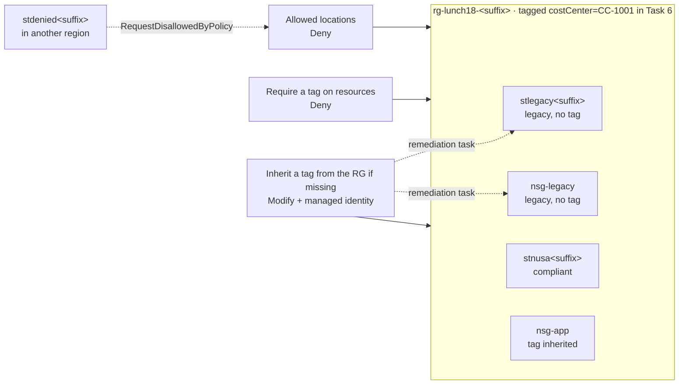

# Lab 18 · Keep data in the right place

> **Pairs with:** [Lunch 18 · Governance and Compliance (Basic)](../../lunches/18-governance-compliance-basic/README.md)
> **Time:** about 45 minutes, including 10–20 minutes of waiting for Azure Policy · **Cost:** 💲 (see [cost bands](../README.md#cost-bands)) · **Difficulty:** ★★☆
> **Works on its own:** ✅ You do not need any earlier lab. Everything this lab needs is created by its steps or by `setup.sh`.

## 🎯 What you'll build

Ibu Sari wants three guardrails before anyone deploys another resource: everything stays in the approved region,
everything carries a `costCenter` tag for finance, and nobody has to remember to type that tag. You will put those rules
on a lab resource group with three **built-in** Azure Policy definitions, prove that a deployment in the wrong region is
refused, watch a **Modify** policy add a missing tag on its own, fix two "legacy" resources that existed before the rules
with a **remediation task**, and read the **compliance** report an auditor would ask for.



## ✅ Before you start

- An Azure subscription where you can create resources (see [Lab 01](../01-before-you-begin/README.md)) and where you are
  **Owner** (or Contributor plus User Access Administrator). The Modify assignment in Task 4 creates a role assignment
  for its managed identity, and plain Contributor cannot do that. Use a personal or dedicated lab subscription.
- **Azure Cloud Shell (Bash)** — open [shell.azure.com](https://shell.azure.com). Nothing to install.
- Get the lab files and load the shared settings plus this lab's names:

```bash
git clone https://github.com/stefpin/azure-fundamentals-lunches.git   # first time only
cd azure-fundamentals-lunches/labs/18-governance-compliance-basic
source ../common/config.sh
source lab-vars.sh        # RG, RG_ID, DENIED_LOCATION, resource and assignment names
echo "Lab RG: $RG | allowed region: $LOCATION | region used for the denial test: $DENIED_LOCATION"
```

- Create the starting point — the resource group and two untagged "legacy" resources (about 2 minutes):

```bash
bash setup.sh
```

> [!IMPORTANT]
> Lab resources cost money while they exist (here: almost nothing — an empty storage account or two and some network
> security groups). Finish with the **Clean up** section, even if you stop halfway. Every assignment in this lab is
> scoped to the lab resource group, so the rest of your subscription is not affected.

> [!TIP]
> Cloud Shell forgets your variables when it times out. If a command complains about an empty value, go back to the lab
> folder and run `source ../common/config.sh && source lab-vars.sh` again. Task 1 also tells you how to restore the
> three policy IDs.

## 🧭 Choose your mode

| Mode | For you if… | How |
|---|---|---|
| **Guided** | you want every step explained | follow Tasks 1–8 below |
| **Challenge** | you already know the basics | read only the [Challenge brief](#-challenge-brief), build it your way, then run `bash verify.sh` |

## Task 1 · Find the three built-in definitions by display name

Built-in definitions are written and maintained by Microsoft, and they are identified by a GUID. Scripts that copy
GUIDs around are hard to read and easy to break, so this course always looks them up by **display name**. Each
`az policy definition list` call searches thousands of definitions, so give it 10–30 seconds.

First, look at the three definitions — their mode, their parameters and their effect:

```bash
az policy definition list \
  --query "[?policyType=='BuiltIn' && contains(['Allowed locations', 'Require a tag on resources', 'Inherit a tag from the resource group if missing'], displayName)].{name:displayName, mode:mode, parameters:join(', ', keys(parameters)), effect:policyRule.then.effect}" \
  --output table
```

All three use **Indexed** mode (they look at resources that support tags and locations, not at resource groups). The
parameter names — `listOfAllowedLocations` and `tagName` — are exactly what you will pass in Tasks 2–4. If *Allowed
locations* shows `[parameters('effect')]` as its effect, the effect is itself a parameter whose default is Deny; the
other two have their effect (`deny`, `modify`) written into the rule.

Now store the three IDs. `lookup_builtin_ids` (defined in `lab-vars.sh`) runs one query like the one below and sets
three variables:

```bash
# What lookup_builtin_ids does, for one definition:
az policy definition list --query "[?policyType=='BuiltIn' && displayName=='Allowed locations'].id | [0]" --output tsv

lookup_builtin_ids
printf '%s\n' "$ALLOWED_LOCATIONS_ID" "$REQUIRE_TAG_ID" "$INHERIT_TAG_ID"
```

Finally, find out which role the Modify policy needs to do its job. The definition lists it in `roleDefinitionIds`:

```bash
ROLE_ID=$(az policy definition list \
  --query "[?id=='$INHERIT_TAG_ID'] | [0].policyRule.then.details.roleDefinitionIds[0]" --output tsv)
az role definition list --query "[?name=='${ROLE_ID##*/}'].roleName | [0]" --output tsv
```

> [!TIP]
> **Prefer the portal?** *Policy › Definitions*, search for each display name and open it to read the JSON: the `if`
> condition, the `then` effect, the parameters and (for the inherit policy) `roleDefinitionIds`. Then come back and run
> `lookup_builtin_ids`.

> ✅ **Checkpoint:** three IDs that start with `/providers/Microsoft.Authorization/policyDefinitions/`, and the role
> name **Contributor**.

## Task 2 · Assign "Allowed locations" to the resource group

An assignment connects a definition to a scope and supplies the parameter values. The scope here is the lab resource
group, written as a resource ID. Region names must be the programmatic ones (`southeastasia`, not "Southeast Asia").
The non-compliance message appears inside the error, so people learn what to do instead of filing a ticket.

```bash
az policy assignment create \
  --name "$A_LOCATIONS" \
  --display-name "Lunch 18 - Allowed locations" \
  --scope "$RG_ID" \
  --policy "$ALLOWED_LOCATIONS_ID" \
  --params "{ 'listOfAllowedLocations': { 'value': [ '$LOCATION' ] } }" \
  --output none

az policy assignment non-compliance-message create \
  --name "$A_LOCATIONS" \
  --scope "$RG_ID" \
  --message "Nusantara Retail keeps lab resources in $LOCATION. Please choose that region." \
  --output none
```

> ✅ **Checkpoint:** the assignment shows your region and the enforcement mode `Default`:
> `az policy assignment show --name "$A_LOCATIONS" --scope "$RG_ID" --query "{scope:scope, locations:parameters.listOfAllowedLocations.value, enforcement:enforcementMode}" --output jsonc`

## Task 3 · Assign "Require a tag on resources"

This one refuses any new or updated resource in the group that has no `costCenter` tag. It does not apply to the
resource group itself.

```bash
az policy assignment create \
  --name "$A_REQUIRE_TAG" \
  --display-name "Lunch 18 - Require costCenter tag" \
  --scope "$RG_ID" \
  --policy "$REQUIRE_TAG_ID" \
  --params "{ 'tagName': { 'value': 'costCenter' } }" \
  --output none
```

> ✅ **Checkpoint:** two assignments on the group:
> `az policy assignment list --resource-group "$RG" --query "[].{name:name, displayName:displayName, enforcement:enforcementMode}" --output table`

## Task 4 · Assign "Inherit a tag from the resource group if missing" with a managed identity

Modify policies change resources for you. Changing a request on the fly needs nothing special, but fixing resources that
already exist (Task 7) is done by a **remediation task**, and that task acts as a **managed identity** that belongs to
the assignment. Three extra flags handle it: `--mi-system-assigned` creates the identity, `--location` says where it
lives, and `--identity-scope` plus `--role` grant it the Contributor role you found in Task 1 — on this resource group
only.

```bash
az policy assignment create \
  --name "$A_INHERIT_TAG" \
  --display-name "Lunch 18 - Inherit costCenter from the resource group" \
  --scope "$RG_ID" \
  --policy "$INHERIT_TAG_ID" \
  --params "{ 'tagName': { 'value': 'costCenter' } }" \
  --mi-system-assigned \
  --location "$LOCATION" \
  --identity-scope "$RG_ID" \
  --role Contributor \
  --output none

PRINCIPAL_ID=$(az policy assignment show --name "$A_INHERIT_TAG" --scope "$RG_ID" --query identity.principalId --output tsv)
az role assignment list --scope "$RG_ID" \
  --query "[?principalId=='$PRINCIPAL_ID'].{role:roleDefinitionName, scope:scope}" --output table
```

> [!TIP]
> **Prefer the portal?** *Policy › Assignments › Assign policy*. On the **Remediation** tab, keep *System assigned
> managed identity*, pick your region, and the portal grants the roles from `roleDefinitionIds` automatically.

> ✅ **Checkpoint:** one row with role **Contributor** at your resource group's scope. If the list is empty, the new
> identity was probably still replicating in Microsoft Entra ID: wait a minute and run
> `az role assignment create --assignee-object-id "$PRINCIPAL_ID" --assignee-principal-type ServicePrincipal --role Contributor --scope "$RG_ID"`.

## Task 5 · Wait for the guardrails, then prove the denials

A new assignment takes about five minutes — sometimes longer — to reach its scope. Instead of guessing, ask Azure
Resource Manager to **validate** (not deploy) a tiny template with a network security group in the forbidden region.
Validation runs the same Deny checks as a real deployment and creates nothing. This loop checks every 30 seconds:

```bash
for i in $(seq 1 30); do
  out=$(az deployment group validate --resource-group "$RG" --template-file policy-probe.json \
        --parameters location="$DENIED_LOCATION" --only-show-errors --output none 2>&1)
  if grep -qiE "RequestDisallowedByPolicy|disallowed by policy|policy violation" <<<"$out"; then
    echo "Allowed locations is enforced now."; break
  elif [ -n "$out" ]; then
    echo "$out"; break
  fi
  echo "Not enforced yet (check $i of 30) - trying again in 30 seconds..."; sleep 30
done
```

While you wait, re-read *Effects* in the lunch: which of your three assignments will act **before** the request
reaches the storage resource provider?

**5a · The wrong region.** Ask for a storage account in the forbidden region. It even carries the right tag, so only
the location rule can object:

```bash
az storage account create --name "$DENIED_SA" --resource-group "$RG" \
  --location "$DENIED_LOCATION" --sku Standard_LRS --tags costCenter="$COST_CENTER"
```

You should get an error that starts with `(RequestDisallowedByPolicy) Resource 'stdenied…' was disallowed by policy`.
Read on: it names the assignment *Lunch 18 - Allowed locations* and shows your non-compliance message. Your Owner role
did not help — RBAC said yes, the policy said no.

**5b · The missing tag.** Ask for a network security group in the right region, without tags:

```bash
az network nsg create --name nsg-untagged --resource-group "$RG" --location "$LOCATION"
```

This time the error names *Lunch 18 - Require costCenter tag*. The inherit policy could not help, because the resource
group itself has no `costCenter` tag yet — there was nothing to copy.

> ✅ **Checkpoint:** two `RequestDisallowedByPolicy` errors, and nothing new in the group:
> `az resource list --resource-group "$RG" --query "[].name" --output tsv` still shows only the two legacy resources.
> If 5b succeeded instead, the tag rule was not enforced yet: delete it with
> `az network nsg delete --name nsg-untagged --resource-group "$RG"`, wait two minutes and try again.

## Task 6 · Create compliant resources — and let Modify do the work

First the obvious way: right region, right tag.

```bash
az storage account create --name "$COMPLIANT_SA" --resource-group "$RG" --location "$LOCATION" \
  --sku Standard_LRS --kind StorageV2 --min-tls-version TLS1_2 --allow-blob-public-access false \
  --tags costCenter="$COST_CENTER" --output none
```

Now the convenient way. Tag the resource group **once** (`Merge` keeps its existing tags), then run the command that
failed in 5b again, under a new name and still without tags:

```bash
az tag update --resource-id "$RG_ID" --operation Merge --tags costCenter="$COST_CENTER" --output none
az group show --name "$RG" --query tags --output jsonc

az network nsg create --name nsg-app --resource-group "$RG" --location "$LOCATION" --output none
az network nsg show --name nsg-app --resource-group "$RG" --query tags --output jsonc
```

Azure Policy runs **Modify before Deny**: the inherit policy copied `costCenter` from the resource group into the
request, so the require policy found the tag and let it through.

> ✅ **Checkpoint:** `nsg-app` shows `"costCenter": "CC-1001"` although you never typed it. If `nsg-app` is still
> refused straight after you tagged the group, wait a minute and run the create command again.

## Task 7 · Remediate the legacy resources

`stlegacy…` and `nsg-legacy` existed before the rules, so no request ever passed through the Modify policy for them.
Deny and Modify never touch existing resources on their own; they only report them. Look at the report first:

```bash
az policy state list --resource-group "$RG" --filter "complianceState eq 'NonCompliant'" \
  --query "[].{assignment:policyAssignmentName, type:resourceType}" --output table
```

You should see the legacy resources listed for the tag assignments (if the list is empty, the first evaluation is still
running — continue anyway). A **remediation task** fixes them in bulk through the assignment's managed identity.
`ReEvaluateCompliance` makes it re-check every resource first, so you do not have to wait for a scan:

```bash
INHERIT_ASSIGNMENT_ID=$(az policy assignment show --name "$A_INHERIT_TAG" --scope "$RG_ID" --query id --output tsv)

az policy remediation create \
  --name "$REMEDIATION" \
  --resource-group "$RG" \
  --policy-assignment "$INHERIT_ASSIGNMENT_ID" \
  --resource-discovery-mode ReEvaluateCompliance \
  --output none
```

Check the task every minute or so. It usually finishes within 2–10 minutes:

```bash
az policy remediation show --name "$REMEDIATION" --resource-group "$RG" \
  --query "{state:provisioningState, deployments:deploymentStatus}" --output jsonc
```

When the state is `Succeeded`, look at the tags:

```bash
az resource list --resource-group "$RG" \
  --query "[].{name:name, location:location, costCenter:tags.costCenter}" --output table
```

> [!TIP]
> **Prefer the portal?** *Policy › Remediation* lists every Modify and DeployIfNotExists assignment with resources to
> fix. The *Remediation tasks* tab shows progress and links to each change.

> ✅ **Checkpoint:** every resource in the table — including `stlegacy…` and `nsg-legacy` — shows `CC-1001`, and the
> remediation task shows `Succeeded`.

## Task 8 · Read the compliance results

Compliance results refresh after changes, after new assignments, once a day and on demand. Ask for an on-demand scan of
your resource group; the command waits until the scan is done, which usually takes a few minutes:

```bash
az policy state trigger-scan --resource-group "$RG"

az policy state summarize --resource-group "$RG" --query "results || value[0].results" --output jsonc

az policy state list --resource-group "$RG" \
  --query "[].{assignment:policyAssignmentName, state:complianceState, type:resourceType}" --output table
```

`summarize` gives the auditor's view: how many resources and policies are non-compliant (`resourceDetails` counts
them per state). `list` gives the engineer's view: one record per resource and assignment.

> [!TIP]
> **Prefer the portal?** *Policy › Compliance*, set the scope to your resource group, and open each assignment. The
> *Resource compliance* tab shows every resource and its state; *Compliance details* explains why.

> ✅ **Checkpoint:** compliance records exist for all three assignments, and every resource is `Compliant`. A
> non-compliant record usually means a scan or the remediation task is still catching up — run the scan again in a few
> minutes.

## 🔧 Break it and fix it

Someone "tidies up" the resource group and deletes its `costCenter` tag. The next day Dewi's pipeline — the same one
that worked in Task 6 — fails. Reproduce it:

```bash
az tag update --resource-id "$RG_ID" --operation Delete --tags costCenter="$COST_CENTER" --output none
az network nsg create --name nsg-breakfix --resource-group "$RG" --location "$LOCATION" --output none
```

**Symptom:** `RequestDisallowedByPolicy`, naming *Lunch 18 - Require costCenter tag*. The existing resources are fine —
they keep their tags.

<details><summary>Hint</summary>

The inherit policy copies the tag **from the resource group**. With no tag on the group there is nothing to copy, so the
request reaches the Deny rule unchanged. Fix the source, not the pipeline: put the tag back on the group, wait a minute,
and run the `nsg create` command again. It succeeds, and `nsg-breakfix` gets `costCenter` automatically.

```bash
az tag update --resource-id "$RG_ID" --operation Merge --tags costCenter="$COST_CENTER" --output none
```

In production, protect the source too — for example with the built-in *Require a tag on resource groups* policy at
subscription scope.

</details>

## 🧪 Verify your work

```bash
bash verify.sh
```

Every check should say **PASS**. If one fails, the message tells you which task to revisit. The compliance checks need
evaluation results — if they fail, run `az policy state trigger-scan --resource-group "$RG"` and try again a few
minutes later.

## 🧹 Clean up (do not skip!)

```bash
bash cleanup.sh
```

This removes the role assignment of the inherit policy's managed identity, the three policy assignments and the
resource group `rg-lunch18-<suffix>` with everything in it (including remediation tasks and any lock you added in the
stretch goals). Deletion continues in the background for a few minutes.

## 🩺 Troubleshooting

| Symptom | Likely cause | Fix |
|---|---|---|
| `(RequestDisallowedByPolicy) Resource 'stnusa…' was disallowed by policy` in Task 6 | the command lacks `--tags costCenter=…`, or uses another region | add the tag and use `--location "$LOCATION"` |
| The storage account in `$DENIED_LOCATION` was **created** in Task 5a | the assignment was not enforced yet | delete it: `az storage account delete --name "$DENIED_SA" --resource-group "$RG" --yes`, run the probe loop, try again |
| `AuthorizationFailed` … `Microsoft.Authorization/roleAssignments/write` in Task 4 | you are not Owner or User Access Administrator, so the CLI cannot grant the identity its role | use a subscription you own, or ask an Owner to grant Contributor on the resource group to the identity |
| `PrincipalNotFound` in Task 4 | the brand-new managed identity has not replicated in Microsoft Entra ID yet | wait a minute, then run the `az role assignment create` command from the Task 4 checkpoint |
| `InvalidCreatePolicyAssignmentRequest` mentioning a managed identity | the Modify assignment was created without `--mi-system-assigned` and `--location` | run the Task 4 command exactly as shown |
| `The subscription is not registered to use namespace 'Microsoft.PolicyInsights'` | the resource provider is not registered yet | `az provider register --namespace Microsoft.PolicyInsights`, wait a minute or two (`setup.sh` does this) |
| Remediation state `Failed`; `deploymentStatus` shows failed deployments | the identity has no role on the resource group | fix the Task 4 checkpoint, then create a new remediation task with a different `--name` |
| `az policy state list` returns `[]` | no evaluation has finished yet | `az policy state trigger-scan --resource-group "$RG"`, then wait |
| `(StorageAccountAlreadyTaken)` | someone else uses that global name | pick another name, for example `COMPLIANT_SA="stnusa${SUFFIX}x"` |
| The probe loop prints an error and stops | usually the wrong folder (`policy-probe.json` not found) | `cd` into `labs/18-governance-compliance-basic` and run it again |

## 🚀 Stretch goals

- **Report before you enforce.** Switch *Allowed locations* to report-only, wait about five minutes, create a storage
  account in `$DENIED_LOCATION` (it now succeeds), scan, and find it as non-compliant. Then switch back and delete it:
  `az policy assignment update --name "$A_LOCATIONS" --scope "$RG_ID" --enforcement-mode DoNotEnforce` (and later
  `--enforcement-mode Default`).
- **Exempt one resource.** Give `stnusa…` a *Waiver* exemption from the tag rule that expires tomorrow, and watch it
  turn *Exempt* after a scan: `az policy exemption create --name tag-waiver --policy-assignment "$(az policy assignment show --name "$A_REQUIRE_TAG" --scope "$RG_ID" --query id --output tsv)" --exemption-category Waiver --scope "$(az storage account show --name "$COMPLIANT_SA" --resource-group "$RG" --query id --output tsv)" --expires-on "$(date -u -d '+1 day' +%Y-%m-%dT%H:%M:%SZ)"`.
- **Lock it.** Add `az lock create --name no-delete --lock-type CanNotDelete --resource-group "$RG"`, then try to delete
  `nsg-app` and read the `ScopeLocked` error. `cleanup.sh` removes the lock for you.
- **Explore regulatory initiatives:**
  `az policy set-definition list --query "[?policyType=='BuiltIn' && metadata.category=='Regulatory Compliance'].displayName" --output tsv | sort | head -n 20`.

## 🏁 Challenge brief

Build the following, any way you like (portal, CLI, Bicep). Start with `bash setup.sh`.

1. On `rg-lunch18-<suffix>`, assign the built-in **Allowed locations** policy so that resources can only be created in
   your lab region (`$LOCATION`).
2. On the same resource group, assign **Require a tag on resources** for the tag `costCenter`.
3. On the same resource group, assign **Inherit a tag from the resource group if missing** for `costCenter`, with a
   **system-assigned managed identity** that holds the role the definition asks for on the resource group.
4. Show that a storage account in another region is refused, then create a compliant storage account (not the legacy
   one) in `$LOCATION`.
5. Tag the resource group `costCenter=CC-1001` and use a **remediation task** so that both legacy resources from
   `setup.sh` carry the tag.
6. Make sure compliance results exist for all three assignments.

Then run `bash verify.sh`. Stuck? Peek at `solution.sh` or switch to Guided mode.

---

⬅️ [Lunch 18 reading](../../lunches/18-governance-compliance-basic/README.md) · 🏠 [All labs](../README.md) · 🏠 [Course home](../../README.md)

<sub>Last validated: October 2026 · Something broken? [Report a lab problem](../../CONTRIBUTING.md).</sub>
