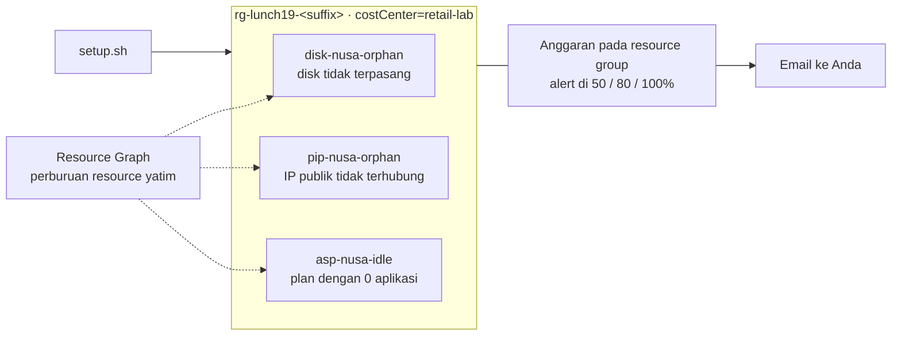

# Lab 19 · Temukan pemborosan buatan Anda sendiri

🇬🇧 [Read in English](README.md)

> **Pasangan dari:** [Makan Siang 19 · Manajemen Biaya (Dasar)](../../lunches/19-cost-management/README.id.md)
> **Waktu:** sekitar 40 menit · **Biaya:** 💲 (lihat [kelompok biaya](../README.id.md#kelompok-biaya)) · **Tingkat kesulitan:** ★☆☆
> **Bisa dikerjakan terpisah:** ✅ Anda tidak memerlukan lab sebelumnya. Semua yang dibutuhkan lab ini dibuat oleh langkah-langkahnya atau oleh `setup.sh`.
> **Penulis:** Stefanus Pinarta · [Tentang penulis](../../README.id.md#tentang-penulis)

## 🎯 Yang akan Anda bangun

Invoice Nusantara Retail penuh dengan biaya kecil yang terus-menerus dan tidak bisa dijelaskan siapa pun. Di lab ini
Anda menciptakan ulang masalah itu dengan sengaja: `setup.sh` meninggalkan tiga pemborosan murah di sebuah resource
group, semuanya diberi tag `costCenter=retail-lab` — sebuah managed disk yang tidak terpasang ke apa pun, sebuah IP
publik Standard yang tidak terhubung ke apa pun, dan sebuah App Service plan tanpa aplikasi. Anda memburunya dengan
Azure Resource Graph, melihat pendapat Azure Advisor tentang ketiganya, memasang anggaran (budget) dengan alert 50, 80,
dan 100 persen pada resource group, membandingkan pay-as-you-go dengan reservation satu tahun untuk VM kecil, lalu
akhirnya menghapus pemborosan itu dan membuktikan bahwa semuanya sudah hilang.



## ✅ Sebelum mulai

- Subscription Azure tempat Anda bisa membuat resource (lihat [Lab 01](../01-before-you-begin/README.id.md)). Anggaran
  dan cost analysis memerlukan jenis subscription yang didukung **Cost Management** — akun gratis dan pay-as-you-go bisa
  dipakai, tetapi **Azure for Students tidak didukung**. Pada subscription yang tidak didukung atau yang masih sangat
  baru (Cost Management bisa butuh hingga 48 jam), Anda tetap bisa mengerjakan semua tugas kecuali tugas 4 dan 5.
- **Azure Cloud Shell (Bash)** — buka [shell.azure.com](https://shell.azure.com). Tidak ada yang perlu dipasang.
- Ambil file lab dan muat pengaturan bersama (baris `git clone` cukup dijalankan saat pertama kali saja):

```bash
git clone https://github.com/stefpin/azure-fundamentals-lunches.git   # first time only
cd azure-fundamentals-lunches/labs/19-cost-management
source ../common/config.sh
RG=$(rg_name 19)
```

- Buat titik awalnya — prosesnya sekitar 2 menit:

```bash
bash setup.sh
```

> [!IMPORTANT]
> Resource lab memakan biaya selama masih ada — di sini hanya beberapa sen, tetapi inti lab ini justru menunjukkan bahwa
> biaya kecil bisa menumpuk. Selesaikan dengan bagian **Bersihkan**, meskipun Anda berhenti di tengah jalan.

## 🧭 Pilih mode Anda

| Mode | Cocok untuk Anda jika… | Caranya |
|---|---|---|
| **Terpandu** | Anda ingin setiap langkah dijelaskan | ikuti Tugas 1–7 di bawah |
| **Tantangan** | Anda sudah menguasai dasarnya | baca hanya [Ringkasan tantangan](#-ringkasan-tantangan), bangun dengan cara Anda sendiri, lalu jalankan `bash verify.sh` |

## Tugas 1 · Mengenali pemborosannya

Sebelum berburu, lihat apa saja yang dibuat `setup.sh` dan perhatikan bahwa tidak ada yang tampak salah.

```bash
az resource list --resource-group "$RG" \
  --query "[].{name:name, type:type, costCenter:tags.costCenter, state:provisioningState}" \
  --output table
```

Setiap resource melaporkan `Succeeded`. Azure tidak tahu bahwa semua ini pemborosan: disk tanpa VM, IP tanpa server, dan
plan tanpa aplikasi semuanya konfigurasi yang sah — dan semuanya ditagih.

> [!TIP]
> **Lebih suka portal?** Buka *Resource groups › rg-lunch19-&lt;suffix&gt;*. Pilih disk-nya dan lihat **Disk state**
> (Unattached), lalu IP publiknya (**Associated to** kosong), lalu plan-nya (**Apps**: 0).

> ✅ **Pemeriksaan:** Anda melihat `disk-nusa-orphan`, `pip-nusa-orphan`, dan `asp-nusa-idle`, masing-masing dengan
> `costCenter = retail-lab`. Jika plan-nya tidak ada, `setup.sh` sudah mencetak catatan yang menjelaskan alasannya —
> lanjutkan saja tanpa plan itu.

## Tugas 2 · Memburu resource yatim dengan Azure Resource Graph

Mengeklik resource satu per satu tidak akan sanggup mengimbangi empat puluh toko. **Azure Resource Graph** menjawab
pertanyaan tentang setiap resource yang bisa Anda baca, di setiap subscription, dalam hitungan detik — dan tidak seperti
data biaya, datanya sudah mutakhir hanya dalam hitungan saat. Resource yatim (orphan) adalah resource yang "induknya"
sudah tiada, misalnya disk yang VM-nya sudah dihapus. Saat pertama kali menjalankan `az graph`, CLI mungkin meminta Anda
memasang extension `resource-graph`: jawab **Y**.

Managed disk yang tidak terpasang:

```bash
az graph query -q "
Resources
| where type =~ 'microsoft.compute/disks'
| where tostring(properties.diskState) =~ 'Unattached'
| where resourceGroup =~ '${RG}'
| project name, sku = tostring(sku.name), sizeGB = toint(properties.diskSizeGB), costCenter = tostring(tags['costCenter'])
" --query "data" --output table
```

Alamat IP publik yang tidak terhubung ke apa pun (tanpa IP configuration dan tanpa NAT gateway):

```bash
az graph query -q "
Resources
| where type =~ 'microsoft.network/publicipaddresses'
| where isnull(properties.ipConfiguration) and isnull(properties.natGateway)
| where resourceGroup =~ '${RG}'
| project name, sku = tostring(sku.name), ip = tostring(properties.ipAddress), costCenter = tostring(tags['costCenter'])
" --query "data" --output table
```

App Service plan tanpa aplikasi:

```bash
az graph query -q "
Resources
| where type =~ 'microsoft.web/serverfarms'
| where toint(properties.numberOfSites) == 0
| where resourceGroup =~ '${RG}'
| project name, sku = tostring(sku.name), costCenter = tostring(tags['costCenter'])
" --query "data" --output table
```

Sekarang hapus filter resource group dan lihat **seluruh subscription** Anda. File `orphan-hunt.kql` menggabungkan
ketiga pemeriksaan itu dalam satu kueri:

```bash
az graph query -q "$(grep -v '^//' orphan-hunt.kql)" --query "data" --output table
```

Apa pun di luar `rg-lunch19-<suffix>` adalah pemborosan sungguhan dari eksperimen sebelumnya — periksa tag dan
pemiliknya sebelum Anda menghapusnya.

> [!TIP]
> **Lebih suka portal?** Cari **Resource Graph Explorer**, tempel isi `orphan-hunt.kql`, lalu pilih **Run query**. Anda
> bisa menyematkan hasilnya ke dashboard, yang praktis sebagai laporan resource yatim mingguan.

> ✅ **Pemeriksaan:** masing-masing dari ketiga kueri mengembalikan tepat satu baris dari resource group lab Anda (kueri
> plan tidak mengembalikan apa-apa jika `setup.sh` tidak berhasil membuat plan). Jika sebuah kueri kosong tepat setelah
> `setup.sh`, tunggu satu menit lalu jalankan lagi — Resource Graph butuh sejenak untuk mengindeks resource baru.

## Tugas 3 · Bertanya kepada Azure Advisor

Rekomendasi biaya dari Advisor mencakup penyesuaian ukuran VM, penghapusan App Service plan yang kosong, dan peninjauan
disk yang tidak terpasang ke VM. Tanyakan pendapatnya tentang subscription Anda:

```bash
az advisor recommendation list --category Cost \
  --query "[].{impact:impact, problem:shortDescription.problem, resource:impactedValue}" \
  --output table
```

Kemungkinan besar, **resource lab Anda tidak ada di daftar**. Advisor mengevaluasi resource secara berkala dan banyak
aturannya melihat riwayat berhari-hari atau berminggu-minggu, jadi pemborosan yang dibuat beberapa menit lalu belum akan
muncul — kadang baru sehari atau lebih kemudian. Itulah sebabnya Anda berburu dengan Resource Graph lebih dulu.
Rekomendasi yang *memang* Anda lihat berasal dari resource lama di subscription Anda.

> [!TIP]
> **Lebih suka portal?** Cari **Advisor** dan buka tab **Cost**. Jika Anda mempertahankan resource group lab sampai
> besok (lihat Tugas 5), periksa tab ini lagi sebelum bersih-bersih.

> ✅ **Pemeriksaan:** perintahnya berjalan tanpa error. Tabel kosong adalah hasil yang benar untuk resource group yang
> masih baru — tuliskan alasannya dalam satu kalimat.

## Tugas 4 · Memasang anggaran pada resource group

**Anggaran (budget)** tidak akan menghentikan apa pun, tetapi ia akan memberi tahu Anda ketika pengeluaran bergerak ke
arah yang tidak terduga. Buat anggaran biaya bulanan pada resource group lab dengan alert biaya aktual pada 50, 80, dan
100 persen. Atur variabelnya terlebih dahulu. Ganti alamat di `BUDGET_EMAIL` dengan email Anda sendiri, dan isi
`BUDGET_AMOUNT` dalam mata uang penagihan Anda (misalnya 10 untuk USD, atau jumlah yang setara dalam mata uang lain).
Anggaran harus dimulai pada tanggal 1 suatu bulan; baris-baris tanggal di bawah ini menyiapkannya untuk Anda.

```bash
BUDGET_EMAIL="you@example.com"     # change this: where the alerts should go
BUDGET_AMOUNT=10                   # in your billing currency, e.g. 10 for USD; pick an equivalent amount for another currency
START_DATE="$(date -u +%Y-%m-01)"                              # budgets must start on the first of a month
END_DATE="$(date -u -d "${START_DATE} +1 year" +%Y-%m-%d)"
TIME_PERIOD="$(printf '{"start-date":"%s","end-date":"%s"}' "$START_DATE" "$END_DATE")"
NOTIFICATIONS=$(cat <<EOF
{
  "actual_GreaterThan_50_Percent":  {"enabled": true, "operator": "GreaterThan", "threshold": 50,  "contact-emails": ["${BUDGET_EMAIL}"]},
  "actual_GreaterThan_80_Percent":  {"enabled": true, "operator": "GreaterThan", "threshold": 80,  "contact-emails": ["${BUDGET_EMAIL}"]},
  "actual_GreaterThan_100_Percent": {"enabled": true, "operator": "GreaterThan", "threshold": 100, "contact-emails": ["${BUDGET_EMAIL}"]}
}
EOF
)
```

Lalu buat anggarannya. Perintah `az consumption` masih berstatus preview, karena itu ia mencetak peringatan singkat:

```bash
az consumption budget create-with-rg \
  --resource-group "$RG" \
  --budget-name budget-lunch19 \
  --amount "$BUDGET_AMOUNT" \
  --category Cost \
  --time-grain Monthly \
  --time-period "$TIME_PERIOD" \
  --notifications "$NOTIFICATIONS" \
  --output none
```

Data biaya dan pemakaian biasanya sampai ke Cost Management 8 sampai 24 jam setelah pemakaian, dan anggaran dievaluasi
sekitar sekali sehari, jadi alert pertama — kalau lab ini memang pernah cukup mahal untuk memicunya — paling cepat
datang sehari kemudian. Email alert dikirim dari `azure-noreply@microsoft.com`; tambahkan alamat itu ke daftar pengirim
tepercaya (safe senders) Anda.

> [!TIP]
> **Lebih suka portal?** Buka *Resource groups › rg-lunch19-&lt;suffix&gt; › Cost Management › Budgets › Add*. Pilih
> periode reset **Monthly**, sebuah jumlah, dan tanggal kedaluwarsa, lalu di **Set alerts** tambahkan tiga kondisi
> **Actual** pada 50, 80, dan 100 % dengan alamat email Anda. Portal juga memungkinkan Anda memasang **action group**
> untuk otomatisasi.

> ✅ **Pemeriksaan:** anggaran sudah ada dengan tiga ambang:
>
> ```bash
> az consumption budget show-with-rg --resource-group "$RG" --budget-name budget-lunch19 \
>   --query "{amount:amount, timeGrain:timeGrain, thresholds:notifications.*.threshold}" --output jsonc
> ```

## Tugas 5 · Melihat biaya per tag — dan mengapa belum muncul

Tag adalah cara Ibu Sari mengetahui *milik siapa* setiap biaya. Cost analysis adalah fitur di portal, jadi bukalah di
sana:

1. Buka *Resource groups › rg-lunch19-&lt;suffix&gt; › Cost Management › Cost analysis*.
2. Beralih ke view yang bisa disesuaikan, seperti **Daily costs** (atau **Accumulated costs**), lalu atur **Group by**
   ke **Tag › costCenter**.
3. Atur rentang tanggal ke **This month**.

Kemungkinan besar Anda belum melihat apa pun untuk resource lab. Itu bukan kesalahan: data biaya biasanya tiba 8 sampai
24 jam setelah pemakaian, dan hingga 72 jam untuk sebagian subscription pay-as-you-go. Buka view yang sama di scope
**subscription** untuk melihat bagaimana biaya Anda sebelumnya terbagi per tag — apa pun yang tidak bertag muncul
sebagai untagged, dan itulah daftar pekerjaan untuk kebijakan tag (Makan Siang 18).

> [!NOTE]
> Ingin melihat biaya lab ini sendiri muncul? Setelah Tugas 7, resource group-nya kosong dan tidak memakan biaya, begitu
> pula anggarannya. Pertahankan keduanya sampai besok, lalu buka view ini lagi — beberapa sen biaya pemborosan itu akan
> muncul di bawah `costCenter = retail-lab`, walaupun resource-nya sudah tidak ada — kemudian jalankan `cleanup.sh`.

> ✅ **Pemeriksaan:** Anda bisa menjelaskan mengapa resource yang dibuat sepuluh menit lalu belum muncul di cost
> analysis, dan Anda tahu di mana menemukan biaya yang dikelompokkan berdasarkan `costCenter`.

## Tugas 6 · Pay-as-you-go atau reservation satu tahun?

Sebelum berkomitmen pada apa pun, Anda perlu tahu berapa penghematan yang diberikan sebuah komitmen. Bandingkan ukuran
VM kecil kursus ini, `$VM_SIZE` (secara default `Standard_B2ats_v2`), di region lab Anda.

**Di pricing calculator:**

1. Buka [Azure pricing calculator](https://azure.microsoft.com/pricing/calculator/) dan tambahkan **Virtual Machines**.
2. Pilih region **Southeast Asia** (atau region di `$LOCATION`), sistem operasi **Linux**, tier **Standard**, ukuran
   **B2ats v2**, dan **730** jam (satu bulan penuh).
3. Di bawah **Savings options**, pilih **Pay as you go** dan catat biaya bulanannya.
4. Pilih **1 year reserved** dan catat lagi biaya bulanannya.
5. Hitung penghematannya dalam persen. Lalu hitung berapa jam per bulan VM itu harus berjalan dengan tarif pay-as-you-go
   sebelum reservation menjadi pilihan yang lebih murah.

**Atau dari Cloud Shell**, dengan daftar harga publik yang sama yang dipakai kalkulator (Azure Retail Prices API):

```bash
bash compare-prices.sh
```

Skrip ini mencetak harga per jam dan per bulan untuk pay-as-you-go, reservation satu dan tiga tahun, serta savings plan,
beserta titik impasnya (break-even). Coba ukuran atau region lain: `VM_SIZE=Standard_D2s_v5 bash compare-prices.sh` atau
`LOCATION=indonesiacentral bash compare-prices.sh`.

> ✅ **Pemeriksaan:** Anda memiliki dua harga bulanan dan persentase penghematannya, dan Anda bisa melengkapi kalimat ini
> untuk Ibu Sari: "Reservation satu tahun untuk ukuran ini hanya menguntungkan jika servernya berjalan lebih dari
> sekitar … dari total waktu."

## Tugas 7 · Menghapus pemborosan dan membuktikan semuanya hilang

Anda sudah menemukan pemborosannya; sekarang hapuslah. Di dunia nyata, Anda akan bertanya dulu kepada pemiliknya dan
membuat snapshot untuk disk yang Anda ragukan.

```bash
az appservice plan delete --resource-group "$RG" --name asp-nusa-idle --yes
az network public-ip delete --resource-group "$RG" --name pip-nusa-orphan
az disk delete --resource-group "$RG" --name disk-nusa-orphan --yes
```

Tunggu satu menit, lalu jalankan lagi perburuan untuk seluruh subscription:

```bash
az graph query -q "$(grep -v '^//' orphan-hunt.kql)" --query "data" --output table
```

> [!TIP]
> **Lebih suka portal?** Pilih ketiga resource di resource group, pilih **Delete**, lalu konfirmasi. Kemudian jalankan
> kueri di Resource Graph Explorer sekali lagi.

> ✅ **Pemeriksaan:** tidak ada lagi baris yang menyebut `rg-lunch19-<suffix>`, dan
> `az resource list --resource-group "$RG" --output table` menampilkan daftar kosong. Anggarannya masih ada — anggaran
> itu melekat pada resource group, bukan berada di dalamnya.

## 🔧 Rusak lalu perbaiki

Kueri resource yatim yang tidak menemukan apa-apa hanya kabar baik jika kuerinya benar. Seorang rekan membagikan versi
yang "lebih cepat" ini — jalankan selagi pemborosannya masih ada (jika Anda sudah mengerjakan Tugas 7, jalankan
`bash setup.sh` lagi; prosesnya dua menit):

```bash
az graph query -q "
Resources
| where type == 'Microsoft.Compute/disks'
| where tostring(properties.diskState) == 'unattached'
| where resourceGroup =~ '${RG}'
| project name
" --query "data" --output table
```

**Gejala:** hasilnya kosong, padahal `disk-nusa-orphan` jelas ada. Rekan Anda menyimpulkan tidak ada pemborosan.

<details><summary>Petunjuk dan perbaikan</summary>

Di KQL, `==` bersifat **case-sensitive** (membedakan huruf besar dan kecil), sedangkan `=~` tidak. Resource Graph
menyimpan jenis resource dalam huruf kecil (`microsoft.compute/disks`), sementara status disk-nya `Unattached` dengan U
kapital — jadi kedua filter meleset. Gunakan `=~` untuk kedua perbandingan, seperti di Tugas 2, dan disk-nya muncul
kembali. Pelajarannya: uji setiap kueri "tidak ada pemborosan" terhadap resource yang Anda *tahu* pasti pemborosan.
Hapus lagi pemborosannya (Tugas 7) setelah selesai.

</details>

## 🧪 Verifikasi hasil kerja Anda

```bash
bash verify.sh
```

Setiap pemeriksaan harus menunjukkan **PASS**. Skrip ini memastikan tidak ada lagi disk yang tidak terpasang, IP publik
yang tidak terhubung, atau App Service plan kosong di resource group lab, dan bahwa resource group tersebut memiliki
anggaran dengan alert pada 50, 80, dan 100 persen. Jika ada yang gagal, pesannya memberi tahu tugas mana yang perlu
diulang.

## 🧹 Bersihkan (jangan dilewati!)

```bash
bash cleanup.sh
```

Skrip ini menghapus setiap anggaran pada `rg-lunch19-<suffix>`, lalu resource group itu sendiri, termasuk pemborosan
yang masih ada di dalamnya. Penghapusan berlanjut di latar belakang selama beberapa menit. Jika Anda ingin melihat biaya
lab ini muncul di cost analysis (Tugas 5), jalankan besok saja — resource group kosong dan anggaran tidak memakan biaya.

## 🩺 Pemecahan masalah

| Gejala | Kemungkinan penyebab | Perbaikan |
|---|---|---|
| `The command requires the extension resource-graph. Do you want to install it now?` | Pertama kali memakai `az graph` | Jawab **Y**, atau jalankan `az extension add --name resource-graph` |
| `setup.sh` mencatat bahwa Basic B1 tidak tersedia dan memakai tier Free (F1) sebagai gantinya | Subscription Anda tidak punya kuota App Service Basic di region ini | Tidak ada yang perlu diperbaiki — perburuannya tetap sama, dan plan F1 tidak dikenai biaya |
| Kueri Resource Graph tidak mengembalikan apa-apa tepat setelah `setup.sh`, atau masih menampilkan resource yang sudah Anda hapus | Resource Graph butuh sedikit waktu untuk mengindeks perubahan | Tunggu satu menit lalu jalankan lagi |
| Advisor tidak menampilkan rekomendasi biaya untuk resource lab | Advisor berjalan berkala dan aturannya butuh riwayat berhari-hari | Wajar untuk resource baru — lihat Tugas 3 |
| `az consumption budget create-with-rg` tidak dikenali | Versi Azure CLI yang lama | Jalankan `az upgrade`, atau gunakan jalur portal di Tugas 4 |
| Pembuatan anggaran gagal, atau Budgets/Cost analysis menyatakan jenis subscription Anda tidak didukung | Azure for Students dan beberapa penawaran lain tidak didukung oleh Cost Management; subscription baru bisa butuh hingga 48 jam | Gunakan portal pada subscription yang didukung di lain waktu, atau cukup ikuti bacaannya |
| Pembuatan anggaran gagal dengan error tentang periode waktu | Tanggal mulai harus hari pertama suatu bulan dan lebih awal daripada tanggal akhir | Jalankan ulang baris `START_DATE`/`END_DATE` dari Tugas 4 lalu coba lagi |
| Cost analysis tidak menampilkan apa pun untuk lab | Data biaya tiba 8–24 jam kemudian (hingga 72 jam untuk sebagian subscription pay-as-you-go) | Wajar — lihat Tugas 5 |
| Email alert anggaran tidak pernah datang | Lab ini menghabiskan jauh lebih sedikit daripada anggaran, jadi tidak ada ambang yang terlewati; atau emailnya masuk ke folder junk | Periksa folder junk untuk `azure-noreply@microsoft.com`; coba jumlah anggaran yang sangat kecil hanya jika Anda ingin menguji alert |
| `(ResourceGroupNotFound) Resource group 'rg-lunch19-…' could not be found.` | `setup.sh` belum dijalankan, atau `cleanup.sh` sudah dijalankan | Jalankan `bash setup.sh` |
| `compare-prices.sh` tidak menemukan harga reservation | Tidak semua ukuran punya harga reservation di setiap region | Coba `VM_SIZE=Standard_D2s_v5 bash compare-prices.sh` |

## 🚀 Tantangan tambahan

- Jalankan `orphan-hunt.kql` di semua subscription Anda melalui Resource Graph Explorer dan bersihkan sisa-sisa nyata
  dari lab sebelumnya. Perluas kuerinya dengan network interface yang tidak terpasang ke VM atau ke private endpoint
  (`isnull(properties.virtualMachine) and isnull(properties.privateEndpoint)`).
- Di portal, tambahkan alert **Forecasted** pada 100 % ke anggaran, lalu pasang **action group** yang mengirimi Anda
  notifikasi push melalui aplikasi seluler Azure.
- Buat **anomaly alert** biaya untuk subscription Anda di Cost Management, sehingga Azure mengirimi Anda email ketika
  pengeluaran harian tiba-tiba berubah.
- Bandingkan region: `LOCATION=indonesiacentral bash compare-prices.sh`, lalu diskusikan kapan residensi data lebih
  penting daripada harga.
- Jadwalkan **export** bulanan data biaya ke storage account (*Cost Management › Exports*) dan buka file-nya di
  spreadsheet.

## 🏁 Ringkasan tantangan

Bangun hal-hal berikut dengan cara apa pun yang Anda suka (portal, CLI, Bicep):

1. Jalankan `bash setup.sh`, lalu temukan setiap resource yatim atau menganggur di `rg-lunch19-<suffix>` tanpa membuka
   resource-nya satu per satu.
2. Jangan sisakan managed disk yang tidak terpasang, alamat IP publik yang tidak terhubung ke apa pun, atau App Service
   plan tanpa aplikasi di resource group tersebut.
3. Pasang anggaran biaya bulanan pada resource group dengan alert biaya aktual pada 50, 80, dan 100 persen, yang dikirim
   ke alamat email Anda.
4. (Tidak diperiksa oleh `verify.sh`.) Cari harga pay-as-you-go dan reservation satu tahun untuk `$VM_SIZE` di
   `$LOCATION`, lalu hitung penghematan dan titik impasnya.

Lalu jalankan `bash verify.sh`. Buntu? Intip `solution.sh` atau beralih ke mode Terpandu.

---

⬅️ [Bacaan Makan Siang 19](../../lunches/19-cost-management/README.id.md) · 🏠 [Semua lab](../README.id.md) · 🏠 [Beranda kursus](../../README.id.md)

<sub>Terakhir divalidasi: Oktober 2026 · Ada yang tidak berfungsi? [Laporkan masalah lab](../../CONTRIBUTING.md).</sub>
