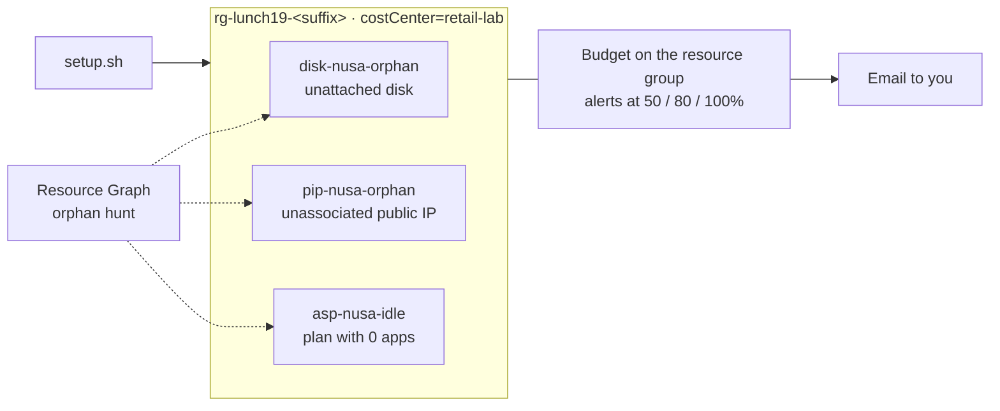

# Lab 19 · Find the waste you made yourself

🇮🇩 [Baca dalam Bahasa Indonesia](README.id.md)

> **Pairs with:** [Lunch 19 · Cost Management (Basic)](../../lunches/19-cost-management/README.md)
> **Time:** about 40 minutes · **Cost:** 💲 (see [cost bands](../README.md#cost-bands)) · **Difficulty:** ★☆☆
> **Works on its own:** ✅ You do not need any earlier lab. Everything this lab needs is created by its steps or by `setup.sh`.
> **Author:** Stefanus Pinarta · [About the author](../../README.md#about-the-author)

## 🎯 What you'll build

Nusantara Retail's invoice is full of small, steady charges that nobody can explain. In this lab you recreate the problem
on purpose: `setup.sh` leaves three cheap pieces of waste in a resource group, all tagged `costCenter=retail-lab` — a
managed disk attached to nothing, a Standard public IP associated with nothing, and an App Service plan with no apps.
You hunt them down with Azure Resource Graph, see what Azure Advisor makes of them, put a budget with 50, 80 and 100
percent alerts on the resource group, compare pay-as-you-go with a one-year reservation for a small VM, and finally
delete the waste and prove it is gone.



## ✅ Before you start

- An Azure subscription where you can create resources (see [Lab 01](../01-before-you-begin/README.md)).
  Budgets and cost analysis need a subscription type that **Cost Management** supports — the free account and
  pay-as-you-go are fine, but **Azure for Students isn't supported**. On an unsupported or brand-new subscription (Cost
  Management can need up to 48 hours) you can still do every task except 4 and 5.
- **Azure Cloud Shell (Bash)** — open [shell.azure.com](https://shell.azure.com). Nothing to install.
- Get the lab files and load the shared settings:

```bash
git clone https://github.com/stefpin/azure-fundamentals-lunches.git   # first time only
cd azure-fundamentals-lunches/labs/19-cost-management
source ../common/config.sh
RG=$(rg_name 19)
```

- Create the starting point — takes about 2 minutes:

```bash
bash setup.sh
```

> [!IMPORTANT]
> Lab resources cost money while they exist — only cents here, but the point of this lab is that small charges add up.
> Finish with the **Clean up** section, even if you stop halfway.

## 🧭 Choose your mode

| Mode | For you if… | How |
|---|---|---|
| **Guided** | you want every step explained | follow Tasks 1–7 below |
| **Challenge** | you already know the basics | read only the [Challenge brief](#-challenge-brief), build it your way, then run `bash verify.sh` |

## Task 1 · Meet the waste

Before you hunt, look at what `setup.sh` created and notice that nothing about it looks wrong.

```bash
az resource list --resource-group "$RG" \
  --query "[].{name:name, type:type, costCenter:tags.costCenter, state:provisioningState}" \
  --output table
```

Every resource reports `Succeeded`. Azure has no idea these are waste: a disk without a VM, an IP without a server and
a plan without apps are all perfectly valid configurations — and all of them bill.

> [!TIP]
> **Prefer the portal?** Open *Resource groups › rg-lunch19-&lt;suffix&gt;*. Select the disk and look at **Disk state**
> (Unattached), then the public IP (**Associated to** is empty), then the plan (**Apps**: 0).

> ✅ **Checkpoint:** you see `disk-nusa-orphan`, `pip-nusa-orphan` and `asp-nusa-idle`, each with
> `costCenter = retail-lab`. If the plan is missing, `setup.sh` printed a note explaining why — carry on without it.

## Task 2 · Hunt orphans with Azure Resource Graph

Clicking through resources doesn't scale to forty stores. **Azure Resource Graph** answers questions about every resource
you can read, in every subscription, in seconds — and unlike cost data, it is up to date within moments. The first time
you run `az graph`, the CLI may ask to install the `resource-graph` extension: answer **Y**.

Unattached managed disks:

```bash
az graph query -q "
Resources
| where type =~ 'microsoft.compute/disks'
| where tostring(properties.diskState) =~ 'Unattached'
| where resourceGroup =~ '${RG}'
| project name, sku = tostring(sku.name), sizeGB = toint(properties.diskSizeGB), costCenter = tostring(tags['costCenter'])
" --query "data" --output table
```

Public IP addresses associated with nothing (no IP configuration and no NAT gateway):

```bash
az graph query -q "
Resources
| where type =~ 'microsoft.network/publicipaddresses'
| where isnull(properties.ipConfiguration) and isnull(properties.natGateway)
| where resourceGroup =~ '${RG}'
| project name, sku = tostring(sku.name), ip = tostring(properties.ipAddress), costCenter = tostring(tags['costCenter'])
" --query "data" --output table
```

App Service plans with no apps:

```bash
az graph query -q "
Resources
| where type =~ 'microsoft.web/serverfarms'
| where toint(properties.numberOfSites) == 0
| where resourceGroup =~ '${RG}'
| project name, sku = tostring(sku.name), costCenter = tostring(tags['costCenter'])
" --query "data" --output table
```

Now remove the resource-group filter and look at your **whole subscription**. The file `orphan-hunt.kql` combines all
three checks in one query:

```bash
az graph query -q "$(grep -v '^//' orphan-hunt.kql)" --query "data" --output table
```

Anything outside `rg-lunch19-<suffix>` is real waste from earlier experiments — check the tags and the owner before you
delete it.

> [!TIP]
> **Prefer the portal?** Search for **Resource Graph Explorer**, paste the contents of `orphan-hunt.kql` and select
> **Run query**. You can pin the result to a dashboard, which makes a handy weekly orphan report.

> ✅ **Checkpoint:** each of the three queries returns exactly one row from your lab resource group (the plan query
> returns nothing if `setup.sh` couldn't create the plan). If a query returns nothing right after `setup.sh`, wait a
> minute and run it again — Resource Graph needs a moment to index new resources.

## Task 3 · Ask Azure Advisor

Advisor's cost recommendations include right-sizing VMs, deleting empty App Service plans and reviewing disks that
aren't attached to a VM. Ask it what it thinks of your subscription:

```bash
az advisor recommendation list --category Cost \
  --query "[].{impact:impact, problem:shortDescription.problem, resource:impactedValue}" \
  --output table
```

Most likely, **your lab resources are not in the list**. Advisor evaluates resources periodically and many rules look at
days or weeks of history, so waste created a few minutes ago won't appear yet — sometimes not for a day or more. That is
exactly why you hunted with Resource Graph first. Recommendations you *do* see come from older resources in your
subscription.

> [!TIP]
> **Prefer the portal?** Search for **Advisor** and open the **Cost** tab. If you keep the lab resource group until
> tomorrow (see Task 5), check this tab again before you clean up.

> ✅ **Checkpoint:** the command runs without an error. An empty table is a correct result for a brand-new resource
> group — write down in one sentence why.

## Task 4 · Put a budget on the resource group

A **budget** won't stop anything, but it will tell you when spending heads somewhere unexpected. Create a monthly cost
budget on the lab resource group with actual-cost alerts at 50, 80 and 100 percent. Set the variables first:

```bash
BUDGET_EMAIL="you@example.com"     # change this: where the alerts should go
BUDGET_AMOUNT=10                   # in your billing currency, e.g. 10 for USD; pick an equivalent amount for another currency
START_DATE="$(date -u +%Y-%m-01)"                              # budgets must start on the first of a month
END_DATE="$(date -u -d "${START_DATE} +1 year" +%Y-%m-%d)"
TIME_PERIOD="$(printf '{"start-date":"%s","end-date":"%s"}' "$START_DATE" "$END_DATE")"
NOTIFICATIONS=$(cat <<EOF
{
  "actual_GreaterThan_50_Percent":  {"enabled": true, "operator": "GreaterThan", "threshold": 50,  "contact-emails": ["${BUDGET_EMAIL}"]},
  "actual_GreaterThan_80_Percent":  {"enabled": true, "operator": "GreaterThan", "threshold": 80,  "contact-emails": ["${BUDGET_EMAIL}"]},
  "actual_GreaterThan_100_Percent": {"enabled": true, "operator": "GreaterThan", "threshold": 100, "contact-emails": ["${BUDGET_EMAIL}"]}
}
EOF
)
```

Then create the budget. The `az consumption` commands are in preview, which is why they print a short warning:

```bash
az consumption budget create-with-rg \
  --resource-group "$RG" \
  --budget-name budget-lunch19 \
  --amount "$BUDGET_AMOUNT" \
  --category Cost \
  --time-grain Monthly \
  --time-period "$TIME_PERIOD" \
  --notifications "$NOTIFICATIONS" \
  --output none
```

Cost and usage data typically reaches Cost Management 8 to 24 hours after the usage, and budgets are evaluated about once
a day, so the first alert — if this lab ever costs enough to send one — arrives a day later at the earliest. Alert emails
come from `azure-noreply@microsoft.com`; add it to your safe senders.

> [!TIP]
> **Prefer the portal?** Open *Resource groups › rg-lunch19-&lt;suffix&gt; › Cost Management › Budgets › Add*. Choose a
> **Monthly** reset period, an amount and an expiration date, then on **Set alerts** add three **Actual** conditions at
> 50, 80 and 100 % with your email address. The portal also lets you attach an **action group** for automation.

> ✅ **Checkpoint:** the budget exists with three thresholds:
>
> ```bash
> az consumption budget show-with-rg --resource-group "$RG" --budget-name budget-lunch19 \
>   --query "{amount:amount, timeGrain:timeGrain, thresholds:notifications.*.threshold}" --output jsonc
> ```

## Task 5 · Look at costs by tag — and why they aren't there yet

Tags are how Ibu Sari finds out *who* each cost belongs to. Cost analysis is a portal experience, so open it there:

1. Open *Resource groups › rg-lunch19-&lt;suffix&gt; › Cost Management › Cost analysis*.
2. Switch to a customizable view such as **Daily costs** (or **Accumulated costs**) and set **Group by** to
   **Tag › costCenter**.
3. Set the date range to **This month**.

You will probably see nothing for the lab resources yet. That isn't a mistake: cost data typically arrives 8 to 24
hours after the usage, and up to 72 hours for some pay-as-you-go subscriptions. Open the same view at **subscription**
scope to see how your earlier costs split by tag — anything without the tag shows up as untagged, which is the to-do list
for a tagging policy (Lunch 18).

> [!NOTE]
> Want to see the lab's own costs land? After Task 7 the resource group is empty and costs nothing, and so does the
> budget. Keep both until tomorrow, open this view again — the few cents the waste cost will appear under
> `costCenter = retail-lab`, even though the resources are already gone — and then run `cleanup.sh`.

> ✅ **Checkpoint:** you can explain why a resource created ten minutes ago doesn't appear in cost analysis yet, and you
> know where to find the costs grouped by `costCenter`.

## Task 6 · Pay-as-you-go or a one-year reservation?

Before you commit to anything, you should know what a commitment saves. Compare the course's small VM size, `$VM_SIZE`
(by default `Standard_B2ats_v2`), in your lab region.

**In the pricing calculator:**

1. Open the [Azure pricing calculator](https://azure.microsoft.com/pricing/calculator/) and add **Virtual Machines**.
2. Choose the region **Southeast Asia** (or the region in `$LOCATION`), operating system **Linux**, tier **Standard**, the
   size **B2ats v2** and **730** hours (a full month).
3. Under **Savings options**, select **Pay as you go** and write down the monthly cost.
4. Select **1 year reserved** and write down the monthly cost again.
5. Work out the saving in percent. Then work out how many hours per month the VM would need to run at pay-as-you-go
   rates before the reservation becomes the cheaper choice.

**Or from Cloud Shell**, with the same public price list the calculator uses (the Azure Retail Prices API):

```bash
bash compare-prices.sh
```

The script prints the hourly and monthly price for pay-as-you-go, one- and three-year reservations and savings plans,
and the break-even point. Try another size or region: `VM_SIZE=Standard_D2s_v5 bash compare-prices.sh` or
`LOCATION=indonesiacentral bash compare-prices.sh`.

> ✅ **Checkpoint:** you have two monthly prices and a saving in percent, and you can finish this sentence for Ibu Sari:
> "A one-year reservation for this size only pays off if the server runs more than about … of the time."

## Task 7 · Remove the waste and prove it's gone

You found the waste; now delete it. In real life you would check with the owner first and snapshot any disk you aren't
sure about.

```bash
az appservice plan delete --resource-group "$RG" --name asp-nusa-idle --yes
az network public-ip delete --resource-group "$RG" --name pip-nusa-orphan
az disk delete --resource-group "$RG" --name disk-nusa-orphan --yes
```

Wait a minute, then run the whole-subscription hunt again:

```bash
az graph query -q "$(grep -v '^//' orphan-hunt.kql)" --query "data" --output table
```

> [!TIP]
> **Prefer the portal?** Select the three resources in the resource group, choose **Delete** and confirm. Then run the
> query in Resource Graph Explorer again.

> ✅ **Checkpoint:** no row mentions `rg-lunch19-<suffix>` any more, and
> `az resource list --resource-group "$RG" --output table` shows an empty list. The budget is still there — it lives on
> the resource group, not inside it.

## 🔧 Break it and fix it

An orphan query that finds nothing is only good news if the query is right. A colleague shares this "faster" version —
run it while the waste still exists (if you've already done Task 7, run `bash setup.sh` again; it takes two minutes):

```bash
az graph query -q "
Resources
| where type == 'Microsoft.Compute/disks'
| where tostring(properties.diskState) == 'unattached'
| where resourceGroup =~ '${RG}'
| project name
" --query "data" --output table
```

**Symptom:** the result is empty, even though `disk-nusa-orphan` is clearly there. The colleague concludes there is no
waste.

<details><summary>Hint and fix</summary>

In KQL, `==` is **case-sensitive** and `=~` is case-insensitive. Resource Graph stores resource types in lowercase
(`microsoft.compute/disks`), while the disk state is `Unattached` with a capital U — so both filters miss. Use `=~` for
both comparisons, as in Task 2, and the disk appears again. The lesson: test every "no waste found" query against a
resource you *know* is waste. Delete the waste again (Task 7) when you're done.

</details>

## 🧪 Verify your work

```bash
bash verify.sh
```

Every check should say **PASS**. It confirms there are no unattached disks, unassociated public IPs or empty App Service
plans left in the lab resource group, and that the resource group has a budget with alerts at 50, 80 and 100 percent. If
one fails, the message tells you which task to revisit.

## 🧹 Clean up (do not skip!)

```bash
bash cleanup.sh
```

This deletes every budget on `rg-lunch19-<suffix>` and then the resource group itself, including any waste that is
still in it. Deletion continues in the background for a few minutes. If you want to watch the lab's costs arrive in cost
analysis (Task 5), run it tomorrow instead — an empty resource group and a budget cost nothing.

## 🩺 Troubleshooting

| Symptom | Likely cause | Fix |
|---|---|---|
| `The command requires the extension resource-graph. Do you want to install it now?` | First use of `az graph` | Answer **Y**, or run `az extension add --name resource-graph` |
| `setup.sh` notes that Basic B1 isn't available and uses the Free tier (F1) instead | Your subscription has no Basic App Service quota in this region | Nothing to fix — the hunt works the same, and an F1 plan costs nothing |
| A Resource Graph query returns nothing right after `setup.sh`, or still shows a resource you deleted | Resource Graph takes a short while to index changes | Wait a minute and run it again |
| Advisor shows no cost recommendations for the lab resources | Advisor runs periodically and its rules need days of history | Expected for new resources — see Task 3 |
| `az consumption budget create-with-rg` is not recognized | An old Azure CLI version | Run `az upgrade`, or use the portal path in Task 4 |
| Budget creation fails, or Budgets/Cost analysis say your subscription type isn't supported | Azure for Students and a few other offers aren't supported by Cost Management; new subscriptions can need up to 48 hours | Use the portal on a supported subscription later, or read along |
| Budget creation fails with an error about the time period | The start date must be the first day of a month and earlier than the end date | Re-run the `START_DATE`/`END_DATE` lines from Task 4 and try again |
| Cost analysis shows nothing for the lab | Cost data arrives 8–24 hours later (up to 72 hours for some pay-as-you-go subscriptions) | Expected — see Task 5 |
| No budget alert email ever arrives | The lab spends far less than the budget, so no threshold is crossed; or the mail went to junk | Check the junk folder for `azure-noreply@microsoft.com`; try a tiny budget amount only if you want to test alerts |
| `(ResourceGroupNotFound) Resource group 'rg-lunch19-…' could not be found.` | `setup.sh` wasn't run, or `cleanup.sh` already ran | Run `bash setup.sh` |
| `compare-prices.sh` finds no reservation prices | Not every size has reservation prices in every region | Try `VM_SIZE=Standard_D2s_v5 bash compare-prices.sh` |

## 🚀 Stretch goals

- Run `orphan-hunt.kql` across all your subscriptions in Resource Graph Explorer and clean up real leftovers from earlier
  labs. Extend it with network interfaces that aren't attached to a VM or a private endpoint
  (`isnull(properties.virtualMachine) and isnull(properties.privateEndpoint)`).
- In the portal, add a **Forecasted** alert at 100 % to the budget, and attach an **action group** that sends you a push
  notification through the Azure mobile app.
- Create a cost **anomaly alert** for your subscription in Cost Management, so Azure emails you when daily spending
  suddenly changes.
- Compare regions: `LOCATION=indonesiacentral bash compare-prices.sh`, and discuss when data residency matters more than
  price.
- Schedule a monthly **export** of cost data to a storage account (*Cost Management › Exports*) and open the file in a
  spreadsheet.

## 🏁 Challenge brief

Build the following, any way you like (portal, CLI, Bicep):

1. Run `bash setup.sh`, then find every orphaned or idle resource in `rg-lunch19-<suffix>` without opening the resources
   one by one.
2. Leave no unattached managed disks, no public IP addresses associated with nothing, and no App Service plans without
   apps in that resource group.
3. Put a monthly cost budget on the resource group with actual-cost alerts at 50, 80 and 100 percent, sent to your
   email address.
4. (Not checked by `verify.sh`.) Find the pay-as-you-go and one-year reservation prices of `$VM_SIZE` in `$LOCATION`,
   and work out the saving and the break-even point.

Then run `bash verify.sh`. Stuck? Peek at `solution.sh` or switch to Guided mode.

---

⬅️ [Lunch 19 reading](../../lunches/19-cost-management/README.md) · 🏠 [All labs](../README.md) · 🏠 [Course home](../../README.md)

<sub>Last validated: October 2026 · Something broken? [Report a lab problem](../../CONTRIBUTING.md).</sub>
