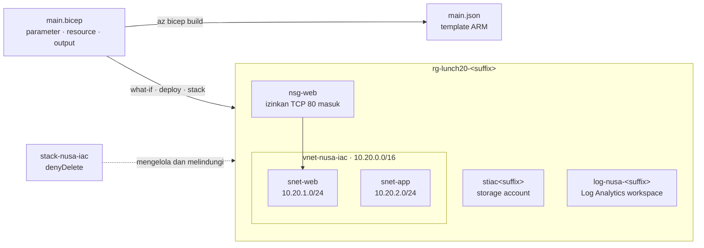

# Lab 20 · Sembilan belas makan siang penuh klik dalam satu file

🇬🇧 [Read in English](README.md)

> **Pasangan dari:** [Makan Siang 20 · Infrastructure as Code dengan Bicep (Dasar)](../../lunches/20-infrastructure-as-code-bicep/README.id.md)
> **Waktu:** sekitar 50 menit · **Biaya:** 💲 (lihat [kelompok biaya](../README.id.md#kelompok-biaya)) · **Tingkat kesulitan:** ★★☆
> **Bisa dikerjakan terpisah:** ✅ Anda tidak memerlukan lab sebelumnya. Semua yang dibutuhkan lab ini dibuat oleh langkah-langkahnya.
> **Penulis:** Stefanus Pinarta · [Tentang penulis](../../README.id.md#tentang-penulis)

## 🎯 Yang akan Anda bangun

Selama sembilan belas makan siang, cloud Nusantara Retail tumbuh satu klik dan satu perintah demi satu. Kini Dewi ingin
salinan test yang segar dari komponen dasar toko online setiap Senin dan tidak ada yang tersisa menyala pada hari Jumat,
sedangkan Ibu Sari ingin yakin bahwa tidak ada yang menghapus produksi secara tidak sengaja. Di lab ini Anda
menyelesaikan sebuah file Bicep yang menggambarkan sebuah storage account, sebuah virtual network dengan dua subnet dan
sebuah network security group, serta sebuah Log Analytics workspace. Anda mengompilasinya, melihat pratinjaunya dengan
what-if, men-deploy-nya, mengubah satu parameter, lalu men-deploy-nya lagi. Terakhir, Anda men-deploy file yang sama
sebagai **deployment stack** yang menolak penghapusan — lalu menghapus semuanya sekaligus dengan menghapus stack
tersebut.



## ✅ Sebelum mulai

- Subscription Azure tempat Anda bisa membuat resource (lihat [Lab 01](../01-before-you-begin/README.id.md)). Untuk
  Tugas 6 Anda memerlukan role **Owner** (atau Contributor ditambah **Azure Deployment Stack Owner**): membuat stack
  dengan deny settings memerlukan izin yang tidak dimiliki Contributor saja. Di subscription milik Anda sendiri, Anda
  adalah Owner.
- **Azure Cloud Shell (Bash)** — buka [shell.azure.com](https://shell.azure.com). Tidak ada yang perlu dipasang: Azure
  CLI dan Bicep CLI sudah tersedia di sana.
- Ambil file lab dan muat pengaturan bersama (baris `git clone` cukup dijalankan saat pertama kali saja):

```bash
git clone https://github.com/stefpin/azure-fundamentals-lunches.git   # first time only
cd azure-fundamentals-lunches/labs/20-infrastructure-as-code-bicep
source ../common/config.sh
RG=$(rg_name 20)
```

> [!IMPORTANT]
> Resource lab memakan biaya selama masih ada — sangat sedikit di sini, karena storage account yang kosong dan workspace
> yang tidak menerima data hampir tidak berbiaya. Selesaikan dengan bagian **Bersihkan**, meskipun Anda berhenti di
> tengah jalan.

## 🧭 Pilih mode Anda

| Mode | Cocok untuk Anda jika… | Caranya |
|---|---|---|
| **Terpandu** | Anda ingin setiap langkah dijelaskan | ikuti Tugas 1–7 di bawah |
| **Tantangan** | Anda sudah menguasai dasarnya | baca hanya [Ringkasan tantangan](#-ringkasan-tantangan), bangun dengan cara Anda sendiri, lalu jalankan `bash verify.sh` |

## Tugas 1 · Membuat resource group dan mem-build starter

File Bicep di-deploy *ke dalam* sebuah resource group, jadi buatlah resource group itu terlebih dahulu. Lalu buat
salinan kerja Anda sendiri dari file starter dan kompilasi. Perintah `cp` cukup dijalankan sekali saja: menjalankannya
lagi akan menimpa salinan Anda.

```bash
ensure_rg "$RG" 20
cp starter/main.bicep main.bicep      # only the first time: this overwrites your copy
az bicep build --file main.bicep
ls main.*
```

`az bicep build` melakukan transpile dari Bicep menjadi template ARM JSON, `main.json`, dan tidak mencetak apa pun jika
tidak ada error atau warning (eksekusi pertama kali mungkin memasang Bicep CLI untuk Azure CLI, yang butuh beberapa
detik). Buka `main.json` dengan `code main.json` dan gulir isinya — inilah yang diterima Resource Manager, sekaligus
alasan mengapa Anda lebih suka menulis Bicep. Lalu baca `main.bicep` dari atas: empat **parameter** (`location` secara
default memakai region resource group, `suffix` secara default memakai `uniqueString(resourceGroup().id)`), dua
**variabel** (`allTags` menambahkan environment ke tag), sebuah **storage account** yang sudah selesai, dua **output**,
dan empat blok `EXERCISE` untuk Anda kerjakan.

> ✅ **Pemeriksaan:** `az bicep build` selesai tanpa error, dan `ls main.*` menampilkan `main.bicep` dan `main.json`.

## Tugas 2 · Menyelesaikan keempat latihan

Buka salinan Anda di editor Cloud Shell dengan `code main.bicep` (**Ctrl+S** untuk menyimpan, **Ctrl+Q** untuk menutup),
atau di VS Code dengan extension Bicep jika Anda menginginkan IntelliSense (saran otomatis saat mengetik). Tempel setiap
blok di bawah ini tepat di bawah blok komentar `EXERCISE`-nya, lalu jalankan `az bicep build --file main.bicep` untuk
memeriksa hasil kerja Anda setelah setiap latihan. Buntu? Bandingkan dengan `solution/main.bicep`.

**Latihan 1 — network security group.** Sebuah aturan adalah objek dengan nama dan `properties`-nya sendiri:

```bicep
resource nsgWeb 'Microsoft.Network/networkSecurityGroups@2024-05-01' = {
  name: 'nsg-web'
  location: location
  tags: allTags
  properties: {
    securityRules: [
      {
        name: 'Allow-HTTP-From-Internet'
        properties: {
          priority: 100
          direction: 'Inbound'
          access: 'Allow'
          protocol: 'Tcp'
          sourceAddressPrefix: 'Internet'
          sourcePortRange: '*'
          destinationAddressPrefix: '*'
          destinationPortRange: '80'
        }
      }
    ]
  }
}
```

**Latihan 2 — virtual network.** Definisikan subnet *di dalam* virtual network, seperti yang direkomendasikan
dokumentasi, sehingga redeploy tidak pernah mencoba menghapusnya. `nsgWeb.id` adalah **symbolic reference** (rujukan
simbolis): rujukan ini menciptakan dependensi, sehingga Bicep men-deploy NSG lebih dulu. `defaultOutboundAccess: false`
membuat kedua subnet menjadi privat (tanpa akses internet keluar secara default).

```bicep
resource vnet 'Microsoft.Network/virtualNetworks@2024-05-01' = {
  name: 'vnet-nusa-iac'
  location: location
  tags: allTags
  properties: {
    addressSpace: {
      addressPrefixes: [
        '10.20.0.0/16'
      ]
    }
    subnets: [
      {
        name: 'snet-web'
        properties: {
          addressPrefix: '10.20.1.0/24'
          defaultOutboundAccess: false
          networkSecurityGroup: {
            id: nsgWeb.id
          }
        }
      }
      {
        name: 'snet-app'
        properties: {
          addressPrefix: '10.20.2.0/24'
          defaultOutboundAccess: false
        }
      }
    ]
  }
}
```

**Latihan 3 — Log Analytics workspace.** Interpolasi string (`${suffix}`) membentuk nama yang sama di setiap redeploy ke
resource group ini:

```bicep
resource logs 'Microsoft.OperationalInsights/workspaces@2023-09-01' = {
  name: 'log-nusa-${suffix}'
  location: location
  tags: allTags
  properties: {
    sku: {
      name: 'PerGB2018'
    }
    retentionInDays: 30
  }
}
```

**Latihan 4 — output.** Output mengembalikan nilai kepada Anda atau ke langkah berikutnya dalam sebuah pipeline. Jangan
pernah meng-output sebuah secret:

```bicep
output vnetId string = vnet.id
output webSubnetId string = vnet.properties.subnets[0].id
output logAnalyticsWorkspaceId string = logs.id
```

Build sekali lagi dan hitung apa saja yang kini dideklarasikan oleh file:

```bash
az bicep build --file main.bicep
grep -c '^resource ' main.bicep
grep -c '^output ' main.bicep
```

> [!TIP]
> Bekerja di VS Code dengan extension Bicep? Arahkan kursor ke `nsgWeb.id` untuk melihat tipenya, dan buka **Bicep
> visualizer** (ikon di kanan atas editor) untuk melihat dependensi antara NSG dan virtual network digambarkan untuk
> Anda.

> ✅ **Pemeriksaan:** build tidak mencetak error, dan kedua perintah `grep` mencetak `4` (resource) dan `5` (output).

## Tugas 3 · Melihat pratinjau deployment dengan what-if

Sebelum ada yang berubah di Azure, mintalah pratinjau. What-if mengompilasi file, mengirimnya ke Resource Manager, dan
membandingkannya dengan apa yang sudah ada — tidak ada yang dibuat.

```bash
az deployment group what-if \
  --resource-group "$RG" \
  --template-file main.bicep
```

Setiap resource ditandai `+` (dibuat), dengan properti yang akan dimilikinya tercantum di bawahnya. Baris terakhir
adalah ringkasannya:

```text
Resource changes: 4 to create.
```

> ✅ **Pemeriksaan:** what-if mencantumkan `nsg-web`, `vnet-nusa-iac`, sebuah workspace `log-nusa-…`, dan sebuah storage
> account `stiac…`, semuanya dengan `+`, dan ringkasannya berbunyi "4 to create".

## Tugas 4 · Men-deploy, lalu men-deploy file yang sama lagi

Sekarang deploy sungguhan. Deployment yang diberi nama mudah ditemukan nanti di riwayat deployment resource group.
Prosesnya sekitar satu sampai dua menit.

```bash
az deployment group create \
  --resource-group "$RG" \
  --name lab20-main \
  --template-file main.bicep \
  --query "properties.outputs" \
  --output jsonc
```

Hasilnya adalah kelima output dari file Anda. Sekarang lihat apa saja yang dibuat dan bagaimana tag-nya:

```bash
az resource list --resource-group "$RG" \
  --query "[].{name:name, type:type, costCenter:tags.costCenter, environment:tags.environment}" \
  --output table
```

Inilah inti kode deklaratif: jalankan what-if lagi, lalu deploy lagi.

```bash
az deployment group what-if --resource-group "$RG" --template-file main.bicep
az deployment group create --resource-group "$RG" --name lab20-main-again --template-file main.bicep --output none
az deployment group list --resource-group "$RG" \
  --query "[].{name:name, state:properties.provisioningState, timestamp:properties.timestamp}" --output table
```

What-if kini menandai resource dengan `=` (tidak berubah). Deployment kedua berhasil dan tidak mengubah apa pun:
file-nya **idempoten**. What-if bisa menampilkan **noise** — misalnya `~` pada virtual network untuk properti yang diisi
Azure dengan nilai default — jadi bacalah baris-baris propertinya, jangan hanya ringkasannya.

> [!TIP]
> **Lebih suka portal?** Buka *Resource groups › rg-lunch20-&lt;suffix&gt; › Settings › Deployments*. Setiap deployment
> menyimpan template, nilai parameter, dan output-nya.

> ✅ **Pemeriksaan:** empat resource, masing-masing dengan `costCenter = retail-lab` dan `environment = lab`, serta dua
> deployment (`lab20-main` dan `lab20-main-again`) dengan status `Succeeded`.

## Tugas 5 · Mengubah parameter dan melihat what-if berkata "modify"

Dewi ingin salinan ini ditandai sebagai lingkungan test. Anda tidak menyentuh resource-nya — Anda mengubah input-nya:

```bash
az deployment group what-if \
  --resource-group "$RG" \
  --template-file main.bicep \
  --parameters environment=test
```

Sekarang setiap resource ditandai `~` (diubah), dan perubahannya tercantum di bawahnya:

```text
~ tags.environment: "lab" => "test"
```

Deploy perubahan itu, dan biarkan CLI menampilkan hasil what-if sekali lagi lalu bertanya sebelum men-deploy. Jawab `y`:

```bash
az deployment group create \
  --resource-group "$RG" \
  --name lab20-environment-test \
  --template-file main.bicep \
  --parameters environment=test \
  --confirm-with-what-if
```

Decorator `@allowed` juga melindungi input: coba `--parameters environment=dev` dengan what-if, dan Resource Manager
menolak nilai itu sebelum ada yang berubah.

> ✅ **Pemeriksaan:** `az resource list --resource-group "$RG" --query "[].tags.environment" --output tsv` mencetak
> `test` sebanyak empat kali.

## Tugas 6 · Men-deploy sebagai deployment stack dengan DenyDelete

Deployment biasa melupakan resource-nya begitu selesai. **Deployment stack** mengingatnya, bisa menghapus apa yang
keluar dari file, dan bisa melindunginya dengan **deny settings**. Deploy file yang sama sebagai stack. Resource-nya
sudah ada, jadi stack cukup mengambil alih. Prosesnya sekitar dua menit:

```bash
az stack group create \
  --name stack-nusa-iac \
  --resource-group "$RG" \
  --template-file main.bicep \
  --parameters environment=test \
  --action-on-unmanage deleteResources \
  --deny-settings-mode denyDelete \
  --yes \
  --output none

az stack group show --name stack-nusa-iac --resource-group "$RG" \
  --query "{state: provisioningState, denySettings: denySettings.mode, managedResources: resources[].id}" \
  --output jsonc
```

`--action-on-unmanage deleteResources` berarti: hapus sebuah resource saat ia keluar dari file atau saat stack dihapus.
`--deny-settings-mode denyDelete` memasang **deny assignment** (aturan larangan yang mengalahkan izin dari role) pada
setiap managed resource. Sekarang berperanlah sebagai seseorang yang ingin "merapikan" storage account:

```bash
STORAGE=$(az storage account list --resource-group "$RG" --query "[0].name" --output tsv)
az storage account delete --name "$STORAGE" --resource-group "$RG" --yes
```

Penghapusan itu ditolak dengan error seperti ini, meskipun Anda seorang Owner:

```text
(DenyAssignmentAuthorizationFailed) The client '…' with object id '…' has permission to perform action
'Microsoft.Storage/storageAccounts/delete' on scope '…'; however, the access is denied because of the deny
assignment with name '…' and Id '…' at scope '…'.
```

> [!TIP]
> **Lebih suka portal?** Buka *Resource groups › rg-lunch20-&lt;suffix&gt; › Settings › Deployment stacks ›
> stack-nusa-iac* untuk melihat managed resource dan deny settings, serta *Access control (IAM) › Deny assignments*
> untuk melihat assignment yang dibuat stack. Coba juga hapus storage account dari sana.

> ✅ **Pemeriksaan:** stack menampilkan `denyDelete` dan mencantumkan resource Anda sebagai managed, dan storage account
> masih ada setelah penghapusan yang gagal. **Sekarang jalankan `bash verify.sh`** (lihat
> [Verifikasi hasil kerja Anda](#-verifikasi-hasil-kerja-anda)) — Tugas 7 menghapus semua yang diperiksanya.

## Tugas 7 · Menghapus stack beserta semua isinya

Ketika minggu pengujian selesai, satu perintah menghapus stack, deny assignment-nya, dan setiap resource yang
dikelolanya. Prosesnya beberapa menit:

```bash
az stack group delete \
  --name stack-nusa-iac \
  --resource-group "$RG" \
  --action-on-unmanage deleteResources \
  --yes

az resource list --resource-group "$RG" --output table
```

Resource group kini kosong — tetapi file-nya masih menggambarkan semuanya. Jalankan lagi perintah
`az stack group create` dari Tugas 6 jika Anda ingin melihat seluruh lingkungan kembali dalam beberapa menit, lalu hapus
stack-nya lagi.

> ✅ **Pemeriksaan:** `az resource list` tidak mencetak apa pun dan
> `az stack group list --resource-group "$RG" --output table` tidak menampilkan stack apa pun.

## 🔧 Rusak lalu perbaiki

Salah ketik pada symbolic name adalah kesalahan Bicep yang paling umum — sekaligus yang paling murah untuk ditangkap. Di
`main.bicep` Anda, ubah rujukan NSG di virtual network dari `nsgWeb.id` menjadi `nsgWbe.id`, simpan, lalu build:

```bash
az bicep build --file main.bicep
```

**Gejala:** build gagal sebelum Azure melihat apa pun, dengan error yang menyebut file, baris, dan kolomnya:

```text
main.bicep(…) : Error BCP082: The name "nsgWbe" does not exist in the current context. Did you mean "nsgWeb"?
```

<details><summary>Petunjuk dan perbaikan</summary>

Error ini menyangkut **symbolic name** — nama yang dipakai file untuk NSG — bukan nama resource Azure `nsg-web`. Ubah
`nsgWbe` kembali menjadi `nsgWeb` lalu build lagi: tidak ada output berarti tidak ada error. Di VS Code, extension Bicep
menggarisbawahi salah ketik saat Anda mengetik dan menawarkan perbaikannya. Jika sebuah nama tidak cukup mirip dengan
symbol yang ada, Anda akan mendapat `BCP057: The name "…" does not exist in the current context.` sebagai gantinya.

</details>

## 🧪 Verifikasi hasil kerja Anda

Jalankan ini di akhir **Tugas 6**, selagi stack masih ada:

```bash
bash verify.sh
```

Setiap pemeriksaan harus menunjukkan **PASS**. Skrip ini memastikan adanya storage account, virtual network dengan
`snet-web` (dengan NSG yang mengizinkan port 80 masuk) dan `snet-app`, Log Analytics workspace, tag `costCenter` dan
`environment` di setiap resource, serta deployment stack dengan `denyDelete` dan `deleteResources` yang mengelola
storage account. Jika ada yang gagal, pesannya memberi tahu tugas mana yang perlu diulang. Sudah menyelesaikan Tugas 7?
Jalankan lagi perintah `az stack group create` dari Tugas 6, lalu verifikasi.

## 🧹 Bersihkan (jangan dilewati!)

```bash
bash cleanup.sh
```

Skrip ini menghapus deployment stack yang masih tersisa di `rg-lunch20-<suffix>` beserta resource yang dikelolanya
(kalau tidak, deny assignment akan memblokir penghapusan), lalu menghapus resource group-nya. Penghapusan berlanjut di
latar belakang selama beberapa menit. Log Analytics workspace tetap bisa dipulihkan selama 14 hari (soft delete) tanpa
biaya; `main.bicep` dan `main.json` lokal Anda hanyalah file di dalam clone Anda.

## 🩺 Pemecahan masalah

| Gejala | Kemungkinan penyebab | Perbaikan |
|---|---|---|
| `Error BCP018: Expected the "}" character at this location.` | Kurung kurawal atau kurung siku yang hilang atau berlebih setelah menempel kode | Bandingkan bloknya dengan `solution/main.bicep`; setiap `{` dan `[` butuh pasangannya |
| `BCP037: The property "adressPrefix" is not allowed on objects of type …` | Nama properti salah eja | Perbaiki ejaannya; pesannya mencantumkan properti yang diizinkan |
| `Error BCP082` atau `BCP057: The name "…" does not exist in the current context.` | Salah ketik pada symbolic name, atau latihan yang merujuk resource yang belum Anda tambahkan | Lihat **Rusak lalu perbaiki**; tambahkan latihan secara berurutan |
| `az: 'stack' is not in the 'az' command group.` | Azure CLI versi lama (deployment stack memerlukan versi 2.61 atau lebih baru) | Gunakan Cloud Shell, atau jalankan `az upgrade` |
| `does not have authorization to perform action 'Microsoft.Resources/deploymentStacks/manageDenySetting/action'` | Anda Contributor, bukan Owner | Minta role **Owner** atau **Azure Deployment Stack Owner** pada resource group, atau gunakan `--deny-settings-mode none` dan cukup ikuti bacaannya |
| `StorageAccountAlreadyTaken` | Orang lain memakai nama storage account yang sama — hanya mungkin terjadi jika Anda memberikan `suffix` sendiri | Hapus parameter `suffix`, atau pilih sufiks yang lebih tidak umum |
| `(InvalidTemplate) Deployment template validation failed: 'The provided value 'dev' for the template parameter 'environment' is not valid.` | Nilai yang tidak tercantum di `@allowed` | Gunakan `lab`, `test`, atau `prod` |
| What-if menampilkan `~` untuk virtual network padahal Anda tidak mengubah apa pun | **Noise** what-if: Azure mengisi sebuah nilai default | Baca baris-baris propertinya; jika itu nilai default yang tidak pernah Anda atur, sebenarnya tidak ada yang berubah |
| Menghapus storage account di Tugas 6 *berhasil* | Stack dibuat tanpa deny settings, atau Anda menghapus sebelum stack selesai dibuat | Buat ulang stack dengan `--deny-settings-mode denyDelete` (Tugas 6) |
| `cleanup.sh` atau `az group delete` gagal dengan `DenyAssignmentAuthorizationFailed` | Stack dengan deny settings masih melindungi resource di grup itu | Hapus stack terlebih dahulu (Tugas 7); `cleanup.sh` melakukannya untuk Anda — jalankan lagi |
| `(ResourceGroupNotFound) Resource group 'rg-lunch20-…' could not be found.` | Tugas 1 terlewat, atau `cleanup.sh` sudah dijalankan | Jalankan `ensure_rg "$RG" 20` dari Tugas 1 |

## 🚀 Tantangan tambahan

- Pindahkan pengaturan test ke file parameter: buat `main.test.bicepparam` berisi `using 'main.bicep'` dan
  `param environment = 'test'`, lalu deploy dengan `--parameters main.test.bicepparam`.
- Hapus resource Log Analytics workspace dari `main.bicep`, lalu jalankan lagi perintah `az stack group create` dari
  Tugas 6. Karena `deleteResources`, stack menghapus workspace yang sudah keluar dari file. Dengan `detachAll`,
  workspace itu akan tetap ada sebagai resource yang tidak dikelola.
- Tambahkan sebuah tag secara manual (`az tag update --resource-id <id> --operation Merge --tags owner=rizky`) —
  DenyDelete masih mengizinkan penulisan — lalu deploy ulang stack dan saksikan file yang menang: tag tambahan itu
  hilang.
- Buat beberapa blob container dengan loop (`[for name in containerNames: …]`) sebagai child resource dari storage
  account.
- Ganti storage account dengan Azure Verified Module untuk storage account
  (`br/public:avm/res/storage/storage-account:<version>`); cari versi terbarunya di
  [indeks module](https://azure.github.io/Azure-Verified-Modules/).

## 🏁 Ringkasan tantangan

Bangun hal-hal berikut dengan cara apa pun yang Anda suka (portal, CLI, Bicep) — meskipun lab ini memang tentang
mengerjakannya dengan Bicep:

1. Satu file Bicep yang di-deploy ke `rg-lunch20-<suffix>`, dengan parameter untuk lokasi (default: region resource
   group), sufiks nama (default: `uniqueString(resourceGroup().id)`), environment (`lab`, `test`, atau `prod`), dan tag.
   Tanpa region yang di-hard-code.
2. Sebuah storage account StorageV2 Standard_LRS; sebuah virtual network dengan subnet `snet-web` dan `snet-app`, di
   mana `snet-web` memakai network security group yang mengizinkan TCP 80 masuk dari internet; dan sebuah Log Analytics
   workspace.
3. Setiap resource diberi tag `costCenter=retail-lab` dan `environment=<the environment parameter>`.
4. Output untuk nama storage account, ID virtual network, ID subnet web, dan ID workspace (tidak diperiksa oleh
   `verify.sh`).
5. Deploy sebagai deployment stack dengan deny settings mode `denyDelete` dan action on unmanage `deleteResources`, lalu
   tunjukkan bahwa penghapusan storage account ditolak.

Lalu jalankan `bash verify.sh` selagi stack masih ada. Buntu? Intip `solution/main.bicep` dan `solution.sh`, atau
beralih ke mode Terpandu.

---

⬅️ [Bacaan Makan Siang 20](../../lunches/20-infrastructure-as-code-bicep/README.id.md) · 🏠 [Semua lab](../README.id.md) · 🏠 [Beranda kursus](../../README.id.md)

<sub>Terakhir divalidasi: Oktober 2026 · Ada yang tidak berfungsi? [Laporkan masalah lab](../../CONTRIBUTING.md).</sub>
