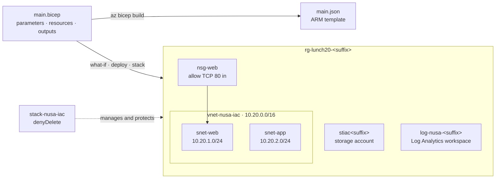

# Lab 20 · Nineteen lunches of clicks in one file

> **Pairs with:** [Lunch 20 · Infrastructure as Code with Bicep (Basic)](../../lunches/20-infrastructure-as-code-bicep/README.md)
> **Time:** about 50 minutes · **Cost:** 💲 (see [cost bands](../README.md#cost-bands)) · **Difficulty:** ★★☆
> **Works on its own:** ✅ You do not need any earlier lab. Everything this lab needs is created by its steps.

## 🎯 What you'll build

For nineteen lunches, Nusantara Retail's cloud grew one click and one command at a time. Dewi now wants a fresh test copy
of the storefront basics every Monday and nothing left running on Friday, and Ibu Sari wants to be sure nobody deletes
production by accident. In this lab you finish a Bicep file that describes a storage account, a virtual network with
two subnets and a network security group, and a Log Analytics workspace. You compile it, preview it with what-if, deploy
it, change one parameter and deploy it again. Finally you deploy the same file as a **deployment stack** that refuses
deletes — and remove everything at once by deleting the stack.



## ✅ Before you start

- An Azure subscription where you can create resources (see [Lab 01](../01-before-you-begin/README.md)). For Task 6 you
  need **Owner** (or Contributor plus **Azure Deployment Stack Owner**): creating a stack with deny settings needs a
  permission that Contributor alone doesn't have. In your own subscription you are Owner.
- **Azure Cloud Shell (Bash)** — open [shell.azure.com](https://shell.azure.com). Nothing to install: the Azure CLI and
  the Bicep CLI are already there.
- Get the lab files and load the shared settings:

```bash
git clone https://github.com/stefpin/azure-fundamentals-lunches.git   # first time only
cd azure-fundamentals-lunches/labs/20-infrastructure-as-code-bicep
source ../common/config.sh
RG=$(rg_name 20)
```

> [!IMPORTANT]
> Lab resources cost money while they exist — very little here, because an empty storage account and a workspace that
> receives no data cost almost nothing. Finish with the **Clean up** section, even if you stop halfway.

## 🧭 Choose your mode

| Mode | For you if… | How |
|---|---|---|
| **Guided** | you want every step explained | follow Tasks 1–7 below |
| **Challenge** | you already know the basics | read only the [Challenge brief](#-challenge-brief), build it your way, then run `bash verify.sh` |

## Task 1 · Create the resource group and build the starter

The Bicep file deploys *into* a resource group, so create that first. Then make your own working copy of the starter
file and compile it.

```bash
ensure_rg "$RG" 20
cp starter/main.bicep main.bicep      # only the first time: this overwrites your copy
az bicep build --file main.bicep
ls main.*
```

`az bicep build` transpiles Bicep into an ARM JSON template, `main.json`, and prints nothing when there are no errors or
warnings (the very first run may install the Bicep CLI for the Azure CLI, which takes a few seconds). Open `main.json`
with `code main.json` and scroll through it — this is what Resource Manager receives, and why you'd rather write Bicep.
Then read `main.bicep` from the top: four **parameters** (`location` defaults to the resource group's region, `suffix`
to `uniqueString(resourceGroup().id)`), two **variables** (`allTags` adds the environment to the tags), a finished
**storage account**, two **outputs**, and four `EXERCISE` blocks for you.

> ✅ **Checkpoint:** `az bicep build` finishes without an error, and `ls main.*` shows `main.bicep` and `main.json`.

## Task 2 · Complete the four exercises

Open your copy in the Cloud Shell editor with `code main.bicep` (**Ctrl+S** saves, **Ctrl+Q** closes), or in VS Code with
the Bicep extension if you want IntelliSense. Paste each block below directly under its `EXERCISE` comment block, then
run `az bicep build --file main.bicep` to check your work after every exercise. Stuck? Compare with `solution/main.bicep`.

**Exercise 1 — the network security group.** A rule is an object with a name and its own `properties`:

```bicep
resource nsgWeb 'Microsoft.Network/networkSecurityGroups@2024-05-01' = {
  name: 'nsg-web'
  location: location
  tags: allTags
  properties: {
    securityRules: [
      {
        name: 'Allow-HTTP-From-Internet'
        properties: {
          priority: 100
          direction: 'Inbound'
          access: 'Allow'
          protocol: 'Tcp'
          sourceAddressPrefix: 'Internet'
          sourcePortRange: '*'
          destinationAddressPrefix: '*'
          destinationPortRange: '80'
        }
      }
    ]
  }
}
```

**Exercise 2 — the virtual network.** Define the subnets *inside* the virtual network, as the docs recommend, so a
redeploy never tries to remove them. `nsgWeb.id` is a **symbolic reference**: it creates the dependency, so Bicep deploys
the NSG first. `defaultOutboundAccess: false` makes both subnets private (no default outbound internet access).

```bicep
resource vnet 'Microsoft.Network/virtualNetworks@2024-05-01' = {
  name: 'vnet-nusa-iac'
  location: location
  tags: allTags
  properties: {
    addressSpace: {
      addressPrefixes: [
        '10.20.0.0/16'
      ]
    }
    subnets: [
      {
        name: 'snet-web'
        properties: {
          addressPrefix: '10.20.1.0/24'
          defaultOutboundAccess: false
          networkSecurityGroup: {
            id: nsgWeb.id
          }
        }
      }
      {
        name: 'snet-app'
        properties: {
          addressPrefix: '10.20.2.0/24'
          defaultOutboundAccess: false
        }
      }
    ]
  }
}
```

**Exercise 3 — the Log Analytics workspace.** String interpolation (`${suffix}`) builds a name that is the same on
every redeploy to this resource group:

```bicep
resource logs 'Microsoft.OperationalInsights/workspaces@2023-09-01' = {
  name: 'log-nusa-${suffix}'
  location: location
  tags: allTags
  properties: {
    sku: {
      name: 'PerGB2018'
    }
    retentionInDays: 30
  }
}
```

**Exercise 4 — the outputs.** Outputs hand values back to you or to the next step of a pipeline. Never output a secret:

```bicep
output vnetId string = vnet.id
output webSubnetId string = vnet.properties.subnets[0].id
output logAnalyticsWorkspaceId string = logs.id
```

Build once more and count what the file now declares:

```bash
az bicep build --file main.bicep
grep -c '^resource ' main.bicep
grep -c '^output ' main.bicep
```

> [!TIP]
> Working in VS Code with the Bicep extension? Hover over `nsgWeb.id` to see its type, and open the **Bicep visualizer**
> (the icon at the top right of the editor) to see the dependency between the NSG and the virtual network drawn for you.

> ✅ **Checkpoint:** the build prints no errors, and the two `grep` commands print `4` (resources) and `5` (outputs).

## Task 3 · Preview the deployment with what-if

Before anything changes in Azure, ask for a preview. What-if compiles the file, sends it to Resource Manager and compares
it with what exists — nothing is created.

```bash
az deployment group what-if \
  --resource-group "$RG" \
  --template-file main.bicep
```

Every resource is marked `+` (create), with the properties it will get listed underneath. The last line is the summary:

```text
Resource changes: 4 to create.
```

> ✅ **Checkpoint:** what-if lists `nsg-web`, `vnet-nusa-iac`, a `log-nusa-…` workspace and a `stiac…` storage account,
> all with `+`, and the summary says 4 to create.

## Task 4 · Deploy, then deploy the same file again

Deploy for real. A named deployment is easy to find later in the resource group's deployment history. It takes about
one to two minutes.

```bash
az deployment group create \
  --resource-group "$RG" \
  --name lab20-main \
  --template-file main.bicep \
  --query "properties.outputs" \
  --output jsonc
```

The output is the five outputs from your file. Now look at what was created and how it was tagged:

```bash
az resource list --resource-group "$RG" \
  --query "[].{name:name, type:type, costCenter:tags.costCenter, environment:tags.environment}" \
  --output table
```

Here is the point of declarative code: run what-if again, then deploy again.

```bash
az deployment group what-if --resource-group "$RG" --template-file main.bicep
az deployment group create --resource-group "$RG" --name lab20-main-again --template-file main.bicep --output none
az deployment group list --resource-group "$RG" \
  --query "[].{name:name, state:properties.provisioningState, timestamp:properties.timestamp}" --output table
```

What-if now marks the resources `=` (no change). The second deployment succeeds and changes nothing: the file is
**idempotent**. What-if can show some **noise** — for example a `~` on the virtual network for a property Azure filled in
with a default — so read the property lines, not only the summary.

> [!TIP]
> **Prefer the portal?** Open *Resource groups › rg-lunch20-&lt;suffix&gt; › Settings › Deployments*. Each deployment
> keeps its template, its parameter values and its outputs.

> ✅ **Checkpoint:** four resources, each with `costCenter = retail-lab` and `environment = lab`, and two deployments
> (`lab20-main` and `lab20-main-again`) with the state `Succeeded`.

## Task 5 · Change a parameter and watch what-if say "modify"

Dewi wants this copy to be marked as a test environment. You don't touch the resources — you change the input:

```bash
az deployment group what-if \
  --resource-group "$RG" \
  --template-file main.bicep \
  --parameters environment=test
```

Now each resource is marked `~` (modify), and the change is listed underneath:

```text
~ tags.environment: "lab" => "test"
```

Deploy the change, and let the CLI show the what-if result once more and ask before it deploys. Answer `y`:

```bash
az deployment group create \
  --resource-group "$RG" \
  --name lab20-environment-test \
  --template-file main.bicep \
  --parameters environment=test \
  --confirm-with-what-if
```

The `@allowed` decorator protects the input as well: try `--parameters environment=dev` with what-if, and Resource
Manager rejects the value before anything is changed.

> ✅ **Checkpoint:** `az resource list --resource-group "$RG" --query "[].tags.environment" --output tsv` prints `test`
> four times.

## Task 6 · Deploy it as a deployment stack with DenyDelete

A normal deployment forgets its resources as soon as it finishes. A **deployment stack** remembers them, can delete what
leaves the file, and can protect them with **deny settings**. Deploy the same file as a stack. The resources already
exist, so the stack simply takes them over. It takes about two minutes:

```bash
az stack group create \
  --name stack-nusa-iac \
  --resource-group "$RG" \
  --template-file main.bicep \
  --parameters environment=test \
  --action-on-unmanage deleteResources \
  --deny-settings-mode denyDelete \
  --yes \
  --output none

az stack group show --name stack-nusa-iac --resource-group "$RG" \
  --query "{state: provisioningState, denySettings: denySettings.mode, managedResources: resources[].id}" \
  --output jsonc
```

`--action-on-unmanage deleteResources` means: delete a resource when it leaves the file or when the stack is deleted.
`--deny-settings-mode denyDelete` puts a **deny assignment** on every managed resource. Now act like someone who wants to
"tidy up" the storage account:

```bash
STORAGE=$(az storage account list --resource-group "$RG" --query "[0].name" --output tsv)
az storage account delete --name "$STORAGE" --resource-group "$RG" --yes
```

The delete is refused with an error like this, even though you are an Owner:

```text
(DenyAssignmentAuthorizationFailed) The client '…' with object id '…' has permission to perform action
'Microsoft.Storage/storageAccounts/delete' on scope '…'; however, the access is denied because of the deny
assignment with name '…' and Id '…' at scope '…'.
```

> [!TIP]
> **Prefer the portal?** Open *Resource groups › rg-lunch20-&lt;suffix&gt; › Settings › Deployment stacks ›
> stack-nusa-iac* to see the managed resources and the deny settings, and *Access control (IAM) › Deny assignments* to
> see the assignment the stack created. Try deleting the storage account there too.

> ✅ **Checkpoint:** the stack shows `denyDelete` and lists your resources as managed, and the storage account still
> exists after the failed delete. **Now run `bash verify.sh`** (see [Verify your work](#-verify-your-work)) —
> Task 7 removes everything it checks.

## Task 7 · Delete the stack, and everything with it

When the test week is over, one command removes the stack, its deny assignment and every resource it manages. It takes
a few minutes:

```bash
az stack group delete \
  --name stack-nusa-iac \
  --resource-group "$RG" \
  --action-on-unmanage deleteResources \
  --yes

az resource list --resource-group "$RG" --output table
```

The resource group is empty now — but the file still describes everything. Run the `az stack group create` command from
Task 6 again if you want to see the whole environment come back in a couple of minutes, then delete the stack again.

> ✅ **Checkpoint:** `az resource list` prints nothing and `az stack group list --resource-group "$RG" --output table`
> shows no stacks.

## 🔧 Break it and fix it

Typos in symbolic names are the most common Bicep mistake — and the cheapest one to catch. In your `main.bicep`, change
the NSG reference in the virtual network from `nsgWeb.id` to `nsgWbe.id`, save, and build:

```bash
az bicep build --file main.bicep
```

**Symptom:** the build fails before Azure sees anything, with an error that names the file, the line and the column:

```text
main.bicep(…) : Error BCP082: The name "nsgWbe" does not exist in the current context. Did you mean "nsgWeb"?
```

<details><summary>Hint and fix</summary>

The error is about the **symbolic name** — the name the file uses for the NSG — not about the Azure resource name
`nsg-web`. Change `nsgWbe` back to `nsgWeb` and build again: no output means no errors. In VS Code the Bicep extension
underlines the typo as you type and offers the fix. If a name isn't close enough to an existing symbol, you get
`BCP057: The name "…" does not exist in the current context.` instead.

</details>

## 🧪 Verify your work

Run this at the end of **Task 6**, while the stack still exists:

```bash
bash verify.sh
```

Every check should say **PASS**. It confirms the storage account, the virtual network with `snet-web` (with an NSG
that allows port 80 in) and `snet-app`, the Log Analytics workspace, the `costCenter` and `environment` tags on every
resource, and a deployment stack with `denyDelete` and `deleteResources` that manages the storage account. If one fails,
the message tells you which task to revisit. Already finished Task 7? Run the `az stack group create` command from
Task 6 again, then verify.

## 🧹 Clean up (do not skip!)

```bash
bash cleanup.sh
```

This deletes any deployment stack that is left in `rg-lunch20-<suffix>` together with the resources it manages (the deny
assignment would otherwise block the deletes), and then the resource group. Deletion continues in the background for a
few minutes. The Log Analytics workspace stays recoverable for 14 days (soft delete) at no cost; your local `main.bicep`
and `main.json` are just files in your clone.

## 🩺 Troubleshooting

| Symptom | Likely cause | Fix |
|---|---|---|
| `Error BCP018: Expected the "}" character at this location.` | A missing or extra brace or bracket after pasting | Compare the block with `solution/main.bicep`; every `{` and `[` needs its partner |
| `BCP037: The property "adressPrefix" is not allowed on objects of type …` | A misspelled property name | Fix the spelling; the message lists the permissible properties |
| `Error BCP082` or `BCP057: The name "…" does not exist in the current context.` | A typo in a symbolic name, or an exercise that refers to a resource you haven't added yet | See **Break it and fix it**; add the exercises in order |
| `az: 'stack' is not in the 'az' command group.` | An old Azure CLI (deployment stacks need 2.61 or later) | Use Cloud Shell, or run `az upgrade` |
| `does not have authorization to perform action 'Microsoft.Resources/deploymentStacks/manageDenySetting/action'` | You are Contributor, not Owner | Ask for **Owner** or **Azure Deployment Stack Owner** on the resource group, or use `--deny-settings-mode none` and read along |
| `StorageAccountAlreadyTaken` | Someone else uses the same storage account name — only likely if you passed your own `suffix` | Remove the `suffix` parameter, or choose a more unusual one |
| `(InvalidTemplate) Deployment template validation failed: 'The provided value 'dev' for the template parameter 'environment' is not valid.` | A value that `@allowed` doesn't list | Use `lab`, `test` or `prod` |
| What-if shows `~` for the virtual network although you changed nothing | What-if **noise**: Azure filled in a default value | Read the property lines; if they are defaults you never set, nothing really changes |
| Deleting the storage account in Task 6 *succeeds* | The stack was created without deny settings, or you deleted before the stack finished | Recreate the stack with `--deny-settings-mode denyDelete` (Task 6) |
| `cleanup.sh` or `az group delete` fails with `DenyAssignmentAuthorizationFailed` | A stack with deny settings still protects resources in the group | Delete the stack first (Task 7); `cleanup.sh` does this for you — run it again |
| `(ResourceGroupNotFound) Resource group 'rg-lunch20-…' could not be found.` | Task 1 was skipped, or `cleanup.sh` already ran | Run `ensure_rg "$RG" 20` from Task 1 |

## 🚀 Stretch goals

- Move the test settings into a parameter file: create `main.test.bicepparam` with `using 'main.bicep'` and
  `param environment = 'test'`, then deploy with `--parameters main.test.bicepparam`.
- Delete the Log Analytics workspace resource from `main.bicep` and run the `az stack group create` command from Task 6
  again. Because of `deleteResources`, the stack deletes the workspace that left the file. With `detachAll` it would
  stay as an unmanaged resource.
- Add a tag by hand (`az tag update --resource-id <id> --operation Merge --tags owner=rizky`) — DenyDelete allows
  writes — then redeploy the stack and watch the file win: the extra tag disappears.
- Create several blob containers with a loop (`[for name in containerNames: …]`) as child resources of the storage
  account.
- Replace the storage account with the Azure Verified Module for storage accounts
  (`br/public:avm/res/storage/storage-account:<version>`); look up the current version in the
  [module index](https://azure.github.io/Azure-Verified-Modules/).

## 🏁 Challenge brief

Build the following, any way you like (portal, CLI, Bicep) — though this lab is about doing it with Bicep:

1. One Bicep file that deploys into `rg-lunch20-<suffix>`, with parameters for the location (default: the resource
   group's region), a name suffix (default: `uniqueString(resourceGroup().id)`), the environment (`lab`, `test` or
   `prod`) and the tags. No hard-coded region.
2. A Standard_LRS StorageV2 storage account; a virtual network with the subnets `snet-web` and `snet-app`, where
   `snet-web` uses a network security group that allows inbound TCP 80 from the internet; and a Log Analytics workspace.
3. Every resource tagged `costCenter=retail-lab` and `environment=<the environment parameter>`.
4. Outputs for the storage account name, the virtual network ID, the web subnet ID and the workspace ID (not checked by
   `verify.sh`).
5. Deploy it as a deployment stack with deny settings mode `denyDelete` and action on unmanage `deleteResources`, and
   show that deleting the storage account is refused.

Then run `bash verify.sh` while the stack exists. Stuck? Peek at `solution/main.bicep` and `solution.sh`, or switch to
Guided mode.

---

⬅️ [Lunch 20 reading](../../lunches/20-infrastructure-as-code-bicep/README.md) · 🏠 [All labs](../README.md) · 🏠 [Course home](../../README.md)

<sub>Last validated: October 2026 · Something broken? [Report a lab problem](../../CONTRIBUTING.md).</sub>
