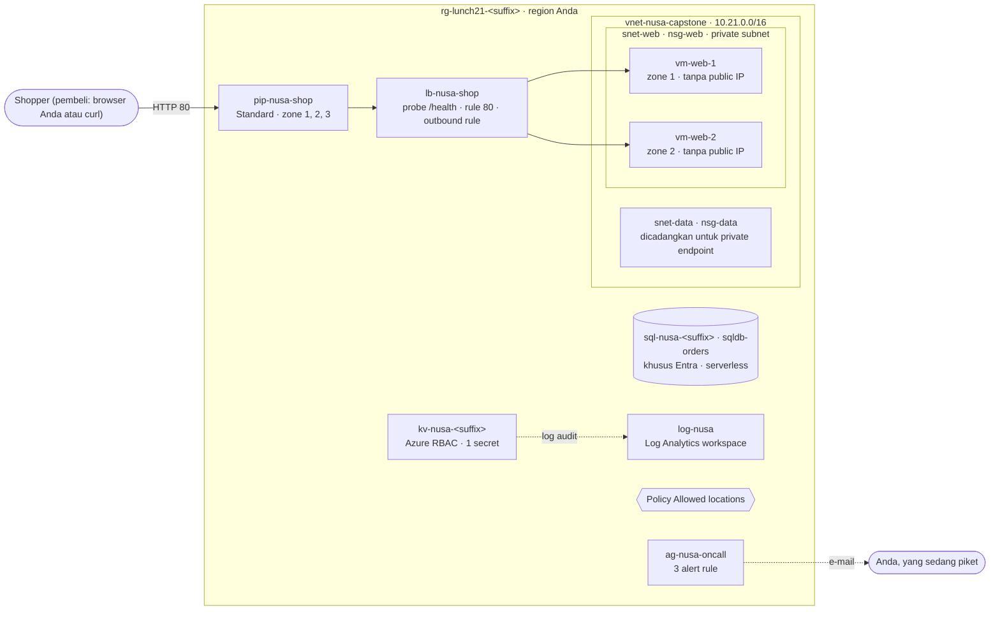

# Lab 21 · Proyek capstone

🇬🇧 [Read in English](README.md)

> **Pasangan dari:** [Makan Siang 21 · Capstone Inti: Menyatukan Semuanya (Dasar)](../../lunches/21-core-capstone/README.id.md)
> **Waktu:** sekitar 2–3 jam termasuk menunggu deployment; boleh dibagi menjadi tiga sesi · **Biaya:** 💲💲 (lihat [kelompok biaya](../README.id.md#kelompok-biaya)) · **Tingkat kesulitan:** ★★★
> **Bisa dikerjakan terpisah:** ✅ Anda tidak memerlukan lab sebelumnya. Semua yang dibutuhkan lab ini dibuat oleh langkah-langkahnya sendiri (file Bicep yang disediakan dan `deploy.sh`).
> **Penulis:** Stefanus Pinarta · [Tentang penulis](../../README.id.md#tentang-penulis)

## 🎯 Yang akan Anda bangun

Anda men-deploy platform inti Nusantara Retail — desain yang dibangun sepanjang bulan inti — dari satu template Bicep yang modular: jaringan privat, dua web server di dua availability zone di belakang Standard load balancer, database Azure SQL yang hanya menerima identitas Microsoft Entra, Key Vault yang memakai Azure RBAC, pemantauan dengan tiga alert rule, policy Allowed locations, dan (lewat portal) sebuah budget. Setelah itu Anda memperlakukannya seperti production: mengikuti satu request dari ujung ke ujung, mematikan zone 1 dan membuktikan toko tetap buka, memeriksa setiap guardrail (pagar pengaman), menjawab pertanyaan direktur dengan RTO dan RPO, lalu meninjau desain terhadap pilar-pilar Well-Architected.



| Modul Bicep | Yang dibuatnya | Makan siang |
|---|---|---|
| `infra/modules/network.bicep` | `vnet-nusa-capstone` (10.21.0.0/16), private subnet `snet-web` dan `snet-data`, NSG `nsg-web` dan `nsg-data` | 08 |
| `infra/modules/web.bicep` | `pip-nusa-shop`, `lb-nusa-shop`, `vm-web-1` (zone 1), `vm-web-2` (zone 2) beserta NIC dan disk-nya | 03, 06, 09 |
| `infra/modules/sql.bicep` | logical server `sql-nusa-<suffix>`, database serverless `sqldb-orders` | 11, 17 |
| `infra/modules/keyvault.bicep` | `kv-nusa-<suffix>`, secret `sql-connection-string`, role Key Vault Secrets Officer milik Anda | 15 |
| `infra/modules/monitoring.bicep` | `log-nusa`, action group `ag-nusa-oncall`, alert `alert-web-cpu-high`, `alert-lb-backend-health`, `alert-web-vm-stopped`, log audit Key Vault | 16 |
| `infra/modules/policy.bicep` | assignment `allowed-locations` dari policy bawaan **Allowed locations** | 18 |
| *(portal, Tugas 7)* | budget `budget-lunch21` dengan alert 50/80/100% | 19 |
| `infra/main.bicep` | menghubungkan keenam modul; `deploy.sh` menjalankannya dengan what-if lebih dulu | 20 |

## ✅ Sebelum mulai

- Subscription Azure tempat Anda menjadi **Owner** — Tugas 2 membuat role assignment dan policy assignment. Gunakan subscription pribadi atau subscription khusus lab, jangan pernah subscription perusahaan (lihat [Lab 01](../01-before-you-begin/README.id.md)).
- **Azure Cloud Shell (Bash)** — buka [shell.azure.com](https://shell.azure.com). Azure CLI dan Bicep sudah tersedia di sana.
- Region yang memiliki availability zone. Region default, `southeastasia`, bisa dipakai; jika Anda memakai `indonesiacentral`, jalankan dulu pemeriksaan lingkungan di bawah. Anda membutuhkan kuota **4 vCPU** di region tersebut (dua VM web `Standard_B2ats_v2`, masing-masing 2 vCPU).
- Alamat e-mail yang bisa Anda baca selama lab — semua alert dikirim ke sana.
- Ambil file lab, lalu muat pengaturan bersama dan nama-nama resource lab ini:

```bash
git clone https://github.com/stefpin/azure-fundamentals-lunches.git   # first time only
cd azure-fundamentals-lunches/labs/21-core-capstone
source ../common/config.sh
source lab.env                          # resource names plus two helpers: who_answers and watch_shop
echo "$RG"                              # rg-lunch21-<suffix>
bash ../common/check-environment.sh     # optional: region, VM sizes and quota
```

> [!IMPORTANT]
> Platform ini menimbulkan sedikit biaya setiap jam selama ia ada (dua VM kecil, satu load balancer, dan satu public IP; database-nya gratis atau berhenti sendiri saat menganggur). Akhiri dengan bagian **Bersihkan**, walaupun Anda berhenti di tengah jalan. Mau membagi lab ini ke beberapa hari? Jalankan `bash cleanup.sh` di akhir setiap sesi dan `bash deploy.sh` di awal sesi berikutnya — membangun ulang dari kode hanya butuh sekitar 15 menit, dan justru itulah inti dari infrastructure as code.

Setiap kali membuka sesi Cloud Shell baru, kembalilah ke folder lab dan jalankan lagi `source ../common/config.sh && source lab.env` sebelum melanjutkan.

| Sesi | Tugas | Kira-kira |
|---|---|---|
| 1 · Bangun | 1 Membaca cetak biru · 2 Deploy · 3 Mengikuti satu request | 50 menit |
| 2 · Buktikan | 4 Kehilangan satu zone · 5 Keamanan dan tata kelola · 6 Operasional | 65 menit |
| 3 · Putuskan | 7 Budget · 8 Menjawab direktur · 9 Tinjauan Well-Architected · Rusak lalu perbaiki · Bersihkan | 65 menit |

## 🧭 Pilih mode Anda

| Mode | Cocok untuk Anda jika… | Caranya |
|---|---|---|
| **Terpandu** | Anda ingin setiap langkah dijelaskan | ikuti Tugas 1–9 di bawah |
| **Tantangan** | Anda sudah menyelesaikan bulan inti dan ingin merancangnya sendiri | baca hanya [Ringkasan tantangan](#-ringkasan-tantangan), bangun dengan cara Anda (Bicep buatan sendiri adalah cara terbaik), lalu jalankan `bash verify.sh` |

## Tugas 1 · Membaca cetak biru sebelum membangun (≈15 menit)

Di tim sungguhan, tidak ada yang men-deploy template yang belum ia baca. Meninjau infrastructure as code adalah cara menangkap port yang terbuka atau tag yang terlewat *sebelum* hal itu menghabiskan uang — ibaratnya memeriksa denah sebelum tukang mulai bekerja: memindahkan pintu di atas kertas jauh lebih murah daripada membongkar tembok. Buka file-file itu di editor Cloud Shell (`code infra/main.bicep`) atau baca di GitHub.

```bash
ls -R infra
```

Temukan setiap baris berikut dan ucapkan dengan lantang mengapa baris itu ada:

| File | Cari | Mengapa penting |
|---|---|---|
| `main.bicep` | `network.outputs.webSubnetId` | modul saling meneruskan nilai melalui output; Bicep menentukan urutan deployment dari referensi-referensi ini |
| `network.bicep` | `defaultOutboundAccess: false` | sebuah **private subnet**: VM tidak mendapat akses internet tersembunyi (Makan Siang 08) |
| `network.bicep` | `sourceAddressPrefix: 'AzureLoadBalancer'` | health probe harus diizinkan masuk; kalau tidak, semua server tampak mati |
| `web.bicep` | `zones: [ zone ]` di dalam loop VM | satu VM per availability zone |
| `web.bicep` | `loadFileAsBase64('../../../common/cloud-init-web.yml')` | penyiapan web server bersama, dibaca saat kompilasi; path-nya relatif terhadap `web.bicep` |
| `web.bicep` | `disableOutboundSnat: true` dan `outboundRules` | akses keluar yang eksplisit melalui load balancer untuk VM-VM privat |
| `sql.bicep` | `azureADOnlyAuthentication: true` | tidak ada SQL login dan tidak ada kata sandi; hanya identitas Microsoft Entra |
| `sql.bicep` | `useFreeLimit` dan `freeLimitExhaustionBehavior: 'AutoPause'` | database dari penawaran gratis (free offer) akan pause alih-alih menagih Anda |
| `keyvault.bicep` | `enableRbacAuthorization: true` dan `scope: vault` | Azure RBAC untuk secret, dengan role Anda hanya pada vault ini |
| `monitoring.bicep` | tiga resource alert | kapasitas (CPU), kesehatan aplikasi (probe), dan perubahan (VM dihentikan) |
| `policy.bicep` | `e56962a6-4747-49cd-b67b-bf8b01975c4c` | Bicep membutuhkan ID policy bawaan; komentar di file menunjukkan cara memeriksanya |

Sekarang biarkan Bicep memeriksa file-file itu:

```bash
az bicep build --file infra/main.bicep --stdout > /dev/null && echo "main.bicep compiles"
az bicep lint --file infra/main.bicep      # no output means no linter warnings
```

> ✅ **Pemeriksaan:** `main.bicep compiles` tercetak, dan Anda bisa menunjuk modul yang membuat setiap kotak di diagram di atas. Tes cepat: file mana yang akan Anda ubah untuk menambahkan web server ketiga di zone 3?
> <details><summary>Jawaban</summary>
>
> `web.bicep` — tambahkan `'3'` ke parameter `zones` (dan periksa dulu kuota vCPU Anda).
>
> </details>

## Tugas 2 · Melihat pratinjau dan men-deploy (≈20 menit, sebagian besar menunggu)

`deploy.sh` melakukan apa yang dikerjakan engineer yang cermat secara manual: mencari tahu siapa Anda (user principal name dan object ID Anda menjadi administrator Azure SQL dan secrets officer Key Vault), memastikan Anda punya SSH key, mengompilasi template, menampilkan pratinjau **what-if**, dan baru men-deploy setelah Anda menjawab ya.

```bash
bash deploy.sh
```

Baca output what-if seperti sedang melakukan code review: setiap baris `+ Create` adalah sesuatu yang akan ada, memakan biaya, atau mengubah siapa bisa melakukan apa. Anda seharusnya melihat jaringan, lapisan web, database, vault beserta secret dan role assignment-nya, workspace, action group, tiga alert rule, satu diagnostic setting, dan policy assignment. Beberapa baris mungkin ditandai sebagai noise atau diabaikan; itu normal. Ketik `y` untuk men-deploy. Deployment memakan waktu sekitar 10–15 menit, lalu script menunggu sampai toko online menjawab.

> [!TIP]
> **Lebih suka portal?** Pantau deployment selagi berjalan: *Resource groups › rg-lunch21-&lt;suffix&gt; › Settings › Deployments*. Anda akan melihat `capstone` ditambah satu nested deployment per modul (`network`, `web`, `sql`, `keyvault`, `monitoring`, `policy`), yang memperlihatkan urutan yang disusun Bicep dari output-output tadi.

> [!NOTE]
> Bersiaplah menerima beberapa e-mail dari Azure Monitor: satu yang menyatakan Anda ditambahkan ke action group, dan mungkin alert *backend health* yang menyala lalu pulih sendiri selagi web server melakukan booting. Itu tandanya pemantauan Anda sudah bekerja.

> ✅ **Pemeriksaan:** deployment berhasil dan toko online menjawab.
>
> ```bash
> az deployment group show -g "$RG" -n "$DEPLOYMENT" --query properties.provisioningState -o tsv   # Succeeded
> curl -s "http://$(lb_ip)/" | grep -o 'Served by.*</p>' | sed 's/<[^>]*>//g'
> ```

## Tugas 3 · Mengikuti satu request dari ujung ke ujung (≈15 menit)

Request dari seorang pembeli melewati lima hal yang Anda bangun di bulan inti. Ikuti request itu lompatan demi lompatan (hop by hop), seperti melacak paket dari gudang sampai ke depan pintu, supaya nanti Anda bisa menjelaskan kepada siapa pun di titik mana ia bisa terputus.

1. **Siapa yang menjawab?** Kirim sepuluh request. Load balancer melakukan hashing pada setiap koneksi baru, sehingga Anda akan melihat kedua server dan kedua zone.

   ```bash
   who_answers 10
   ```

2. **Pintu depan** — Standard public IP yang zone-redundant, lengkap dengan nama DNS:

   ```bash
   az network public-ip show -g "$RG" -n "$PIP" \
     --query "{ip:ipAddress, fqdn:dnsSettings.fqdn, sku:sku.name, zones:join(',', zones)}" -o table
   ```

3. **Load balancer** — health probe, rule, dan outbound rule:

   ```bash
   az network lb show -g "$RG" -n "$LB" \
     --query "{probePath:probes[0].requestPath, everySeconds:probes[0].intervalInSeconds, rulePort:loadBalancingRules[0].frontendPort, outboundRules:length(outboundRules)}" -o table
   ```

4. **Network security group** — apa saja yang boleh masuk ke subnet:

   ```bash
   az network nsg rule list -g "$RG" --nsg-name "$NSG" \
     --query "[].{rule:name, priority:priority, from:sourceAddressPrefix, port:destinationPortRange, access:access}" -o table
   ```

5. **Server** — hanya alamat privat:

   ```bash
   az vm list -g "$RG" -d --query "[].{vm:name, zone:zones[0], privateIp:privateIps, publicIp:publicIps}" -o table
   ```

6. **Jalan keluar.** VM tidak punya public IP dan berada di private subnet, tetapi tetap bisa menjangkau internet — melalui outbound rule milik load balancer. Tanyakan kepada salah satu VM alamat mana yang terlihat oleh internet (Run Command butuh sekitar satu menit):

   ```bash
   az vm run-command invoke -g "$RG" -n "$VM1" --command-id RunShellScript \
     --scripts "curl -s --max-time 10 https://api.ipify.org" --query "value[0].message" -o tsv
   lb_ip
   ```

> [!TIP]
> **Lebih suka portal?** *lb-nusa-shop › Monitoring › Insights* menggambar frontend, rule, probe, dan backend pool sebagai diagram dengan status kesehatan langsung (live). *rg-lunch21-&lt;suffix&gt; › Resource visualizer* menunjukkan bagaimana semua resource saling terhubung.

> ✅ **Pemeriksaan:** `vm-web-1` dan `vm-web-2` sama-sama menjawab, public IP mencantumkan zone `1,2,3`, VM tidak menunjukkan public IP, dan alamat yang dilaporkan VM di langkah 6 sama dengan `lb_ip`.

## Tugas 4 · Kehilangan satu zone, toko tetap buka (≈25 menit)

Inilah momen yang paling dipedulikan direktur. Anda tidak bisa mematikan pusat data Azure yang sesungguhnya, tetapi Anda bisa menyingkirkan semua yang *Anda* jalankan di zone 1 — yaitu `vm-web-1` — lalu melihat apa yang dialami para pembeli. Anggap saja ini simulasi evakuasi kebakaran di gedung kantor: lebih baik berlatih saat semuanya tenang daripada belajar saat panik.

1. Lakukan deallocate pada `vm-web-1` di latar belakang, lalu segera mulai memantau toko selama sekitar dua setengah menit:

   ```bash
   az vm deallocate -g "$RG" -n "$VM1" --no-wait
   watch_shop 150
   ```

   Anda seharusnya melihat sesuatu seperti ini: awalnya campuran, mungkin satu atau dua baris `(no answer)` selagi probe menyadari server itu hilang, lalu hanya `vm-web-2`.

   ```text
   10:02:11  vm-web-1
   10:02:13  vm-web-2
   10:02:16  (no answer)
   10:02:18  vm-web-2
   10:02:20  vm-web-2
   ```

   Hitung baris `(no answer)` lalu kalikan dengan dua detik: itulah **RTO hasil pengukuran** Anda untuk kegagalan zone. Catatlah; Anda akan membutuhkannya di Tugas 8.

2. Pastikan VM itu benar-benar hilang dan lihat siapa pelakunya — activity log mencatat setiap tindakan control plane (tindakan pengelolaan resource):

   ```bash
   az vm get-instance-view -g "$RG" -n "$VM1" \
     --query "instanceView.statuses[?starts_with(code, 'PowerState/')].displayStatus | [0]" -o tsv
   az monitor activity-log list -g "$RG" --offset 1h \
     --query "[?operationName.value=='Microsoft.Compute/virtualMachines/deallocate/action'].{time:eventTimestamp, who:caller, status:status.value}" -o table
   ```

3. Periksa inbox Anda. Dalam beberapa menit, activity log alert **alert-web-vm-stopped** mengirimi Anda e-mail: pemantauan menyadari perubahan itu sebelum ada pelanggan yang mengeluh.

4. Lihat dari sudut pandang probe: *lb-nusa-shop › Monitoring › Metrics › Health Probe Status*, aggregation **Avg**, lalu **Apply splitting** berdasarkan **Backend IP Address**. Garis untuk `vm-web-1` berhenti — load balancer sama sekali tidak memeriksa VM yang sudah di-deallocate, dan itulah sebabnya lab ini juga punya activity log alert.

5. Hidupkan kembali zone 1 dan lihat ia bergabung lagi ke rotasi tanpa perubahan konfigurasi apa pun:

   ```bash
   az vm start -g "$RG" -n "$VM1"
   who_answers 10
   ```

> [!NOTE]
> **Variasi — yang gagal aplikasinya, bukan servernya.** Hentikan hanya layanan web di `vm-web-2`. VM tetap berjalan, health probe-nya gagal, load balancer mengalihkan lalu lintas menjauhinya, dan dalam sekitar 5–10 menit metric alert **alert-lb-backend-health** mengirimi Anda e-mail. Kegagalan yang berbeda, sinyal yang berbeda.
>
> ```bash
> az vm run-command invoke -g "$RG" -n "$VM2" --command-id RunShellScript --scripts "systemctl stop nusa-web" -o none
> who_answers 6        # only vm-web-1 answers
> # ...wait for the e-mail, then repair it:
> az vm run-command invoke -g "$RG" -n "$VM2" --command-id RunShellScript --scripts "systemctl start nusa-web" -o none
> ```

> ✅ **Pemeriksaan:** toko terus menjawab (kecuali beberapa detik), Anda menerima e-mail *VM stopped*, Anda sudah mencatat RTO hasil pengukuran, dan `who_answers 10` kembali menampilkan kedua server.

## Tugas 5 · Memeriksa guardrail keamanan dan tata kelola (≈20 menit)

Keamanan dalam desain ini adalah tumpukan keputusan kecil yang bisa diperiksa satu per satu. Mari kita periksa.

1. **Key Vault memakai Azure RBAC, dan Anda memegang role hanya pada vault ini:**

   ```bash
   az keyvault show -n "$KV" \
     --query "{rbac:properties.enableRbacAuthorization, softDeleteDays:properties.softDeleteRetentionInDays, purgeProtection:properties.enablePurgeProtection}" -o table
   KV_ID=$(az keyvault show -n "$KV" --query id -o tsv)
   az role assignment list --scope "$KV_ID" --query "[].{role:roleDefinitionName, who:principalName}" -o table
   ```

2. **Baca secret-nya.** Secret ini aman dicetak karena tidak berisi kata sandi — itulah inti dari autentikasi Microsoft Entra. (Role assignment yang baru dibuat bisa butuh hingga sekitar 10 menit untuk berlaku; jika Anda mendapat `Forbidden`, tunggu lalu coba lagi.)

   ```bash
   az keyvault secret show --vault-name "$KV" -n "$SECRET" --query value -o tsv
   ```

3. **Azure SQL hanya menerima identitas Microsoft Entra, dan belum ada yang bisa terhubung dari internet:**

   ```bash
   az sql server ad-only-auth get -g "$RG" -n "$SQL" --query azureAdOnlyAuthentication   # true
   az sql server ad-admin list -g "$RG" -s "$SQL" --query "[].login" -o tsv                # you
   az sql server firewall-rule list -g "$RG" -s "$SQL" -o table                            # empty
   az sql db show -g "$RG" -s "$SQL" -n "$DB" \
     --query "{tier:currentServiceObjectiveName, autoPauseMinutes:autoPauseDelay, freeOffer:useFreeLimit}" -o table
   ```

4. **Guardrail policy.** Tampilkan daftar assignment-nya, lalu coba langgar aturannya dengan resource gratis (NSG kosong) di region lain:

   ```bash
   az policy assignment list -g "$RG" --query "[].{name:name, displayName:displayName, mode:enforcementMode}" -o table
   OTHER_REGION=$([[ "$LOCATION" == "eastus" ]] && echo westeurope || echo eastus)
   az network nsg create -g "$RG" -n nsg-policy-test --location "$OTHER_REGION"
   ```

   Yang diharapkan: error dengan kode `RequestDisallowedByPolicy` dan pesan yang ditulis Nusantara Retail di dalam assignment. Assignment baru butuh sekitar lima menit untuk berlaku; jika NSG itu *ternyata* berhasil dibuat, hapus (`az network nsg delete -g "$RG" -n nsg-policy-test`), tunggu beberapa menit, lalu coba lagi.

> [!TIP]
> **Lebih suka portal?** *kv-nusa-&lt;suffix&gt; › Access control (IAM) › Role assignments* menampilkan role Anda; *sql-nusa-&lt;suffix&gt; › Settings › Microsoft Entra ID* menampilkan pengaturan "Support only Microsoft Entra authentication"; *Policy › Compliance* menampilkan assignment-nya (hasil compliance pertama baru muncul setelah satu siklus evaluasi, yang bisa makan waktu cukup lama).

> ✅ **Pemeriksaan:** RBAC bernilai `true`, secret mencetak connection string dengan `Authentication=Active Directory Default` dan tanpa kata sandi, autentikasi khusus Entra bernilai `true`, tidak ada firewall rule, dan NSG di luar region ditolak.

## Tugas 6 · Memeriksa guardrail operasional (≈20 menit)

Operasional menjawab tiga pertanyaan: apakah kita akan tahu, apakah orang yang tepat akan mendengarnya, dan bisakah kita mencari tahu apa yang terjadi?

1. **Alert rule dan siapa yang diberi tahu:**

   ```bash
   az monitor metrics alert list -g "$RG" --query "[].{rule:name, severity:severity, enabled:enabled}" -o table
   az monitor activity-log alert list -g "$RG" --query "[].{rule:name, enabled:enabled}" -o table
   az monitor action-group show -g "$RG" -n "$AG" --query "{enabled:enabled, shortName:groupShortName, emails:length(emailReceivers)}" -o table
   ```

   Di portal, *Monitor › Alerts* (difilter ke resource group Anda) menampilkan alert yang menyala di Tugas 4.

2. **Metrik tanpa agent apa pun.** Azure mengumpulkan metrik host untuk setiap VM:

   ```bash
   VM1_ID=$(az vm show -g "$RG" -n "$VM1" --query id -o tsv)
   az monitor metrics list --resource "$VM1_ID" --metric "Percentage CPU" --interval PT5M --offset 1h --aggregation Average -o table
   ```

3. **Log: siapa yang membaca secret?** Pembacaan secret yang Anda lakukan di Tugas 5 sudah tercatat. Di portal, buka *log-nusa › Logs*, beralih ke mode KQL, dan jalankan query ini (catatan pertama bisa butuh 10–15 menit untuk masuk):

   ```kusto
   search "SecretGet"
   | where TimeGenerated > ago(4h)
   | project TimeGenerated, $table, OperationName
   | order by TimeGenerated desc
   ```

   `search` mencari di semua tabel, jadi query ini berfungsi tabel apa pun yang dipakai workspace Anda untuk log Key Vault (`AzureDiagnostics` secara default). Makan Siang 30 mengajarkan KQL secara tuntas.

4. **Cadangan yang tidak perlu Anda konfigurasi.** Azure SQL Database membuat cadangannya sendiri; periksa jendela restore-nya:

   ```bash
   az sql db show -g "$RG" -s "$SQL" -n "$DB" --query "{earliestRestore:earliestRestoreDate, backupStorage:currentBackupStorageRedundancy}" -o table
   az sql db str-policy show -g "$RG" -s "$SQL" -n "$DB" --query retentionDays    # 7
   ```

   `earliestRestore` tetap kosong sampai full backup pertama selesai, biasanya sekitar setengah jam setelah database dibuat.

5. *(Opsional)* **Buat alert CPU menyala.** Buat `vm-web-2` sibuk selama 15 menit; dalam sekitar 10 menit **alert-web-cpu-high** mengirimi Anda e-mail, dan alert itu pulih sendiri setelah loop berakhir.

   ```bash
   az vm run-command invoke -g "$RG" -n "$VM2" --command-id RunShellScript \
     --scripts "nohup timeout 900 sh -c 'while :; do :; done' > /dev/null 2>&1 &" -o none
   ```

> ✅ **Pemeriksaan:** tiga alert rule yang aktif mengarah ke `ag-nusa-oncall`, Anda bisa melihat metrik CPU, `SecretGet` Anda muncul di workspace, dan database melaporkan jendela restore 7 hari.

## Tugas 7 · Memasang budget (portal, ≈10 menit)

Di sini budget dibuat lewat portal karena di sanalah Anda bisa mengatur alert e-mail dengan nyaman. Budget tidak pernah menghentikan resource; ia memperingatkan orang tepat pada waktunya — mirip notifikasi m-banking saat saldo menipis: Anda diberi tahu, tetapi transaksi tidak diblokir.

1. Portal › *Resource groups* › **rg-lunch21-&lt;suffix&gt;** › *Cost Management* › **Budgets** › **+ Add**.
2. **Name** `budget-lunch21` (script lab mencari nama ini), **Reset period** Monthly, **Amount** angka kecil dalam mata uang tagihan Anda — misalnya setara US$10.
3. **Next** › **Alert conditions**: tambahkan *Actual* pada **50**, **80**, dan **100** persen, serta *Forecasted* pada **100** persen. Masukkan alamat e-mail Anda di bawah **Alert recipients**.
4. **Create**.

> [!NOTE]
> Data biaya datang dengan jeda beberapa jam, jadi budget yang baru dibuat awalnya hanya menunjukkan sedikit pengeluaran, dan alert-nya tidak pernah instan. Jika halaman *Budgets* menyatakan jenis penawaran (offer) subscription Anda tidak didukung, baca langkah-langkahnya, lewati tugas ini, dan wajar jika `verify.sh` menampilkan catatan alih-alih pemeriksaan.

> ✅ **Pemeriksaan:**
>
> ```bash
> az consumption budget list -g "$RG" --query "[].{name:name, amount:amount, period:timeGrain}" -o table
> ```

## Tugas 8 · Menjawab direktur dengan RTO dan RPO (≈15 menit, tanpa perubahan di Azure)

Ibu Sari bertanya: *"Kalau server itu mati, berapa lama kita tidak bisa jualan?"* Jawablah dengan bukti dari lab ini, bukan dengan harapan. Salin tabel ini ke catatan Anda dan isilah.

| Kegagalan | Apa yang melindungi kita dalam desain ini | Bukti dari lab | RTO (waktu kita tidak bisa jualan) | RPO (pesanan yang bisa hilang) |
|---|---|---|---|---|
| Satu web server gagal | | Variasi di Tugas 4 | | |
| Zone 1 gagal | | Pengukuran di Tugas 4 | | |
| Seseorang menghapus pesanan hari ini | | Tugas 6, langkah 4 | | |
| Seluruh region hilang | | — | | |

Lalu tulis pesan lima kalimat untuk Ibu Sari: bahasa sederhana, ada angkanya, dan satu kalimat tentang apa yang bisa memperbaiki baris terlemah beserta biayanya (buka [pricing calculator](https://azure.microsoft.com/pricing/calculator/) — *kalkulator harga* — jika Anda ingin angka pasti).

<details><summary>Contoh jawaban</summary>

| Kegagalan | Apa yang melindungi kita | Bukti | RTO | RPO |
|---|---|---|---|---|
| Satu web server gagal | Health probe + server kedua | probe menandainya down; server lain menjawab | hitungan detik | tidak ada (web server tidak menyimpan data) |
| Zone 1 gagal | Server di dua zone, public IP zone-redundant | beberapa baris `(no answer)`, lalu hanya `vm-web-2` | hitungan detik | tidak ada untuk lapisan web; database lab *tidak* zone-redundant, jadi production harus mengaktifkannya |
| Seseorang menghapus pesanan hari ini | Cadangan otomatis, point-in-time restore (7 hari) | `earliestRestoreDate`, retensi 7 hari | beberapa menit hingga satu jam (restore membuat database baru; ukurannya berpengaruh) | beberapa menit — log backup berjalan kira-kira setiap 5–10 menit, ditambah pesanan yang masuk setelah kesalahan |
| Region hilang | Belum ada apa-apa selain file Bicep | — | berjam-jam untuk membangun ulang di region lain; data hanya ada jika salinannya tersedia di sana | semua data sejak salinan terakhir di luar region |

*"Ibu Sari, kalau satu server atau bahkan satu zone pusat data Azure di region kita gagal, toko tetap berjualan: kami mengukur jeda hanya beberapa detik dan tidak ada pesanan yang hilang. Kalau ada yang menghapus pesanan secara tidak sengaja, kita bisa memulihkan database ke titik waktu mana pun dalam tujuh hari terakhir, dan paling banyak hanya perlu memasukkan ulang pesanan dari beberapa menit. Kalau seluruh region hilang, yang jarang sekali terjadi, kita bisa membangun ulang toko di tempat lain dari template kita dalam hitungan jam, tetapi pesanan hari itu berisiko hilang. Menyimpan salinan database yang terus diperbarui di region kedua akan menutup celah itu; Makan Siang 28 menunjukkan caranya, dan saya bisa menghitungkan biayanya untuk rapat berikutnya. Untuk production, database juga sebaiknya dibuat zone-redundant, yang sengaja dilewati di lab ini demi menghemat biaya."*

</details>

> ✅ **Pemeriksaan:** setiap baris punya RTO dan RPO, dan pesan Anda menyebutkan satu perbaikan beserta trade-off biayanya.

## Tugas 9 · Melakukan tinjauan mandiri Well-Architected (≈20 menit)

Buka [`review-checklist.id.md`](review-checklist.id.md). Untuk setiap pilar, jalankan perintahnya, beri tanda ✅, ⚠️, atau ❌ pada setiap pemeriksaan, lalu lengkapi bagian *Trade-off yang Anda terima* dan *Your top three* (tiga perbaikan teratas Anda). Bersikaplah tegas: hasil build lab ini sengaja menyisakan beberapa celah (hanya HTTP, database yang tidak zone-redundant, purge protection mati), dan tinjauan inilah tempat Anda mengatakannya.

> ✅ **Pemeriksaan:** setiap pemeriksaan sudah diberi tanda, minimal tiga trade-off sudah dituliskan, dan setiap butir dari tiga perbaikan teratas Anda menyebutkan makan siang yang mengajarkan cara memperbaikinya.

## 🔧 Rusak lalu perbaiki

**Drift (penyimpangan konfigurasi).** Seseorang "merapikan" network security group secara manual dan menghapus rule untuk para pembeli:

```bash
az network nsg rule delete -g "$RG" --nsg-name "$NSG" -n Allow-HTTP-Internet
curl -s -m 5 -o /dev/null -w '%{http_code}\n' "http://$(lb_ip)/"    # 000 = no answer
```

Toko mati — tetapi di portal, **Health Probe Status** milik load balancer tetap 100%. Mengapa kedua server "sehat" sementara tidak ada pembeli yang bisa masuk? Dan apa cara *aman* tercepat untuk memperbaikinya?

<details><summary>Petunjuk dan perbaikan</summary>

Probe datang dari service tag `AzureLoadBalancer`, yang masih punya rule sendiri, sehingga server tampak sehat. Pembeli datang dari tag `Internet`, yang rule-nya Anda hapus, dan default rule menolak lalu lintas tersebut.

Jangan membuat ulang rule itu secara manual — Anda bisa saja salah mengetik priority atau port. Jalankan lagi template-nya:

```bash
bash deploy.sh
```

What-if menampilkan `~ Modify` pada `nsg-web` dengan rule yang hilang; konfirmasikan, dan toko kembali buka. Infrastructure as code mengubah pertanyaan "apa yang diubah seseorang?" menjadi sebuah diff (daftar perbedaan). Untuk mencegah perubahan seperti ini sejak awal, deploy template sebagai deployment stack dengan deny settings (Makan Siang 20) — lihat tantangan tambahan.

</details>

## 🧪 Verifikasi hasil kerja Anda

```bash
bash verify.sh
```

Setiap pemeriksaan seharusnya bertuliskan **PASS**: jaringan dan rule NSG, kedua VM berjalan di zone 1 dan 2 tanpa public IP, Standard public IP dan load balancer yang zone-redundant (probe, rule, outbound rule, dua backend, HTTP 200 dari kedua server), Azure SQL khusus Entra dengan TLS 1.2+ dan jendela restore 7 hari, Key Vault ber-RBAC beserta secret-nya yang tanpa kata sandi, workspace, action group, alert CPU dan activity log, log audit Key Vault, policy Allowed locations, serta budget. Jika ada pemeriksaan yang gagal, pesannya memberi tahu tugas mana yang perlu Anda ulangi.

## 🧹 Bersihkan (jangan dilewati!)

```bash
bash cleanup.sh
```

Perintah ini menghapus budget, policy assignment, role assignment Anda pada vault, Key Vault itu sendiri (dihapus **dan di-purge**, sehingga namanya bisa dipakai lagi), deployment stack dari tantangan tambahan jika ada, dan resource group `rg-lunch21-<suffix>` beserta seluruh isinya. Penghapusan berlanjut di latar belakang selama beberapa menit; periksa dengan `az group list --tag lunch=21 -o table`. SSH key Anda di `~/.ssh` tetap ada — itu bukan resource Azure.

## 🩺 Pemecahan masalah

| Gejala | Kemungkinan penyebab | Perbaikan |
|---|---|---|
| `SkuNotAvailable` … *"The requested size for resource … is currently not available in location … zones …"* | Ukuran VM (`$VM_SIZE_SMALL`) tidak tersedia di zone itu untuk subscription Anda | Pilih ukuran lain yang diizinkan: `VM_SIZE_SMALL=Standard_B2ts_v2 bash deploy.sh` (lihat daftar ukuran dengan `az vm list-skus --location "$LOCATION" --size Standard_B --zone -o table`) |
| *"Operation could not be completed as it results in exceeding approved … Cores quota"* | Kuota vCPU di region tidak cukup | Hapus VM sisa lab lain (setiap VM web butuh 2 vCPU), atau minta tambahan kuota |
| `ConflictError` … *"A vault with the same name already exists in deleted state"* | Key Vault dari percobaan sebelumnya masih dalam status soft-delete | Biarkan `deploy.sh` melakukan purge saat ditanya, atau `az keyvault purge --name "$KV" --location "$LOCATION"` |
| Error deployment tentang free offer atau `useFreeLimit` | Database gratis sudah dipakai di region lain, atau jenis penawaran Anda tidak mendukungnya | `USE_FREE_SQL_OFFER=false bash deploy.sh` (database serverless kecil yang pause saat menganggur) |
| `deploy.sh` mengatakan tidak bisa membaca profil Microsoft Entra Anda | Akun tamu (guest) atau direktori yang dibatasi | Atur sendiri `SQL_ADMIN_UPN` dan `SQL_ADMIN_OBJECT_ID`, seperti yang ditunjukkan pesannya |
| `RequestDisallowedByPolicy` saat **Anda** men-deploy ulang | Anda mengubah `LOCATION` setelah deployment pertama; policy hanya mengizinkan region pertama | Gunakan region semula, atau jalankan `cleanup.sh` lebih dulu |
| `PropertyChangeNotAllowed` … `linuxConfiguration.ssh.publicKeys` | SSH key Anda berubah di antara dua deployment | Pulihkan key yang lama, atau jalankan `cleanup.sh` lalu deploy lagi |
| `Forbidden` … *"Caller is not authorized to perform action on resource"* … `secrets/getSecret/action` | Role assignment yang baru belum sampai ke Key Vault | Tunggu sekitar 10 menit dan coba lagi |
| `curl` tidak mendapat jawaban tepat setelah deployment | Web server masih menjalankan cloud-init | Tunggu 2–3 menit; periksa dengan `az vm run-command invoke -g "$RG" -n "$VM1" --command-id RunShellScript --scripts "systemctl status nusa-web --no-pager"` |
| `LoadBalancingRuleMustDisableSNATSinceSameFrontendIPConfigurationIsReferencedByOutboundRule` (mode Tantangan) | Load-balancing rule masih melakukan SNAT padahal outbound rule memakai frontend yang sama | Atur `disableOutboundSnat: true` pada rule tersebut |
| NSG di luar region pada Tugas 5 **tidak** ditolak | Assignment masih dalam proses propagasi | Hapus NSG uji, tunggu sekitar lima menit, lalu coba lagi |

## 🚀 Tantangan tambahan

- **Bekukan desainnya.** Deploy template yang sama sebagai deployment stack yang menolak perubahan, lalu coba lagi latihan Rusak lalu perbaiki (kecualikan diri Anda dengan `--deny-settings-excluded-principals` jika Anda ingin tetap bisa memperbaiki sesuatu):

  ```bash
  ALERT_EMAIL="you@example.com"        # your address
  az stack group create --name capstone-stack --resource-group "$RG" --template-file infra/main.bicep \
    --parameters suffix="$SUFFIX" vmSize="$VM_SIZE_SMALL" sshPublicKey="$(cat ~/.ssh/id_rsa.pub)" \
                 sqlAdminLogin="$(my_upn)" sqlAdminObjectId="$(my_object_id)" alertEmail="$ALERT_EMAIL" \
    --action-on-unmanage deleteAll --deny-settings-mode denyWriteAndDelete
  ```

  `cleanup.sh` menghapus stack lebih dulu, sehingga deny settings-nya tidak pernah menghalangi proses bersih-bersih.

- **Zone 3.** Tambahkan `'3'` ke parameter `zones` di `web.bicep` lalu deploy ulang (total 6 vCPU — periksa kuota Anda lebih dulu).
- **Database zone-redundant.** Atur `zoneRedundant: true` di `sql.bicep` dengan `USE_FREE_SQL_OFFER=false`, periksa what-if, dan bandingkan harganya di pricing calculator sebelum men-deploy.
- **NAT gateway sebagai pengganti outbound rule** (Makan Siang 08 dan 25): pasang NAT gateway pada `snet-web` dan hapus outbound rule. Mana yang lebih mudah dioperasikan?
- **Managed identity dari ujung ke ujung** (Makan Siang 15): beri VM identitas system-assigned dengan role *Key Vault Secrets User*, lalu baca secret dari dalam `vm-web-1` menggunakan Run Command.
- **Log dari dalam sistem operasi VM** (Makan Siang 30): kumpulkan syslog dari VM ke `log-nusa` dengan Azure Monitor Agent dan sebuah data collection rule.
- **Pendapat kedua:** kerjakan [Azure Well-Architected Review](https://learn.microsoft.com/assessments/azure-architecture-review/) yang gratis untuk toko online, lalu bandingkan hasilnya dengan checklist Anda.

## 🏁 Ringkasan tantangan

Bangun platform inti Nusantara Retail dengan cara apa pun yang Anda suka — Bicep buatan sendiri adalah cara terbaik — dengan memakai nama-nama di bawah ini supaya `verify.sh` bisa menemukan semuanya. Pengaturan bersama memberi Anda `$LOCATION` dan `$SUFFIX`; `lab.env` mencantumkan semua nama.

1. Resource group `rg-lunch21-<suffix>` dengan tag `course=azure-fundamentals-lunches` dan `lunch=21` (gunakan `ensure_rg "$RG" 21`).
2. Virtual network `vnet-nusa-capstone` dengan subnet **privat** `snet-web` (default outbound access dinonaktifkan) yang dilindungi NSG `nsg-web`, yang mengizinkan TCP 80 dari `Internet` dan dari `AzureLoadBalancer`, dan tidak mengizinkan lalu lintas masuk lainnya.
3. VM Ubuntu `vm-web-1` di zone 1 dan `vm-web-2` di zone 2, tanpa public IP, yang menjalankan web server bersama (`labs/common/cloud-init-web.yml`).
4. Standard public IP `pip-nusa-shop` yang zone-redundant pada Standard load balancer `lb-nusa-shop` dengan HTTP probe pada `/health`, rule TCP 80, sebuah outbound rule, dan kedua VM di backend pool. Toko online menjawab HTTP 200 dari kedua server.
5. Logical server `sql-nusa-<suffix>` dengan autentikasi khusus Microsoft Entra (Anda sebagai administrator) dan TLS 1.2 atau lebih baru, serta database serverless General Purpose `sqldb-orders` yang menyimpan point-in-time restore minimal 7 hari.
6. Key Vault `kv-nusa-<suffix>` yang memakai model izin Azure RBAC, dengan secret `sql-connection-string` yang tidak berisi kata sandi; role data plane Anda di-assign hanya pada vault ini.
7. Log Analytics workspace `log-nusa` yang menerima log audit vault; action group `ag-nusa-oncall` dengan e-mail Anda; metric alert yang aktif untuk *Percentage CPU* milik VM; dan activity log alert yang aktif untuk VM yang dihentikan atau di-deallocate.
8. Policy bawaan **Allowed locations** yang di-assign ke resource group dan mengizinkan region Anda.
9. Budget pada resource group dengan alert e-mail.
10. Semuanya kecuali budget berasal dari kode, dan menjalankannya dua kali tidak mengubah apa pun.

Lalu jalankan `bash verify.sh`. Buntu? Baca modul-modul di [`infra/`](infra/), lihat [`solution.sh`](solution.sh), atau beralih ke mode Terpandu.

---

⬅️ [Bacaan Makan Siang 21](../../lunches/21-core-capstone/README.id.md) · 🏠 [Semua lab](../README.id.md) · 🏠 [Beranda kursus](../../README.id.md)

<sub>Terakhir divalidasi: Oktober 2026 · Ada yang tidak berfungsi? [Laporkan masalah lab](../../CONTRIBUTING.md).</sub>
