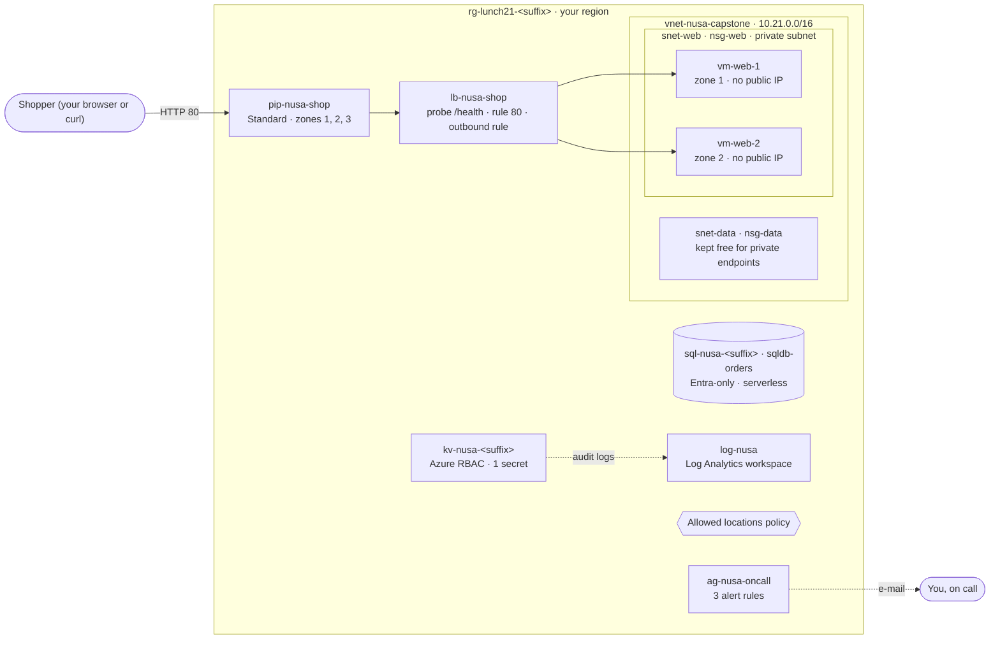

# Lab 21 · Capstone project

> **Pairs with:** [Lunch 21 · Core Capstone: Putting It All Together](../../lunches/21-core-capstone/README.md)
> **Time:** about 2–3 hours including deployment waits; split it into three sessions if you like · **Cost:** 💲💲 (see [cost bands](../README.md#cost-bands)) · **Difficulty:** ★★★
> **Works on its own:** ✅ You do not need any earlier lab. Everything this lab needs is created by its own steps (the provided Bicep files and `deploy.sh`).

## 🎯 What you'll build

You deploy Nusantara Retail's core platform — the design the whole core month has been building — from one modular
Bicep template: a private network, two web servers in two availability zones behind a Standard load balancer, an Azure
SQL database that accepts only Microsoft Entra identities, a Key Vault that uses Azure RBAC, monitoring with three alert
rules, an Allowed locations policy, and (in the portal) a budget. Then you treat it like production: you follow a
request end to end, switch off zone 1 and prove the shop stays open, check every guardrail, answer the director's
question with RTO and RPO, and review the design against the Well-Architected pillars.



| Bicep module | What it creates | Lunch |
|---|---|---|
| `infra/modules/network.bicep` | `vnet-nusa-capstone` (10.21.0.0/16), private subnets `snet-web` and `snet-data`, NSGs `nsg-web` and `nsg-data` | 08 |
| `infra/modules/web.bicep` | `pip-nusa-shop`, `lb-nusa-shop`, `vm-web-1` (zone 1), `vm-web-2` (zone 2) with their NICs and disks | 03, 06, 09 |
| `infra/modules/sql.bicep` | logical server `sql-nusa-<suffix>`, serverless database `sqldb-orders` | 11, 17 |
| `infra/modules/keyvault.bicep` | `kv-nusa-<suffix>`, secret `sql-connection-string`, your Key Vault Secrets Officer role | 15 |
| `infra/modules/monitoring.bicep` | `log-nusa`, action group `ag-nusa-oncall`, alerts `alert-web-cpu-high`, `alert-lb-backend-health`, `alert-web-vm-stopped`, Key Vault audit logs | 16 |
| `infra/modules/policy.bicep` | assignment `allowed-locations` of the built-in **Allowed locations** policy | 18 |
| *(portal, Task 7)* | budget `budget-lunch21` with 50/80/100% alerts | 19 |
| `infra/main.bicep` | wires the six modules together; `deploy.sh` runs it with what-if first | 20 |

## ✅ Before you start

- An Azure subscription where you are **Owner** — Task 2 creates a role assignment and a policy assignment. Use a
  personal or dedicated lab subscription, never a company one (see [Lab 01](../01-before-you-begin/README.md)).
- **Azure Cloud Shell (Bash)** — open [shell.azure.com](https://shell.azure.com). The Azure CLI and Bicep are already there.
- A region with availability zones. The default, `southeastasia`, works; if you use `indonesiacentral`, run the
  environment check below first. You need **4 vCPUs** of quota in the region (two `Standard_B2ats_v2` web VMs with 2 vCPUs each).
- An e-mail address you can read during the lab — the alerts go there.
- Get the lab files and load the shared settings and this lab's names:

```bash
git clone https://github.com/stefpin/azure-fundamentals-lunches.git   # first time only
cd azure-fundamentals-lunches/labs/21-core-capstone
source ../common/config.sh
source lab.env                          # resource names plus two helpers: who_answers and watch_shop
echo "$RG"                              # rg-lunch21-<suffix>
bash ../common/check-environment.sh     # optional: region, VM sizes and quota
```

> [!IMPORTANT]
> The platform costs a little every hour it exists (two small VMs, a load balancer and a public IP; the database is free
> or pauses). Finish with **Clean up**, even if you stop halfway. Splitting the lab over several days? Run
> `bash cleanup.sh` at the end of each session and `bash deploy.sh` at the start of the next — rebuilding from code takes
> about 15 minutes, and that is exactly the point of infrastructure as code.

Every time you open a new Cloud Shell session, go back to the lab folder and run
`source ../common/config.sh && source lab.env` again before you continue.

| Session | Tasks | About |
|---|---|---|
| 1 · Build | 1 Read the blueprint · 2 Deploy · 3 Follow a request | 50 min |
| 2 · Prove | 4 Lose a zone · 5 Security and governance · 6 Operations | 65 min |
| 3 · Decide | 7 Budget · 8 Answer the director · 9 Well-Architected review · Break it and fix it · Clean up | 65 min |

## 🧭 Choose your mode

| Mode | For you if… | How |
|---|---|---|
| **Guided** | you want every step explained | follow Tasks 1–9 below |
| **Challenge** | you finished the core month and want to design it yourself | read only the [Challenge brief](#-challenge-brief), build it your way (your own Bicep is the best way), then run `bash verify.sh` |

## Task 1 · Read the blueprint before you build (≈15 min)

In a real team nobody deploys a template they have not read. Reviewing infrastructure as code is how you catch an open
port or a missing tag *before* it costs money. Open the files in the Cloud Shell editor (`code infra/main.bicep`) or
read them on GitHub.

```bash
ls -R infra
```

Find each of these lines and say out loud why it is there:

| File | Look for | Why it matters |
|---|---|---|
| `main.bicep` | `network.outputs.webSubnetId` | modules pass values to each other through outputs; Bicep orders the deployment from these references |
| `network.bicep` | `defaultOutboundAccess: false` | a **private subnet**: VMs get no hidden internet access (Lunch 08) |
| `network.bicep` | `sourceAddressPrefix: 'AzureLoadBalancer'` | the health probe must be allowed in, or every server looks dead |
| `web.bicep` | `zones: [ zone ]` inside the VM loop | one VM per availability zone |
| `web.bicep` | `loadFileAsBase64('../../../common/cloud-init-web.yml')` | the shared web server set-up, read at compile time; the path is relative to `web.bicep` |
| `web.bicep` | `disableOutboundSnat: true` and `outboundRules` | explicit outbound access through the load balancer for the private VMs |
| `sql.bicep` | `azureADOnlyAuthentication: true` | no SQL logins and no passwords; only Microsoft Entra identities |
| `sql.bicep` | `useFreeLimit` and `freeLimitExhaustionBehavior: 'AutoPause'` | the free offer database pauses instead of billing you |
| `keyvault.bicep` | `enableRbacAuthorization: true` and `scope: vault` | Azure RBAC for secrets, with your role on this vault only |
| `monitoring.bicep` | three alert resources | capacity (CPU), application health (probe) and change (VM stopped) |
| `policy.bicep` | `e56962a6-4747-49cd-b67b-bf8b01975c4c` | Bicep needs the built-in policy's ID; the comment shows how to check it |

Now let Bicep check the files:

```bash
az bicep build --file infra/main.bicep --stdout > /dev/null && echo "main.bicep compiles"
az bicep lint --file infra/main.bicep      # no output means no linter warnings
```

> ✅ **Checkpoint:** `main.bicep compiles` is printed, and you can point to the module that creates each box in the
> diagram above. Quick test: which file would you change to add a third web server in zone 3?
> <details><summary>Answer</summary>
>
> `web.bicep` — add `'3'` to the `zones` parameter (and check your vCPU quota first).
>
> </details>

## Task 2 · Preview and deploy (≈20 min, mostly waiting)

`deploy.sh` does what a careful engineer does by hand: it finds out who you are (your user principal name and object
ID become the Azure SQL administrator and the Key Vault secrets officer), makes sure you have an SSH key, compiles the
templates, shows a **what-if** preview and only deploys after you say yes.

```bash
bash deploy.sh
```

Read the what-if output like a code review: every `+ Create` line is something that will exist, cost money or change who
can do what. You should see the network, the web tier, the database, the vault, its secret and role assignment, the
workspace, the action group, three alert rules, a diagnostic setting and the policy assignment. A few lines may be
marked as noise or ignored; that is normal. Type `y` to deploy. The deployment takes about 10–15 minutes, and the
script then waits until the storefront answers.

> [!TIP]
> **Prefer the portal?** Watch the deployment while it runs: *Resource groups › rg-lunch21-&lt;suffix&gt; › Settings ›
> Deployments*. You see `capstone` plus one nested deployment per module (`network`, `web`, `sql`, `keyvault`,
> `monitoring`, `policy`), which shows the order Bicep worked out from the outputs.

> [!NOTE]
> Expect a few e-mails from Azure Monitor: one saying you were added to the action group, and possibly a
> *backend health* alert that fires and resolves while the web servers boot. That is your monitoring already working.

> ✅ **Checkpoint:** the deployment succeeded and the storefront answers.
>
> ```bash
> az deployment group show -g "$RG" -n "$DEPLOYMENT" --query properties.provisioningState -o tsv   # Succeeded
> curl -s "http://$(lb_ip)/" | grep -o 'Served by.*</p>' | sed 's/<[^>]*>//g'
> ```

## Task 3 · Follow one request end to end (≈15 min)

A shopper's request crosses five things you built in the core month. Follow it hop by hop, so that later you can
explain to anyone where it could break.

1. **Who answers?** Send ten requests. The load balancer hashes each new connection, so you see both servers and both zones.

   ```bash
   who_answers 10
   ```

2. **The front door** — a zone-redundant Standard public IP with a DNS name:

   ```bash
   az network public-ip show -g "$RG" -n "$PIP" \
     --query "{ip:ipAddress, fqdn:dnsSettings.fqdn, sku:sku.name, zones:join(',', zones)}" -o table
   ```

3. **The load balancer** — health probe, rule and outbound rule:

   ```bash
   az network lb show -g "$RG" -n "$LB" \
     --query "{probePath:probes[0].requestPath, everySeconds:probes[0].intervalInSeconds, rulePort:loadBalancingRules[0].frontendPort, outboundRules:length(outboundRules)}" -o table
   ```

4. **The network security group** — what may enter the subnet:

   ```bash
   az network nsg rule list -g "$RG" --nsg-name "$NSG" \
     --query "[].{rule:name, priority:priority, from:sourceAddressPrefix, port:destinationPortRange, access:access}" -o table
   ```

5. **The servers** — private addresses only:

   ```bash
   az vm list -g "$RG" -d --query "[].{vm:name, zone:zones[0], privateIp:privateIps, publicIp:publicIps}" -o table
   ```

6. **The way out.** The VMs have no public IP and sit in a private subnet, yet they can reach the internet — through
   the load balancer's outbound rule. Ask a VM which address the internet sees (Run Command takes about a minute):

   ```bash
   az vm run-command invoke -g "$RG" -n "$VM1" --command-id RunShellScript \
     --scripts "curl -s --max-time 10 https://api.ipify.org" --query "value[0].message" -o tsv
   lb_ip
   ```

> [!TIP]
> **Prefer the portal?** *lb-nusa-shop › Monitoring › Insights* draws the frontend, rule, probe and backend pool as a
> diagram with live health. *rg-lunch21-&lt;suffix&gt; › Resource visualizer* shows how all the resources connect.

> ✅ **Checkpoint:** both `vm-web-1` and `vm-web-2` answer, the public IP lists zones `1,2,3`, the VMs show no public IP,
> and the address the VM reports in step 6 is the same as `lb_ip`.

## Task 4 · Lose a zone, keep the shop open (≈25 min)

This is the moment the director cares about. You cannot switch off a real Azure datacenter, but you can remove
everything *you* run in zone 1 — `vm-web-1` — and watch what shoppers experience.

1. Deallocate `vm-web-1` in the background and immediately start watching the shop for about two and a half minutes:

   ```bash
   az vm deallocate -g "$RG" -n "$VM1" --no-wait
   watch_shop 150
   ```

   You should see something like this: a mix at first, perhaps one or two `(no answer)` lines while the probe notices
   the server is gone, then only `vm-web-2`.

   ```text
   10:02:11  vm-web-1
   10:02:13  vm-web-2
   10:02:16  (no answer)
   10:02:18  vm-web-2
   10:02:20  vm-web-2
   ```

   Count the `(no answer)` lines and multiply by two seconds: that is your **measured RTO** for a zone failure. Write it
   down; you need it in Task 8.

2. Confirm the VM is really gone and see who did it — the activity log records every control-plane action:

   ```bash
   az vm get-instance-view -g "$RG" -n "$VM1" \
     --query "instanceView.statuses[?starts_with(code, 'PowerState/')].displayStatus | [0]" -o tsv
   az monitor activity-log list -g "$RG" --offset 1h \
     --query "[?operationName.value=='Microsoft.Compute/virtualMachines/deallocate/action'].{time:eventTimestamp, who:caller, status:status.value}" -o table
   ```

3. Check your inbox. Within a few minutes the activity log alert **alert-web-vm-stopped** e-mails you: monitoring
   noticed the change before any customer complained.

4. Look at the probe's view: *lb-nusa-shop › Monitoring › Metrics › Health Probe Status*, aggregation **Avg**, then
   **Apply splitting** by **Backend IP Address**. The line for `vm-web-1` stops — the load balancer does not probe a
   deallocated VM at all, which is why this lab also has the activity log alert.

5. Bring zone 1 back and watch it rejoin the rotation without any configuration change:

   ```bash
   az vm start -g "$RG" -n "$VM1"
   who_answers 10
   ```

> [!NOTE]
> **Variation — the application fails, not the server.** Stop only the web service on `vm-web-2`. The VM keeps
> running, its health probe fails, the load balancer routes around it, and within about 5–10 minutes the metric alert
> **alert-lb-backend-health** e-mails you. Different failure, different signal.
>
> ```bash
> az vm run-command invoke -g "$RG" -n "$VM2" --command-id RunShellScript --scripts "systemctl stop nusa-web" -o none
> who_answers 6        # only vm-web-1 answers
> # ...wait for the e-mail, then repair it:
> az vm run-command invoke -g "$RG" -n "$VM2" --command-id RunShellScript --scripts "systemctl start nusa-web" -o none
> ```

> ✅ **Checkpoint:** the shop answered throughout (apart from a few seconds), you received the *VM stopped* e-mail, you
> wrote down your measured RTO, and `who_answers 10` shows both servers again.

## Task 5 · Check the security and governance guardrails (≈20 min)

Security in this design is a stack of small, checkable decisions. Check them one by one.

1. **Key Vault uses Azure RBAC, and you hold a role on this vault only:**

   ```bash
   az keyvault show -n "$KV" \
     --query "{rbac:properties.enableRbacAuthorization, softDeleteDays:properties.softDeleteRetentionInDays, purgeProtection:properties.enablePurgeProtection}" -o table
   KV_ID=$(az keyvault show -n "$KV" --query id -o tsv)
   az role assignment list --scope "$KV_ID" --query "[].{role:roleDefinitionName, who:principalName}" -o table
   ```

2. **Read the secret.** It is safe to print because it contains no password — that is the whole point of Microsoft
   Entra authentication. (A brand-new role assignment can take up to about 10 minutes to work; if you get
   `Forbidden`, wait and retry.)

   ```bash
   az keyvault secret show --vault-name "$KV" -n "$SECRET" --query value -o tsv
   ```

3. **Azure SQL accepts only Microsoft Entra identities, and nobody can connect from the internet yet:**

   ```bash
   az sql server ad-only-auth get -g "$RG" -n "$SQL" --query azureAdOnlyAuthentication   # true
   az sql server ad-admin list -g "$RG" -s "$SQL" --query "[].login" -o tsv                # you
   az sql server firewall-rule list -g "$RG" -s "$SQL" -o table                            # empty
   az sql db show -g "$RG" -s "$SQL" -n "$DB" \
     --query "{tier:currentServiceObjectiveName, autoPauseMinutes:autoPauseDelay, freeOffer:useFreeLimit}" -o table
   ```

4. **The policy guardrail.** List the assignment, then try to break the rule with a free resource (an empty NSG) in
   another region:

   ```bash
   az policy assignment list -g "$RG" --query "[].{name:name, displayName:displayName, mode:enforcementMode}" -o table
   OTHER_REGION=$([[ "$LOCATION" == "eastus" ]] && echo westeurope || echo eastus)
   az network nsg create -g "$RG" -n nsg-policy-test --location "$OTHER_REGION"
   ```

   Expected: an error with the code `RequestDisallowedByPolicy` and the message Nusantara Retail wrote into the
   assignment. A new assignment takes about five minutes to take effect; if the NSG *was* created, delete it
   (`az network nsg delete -g "$RG" -n nsg-policy-test`), wait a few minutes and try again.

> [!TIP]
> **Prefer the portal?** *kv-nusa-&lt;suffix&gt; › Access control (IAM) › Role assignments* shows your role; *sql-nusa-&lt;suffix&gt;
> › Settings › Microsoft Entra ID* shows the "Support only Microsoft Entra authentication" setting; *Policy ›
> Compliance* shows the assignment (the first compliance results appear only after an evaluation cycle, which can take a while).

> ✅ **Checkpoint:** RBAC is `true`, the secret prints a connection string with `Authentication=Active Directory
> Default` and no password, Entra-only authentication is `true`, there are no firewall rules, and the out-of-region NSG
> was denied.

## Task 6 · Check the operations guardrails (≈20 min)

Operations answers three questions: will we know, will the right person hear about it, and can we find out what happened?

1. **The alert rules and who they notify:**

   ```bash
   az monitor metrics alert list -g "$RG" --query "[].{rule:name, severity:severity, enabled:enabled}" -o table
   az monitor activity-log alert list -g "$RG" --query "[].{rule:name, enabled:enabled}" -o table
   az monitor action-group show -g "$RG" -n "$AG" --query "{enabled:enabled, shortName:groupShortName, emails:length(emailReceivers)}" -o table
   ```

   In the portal, *Monitor › Alerts* (filtered to your resource group) lists the alerts that fired in Task 4.

2. **Metrics without any agent.** Azure collects host metrics for every VM:

   ```bash
   VM1_ID=$(az vm show -g "$RG" -n "$VM1" --query id -o tsv)
   az monitor metrics list --resource "$VM1_ID" --metric "Percentage CPU" --interval PT5M --offset 1h --aggregation Average -o table
   ```

3. **Logs: who read the secret?** Your secret read in Task 5 was recorded. In the portal open *log-nusa › Logs*,
   switch to KQL mode and run this query (the first records can take 10–15 minutes to arrive):

   ```kusto
   search "SecretGet"
   | where TimeGenerated > ago(4h)
   | project TimeGenerated, $table, OperationName
   | order by TimeGenerated desc
   ```

   `search` looks in every table, so it works whichever table your workspace uses for Key Vault logs
   (`AzureDiagnostics` by default). Lunch 30 teaches KQL properly.

4. **Backups you did not have to configure.** Azure SQL Database backs itself up; check the restore window:

   ```bash
   az sql db show -g "$RG" -s "$SQL" -n "$DB" --query "{earliestRestore:earliestRestoreDate, backupStorage:currentBackupStorageRedundancy}" -o table
   az sql db str-policy show -g "$RG" -s "$SQL" -n "$DB" --query retentionDays    # 7
   ```

   `earliestRestore` stays empty until the first full backup finishes, usually within about half an hour of creation.

5. *(Optional)* **Make the CPU alert fire.** Keep `vm-web-2` busy for 15 minutes; within about 10 minutes
   **alert-web-cpu-high** e-mails you, and it resolves itself after the loop ends.

   ```bash
   az vm run-command invoke -g "$RG" -n "$VM2" --command-id RunShellScript \
     --scripts "nohup timeout 900 sh -c 'while :; do :; done' > /dev/null 2>&1 &" -o none
   ```

> ✅ **Checkpoint:** three enabled alert rules point to `ag-nusa-oncall`, you can see CPU metrics, your `SecretGet`
> appears in the workspace, and the database reports a 7-day restore window.

## Task 7 · Put a budget on it (portal, ≈10 min)

Budgets are created in the portal here because that is where you set the e-mail alerts comfortably. A budget never
stops resources; it warns people in time.

1. Portal › *Resource groups* › **rg-lunch21-&lt;suffix&gt;** › *Cost Management* › **Budgets** › **+ Add**.
2. **Name** `budget-lunch21` (the scripts look for this name), **Reset period** Monthly, **Amount** a small number in
   your billing currency — for example the equivalent of US$10.
3. **Next** › **Alert conditions**: add *Actual* at **50**, **80** and **100** percent, and *Forecasted* at **100** percent.
   Add your e-mail address under **Alert recipients**.
4. **Create**.

> [!NOTE]
> Cost data arrives with a delay of several hours, so a new budget shows little spending at first and alerts are never
> instant. If the *Budgets* page says your subscription offer is not supported, read the steps, skip the task, and
> expect `verify.sh` to show a note instead of a check.

> ✅ **Checkpoint:**
>
> ```bash
> az consumption budget list -g "$RG" --query "[].{name:name, amount:amount, period:timeGrain}" -o table
> ```

## Task 8 · Answer the director with RTO and RPO (≈15 min, no Azure changes)

Ibu Sari asked: *"If that server dies, how long can't we sell?"* Answer with evidence from this lab, not with hope.
Copy this table into your notes and fill it in.

| Failure | What protects us in this design | Evidence from the lab | RTO (time we can't sell) | RPO (orders we could lose) |
|---|---|---|---|---|
| One web server fails | | Task 4 variation | | |
| Zone 1 fails | | Task 4 measurement | | |
| Someone deletes today's orders | | Task 6, step 4 | | |
| The whole region is lost | | — | | |

Then write a five-sentence message to Ibu Sari: plain words, numbers, one sentence on what would make the weakest
row better and what it would cost (open the [pricing calculator](https://azure.microsoft.com/pricing/calculator/) if you
want a figure).

<details><summary>Sample answer</summary>

| Failure | What protects us | Evidence | RTO | RPO |
|---|---|---|---|---|
| One web server fails | Health probe + second server | probe marked it down; the other server answered | seconds | none (web servers hold no data) |
| Zone 1 fails | Servers in two zones, zone-redundant public IP | a few `(no answer)` lines, then only `vm-web-2` | seconds | none for the web tier; the lab database is *not* zone-redundant, so production must enable it |
| Someone deletes today's orders | Automatic backups, point-in-time restore (7 days) | `earliestRestoreDate`, retention 7 days | minutes to an hour (restore creates a new database; size matters) | minutes — log backups run roughly every 5–10 minutes, plus any orders taken after the mistake |
| Region lost | Nothing yet except the Bicep files | — | hours to rebuild in another region; data only if a copy exists there | everything since the last copy outside the region |

*"Ibu Sari, if a server or even one of Azure's datacenter zones in the region fails, the shop keeps selling: we
measured a pause of a few seconds and no lost orders. If someone deletes orders by mistake, we can restore the database
to any moment in the last seven days and would re-enter at most a few minutes of orders. If the whole region were lost,
which is rare, we could rebuild the shop elsewhere from our templates within hours, but today's orders would be at
risk. Keeping a continuously updated copy of the database in a second region closes that gap; Lunch 28 shows how, and I
can price it for the next meeting. Production should also make the database zone-redundant, which this lab skipped to
save money."*

</details>

> ✅ **Checkpoint:** every row has an RTO and an RPO, and your message names one improvement with its cost trade-off.

## Task 9 · Do a Well-Architected self-review (≈20 min)

Open [`review-checklist.md`](review-checklist.md). For each pillar, run the commands, mark every check ✅, ⚠️ or ❌,
and finish the *Trade-offs you accepted* and *Your top three improvements* sections. Be strict: the lab build has
several deliberate gaps (HTTP only, a database that is not zone-redundant, purge protection off) and the review is
where you say so.

> ✅ **Checkpoint:** every check has a mark, at least three trade-offs are written down, and your top three improvements
> each name the lunch that teaches the fix.

## 🔧 Break it and fix it

**Drift.** Someone "tidies up" the network security group by hand and removes the rule for shoppers:

```bash
az network nsg rule delete -g "$RG" --nsg-name "$NSG" -n Allow-HTTP-Internet
curl -s -m 5 -o /dev/null -w '%{http_code}\n' "http://$(lb_ip)/"    # 000 = no answer
```

The shop is down — yet in the portal the load balancer's **Health Probe Status** stays at 100%. Why are both servers
"healthy" while no shopper gets through? And what is the fastest *safe* way to repair it?

<details><summary>Hint and fix</summary>

The probe comes from the `AzureLoadBalancer` service tag, which still has its own rule, so the servers look healthy.
Shoppers come from the `Internet` tag, whose rule you deleted, and the default rules deny that traffic.

Do not re-create the rule by hand — you might type a different priority or port. Run the template again:

```bash
bash deploy.sh
```

The what-if shows `~ Modify` on `nsg-web` with the missing rule; confirm, and the shop is back. Infrastructure as code
turns "what did someone change?" into a diff. To stop such changes in the first place, deploy the template as a
deployment stack with deny settings (Lunch 20) — see the stretch goals.

</details>

## 🧪 Verify your work

```bash
bash verify.sh
```

Every check should say **PASS**: network and NSG rules, both VMs running in zones 1 and 2 without public IPs, the
zone-redundant Standard public IP and load balancer (probe, rule, outbound rule, two backends, HTTP 200 from both
servers), Entra-only Azure SQL with TLS 1.2+ and a 7-day restore window, the RBAC Key Vault and its password-free
secret, the workspace, action group, CPU and activity log alerts, Key Vault audit logs, the Allowed locations policy,
and the budget. If a check fails, the message tells you which task to revisit.

## 🧹 Clean up (do not skip!)

```bash
bash cleanup.sh
```

This deletes the budget, the policy assignment, your role assignment on the vault, the Key Vault itself (deleted **and
purged**, so the name is free again), any deployment stack from the stretch goals, and resource group
`rg-lunch21-<suffix>` with everything in it. Deletion continues in the background for a few minutes; check with
`az group list --tag lunch=21 -o table`. Your SSH key in `~/.ssh` stays — it is not an Azure resource.

## 🩺 Troubleshooting

| Symptom | Likely cause | Fix |
|---|---|---|
| `SkuNotAvailable` … *"The requested size for resource … is currently not available in location … zones …"* | The VM size (`$VM_SIZE_SMALL`) is not offered in that zone for your subscription | Pick another allowed size: `VM_SIZE_SMALL=Standard_B2ts_v2 bash deploy.sh` (list sizes with `az vm list-skus --location "$LOCATION" --size Standard_B --zone -o table`) |
| *"Operation could not be completed as it results in exceeding approved … Cores quota"* | Not enough vCPU quota in the region | Delete VMs left over from other labs (each web VM needs 2 vCPUs), or request more quota |
| `ConflictError` … *"A vault with the same name already exists in deleted state"* | A Key Vault from an earlier run is soft-deleted | Let `deploy.sh` purge it when it asks, or `az keyvault purge --name "$KV" --location "$LOCATION"` |
| A deployment error about the free offer or `useFreeLimit` | Free databases already used in another region, or an offer that does not support them | `USE_FREE_SQL_OFFER=false bash deploy.sh` (a small serverless database that pauses when idle) |
| `deploy.sh` says it could not read your Microsoft Entra profile | Guest account or restricted directory | Set `SQL_ADMIN_UPN` and `SQL_ADMIN_OBJECT_ID` yourself, as the message shows |
| `RequestDisallowedByPolicy` when **you** redeploy | You changed `LOCATION` after the first deployment; the policy allows only the first region | Use the original region, or run `cleanup.sh` first |
| `PropertyChangeNotAllowed` … `linuxConfiguration.ssh.publicKeys` | Your SSH key changed between deployments | Restore the old key, or run `cleanup.sh` and deploy again |
| `Forbidden` … *"Caller is not authorized to perform action on resource"* … `secrets/getSecret/action` | The new role assignment has not reached Key Vault yet | Wait about 10 minutes and try again |
| `curl` gets no answer right after deployment | The web servers are still running cloud-init | Wait 2–3 minutes; check with `az vm run-command invoke -g "$RG" -n "$VM1" --command-id RunShellScript --scripts "systemctl status nusa-web --no-pager"` |
| `LoadBalancingRuleMustDisableSNATSinceSameFrontendIPConfigurationIsReferencedByOutboundRule` (Challenge mode) | The load-balancing rule still does SNAT while an outbound rule uses the same frontend | Set `disableOutboundSnat: true` on the rule |
| The out-of-region NSG in Task 5 was **not** denied | The assignment is still propagating | Delete the test NSG, wait about five minutes, retry |

## 🚀 Stretch goals

- **Freeze the design.** Deploy the same template as a deployment stack that denies changes, then try the Break it
  exercise again (exclude yourself with `--deny-settings-excluded-principals` if you want to keep fixing things):

  ```bash
  ALERT_EMAIL="you@example.com"        # your address
  az stack group create --name capstone-stack --resource-group "$RG" --template-file infra/main.bicep \
    --parameters suffix="$SUFFIX" vmSize="$VM_SIZE_SMALL" sshPublicKey="$(cat ~/.ssh/id_rsa.pub)" \
                 sqlAdminLogin="$(my_upn)" sqlAdminObjectId="$(my_object_id)" alertEmail="$ALERT_EMAIL" \
    --action-on-unmanage deleteAll --deny-settings-mode denyWriteAndDelete
  ```

  `cleanup.sh` deletes the stack first, so its deny settings never block the clean-up.

- **Zone 3.** Add `'3'` to the `zones` parameter in `web.bicep` and redeploy (6 vCPUs in total — check your quota first).
- **Zone-redundant database.** Set `zoneRedundant: true` in `sql.bicep` with `USE_FREE_SQL_OFFER=false`, check the
  what-if, and compare the price in the pricing calculator before you deploy.
- **NAT gateway instead of an outbound rule** (Lunches 08 and 25): give `snet-web` a NAT gateway and remove the
  outbound rule. Which is simpler to operate?
- **Managed identity end to end** (Lunch 15): give the VMs system-assigned identities with *Key Vault Secrets User*,
  then read the secret from inside `vm-web-1` with Run Command.
- **Guest logs** (Lunch 30): collect syslog from the VMs into `log-nusa` with the Azure Monitor Agent and a data collection rule.
- **Second opinion:** take the free [Azure Well-Architected Review](https://learn.microsoft.com/assessments/azure-architecture-review/)
  for the storefront and compare it with your checklist.

## 🏁 Challenge brief

Build Nusantara Retail's core platform any way you like — your own Bicep is the best way — using the names below so
`verify.sh` can find everything. The shared settings give you `$LOCATION` and `$SUFFIX`; `lab.env` lists every name.

1. Resource group `rg-lunch21-<suffix>` tagged `course=azure-fundamentals-lunches` and `lunch=21` (use `ensure_rg "$RG" 21`).
2. Virtual network `vnet-nusa-capstone` with a **private** subnet `snet-web` (default outbound access disabled) protected
   by NSG `nsg-web`, which allows TCP 80 from `Internet` and from `AzureLoadBalancer` and nothing else inbound.
3. Ubuntu VMs `vm-web-1` in zone 1 and `vm-web-2` in zone 2, without public IPs, running the shared web server
   (`labs/common/cloud-init-web.yml`).
4. Zone-redundant Standard public IP `pip-nusa-shop` on Standard load balancer `lb-nusa-shop` with an HTTP probe on
   `/health`, a TCP 80 rule, an outbound rule and both VMs in the backend pool. The storefront answers HTTP 200 from both servers.
5. Logical server `sql-nusa-<suffix>` with Microsoft Entra-only authentication (you as administrator) and TLS 1.2 or
   later, and a General Purpose serverless database `sqldb-orders` that keeps at least 7 days of point-in-time restore.
6. Key Vault `kv-nusa-<suffix>` using the Azure RBAC permission model, with a secret `sql-connection-string` that
   contains no password; your data-plane role is assigned on the vault only.
7. Log Analytics workspace `log-nusa` receiving the vault's audit logs; action group `ag-nusa-oncall` with your e-mail;
   an enabled metric alert on the VMs' *Percentage CPU*; an enabled activity log alert for stopped or deallocated VMs.
8. The built-in **Allowed locations** policy assigned to the resource group, allowing your region.
9. A budget on the resource group with e-mail alerts.
10. Everything except the budget comes from code, and running it twice changes nothing.

Then run `bash verify.sh`. Stuck? Read the modules in [`infra/`](infra/), look at [`solution.sh`](solution.sh), or
switch to Guided mode.

---

⬅️ [Lunch 21 reading](../../lunches/21-core-capstone/README.md) · 🏠 [All labs](../README.md) · 🏠 [Course home](../../README.md)

<sub>Last validated: October 2026 · Something broken? [Report a lab problem](../../CONTRIBUTING.md).</sub>
