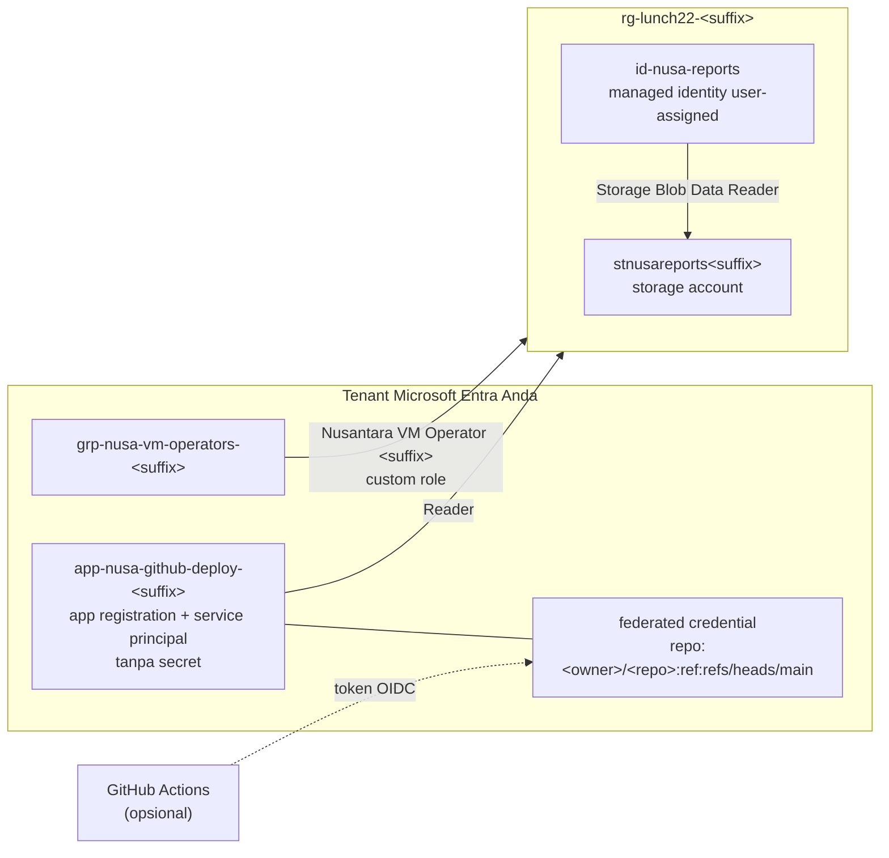

# Lab 22 · Pipeline tanpa kata sandi dan hak akses minimum

🇬🇧 [Read in English](README.md)

> **Pasangan dari:** [Makan Siang 22 · Identitas dan Akses (Lanjutan)](../../lunches/22-identity-access-advanced/README.id.md)
> **Waktu:** sekitar 50 menit · **Biaya:** 💲 (lihat [kelompok biaya](../README.id.md#kelompok-biaya)) · **Tingkat kesulitan:** ★★☆
> **Bisa dikerjakan terpisah:** ✅ Anda tidak memerlukan lab sebelumnya. Semua yang dibutuhkan lab ini dibuat oleh langkah-langkahnya sendiri.
> **Penulis:** Stefanus Pinarta · [Tentang penulis](../../README.id.md#tentang-penulis)

> [!CAUTION]
> **Gunakan tenant dan subscription milik Anda sendiri.** Lab ini membuat custom role, grup, dan app registration. Anda membutuhkan **Owner** pada subscription (untuk membuat custom role dan role assignment) serta hak untuk membuat grup dan app registration di Microsoft Entra ID. Tenant yang ikut tercipta bersama akun gratis pribadi Anda memberikan semua itu; tenant perusahaan atau kampus biasanya tidak — dan memang bukan tempat untuk bereksperimen.

## 🎯 Yang akan Anda bangun

Temuan auditor dari makan siang, diperbaiki dalam versi mini. Anda akan menulis custom role **Nusantara VM Operator** dari sebuah file JSON — start, restart, dan deallocate VM, tidak lebih — lalu meng-assign-nya ke grup operator di scope resource group. Anda akan memberi **managed identity user-assigned** sebuah data role pada storage account, supaya aplikasi pelaporan di masa depan tidak butuh storage key. Dan Anda akan membuat **app registration tanpa secret sama sekali**: satu-satunya kredensialnya adalah federated credential yang memercayai GitHub Actions pada branch main dari satu repository. Jika Anda punya repository GitHub, Anda akan melihat sebuah workflow sign-in ke Azure dengan OpenID Connect. Conditional Access dan PIM membutuhkan lisensi P1 dan P2, jadi keduanya hadir sebagai tur portal terpandu.



## ✅ Sebelum mulai

- Subscription Azure tempat Anda menjadi **Owner** (lihat [Lab 01](../01-before-you-begin/README.id.md)), di tenant milik Anda sendiri.
- **Azure Cloud Shell (Bash)** — buka [shell.azure.com](https://shell.azure.com). Tidak ada yang perlu diinstal; `jq` sudah tersedia.
- Opsional, untuk Tugas 7: **akun GitHub** dan repository milik Anda (boleh kosong).
- Ambil file lab dan muat pengaturan bersama:

```bash
git clone https://github.com/stefpin/azure-fundamentals-lunches.git   # first time only
cd azure-fundamentals-lunches/labs/22-identity-access-advanced
source ../common/config.sh
RG=$(rg_name 22)
```

> [!IMPORTANT]
> Resource lab menimbulkan biaya selama masih ada. Akhiri dengan bagian **Bersihkan**, walaupun Anda berhenti di tengah jalan. Storage account nyaris tidak berbiaya selama masih kosong, tetapi custom role, grup, dan app registration berada di luar resource group, sehingga hanya `cleanup.sh` yang bisa menghapusnya.

## 🧭 Pilih mode Anda

| Mode | Cocok untuk Anda jika… | Caranya |
|---|---|---|
| **Terpandu** | Anda ingin setiap langkah dijelaskan | ikuti Tugas 1–8 di bawah |
| **Tantangan** | Anda sudah menguasai dasarnya | baca hanya [Ringkasan tantangan](#-ringkasan-tantangan), bangun dengan cara Anda, lalu jalankan `bash verify.sh` |

## Tugas 1 · Membuat resource group dan mencatat ID Anda

Custom role dan role assignment ditulis dengan merujuk ID resource, jadi simpan ID-ID yang nanti Anda butuhkan.

```bash
ensure_rg "$RG" 22
SUB_ID=$(az account show --query id --output tsv)
TENANT_ID=$(az account show --query tenantId --output tsv)
RG_ID=$(az group show --name "$RG" --query id --output tsv)
echo "$RG_ID"
```

> ✅ **Pemeriksaan:** `RG_ID` terlihat seperti `/subscriptions/…/resourceGroups/rg-lunch22-<suffix>`.

## Tugas 2 · Menulis custom role

Buka [`vm-operator-role.json`](vm-operator-role.json). File ini mencantumkan persis apa yang dibutuhkan operator shift malam: membaca VM dan statusnya, menjalankan (start), me-restart, dan men-deallocate VM, serta melihat resource group. Tidak ada wildcard, tidak ada `write`, tidak ada `delete`, dan tidak ada data action. `AssignableScopes` hanya akan berisi resource group lab, sehingga role ini tidak bisa dipakai di tempat lain. Isi placeholder-nya, lalu buat role tersebut:

```bash
ROLE_NAME="Nusantara VM Operator ${SUFFIX}"
sed -e "s|__SUFFIX__|${SUFFIX}|" -e "s|__SUBSCRIPTION_ID__|${SUB_ID}|" -e "s|__RESOURCE_GROUP__|${RG}|" \
  vm-operator-role.json > my-vm-operator-role.json
cat my-vm-operator-role.json
az role definition create --role-definition @my-vm-operator-role.json --query "{name:roleName, id:name}" --output table
```

Nama role harus unik di tenant Anda — itulah sebabnya nama ini diakhiri dengan suffix Anda. Cari role itu di scope resource group, karena hanya di sanalah role ini bisa di-assign:

```bash
az role definition list --name "$ROLE_NAME" --scope "$RG_ID" \
  --query "[0].{name:roleName, type:roleType, actions:permissions[0].actions, scopes:assignableScopes}" --output json
```

> [!TIP]
> **Lebih suka portal?** *rg-lunch22-&lt;suffix&gt; › Access control (IAM) › Add › Add custom role*, lalu pilih **Start from JSON** dan unggah `my-vm-operator-role.json`. Tab *Permissions* memungkinkan Anda mencari setiap operasi berdasarkan kata kunci — cara yang bagus untuk menemukan nama-nama action.

> ✅ **Pemeriksaan:** role menampilkan `"type": "CustomRole"`, enam action, dan satu assignable scope, yaitu resource group Anda. Jika pencarian tidak mengembalikan apa pun, tunggu semenit: role baru butuh sedikit waktu untuk tereplikasi.

## Tugas 3 · Meng-assign custom role ke grup operator

Role diberikan kepada grup, bukan kepada orang satu per satu. Buat satu grup untuk shift malam dan assign custom role berdasarkan **ID**-nya (sebuah GUID), yang tetap berfungsi walaupun suatu saat ada yang mengganti nama role tersebut.

```bash
OPS_GROUP="grp-nusa-vm-operators-${SUFFIX}"
OPS_GROUP_ID=$(az ad group create --display-name "$OPS_GROUP" --mail-nickname "$OPS_GROUP" \
  --description "Lab 22: night-shift operators who start, restart and deallocate VMs" --query id --output tsv)
ROLE_GUID=$(az role definition list --name "$ROLE_NAME" --scope "$RG_ID" --query "[0].name" --output tsv)
az role assignment create \
  --assignee-object-id "$OPS_GROUP_ID" \
  --assignee-principal-type Group \
  --role "$ROLE_GUID" \
  --scope "$RG_ID" \
  --output none
az role assignment list --scope "$RG_ID" \
  --query "[].{principal:principalName, role:roleDefinitionName}" --output table
```

Jika Anda mendapat `RoleDefinitionDoesNotExist` atau *Role … doesn't exist*, role baru itu belum tereplikasi: tunggu semenit lalu jalankan perintahnya lagi.

Tidak bisa membuat grup di tenant Anda? Assign role itu ke diri Anda sendiri, dengan `--assignee-object-id "$(my_object_id)" --assignee-principal-type User`. Karena Anda Owner, hal ini tidak menambah apa pun pada kemampuan Anda, tetapi Anda bisa melihat assignment-nya, dan `verify.sh` menerima principal apa pun.

> ✅ **Pemeriksaan:** tabel menampilkan grup operator Anda dengan **Nusantara VM Operator &lt;suffix&gt;**.

## Tugas 4 · Memberi managed identity user-assigned sebuah data role

Aplikasi pelaporan akan membaca ekspor data penjualan dari blob storage. Alih-alih menyimpan storage key di konfigurasinya, aplikasi itu mendapat identitasnya sendiri — dibuat sebagai resource yang berdiri sendiri, sehingga tetap ada saat compute aplikasinya dibangun ulang.

```bash
az identity create --name id-nusa-reports --resource-group "$RG" --location "$LOCATION" --output none
MI_PRINCIPAL_ID=$(az identity show --name id-nusa-reports --resource-group "$RG" --query principalId --output tsv)

ST_NAME="stnusareports${SUFFIX}"
az storage account create --name "$ST_NAME" --resource-group "$RG" --location "$LOCATION" \
  --sku Standard_LRS --kind StorageV2 --min-tls-version TLS1_2 --allow-blob-public-access false --output none
ST_ID=$(az storage account show --name "$ST_NAME" --resource-group "$RG" --query id --output tsv)

az role assignment create \
  --assignee-object-id "$MI_PRINCIPAL_ID" \
  --assignee-principal-type ServicePrincipal \
  --role "Storage Blob Data Reader" \
  --scope "$ST_ID" \
  --output none
az role assignment list --assignee-object-id "$MI_PRINCIPAL_ID" --all \
  --query "[].{role:roleDefinitionName, scope:scope}" --output table
```

Identitas ini punya dua ID: **principal ID** (service principal-nya, yang menerima role) dan **client ID**, yang diteruskan kode ke `ManagedIdentityCredential` untuk memilih identitas ini. *Storage Blob Data Reader* adalah **data role**: ia bisa membaca blob, tetapi tidak bisa mengubah account atau menampilkan key-nya.

> ✅ **Pemeriksaan:** tepat satu baris — **Storage Blob Data Reader**, dengan scope storage account Anda.

## Tugas 5 · Membuat app registration tanpa secret

Pipeline juga membutuhkan identitas. Buat app registration beserta service principal-nya, lalu beri service principal itu role **Reader** pada resource group — cukup bagi contoh workflow untuk menampilkan daftar resource.

```bash
APP_NAME="app-nusa-github-deploy-${SUFFIX}"
APP_ID=$(az ad app create --display-name "$APP_NAME" --query appId --output tsv)
az ad sp create --id "$APP_ID" --output none
SP_ID=$(az ad sp show --id "$APP_ID" --query id --output tsv)
az role assignment create \
  --assignee-object-id "$SP_ID" \
  --assignee-principal-type ServicePrincipal \
  --role "Reader" \
  --scope "$RG_ID" \
  --output none
az ad app credential list --id "$APP_ID" --output table
```

`APP_ID` adalah **application (client) ID** yang akan dipakai GitHub. Perintah terakhir menampilkan client secret milik aplikasi — dan tidak mencetak apa pun, karena memang tidak ada. Pertahankan seperti itu.

> [!WARNING]
> `az ad app create` tidak mencegah Anda membuat aplikasi kedua dengan display name yang sama. Jika Anda menjalankan tugas ini dua kali, cari dulu aplikasinya: `az ad app list --display-name "$APP_NAME" --query "[].appId" --output tsv`.

> ✅ **Pemeriksaan:** `az ad sp show --id "$APP_ID" --query "{name:displayName, type:servicePrincipalType}" --output table` menampilkan aplikasi Anda dengan tipe **Application**, dan daftar kredensialnya kosong.

## Tugas 6 · Menambahkan federated credential untuk GitHub Actions

Tentukan repository mana yang harus dipercaya Azure. `GITHUB_REPO` adalah bagian subject di antara `repo:` dan `:ref:`:

```bash
GITHUB_REPO="<your-github-user>/<your-repo>"          # a repository you own
# No GitHub account? Use a name only you know, so nothing can ever match it:
# GITHUB_REPO="nusa-lab-${SUFFIX}/storefront"
```

> [!IMPORTANT]
> Repository GitHub yang dibuat setelah **15 Juli 2026** memakai subject *immutable* (tidak berubah) yang menambahkan ID numerik, misalnya `repo:octo-learner@1234567/storefront@891011:ref:refs/heads/main`. Repository yang lebih lama tetap memakai bentuk klasik `repo:owner/repo`, kecuali pemiliknya memilih ikut (opt in). Untuk repository publik, perintah ini mencetak bentuk immutable-nya:
>
> ```bash
> curl -s "https://api.github.com/repos/${GITHUB_REPO}" | jq -r '"\(.owner.login)@\(.owner.id)/\(.name)@\(.id)"'
> ```
>
> Jika repository Anda memakai format itu, isi `GITHUB_REPO` dengan nilai yang tercetak. Ragu? Pakai bentuk klasik dulu; Tugas 7 akan menunjukkan subject yang persis jika ternyata tidak cocok.

Sekarang lihat [`federated-credential.json`](federated-credential.json) — issuer, subject, dan audience — isi repository-nya, lalu buat credential-nya:

```bash
sed "s|__GITHUB_REPO__|${GITHUB_REPO}|" federated-credential.json > my-federated-credential.json
cat my-federated-credential.json
az ad app federated-credential create --id "$APP_ID" --parameters my-federated-credential.json --output none
az ad app federated-credential list --id "$APP_ID" \
  --query "[].{name:name, issuer:issuer, subject:subject, audiences:join(',', audiences)}" --output table
```

> [!TIP]
> **Lebih suka portal?** *Microsoft Entra admin center › App registrations › app-nusa-github-deploy-&lt;suffix&gt; › Certificates & secrets › Federated credentials › Add credential*, skenario **GitHub Actions deploying Azure resources**. Portal menyusun subject dari organisasi, repository, dan entity type (branch, environment, pull request, atau tag).

> ✅ **Pemeriksaan:** satu credential, `github-main-branch`, dengan issuer `https://token.actions.githubusercontent.com`, subject Anda, dan audience `api://AzureADTokenExchange`.

## Tugas 7 · (Opsional) Sign-in dari GitHub Actions tanpa secret

Kerjakan tugas ini jika `GITHUB_REPO` adalah repository sungguhan milik Anda.

1. Cetak nilai-nilai yang dibutuhkan workflow:

   ```bash
   echo "AZURE_CLIENT_ID=$APP_ID"; echo "AZURE_TENANT_ID=$TENANT_ID"
   echo "AZURE_SUBSCRIPTION_ID=$SUB_ID"; echo "AZURE_RESOURCE_GROUP=$RG"
   ```

2. Di GitHub, buka **Settings › Secrets and variables › Actions** milik repository. Tambahkan tiga **repository secret** (`AZURE_CLIENT_ID`, `AZURE_TENANT_ID`, `AZURE_SUBSCRIPTION_ID`) dan, di tab **Variables**, satu **repository variable** (`AZURE_RESOURCE_GROUP`). ID-ID ini bukan rahasia; menyimpannya sebagai secret hanya membuatnya tidak muncul di log.
3. Di branch **main**, buat `.github/workflows/azure-oidc.yml` dengan isi dari [`github-workflow-example.yml`](github-workflow-example.yml). Perhatikan `permissions: id-token: write` dan langkah `azure/login@v3` yang hanya memakai tiga ID — tanpa `client-secret`.
4. Commit ke main akan memulai workflow (atau gunakan **Actions › Azure OIDC sign-in (Lab 22) › Run workflow** pada main). Langkah sign-in berhasil, dan langkah berikutnya menampilkan `id-nusa-reports` serta storage account Anda.
5. Sekarang buat branch bernama `feature/test` dan jalankan workflow di sana. Sign-in gagal dengan `AADSTS700213: No matching federated identity record found for presented assertion subject …` — subject-nya berakhiran `refs/heads/feature/test`, dan tidak ada yang memercayainya. Penolakan itu adalah batas keamanan yang sedang bekerja.

> ✅ **Pemeriksaan:** run hijau di `main` dan sign-in merah di `feature/test`. Jika `main` juga gagal dengan `AADSTS700213`, salin subject dari pesan error (pesan itu menunjukkan format yang dipakai repository Anda) dan perbaiki `GITHUB_REPO` di Tugas 6.

## Tugas 8 · (Tur hanya-baca) Conditional Access dan PIM

Conditional Access membutuhkan **Microsoft Entra ID P1**, sedangkan Privileged Identity Management dan fitur access review yang lengkap membutuhkan **Microsoft Entra ID P2** atau **Microsoft Entra ID Governance**. Halaman produk Entra dari Microsoft menawarkan uji coba gratis (free trial); baca dulu ketentuan trial yang berlaku saat ini, dan ingat bahwa saat trial berakhir, assignment PIM yang eligible akan dihapus. Tanpa lisensi ini Anda tetap bisa membuka halaman-halamannya dan membaca sambil mengikuti; Anda hanya tidak bisa membuat policy atau assignment eligible. Tidak ada bagian tugas ini yang diperiksa oleh `verify.sh`.

**Conditional Access** — *Microsoft Entra admin center › Entra ID › Conditional Access › Policies › New policy*:

1. **Name:** *Contractors · Azure management · require MFA*.
2. **Users:** sertakan (include) grup kontraktor; **kecualikan** (exclude) akun-akun akses darurat Anda.
3. **Target resources:** aplikasi cloud yang mewakili Azure management (cari *Azure* di kolom pemilih).
4. **Grant:** *Grant access* › *Require multifactor authentication*. **Session:** *Sign-in frequency* 8 jam.
5. **Enable policy: Report-only** › **Create**. Lalu buka *Sign-in logs* dan tab **Report-only** pada salah satu sign-in, serta coba tool **What If** di daftar policy, untuk melihat apa yang *akan* dilakukan policy tersebut.

**Privileged Identity Management** — *Microsoft Entra admin center › ID Governance › Privileged Identity Management › Azure resources*, lalu pilih subscription Anda dan `rg-lunch22-<suffix>`:

1. **Settings › Owner › Edit:** atur *Activation maximum duration* (1–24 jam), wajibkan MFA dan justifikasi saat aktivasi, dan wajibkan persetujuan dengan minimal dua approver.
2. **Assignments › Add assignments:** role **Owner**, seorang anggota, assignment type **Eligible**, dengan tanggal berakhir.
3. Sebagai anggota tersebut, buka *My roles › Azure resources* dan klik **Activate** — lalu amati assignment itu menjadi active dan kemudian kedaluwarsa.

**Access review** — *ID Governance › Access reviews › New access review*: tinjau anggota grup kontraktor setiap triwulan, biarkan pemilik grup yang memutuskan, dan terapkan hasilnya secara otomatis.

> ✅ **Pemeriksaan:** Anda bisa menjelaskan mengapa setiap policy Conditional Access dimulai dalam report-only dengan akun darurat dikecualikan, dan apa yang berubah ketika sebuah role berstatus *eligible*, bukan *active*.

## 🔧 Rusak lalu perbaiki

**Scope creep (cakupan yang diam-diam melebar) pada custom role.** Dewi bilang role operator itu "terlalu ribet" dan meminta Anda "tambahkan saja `Microsoft.Compute/virtualMachines/*` biar selalu jalan". Lakukan:

```bash
jq '.Actions += ["Microsoft.Compute/virtualMachines/*"]' my-vm-operator-role.json > my-vm-operator-role-broken.json
az role definition update --role-definition @my-vm-operator-role-broken.json --output none
bash verify.sh
```

**Gejala:** setelah semenit, `verify.sh` gagal pada pemeriksaan *Grants no wildcard, write or delete actions*. Wildcard itu diam-diam menambahkan `write` dan `delete` — operator kini bisa mengubah ukuran atau menghapus VM toko online — ditambah setiap operasi VM yang akan ditambahkan Microsoft di masa depan.

<details><summary>Petunjuk: cara memperbaikinya</summary>

Kembalikan definisi aslinya. `az role definition update` mencari role berdasarkan nama di dalam file dan mengganti permission-nya:

```bash
az role definition update --role-definition @my-vm-operator-role.json --output none
az role definition list --name "$ROLE_NAME" --scope "$RG_ID" --query "[0].permissions[0].actions" --output tsv
```

Pelajarannya: tulis operasi secara eksplisit. Jika seorang operator benar-benar butuh lebih, tambahkan satu action yang ia butuhkan — bukan wildcard.

</details>

## 🧪 Verifikasi hasil kerja Anda

```bash
bash verify.sh
```

Setiap pemeriksaan seharusnya bertuliskan **PASS**. Jika ada yang gagal, pesannya memberi tahu tugas mana yang perlu Anda ulangi.

## 🧹 Bersihkan (jangan dilewati!)

```bash
bash cleanup.sh
```

Dengan urutan yang aman, perintah ini menghapus assignment custom role lalu role-nya (custom role tidak bisa dihapus selama masih di-assign), app registration beserta service principal dan federated credential-nya (dan mem-purge-nya dari *Deleted applications*), managed identity beserta role assignment-nya, grup operator, resource group `rg-lunch22-<suffix>` beserta storage account-nya, dan file `my-*.json` yang dihasilkan selama lab. Penghapusan resource group berlanjut di latar belakang selama beberapa menit. Jika Anda mengerjakan Tugas 7, hapus juga file workflow, secret, dan variable dari repository GitHub Anda.

## 🩺 Pemecahan masalah

| Gejala | Kemungkinan penyebab | Perbaikan |
|---|---|---|
| `RoleDefinitionDoesNotExist`, atau *Role 'Nusantara VM Operator …' doesn't exist* | Custom role baru belum tereplikasi, atau Anda mencarinya di scope yang salah | Tunggu semenit; cari dengan `--scope "$RG_ID"`; assign berdasarkan `ROLE_GUID` |
| Error yang menyatakan role dengan nama yang sama sudah ada | Anda sudah membuat role itu pada percobaan sebelumnya | Lewati perintah create dan lanjutkan dari langkah pencarian, atau gunakan `az role definition update` |
| `There are existing role assignments referencing role (code: RoleDefinitionHasAssignments)` | Anda mencoba menghapus custom role yang masih di-assign | Hapus dulu assignment-nya — `cleanup.sh` melakukannya dengan urutan itu |
| `MissingSubscriptionRegistration` yang menyebut `Microsoft.ManagedIdentity` | Resource provider belum terdaftar di subscription baru | `az provider register --namespace Microsoft.ManagedIdentity --wait`, lalu coba lagi |
| `The storage account named stnusareports… is already taken.` | Nama storage berlaku global dan sudah dipakai orang lain | Gunakan nama lain, misalnya `ST_NAME="stnusarpt${SUFFIX}"`; `verify.sh` menerima storage account apa pun di grup itu |
| `Insufficient privileges to complete the operation.` saat membuat grup atau aplikasi | Anda tidak bisa membuat objek direktori di tenant ini | Gunakan tenant dari akun gratis pribadi Anda |
| `PrincipalNotFound … does not exist in the directory` | Service principal atau grup yang baru belum tereplikasi | Tunggu semenit lalu coba lagi; tetap sertakan `--assignee-principal-type` |
| GitHub: `AADSTS700213: No matching federated identity record found for presented assertion subject …` | Subject tidak cocok: branch salah, job dengan `environment:`, atau format immutable | Salin subject dari pesan error dan buat credential dengan nilai yang persis sama |
| GitHub: error yang menyebut `ACTIONS_ID_TOKEN_REQUEST_URL` atau izin id-token | Workflow tidak punya `permissions: id-token: write` | Tambahkan blok `permissions` dari file contoh |
| GitHub: *No subscriptions found for …* | Service principal belum punya role, atau role-nya belum berlaku | Periksa assignment Reader di Tugas 5 dan tunggu beberapa menit |

## 🚀 Tantangan tambahan

- **Subject kelas production:** tambahkan federated credential kedua dengan subject `repo:<owner>/<repo>:environment:production`, buat GitHub environment bernama *production* dengan seorang required reviewer, lalu tambahkan `environment: production` ke job.
- **Federation tanpa app registration:** pasang kepercayaannya pada managed identity —
  `az identity federated-credential create --name github-main --identity-name id-nusa-reports --resource-group "$RG" --issuer https://token.actions.githubusercontent.com --subject "repo:${GITHUB_REPO}:ref:refs/heads/main" --audiences api://AzureADTokenExchange`
  — lalu gunakan client ID identitas itu di workflow. Hapus lagi sebelum Anda bersih-bersih.
- **Pakai identitasnya sungguhan:** pasang `id-nusa-reports` ke resource compute kecil yang Anda buat di resource group ini (misalnya container instance), unggah sebuah blob sebagai diri Anda sendiri, lalu baca blob itu dari resource tersebut setelah `az login --identity --client-id <the identity's client ID>` — tanpa key sama sekali.
- **Uji custom role-nya:** tambahkan pengguna uji ke grup operator (Lab 05 menunjukkan cara membuatnya), buat VM murah di resource group sebagai diri Anda sendiri (💲💲 selama berjalan), lalu pastikan operator bisa me-restart-nya tetapi tidak bisa menghapusnya.

## 🏁 Ringkasan tantangan

Bangun hal-hal berikut dengan cara apa pun yang Anda suka (portal, CLI, Bicep), di tenant dan subscription milik Anda sendiri:

1. Resource group `rg-lunch22-<suffix>` dengan tag `course=azure-fundamentals-lunches` dan `lunch=22`.
2. Custom role `Nusantara VM Operator <suffix>` yang mengizinkan membaca, menjalankan, me-restart, dan men-deallocate virtual machine, tanpa action wildcard, `write`, atau `delete` dan tanpa data action, yang bisa di-assign **hanya** di resource group tersebut — dan sudah di-assign ke setidaknya satu principal di sana.
3. Managed identity user-assigned `id-nusa-reports` di resource group itu, yang memegang **Storage Blob Data Reader** pada sebuah storage account di grup yang sama, dan tidak memegang role lain.
4. App registration `app-nusa-github-deploy-<suffix>` dengan service principal, **tanpa** client secret maupun certificate, role **Reader** pada resource group, dan federated credential dengan issuer `https://token.actions.githubusercontent.com`, audience `api://AzureADTokenExchange`, dan subject `repo:<owner>/<repo>:ref:refs/heads/main`.

Lalu jalankan `bash verify.sh`. Buntu? Intip `solution.sh` atau beralih ke mode Terpandu.

---

⬅️ [Bacaan Makan Siang 22](../../lunches/22-identity-access-advanced/README.id.md) · 🏠 [Semua lab](../README.id.md) · 🏠 [Beranda kursus](../../README.id.md)

<sub>Terakhir divalidasi: Oktober 2026 · Ada yang tidak berfungsi? [Laporkan masalah lab](../../CONTRIBUTING.md).</sub>
