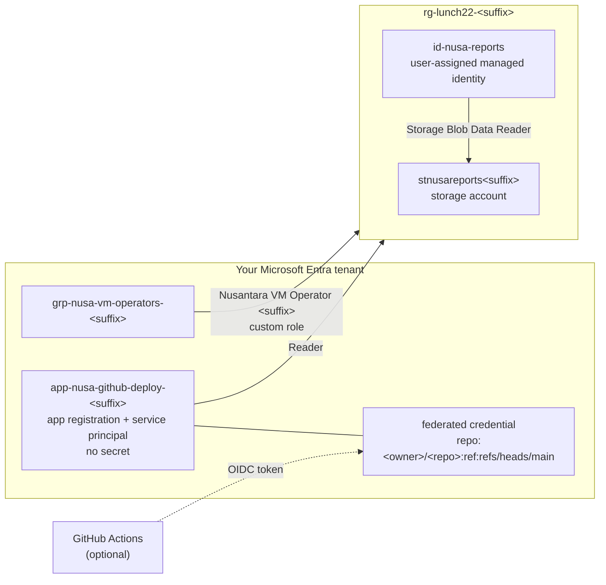

# Lab 22 · Passwordless pipelines and least privilege

> **Pairs with:** [Lunch 22 · Identity and Access (Advanced)](../../lunches/22-identity-access-advanced/README.md)
> **Time:** about 50 minutes · **Cost:** 💲 (see [cost bands](../README.md#cost-bands)) · **Difficulty:** ★★☆
> **Works on its own:** ✅ You do not need any earlier lab. Everything this lab needs is created by its steps.

> [!CAUTION]
> **Use your own tenant and subscription.** This lab creates a custom role, a group and an app registration. You need
> **Owner** on the subscription (to create custom roles and role assignments) and the right to create groups and app
> registrations in Microsoft Entra ID. The tenant that came with your personal free account gives you all of that; a
> company or school tenant usually doesn't — and isn't the place for experiments anyway.

## 🎯 What you'll build

The auditor's findings from the lunch, fixed in miniature. You'll write the **Nusantara VM Operator** custom role from a
JSON file — start, restart and deallocate VMs, nothing else — and assign it to an operators group at resource-group scope.
You'll give a **user-assigned managed identity** a data role on a storage account, so a future reporting app needs no
storage key. And you'll create an **app registration with no secret at all**: its only credential is a federated
credential that trusts GitHub Actions on one repository's main branch. If you have a GitHub repository, you'll watch a
workflow sign in to Azure with OpenID Connect. Conditional Access and PIM need P1 and P2 licences, so they come as a
guided portal tour.



## ✅ Before you start

- An Azure subscription where you are **Owner** (see [Lab 01](../01-before-you-begin/README.md)), in a tenant you own.
- **Azure Cloud Shell (Bash)** — open [shell.azure.com](https://shell.azure.com). Nothing to install; `jq` is included.
- Optional, for Task 7: a **GitHub account** and a repository you own (it can be empty).
- Get the lab files and load the shared settings:

```bash
git clone https://github.com/stefpin/azure-fundamentals-lunches.git   # first time only
cd azure-fundamentals-lunches/labs/22-identity-access-advanced
source ../common/config.sh
RG=$(rg_name 22)
```

> [!IMPORTANT]
> Lab resources cost money while they exist. Finish with the **Clean up** section, even if you stop halfway. The
> storage account costs next to nothing while it's empty, but the custom role, group and app registration live outside
> the resource group, so only `cleanup.sh` removes them.

## 🧭 Choose your mode

| Mode | For you if… | How |
|---|---|---|
| **Guided** | you want every step explained | follow Tasks 1–8 below |
| **Challenge** | you already know the basics | read only the [Challenge brief](#-challenge-brief), build it your way, then run `bash verify.sh` |

## Task 1 · Create the resource group and note your IDs

Custom roles and role assignments are written against resource IDs, so capture the ones you'll need.

```bash
ensure_rg "$RG" 22
SUB_ID=$(az account show --query id --output tsv)
TENANT_ID=$(az account show --query tenantId --output tsv)
RG_ID=$(az group show --name "$RG" --query id --output tsv)
echo "$RG_ID"
```

> ✅ **Checkpoint:** `RG_ID` looks like `/subscriptions/…/resourceGroups/rg-lunch22-<suffix>`.

## Task 2 · Write the custom role

Open [`vm-operator-role.json`](vm-operator-role.json). It lists exactly what a night-shift operator needs: read VMs and
their status, start, restart and deallocate them, and see the resource group. There are no wildcards, no `write`, no
`delete` and no data actions. `AssignableScopes` will hold just the lab resource group, so the role can't be used
anywhere else. Fill in the placeholders and create the role:

```bash
ROLE_NAME="Nusantara VM Operator ${SUFFIX}"
sed -e "s|__SUFFIX__|${SUFFIX}|" -e "s|__SUBSCRIPTION_ID__|${SUB_ID}|" -e "s|__RESOURCE_GROUP__|${RG}|" \
  vm-operator-role.json > my-vm-operator-role.json
cat my-vm-operator-role.json
az role definition create --role-definition @my-vm-operator-role.json --query "{name:roleName, id:name}" --output table
```

The role's name must be unique in your tenant — that's why it ends with your suffix. Look it up at the resource-group
scope, because that's the only place it can be assigned:

```bash
az role definition list --name "$ROLE_NAME" --scope "$RG_ID" \
  --query "[0].{name:roleName, type:roleType, actions:permissions[0].actions, scopes:assignableScopes}" --output json
```

> [!TIP]
> **Prefer the portal?** *rg-lunch22-&lt;suffix&gt; › Access control (IAM) › Add › Add custom role*, then choose
> **Start from JSON** and upload `my-vm-operator-role.json`. The *Permissions* tab lets you search every operation by
> keyword — a good way to discover action names.

> ✅ **Checkpoint:** the role shows `"type": "CustomRole"`, six actions and one assignable scope, your resource group.
> If the lookup returns nothing, wait a minute: new roles take a moment to replicate.

## Task 3 · Assign the custom role to an operators group

Roles go to groups. Create one for the night shift and assign the custom role by its **ID** (a GUID), which keeps
working even if someone renames the role.

```bash
OPS_GROUP="grp-nusa-vm-operators-${SUFFIX}"
OPS_GROUP_ID=$(az ad group create --display-name "$OPS_GROUP" --mail-nickname "$OPS_GROUP" \
  --description "Lab 22: night-shift operators who start, restart and deallocate VMs" --query id --output tsv)
ROLE_GUID=$(az role definition list --name "$ROLE_NAME" --scope "$RG_ID" --query "[0].name" --output tsv)
az role assignment create \
  --assignee-object-id "$OPS_GROUP_ID" \
  --assignee-principal-type Group \
  --role "$ROLE_GUID" \
  --scope "$RG_ID" \
  --output none
az role assignment list --scope "$RG_ID" \
  --query "[].{principal:principalName, role:roleDefinitionName}" --output table
```

If you get `RoleDefinitionDoesNotExist` or *Role … doesn't exist*, the new role hasn't replicated yet: wait a minute and
run the command again.

Can't create groups in your tenant? Assign the role to yourself instead, with
`--assignee-object-id "$(my_object_id)" --assignee-principal-type User`. As Owner it adds nothing to what you can do,
but you'll see the assignment, and `verify.sh` accepts any principal.

> ✅ **Checkpoint:** the table shows your operators group with **Nusantara VM Operator &lt;suffix&gt;**.

## Task 4 · Give a user-assigned managed identity a data role

The reporting app will read sales exports from blob storage. Instead of a storage key in its configuration, it gets an
identity of its own — created as a standalone resource, so it survives when the app's compute is rebuilt.

```bash
az identity create --name id-nusa-reports --resource-group "$RG" --location "$LOCATION" --output none
MI_PRINCIPAL_ID=$(az identity show --name id-nusa-reports --resource-group "$RG" --query principalId --output tsv)

ST_NAME="stnusareports${SUFFIX}"
az storage account create --name "$ST_NAME" --resource-group "$RG" --location "$LOCATION" \
  --sku Standard_LRS --kind StorageV2 --min-tls-version TLS1_2 --allow-blob-public-access false --output none
ST_ID=$(az storage account show --name "$ST_NAME" --resource-group "$RG" --query id --output tsv)

az role assignment create \
  --assignee-object-id "$MI_PRINCIPAL_ID" \
  --assignee-principal-type ServicePrincipal \
  --role "Storage Blob Data Reader" \
  --scope "$ST_ID" \
  --output none
az role assignment list --assignee-object-id "$MI_PRINCIPAL_ID" --all \
  --query "[].{role:roleDefinitionName, scope:scope}" --output table
```

The identity has two IDs: the **principal ID** (its service principal, which receives roles) and the **client ID**,
which code passes to `ManagedIdentityCredential` to choose this identity. *Storage Blob Data Reader* is a **data role**: it
reads blobs, but it can't change the account or list its keys.

> ✅ **Checkpoint:** exactly one row — **Storage Blob Data Reader**, scoped to your storage account.

## Task 5 · Create an app registration with no secret

The pipeline needs an identity too. Create the app registration and its service principal, and give the service
principal **Reader** on the resource group — enough for the sample workflow to list resources.

```bash
APP_NAME="app-nusa-github-deploy-${SUFFIX}"
APP_ID=$(az ad app create --display-name "$APP_NAME" --query appId --output tsv)
az ad sp create --id "$APP_ID" --output none
SP_ID=$(az ad sp show --id "$APP_ID" --query id --output tsv)
az role assignment create \
  --assignee-object-id "$SP_ID" \
  --assignee-principal-type ServicePrincipal \
  --role "Reader" \
  --scope "$RG_ID" \
  --output none
az ad app credential list --id "$APP_ID" --output table
```

`APP_ID` is the **application (client) ID** that GitHub will use. The last command lists the app's client secrets — and
prints nothing, because there are none. Keep it that way.

> [!WARNING]
> `az ad app create` doesn't stop you from creating a second app with the same display name. If you run this task twice,
> look the app up first: `az ad app list --display-name "$APP_NAME" --query "[].appId" --output tsv`.

> ✅ **Checkpoint:** `az ad sp show --id "$APP_ID" --query "{name:displayName, type:servicePrincipalType}" --output table`
> shows your app as type **Application**, and the credential list is empty.

## Task 6 · Add a federated credential for GitHub Actions

Decide which repository Azure should trust. `GITHUB_REPO` is the part of the subject between `repo:` and `:ref:`:

```bash
GITHUB_REPO="<your-github-user>/<your-repo>"          # a repository you own
# No GitHub account? Use a name only you know, so nothing can ever match it:
# GITHUB_REPO="nusa-lab-${SUFFIX}/storefront"
```

> [!IMPORTANT]
> GitHub repositories created after **July 15, 2026** use an *immutable* subject that adds numeric IDs, for example
> `repo:octo-learner@1234567/storefront@891011:ref:refs/heads/main`. Older repositories keep the classic
> `repo:owner/repo` form unless their owner opted in. For a public repository, this prints the immutable form:
>
> ```bash
> curl -s "https://api.github.com/repos/${GITHUB_REPO}" | jq -r '"\(.owner.login)@\(.owner.id)/\(.name)@\(.id)"'
> ```
>
> If your repository uses that format, set `GITHUB_REPO` to the printed value. Unsure? Use the classic form now; Task 7
> shows you the exact subject if it doesn't match.

Now look at [`federated-credential.json`](federated-credential.json) — issuer, subject and audience — fill in the
repository and create the credential:

```bash
sed "s|__GITHUB_REPO__|${GITHUB_REPO}|" federated-credential.json > my-federated-credential.json
cat my-federated-credential.json
az ad app federated-credential create --id "$APP_ID" --parameters my-federated-credential.json --output none
az ad app federated-credential list --id "$APP_ID" \
  --query "[].{name:name, issuer:issuer, subject:subject, audiences:join(',', audiences)}" --output table
```

> [!TIP]
> **Prefer the portal?** *Microsoft Entra admin center › App registrations › app-nusa-github-deploy-&lt;suffix&gt; ›
> Certificates & secrets › Federated credentials › Add credential*, scenario **GitHub Actions deploying Azure
> resources**. The portal builds the subject from organisation, repository and entity type (branch, environment, pull
> request or tag).

> ✅ **Checkpoint:** one credential, `github-main-branch`, with issuer `https://token.actions.githubusercontent.com`,
> your subject, and audience `api://AzureADTokenExchange`.

## Task 7 · (Optional) Sign in from GitHub Actions without a secret

Do this if `GITHUB_REPO` is a real repository of yours.

1. Print the values the workflow needs:

   ```bash
   echo "AZURE_CLIENT_ID=$APP_ID"; echo "AZURE_TENANT_ID=$TENANT_ID"
   echo "AZURE_SUBSCRIPTION_ID=$SUB_ID"; echo "AZURE_RESOURCE_GROUP=$RG"
   ```

2. In GitHub, open the repository's **Settings › Secrets and variables › Actions**. Add three **repository secrets**
   (`AZURE_CLIENT_ID`, `AZURE_TENANT_ID`, `AZURE_SUBSCRIPTION_ID`) and, on the **Variables** tab, one **repository
   variable** (`AZURE_RESOURCE_GROUP`). The IDs aren't secrets; storing them as secrets just keeps them out of logs.
3. On the **main** branch, create `.github/workflows/azure-oidc.yml` with the contents of
   [`github-workflow-example.yml`](github-workflow-example.yml). Note `permissions: id-token: write` and the
   `azure/login@v3` step with only three IDs — no `client-secret`.
4. The commit to main starts the workflow (or use **Actions › Azure OIDC sign-in (Lab 22) › Run workflow** on main).
   The sign-in step succeeds, and the next step lists `id-nusa-reports` and your storage account.
5. Now create a branch called `feature/test` and run the workflow there. The sign-in fails with
   `AADSTS700213: No matching federated identity record found for presented assertion subject …` — the subject ends in
   `refs/heads/feature/test`, and nothing trusts it. That refusal is the security boundary working.

> ✅ **Checkpoint:** a green run on `main` and a red sign-in on `feature/test`. If `main` fails with `AADSTS700213` too,
> copy the subject from the error message (it shows which format your repository uses) and fix `GITHUB_REPO` in Task 6.

## Task 8 · (Read-only tour) Conditional Access and PIM

Conditional Access needs **Microsoft Entra ID P1**, and Privileged Identity Management and the full access-review
feature set need **Microsoft Entra ID P2** or **Microsoft Entra ID Governance**. Microsoft's Entra product pages offer
free trials; read the current trial terms first, and remember that when a trial ends, eligible PIM assignments are
removed. Without these licences you can still open the pages and read along; you just can't create
policies or eligible assignments. Nothing in this task is checked by `verify.sh`.

**Conditional Access** — *Microsoft Entra admin center › Entra ID › Conditional Access › Policies › New policy*:

1. **Name:** *Contractors · Azure management · require MFA*.
2. **Users:** include a contractors group; **exclude** your emergency-access accounts.
3. **Target resources:** the cloud app that represents Azure management (search for *Azure* in the picker).
4. **Grant:** *Grant access* › *Require multifactor authentication*. **Session:** *Sign-in frequency* 8 hours.
5. **Enable policy: Report-only** › **Create**. Then open *Sign-in logs* and a sign-in's **Report-only** tab, and try the
   **What If** tool on the policy list, to see what the policy *would* have done.

**Privileged Identity Management** — *Microsoft Entra admin center › ID Governance › Privileged Identity Management ›
Azure resources*, then select your subscription and `rg-lunch22-<suffix>`:

1. **Settings › Owner › Edit:** set *Activation maximum duration* (1–24 hours), require MFA and a justification on
   activation, and require approval with at least two approvers.
2. **Assignments › Add assignments:** role **Owner**, a member, assignment type **Eligible**, with an end date.
3. As that member, open *My roles › Azure resources* and **Activate** — then watch the assignment become active and
   expire.

**Access reviews** — *ID Governance › Access reviews › New access review*: review the members of a contractors group
every quarter, let the group owners decide, and apply results automatically.

> ✅ **Checkpoint:** you can explain why every Conditional Access policy starts in report-only with emergency accounts
> excluded, and what changes when a role is *eligible* instead of *active*.

## 🔧 Break it and fix it

**Scope creep in a custom role.** Dewi says the operator role is "too fiddly" and asks you to "just add
`Microsoft.Compute/virtualMachines/*` so it always works". Do it:

```bash
jq '.Actions += ["Microsoft.Compute/virtualMachines/*"]' my-vm-operator-role.json > my-vm-operator-role-broken.json
az role definition update --role-definition @my-vm-operator-role-broken.json --output none
bash verify.sh
```

**Symptom:** after a minute, `verify.sh` fails *Grants no wildcard, write or delete actions*. The wildcard quietly added
`write` and `delete` — the operator could now resize or delete the storefront VM — plus every VM operation Microsoft
adds in the future.

<details><summary>Hint: how to fix it</summary>

Put the original definition back. `az role definition update` finds the role by the name in the file and replaces its
permissions:

```bash
az role definition update --role-definition @my-vm-operator-role.json --output none
az role definition list --name "$ROLE_NAME" --scope "$RG_ID" --query "[0].permissions[0].actions" --output tsv
```

Lesson: list operations explicitly. If an operator really needs more, add the one action they need — not a wildcard.

</details>

## 🧪 Verify your work

```bash
bash verify.sh
```

Every check should say **PASS**. If one fails, the message tells you which task to revisit.

## 🧹 Clean up (do not skip!)

```bash
bash cleanup.sh
```

In a safe order, this removes the custom role's assignments and then the role (a custom role can't be deleted while
it's assigned), the app registration with its service principal and federated credential (and purges it from *Deleted
applications*), the managed identity and its role assignment, the operators group, the resource group
`rg-lunch22-<suffix>` with the storage account, and the generated `my-*.json` files. Deletion of the resource group
continues in the background for a few minutes. If you did Task 7, also delete the workflow file, secrets and variable
from your GitHub repository.

## 🩺 Troubleshooting

| Symptom | Likely cause | Fix |
|---|---|---|
| `RoleDefinitionDoesNotExist`, or *Role 'Nusantara VM Operator …' doesn't exist* | The new custom role hasn't replicated yet, or you looked it up at the wrong scope | Wait a minute; look it up with `--scope "$RG_ID"`; assign it by `ROLE_GUID` |
| An error that a role with the same name already exists | You created the role in an earlier attempt | Skip the create command and carry on from the lookup, or use `az role definition update` |
| `There are existing role assignments referencing role (code: RoleDefinitionHasAssignments)` | You tried to delete the custom role while it was still assigned | Remove its assignments first — `cleanup.sh` does it in that order |
| `MissingSubscriptionRegistration` mentioning `Microsoft.ManagedIdentity` | The resource provider isn't registered in a new subscription | `az provider register --namespace Microsoft.ManagedIdentity --wait`, then retry |
| `The storage account named stnusareports… is already taken.` | Storage names are global and someone has it | Use another name, for example `ST_NAME="stnusarpt${SUFFIX}"`; `verify.sh` accepts any storage account in the group |
| `Insufficient privileges to complete the operation.` creating the group or app | You can't create directory objects in this tenant | Use the tenant of your personal free account |
| `PrincipalNotFound … does not exist in the directory` | The new service principal or group hasn't replicated yet | Wait a minute and retry; keep `--assignee-principal-type` |
| GitHub: `AADSTS700213: No matching federated identity record found for presented assertion subject …` | The subject doesn't match: wrong branch, an `environment:` job, or the immutable format | Copy the subject from the error and create a credential with exactly that value |
| GitHub: an error mentioning `ACTIONS_ID_TOKEN_REQUEST_URL` or id-token permissions | The workflow lacks `permissions: id-token: write` | Add the `permissions` block from the sample file |
| GitHub: *No subscriptions found for …* | The service principal has no role yet, or it hasn't applied | Check Task 5's Reader assignment and wait a few minutes |

## 🚀 Stretch goals

- **Production-grade subject:** add a second federated credential with the subject `repo:<owner>/<repo>:environment:production`,
  create a GitHub environment called *production* with a required reviewer, and add `environment: production` to the job.
- **Federation without an app registration:** put the trust on the managed identity instead —
  `az identity federated-credential create --name github-main --identity-name id-nusa-reports --resource-group "$RG" --issuer https://token.actions.githubusercontent.com --subject "repo:${GITHUB_REPO}:ref:refs/heads/main" --audiences api://AzureADTokenExchange`
  — and use the identity's client ID in the workflow. Remove it again before you clean up.
- **Use the identity for real:** attach `id-nusa-reports` to a small compute resource you create in this resource group
  (for example a container instance), upload a blob as yourself, and read it from that resource after
  `az login --identity --client-id <the identity's client ID>` — no key in sight.
- **Test the custom role:** add a test user to the operators group (Lab 05 shows how to create one), create a cheap VM in
  the resource group as yourself (💲💲 while it runs), and check that the operator can restart it but not delete it.

## 🏁 Challenge brief

Build the following, any way you like (portal, CLI, Bicep), in your own tenant and subscription:

1. A resource group `rg-lunch22-<suffix>` tagged `course=azure-fundamentals-lunches` and `lunch=22`.
2. A custom role `Nusantara VM Operator <suffix>` that allows reading, starting, restarting and deallocating virtual
   machines, with no wildcard, `write` or `delete` actions and no data actions, assignable **only** at that resource
   group — and assigned to at least one principal there.
3. A user-assigned managed identity `id-nusa-reports` in the resource group, holding **Storage Blob Data Reader** on a
   storage account in the same group, and no other role.
4. An app registration `app-nusa-github-deploy-<suffix>` with a service principal, **no** client secrets or certificates,
   **Reader** on the resource group, and a federated credential with issuer `https://token.actions.githubusercontent.com`,
   audience `api://AzureADTokenExchange` and subject `repo:<owner>/<repo>:ref:refs/heads/main`.

Then run `bash verify.sh`. Stuck? Peek at `solution.sh` or switch to Guided mode.

---

⬅️ [Lunch 22 reading](../../lunches/22-identity-access-advanced/README.md) · 🏠 [All labs](../README.md) · 🏠 [Course home](../../README.md)

<sub>Last validated: October 2026 · Something broken? [Report a lab problem](../../CONTRIBUTING.md).</sub>
