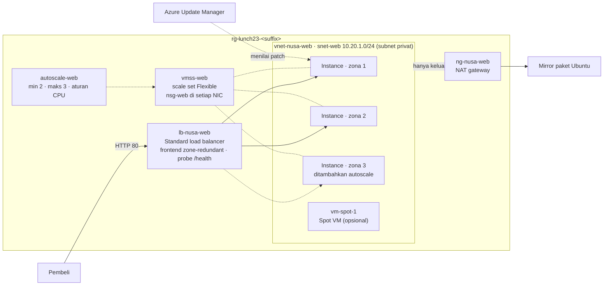

# Lab 23 · Siap menghadapi promo 12.12

🇬🇧 [Read in English](README.md)

> **Pasangan dari:** [Makan Siang 23 · Virtual Machines (Lanjutan)](../../lunches/23-virtual-machines-advanced/README.id.md)
> **Waktu:** sekitar 60 menit · **Biaya:** 💲💲 (lihat [kelompok biaya](../README.id.md#kelompok-biaya)) · **Tingkat kesulitan:** ★★☆
> **Bisa dikerjakan terpisah:** ✅ Anda tidak memerlukan lab sebelumnya. Semua yang dibutuhkan lab ini dibuat oleh langkah-langkahnya sendiri atau oleh `setup.sh`.
> **Penulis:** Stefanus Pinarta · [Tentang penulis](../../README.id.md#tentang-penulis)

## 🎯 Yang akan Anda bangun

Toko online Nusantara Retail sudah terlalu besar untuk satu VM. Anda membangun **scale set Flexible** bernama `vmss-web`
yang menyebarkan instance-nya ke availability zone 1, 2, dan 3, di belakang Standard load balancer `lb-nusa-web` yang
disiapkan oleh `setup.sh`. Setiap instance menjalankan web server kecil milik kursus ini dari cloud-init dan hanya bisa
menjangkau internet lewat NAT gateway — akses keluar yang eksplisit. **Autoscale** menjaga jumlah instance antara dua
dan tiga, tergantung CPU: Anda menciptakan "serbuan 12.12" sendiri dengan skrip beban, lalu menyaksikan Azure menambah
satu instance di zona yang masih kosong dan membuangnya lagi setelah cool-down. Sebagai penutup, Anda memeriksa patch
yang belum terpasang dengan **Azure Update Manager**, secara opsional menyaksikan **Spot VM** di-evict, dan memperbaiki
gangguan yang baru ketahuan pada hari patch. Lab ini berjalan di `$LOCATION` (default-nya Southeast Asia); desain
produksi di bacaan memakai Indonesia Central.



## ✅ Sebelum mulai

- Subscription Azure tempat Anda bisa membuat resource (lihat [Lab 01](../01-before-you-begin/README.id.md)).
- **Azure Cloud Shell (Bash)** — buka [shell.azure.com](https://shell.azure.com). Tidak ada yang perlu dipasang.
- Ambil file lab, muat pengaturan bersama, dan tetapkan ukuran scale set untuk lab ini:

```bash
git clone https://github.com/stefpin/azure-fundamentals-lunches.git   # first time only
cd azure-fundamentals-lunches/labs/23-virtual-machines-advanced
source ../common/config.sh
RG=$(rg_name 23)
export INSTANCES=2 AS_MIN=2 AS_MAX=3
echo "Resource group: $RG · region: $LOCATION · size: $VM_SIZE_SMALL · image: $VM_IMAGE"
```

- Buat titik awalnya — sekitar 3 menit:

```bash
bash setup.sh
```

`setup.sh` lebih dulu memeriksa bahwa `$VM_SIZE_SMALL` tersedia di ketiga zona region Anda dan bahwa kuota vCPU Anda
cukup untuk batas maksimum autoscale. Setelah itu ia membuat virtual network dengan subnet privat, NAT gateway, network
security group `nsg-web`, dan load balancer beserta probe `/health`-nya. Scale set-nya sendiri adalah tugas Anda.

- **Perhatikan kuota vCPU Anda.** Setiap instance memakai ukuran lab default `Standard_B2ats_v2` (2 vCPU). Dengan
  pengaturan default, scale set menjalankan 2 instance dan paling banyak 3 selama uji beban — hingga **6 vCPU**.
  `setup.sh` memeriksa kuota Anda sebelum membangun apa pun.

> [!WARNING]
> **Kuota kecil?** Free trial sering hanya mengizinkan 4 vCPU per region. Jika `setup.sh` melaporkan kuota tidak cukup,
> pakai pengaturan kuota kecil di bawah ini lalu jalankan `bash setup.sh` lagi untuk memeriksa ulang. Semua tugas
> berjalan dengan cara yang sama; karena hanya ada satu instance di awal, Anda baru melihat zona kedua setelah scale-out.
> (Ukuran lama seperti `Standard_B1s` bukan pilihan: subscription baru tidak bisa lagi men-deploy seri B v1.)
>
> | Pengaturan | Default | Pengaturan kuota kecil |
> |---|---|---|
> | `VM_SIZE_SMALL` | `Standard_B2ats_v2` (2 vCPU) | `Standard_B2ats_v2` (2 vCPU) |
> | `INSTANCES` / `AS_MIN` / `AS_MAX` | 2 / 2 / 3 | 1 / 1 / 2 |
> | vCPU terbanyak sekaligus | 6 | 4 |
>
> ```bash
> export INSTANCES=1 AS_MIN=1 AS_MAX=2
> ```

> [!IMPORTANT]
> Resource lab memakan biaya selama masih ada — NAT gateway dan kedua IP publik ditagih per jam walaupun tidak ada
> instance yang berjalan. Akhiri dengan bagian **Bersihkan**, walaupun Anda berhenti di tengah jalan.

> [!TIP]
> Cloud Shell terputus setelah sekitar 20 menit tanpa input dan melupakan variabel Anda. Jika itu terjadi, `cd` kembali
> ke folder lab lalu jalankan lagi baris `source`, `RG=`, dan `export` — serta `LB_IP=` dari Tugas 3.

## 🧭 Pilih mode Anda

| Mode | Cocok untuk Anda jika… | Caranya |
|---|---|---|
| **Terpandu** | Anda ingin setiap langkah dijelaskan | ikuti Tugas 1–7 di bawah |
| **Tantangan** | Anda sudah menguasai dasarnya | baca hanya [Ringkasan tantangan](#-ringkasan-tantangan), bangun dengan cara Anda sendiri, lalu jalankan `bash verify.sh` |

## Tugas 1 · Melihat titik awal

`setup.sh` sudah membangun jaringan di sekitar scale set agar lab ini bisa fokus pada VM. Luangkan dua menit untuk
melihat ke mana instance nanti akan tersambung.

```bash
az resource list -g "$RG" --query "[].{type:type, name:name}" -o table

az network vnet subnet show -g "$RG" --vnet-name vnet-nusa-web -n snet-web \
  --query "{prefix:addressPrefix, natGateway:natGateway.id, defaultOutboundAccess:defaultOutboundAccess, subnetNsg:networkSecurityGroup.id}" \
  -o yaml

az network lb probe list -g "$RG" --lb-name lb-nusa-web \
  --query "[].{name:name, protocol:protocol, port:port, path:requestPath}" -o table

az network lb rule list -g "$RG" --lb-name lb-nusa-web \
  --query "[].{name:name, frontendPort:frontendPort, backendPort:backendPort, outboundSnatDisabled:disableOutboundSnat}" -o table
```

Tiga detail ini akan penting nanti:

- Subnet-nya **privat** (`defaultOutboundAccess: false`) dan jalan keluarnya yang eksplisit adalah **NAT gateway**.
  Instance scale set Flexible memang tidak pernah mendapat akses keluar bawaan, jadi tanpa NAT gateway mereka tidak bisa
  menjangkau mirror Ubuntu (server cermin tempat paket Ubuntu diunduh).
- **Tidak ada NSG di subnet** (`subnetNsg: null`). Scale set akan memasang `nsg-web`, yang mengizinkan HTTP dari
  internet, pada network interface setiap instance. Standard load balancer tertutup untuk lalu lintas masuk sampai ada
  NSG (network security group, kumpulan aturan firewall) yang mengizinkannya.
- Load-balancing rule-nya **menonaktifkan outbound SNAT** (*source network address translation* untuk koneksi keluar):
  load balancer hanya menangani lalu lintas masuk. Probe-nya menanyakan `/health` di port 80 ke setiap instance — web
  server cloud-init bersama menjawab `ok` di sana.

> ✅ **Pemeriksaan:** daftar resource menampilkan enam resource: dua alamat IP publik (`pip-lb-web`, `pip-ng-web`), NAT
> gateway `ng-nusa-web`, virtual network, network security group, dan load balancer. Tabel probe menampilkan
> `probe-health` pada HTTP port 80 dengan path `/health`.

## Tugas 2 · Membuat scale set Flexible di tiga zona

Satu perintah membuat scale set, instance-nya, disk dan network interface mereka, lalu memasukkan instance ke backend
pool load balancer. Prosesnya memakan waktu tiga sampai lima menit.

```bash
az vmss create \
  --resource-group "$RG" \
  --name vmss-web \
  --location "$LOCATION" \
  --orchestration-mode Flexible \
  --image "$VM_IMAGE" \
  --vm-sku "$VM_SIZE_SMALL" \
  --instance-count "$INSTANCES" \
  --zones 1 2 3 \
  --platform-fault-domain-count 1 \
  --vnet-name vnet-nusa-web \
  --subnet snet-web \
  --nsg nsg-web \
  --lb lb-nusa-web \
  --backend-pool-name bep-web \
  --custom-data "$AZL_COMMON_DIR/cloud-init-web.yml" \
  --admin-username "$ADMIN_USER" \
  --generate-ssh-keys \
  --storage-sku StandardSSD_LRS \
  --upgrade-policy-mode Manual \
  --output none
```

| Opsi | Alasan |
|---|---|
| `--orchestration-mode Flexible` | Setiap instance adalah VM biasa. Flexible sudah menjadi default CLI; menuliskannya secara eksplisit mendokumentasikan pilihan yang tidak bisa diubah belakangan |
| `--zones 1 2 3` | Instance disebar ke tiga pusat data; Azure berusaha menjaga keseimbangan antar-zona saat set membesar dan mengecil |
| `--platform-fault-domain-count 1` | *Max spreading*: di dalam setiap zona, Azure menyebar instance ke sebanyak mungkin fault domain — pengaturan yang direkomendasikan bersama zona |
| `--vm-sku "$VM_SIZE_SMALL"` | Ukuran setiap instance dalam model (default-nya `Standard_B2ats_v2`) |
| `--nsg nsg-web` | NSG yang sudah ada dipasang di network interface setiap instance, sehingga HTTP dari internet diizinkan |
| `--lb lb-nusa-web --backend-pool-name bep-web` | Instance baru — termasuk yang nanti ditambahkan autoscale — otomatis bergabung ke backend pool |
| `--custom-data …/cloud-init-web.yml` | cloud-init menyalakan web server kecil di port 80 yang menampilkan nama host dan zona, plus `/health` |
| `--upgrade-policy-mode Manual` | Perubahan model baru sampai ke instance lama ketika Anda meng-upgrade-nya; instance baru selalu memakai model terbaru |

Tidak ada IP publik dan tidak ada aturan SSH: sebagai gantinya, Anda akan menjalankan perintah di dalam instance dengan
**Run Command**. Sekarang lihat scale set dan instance-nya:

```bash
az vmss show -g "$RG" -n vmss-web \
  --query "{mode:orchestrationMode, zones:join(',', zones), faultDomains:platformFaultDomainCount, size:sku.name, capacity:sku.capacity}" -o table

az vm list -g "$RG" -d \
  --query "[?virtualMachineScaleSet].{name:name, zone:zones[0], size:hardwareProfile.vmSize, power:powerState, privateIp:privateIps}" -o table
```

Karena instance Flexible adalah VM biasa, `az vm list` menampilkannya, dan setiap perintah `az vm` yang Anda pelajari di
Lab 06 bisa dipakai pada mereka.

> [!TIP]
> **Lebih suka portal?** *Home › Virtual Machine Scale Sets › Create.* Di tab **Basics**: resource group Anda, nama
> `vmss-web`, region Anda, availability zones *1, 2, 3*, orchestration mode *Flexible*, security type *Trusted launch
> virtual machines*, scaling mode *Manual* dengan instance count 2, image *Ubuntu Server 24.04 LTS – x64 Gen2*, ukuran
> pilihan Anda, username `azureuser`, dan *Use existing public key* (tempelkan hasil `cat ~/.ssh/id_rsa.pub`). Di tab
> **Networking**: virtual network `vnet-nusa-web`; edit network interface agar memakai subnet `snet-web`, opsi NSG
> advanced dengan `nsg-web`, dan tanpa IP publik; di bagian *Load balancing* pilih *Azure load balancer*,
> `lb-nusa-web`, dan backend pool `bep-web`. Di tab **Advanced**: tempelkan isi `labs/common/cloud-init-web.yml` ke
> *Custom data*. Lalu **Review + create**.

> ✅ **Pemeriksaan:** scale set menampilkan mode `Flexible`, zona `1,2,3`, dan fault domain `1`. Daftar VM menampilkan
> `$INSTANCES` instance yang namanya diawali `vmss-web_`, masing-masing berstatus `VM running`, di zona yang berbeda-beda.

## Tugas 3 · Menguji lewat load balancer

Pembeli hanya pernah melihat alamat load balancer. Mintalah halaman darinya beberapa kali:

```bash
LB_IP=$(az network public-ip show -g "$RG" -n pip-lb-web --query ipAddress -o tsv)
echo "http://$LB_IP/"
for i in {1..8}; do
  curl -s -m 5 "http://$LB_IP/" | grep -o 'Served by.*' | sed -e 's/<[^>]*>//g'
done
curl -s "http://$LB_IP/health"
```

Setiap `curl` membuka koneksi baru, dan load balancer membagi koneksi ke instance yang sehat, sehingga jawabannya
bergantian antara beberapa nama host — dan beberapa zona. Baris terakhir mencetak `ok`, jawaban yang diterima health
probe setiap beberapa detik. Buka juga alamat itu di browser Anda.

Jika belum ada yang tercetak, tunggu satu menit: cloud-init masih menyalakan web server, dan load balancer tidak
mengirim lalu lintas ke sebuah instance sampai probe `/health`-nya berhasil.

> ✅ **Pemeriksaan:** Anda melihat baris seperti `Served by <host name> in availability zone 1.` dari dua host berbeda
> di dua zona berbeda (satu host jika memakai pengaturan kuota kecil), dan `/health` mengembalikan `ok`.

## Tugas 4 · Menambahkan aturan autoscale

Autoscale adalah pengaturan Azure Monitor yang dipasang pada scale set. Buat pengaturannya dengan batas jumlah
instance, lalu tambahkan satu aturan untuk scale-out dan satu untuk scale-in:

```bash
az monitor autoscale create \
  --resource-group "$RG" \
  --resource vmss-web \
  --resource-type Microsoft.Compute/virtualMachineScaleSets \
  --name autoscale-web \
  --min-count "$AS_MIN" --max-count "$AS_MAX" --count "$AS_MIN" \
  --output none

az monitor autoscale rule create -g "$RG" --autoscale-name autoscale-web \
  --condition "Percentage CPU > 70 avg 5m" --scale out 1 --cooldown 5 --output none

az monitor autoscale rule create -g "$RG" --autoscale-name autoscale-web \
  --condition "Percentage CPU < 30 avg 5m" --scale in 1 --cooldown 5 --output none
```

Bacalah aturan pertama seperti mesin autoscale membacanya: *jika rata-rata Percentage CPU di seluruh scale set selama
lima menit terakhir berada di atas 70%, tambahkan satu instance, lalu tunggu lima menit sebelum aturan ini boleh
bertindak lagi*. Jarak lebar antara 70% dan 30% mencegah set mengalami flapping, dan batas maksimum tiga menjaga Anda
tetap di dalam kuota vCPU yang kecil. Periksa apa yang sudah Anda bangun:

```bash
az monitor autoscale show -g "$RG" -n autoscale-web \
  --query "{enabled:enabled, minimum:profiles[0].capacity.minimum, maximum:profiles[0].capacity.maximum, default:profiles[0].capacity.default}" -o table

az monitor autoscale rule list -g "$RG" --autoscale-name autoscale-web \
  --query "[].{metric:metricTrigger.metricName, operator:metricTrigger.operator, threshold:metricTrigger.threshold, window:metricTrigger.timeWindow, direction:scaleAction.direction, change:scaleAction.value, cooldown:scaleAction.cooldown}" -o table
```

> [!TIP]
> **Lebih suka portal?** *vmss-web › Scaling › Custom autoscale.* Pilih *Scale based on a metric*, tetapkan batas
> instance (minimum 2, maksimum 3, default 2), lalu *Add a rule*: Percentage CPU, greater than 70, durasi 5 menit,
> *Increase count by* 1, cool down 5 menit. Tambahkan aturan kedua: less than 30, *Decrease count by* 1. **Save**. Portal
> memberi nama pengaturan itu untuk Anda; `verify.sh` menemukannya lewat scale set.

> ✅ **Pemeriksaan:** autoscale aktif dengan minimum `$AS_MIN` dan maksimum `$AS_MAX`, dan tabel aturan menampilkan dua
> aturan `Percentage CPU` — `GreaterThan` 70 dengan arah `Increase`, dan `LessThan` 30 dengan arah `Decrease` —
> masing-masing mengubah jumlah sebanyak 1, dengan jendela waktu dan cool-down lima menit (`PT5M`).

## Tugas 5 · Menciptakan serbuan 12.12 dan menyaksikan autoscale

Pembeli sungguhan sulit dipanggil pada jam makan siang, jadi kita palsukan saja serbuannya:
[`load-cpu.sh`](load-cpu.sh) membuat setiap vCPU sebuah instance sibuk selama 15 menit, lalu berhenti sendiri. Run
Command menyalinnya ke setiap instance dan menjalankannya di sana:

```bash
for vm in $(az vm list -g "$RG" --query "[?virtualMachineScaleSet].name" -o tsv); do
  az vm run-command invoke -g "$RG" -n "$vm" --command-id RunShellScript \
    --scripts @load-cpu.sh --parameters 900 --query "value[0].message" -o tsv
done
```

Setiap instance menjawab `CPU load started on … for 900 seconds`. Sekarang pantau rata-rata CPU dan jumlah instance
setiap menit (tekan **Ctrl+C** untuk berhenti memantau):

```bash
VMSS_ID=$(az vmss show -g "$RG" -n vmss-web --query id -o tsv)
while true; do
  cpu=$(az monitor metrics list --resource "$VMSS_ID" --metric "Percentage CPU" --interval PT1M \
        --aggregation Average --offset 1h \
        --query "value[0].timeseries[0].data[?average] | [-1].average" -o tsv)
  count=$(az vm list -g "$RG" --query "length([?virtualMachineScaleSet])" -o tsv)
  printf '%s  average CPU: %5.1f%%  instances: %s\n' "$(date +%H:%M)" "${cpu:-0}" "$count"
  sleep 60
done
```

Yang bisa Anda harapkan (waktunya bisa meleset beberapa menit):

| Menit sejak beban dimulai | Yang terjadi |
|---|---|
| 0–3 | CPU naik ke sekitar 100% di setiap instance; metrik tertinggal satu sampai tiga menit |
| sekitar 6–10 | Rata-rata lima menit melewati 70%, sehingga autoscale menambah satu instance. Jumlah instance sudah naik selagi VM baru masih dibuat |
| sekitar 10–13 | Instance baru berjalan — biasanya di zona yang belum punya instance — dan mendapat lalu lintas dari load balancer begitu `/health` menjawab |
| 15 | Beban berhenti dengan sendirinya |
| sekitar 20–25 | Rata-rata lima menit berada di bawah 30% dan cool-down sudah selesai, sehingga autoscale membuang satu instance |

Perhatikan bahwa rata-rata turun saat instance baru datang — menjadi sekitar 67% dengan pengaturan default, sekitar 50%
dengan pengaturan kuota kecil — karena instance baru itu tidak punya beban sendiri.
Di toko sungguhan, load balancer akan mengirimkan pembeli kepadanya, dan semua instance akan ikut mendingin. Jalankan
lagi loop `curl` dari Tugas 3 untuk melihat nama host yang baru.

Autoscale mencatat setiap keputusannya. Tanyakan ke activity log, atau buka *vmss-web › Scaling › Run history* di
portal:

```bash
az monitor activity-log list -g "$RG" --offset 1h \
  --query "[?category.value=='Autoscale'].{time:eventTimestamp, operation:operationName.localizedValue, status:status.localizedValue}" -o table
```

**Sambil menunggu** scale-in, kerjakan Tugas 6. Ingin lebih cepat? Hentikan bebannya sekarang — scale-in menyusul sekitar
sepuluh menit kemudian:

```bash
for vm in $(az vm list -g "$RG" --query "[?virtualMachineScaleSet].name" -o tsv); do
  az vm run-command invoke -g "$RG" -n "$vm" --command-id RunShellScript \
    --scripts @load-cpu.sh --parameters stop --query "value[0].message" -o tsv
done
```

> [!NOTE]
> **Kredit burstable.** Instance seri B mengumpulkan kredit CPU selama menganggur dan menghabiskannya saat bekerja di
> atas baseline-nya — mirip token listrik prabayar yang terisi saat hemat dan terkuras saat boros. Instance yang baru
> dibuat hanya membawa saldo kecil, jadi jika Anda mengulang uji beban beberapa kali, kreditnya habis: CPU lalu dibatasi
> di baseline, dan autoscale mungkin hanya melihat CPU yang *sedang-sedang saja* padahal instance sedang kewalahan —
> jebakan yang dibahas di bacaan. Metrik *CPU Credits Remaining* menunjukkan berapa sisa kreditnya.

> ✅ **Pemeriksaan:** loop pemantau menunjukkan jumlah instance naik dari `$AS_MIN` ke `$AS_MAX`, lalu kemudian kembali
> ke `$AS_MIN`. Activity log (atau Run history) mencantumkan satu scale-up dan satu scale-down.

## Tugas 6 · Menilai patch dengan Azure Update Manager

Mem-patch armada secara manual tidak akan sanggup mengimbangi pertumbuhan, dan instance yang ditambahkan autoscale
semalam sama rentannya dengan instance pertama. Azure Update Manager memeriksa update yang belum terpasang pada mesin
sesuai permintaan atau setiap 24 jam (periodic assessment), lalu memasangnya saat itu juga atau dalam maintenance
window. Nilailah instance pertama — prosesnya dua sampai lima menit:

```bash
FIRST_VM=$(az vm list -g "$RG" --query "[?virtualMachineScaleSet].name | [0]" -o tsv)
az vm assess-patches -g "$RG" -n "$FIRST_VM" \
  --query "{status:status, criticalAndSecurity:criticalAndSecurityPatchCount, other:otherPatchCount, rebootPending:rebootPending, examples:availablePatches[:5].name}" \
  -o yaml
```

Assessment berjalan *di dalam* instance: ia menyegarkan daftar paket dari mirror Ubuntu — lewat NAT gateway — lalu
membandingkannya dengan paket yang sudah terpasang. Berapa banyak update yang Anda lihat bergantung pada umur image
Marketplace; nol pun jawaban yang sah.

> [!TIP]
> **Lebih suka portal?** *Azure Update Manager › Machines*, filter berdasarkan resource group Anda, pilih satu instance,
> lalu **Check for updates**. Setelah selesai, kolom *Updates* menampilkan jumlahnya dan halaman instance mencantumkan
> setiap update. Buka **Schedule updates** untuk melihat bagaimana sebuah maintenance configuration (misalnya *Selasa
> 02.00 WIB*) akan mem-patch seluruh armada — lalu tutup tanpa menyimpan.

> ✅ **Pemeriksaan:** statusnya `Succeeded` (atau `CompletedWithWarnings`), dan Anda bisa menyebutkan berapa update kritis
> dan update keamanan yang belum terpasang di instance itu.

## Tugas 7 · (Opsional) Spot VM dan simulasi eviction

Spot VM murah karena Azure bisa mengambilnya kembali. Kerjakan tugas ini **setelah scale set kembali ke `$AS_MIN`
instance**, agar Anda tetap di 4 vCPU atau kurang. Spot tidak mendukung ukuran seri B, memakai kuota vCPU tersendiri,
dan tidak tersedia di semua jenis subscription (subscription free trial dan pelajar mungkin tidak memilikinya). Periksa
dulu kuota Spot Anda:

```bash
az vm list-usage -l "$LOCATION" \
  --query "[?contains(localName, 'Low-priority') || contains(localName, 'Spot')].{quota:localName, used:currentValue, limit:limit}" -o table
```

Jika limit-nya minimal 2, buat Spot VM di subnet yang sama, tanpa IP publik:

```bash
SPOT_SIZE=${SPOT_SIZE:-Standard_D2as_v5}
az vm create \
  --resource-group "$RG" --name vm-spot-1 --location "$LOCATION" \
  --image "$VM_IMAGE" --size "$SPOT_SIZE" \
  --priority Spot --eviction-policy Deallocate --max-price -1 \
  --vnet-name vnet-nusa-web --subnet snet-web --nsg "" --public-ip-address "" \
  --os-disk-delete-option Delete --nic-delete-option Delete \
  --admin-username "$ADMIN_USER" --generate-ssh-keys --storage-sku StandardSSD_LRS --output table

az vm show -g "$RG" -n vm-spot-1 \
  --query "{priority:priority, evictionPolicy:evictionPolicy, maxPrice:billingProfile.maxPrice}" -o table
```

`--max-price -1` berarti "jangan pernah usir saya karena harga, dan jangan pernah tagih lebih dari harga reguler".
`--eviction-policy Deallocate` mempertahankan disk saat VM di-evict. Sekarang berperanlah sebagai Azure dan ambil kembali
kapasitasnya:

```bash
az vm simulate-eviction -g "$RG" -n vm-spot-1
for i in {1..40}; do
  state=$(az vm get-instance-view -g "$RG" -n vm-spot-1 \
    --query "instanceView.statuses[?starts_with(code, 'PowerState/')].displayStatus | [0]" -o tsv)
  echo "$(date +%H:%M:%S)  $state"
  [[ "$state" == "VM deallocated" ]] && break
  sleep 15
done
```

Spot VM yang ter-deallocate tidak memakan biaya komputasi, tetapi disknya tetap ditagih dan vCPU-nya tetap dihitung dalam
kuota Spot Anda. Hapus VM itu:

```bash
az vm delete -g "$RG" -n vm-spot-1 --yes
```

> ✅ **Pemeriksaan:** power state berubah dari `VM running` menjadi `VM deallocated` tanpa Anda menghentikan apa pun, dan
> `vm-spot-1` sudah tidak ada di `az vm list -g "$RG" -o table`. Jika VM tidak bisa dibuat karena kuota atau jenis
> subscription Anda, lewati tugas ini — `verify.sh` tidak memeriksanya.

## 🔧 Rusak lalu perbaiki

Tim jaringan kantor pusat melihat NAT gateway di tagihan dan mencopotnya dari subnet "karena situs webnya tetap jalan
tanpa itu". Berperanlah sebagai tim jaringan tersebut:

```bash
az network vnet subnet update -g "$RG" --vnet-name vnet-nusa-web -n snet-web --remove natGateway --output none
curl -s -o /dev/null -w '%{http_code}\n' "http://$LB_IP/"
FIRST_VM=$(az vm list -g "$RG" --query "[?virtualMachineScaleSet].name | [0]" -o tsv)
az vm run-command invoke -g "$RG" -n "$FIRST_VM" --command-id RunShellScript \
  --scripts "curl -sS -m 8 -o /dev/null -w 'HTTP %{http_code}\n' http://archive.ubuntu.com/ubuntu/ || echo 'No outbound internet access'" \
  --query "value[0].message" -o tsv
```

**Gejala:** toko masih menjawab `200` — tetapi instance tidak bisa lagi menjangkau mirror Ubuntu (`Connection
timed out`, lalu `No outbound internet access`). Tidak ada yang sadar sampai hari patch: `apt` gagal, patch assessment
tidak bisa menyegarkan daftar paketnya, dan `bash verify.sh` gagal pada satu pemeriksaan. Jelaskan mengapa situs web
masih berfungsi, lalu perbaiki tanpa melihat petunjuk.

<details><summary>Petunjuk dan perbaikan</summary>

Koneksi pembeli *dimulai* dari internet, masuk lewat load balancer, dan dijawab lewat jalur yang sama, sehingga lalu
lintas masuk tidak terpengaruh. Koneksi yang *dimulai* oleh instance membutuhkan metode outbound yang eksplisit: instance
scale set Flexible tidak punya akses keluar bawaan, subnet-nya privat, dan load-balancing rule-nya menonaktifkan outbound
SNAT — NAT gateway adalah satu-satunya jalan keluar. Pasang kembali:

```bash
az network vnet subnet update -g "$RG" --vnet-name vnet-nusa-web -n snet-web --nat-gateway ng-nusa-web --output none
az vm run-command invoke -g "$RG" -n "$FIRST_VM" --command-id RunShellScript \
  --scripts "curl -sS -m 8 -o /dev/null -w 'HTTP %{http_code}\n' http://archive.ubuntu.com/ubuntu/ || echo 'No outbound internet access'" \
  --query "value[0].message" -o tsv
```

Perintah kedua kembali mencetak `HTTP 200`. Outbound rule load balancer juga bisa dipakai, tetapi NAT gateway adalah
metode yang direkomendasikan Microsoft, dan mampu melayani banyak instance tanpa kehabisan port.

</details>

## 🧪 Verifikasi hasil kerja Anda

```bash
bash verify.sh
```

Setiap pemeriksaan seharusnya menampilkan **PASS**. Jika ada yang gagal, pesannya memberi tahu tugas mana yang perlu
Anda ulangi. Jika Anda memakai pengaturan kuota kecil (paling banyak 4 vCPU), pastikan `AS_MIN` dan `AS_MAX` masih di-export di shell
Anda (`echo $AS_MIN $AS_MAX`) agar skrip mengharapkan batas yang Anda pakai.

## 🧹 Bersihkan (jangan dilewati!)

```bash
bash cleanup.sh
```

Perintah ini menghapus semua yang dibuat lab: resource group `rg-lunch23-<suffix>` beserta scale set, VM, disk, dan
network interface-nya, pengaturan autoscale, load balancer, NAT gateway, kedua IP publik, dan Spot VM opsional. Tidak
ada yang tinggal di luar resource group. Penghapusan berlanjut di latar belakang selama beberapa menit.

## 🩺 Pemecahan masalah

| Gejala | Kemungkinan penyebab | Perbaikan |
|---|---|---|
| `SkuNotAvailable` … "The requested size for resource … is currently not available in location … zones …" | Ukuran itu tidak ditawarkan untuk subscription Anda di region tersebut atau tidak di setiap zona (ukuran seri B v1 seperti `Standard_B1s` sudah tertutup untuk subscription baru) | Pilih ukuran 2 vCPU terkini lainnya (`export VM_SIZE_SMALL=Standard_B2ts_v2`, lalu `bash setup.sh` untuk memeriksa ulang), hapus set yang gagal (`az vmss delete -g "$RG" -n vmss-web`), lalu ulangi Tugas 2 |
| "Operation could not be completed as it results in exceeding approved Total Regional Cores quota" (atau kuota keluarga VM) | VM lain memakai vCPU Anda, atau kuotanya lebih kecil dari 6 | Hapus sisa resource dari lab lain (`bash ../common/check-environment.sh` mencantumkannya), pakai pengaturan kuota kecil, atau minta tambahan kuota |
| `curl` ke load balancer tidak mencetak apa pun atau mencetak `000` | cloud-init masih menyalakan web server, atau instance belum masuk ke backend pool | Tunggu dua menit; periksa `az network lb address-pool show -g "$RG" --lb-name lb-nusa-web -n bep-web --query "length(loadBalancerBackendAddresses)"` |
| Semua jawaban datang dari host yang sama | Hanya satu instance yang lolos probe `/health`, atau Anda memakai pengaturan kuota kecil dengan satu instance | Periksa `az vm list -g "$RG" -d -o table`; tunggu sampai web server instance baru menyala |
| Tidak ada scale-out setelah 15 menit | Beban tidak berjalan, rata-rata tetap di bawah 70%, atau kredit CPU instance habis | Periksa pesan Run Command dan loop pemantau; lihat *CPU Credits Remaining*; ulangi Tugas 5 setelah kredit pulih |
| Set tetap berisi 3 instance lama setelah uji selesai | Scale-in butuh lima menit di bawah 30% ditambah cool-down, atau bebannya masih berjalan | Jalankan loop `stop` dari Tugas 5 lalu tunggu sepuluh menit |
| Run Command gagal dengan `Conflict` atau "Run command extension execution is in progress" | Run Command lain (atau patch assessment) masih berjalan di instance itu | Tunggu satu menit lalu jalankan lagi |
| `az vm assess-patches` mengembalikan `Failed` atau error | Instance tidak bisa menjangkau mirror Ubuntu (NAT gateway hilang), atau VM agent-nya belum siap | Pasang kembali NAT gateway (Rusak lalu perbaiki); tunggu beberapa menit setelah VM dibuat lalu coba lagi |
| Spot VM: "exceeding approved LowPriorityCores quota" atau "not supported for this subscription offer" | Kuota Spot Anda terlalu kecil, atau jenis subscription Anda tidak menawarkan Spot | Lewati Tugas 7, atau minta kuota Spot pada subscription pay-as-you-go |
| Spot VM: `SkuNotAvailable` untuk `Standard_D2as_v5` | Saat ini tidak ada kapasitas Spot untuk ukuran itu | Coba ukuran 2 vCPU lain: `SPOT_SIZE=Standard_D2s_v5` lalu jalankan perintahnya lagi |
| `setup.sh` mencetak catatan tentang `--default-outbound` | Versi Azure CLI Anda lebih lama daripada pengaturan subnet tersebut | Tidak perlu melakukan apa-apa: instance scale set Flexible memang tidak punya akses keluar bawaan |
| `verify.sh` gagal pada minimum atau maksimum setelah memakai pengaturan kuota kecil | `AS_MIN`/`AS_MAX` tidak di-export di shell yang menjalankan `verify.sh` | `export AS_MIN=1 AS_MAX=2`, lalu `bash verify.sh` |

## 🚀 Tantangan tambahan

- **Bersiap menyambut tengah malam.** Tambahkan profil fixed-date yang menjaga tiga instance sepanjang malam 12.12 (cari
  nama zona waktu dengan `az monitor autoscale profile list-timezones -q "SE Asia" -o table`):
  `az monitor autoscale profile create -g "$RG" --autoscale-name autoscale-web -n sale-1212 --copy-rules default --min-count 3 --count 3 --max-count 3 --start "2026-12-11 22:00:00" --end "2026-12-13 03:00:00" --timezone "SE Asia Standard Time"`.
  `verify.sh` hanya memeriksa profil default, jadi langkah ini tidak mengubah hasilnya.
- **Dapatkan kabar saat penskalaan terjadi.** `az monitor autoscale update -g "$RG" -n autoscale-web --add-action email you@example.com`
  (pakai alamat email Anda sendiri), lalu ulangi Tugas 5.
- **Saksikan probe bekerja.** Hentikan web server di satu instance
  (`az vm run-command invoke -g "$RG" -n "$FIRST_VM" --command-id RunShellScript --scripts "systemctl stop nusa-web"`),
  jalankan loop `curl` dari Tugas 3 — kini semua jawaban datang dari instance lainnya — lalu nyalakan lagi dengan
  `systemctl start nusa-web`. Dengan Application Health extension dan automatic repairs (bacaan, bagian 4), scale set akan
  mengganti instance seperti itu dengan sendirinya.
- **Pilih ukuran Spot berdasarkan data.** Kueri tingkat eviction terbaru dengan Azure Resource Graph (CLI mungkin
  menawarkan untuk memasang extension `resource-graph`):
  `az graph query -q "SpotResources | where type =~ 'microsoft.compute/skuspotevictionrate/location' | where location =~ '$LOCATION' | where sku.name in~ ('standard_d2as_v5', 'standard_d2s_v5') | project skuName=tostring(sku.name), evictionRate=tostring(properties.evictionRate)" -o table`.

## 🏁 Ringkasan tantangan

Bangun hal-hal berikut dengan cara apa pun yang Anda suka (portal, CLI, Bicep). Anda boleh menjalankan `bash setup.sh`
untuk jaringan dan load balancer, atau membangunnya sendiri:

1. Resource group bernama `rg-lunch23-<suffix>` (`rg_name 23`) dengan tag `course=azure-fundamentals-lunches` dan
   `lunch=23` — `setup.sh` (atau `ensure_rg "$RG" 23`) melakukannya untuk Anda.
2. Virtual Machine Scale Set bernama `vmss-web` dengan orkestrasi **Flexible**, membentang di availability zone **1, 2,
   dan 3**, memakai ukuran `$VM_SIZE_SMALL` dan web server bersama
   `labs/common/cloud-init-web.yml`, dengan minimal 2 instance yang berjalan (1 jika memakai pengaturan kuota kecil).
3. Instance-nya berada di backend pool sebuah load balancer publik **Standard** dengan health probe HTTP di `/health` dan
   aturan untuk port 80, sehingga `http://<load balancer IP>/` mengembalikan HTTP 200 dan halaman Nusantara Retail.
4. Akses internet **outbound yang eksplisit** untuk instance: NAT gateway di subnet mereka (atau outbound rule load
   balancer).
5. **Pengaturan autoscale yang aktif** pada scale set, yang profil default-nya bernilai minimum 2 dan maksimum 3 instance
   (1 dan 2 dengan pengaturan kuota kecil), minimal satu aturan scale-out `Percentage CPU`, dan minimal satu aturan
   scale-in `Percentage CPU`.
6. Tidak diperiksa skrip, tetapi tetap kerjakan: bangkitkan beban CPU dan saksikan scale-out serta scale-in, jalankan
   patch assessment, dan (jika subscription Anda mengizinkan Spot) buat, evict, lalu hapus sebuah Spot VM.

Lalu jalankan `bash verify.sh`. Buntu? Intip `solution.sh` atau beralih ke mode Terpandu.

---

⬅️ [Bacaan Makan Siang 23](../../lunches/23-virtual-machines-advanced/README.id.md) · 🏠 [Semua lab](../README.id.md) · 🏠 [Beranda kursus](../../README.id.md)

<sub>Terakhir divalidasi: Oktober 2026 · Ada yang tidak berfungsi? [Laporkan masalah lab](../../CONTRIBUTING.md).</sub>
