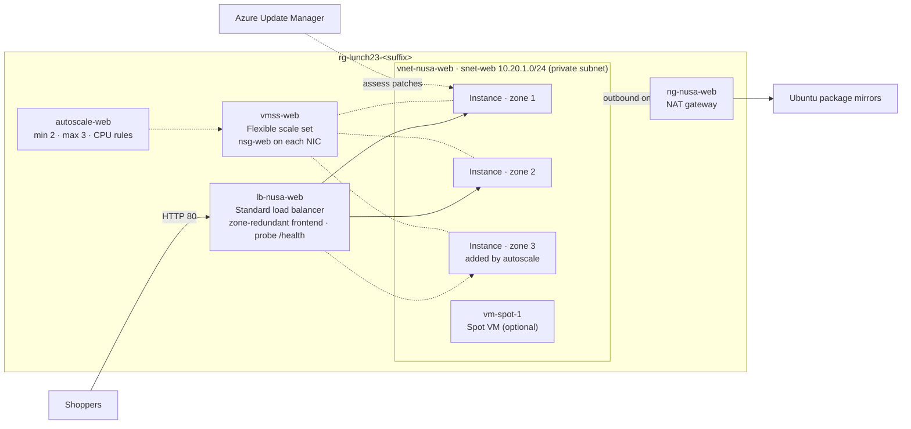

# Lab 23 · Ready for the 12.12 sale

🇮🇩 [Baca dalam Bahasa Indonesia](README.id.md)

> **Pairs with:** [Lunch 23 · Virtual Machines (Advanced)](../../lunches/23-virtual-machines-advanced/README.md)
> **Time:** about 60 minutes · **Cost:** 💲💲 (see [cost bands](../README.md#cost-bands)) · **Difficulty:** ★★☆
> **Works on its own:** ✅ You do not need any earlier lab. Everything this lab needs is created by its steps or by `setup.sh`.
> **Author:** Stefanus Pinarta · [About the author](../../README.md#about-the-author)

## 🎯 What you'll build

Nusantara Retail's storefront outgrows its single VM. You build a **Flexible scale set** called `vmss-web` that spreads
its instances across availability zones 1, 2 and 3, behind the Standard load balancer `lb-nusa-web` that `setup.sh`
prepares. Every instance runs the course's small web server from cloud-init and reaches the internet only through a
NAT gateway — explicit outbound access. **Autoscale** keeps two to three instances depending on CPU: you create your
own 12.12 rush with a load script and watch Azure add an instance in the empty zone, then remove it after the
cool-down. You finish by checking the instances for missing patches with **Azure Update Manager**, optionally watching
a **Spot VM** get evicted, and repairing an outage that only shows up on patch day. The lab runs in `$LOCATION`
(Southeast Asia by default); the production design in the reading uses Indonesia Central.



## ✅ Before you start

- An Azure subscription where you can create resources (see [Lab 01](../01-before-you-begin/README.md)).
- **Azure Cloud Shell (Bash)** — open [shell.azure.com](https://shell.azure.com). Nothing to install.
- Get the lab files, load the shared settings and set the scale-set sizes for this lab:

```bash
git clone https://github.com/stefpin/azure-fundamentals-lunches.git   # first time only
cd azure-fundamentals-lunches/labs/23-virtual-machines-advanced
source ../common/config.sh
RG=$(rg_name 23)
export INSTANCES=2 AS_MIN=2 AS_MAX=3
echo "Resource group: $RG · region: $LOCATION · size: $VM_SIZE_SMALL · image: $VM_IMAGE"
```

- Create the starting point — about 3 minutes:

```bash
bash setup.sh
```

`setup.sh` first checks that `$VM_SIZE_SMALL` is offered in all three zones of your region and that your vCPU quota
covers the autoscale maximum. Then it creates the virtual network with a private subnet, the NAT gateway, the network
security group `nsg-web` and the load balancer with its `/health` probe. The scale set itself is yours to build.

- **Watch your vCPU quota.** Each instance uses the default lab size `Standard_B2ats_v2` (2 vCPUs). With the default
  settings the scale set runs 2 instances and at most 3 during the load test — up to **6 vCPUs**. `setup.sh` checks
  your quota before it builds anything.

> [!WARNING]
> **Small quota?** Free trials often allow only 4 vCPUs per region. If `setup.sh` reports too little quota, use the
> small-quota settings below and run `bash setup.sh` again to re-check. The tasks work the same way; with one instance
> at the start, you see the second zone only after the scale-out. (Older sizes such as `Standard_B1s` are not an option:
> new subscriptions can't deploy B-series v1 any more.)
>
> | Setting | Default | Small-quota settings |
> |---|---|---|
> | `VM_SIZE_SMALL` | `Standard_B2ats_v2` (2 vCPUs) | `Standard_B2ats_v2` (2 vCPUs) |
> | `INSTANCES` / `AS_MIN` / `AS_MAX` | 2 / 2 / 3 | 1 / 1 / 2 |
> | Most vCPUs at once | 6 | 4 |
>
> ```bash
> export INSTANCES=1 AS_MIN=1 AS_MAX=2
> ```

> [!IMPORTANT]
> Lab resources cost money while they exist — the NAT gateway and both public IPs are billed by the hour even when no
> instance runs. Finish with the **Clean up** section, even if you stop halfway.

> [!TIP]
> Cloud Shell disconnects after about 20 minutes without input and forgets your variables. If that happens, `cd` back
> into the lab folder and run the `source`, `RG=` and `export` lines again — and `LB_IP=` from Task 3.

## 🧭 Choose your mode

| Mode | For you if… | How |
|---|---|---|
| **Guided** | you want every step explained | follow Tasks 1–7 below |
| **Challenge** | you already know the basics | read only the [Challenge brief](#-challenge-brief), build it your way, then run `bash verify.sh` |

## Task 1 · Look at the starting point

`setup.sh` built the network around the scale set so this lab can focus on the VMs. Take two minutes to see what the
instances will plug into.

```bash
az resource list -g "$RG" --query "[].{type:type, name:name}" -o table

az network vnet subnet show -g "$RG" --vnet-name vnet-nusa-web -n snet-web \
  --query "{prefix:addressPrefix, natGateway:natGateway.id, defaultOutboundAccess:defaultOutboundAccess, subnetNsg:networkSecurityGroup.id}" \
  -o yaml

az network lb probe list -g "$RG" --lb-name lb-nusa-web \
  --query "[].{name:name, protocol:protocol, port:port, path:requestPath}" -o table

az network lb rule list -g "$RG" --lb-name lb-nusa-web \
  --query "[].{name:name, frontendPort:frontendPort, backendPort:backendPort, outboundSnatDisabled:disableOutboundSnat}" -o table
```

Three details matter later:

- The subnet is **private** (`defaultOutboundAccess: false`) and its explicit way out is the **NAT gateway**. Flexible
  scale-set instances never get default outbound access anyway, so without the NAT gateway they couldn't reach the
  Ubuntu mirrors.
- There is **no NSG on the subnet** (`subnetNsg: null`). The scale set will put `nsg-web`, which allows HTTP from the
  internet, on every instance's network interface. Standard load balancers are closed to inbound traffic until an NSG
  allows it.
- The load-balancing rule has **outbound SNAT disabled**: the load balancer handles inbound traffic only. Its probe
  asks each instance for `/health` on port 80 — the shared cloud-init web server answers `ok` there.

> ✅ **Checkpoint:** the resource list shows six resources: two public IP addresses (`pip-lb-web`, `pip-ng-web`), the NAT
> gateway `ng-nusa-web`, the virtual network, the network security group and the load balancer. The probe table shows
> `probe-health` on HTTP port 80 with path `/health`.

## Task 2 · Create a Flexible scale set across three zones

One command creates the scale set, its instances, their disks and network interfaces, and adds the instances to the
load balancer's backend pool. It takes three to five minutes.

```bash
az vmss create \
  --resource-group "$RG" \
  --name vmss-web \
  --location "$LOCATION" \
  --orchestration-mode Flexible \
  --image "$VM_IMAGE" \
  --vm-sku "$VM_SIZE_SMALL" \
  --instance-count "$INSTANCES" \
  --zones 1 2 3 \
  --platform-fault-domain-count 1 \
  --vnet-name vnet-nusa-web \
  --subnet snet-web \
  --nsg nsg-web \
  --lb lb-nusa-web \
  --backend-pool-name bep-web \
  --custom-data "$AZL_COMMON_DIR/cloud-init-web.yml" \
  --admin-username "$ADMIN_USER" \
  --generate-ssh-keys \
  --storage-sku StandardSSD_LRS \
  --upgrade-policy-mode Manual \
  --output none
```

| Option | Why |
|---|---|
| `--orchestration-mode Flexible` | Every instance is an ordinary VM. Flexible is already the CLI default; writing it out documents the choice, which can't be changed later |
| `--zones 1 2 3` | Instances are spread across three datacenters; Azure tries to keep the zones balanced as the set grows and shrinks |
| `--platform-fault-domain-count 1` | *Max spreading*: inside each zone, Azure spreads instances over as many fault domains as it can — the recommended setting with zones |
| `--vm-sku "$VM_SIZE_SMALL"` | The size of every instance in the model (`Standard_B2ats_v2` by default) |
| `--nsg nsg-web` | The existing NSG goes on each instance's network interface, so HTTP from the internet is allowed |
| `--lb lb-nusa-web --backend-pool-name bep-web` | New instances — including those autoscale adds later — join the backend pool automatically |
| `--custom-data …/cloud-init-web.yml` | cloud-init starts a small web server on port 80 that shows the host name and zone, plus `/health` |
| `--upgrade-policy-mode Manual` | Model changes reach existing instances only when you upgrade them; new instances always use the latest model |

There is no public IP and no SSH rule: you will run commands inside the instances with **Run Command** instead. Now
look at the scale set and its instances:

```bash
az vmss show -g "$RG" -n vmss-web \
  --query "{mode:orchestrationMode, zones:join(',', zones), faultDomains:platformFaultDomainCount, size:sku.name, capacity:sku.capacity}" -o table

az vm list -g "$RG" -d \
  --query "[?virtualMachineScaleSet].{name:name, zone:zones[0], size:hardwareProfile.vmSize, power:powerState, privateIp:privateIps}" -o table
```

Because Flexible instances are ordinary VMs, `az vm list` shows them, and every `az vm` command you learned in Lab 06
works on them.

> [!TIP]
> **Prefer the portal?** *Home › Virtual Machine Scale Sets › Create.* On **Basics**: your resource group, name
> `vmss-web`, your region, availability zones *1, 2, 3*, orchestration mode *Flexible*, security type *Trusted launch
> virtual machines*, scaling mode *Manual* with instance count 2, image *Ubuntu Server 24.04 LTS – x64 Gen2*, your
> size, username `azureuser` and *Use existing public key* (paste `cat ~/.ssh/id_rsa.pub`). On **Networking**: virtual
> network `vnet-nusa-web`; edit the network interface to use subnet `snet-web`, the advanced NSG option with
> `nsg-web` and no public IP; under *Load balancing* choose *Azure load balancer*, `lb-nusa-web` and backend pool
> `bep-web`. On **Advanced**: paste the contents of `labs/common/cloud-init-web.yml` into *Custom data*. Then
> **Review + create**.

> ✅ **Checkpoint:** the scale set shows mode `Flexible`, zones `1,2,3` and fault domains `1`. The VM list shows
> `$INSTANCES` instances whose names start with `vmss-web_`, each `VM running`, in different zones.

## Task 3 · Test through the load balancer

Shoppers only ever see the load balancer's address. Ask it for the page several times:

```bash
LB_IP=$(az network public-ip show -g "$RG" -n pip-lb-web --query ipAddress -o tsv)
echo "http://$LB_IP/"
for i in {1..8}; do
  curl -s -m 5 "http://$LB_IP/" | grep -o 'Served by.*' | sed -e 's/<[^>]*>//g'
done
curl -s "http://$LB_IP/health"
```

Each `curl` opens a new connection, and the load balancer spreads connections across the healthy instances, so the
answers alternate between host names — and zones. The last line prints `ok`, the answer the health probe receives
every few seconds. Open the address in your browser, too.

If nothing prints yet, wait a minute: cloud-init is still starting the web server, and the load balancer sends no
traffic to an instance until its `/health` probe succeeds.

> ✅ **Checkpoint:** you see lines such as `Served by <host name> in availability zone 1.` from two different hosts in
> two different zones (one host with the small-quota settings), and `/health` returns `ok`.

## Task 4 · Add autoscale rules

Autoscale is an Azure Monitor setting attached to the scale set. Create it with the instance limits, then add one
rule to scale out and one to scale in:

```bash
az monitor autoscale create \
  --resource-group "$RG" \
  --resource vmss-web \
  --resource-type Microsoft.Compute/virtualMachineScaleSets \
  --name autoscale-web \
  --min-count "$AS_MIN" --max-count "$AS_MAX" --count "$AS_MIN" \
  --output none

az monitor autoscale rule create -g "$RG" --autoscale-name autoscale-web \
  --condition "Percentage CPU > 70 avg 5m" --scale out 1 --cooldown 5 --output none

az monitor autoscale rule create -g "$RG" --autoscale-name autoscale-web \
  --condition "Percentage CPU < 30 avg 5m" --scale in 1 --cooldown 5 --output none
```

Read the first rule the way the engine does: *when the average Percentage CPU across the scale set over the last
five minutes is above 70%, add one instance, then wait five minutes before this rule may act again*. The wide gap
between 70% and 30% stops the set from flapping, and the maximum of three keeps you inside a small vCPU quota. Check
what you built:

```bash
az monitor autoscale show -g "$RG" -n autoscale-web \
  --query "{enabled:enabled, minimum:profiles[0].capacity.minimum, maximum:profiles[0].capacity.maximum, default:profiles[0].capacity.default}" -o table

az monitor autoscale rule list -g "$RG" --autoscale-name autoscale-web \
  --query "[].{metric:metricTrigger.metricName, operator:metricTrigger.operator, threshold:metricTrigger.threshold, window:metricTrigger.timeWindow, direction:scaleAction.direction, change:scaleAction.value, cooldown:scaleAction.cooldown}" -o table
```

> [!TIP]
> **Prefer the portal?** *vmss-web › Scaling › Custom autoscale.* Choose *Scale based on a metric*, set the instance
> limits (minimum 2, maximum 3, default 2), then *Add a rule*: Percentage CPU, greater than 70, duration 5 minutes,
> *Increase count by* 1, cool down 5 minutes. Add a second rule: less than 30, *Decrease count by* 1. **Save**. The
> portal names the setting for you; `verify.sh` finds it through the scale set.

> ✅ **Checkpoint:** autoscale is enabled with minimum `$AS_MIN` and maximum `$AS_MAX`, and the rule table shows two
> `Percentage CPU` rules — `GreaterThan` 70 with direction `Increase`, and `LessThan` 30 with direction `Decrease` —
> each changing the count by 1, with a five-minute window and cool-down (`PT5M`).

## Task 5 · Create a 12.12 rush and watch autoscale

Real shoppers are hard to summon at lunchtime, so fake the rush: [`load-cpu.sh`](load-cpu.sh) keeps every vCPU of an
instance busy for 15 minutes and then stops by itself. Run Command copies it into each instance and runs it there:

```bash
for vm in $(az vm list -g "$RG" --query "[?virtualMachineScaleSet].name" -o tsv); do
  az vm run-command invoke -g "$RG" -n "$vm" --command-id RunShellScript \
    --scripts @load-cpu.sh --parameters 900 --query "value[0].message" -o tsv
done
```

Each instance answers `CPU load started on … for 900 seconds`. Now watch the average CPU and the instance count once
a minute (press **Ctrl+C** to stop watching):

```bash
VMSS_ID=$(az vmss show -g "$RG" -n vmss-web --query id -o tsv)
while true; do
  cpu=$(az monitor metrics list --resource "$VMSS_ID" --metric "Percentage CPU" --interval PT1M \
        --aggregation Average --offset 1h \
        --query "value[0].timeseries[0].data[?average] | [-1].average" -o tsv)
  count=$(az vm list -g "$RG" --query "length([?virtualMachineScaleSet])" -o tsv)
  printf '%s  average CPU: %5.1f%%  instances: %s\n' "$(date +%H:%M)" "${cpu:-0}" "$count"
  sleep 60
done
```

What to expect (timings vary by a few minutes):

| Minutes after the load starts | What happens |
|---|---|
| 0–3 | CPU climbs to about 100% on every instance; the metric lags one to three minutes behind |
| about 6–10 | The five-minute average passes 70%, so autoscale adds one instance. The count goes up while the new VM is still being created |
| about 10–13 | The new instance runs — usually in the zone that had none — and gets traffic from the load balancer once `/health` answers |
| 15 | The load stops by itself |
| about 20–25 | The five-minute average is below 30% and the cool-down is over, so autoscale removes one instance |

Notice that the average drops when the new instance arrives — to about 67% with the default settings, about 50% with
the small-quota settings — because the new instance has no load of its own.
In a real shop the load balancer would send it shoppers, and every instance would cool down. Run the `curl` loop from
Task 3 again to see the new host name.

Autoscale records every decision. Ask the activity log, or open *vmss-web › Scaling › Run history* in the portal:

```bash
az monitor activity-log list -g "$RG" --offset 1h \
  --query "[?category.value=='Autoscale'].{time:eventTimestamp, operation:operationName.localizedValue, status:status.localizedValue}" -o table
```

**While you wait** for the scale-in, do Task 6. Want it sooner? Stop the load now — scale-in follows about ten minutes
later:

```bash
for vm in $(az vm list -g "$RG" --query "[?virtualMachineScaleSet].name" -o tsv); do
  az vm run-command invoke -g "$RG" -n "$vm" --command-id RunShellScript \
    --scripts @load-cpu.sh --parameters stop --query "value[0].message" -o tsv
done
```

> [!NOTE]
> **Burstable credits.** B-series instances earn CPU credits while they idle and spend them when they run above
> their baseline. A brand-new instance starts with only a small balance, so if you repeat the load test several
> times the instances run out of credits: CPU is then capped at the baseline, and autoscale may see *modest* CPU
> while the instances struggle — the trap from the reading. The *CPU Credits Remaining* metric shows how much is left.

> ✅ **Checkpoint:** the watch loop showed the instance count go from `$AS_MIN` to `$AS_MAX`, and later back to
> `$AS_MIN`. The activity log (or Run history) lists a scale-up and a scale-down.

## Task 6 · Assess patches with Azure Update Manager

Patching a fleet by hand doesn't scale, and an instance that autoscale added last night is as exposed as the first
one. Azure Update Manager checks machines for missing updates on demand or every 24 hours (periodic assessment), and
installs them now or in a maintenance window. Assess the first instance — it takes two to five minutes:

```bash
FIRST_VM=$(az vm list -g "$RG" --query "[?virtualMachineScaleSet].name | [0]" -o tsv)
az vm assess-patches -g "$RG" -n "$FIRST_VM" \
  --query "{status:status, criticalAndSecurity:criticalAndSecurityPatchCount, other:otherPatchCount, rebootPending:rebootPending, examples:availablePatches[:5].name}" \
  -o yaml
```

The assessment runs *inside* the instance: it refreshes the package lists from the Ubuntu mirrors — through the NAT
gateway — and compares them with what is installed. How many updates you see depends on how old the Marketplace image
is; zero is a perfectly good answer.

> [!TIP]
> **Prefer the portal?** *Azure Update Manager › Machines*, filter on your resource group, select an instance and
> **Check for updates**. When it finishes, the *Updates* column shows the counts and the instance page lists each
> update. Open **Schedule updates** to see how a maintenance configuration (for example *Tuesdays 02:00 WIB*) would
> patch the whole fleet — then close it without saving.

> ✅ **Checkpoint:** the status is `Succeeded` (or `CompletedWithWarnings`), and you can name the number of critical and
> security updates the instance is missing.

## Task 7 · (Optional) A Spot VM and a simulated eviction

Spot VMs are cheap because Azure can take them back. Do this task **after the scale set is back to `$AS_MIN`
instances**, so you stay at 4 vCPUs or fewer. Spot doesn't support B-series sizes, uses its own vCPU quota and isn't
offered on every subscription type (free trial and student subscriptions may not have it). Check your Spot quota
first:

```bash
az vm list-usage -l "$LOCATION" \
  --query "[?contains(localName, 'Low-priority') || contains(localName, 'Spot')].{quota:localName, used:currentValue, limit:limit}" -o table
```

If the limit is at least 2, create a Spot VM in the same subnet, without a public IP:

```bash
SPOT_SIZE=${SPOT_SIZE:-Standard_D2as_v5}
az vm create \
  --resource-group "$RG" --name vm-spot-1 --location "$LOCATION" \
  --image "$VM_IMAGE" --size "$SPOT_SIZE" \
  --priority Spot --eviction-policy Deallocate --max-price -1 \
  --vnet-name vnet-nusa-web --subnet snet-web --nsg "" --public-ip-address "" \
  --os-disk-delete-option Delete --nic-delete-option Delete \
  --admin-username "$ADMIN_USER" --generate-ssh-keys --storage-sku StandardSSD_LRS --output table

az vm show -g "$RG" -n vm-spot-1 \
  --query "{priority:priority, evictionPolicy:evictionPolicy, maxPrice:billingProfile.maxPrice}" -o table
```

`--max-price -1` means "never evict me because of the price, and never charge more than the regular price".
`--eviction-policy Deallocate` keeps the disk when the VM is evicted. Now play Azure and take the capacity back:

```bash
az vm simulate-eviction -g "$RG" -n vm-spot-1
for i in {1..40}; do
  state=$(az vm get-instance-view -g "$RG" -n vm-spot-1 \
    --query "instanceView.statuses[?starts_with(code, 'PowerState/')].displayStatus | [0]" -o tsv)
  echo "$(date +%H:%M:%S)  $state"
  [[ "$state" == "VM deallocated" ]] && break
  sleep 15
done
```

A deallocated Spot VM costs nothing for compute, but its disk is still billed and its vCPUs still count against your
Spot quota. Delete it:

```bash
az vm delete -g "$RG" -n vm-spot-1 --yes
```

> ✅ **Checkpoint:** the power state went from `VM running` to `VM deallocated` without you stopping anything, and
> `vm-spot-1` is gone from `az vm list -g "$RG" -o table`. If the VM couldn't be created because of quota or your
> subscription type, skip this task — `verify.sh` doesn't check it.

## 🔧 Break it and fix it

Head office's network team spots the NAT gateway on the bill and removes it from the subnet "because the website still
works without it". Play the network team:

```bash
az network vnet subnet update -g "$RG" --vnet-name vnet-nusa-web -n snet-web --remove natGateway --output none
curl -s -o /dev/null -w '%{http_code}\n' "http://$LB_IP/"
FIRST_VM=$(az vm list -g "$RG" --query "[?virtualMachineScaleSet].name | [0]" -o tsv)
az vm run-command invoke -g "$RG" -n "$FIRST_VM" --command-id RunShellScript \
  --scripts "curl -sS -m 8 -o /dev/null -w 'HTTP %{http_code}\n' http://archive.ubuntu.com/ubuntu/ || echo 'No outbound internet access'" \
  --query "value[0].message" -o tsv
```

**Symptom:** the shop still answers `200` — but the instance can't reach the Ubuntu mirrors any more (`Connection
timed out`, then `No outbound internet access`). Nobody notices until patch day: `apt` fails, patch assessments can't
refresh their package lists, and `bash verify.sh` fails one check. Explain why the website still works, then fix it
without looking at the hint.

<details><summary>Hint and fix</summary>

Shoppers' connections *start* on the internet, arrive through the load balancer and are answered through it, so
inbound traffic is unaffected. Connections that the instances *start* need an explicit outbound method: Flexible
scale-set instances have no default outbound access, the subnet is private, and the load-balancing rule has outbound
SNAT disabled — the NAT gateway was the only way out. Attach it again:

```bash
az network vnet subnet update -g "$RG" --vnet-name vnet-nusa-web -n snet-web --nat-gateway ng-nusa-web --output none
az vm run-command invoke -g "$RG" -n "$FIRST_VM" --command-id RunShellScript \
  --scripts "curl -sS -m 8 -o /dev/null -w 'HTTP %{http_code}\n' http://archive.ubuntu.com/ubuntu/ || echo 'No outbound internet access'" \
  --query "value[0].message" -o tsv
```

The second command prints `HTTP 200` again. Load balancer outbound rules would also work, but a NAT gateway is the
method Microsoft recommends, and it scales to many instances without running out of ports.

</details>

## 🧪 Verify your work

```bash
bash verify.sh
```

Every check should say **PASS**. If one fails, the message tells you which task to revisit. If you used the small-quota
settings (at most 4 vCPUs), make sure `AS_MIN` and `AS_MAX` are still exported in your shell (`echo $AS_MIN $AS_MAX`) so the script
expects your limits.

## 🧹 Clean up (do not skip!)

```bash
bash cleanup.sh
```

This deletes everything the lab created: the resource group `rg-lunch23-<suffix>` with the scale set, its VMs, disks
and network interfaces, the autoscale setting, the load balancer, the NAT gateway, both public IPs and the optional
Spot VM. Nothing lives outside the resource group. Deletion continues in the background for a few minutes.

## 🩺 Troubleshooting

| Symptom | Likely cause | Fix |
|---|---|---|
| `SkuNotAvailable` … "The requested size for resource … is currently not available in location … zones …" | The size isn't offered to your subscription in that region or in every zone (B-series v1 sizes such as `Standard_B1s` are closed to new subscriptions) | Pick another current 2-vCPU size (`export VM_SIZE_SMALL=Standard_B2ts_v2`, then `bash setup.sh` to re-check), delete the failed set (`az vmss delete -g "$RG" -n vmss-web`) and run Task 2 again |
| "Operation could not be completed as it results in exceeding approved Total Regional Cores quota" (or a VM family quota) | Other VMs use your vCPUs, or the quota is smaller than 6 | Delete leftovers from other labs (`bash ../common/check-environment.sh` lists them), use the small-quota settings, or request more quota |
| `curl` to the load balancer prints nothing or `000` | cloud-init is still starting the web server, or the instances aren't in the backend pool | Wait two minutes; check `az network lb address-pool show -g "$RG" --lb-name lb-nusa-web -n bep-web --query "length(loadBalancerBackendAddresses)"` |
| Every answer comes from the same host | Only one instance passes the `/health` probe, or you use the small-quota settings with one instance | Check `az vm list -g "$RG" -d -o table`; wait for the new instance's web server to start |
| No scale-out after 15 minutes | The load didn't start, the average stayed below 70%, or the instances ran out of CPU credits | Check the Run Command messages and the watch loop; look at *CPU Credits Remaining*; repeat Task 5 after the credits recover |
| The set stays at 3 instances long after the test | Scale-in needs five minutes below 30% plus the cool-down, or the load is still running | Run the `stop` loop from Task 5 and wait ten minutes |
| Run Command fails with `Conflict` or "Run command extension execution is in progress" | Another Run Command (or a patch assessment) is still running on that instance | Wait a minute and run it again |
| `az vm assess-patches` returns `Failed` or an error | The instance can't reach the Ubuntu mirrors (NAT gateway missing), or its VM agent isn't ready yet | Re-attach the NAT gateway (Break it and fix it); wait a few minutes after creation and try again |
| Spot VM: "exceeding approved LowPriorityCores quota" or "not supported for this subscription offer" | Your Spot quota is too small, or your subscription type doesn't offer Spot | Skip Task 7, or request Spot quota on a pay-as-you-go subscription |
| Spot VM: `SkuNotAvailable` for `Standard_D2as_v5` | No Spot capacity for that size right now | Try another 2-vCPU size: `SPOT_SIZE=Standard_D2s_v5` and run the command again |
| `setup.sh` prints a note about `--default-outbound` | Your Azure CLI is older than the subnet setting | Nothing to do: Flexible scale-set instances have no default outbound access anyway |
| `verify.sh` fails on the minimum or maximum after using the small-quota settings | `AS_MIN`/`AS_MAX` weren't exported in the shell that runs `verify.sh` | `export AS_MIN=1 AS_MAX=2`, then `bash verify.sh` |

## 🚀 Stretch goals

- **Get ready for midnight.** Add a fixed-date profile that keeps three instances through the 12.12 night (look up time
  zone names with `az monitor autoscale profile list-timezones -q "SE Asia" -o table`):
  `az monitor autoscale profile create -g "$RG" --autoscale-name autoscale-web -n sale-1212 --copy-rules default --min-count 3 --count 3 --max-count 3 --start "2026-12-11 22:00:00" --end "2026-12-13 03:00:00" --timezone "SE Asia Standard Time"`.
  `verify.sh` checks only the default profile, so this doesn't change its result.
- **Get told when it scales.** `az monitor autoscale update -g "$RG" -n autoscale-web --add-action email you@example.com`
  (use your own address), then repeat Task 5.
- **Watch the probe at work.** Stop the web server on one instance
  (`az vm run-command invoke -g "$RG" -n "$FIRST_VM" --command-id RunShellScript --scripts "systemctl stop nusa-web"`),
  run the `curl` loop from Task 3 — every answer now comes from the other instances — then start it again with
  `systemctl start nusa-web`. With the Application Health extension and automatic repairs (reading, section 4), the
  scale set would replace such an instance by itself.
- **Choose Spot sizes with data.** Query recent eviction rates with Azure Resource Graph (the CLI may offer to install
  the `resource-graph` extension):
  `az graph query -q "SpotResources | where type =~ 'microsoft.compute/skuspotevictionrate/location' | where location =~ '$LOCATION' | where sku.name in~ ('standard_d2as_v5', 'standard_d2s_v5') | project skuName=tostring(sku.name), evictionRate=tostring(properties.evictionRate)" -o table`.

## 🏁 Challenge brief

Build the following, any way you like (portal, CLI, Bicep). You may run `bash setup.sh` for the network and load
balancer, or build your own:

1. A resource group named `rg-lunch23-<suffix>` (`rg_name 23`) tagged `course=azure-fundamentals-lunches` and
   `lunch=23` — `setup.sh` (or `ensure_rg "$RG" 23`) does this for you.
2. A Virtual Machine Scale Set named `vmss-web` with **Flexible** orchestration, spanning availability zones **1, 2
   and 3**, using size `$VM_SIZE_SMALL` and the shared web server
   `labs/common/cloud-init-web.yml`, with at least 2 running instances (1 with the small-quota settings).
3. Its instances in the backend pool of a **Standard** public load balancer with an HTTP health probe on `/health` and
   a rule for port 80, so that `http://<load balancer IP>/` returns HTTP 200 and the Nusantara Retail page.
4. **Explicit outbound** internet access for the instances: a NAT gateway on their subnet (or load balancer outbound
   rules).
5. An **enabled autoscale setting** on the scale set whose default profile has minimum 2 and maximum 3 instances (1
   and 2 with the small-quota settings), at least one `Percentage CPU` scale-out rule and at least one `Percentage CPU` scale-in
   rule.
6. Not checked by the script, but do it: generate CPU load and watch a scale-out and a scale-in, run a patch
   assessment, and (if your subscription allows Spot) create, evict and delete a Spot VM.

Then run `bash verify.sh`. Stuck? Peek at `solution.sh` or switch to Guided mode.

---

⬅️ [Lunch 23 reading](../../lunches/23-virtual-machines-advanced/README.md) · 🏠 [All labs](../README.md) · 🏠 [Course home](../../README.md)

<sub>Last validated: October 2026 · Something broken? [Report a lab problem](../../CONTRIBUTING.md).</sub>
