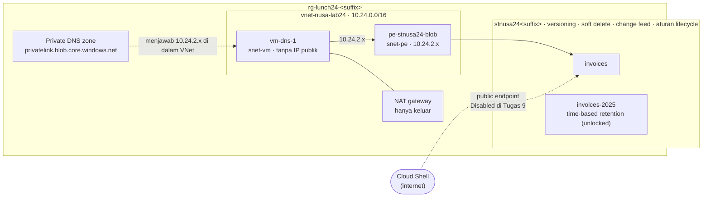

# Lab 24 · Faktur tahan ransomware

🇬🇧 [Read in English](README.md)

> **Pasangan dari:** [Makan Siang 24 · Penyimpanan (Lanjutan)](../../lunches/24-storage-advanced/README.id.md)
> **Waktu:** sekitar 60 menit (termasuk sekitar 5 menit untuk `setup.sh`) · **Biaya:** 💲💲 (lihat [kelompok biaya](../README.id.md#kelompok-biaya)) · **Tingkat kesulitan:** ★★☆
> **Bisa dikerjakan terpisah:** ✅ Anda tidak memerlukan lab sebelumnya. Semua yang dibutuhkan lab ini dibuat oleh langkah-langkahnya sendiri atau oleh `setup.sh`.
> **Penulis:** Stefanus Pinarta · [Tentang penulis](../../README.id.md#tentang-penulis)

## 🎯 Yang akan Anda bangun

Seorang pemasok Nusantara Retail terkena ransomware. Anda memastikan serangan serupa tidak akan membuat Nusantara
kehilangan fakturnya: Anda mengaktifkan versioning, soft delete, dan change feed, lalu berperan sebagai penyerang —
menimpa satu faktur, menghapus faktur lain, bahkan menghapus seluruh container — dan memulihkan semuanya. Anda
menambahkan lifecycle policy sepuluh tahun dan retention policy tulis-sekali (*write-once*) untuk tahun pajak yang sudah
ditutup. Terakhir, Anda memberi account sebuah private endpoint dan private DNS zone, membuktikan dari VM di dalam
jaringan bahwa nama account kini diterjemahkan ke alamat IP privat, lalu mematikan public network access.



## ✅ Sebelum mulai

- Subscription Azure tempat Anda bisa membuat resource dan memberikan role (Owner, atau Contributor ditambah User Access
  Administrator) — lihat [Lab 01](../01-before-you-begin/README.id.md).
- **Azure Cloud Shell (Bash)** — buka [shell.azure.com](https://shell.azure.com). Tidak ada yang perlu dipasang.
- Baca dulu [bacaan Makan Siang 24](../../lunches/24-storage-advanced/README.id.md); lab ini mengasumsikan Anda sudah tahu
  apa itu versi, soft delete, immutability, dan private endpoint.
- Ambil file lab dan muat pengaturan bersama (jalankan blok ini lagi setiap kali Cloud Shell dimulai ulang):

```bash
git clone https://github.com/stefpin/azure-fundamentals-lunches.git   # first time only
cd azure-fundamentals-lunches/labs/24-storage-advanced
source ../common/config.sh
RG=$(rg_name 24)
ACCOUNT="stnusa24${SUFFIX}"
VNET=vnet-nusa-lab24
ZONE=privatelink.blob.core.windows.net
ACCOUNT_ID=$(az storage account show --name "$ACCOUNT" --resource-group "$RG" --query id --output tsv 2>/dev/null)
mkdir -p work
echo "Resource group: $RG   Storage account: $ACCOUNT"
```

- Buat titik awalnya — virtual network dengan dua subnet, NAT gateway, dan VM Linux kecil tanpa alamat IP publik.
  Prosesnya sekitar 5 menit; baca bagian 3 dari bacaan makan siang sambil menunggu:

```bash
bash setup.sh
```

VM ini hanya ada untuk menguji DNS dan jalur jaringan dari *dalam* virtual network. VM ini tidak punya IP publik dan
tidak punya aturan inbound; Anda menjangkaunya lewat **Run Command**, yang membutuhkan HTTPS keluar untuk mengembalikan
hasilnya — itulah sebabnya `setup.sh` menambahkan NAT gateway (subnet baru tidak punya akses internet keluar bawaan).

> [!IMPORTANT]
> VM, NAT gateway, dan private endpoint ditagih per jam. Akhiri dengan bagian **Bersihkan**, walaupun Anda berhenti di
> tengah jalan — dan **jangan pernah mengunci** retention policy di Tugas 6, atau account tidak bisa dihapus selama
> berhari-hari.

## 🧭 Pilih mode Anda

| Mode | Cocok untuk Anda jika… | Caranya |
|---|---|---|
| **Terpandu** | Anda ingin setiap langkah dijelaskan | ikuti Tugas 1–9 di bawah |
| **Tantangan** | Anda sudah menguasai dasarnya | jalankan `bash setup.sh`, baca hanya [Ringkasan tantangan](#-ringkasan-tantangan), bangun dengan cara Anda sendiri, lalu jalankan `bash verify.sh` |

## Tugas 1 · Membuat account faktur dan memberi diri Anda role data

Account-nya bertipe general-purpose v2 dengan locally redundant storage (murah, dan mendukung archive tier yang dipakai
aturan lifecycle Anda), TLS 1.2, dan tanpa akses anonim. Anda bekerja dengan data blob lewat identitas Microsoft Entra
Anda, jadi Anda membutuhkan role data.

```bash
az storage account create \
  --name "$ACCOUNT" \
  --resource-group "$RG" \
  --location "$LOCATION" \
  --kind StorageV2 \
  --sku Standard_LRS \
  --min-tls-version TLS1_2 \
  --allow-blob-public-access false \
  --https-only true \
  --output none

ACCOUNT_ID=$(az storage account show --name "$ACCOUNT" --resource-group "$RG" --query id --output tsv)

az role assignment create \
  --assignee-object-id "$(my_object_id)" \
  --assignee-principal-type User \
  --role "Storage Blob Data Contributor" \
  --scope "$ACCOUNT_ID" \
  --output none

wait_until "your data role to take effect" 600 \
  az storage container list --account-name "$ACCOUNT" --auth-mode login \
  && echo "Data role is active."
```

> ✅ **Pemeriksaan:** `Data role is active.` tercetak, dan
> `az role assignment list --assignee "$(my_object_id)" --scope "$ACCOUNT_ID" --query "[].roleDefinitionName" --output tsv`
> menampilkan `Storage Blob Data Contributor`.

## Tugas 2 · Mengaktifkan lapisan-lapisan perlindungan

Satu perintah mengaktifkan versioning, soft delete 14 hari untuk blob dan untuk container, serta change feed:

```bash
az storage account blob-service-properties update \
  --account-name "$ACCOUNT" \
  --resource-group "$RG" \
  --enable-versioning true \
  --enable-delete-retention true --delete-retention-days 14 \
  --enable-container-delete-retention true --container-delete-retention-days 14 \
  --enable-change-feed true \
  --output none
```

Anda sengaja membiarkan **point-in-time restore** nonaktif: fitur itu tidak bisa digabungkan dengan immutability policy
yang Anda tambahkan di Tugas 6.
(Point-in-time restore menjadi tantangan tambahan, di account terpisah.)

> [!TIP]
> **Lebih suka portal?** Storage account › *Data management* › *Data protection*. Centang versioning, soft delete untuk
> blob dan container (14 hari), serta blob change feed, lalu *Save*.

> ✅ **Pemeriksaan:** perintah ini mencetak `True`, `14`, `14`, `True`:
>
> ```bash
> az storage account blob-service-properties show --account-name "$ACCOUNT" --resource-group "$RG" \
>   --query "{versioning:isVersioningEnabled, blobSoftDeleteDays:deleteRetentionPolicy.days, containerSoftDeleteDays:containerDeleteRetentionPolicy.days, changeFeed:changeFeed.enabled}" \
>   --output table
> ```

## Tugas 3 · Mengunggah faktur, berperan sebagai ransomware, memulihkan versi

Buat container `invoices` dan unggah dua faktur:

```bash
az storage container create --account-name "$ACCOUNT" --name invoices --auth-mode login --output none

for f in sample-files/INV-2026-0042.txt sample-files/INV-2026-0043.txt; do
  az storage blob upload --account-name "$ACCOUNT" --container-name invoices \
    --name "$(basename "$f")" --file "$f" --auth-mode login --output none
done
```

Sekarang jadilah penyerang. Ransomware tidak perlu menghapus apa pun — ia cukup menimpa file dengan "sampah" terenkripsi:

```bash
printf 'ENCRYPTED BY RANSOMWARE - pay by Friday to get your invoice back\n' > work/INV-2026-0042.txt
az storage blob upload --account-name "$ACCOUNT" --container-name invoices --name INV-2026-0042.txt \
  --file work/INV-2026-0042.txt --overwrite --auth-mode login --output none

rm -f work/check.txt
az storage blob download --account-name "$ACCOUNT" --container-name invoices --name INV-2026-0042.txt \
  --file work/check.txt --auth-mode login --output none
cat work/check.txt
```

Tanpa versioning, faktur itu pasti sudah lenyap. Tampilkan daftar versinya — setiap penulisan membuat satu versi, dengan
timestamp sebagai ID-nya:

```bash
az storage blob list --account-name "$ACCOUNT" --container-name invoices --include v --prefix INV-2026-0042 \
  --auth-mode login --query "[].{name:name, versionId:versionId, current:isCurrentVersion}" --output table
```

Versi tertua menyimpan faktur aslinya. Baca versi itu, lalu **promosikan** dengan menyalinnya ke atas blob saat ini:

```bash
ORIGINAL=$(az storage blob list --account-name "$ACCOUNT" --container-name invoices --include v \
  --prefix INV-2026-0042.txt --auth-mode login \
  --query "sort_by([?name=='INV-2026-0042.txt'], &versionId)[0].versionId" --output tsv)
echo "Original version: $ORIGINAL"

rm -f work/original.txt
az storage blob download --account-name "$ACCOUNT" --container-name invoices --name INV-2026-0042.txt \
  --version-id "$ORIGINAL" --file work/original.txt --auth-mode login --output none
head -n 3 work/original.txt

az storage blob copy start --account-name "$ACCOUNT" \
  --destination-container invoices --destination-blob INV-2026-0042.txt \
  --source-uri "https://${ACCOUNT}.blob.core.windows.net/invoices/INV-2026-0042.txt?versionId=${ORIGINAL}" \
  --auth-mode login --output none
```

Penyalinan itu membuat versi saat ini yang *baru* dengan isi asli; versi terenkripsi tertinggal sebagai previous
version, yang nanti dibersihkan oleh aturan lifecycle (Tugas 5).

> [!TIP]
> **Lebih suka portal?** Storage browser › `invoices` › `INV-2026-0042.txt` › tab *Versions* › pilih versi tertua ›
> *Make current version*. Portal melakukan penyalinan yang sama untuk Anda.

> ✅ **Pemeriksaan:** unduh blob itu lagi (perintah `download` dan `cat` di atas) — baris pertamanya berbunyi
> `PT NUSANTARA RETAIL - INVOICE INV-2026-0042`, dan daftar versi kini menampilkan tiga versi.

## Tugas 4 · Menghapus satu faktur, lalu seluruh container — dan mengembalikan keduanya

Hapus faktur kedua lalu lihat isi container:

```bash
az storage blob delete --account-name "$ACCOUNT" --container-name invoices --name INV-2026-0043.txt \
  --auth-mode login --output none
az storage blob list --account-name "$ACCOUNT" --container-name invoices --auth-mode login --query "[].name" --output tsv
az storage blob list --account-name "$ACCOUNT" --container-name invoices --include v --prefix INV-2026-0043 \
  --auth-mode login --query "[].{name:name, versionId:versionId, current:isCurrentVersion}" --output table
```

Faktur itu tidak muncul di daftar biasa, tetapi versinya masih ada: dengan versioning aktif, penghapusan hanya mengubah
versi saat ini menjadi previous version. (`az storage blob undelete` memulihkan versi yang *di-soft-delete*; perintah
itu tidak mengembalikan versi saat ini, jadi caranya di sini adalah promosi.) Promosikan versi terbaru, persis seperti di
Tugas 3:

```bash
LATEST=$(az storage blob list --account-name "$ACCOUNT" --container-name invoices --include v \
  --prefix INV-2026-0043.txt --auth-mode login \
  --query "sort_by([?name=='INV-2026-0043.txt'], &versionId)[-1].versionId" --output tsv)

az storage blob copy start --account-name "$ACCOUNT" \
  --destination-container invoices --destination-blob INV-2026-0043.txt \
  --source-uri "https://${ACCOUNT}.blob.core.windows.net/invoices/INV-2026-0043.txt?versionId=${LATEST}" \
  --auth-mode login --output none
```

Sekarang yang lebih besar: seseorang menghapus **seluruh container**. Container soft delete menyimpannya selama 14 hari.

```bash
az storage container delete --account-name "$ACCOUNT" --name invoices --auth-mode login --output none

az storage container list --account-name "$ACCOUNT" --include-deleted --auth-mode login \
  --query "[?deleted].{name:name, version:version}" --output table

DELETED_VERSION=$(az storage container list --account-name "$ACCOUNT" --include-deleted --auth-mode login \
  --query "[?name=='invoices' && deleted] | [0].version" --output tsv)

az storage container restore --account-name "$ACCOUNT" --name invoices \
  --deleted-version "$DELETED_VERSION" --auth-mode login --output none
```

Jika restore menampilkan pesan *The specified container is being deleted*, tunggu 30 detik lalu jalankan perintah
terakhir sekali lagi.

> ✅ **Pemeriksaan:**
> `az storage blob list --account-name "$ACCOUNT" --container-name invoices --auth-mode login --query "[].name" --output tsv`
> kembali menampilkan kedua faktur — container itu kembali lengkap dengan blob dan versinya.

## Tugas 5 · Men-deploy lifecycle policy sepuluh tahun

Lihat [`lifecycle-policy.json`](lifecycle-policy.json): satu aturan untuk block blob yang namanya diawali `invoices/`
(nama container). Versi saat ini pindah ke cool setelah 30 hari, ke cold setelah 90 hari, dan ke archive setelah satu
tahun — tetapi tidak dalam 7 hari setelah perpindahan tier, sehingga faktur yang baru di-rehydrate tidak langsung
diarsipkan lagi — dan dihapus setelah 3.650 hari. Previous version pindah ke cold setelah 30 hari dan dihapus setelah
satu tahun, sehingga sisa-sisa ransomware tidak menumpuk.

```bash
cat lifecycle-policy.json

az storage account management-policy create --account-name "$ACCOUNT" --resource-group "$RG" \
  --policy @lifecycle-policy.json --output none
```

Jarak antarlangkah diatur agar setiap faktur tinggal di setiap tier setidaknya selama durasi penyimpanan minimum tier
tersebut (30, 90, dan 180 hari), sehingga aturan ini tidak pernah menimbulkan biaya penghapusan dini. Platform menjalankan
aturan lifecycle sekali sehari, dan kebijakan baru bisa memerlukan hingga 24 jam untuk mulai bekerja — faktur Anda yang
baru berumur beberapa menit tidak akan berpindah hari ini.

> [!TIP]
> **Lebih suka portal?** Storage account › *Data management* › *Lifecycle management* › *Add a rule*. Setelah menyimpan,
> buka *Code view* untuk melihat JSON yang sama.

> ✅ **Pemeriksaan:** perintah ini menampilkan aturan `invoices-ten-years` dalam keadaan aktif, dengan 30, 90, 365, dan
> 3650:
>
> ```bash
> az storage account management-policy show --account-name "$ACCOUNT" --resource-group "$RG" \
>   --query "policy.rules[].{rule:name, enabled:enabled, cool:definition.actions.baseBlob.tierToCool.daysAfterModificationGreaterThan, cold:definition.actions.baseBlob.tierToCold.daysAfterModificationGreaterThan, archive:definition.actions.baseBlob.tierToArchive.daysAfterModificationGreaterThan, delete:definition.actions.baseBlob.delete.daysAfterModificationGreaterThan}" \
>   --output table
> ```

## Tugas 6 · Membuat tahun pajak yang sudah ditutup menjadi immutable

Tahun pajak 2025 sudah ditutup; fakturnya tidak boleh berubah. Buat container untuknya, unggah fakturnya, lalu tambahkan
**time-based retention policy** selama satu hari (di dunia nyata: sepuluh tahun, atau 3.650 hari):

```bash
az storage container create --account-name "$ACCOUNT" --name invoices-2025 --auth-mode login --output none
az storage blob upload --account-name "$ACCOUNT" --container-name invoices-2025 --name INV-2025-0999.txt \
  --file sample-files/INV-2025-0999.txt --auth-mode login --output none

az storage container immutability-policy create --account-name "$ACCOUNT" --resource-group "$RG" \
  --container-name invoices-2025 --period 1 --output none

az storage container immutability-policy show --account-name "$ACCOUNT" --resource-group "$RG" \
  --container-name invoices-2025 --query "{state:state, days:immutabilityPeriodSinceCreationInDays}" --output table
```

Beri kebijakan itu sedikit waktu untuk berlaku, lalu coba hapus fakturnya — seperti yang akan dilakukan penyerang yang
memegang izin seperti milik Anda:

```bash
sleep 45
az storage blob delete --account-name "$ACCOUNT" --container-name invoices-2025 --name INV-2025-0999.txt \
  --auth-mode login
```

Penghapusan ditolak dengan `BlobImmutableDueToPolicy` (HTTP 409), walaupun Anda punya akses data penuh. Kebijakan itu
melindungi setiap blob selama satu hari setelah blob dibuat; setelah itu, blob boleh dihapus tetapi tetap tidak boleh
diubah.

**Locked vs unlocked.** Kebijakan Anda berstatus **Unlocked**: ia sudah memblokir penghapusan dan perubahan, tetapi Anda
masih bisa memperpendek atau menghapusnya. Karena itulah kebijakan ini cocok untuk pengujian — dan itulah sebabnya
`cleanup.sh` bisa membereskan lab ini. Kebijakan **Locked** (`az storage container immutability-policy lock`) hanya bisa
*diperpanjang*, paling banyak lima kali, dan tidak pernah bisa dihapus. Selama terkunci, blob yang dilindungi tidak bisa
dihapus sebelum periodenya berakhir, dan storage account tidak bisa dihapus selama container itu masih ada. Itulah yang
diinginkan auditor untuk faktur sepuluh tahun — dan itulah sebabnya Anda **tidak** menguncinya di lab.

> [!TIP]
> **Lebih suka portal?** Container `invoices-2025` › *Settings* › *Access policy* › *Immutable blob storage* ›
> *Add policy* › *Time-based retention*, 1 hari.

> ✅ **Pemeriksaan:** perintah `show` mencetak `Unlocked` dan `1`, dan penghapusan gagal dengan pesan
> `This operation is not permitted as the blob is immutable due to a policy.`

## Tugas 7 · Memberi account private endpoint dan private DNS zone

Private endpoint menaruh sebuah network interface untuk layanan **blob** milik account ke dalam `snet-pe`. Karena Anda
pemilik account tersebut, koneksinya disetujui secara otomatis.

```bash
az network private-endpoint create \
  --resource-group "$RG" \
  --name pe-stnusa24-blob \
  --location "$LOCATION" \
  --vnet-name "$VNET" \
  --subnet snet-pe \
  --private-connection-resource-id "$ACCOUNT_ID" \
  --group-id blob \
  --connection-name pec-stnusa24-blob \
  --output none
```

Tanpa DNS, tidak akan ada yang memakainya. Buat private DNS zone, tautkan ke virtual network, lalu tambahkan **DNS zone
group** ke endpoint, yang menulis (dan memelihara) A record untuk account Anda di zona tersebut:

```bash
az network private-dns zone create --resource-group "$RG" --name "$ZONE" --output none

az network private-dns link vnet create --resource-group "$RG" --zone-name "$ZONE" \
  --name link-vnet-nusa-lab24 --virtual-network "$VNET" --registration-enabled false --output none

az network private-endpoint dns-zone-group create --resource-group "$RG" --endpoint-name pe-stnusa24-blob \
  --name default --private-dns-zone "$ZONE" --zone-name blob --output none

az network private-dns record-set a list --resource-group "$RG" --zone-name "$ZONE" \
  --query "[].{name:name, ip:aRecords[0].ipv4Address}" --output table
```

> [!TIP]
> **Lebih suka portal?** Storage account › *Security + networking* › *Networking* › *Private endpoints* ›
> *+ Private endpoint*. Pilih sub-resource *blob*, subnet `snet-pe`, dan *Integrate with private DNS zone: Yes* — portal
> membuat zona, tautan, dan zone group untuk Anda.

> ✅ **Pemeriksaan:** daftar record menampilkan nama account Anda dengan alamat di `10.24.2.0/24` (biasanya `10.24.2.4`),
> dan
> `az network private-endpoint show --resource-group "$RG" --name pe-stnusa24-blob --query "privateLinkServiceConnections[0].privateLinkServiceConnectionState.status" --output tsv`
> mencetak `Approved`.

## Tugas 8 · Membandingkan jawaban DNS: Cloud Shell vs di dalam jaringan

Dari Cloud Shell, yang berjalan di sisi internet:

```bash
nslookup "${ACCOUNT}.blob.core.windows.net"
```

Anda melihat rangkaian alias — mula-mula `<account>.privatelink.blob.core.windows.net`, lalu sebuah nama host storage
publik — dan alamat IP **publik**. Cloud Shell tidak berada di `vnet-nusa-lab24`, jadi private zone tidak berlaku
baginya.

Sekarang ajukan pertanyaan yang sama dari `vm-dns-1`, di dalam virtual network. Run Command memerlukan 20–60 detik:

```bash
az vm run-command invoke --resource-group "$RG" --name vm-dns-1 --command-id RunShellScript \
  --scripts "nslookup ${ACCOUNT}.blob.core.windows.net || getent hosts ${ACCOUNT}.blob.core.windows.net" \
  --query "value[0].message" --output tsv
```

Nama yang sama, alias yang sama ke `privatelink`, tetapi kali ini private DNS zone yang tertaut menjawab dengan
**10.24.2.4** (atau alamat mana pun yang ditampilkan Tugas 7). Aplikasi sama sekali tidak mengubah connection
string-nya — DNS-lah yang melakukan pengalihan.

> ✅ **Pemeriksaan:** Cloud Shell menampilkan alamat publik; VM menampilkan alamat `10.24.2.x` milik private endpoint Anda.

## Tugas 9 · Menutup pintu publik — selesaikan pekerjaan data plane lebih dulu

Menonaktifkan public network access memblokir **setiap** request yang sampai ke public endpoint, termasuk request Anda
sendiri dari Cloud Shell dan dari Storage browser di portal. Operasi manajemen (control plane, yaitu mengelola resource
dan pengaturannya) lewat Azure Resource Manager tetap berjalan, tetapi apa pun yang menyentuh data blob kini harus datang
lewat private endpoint. Jadi, selesaikan dulu tugas-tugas data plane. Di sini tinggal satu lagi: **user delegation SAS**
hanya-baca untuk sebuah faktur, berlaku satu jam, yang akan Anda pakai untuk menguji kedua jalur jaringan. (Membuatnya
berarti meminta user delegation key ke endpoint blob — panggilan data plane yang akan gagal setelah pintu ditutup.)

```bash
EXPIRY=$(date -u -d "+1 hour" '+%Y-%m-%dT%H:%MZ')
SAS_URL=$(az storage blob generate-sas --account-name "$ACCOUNT" --container-name invoices \
  --name INV-2026-0042.txt --permissions r --expiry "$EXPIRY" --https-only \
  --auth-mode login --as-user --full-uri --output tsv)

curl -s -o /dev/null -w "Cloud Shell, public access on: HTTP %{http_code}\n" "$SAS_URL"
```

Sekarang tutup pintunya:

```bash
az storage account update --name "$ACCOUNT" --resource-group "$RG" \
  --public-network-access Disabled --output none

az storage account show --name "$ACCOUNT" --resource-group "$RG" \
  --query "{publicNetworkAccess:publicNetworkAccess, defaultAction:networkRuleSet.defaultAction}" --output table
```

Uji dari Cloud Shell (jika Anda masih mendapat 200, tunggu satu menit — perubahan jaringan butuh sedikit waktu):

```bash
curl -s -o work/blocked.xml -w "Cloud Shell, public access Disabled: HTTP %{http_code}\n" "$SAS_URL"
grep -o '<Code>[^<]*</Code>' work/blocked.xml

az storage blob list --account-name "$ACCOUNT" --container-name invoices --auth-mode login --output table
```

Keduanya gagal: `curl` mendapat `403` dengan `AuthorizationFailure`, dan CLI melaporkan *This request is not authorized
to perform this operation.* (request ini tidak diizinkan menjalankan operasi tersebut) — kredensialnya sah, tetapi
datang dari jaringan yang salah. Sekarang coba URL SAS yang sama persis dari VM di dalam virtual network, lewat private
endpoint:

```bash
az vm run-command invoke --resource-group "$RG" --name vm-dns-1 --command-id RunShellScript \
  --scripts "curl -s -w '\nHTTP %{http_code}\n' '${SAS_URL}'" \
  --query "value[0].message" --output tsv
```

Fakturnya kembali dengan `HTTP 200`. URL yang sama, SAS yang sama — satu-satunya perbedaan adalah jalur jaringannya.

> [!TIP]
> **Lebih suka portal?** Storage account › *Security + networking* › *Networking* › *Public network access* ›
> *Disabled* › *Save*. Lalu buka *Storage browser* dan lihat sendiri pesan error-nya.

> ✅ **Pemeriksaan:** Cloud Shell mendapat `403` / `AuthorizationFailure`; VM mendapat teks faktur dan `HTTP 200`.

## 🔧 Rusak lalu perbaiki

Seorang rekan "merapikan" private DNS zone dan menghapus tautannya ke virtual network. Simulasikan kejadian itu:

```bash
az network private-dns link vnet delete --resource-group "$RG" --zone-name "$ZONE" \
  --name link-vnet-nusa-lab24 --yes
sleep 60

az vm run-command invoke --resource-group "$RG" --name vm-dns-1 --command-id RunShellScript \
  --scripts "resolvectl flush-caches; nslookup ${ACCOUNT}.blob.core.windows.net; curl -s -o /dev/null -w 'HTTP %{http_code}\n' '${SAS_URL}'" \
  --query "value[0].message" --output tsv
```

**Gejala:** VM kini mendapat alamat IP *publik*, dan request gagal dengan `HTTP 403`. Private endpoint masih ada dan
masih berstatus disetujui — tetapi tanpa tautan zona, jawaban DNS mengirim VM ke public endpoint (keluar lewat NAT
gateway), yang sudah Anda nonaktifkan di Tugas 9. (Jika sudah lewat lebih dari satu jam, SAS-nya kedaluwarsa dan Anda
tetap mendapat 403; jawaban `nslookup` saja sudah cukup membuktikannya.)

<details><summary>Petunjuk: perbaikannya</summary>

Buat ulang tautan itu persis seperti di Tugas 7, tunggu satu menit, lalu jalankan Run Command yang sama sekali lagi:

```bash
az network private-dns link vnet create --resource-group "$RG" --zone-name "$ZONE" \
  --name link-vnet-nusa-lab24 --virtual-network "$VNET" --registration-enabled false --output none
```

VM kembali mendapat `10.24.2.x` dan `HTTP 200`. Pelajarannya: private endpoint baru separuh pekerjaan — klien harus
menerjemahkan nama lewat zona yang tertaut ke jaringan *mereka* (atau lewat server DNS yang meneruskan ke zona itu).

</details>

## 🧪 Verifikasi hasil kerja Anda

```bash
bash verify.sh
```

Setiap pemeriksaan seharusnya menampilkan **PASS**. Jika ada yang gagal, pesannya memberi tahu tugas mana yang perlu
Anda ulangi. `verify.sh` hanya memakai panggilan manajemen, jadi skrip ini tetap berjalan walaupun public network access
kini Disabled.

## 🧹 Bersihkan (jangan dilewati!)

```bash
bash cleanup.sh
unset SAS_URL
```

Perintah ini menghapus retention policy unlocked pada `invoices-2025`, menghapus resource group `rg-lunch24-<suffix>`
(beserta storage account, private endpoint, private DNS zone, VM, NAT gateway, dan virtual network), serta folder lokal
`work/`. Penghapusan berlanjut di latar belakang selama beberapa menit.

<details><summary>Jika Anda telanjur mengunci kebijakan</summary>

Kebijakan yang terkunci tidak bisa dihapus, jadi storage account (dan resource group-nya) bertahan sampai masa retensi
berakhir — satu hari setelah setiap blob dibuat, jika Anda memakai `--period 1`. `cleanup.sh` tetap menghapus semua yang
lain. Setelah periode itu berakhir:

1. Aktifkan kembali public network access:
   `az storage account update --name "$ACCOUNT" --resource-group "$RG" --public-network-access Enabled --default-action Allow`
2. Kosongkan `invoices-2025`: hapus blob-blobnya beserta previous version-nya (menghapus versi membutuhkan **Storage Blob
   Data Owner**, yang bisa Anda berikan kepada diri sendiri seperti di Tugas 1).
3. Hapus container lewat control plane:
   `az storage container-rm delete --storage-account "$ACCOUNT" --resource-group "$RG" --name invoices-2025 --yes`
4. Jalankan `bash cleanup.sh` lagi.

Jika Azure masih menolak, baca dokumentasi WORM container-level atau ajukan support request. Sementara itu, beberapa
kilobyte di account LRS hampir tidak memakan biaya.

</details>

## 🩺 Pemecahan masalah

| Gejala | Kemungkinan penyebab | Perbaikan |
|---|---|---|
| `setup.sh` gagal dengan `SkuNotAvailable` | Ukuran VM itu sedang tidak ditawarkan di region Anda | Jalankan `VM_SIZE_SMALL=Standard_B2ats_v2 bash setup.sh`, atau pilih ukuran dari `az vm list-skus --location "$LOCATION" --size Standard_B --output table` |
| `The storage account named stnusa24… is already taken.` | Nama storage account bersifat global | Tetapkan `ACCOUNT="stnusa24${SUFFIX}x"` dan pakai di mana-mana (skrip-skrip juga mematuhi `ACCOUNT`) |
| `You do not have the required permissions needed to perform this operation…` | Role data dari Tugas 1 belum aktif | Tunggu beberapa menit lalu coba lagi |
| `The specified container is being deleted. Try operation later.` | Anda memulihkan atau membuat ulang container beberapa detik setelah menghapusnya | Tunggu 30 detik lalu coba lagi |
| `This operation is not permitted as the blob is immutable due to a policy.` | Retention policy bekerja (Tugas 6) | Memang diharapkan — justru itu tujuannya |
| `This request is not authorized to perform this operation.` | Public network access Disabled (Tugas 9), dan Anda berada di sisi publik | Diharapkan setelah Tugas 9; pekerjaan data plane kini harus datang dari dalam virtual network |
| Run Command macet, kehabisan waktu, atau tidak mengembalikan output | VM tidak punya akses keluar (NAT gateway hilang) atau masih menyala | Jalankan lagi `bash setup.sh` (aman dijalankan ulang), tunggu satu menit, lalu coba lagi |
| `Run command extension execution is in progress…` | Run Command sebelumnya masih berjalan | Tunggu sampai selesai; jalankan satu perintah dalam satu waktu |
| `nslookup: command not found` di VM | Image-nya tidak punya alat DNS | Perintahnya otomatis beralih ke `getent hosts`, yang mencetak alamat hasil resolusi |
| `management-policy create` mengeluh tidak bisa mem-parse kebijakan | File JSON sudah diedit dan tidak valid lagi | Periksa dengan `python3 -m json.tool lifecycle-policy.json` |

## 🚀 Tantangan tambahan

- **Hapus sebuah previous version** dari `INV-2026-0042.txt` di portal (tab *Versions*). Dengan Storage Blob Data
  Contributor, upaya itu gagal — menghapus versi membutuhkan **Storage Blob Data Owner**. Mengapa itu menjadi lapisan
  pertahanan yang berguna? (Kerjakan sebelum Tugas 9, atau aktifkan kembali public access sebentar.)
- **Point-in-time restore:** buat account kedua (bukan account ini — PITR, alias point-in-time restore, dan immutability
  tidak bisa berbagi satu account), aktifkan point-in-time restore 6 hari dan soft delete 7 hari, ubah beberapa blob,
  lalu gunakan *Containers* › *Restore containers* di portal untuk memutar baliknya.
- **Baca change feed:** sebelum Tugas 9, tampilkan daftarnya dengan `az storage blob list --account-name "$ACCOUNT" --container-name '$blobchangefeed' --auth-mode login --query "[].name" --output tsv`.
  File log muncul setelah beberapa menit dan mencatat setiap create, update, dan delete yang Anda lakukan.
- **Larang Shared Key** dengan `az storage account update --allow-shared-key-access false` lalu coba
  `az storage container list --account-name "$ACCOUNT" --auth-mode key`. Error apa yang Anda dapat, dan jenis SAS mana
  yang berhenti berfungsi?
- **Object replication:** replikasikan `invoices` ke account kedua di `$SECONDARY_LOCATION` (*Data management* ›
  *Object replication*). Apa yang harus dimiliki kedua account lebih dulu?

## 🏁 Ringkasan tantangan

Jalankan `bash setup.sh` lebih dulu, lalu bangun hal-hal berikut dengan cara apa pun yang Anda suka (portal, CLI, Bicep),
di `rg-lunch24-<suffix>`:

1. Storage account general-purpose v2 bernama `stnusa24<suffix>` (LRS sudah cukup).
2. Blob versioning, blob soft delete, dan container soft delete (masing-masing minimal 7 hari), serta change feed —
   semuanya aktif.
3. Latihan pemulihan (buktikan kepada diri Anda sendiri; `verify.sh` tidak bisa memeriksanya): timpa sebuah faktur dan
   pulihkan versi aslinya; hapus sebuah faktur dan kembalikan; hapus sebuah container dan pulihkan.
4. Aturan lifecycle yang aktif, yang memindahkan blob ke tier yang lebih dingin dan menghapusnya di akhir masa hidupnya
   (misalnya dari `lifecycle-policy.json`).
5. Container `invoices-2025` dengan time-based retention policy yang tetap **unlocked**.
6. Private endpoint untuk sub-resource `blob` di `snet-pe` milik `vnet-nusa-lab24`, dan private DNS zone
   `privatelink.blob.core.windows.net` di resource group yang sama, tertaut ke `vnet-nusa-lab24`, dengan A record untuk
   account tersebut. Dari `vm-dns-1`, nama account diterjemahkan ke alamat `10.24.2.x`.
7. Public network access **Disabled** — setelah semua pekerjaan data plane Anda selesai.

Lalu jalankan `bash verify.sh`. Buntu? Intip `solution.sh` atau beralih ke mode Terpandu.

---

⬅️ [Bacaan Makan Siang 24](../../lunches/24-storage-advanced/README.id.md) · 🏠 [Semua lab](../README.id.md) · 🏠 [Beranda kursus](../../README.id.md)

<sub>Terakhir divalidasi: Oktober 2026 · Ada yang tidak berfungsi? [Laporkan masalah lab](../../CONTRIBUTING.md).</sub>
