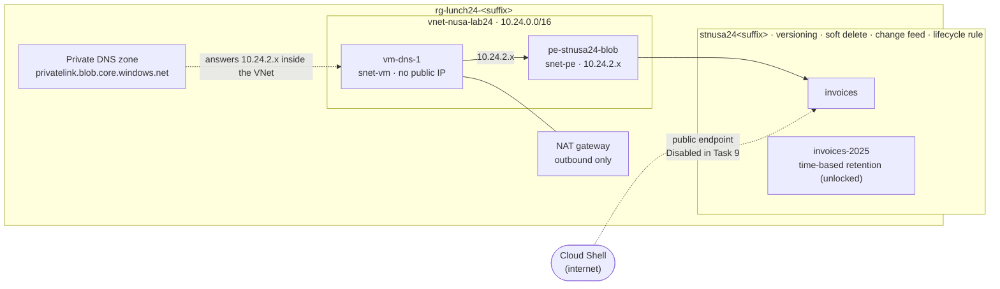

# Lab 24 · Ransomware-proof invoices

> **Pairs with:** [Lunch 24 · Storage (Advanced)](../../lunches/24-storage-advanced/README.md)
> **Time:** about 60 minutes (including about 5 minutes for `setup.sh`) · **Cost:** 💲💲 (see [cost bands](../README.md#cost-bands)) · **Difficulty:** ★★☆
> **Works on its own:** ✅ You do not need any earlier lab. Everything this lab needs is created by its steps or by `setup.sh`.

## 🎯 What you'll build

A supplier of Nusantara Retail was hit by ransomware. You make sure the same attack can't cost Nusantara its invoices:
you switch on versioning, soft delete and change feed, then play the attacker — overwrite an invoice, delete another,
even delete the whole container — and recover everything. You add a ten-year lifecycle policy and a write-once
retention policy for a closed tax year. Finally, you give the account a private endpoint and a private DNS zone, prove
from a VM inside the network that the account's name now resolves to a private IP address, and switch off public
network access.



## ✅ Before you start

- An Azure subscription where you can create resources and assign roles (Owner, or Contributor plus User Access
  Administrator) — see [Lab 01](../01-before-you-begin/README.md).
- **Azure Cloud Shell (Bash)** — open [shell.azure.com](https://shell.azure.com). Nothing to install.
- Read the [Lunch 24 reading](../../lunches/24-storage-advanced/README.md) first; this lab assumes you know what
  versions, soft delete, immutability and private endpoints are.
- Get the lab files and load the shared settings (run this block again whenever Cloud Shell restarts):

```bash
git clone https://github.com/stefpin/azure-fundamentals-lunches.git   # first time only
cd azure-fundamentals-lunches/labs/24-storage-advanced
source ../common/config.sh
RG=$(rg_name 24)
ACCOUNT="stnusa24${SUFFIX}"
VNET=vnet-nusa-lab24
ZONE=privatelink.blob.core.windows.net
ACCOUNT_ID=$(az storage account show --name "$ACCOUNT" --resource-group "$RG" --query id --output tsv 2>/dev/null)
mkdir -p work
echo "Resource group: $RG   Storage account: $ACCOUNT"
```

- Create the starting point — a virtual network with two subnets, a NAT gateway and a small Linux VM without a public
  IP address. It takes about 5 minutes; read section 3 of the lunch while you wait:

```bash
bash setup.sh
```

The VM is only there to test DNS and network paths from *inside* the virtual network. It has no public IP and no
inbound rules; you reach it through **Run Command**, which needs outbound HTTPS to return its output — that's why
`setup.sh` adds a NAT gateway (new subnets have no default outbound internet access).

> [!IMPORTANT]
> The VM, the NAT gateway and the private endpoint are billed by the hour. Finish with the **Clean up** section, even if
> you stop halfway — and **never lock** the retention policy in Task 6, or the account can't be deleted for days.

## 🧭 Choose your mode

| Mode | For you if… | How |
|---|---|---|
| **Guided** | you want every step explained | follow Tasks 1–9 below |
| **Challenge** | you already know the basics | run `bash setup.sh`, read only the [Challenge brief](#-challenge-brief), build it your way, then run `bash verify.sh` |

## Task 1 · Create the invoice account and give yourself a data role

The account is general-purpose v2 with locally redundant storage (cheap, and it supports the archive tier your lifecycle
rule uses), TLS 1.2 and no anonymous access. You work with blob data through your Microsoft Entra identity, so you need
a data role.

```bash
az storage account create \
  --name "$ACCOUNT" \
  --resource-group "$RG" \
  --location "$LOCATION" \
  --kind StorageV2 \
  --sku Standard_LRS \
  --min-tls-version TLS1_2 \
  --allow-blob-public-access false \
  --https-only true \
  --output none

ACCOUNT_ID=$(az storage account show --name "$ACCOUNT" --resource-group "$RG" --query id --output tsv)

az role assignment create \
  --assignee-object-id "$(my_object_id)" \
  --assignee-principal-type User \
  --role "Storage Blob Data Contributor" \
  --scope "$ACCOUNT_ID" \
  --output none

wait_until "your data role to take effect" 600 \
  az storage container list --account-name "$ACCOUNT" --auth-mode login \
  && echo "Data role is active."
```

> ✅ **Checkpoint:** `Data role is active.` is printed, and
> `az role assignment list --assignee "$(my_object_id)" --scope "$ACCOUNT_ID" --query "[].roleDefinitionName" --output tsv`
> shows `Storage Blob Data Contributor`.

## Task 2 · Switch on the protection layers

One command enables versioning, 14 days of soft delete for blobs and for containers, and the change feed:

```bash
az storage account blob-service-properties update \
  --account-name "$ACCOUNT" \
  --resource-group "$RG" \
  --enable-versioning true \
  --enable-delete-retention true --delete-retention-days 14 \
  --enable-container-delete-retention true --container-delete-retention-days 14 \
  --enable-change-feed true \
  --output none
```

You leave **point-in-time restore** off on purpose: it can't be combined with the immutability policy you add in Task 6.
(Point-in-time restore is a stretch goal, on a separate account.)

> [!TIP]
> **Prefer the portal?** Storage account › *Data management* › *Data protection*. Tick versioning, soft delete for blobs
> and containers (14 days) and blob change feed, then *Save*.

> ✅ **Checkpoint:** this prints `True`, `14`, `14`, `True`:
>
> ```bash
> az storage account blob-service-properties show --account-name "$ACCOUNT" --resource-group "$RG" \
>   --query "{versioning:isVersioningEnabled, blobSoftDeleteDays:deleteRetentionPolicy.days, containerSoftDeleteDays:containerDeleteRetentionPolicy.days, changeFeed:changeFeed.enabled}" \
>   --output table
> ```

## Task 3 · Upload invoices, play the ransomware, restore a version

Create the `invoices` container and upload two invoices:

```bash
az storage container create --account-name "$ACCOUNT" --name invoices --auth-mode login --output none

for f in sample-files/INV-2026-0042.txt sample-files/INV-2026-0043.txt; do
  az storage blob upload --account-name "$ACCOUNT" --container-name invoices \
    --name "$(basename "$f")" --file "$f" --auth-mode login --output none
done
```

Now be the attacker. Ransomware doesn't need to delete anything — it just overwrites files with encrypted garbage:

```bash
printf 'ENCRYPTED BY RANSOMWARE - pay by Friday to get your invoice back\n' > work/INV-2026-0042.txt
az storage blob upload --account-name "$ACCOUNT" --container-name invoices --name INV-2026-0042.txt \
  --file work/INV-2026-0042.txt --overwrite --auth-mode login --output none

rm -f work/check.txt
az storage blob download --account-name "$ACCOUNT" --container-name invoices --name INV-2026-0042.txt \
  --file work/check.txt --auth-mode login --output none
cat work/check.txt
```

Without versioning, that invoice would be gone. List its versions — each write created one, with a timestamp as its ID:

```bash
az storage blob list --account-name "$ACCOUNT" --container-name invoices --include v --prefix INV-2026-0042 \
  --auth-mode login --query "[].{name:name, versionId:versionId, current:isCurrentVersion}" --output table
```

The oldest version holds the original invoice. Read it, then **promote** it by copying it over the current blob:

```bash
ORIGINAL=$(az storage blob list --account-name "$ACCOUNT" --container-name invoices --include v \
  --prefix INV-2026-0042.txt --auth-mode login \
  --query "sort_by([?name=='INV-2026-0042.txt'], &versionId)[0].versionId" --output tsv)
echo "Original version: $ORIGINAL"

rm -f work/original.txt
az storage blob download --account-name "$ACCOUNT" --container-name invoices --name INV-2026-0042.txt \
  --version-id "$ORIGINAL" --file work/original.txt --auth-mode login --output none
head -n 3 work/original.txt

az storage blob copy start --account-name "$ACCOUNT" \
  --destination-container invoices --destination-blob INV-2026-0042.txt \
  --source-uri "https://${ACCOUNT}.blob.core.windows.net/invoices/INV-2026-0042.txt?versionId=${ORIGINAL}" \
  --auth-mode login --output none
```

The copy creates a *new* current version with the original content; the encrypted one stays behind as a previous
version, which a lifecycle rule (Task 5) cleans up later.

> [!TIP]
> **Prefer the portal?** Storage browser › `invoices` › `INV-2026-0042.txt` › *Versions* tab › select the oldest
> version › *Make current version*. It does the same copy for you.

> ✅ **Checkpoint:** download the blob again (the `download` and `cat` commands above) — the first line reads
> `PT NUSANTARA RETAIL - INVOICE INV-2026-0042`, and the version list now shows three versions.

## Task 4 · Delete an invoice, then the whole container — and get both back

Delete the second invoice and look at the container:

```bash
az storage blob delete --account-name "$ACCOUNT" --container-name invoices --name INV-2026-0043.txt \
  --auth-mode login --output none
az storage blob list --account-name "$ACCOUNT" --container-name invoices --auth-mode login --query "[].name" --output tsv
az storage blob list --account-name "$ACCOUNT" --container-name invoices --include v --prefix INV-2026-0043 \
  --auth-mode login --query "[].{name:name, versionId:versionId, current:isCurrentVersion}" --output table
```

The invoice is missing from the normal listing, but its version is still there: with versioning on, a delete only turns
the current version into a previous one. (`az storage blob undelete` restores *soft-deleted* versions; it doesn't bring
back a current version, so promoting is the way here.) Promote the newest version, exactly as in Task 3:

```bash
LATEST=$(az storage blob list --account-name "$ACCOUNT" --container-name invoices --include v \
  --prefix INV-2026-0043.txt --auth-mode login \
  --query "sort_by([?name=='INV-2026-0043.txt'], &versionId)[-1].versionId" --output tsv)

az storage blob copy start --account-name "$ACCOUNT" \
  --destination-container invoices --destination-blob INV-2026-0043.txt \
  --source-uri "https://${ACCOUNT}.blob.core.windows.net/invoices/INV-2026-0043.txt?versionId=${LATEST}" \
  --auth-mode login --output none
```

Now something bigger: someone deletes the **whole container**. Container soft delete keeps it for 14 days.

```bash
az storage container delete --account-name "$ACCOUNT" --name invoices --auth-mode login --output none

az storage container list --account-name "$ACCOUNT" --include-deleted --auth-mode login \
  --query "[?deleted].{name:name, version:version}" --output table

DELETED_VERSION=$(az storage container list --account-name "$ACCOUNT" --include-deleted --auth-mode login \
  --query "[?name=='invoices' && deleted] | [0].version" --output tsv)

az storage container restore --account-name "$ACCOUNT" --name invoices \
  --deleted-version "$DELETED_VERSION" --auth-mode login --output none
```

If the restore says *The specified container is being deleted*, wait 30 seconds and run the last command again.

> ✅ **Checkpoint:**
> `az storage blob list --account-name "$ACCOUNT" --container-name invoices --auth-mode login --query "[].name" --output tsv`
> lists both invoices again — the container came back with its blobs and their versions.

## Task 5 · Deploy a ten-year lifecycle policy

Look at [`lifecycle-policy.json`](lifecycle-policy.json): one rule for block blobs whose names start with `invoices/`
(the container name). Current versions move to cool after 30 days, cold after 90 and archive after a year — but not
within 7 days of a tier change, so a rehydrated invoice isn't archived again straight away — and are deleted after
3,650 days. Previous versions move to cold after 30 days and are deleted after a year, so ransomware leftovers don't
pile up.

```bash
cat lifecycle-policy.json

az storage account management-policy create --account-name "$ACCOUNT" --resource-group "$RG" \
  --policy @lifecycle-policy.json --output none
```

The steps are spaced so that every invoice stays in each tier at least as long as that tier's minimum storage duration
(30, 90 and 180 days), so the rule never causes early deletion charges. The platform runs lifecycle rules once a day, and
a new policy can take up to 24 hours to start — your minutes-old invoices won't move today.

> [!TIP]
> **Prefer the portal?** Storage account › *Data management* › *Lifecycle management* › *Add a rule*. After saving, open
> *Code view* to see the same JSON.

> ✅ **Checkpoint:** this shows the rule `invoices-ten-years`, enabled, with 30, 90, 365 and 3650:
>
> ```bash
> az storage account management-policy show --account-name "$ACCOUNT" --resource-group "$RG" \
>   --query "policy.rules[].{rule:name, enabled:enabled, cool:definition.actions.baseBlob.tierToCool.daysAfterModificationGreaterThan, cold:definition.actions.baseBlob.tierToCold.daysAfterModificationGreaterThan, archive:definition.actions.baseBlob.tierToArchive.daysAfterModificationGreaterThan, delete:definition.actions.baseBlob.delete.daysAfterModificationGreaterThan}" \
>   --output table
> ```

## Task 6 · Make a closed tax year immutable

Tax year 2025 is closed; its invoices must not change. Create a container for it, upload the invoice, and add a
**time-based retention policy** of one day (in real life: ten years, or 3,650 days):

```bash
az storage container create --account-name "$ACCOUNT" --name invoices-2025 --auth-mode login --output none
az storage blob upload --account-name "$ACCOUNT" --container-name invoices-2025 --name INV-2025-0999.txt \
  --file sample-files/INV-2025-0999.txt --auth-mode login --output none

az storage container immutability-policy create --account-name "$ACCOUNT" --resource-group "$RG" \
  --container-name invoices-2025 --period 1 --output none

az storage container immutability-policy show --account-name "$ACCOUNT" --resource-group "$RG" \
  --container-name invoices-2025 --query "{state:state, days:immutabilityPeriodSinceCreationInDays}" --output table
```

Give the policy a moment to take effect, then try to delete the invoice — as an attacker with your permissions would:

```bash
sleep 45
az storage blob delete --account-name "$ACCOUNT" --container-name invoices-2025 --name INV-2025-0999.txt \
  --auth-mode login
```

The delete is refused with `BlobImmutableDueToPolicy` (HTTP 409), even though you have full data access. The policy
protects each blob for one day after it was created; after that, the blob can be deleted but still not changed.

**Locked vs unlocked.** Your policy is **Unlocked**: it already blocks deletes and changes, but you can still shorten
it or remove it. That makes it right for testing — and it's why `cleanup.sh` can tidy up after this lab. A **Locked**
policy (`az storage container immutability-policy lock`) can only be *extended*, up to five times, and can never be
deleted. While locked, the protected blobs can't be deleted before their period ends, and the storage account can't be
deleted while the container exists. That is what an auditor wants for ten years of invoices — and why you **don't**
lock it in a lab.

> [!TIP]
> **Prefer the portal?** Container `invoices-2025` › *Settings* › *Access policy* › *Immutable blob storage* ›
> *Add policy* › *Time-based retention*, 1 day.

> ✅ **Checkpoint:** the `show` command prints `Unlocked` and `1`, and the delete fails with
> `This operation is not permitted as the blob is immutable due to a policy.`

## Task 7 · Give the account a private endpoint and a private DNS zone

A private endpoint puts a network interface for the account's **blob** service into `snet-pe`. Because you own the
account, the connection is approved automatically.

```bash
az network private-endpoint create \
  --resource-group "$RG" \
  --name pe-stnusa24-blob \
  --location "$LOCATION" \
  --vnet-name "$VNET" \
  --subnet snet-pe \
  --private-connection-resource-id "$ACCOUNT_ID" \
  --group-id blob \
  --connection-name pec-stnusa24-blob \
  --output none
```

Without DNS, nobody would use it. Create the private DNS zone, link it to the virtual network, and add a **DNS zone
group** to the endpoint, which writes (and maintains) the A record for your account in the zone:

```bash
az network private-dns zone create --resource-group "$RG" --name "$ZONE" --output none

az network private-dns link vnet create --resource-group "$RG" --zone-name "$ZONE" \
  --name link-vnet-nusa-lab24 --virtual-network "$VNET" --registration-enabled false --output none

az network private-endpoint dns-zone-group create --resource-group "$RG" --endpoint-name pe-stnusa24-blob \
  --name default --private-dns-zone "$ZONE" --zone-name blob --output none

az network private-dns record-set a list --resource-group "$RG" --zone-name "$ZONE" \
  --query "[].{name:name, ip:aRecords[0].ipv4Address}" --output table
```

> [!TIP]
> **Prefer the portal?** Storage account › *Security + networking* › *Networking* › *Private endpoints* ›
> *+ Private endpoint*. Choose sub-resource *blob*, subnet `snet-pe`, and *Integrate with private DNS zone: Yes* — the
> portal creates the zone, the link and the zone group for you.

> ✅ **Checkpoint:** the record list shows your account name with an address in `10.24.2.0/24` (usually `10.24.2.4`),
> and
> `az network private-endpoint show --resource-group "$RG" --name pe-stnusa24-blob --query "privateLinkServiceConnections[0].privateLinkServiceConnectionState.status" --output tsv`
> prints `Approved`.

## Task 8 · Compare DNS answers: Cloud Shell vs inside the network

From Cloud Shell, which runs on the internet side:

```bash
nslookup "${ACCOUNT}.blob.core.windows.net"
```

You see a chain of aliases — first `<account>.privatelink.blob.core.windows.net`, then a public storage host name — and
a **public** IP address. Cloud Shell isn't in `vnet-nusa-lab24`, so the private zone doesn't apply to it.

Now ask the same question from `vm-dns-1`, inside the virtual network. Run Command takes 20–60 seconds:

```bash
az vm run-command invoke --resource-group "$RG" --name vm-dns-1 --command-id RunShellScript \
  --scripts "nslookup ${ACCOUNT}.blob.core.windows.net || getent hosts ${ACCOUNT}.blob.core.windows.net" \
  --query "value[0].message" --output tsv
```

Same name, same alias to `privatelink`, but this time the linked private DNS zone answers with **10.24.2.4** (or
whichever address Task 7 showed). Applications don't change their connection strings at all — DNS does the
redirection.

> ✅ **Checkpoint:** Cloud Shell shows a public address; the VM shows your private endpoint's `10.24.2.x` address.

## Task 9 · Close the public door — data-plane work first

Disabling public network access blocks **every** request that reaches the public endpoint, including yours from Cloud
Shell and the portal's Storage browser. Management (control-plane) operations through Azure Resource Manager keep
working, but anything that touches blob data must now come through the private endpoint. So finish data-plane tasks
first. Here, that's one more: a read-only **user delegation SAS** for an invoice, valid for one hour, which you'll use to
test both network paths. (Generating it asks the blob endpoint for a user delegation key — a data-plane call that would
fail after the lockdown.)

```bash
EXPIRY=$(date -u -d "+1 hour" '+%Y-%m-%dT%H:%MZ')
SAS_URL=$(az storage blob generate-sas --account-name "$ACCOUNT" --container-name invoices \
  --name INV-2026-0042.txt --permissions r --expiry "$EXPIRY" --https-only \
  --auth-mode login --as-user --full-uri --output tsv)

curl -s -o /dev/null -w "Cloud Shell, public access on: HTTP %{http_code}\n" "$SAS_URL"
```

Now close the door:

```bash
az storage account update --name "$ACCOUNT" --resource-group "$RG" \
  --public-network-access Disabled --output none

az storage account show --name "$ACCOUNT" --resource-group "$RG" \
  --query "{publicNetworkAccess:publicNetworkAccess, defaultAction:networkRuleSet.defaultAction}" --output table
```

Test from Cloud Shell (if you still get 200, wait a minute — network changes take a moment):

```bash
curl -s -o work/blocked.xml -w "Cloud Shell, public access Disabled: HTTP %{http_code}\n" "$SAS_URL"
grep -o '<Code>[^<]*</Code>' work/blocked.xml

az storage blob list --account-name "$ACCOUNT" --container-name invoices --auth-mode login --output table
```

Both fail: `curl` gets `403` with `AuthorizationFailure`, and the CLI reports *This request is not authorized to perform
this operation.* — valid credentials, wrong network. Now the same SAS URL from the VM, through the private endpoint:

```bash
az vm run-command invoke --resource-group "$RG" --name vm-dns-1 --command-id RunShellScript \
  --scripts "curl -s -w '\nHTTP %{http_code}\n' '${SAS_URL}'" \
  --query "value[0].message" --output tsv
```

The invoice comes back with `HTTP 200`. Same URL, same SAS — the only difference is the network path.

> [!TIP]
> **Prefer the portal?** Storage account › *Security + networking* › *Networking* › *Public network access* ›
> *Disabled* › *Save*. Then open *Storage browser* and see the error for yourself.

> ✅ **Checkpoint:** Cloud Shell gets `403` / `AuthorizationFailure`; the VM gets the invoice text and `HTTP 200`.

## 🔧 Break it and fix it

A colleague "tidies up" the private DNS zone and removes its link to the virtual network. Simulate it:

```bash
az network private-dns link vnet delete --resource-group "$RG" --zone-name "$ZONE" \
  --name link-vnet-nusa-lab24 --yes
sleep 60

az vm run-command invoke --resource-group "$RG" --name vm-dns-1 --command-id RunShellScript \
  --scripts "resolvectl flush-caches; nslookup ${ACCOUNT}.blob.core.windows.net; curl -s -o /dev/null -w 'HTTP %{http_code}\n' '${SAS_URL}'" \
  --query "value[0].message" --output tsv
```

**Symptom:** the VM now resolves the *public* IP address, and the request fails with `HTTP 403`. The private endpoint
still exists and is still approved — but without the zone link, the VM's DNS answers send it to the public endpoint
(out through the NAT gateway), which you disabled in Task 9. (If more than an hour has passed, the SAS has expired and
you get 403 anyway; the `nslookup` answer alone proves the point.)

<details><summary>Hint: the fix</summary>

Recreate the link exactly as in Task 7, wait a minute, and run the same Run Command again:

```bash
az network private-dns link vnet create --resource-group "$RG" --zone-name "$ZONE" \
  --name link-vnet-nusa-lab24 --virtual-network "$VNET" --registration-enabled false --output none
```

The VM resolves `10.24.2.x` again and gets `HTTP 200`. Lesson: a private endpoint is only half the job — clients must
resolve the name through a zone that is linked to *their* network (or through DNS servers that forward to it).

</details>

## 🧪 Verify your work

```bash
bash verify.sh
```

Every check should say **PASS**. If one fails, the message tells you which task to revisit. `verify.sh` uses only
management calls, so it works even though public network access is now Disabled.

## 🧹 Clean up (do not skip!)

```bash
bash cleanup.sh
unset SAS_URL
```

This removes the unlocked retention policy on `invoices-2025`, deletes the resource group `rg-lunch24-<suffix>` (with
the storage account, private endpoint, private DNS zone, VM, NAT gateway and virtual network) and the local `work/`
folder. Deletion continues in the background for a few minutes.

<details><summary>If you locked the policy</summary>

A locked policy can't be removed, so the storage account (and its resource group) survives until the retention period
ends — one day after each blob was created, if you used `--period 1`. `cleanup.sh` still deletes everything else. After
the period ends:

1. Turn public network access back on:
   `az storage account update --name "$ACCOUNT" --resource-group "$RG" --public-network-access Enabled --default-action Allow`
2. Empty `invoices-2025`: delete its blobs and their previous versions (deleting versions needs **Storage Blob Data
   Owner**, which you can assign yourself as in Task 1).
3. Delete the container through the control plane:
   `az storage container-rm delete --storage-account "$ACCOUNT" --resource-group "$RG" --name invoices-2025 --yes`
4. Run `bash cleanup.sh` again.

If Azure still refuses, read the container-level WORM documentation or open a support request. A few kilobytes in an
LRS account cost almost nothing in the meantime.

</details>

## 🩺 Troubleshooting

| Symptom | Likely cause | Fix |
|---|---|---|
| `setup.sh` fails with `SkuNotAvailable` | The VM size isn't offered in your region right now | Run `VM_SIZE_SMALL=Standard_B2ats_v2 bash setup.sh`, or pick a size from `az vm list-skus --location "$LOCATION" --size Standard_B --output table` |
| `The storage account named stnusa24… is already taken.` | Storage account names are global | Set `ACCOUNT="stnusa24${SUFFIX}x"` and use it everywhere (the scripts honour `ACCOUNT` too) |
| `You do not have the required permissions needed to perform this operation…` | The data role from Task 1 isn't active yet | Wait a few minutes and retry |
| `The specified container is being deleted. Try operation later.` | You restored or recreated a container seconds after deleting it | Wait 30 seconds and retry |
| `This operation is not permitted as the blob is immutable due to a policy.` | The retention policy works (Task 6) | Expected — that's the point |
| `This request is not authorized to perform this operation.` | Public network access is Disabled (Task 9), and you're on the public side | Expected after Task 9; data-plane work now has to come from inside the virtual network |
| Run Command hangs, times out or returns no output | The VM has no outbound access (NAT gateway missing) or is still starting | Run `bash setup.sh` again (it's re-runnable), wait a minute, retry |
| `Run command extension execution is in progress…` | A previous Run Command is still running | Wait for it to finish; run one command at a time |
| `nslookup: command not found` on the VM | The image has no DNS tools | The commands fall back to `getent hosts`, which prints the resolved address |
| `management-policy create` complains that it can't parse the policy | The JSON file was edited and is no longer valid | Check it with `python3 -m json.tool lifecycle-policy.json` |

## 🚀 Stretch goals

- **Delete a previous version** of `INV-2026-0042.txt` in the portal (*Versions* tab). With Storage Blob Data
  Contributor it fails — deleting versions needs **Storage Blob Data Owner**. Why is that a useful line of defence? (Do
  this before Task 9, or turn public access back on for a moment.)
- **Point-in-time restore:** create a second account (not this one — PITR and immutability can't share an account),
  enable point-in-time restore with 6 days and soft delete with 7, change a few blobs, then use *Containers* ›
  *Restore containers* in the portal to roll them back.
- **Read the change feed:** before Task 9, list `az storage blob list --account-name "$ACCOUNT" --container-name '$blobchangefeed' --auth-mode login --query "[].name" --output tsv`.
  The log files appear after a few minutes and record every create, update and delete you made.
- **Disallow Shared Key** with `az storage account update --allow-shared-key-access false` and try
  `az storage container list --account-name "$ACCOUNT" --auth-mode key`. Which error do you get, and which SAS types
  stop working?
- **Object replication:** replicate `invoices` to a second account in `$SECONDARY_LOCATION` (*Data management* ›
  *Object replication*). What do both accounts need first?

## 🏁 Challenge brief

Run `bash setup.sh` first, then build the following, any way you like (portal, CLI, Bicep), in `rg-lunch24-<suffix>`:

1. A general-purpose v2 storage account named `stnusa24<suffix>` (LRS is fine).
2. Blob versioning, blob soft delete and container soft delete (at least 7 days each), and change feed — all enabled.
3. Recovery practice (prove it to yourself; `verify.sh` can't check it): overwrite an invoice and restore its original
   version; delete an invoice and bring it back; delete a container and restore it.
4. An enabled lifecycle rule that moves blobs to cooler tiers and deletes them at the end of their life (for example
   from `lifecycle-policy.json`).
5. A container `invoices-2025` with a time-based retention policy that stays **unlocked**.
6. A private endpoint for the `blob` sub-resource in `snet-pe` of `vnet-nusa-lab24`, and a private DNS zone
   `privatelink.blob.core.windows.net` in the same resource group, linked to `vnet-nusa-lab24`, with an A record for the
   account. From `vm-dns-1`, the account name resolves to a `10.24.2.x` address.
7. Public network access **Disabled** — after all your data-plane work is done.

Then run `bash verify.sh`. Stuck? Peek at `solution.sh` or switch to Guided mode.

---

⬅️ [Lunch 24 reading](../../lunches/24-storage-advanced/README.md) · 🏠 [All labs](../README.md) · 🏠 [Course home](../../README.md)

<sub>Last validated: October 2026 · Something broken? [Report a lab problem](../../CONTRIBUTING.md).</sub>
