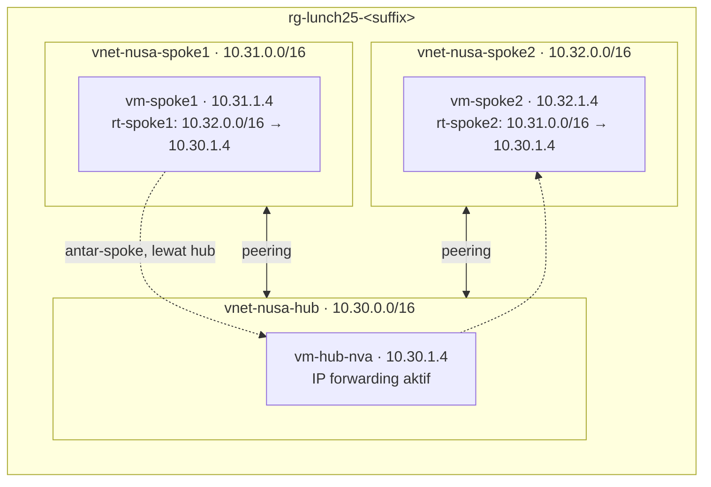

# Lab 25 · Hub-and-spoke untuk Nusantara Retail

🇬🇧 [Read in English](README.md)

> **Pasangan dari:** [Makan Siang 25 · Virtual Networking (Lanjutan)](../../lunches/25-networking-advanced/README.id.md)
> **Waktu:** sekitar 60 menit (termasuk sekitar 8 menit setup) · **Biaya:** 💲💲, jalur opsional Azure Firewall 💲💲💲 (lihat [kelompok biaya](../README.id.md#kelompok-biaya)) · **Tingkat kesulitan:** ★★★
> **Bisa dikerjakan terpisah:** ✅ Anda tidak memerlukan lab sebelumnya. Semua yang dibutuhkan lab ini dibuat oleh langkah-langkahnya sendiri atau oleh `setup.sh`.
> **Penulis:** Stefanus Pinarta · [Tentang penulis](../../README.id.md#tentang-penulis)

## 🎯 Yang akan Anda bangun

Jaringan hub-and-spoke pertama milik Nusantara Retail. Toko online tinggal di **spoke1**, back office tim keuangan di
**spoke2**, dan layanan bersama di **hub**. Anda membuat peering antara setiap spoke dan hub, membuktikan bahwa kedua
spoke tetap tidak bisa saling bicara karena peering tidak transitif, lalu membuat keduanya bisa berkomunikasi *melalui
hub*: sebuah VM Linux kecil di hub menjadi router (network virtual appliance yang sangat sederhana), dan route table di
kedua spoke mengirim lalu lintas untuk spoke seberang ke router itu. Effective routes, next hop dari Network Watcher,
dan penghitung paket terusan (forwarded-packet counter) di router membuktikan setiap lompatan. Jalur opsional mengganti
router buatan tangan itu dengan Azure Firewall.



## ✅ Sebelum mulai

- Sebuah subscription Azure tempat Anda bisa membuat resource (lihat [Lab 01](../01-before-you-begin/README.id.md)).
- **Azure Cloud Shell (Bash)** — buka [shell.azure.com](https://shell.azure.com). Tidak ada yang perlu diinstal.
- Sekitar **6 vCPU** kuota yang masih kosong di region Anda: lab ini menjalankan tiga VM `$VM_SIZE_SMALL` (masing-masing
  2 vCPU secara default). Free trial sering hanya mengizinkan 4 vCPU per region: periksa dengan
  `bash ../common/check-environment.sh` dan, bila perlu, minta tambahan kuota di portal (*Subscriptions › Usage +
  quotas*) sebelum mulai. Tiga VM adalah jumlah minimum untuk lab ini, karena lalu lintas antar-spoke harus melewati
  sebuah router di hub.
- Ambil file lab, muat pengaturan bersama, dan definisikan sebuah fungsi bantu (helper). Jika Cloud Shell tersambung
  ulang di tengah lab, jalankan blok ini lagi sebelum melanjutkan:

```bash
git clone https://github.com/stefpin/azure-fundamentals-lunches.git   # first time only
cd azure-fundamentals-lunches/labs/25-networking-advanced
source ../common/config.sh
RG=$(rg_name 25)

# Helper: run shell commands inside a VM through the Azure VM agent. The VMs have no public IPs,
# so this replaces SSH. Each call takes 20-40 seconds.
run_on() {
  az vm run-command invoke -g "$RG" -n "$1" --command-id RunShellScript \
    --scripts "$2" --query "value[0].message" -o tsv
}
```

- Buat titik awalnya — tiga virtual network tanpa peering, dengan satu VM di masing-masing. Prosesnya sekitar 8 menit;
  baca bagian 1 dan 2 dari bacaan makan siang ini sambil menunggu:

```bash
bash setup.sh
```

> [!IMPORTANT]
> Resource lab menimbulkan biaya selama masih ada — terutama ketiga VM, dan Azure Firewall jika Anda mengambil jalur
> opsional. Akhiri dengan bagian **Bersihkan**, meskipun Anda berhenti di tengah jalan.

## 🧭 Pilih mode Anda

| Mode | Cocok untuk Anda jika… | Caranya |
|---|---|---|
| **Terpandu** | Anda ingin setiap langkah dijelaskan | ikuti Tugas 1–6 di bawah |
| **Tantangan** | Anda sudah menguasai dasarnya | jalankan `setup.sh`, baca hanya [Ringkasan tantangan](#-ringkasan-tantangan), bangun dengan cara Anda sendiri, lalu jalankan `bash verify.sh` |

## Tugas 1 · Menjelajahi titik awal

Sebelum mengubah apa pun, lihat bagaimana Azure memandang jaringan ini dari dalam spoke1: tiga VNet yang terisolasi,
dan sebuah route table di network interface `vm-spoke1` yang tidak pernah Anda buat.

```bash
az network vnet list -g "$RG" \
  --query '[].{vnet:name, space:addressSpace.addressPrefixes[0], peerings:length(virtualNetworkPeerings || `[]`)}' -o table

S1_NIC=$(az vm show -g "$RG" -n vm-spoke1 --query "networkProfile.networkInterfaces[0].id" -o tsv)
az network nic show-effective-route-table --ids "$S1_NIC" -o table

run_on vm-spoke1 'ping -c 3 -W 2 10.30.1.4 >/dev/null && echo "spoke1 -> hub: REACHABLE" || echo "spoke1 -> hub: UNREACHABLE"'
```

Baca effective routes itu pelan-pelan. `10.31.0.0/16` menuju *VnetLocal* (di dalam spoke1), `0.0.0.0/0` menuju
internet, dan beberapa rentang privat — termasuk `10.0.0.0/8` — menuju *None*. Belum ada yang tahu tentang hub atau
spoke2, sehingga paket untuk `10.30.1.4` cocok dengan `10.0.0.0/8` dan dibuang.

> [!TIP]
> **Lebih suka portal?** *vm-spoke1 › Networking › Network settings ›* pilih network interface › *Effective
> routes*. Tabelnya sama, dengan kolom **Source** (Default, User, Virtual network gateway).

> ✅ **Pemeriksaan:** tiga VNet dengan 0 peering, tidak ada rute untuk `10.30.0.0/16` maupun `10.32.0.0/16` di
> effective routes, dan `spoke1 -> hub: UNREACHABLE`.

## Tugas 2 · Membuat peering antara hub dan setiap spoke

Sebuah peering punya dua bagian, masing-masing dibuat dari salah satu VNet. Ada dua detail penting di CLI.
`--allow-vnet-access` secara default bernilai *false* pada `az network vnet peering create`, jadi atur nilainya secara
eksplisit. Lalu `--allow-forwarded-traffic` di link milik sebuah spoke membuat spoke itu mau menerima paket yang
diteruskan router hub dari spoke *lainnya* — Anda membutuhkannya di Tugas 5. Mengaturnya di keempat link membuat
semuanya tetap sederhana.

```bash
for spoke in spoke1 spoke2; do
  az network vnet peering create -g "$RG" -n "peer-hub-to-$spoke" \
    --vnet-name vnet-nusa-hub --remote-vnet "vnet-nusa-$spoke" \
    --allow-vnet-access true --allow-forwarded-traffic true --output none
  az network vnet peering create -g "$RG" -n "peer-$spoke-to-hub" \
    --vnet-name "vnet-nusa-$spoke" --remote-vnet vnet-nusa-hub \
    --allow-vnet-access true --allow-forwarded-traffic true --output none
done
```

> [!TIP]
> **Lebih suka portal?** *vnet-nusa-hub › Peerings › + Add* membuat kedua link dalam satu formulir. Biarkan kedua kotak
> *access* tetap tercentang, lalu centang kedua kotak *…to receive forwarded traffic…* — satu di bagian remote, satu di
> bagian local.

> ✅ **Pemeriksaan:** empat link, semuanya *Connected*, dan sebuah rute baru untuk `10.30.0.0/16` (next hop: peering)
> di effective routes `vm-spoke1` — tetapi tetap belum ada apa-apa untuk `10.32.0.0/16`:
>
> ```bash
> for v in vnet-nusa-hub vnet-nusa-spoke1 vnet-nusa-spoke2; do
>   az network vnet peering list -g "$RG" --vnet-name "$v" \
>     --query "[].{vnet:'$v', link:name, state:peeringState, forwarded:allowForwardedTraffic}" -o table
> done
> az network nic show-effective-route-table --ids "$S1_NIC" -o table
> ```

## Tugas 3 · Membuktikan bahwa peering tidak transitif

Spoke1 sekarang bisa menjangkau hub. Bisakah ia menjangkau spoke2, yang *juga* di-peering dengan hub?

```bash
run_on vm-spoke1 'ping -c 3 -W 2 10.30.1.4 >/dev/null && echo "spoke1 -> hub: REACHABLE" || echo "spoke1 -> hub: UNREACHABLE"'
run_on vm-spoke1 'ping -c 3 -W 2 10.32.1.4 >/dev/null && echo "spoke1 -> spoke2: REACHABLE" || echo "spoke1 -> spoke2: UNREACHABLE"'

# Ask Network Watcher where Azure sends a packet from vm-spoke1 to vm-spoke2.
az network watcher show-next-hop -g "$RG" --vm vm-spoke1 \
  --source-ip 10.31.1.4 --dest-ip 10.32.1.4 -o table
```

Hub menjawab; spoke2 diam saja. Next hop menunjukkan **None** dari sebuah **System Route**: paket masih cocok dengan
`10.0.0.0/8`. Setiap peering hanya memperkenalkan spoke1 kepada tetangga langsungnya, yaitu hub.

> ✅ **Pemeriksaan:** `spoke1 -> hub: REACHABLE`, `spoke1 -> spoke2: UNREACHABLE`, dan next hop type `None`.

## Tugas 4 · Mengubah VM hub menjadi router sederhana

Agar bisa membawa lalu lintas antar-spoke, `vm-hub-nva` harus mau menerima paket yang tidak dialamatkan kepadanya, lalu
meneruskannya. Untuk itu dibutuhkan **dua** sakelar. Di Azure, **IP forwarding** pada NIC mencegah platform membuang
paket yang tujuannya bukan alamat milik NIC itu. Di Linux, `net.ipv4.ip_forward` membuat kernel merutekan paket-paket
tersebut alih-alih membuangnya. File di `/etc/sysctl.d` menjaga setelan ini tetap berlaku setelah reboot.

```bash
HUB_NIC=$(az vm show -g "$RG" -n vm-hub-nva --query "networkProfile.networkInterfaces[0].id" -o tsv)

az network nic update --ids "$HUB_NIC" --ip-forwarding true --output none
az network nic show --ids "$HUB_NIC" --query enableIPForwarding -o tsv

run_on vm-hub-nva 'sysctl -w net.ipv4.ip_forward=1 >/dev/null && echo "net.ipv4.ip_forward = 1" > /etc/sysctl.d/99-nusa-router.conf && echo "ip_forward=$(sysctl -n net.ipv4.ip_forward)"'
```

> [!TIP]
> **Lebih suka portal?** *vm-hub-nva › Networking ›* pilih network interface › *IP configurations* › centang
> **Enable IP forwarding** › Save. Bagian Linux tetap memerlukan Run Command di atas (*vm-hub-nva › Run command ›
> RunShellScript* di portal).

> ✅ **Pemeriksaan:** `true` untuk NIC, dan `ip_forward=1` dari dalam VM.

## Tugas 5 · Mengirim lalu lintas antar-spoke melalui hub

Sekarang ajari setiap spoke sebuah rute ke spoke lainnya, dengan VM hub sebagai next hop. Spoke2 membutuhkan bayangan
cermin dari rute spoke1; tanpa rute itu, balasan tidak punya jalan pulang.

```bash
az network route-table create -g "$RG" -n rt-spoke1 --location "$LOCATION" --output none
az network route-table route create -g "$RG" --route-table-name rt-spoke1 -n to-spoke2-via-hub \
  --address-prefix 10.32.0.0/16 --next-hop-type VirtualAppliance --next-hop-ip-address 10.30.1.4 --output none
az network vnet subnet update -g "$RG" --vnet-name vnet-nusa-spoke1 -n snet-workload \
  --route-table rt-spoke1 --output none

az network route-table create -g "$RG" -n rt-spoke2 --location "$LOCATION" --output none
az network route-table route create -g "$RG" --route-table-name rt-spoke2 -n to-spoke1-via-hub \
  --address-prefix 10.31.0.0/16 --next-hop-type VirtualAppliance --next-hop-ip-address 10.30.1.4 --output none
az network vnet subnet update -g "$RG" --vnet-name vnet-nusa-spoke2 -n snet-workload \
  --route-table rt-spoke2 --output none
```

Periksa hasilnya dari kedua sisi. `/16` adalah prefix yang lebih panjang daripada `10.0.0.0/8`, jadi user route-lah
yang menang:

```bash
az network nic show-effective-route-table --ids "$S1_NIC" -o table
az network watcher show-next-hop -g "$RG" --vm vm-spoke1 --source-ip 10.31.1.4 --dest-ip 10.32.1.4 -o table
az network watcher show-next-hop -g "$RG" --vm vm-spoke2 --source-ip 10.32.1.4 --dest-ip 10.31.1.4 -o table
```

> [!TIP]
> **Lebih suka portal?** *Create a resource › Route table*, lalu **Routes › + Add** (destination type *IP addresses*,
> next hop type *Virtual appliance*) dan **Subnets › + Associate**. Setelah itu, *Network Watcher › Next hop* memberikan
> jawaban yang sama dengan CLI.

> ✅ **Pemeriksaan:** di effective routes ada rute *User* untuk `10.32.0.0/16` dengan next hop *VirtualAppliance*
> `10.30.1.4`; kedua kueri next hop menjawab *VirtualAppliance* `10.30.1.4` dan menyebut route table Anda. Jika
> effective routes belum menampilkan user route itu, tunggu satu menit lalu ulangi.

## Tugas 6 · Membuktikan bahwa lalu lintas mengalir melalui hub

Rute hanya menyatakan ke mana paket *seharusnya* pergi. Sekarang buktikan ke mana paket *benar-benar* pergi: baca
penghitung paket terusan di router, kirim lalu lintas dari spoke1 ke spoke2, lalu baca penghitungnya lagi.

```bash
run_on vm-hub-nva 'nstat -az IpForwDatagrams'

run_on vm-spoke1 'ping -c 5 -W 2 10.32.1.4; curl -s --max-time 5 http://10.32.1.4/ | grep -q vm-spoke2 && echo "HTTP from vm-spoke2: OK" || echo "HTTP: FAILED"'

run_on vm-hub-nva 'nstat -az IpForwDatagrams'
```

> ✅ **Pemeriksaan:** `5 received, 0% packet loss`, `HTTP from vm-spoke2: OK`, dan nilai `IpForwDatagrams` yang
> bertambah setidaknya sepuluh di antara kedua pembacaan — setiap ping dan setiap balasan melintasi hub.

## 🔧 Rusak lalu perbaiki

Tim Pak Budi menjalankan skrip "bersih-bersih" yang me-reset setelan NIC di seluruh subscription. Mari kita
simulasikan:

```bash
az network nic update --ids "$HUB_NIC" --ip-forwarding false --output none
```

Tunggu sekitar satu menit, lalu uji lagi dan tanyakan ke Network Watcher:

```bash
run_on vm-spoke1 'ping -c 3 -W 2 10.32.1.4 >/dev/null && echo "spoke1 -> spoke2: REACHABLE" || echo "spoke1 -> spoke2: UNREACHABLE"'
az network watcher show-next-hop -g "$RG" --vm vm-spoke1 --source-ip 10.31.1.4 --dest-ip 10.32.1.4 -o table
```

**Gejala:** spoke2 kembali tidak terjangkau, padahal next hop masih menunjukkan *VirtualAppliance* `10.30.1.4` dan
Linux masih punya `ip_forward=1`. Peruteannya benar; ada sesuatu di appliance yang menolak. Apa itu?

<details><summary>Petunjuk dan perbaikan</summary>

Next hop hanya membuktikan keputusan perutean di spoke1. Paket memang sampai ke network interface VM hub — dan Azure
membuangnya di sana, karena IP forwarding di NIC mati, sehingga paket yang dialamatkan ke `10.32.1.4` tidak diterima.
Periksa, lalu nyalakan kembali:

```bash
az network nic show --ids "$HUB_NIC" --query enableIPForwarding -o tsv     # false
az network nic update --ids "$HUB_NIC" --ip-forwarding true --output none
run_on vm-spoke1 'ping -c 3 -W 2 10.32.1.4 >/dev/null && echo "spoke1 -> spoke2: REACHABLE" || echo "spoke1 -> spoke2: UNREACHABLE"'
```

</details>

## 🔥 Opsional · Mengganti router dengan Azure Firewall (💲💲💲)

> [!CAUTION]
> Azure Firewall ditagih untuk setiap jam keberadaannya, ada atau tidak ada lalu lintas, dan dengan tarif yang jauh
> lebih tinggi daripada VM lab. Kerjakan bagian ini hanya jika Anda bisa menyelesaikannya dalam sekali duduk, dan hapus
> firewall tersebut segera sesudahnya.

Firewall terkelola menggantikan router buatan tangan: Microsoft yang mengurus high availability dan patching, dan setiap
aliran harus cocok dengan sebuah aturan. Firewall membutuhkan subnet sendiri bernama `AzureFirewallSubnet` (/26 atau
lebih besar), sebuah IP publik Standard, dan sebuah **Firewall Policy** dengan network rule yang mengizinkan lalu lintas
antar-spoke. Pembuatannya memakan waktu sekitar 10 menit. Perintah `az network firewall` yang pertama mungkin meminta
Anda memasang ekstensi CLI `azure-firewall` — jawab **Y**.

```bash
az network vnet subnet create -g "$RG" --vnet-name vnet-nusa-hub -n AzureFirewallSubnet \
  --address-prefixes 10.30.2.0/26 --output none
az network public-ip create -g "$RG" -n pip-afw-nusa --location "$LOCATION" \
  --sku Standard --allocation-method Static --output none

az network firewall policy create -g "$RG" -n afwp-nusa --location "$LOCATION" --output none
az network firewall policy rule-collection-group create -g "$RG" --policy-name afwp-nusa \
  -n rcg-spokes --priority 200 --output none
az network firewall policy rule-collection-group collection add-filter-collection -g "$RG" \
  --policy-name afwp-nusa --rule-collection-group-name rcg-spokes -n allow-spoke-to-spoke \
  --collection-priority 100 --action Allow --rule-type NetworkRule --rule-name spoke1-spoke2 \
  --source-addresses 10.31.0.0/16 10.32.0.0/16 --destination-addresses 10.31.0.0/16 10.32.0.0/16 \
  --destination-ports '*' --ip-protocols Any --output none

az network firewall create -g "$RG" -n afw-nusa-hub --location "$LOCATION" \
  --sku AZFW_VNet --tier Standard --firewall-policy afwp-nusa \
  --vnet-name vnet-nusa-hub --conf-name ipconfig1 --public-ip pip-afw-nusa --output none

FW_IP=$(az network firewall show -g "$RG" -n afw-nusa-hub \
  --query "ipConfigurations[0].privateIPAddress || ipConfigurations[0].privateIpAddress" -o tsv)
echo "Firewall private IP: $FW_IP"

# Point both spokes' routes at the firewall instead of the VM.
az network route-table route update -g "$RG" --route-table-name rt-spoke1 -n to-spoke2-via-hub \
  --next-hop-ip-address "$FW_IP" --output none
az network route-table route update -g "$RG" --route-table-name rt-spoke2 -n to-spoke1-via-hub \
  --next-hop-ip-address "$FW_IP" --output none
```

Ulangi uji ping dan HTTP dari Tugas 6 (penghitung di VM hub kini diam saja) serta kueri next hop, yang sekarang
menyebutkan IP privat firewall. Lalu hapus firewall beserta IP publiknya, dan arahkan rute-rute kembali ke `10.30.1.4`:

```bash
az network firewall delete -g "$RG" -n afw-nusa-hub
az network public-ip delete -g "$RG" -n pip-afw-nusa
for pair in "rt-spoke1 to-spoke2-via-hub" "rt-spoke2 to-spoke1-via-hub"; do
  read -r rt route <<< "$pair"
  az network route-table route update -g "$RG" --route-table-name "$rt" -n "$route" \
    --next-hop-ip-address 10.30.1.4 --output none
done
```

Jika ada perintah firewall yang gagal karena sebuah flag telah berubah, gunakan portal saja: *Create a resource ›
Firewall*, pilih `vnet-nusa-hub`, tier Standard, dan Firewall Policy baru, lalu tambahkan network rule di *Firewall
Policy › Network rules*.

## 🧪 Verifikasi hasil kerja Anda

```bash
bash verify.sh
```

Setiap pemeriksaan harus menyatakan **PASS**. Skrip ini butuh sekitar dua menit karena meminta next hop ke Network
Watcher dan mengirim lalu lintas sungguhan lewat Run Command. Jika ada pemeriksaan yang gagal, pesannya memberi tahu
tugas mana yang perlu Anda ulangi.

## 🧹 Bersihkan (jangan dilewati!)

```bash
bash cleanup.sh
```

Perintah ini menghapus resource group `rg-lunch25-<suffix>` beserta seluruh isinya: VM dan disk-nya, ketiga VNet
beserta peering-nya, route table, dan — jika Anda membuatnya — firewall. Penghapusan berlanjut di latar belakang selama
beberapa menit. Tidak ada yang dibuat di luar resource group: Network Watcher (di `NetworkWatcherRG`) adalah resource
regional yang gratis dan dipakai bersama, dan kunci SSH di `~/.ssh` dipakai ulang oleh lab lain.

## 🩺 Pemecahan masalah

| Gejala | Kemungkinan penyebab | Perbaikan |
|---|---|---|
| `setup.sh` berhenti dengan `SkuNotAvailable` | `$VM_SIZE_SMALL` tidak ditawarkan untuk subscription Anda di region ini | `az vm list-skus -l "$LOCATION" --size Standard_B -o table`, lalu `export VM_SIZE_SMALL=<size>`, `source ../common/config.sh`, dan jalankan `setup.sh` lagi |
| `Operation could not be completed as it results in exceeding approved ... Cores quota` | Lab ini membutuhkan sekitar 6 vCPU sekaligus (tiga VM) | Bersihkan VM dari lab lain atau minta tambahan kuota |
| Sebuah peering tetap *Initiated* | Baru satu dari dua link yang ada | Buat link dari VNet yang satunya lagi |
| `spoke1 -> hub` tidak terjangkau meskipun peering sudah *Connected* | `--allow-vnet-access` tidak diatur; default CLI adalah false | `az network vnet peering update -g "$RG" --vnet-name <vnet> -n <link> --allow-vnet-access true` di kedua link |
| Next hop masih *None* setelah Tugas 5 | Route table belum dikaitkan dengan subnet, atau ada salah ketik pada prefix | `az network vnet subnet show -g "$RG" --vnet-name vnet-nusa-spoke1 -n snet-workload --query routeTable.id`; baca effective routes |
| Next hop menunjukkan *VirtualAppliance* tetapi ping gagal | IP forwarding mati di NIC atau di Linux, tidak ada rute balik di spoke2, atau *allow forwarded traffic* mati di link sebuah spoke | Ulangi pemeriksaan Tugas 4; periksa `rt-spoke2`; periksa kolom *forwarded* pada pemeriksaan Tugas 2 |
| `Run command extension execution is in progress. Please wait for completion before invoking a run command.` | Run Command hanya menjalankan satu skrip dalam satu waktu per VM | Tunggu 30 detik lalu coba lagi |
| `show-next-hop` atau effective routes gagal untuk satu VM | VM sedang berhenti (deallocated); kedua alat membutuhkan VM yang sedang berjalan | `az vm start -g "$RG" -n <vm>` |
| `show-next-hop` melaporkan bahwa Network Watcher tidak aktif atau tidak ditemukan untuk region tersebut | Anda memilih keluar (opt out) dari pengaktifan otomatis | `az network watcher configure -g NetworkWatcherRG -l "$LOCATION" --enabled true` |
| `nstat: command not found` | Image yang tidak lazim, tanpa tool iproute2 | Baca penghitungnya dengan `grep -A1 '^Ip:' /proc/net/snmp` (kolom *ForwDatagrams*) |

## 🚀 Tantangan tambahan

- Pasang NSG yang hanya berisi aturan default di subnet spoke2, lalu pastikan lalu lintas antar-spoke tetap mengalir.
  Gunakan IP flow verify untuk melihat aturan mana yang mengizinkannya: service tag *VirtualNetwork* mencakup rentang
  yang di-peering **dan** prefix dari user-defined route Anda.
- Di portal, jalankan **Network Watcher › Connection troubleshoot** dari `vm-spoke1` ke `10.32.1.4` port 80, lalu baca
  hop-hop-nya: appliance di hub muncul di antara kedua spoke.
- Tambahkan spoke ketiga di `$SECONDARY_LOCATION` dengan global peering ke hub (perhatikan kuota vCPU Anda — dibutuhkan
  satu VM lagi), lalu rutekan melalui hub yang sama.
- Buat sketsa bagaimana Azure Virtual Network Manager akan menggantikan empat peering dan dua route table Anda dengan
  satu network group dan satu connectivity configuration hub-and-spoke.

## 🏁 Ringkasan tantangan

Jalankan `bash setup.sh` terlebih dahulu, lalu bangun hal-hal berikut dengan cara apa pun yang Anda suka (portal, CLI,
Bicep):

1. Peering `vnet-nusa-hub` dengan `vnet-nusa-spoke1` dan dengan `vnet-nusa-spoke2`, di kedua arah. Setiap link
   berstatus *Connected*, dan link spoke ke hub mengizinkan forwarded traffic. Jangan buat peering di antara kedua
   spoke.
2. Ubah `vm-hub-nva` menjadi router: IP forwarding aktif di network interface-nya dan di dalam Linux (tetap berlaku
   setelah reboot).
3. Kaitkan route table ke subnet kedua spoke sehingga lalu lintas spoke1 ↔ spoke2 memakai next hop type
   *VirtualAppliance* dengan IP `vm-hub-nva` (`10.30.1.4`) — atau, jika Anda mengambil jalur opsional, IP privat Azure
   Firewall — di **kedua** arah.
4. `vm-spoke1` bisa melakukan ping ke `vm-spoke2` dan mengambil halaman web-nya di port 80.

Lalu jalankan `bash verify.sh`. Buntu? Intip `solution.sh` atau beralih ke mode Terpandu.

---

⬅️ [Bacaan Makan Siang 25](../../lunches/25-networking-advanced/README.id.md) · 🏠 [Semua lab](../README.id.md) · 🏠 [Beranda kursus](../../README.id.md)

<sub>Terakhir divalidasi: Oktober 2026 · Ada yang tidak berfungsi? [Laporkan masalah lab](../../CONTRIBUTING.md).</sub>
