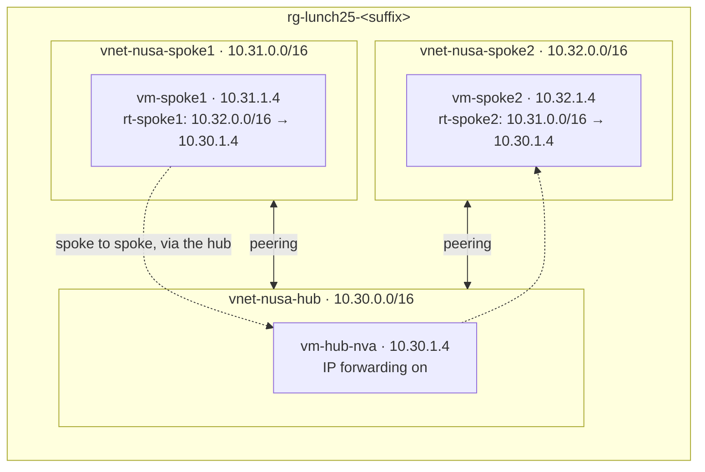

# Lab 25 · Hub and spoke for Nusantara Retail

> **Pairs with:** [Lunch 25 · Virtual Networking (Advanced)](../../lunches/25-networking-advanced/README.md)
> **Time:** about 60 minutes (including about 8 minutes of setup) · **Cost:** 💲💲, optional Azure Firewall path 💲💲💲 (see [cost bands](../README.md#cost-bands)) · **Difficulty:** ★★★
> **Works on its own:** ✅ You do not need any earlier lab. Everything this lab needs is created by its steps or by `setup.sh`.

## 🎯 What you'll build

Nusantara Retail's first hub-and-spoke network. The storefront lives in **spoke1**, the finance team's back office in
**spoke2**, and shared services in the **hub**. You peer each spoke with the hub, prove that the two spokes still can't
talk because peering isn't transitive, and then make them talk *through the hub*: a small Linux VM in the hub becomes a
router (a very simple network virtual appliance), and route tables on both spokes send each other's traffic to it.
Effective routes, Network Watcher's next hop and a forwarded-packet counter on the router prove every hop. An optional
path replaces the hand-built router with Azure Firewall.



## ✅ Before you start

- An Azure subscription where you can create resources (see [Lab 01](../01-before-you-begin/README.md)).
- **Azure Cloud Shell (Bash)** — open [shell.azure.com](https://shell.azure.com). Nothing to install.
- About **6 vCPUs** of free quota in your region: the lab runs three `$VM_SIZE_SMALL` VMs (2 vCPUs each by default).
  Free trials often allow only 4 vCPUs per region: check with `bash ../common/check-environment.sh` and, if needed,
  request more in the portal (*Subscriptions › Usage + quotas*) before you start. Three VMs are the minimum for this
  lab, because spoke-to-spoke traffic has to pass through a router in the hub.
- Get the lab files, load the shared settings and define a helper. If Cloud Shell reconnects during the lab, run this
  block again before you continue:

```bash
git clone https://github.com/stefpin/azure-fundamentals-lunches.git   # first time only
cd azure-fundamentals-lunches/labs/25-networking-advanced
source ../common/config.sh
RG=$(rg_name 25)

# Helper: run shell commands inside a VM through the Azure VM agent. The VMs have no public IPs,
# so this replaces SSH. Each call takes 20-40 seconds.
run_on() {
  az vm run-command invoke -g "$RG" -n "$1" --command-id RunShellScript \
    --scripts "$2" --query "value[0].message" -o tsv
}
```

- Create the starting point — three virtual networks without peerings and one VM in each. It takes about 8 minutes;
  read sections 1 and 2 of the lunch while you wait:

```bash
bash setup.sh
```

> [!IMPORTANT]
> Lab resources cost money while they exist — mainly the three VMs, and Azure Firewall if you take the optional path.
> Finish with the **Clean up** section, even if you stop halfway.

## 🧭 Choose your mode

| Mode | For you if… | How |
|---|---|---|
| **Guided** | you want every step explained | follow Tasks 1–6 below |
| **Challenge** | you already know the basics | run `setup.sh`, read only the [Challenge brief](#-challenge-brief), build it your way, then run `bash verify.sh` |

## Task 1 · Explore the starting point

Before changing anything, look at what Azure thinks the network looks like from inside spoke1. Three isolated VNets,
and a route table on `vm-spoke1`'s network interface that you never created.

```bash
az network vnet list -g "$RG" \
  --query '[].{vnet:name, space:addressSpace.addressPrefixes[0], peerings:length(virtualNetworkPeerings || `[]`)}' -o table

S1_NIC=$(az vm show -g "$RG" -n vm-spoke1 --query "networkProfile.networkInterfaces[0].id" -o tsv)
az network nic show-effective-route-table --ids "$S1_NIC" -o table

run_on vm-spoke1 'ping -c 3 -W 2 10.30.1.4 >/dev/null && echo "spoke1 -> hub: REACHABLE" || echo "spoke1 -> hub: UNREACHABLE"'
```

Read the effective routes slowly. `10.31.0.0/16` goes to *VnetLocal* (inside spoke1), `0.0.0.0/0` goes to the
internet, and several private ranges — including `10.0.0.0/8` — go to *None*. Nothing knows about the hub or spoke2,
so a packet for `10.30.1.4` matches `10.0.0.0/8` and is dropped.

> [!TIP]
> **Prefer the portal?** *vm-spoke1 › Networking › Network settings ›* select the network interface › *Effective
> routes*. The same table, with a **Source** column (Default, User, Virtual network gateway).

> ✅ **Checkpoint:** three VNets with 0 peerings, no route for `10.30.0.0/16` or `10.32.0.0/16` in the effective
> routes, and `spoke1 -> hub: UNREACHABLE`.

## Task 2 · Peer the hub with each spoke

A peering has two halves, one created from each VNet. Two details matter in the CLI. `--allow-vnet-access` defaults
to *false* in `az network vnet peering create`, so set it explicitly. And `--allow-forwarded-traffic` on a spoke's link
lets that spoke accept packets that the hub's router forwards from the *other* spoke — you need it in Task 5. Setting it
on all four links keeps things simple.

```bash
for spoke in spoke1 spoke2; do
  az network vnet peering create -g "$RG" -n "peer-hub-to-$spoke" \
    --vnet-name vnet-nusa-hub --remote-vnet "vnet-nusa-$spoke" \
    --allow-vnet-access true --allow-forwarded-traffic true --output none
  az network vnet peering create -g "$RG" -n "peer-$spoke-to-hub" \
    --vnet-name "vnet-nusa-$spoke" --remote-vnet vnet-nusa-hub \
    --allow-vnet-access true --allow-forwarded-traffic true --output none
done
```

> [!TIP]
> **Prefer the portal?** *vnet-nusa-hub › Peerings › + Add* creates both links in one form. Keep both *access*
> boxes ticked and tick both *…to receive forwarded traffic…* boxes — one in the remote section, one in the local section.

> ✅ **Checkpoint:** four links, all *Connected*, and a new route for `10.30.0.0/16` (next hop: the peering) in
> `vm-spoke1`'s effective routes — but still nothing for `10.32.0.0/16`:
>
> ```bash
> for v in vnet-nusa-hub vnet-nusa-spoke1 vnet-nusa-spoke2; do
>   az network vnet peering list -g "$RG" --vnet-name "$v" \
>     --query "[].{vnet:'$v', link:name, state:peeringState, forwarded:allowForwardedTraffic}" -o table
> done
> az network nic show-effective-route-table --ids "$S1_NIC" -o table
> ```

## Task 3 · Prove that peering is not transitive

Spoke1 can now reach the hub. Can it reach spoke2, which is *also* peered with the hub?

```bash
run_on vm-spoke1 'ping -c 3 -W 2 10.30.1.4 >/dev/null && echo "spoke1 -> hub: REACHABLE" || echo "spoke1 -> hub: UNREACHABLE"'
run_on vm-spoke1 'ping -c 3 -W 2 10.32.1.4 >/dev/null && echo "spoke1 -> spoke2: REACHABLE" || echo "spoke1 -> spoke2: UNREACHABLE"'

# Ask Network Watcher where Azure sends a packet from vm-spoke1 to vm-spoke2.
az network watcher show-next-hop -g "$RG" --vm vm-spoke1 \
  --source-ip 10.31.1.4 --dest-ip 10.32.1.4 -o table
```

The hub answers; spoke2 doesn't. Next hop says **None** from a **System Route**: the packet still matches
`10.0.0.0/8`. Each peering only taught spoke1 about its direct neighbour, the hub.

> ✅ **Checkpoint:** `spoke1 -> hub: REACHABLE`, `spoke1 -> spoke2: UNREACHABLE`, and next hop type `None`.

## Task 4 · Turn the hub VM into a simple router

To carry traffic between the spokes, `vm-hub-nva` must accept packets that aren't addressed to it and pass them on.
That takes **two** switches. In Azure, **IP forwarding** on the NIC stops the platform from dropping packets whose
destination isn't the NIC's own address. In Linux, `net.ipv4.ip_forward` makes the kernel route those packets instead
of discarding them. The file in `/etc/sysctl.d` keeps the setting after a reboot.

```bash
HUB_NIC=$(az vm show -g "$RG" -n vm-hub-nva --query "networkProfile.networkInterfaces[0].id" -o tsv)

az network nic update --ids "$HUB_NIC" --ip-forwarding true --output none
az network nic show --ids "$HUB_NIC" --query enableIPForwarding -o tsv

run_on vm-hub-nva 'sysctl -w net.ipv4.ip_forward=1 >/dev/null && echo "net.ipv4.ip_forward = 1" > /etc/sysctl.d/99-nusa-router.conf && echo "ip_forward=$(sysctl -n net.ipv4.ip_forward)"'
```

> [!TIP]
> **Prefer the portal?** *vm-hub-nva › Networking ›* select the network interface › *IP configurations* › tick
> **Enable IP forwarding** › Save. The Linux half still needs the Run Command above (*vm-hub-nva › Run command ›
> RunShellScript* in the portal).

> ✅ **Checkpoint:** `true` for the NIC, and `ip_forward=1` from inside the VM.

## Task 5 · Send spoke-to-spoke traffic through the hub

Now teach each spoke a route to the other one, with the hub VM as the next hop. Spoke2 needs the mirror image of
spoke1's route; without it, replies would have no way back.

```bash
az network route-table create -g "$RG" -n rt-spoke1 --location "$LOCATION" --output none
az network route-table route create -g "$RG" --route-table-name rt-spoke1 -n to-spoke2-via-hub \
  --address-prefix 10.32.0.0/16 --next-hop-type VirtualAppliance --next-hop-ip-address 10.30.1.4 --output none
az network vnet subnet update -g "$RG" --vnet-name vnet-nusa-spoke1 -n snet-workload \
  --route-table rt-spoke1 --output none

az network route-table create -g "$RG" -n rt-spoke2 --location "$LOCATION" --output none
az network route-table route create -g "$RG" --route-table-name rt-spoke2 -n to-spoke1-via-hub \
  --address-prefix 10.31.0.0/16 --next-hop-type VirtualAppliance --next-hop-ip-address 10.30.1.4 --output none
az network vnet subnet update -g "$RG" --vnet-name vnet-nusa-spoke2 -n snet-workload \
  --route-table rt-spoke2 --output none
```

Check the result from both sides. A `/16` is a longer prefix than `10.0.0.0/8`, so the user route wins:

```bash
az network nic show-effective-route-table --ids "$S1_NIC" -o table
az network watcher show-next-hop -g "$RG" --vm vm-spoke1 --source-ip 10.31.1.4 --dest-ip 10.32.1.4 -o table
az network watcher show-next-hop -g "$RG" --vm vm-spoke2 --source-ip 10.32.1.4 --dest-ip 10.31.1.4 -o table
```

> [!TIP]
> **Prefer the portal?** *Create a resource › Route table*, then **Routes › + Add** (destination type *IP addresses*,
> next hop type *Virtual appliance*) and **Subnets › + Associate**. Afterwards, *Network Watcher › Next hop* gives the
> same answer as the CLI.

> ✅ **Checkpoint:** in the effective routes, a *User* route for `10.32.0.0/16` with next hop *VirtualAppliance*
> `10.30.1.4`; both next-hop queries answer *VirtualAppliance* `10.30.1.4` and name your route table. If the effective
> routes don't show the user route yet, wait a minute and repeat.

## Task 6 · Prove that the traffic flows through the hub

Routes say where packets *should* go. Prove where they *do* go: read the router's forwarded-packet counter, send traffic
from spoke1 to spoke2, and read the counter again.

```bash
run_on vm-hub-nva 'nstat -az IpForwDatagrams'

run_on vm-spoke1 'ping -c 5 -W 2 10.32.1.4; curl -s --max-time 5 http://10.32.1.4/ | grep -q vm-spoke2 && echo "HTTP from vm-spoke2: OK" || echo "HTTP: FAILED"'

run_on vm-hub-nva 'nstat -az IpForwDatagrams'
```

> ✅ **Checkpoint:** `5 received, 0% packet loss`, `HTTP from vm-spoke2: OK`, and an `IpForwDatagrams` value that grew
> by at least ten between the two readings — every ping and every reply crossed the hub.

## 🔧 Break it and fix it

Pak Budi's team runs a "cleanup" script that resets NIC settings across the subscription. Simulate it:

```bash
az network nic update --ids "$HUB_NIC" --ip-forwarding false --output none
```

Wait about a minute, then test again and ask Network Watcher:

```bash
run_on vm-spoke1 'ping -c 3 -W 2 10.32.1.4 >/dev/null && echo "spoke1 -> spoke2: REACHABLE" || echo "spoke1 -> spoke2: UNREACHABLE"'
az network watcher show-next-hop -g "$RG" --vm vm-spoke1 --source-ip 10.31.1.4 --dest-ip 10.32.1.4 -o table
```

**Symptom:** spoke2 is unreachable again, yet next hop still says *VirtualAppliance* `10.30.1.4` and Linux still has
`ip_forward=1`. Routing is right; something at the appliance refuses. What is it?

<details><summary>Hint and fix</summary>

Next hop only proves the routing decision in spoke1. The packet does reach the hub VM's network interface — and Azure
drops it there, because IP forwarding is off on the NIC, so packets addressed to `10.32.1.4` aren't accepted. Check it
and switch it back on:

```bash
az network nic show --ids "$HUB_NIC" --query enableIPForwarding -o tsv     # false
az network nic update --ids "$HUB_NIC" --ip-forwarding true --output none
run_on vm-spoke1 'ping -c 3 -W 2 10.32.1.4 >/dev/null && echo "spoke1 -> spoke2: REACHABLE" || echo "spoke1 -> spoke2: UNREACHABLE"'
```

</details>

## 🔥 Optional · Swap the router for Azure Firewall (💲💲💲)

> [!CAUTION]
> Azure Firewall is billed for every hour it exists, whether or not traffic flows, and at a noticeably higher rate than
> the lab VMs. Do this part only if you can finish it in one sitting, and delete the firewall straight afterwards.

A managed firewall replaces the hand-built router: Microsoft runs the high availability and patching, and every flow
must match a rule. The firewall needs its own subnet called `AzureFirewallSubnet` (/26 or larger), a Standard public IP
and a **Firewall Policy** with a network rule that allows spoke-to-spoke traffic. Creating it takes about 10 minutes.
The first `az network firewall` command may ask to install the `azure-firewall` CLI extension — answer **Y**.

```bash
az network vnet subnet create -g "$RG" --vnet-name vnet-nusa-hub -n AzureFirewallSubnet \
  --address-prefixes 10.30.2.0/26 --output none
az network public-ip create -g "$RG" -n pip-afw-nusa --location "$LOCATION" \
  --sku Standard --allocation-method Static --output none

az network firewall policy create -g "$RG" -n afwp-nusa --location "$LOCATION" --output none
az network firewall policy rule-collection-group create -g "$RG" --policy-name afwp-nusa \
  -n rcg-spokes --priority 200 --output none
az network firewall policy rule-collection-group collection add-filter-collection -g "$RG" \
  --policy-name afwp-nusa --rule-collection-group-name rcg-spokes -n allow-spoke-to-spoke \
  --collection-priority 100 --action Allow --rule-type NetworkRule --rule-name spoke1-spoke2 \
  --source-addresses 10.31.0.0/16 10.32.0.0/16 --destination-addresses 10.31.0.0/16 10.32.0.0/16 \
  --destination-ports '*' --ip-protocols Any --output none

az network firewall create -g "$RG" -n afw-nusa-hub --location "$LOCATION" \
  --sku AZFW_VNet --tier Standard --firewall-policy afwp-nusa \
  --vnet-name vnet-nusa-hub --conf-name ipconfig1 --public-ip pip-afw-nusa --output none

FW_IP=$(az network firewall show -g "$RG" -n afw-nusa-hub \
  --query "ipConfigurations[0].privateIPAddress || ipConfigurations[0].privateIpAddress" -o tsv)
echo "Firewall private IP: $FW_IP"

# Point both spokes' routes at the firewall instead of the VM.
az network route-table route update -g "$RG" --route-table-name rt-spoke1 -n to-spoke2-via-hub \
  --next-hop-ip-address "$FW_IP" --output none
az network route-table route update -g "$RG" --route-table-name rt-spoke2 -n to-spoke1-via-hub \
  --next-hop-ip-address "$FW_IP" --output none
```

Repeat the Task 6 ping and HTTP test (the hub VM's counter stays still now) and the next-hop query, which now names
the firewall's private IP. Then delete the firewall and its public IP, and point the routes back at `10.30.1.4`:

```bash
az network firewall delete -g "$RG" -n afw-nusa-hub
az network public-ip delete -g "$RG" -n pip-afw-nusa
for pair in "rt-spoke1 to-spoke2-via-hub" "rt-spoke2 to-spoke1-via-hub"; do
  read -r rt route <<< "$pair"
  az network route-table route update -g "$RG" --route-table-name "$rt" -n "$route" \
    --next-hop-ip-address 10.30.1.4 --output none
done
```

If any firewall command fails because a flag has changed, use the portal instead: *Create a resource › Firewall*,
choose `vnet-nusa-hub`, the Standard tier and a new Firewall Policy, then add the network rule under *Firewall Policy ›
Network rules*.

## 🧪 Verify your work

```bash
bash verify.sh
```

Every check should say **PASS**. The script takes about two minutes because it asks Network Watcher for next hops and
sends real traffic through Run Command. If a check fails, the message tells you which task to revisit.

## 🧹 Clean up (do not skip!)

```bash
bash cleanup.sh
```

This deletes the resource group `rg-lunch25-<suffix>` and everything in it: the VMs and their disks, the three VNets
with their peerings, the route tables and, if you created it, the firewall. Deletion continues in the background for
a few minutes. Nothing was created outside the resource group: Network Watcher (in `NetworkWatcherRG`) is a free, shared
regional resource, and the SSH key in `~/.ssh` is reused by other labs.

## 🩺 Troubleshooting

| Symptom | Likely cause | Fix |
|---|---|---|
| `setup.sh` stops with `SkuNotAvailable` | `$VM_SIZE_SMALL` isn't offered to your subscription in this region | `az vm list-skus -l "$LOCATION" --size Standard_B -o table`, then `export VM_SIZE_SMALL=<size>`, `source ../common/config.sh` and run `setup.sh` again |
| `Operation could not be completed as it results in exceeding approved ... Cores quota` | The lab needs 3 vCPUs at once | Clean up other labs' VMs or request more quota |
| A peering stays *Initiated* | Only one of the two links exists | Create the link from the other VNet |
| `spoke1 -> hub` is unreachable even though the peering is *Connected* | `--allow-vnet-access` wasn't set; the CLI default is false | `az network vnet peering update -g "$RG" --vnet-name <vnet> -n <link> --allow-vnet-access true` on both links |
| Next hop still says *None* after Task 5 | The route table isn't associated with the subnet, or the prefix has a typo | `az network vnet subnet show -g "$RG" --vnet-name vnet-nusa-spoke1 -n snet-workload --query routeTable.id`; read the effective routes |
| Next hop says *VirtualAppliance* but ping fails | IP forwarding off on the NIC or in Linux, no return route on spoke2, or *allow forwarded traffic* off on a spoke's link | Repeat the Task 4 checkpoint; check `rt-spoke2`; check the Task 2 checkpoint's *forwarded* column |
| `Run command extension execution is in progress. Please wait for completion before invoking a run command.` | Run Command runs one script at a time per VM | Wait 30 seconds and try again |
| `show-next-hop` or effective routes fail for one VM | The VM is stopped (deallocated); both tools need a running VM | `az vm start -g "$RG" -n <vm>` |
| `show-next-hop` reports that Network Watcher isn't enabled or found for the region | You opted out of automatic enablement | `az network watcher configure -g NetworkWatcherRG -l "$LOCATION" --enabled true` |
| `nstat: command not found` | Unusual image without iproute2 tools | Read the counter with `grep -A1 '^Ip:' /proc/net/snmp` (column *ForwDatagrams*) |

## 🚀 Stretch goals

- Attach an NSG with only the default rules to spoke2's subnet and confirm spoke-to-spoke traffic still flows. Use IP
  flow verify to see which rule allowed it: the *VirtualNetwork* service tag includes peered ranges **and** the prefixes
  of your user-defined routes.
- In the portal, run **Network Watcher › Connection troubleshoot** from `vm-spoke1` to `10.32.1.4` port 80 and read the
  hops: the hub appliance appears between the two spokes.
- Add a third spoke in `$SECONDARY_LOCATION` with global peering to the hub (watch your vCPU quota — it needs one more
  VM), and route it through the same hub.
- Sketch how Azure Virtual Network Manager would replace your four peerings and two route tables with one network group
  and one hub-and-spoke connectivity configuration.

## 🏁 Challenge brief

Run `bash setup.sh` first, then build the following any way you like (portal, CLI, Bicep):

1. Peer `vnet-nusa-hub` with `vnet-nusa-spoke1` and with `vnet-nusa-spoke2`, in both directions. Every link is
   *Connected*, and the spokes' links to the hub allow forwarded traffic. Don't peer the spokes with each other.
2. Turn `vm-hub-nva` into a router: IP forwarding enabled on its network interface and inside Linux (persisting
   across reboots).
3. Associate route tables with both spoke subnets so that spoke1 ↔ spoke2 traffic uses next hop type
   *VirtualAppliance* with `vm-hub-nva`'s IP (`10.30.1.4`) — or, if you take the optional path, Azure Firewall's private
   IP — in **both** directions.
4. `vm-spoke1` can ping `vm-spoke2` and fetch its web page on port 80.

Then run `bash verify.sh`. Stuck? Peek at `solution.sh` or switch to Guided mode.

---

⬅️ [Lunch 25 reading](../../lunches/25-networking-advanced/README.md) · 🏠 [All labs](../README.md) · 🏠 [Course home](../../README.md)

<sub>Last validated: October 2026 · Something broken? [Report a lab problem](../../CONTRIBUTING.md).</sub>
